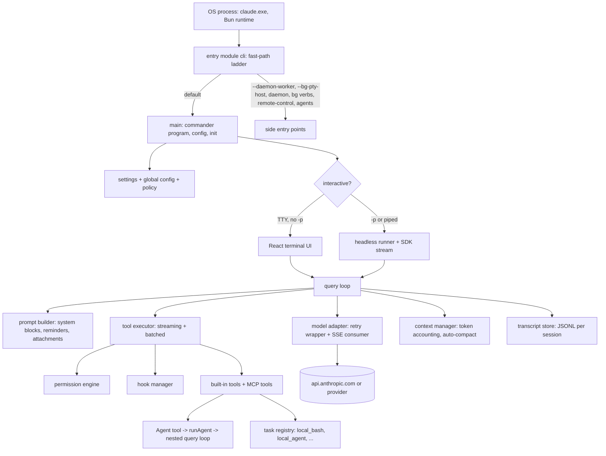
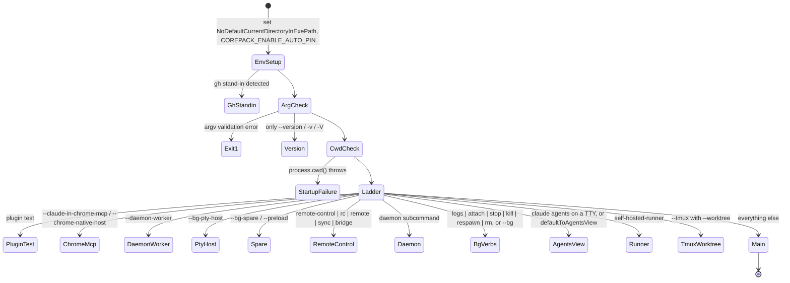
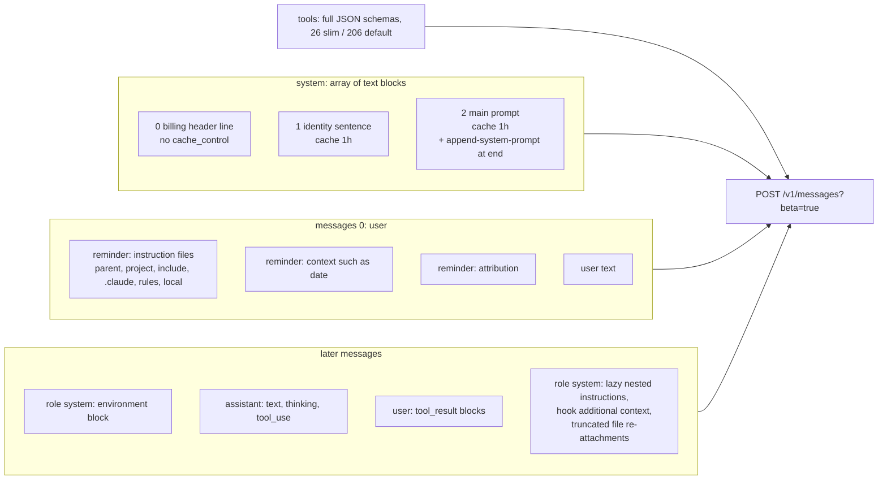
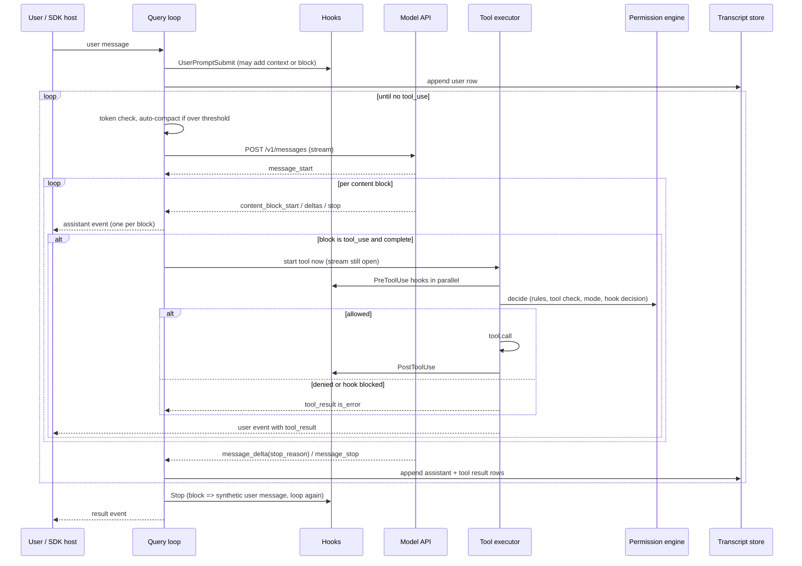
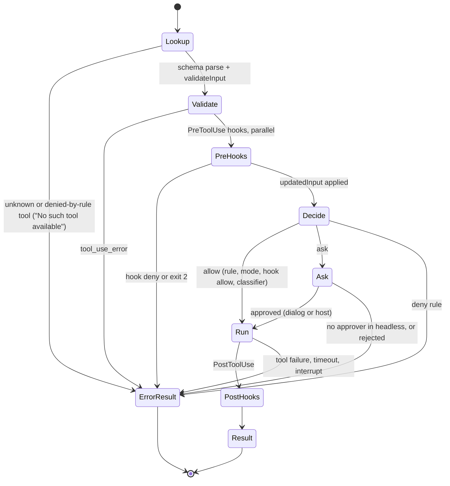
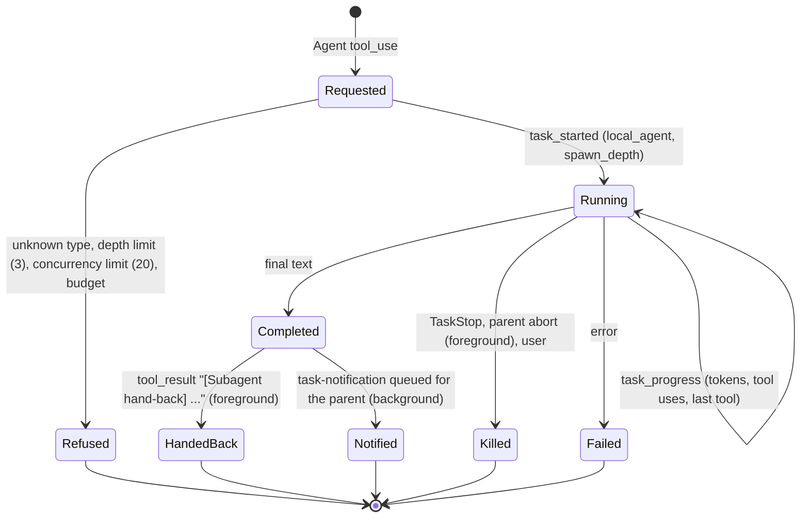

# 02. Verified architecture of Claude Code 2.1.296

This document joins the static passes (`static-01` to `static-05`) with the runtime
experiments (`03-runtime-experiments.md`). Each claim is tagged:

- **V-RT**: verified at runtime (experiment id given).
- **V-ST**: verified statically (read in the shipped code; the static pass holds the
  `chunk@offset` anchors). Static evidence shows the code exists, not that it ran.
- **V-BOTH**: static reading and runtime observation agree.
- **INF**: strongly inferred. **HYP**: hypothesis. **UNK**: unknown.

Identifier names in `code font` that look like words (`query`, `runAgent`) are real export
names from the artifact. Module names in the diagrams are conceptual.

## 1. Subsystem map



Dependency evidence: `cli` imports `main` from `chunk-zvnaqyp5.js` (V-ST, read directly);
`query` is exported from `chunk-q0w9mgb8.js`, `runAgent` from `chunk-yy3r64d0.js`,
`hasPermissionsToUseTool` from `chunk-snfhkfn3.js`, `executeHooks` from
`chunk-7xzs7f0h.js` (V-ST, export index). Static pass 05 found that several of these small
chunks are re-export shims and the bodies live in `chunk-phacttch.js` (4.7 MB),
`chunk-jwmqjyrb.js`, `chunk-93pksqr2.js` and `chunk-h6wy99cb.js`. The full static import
graph (188,144 static edges, 1,038 dynamic edges) is in
`runtime-logs/static/chunk-index-2.1.296.json`.

## 2. Startup and dispatch

Source: the entry module `cli`, read in full (24 KB), plus static pass 01.



Verified details:

1. `--version` is answered before any config is read, from constants compiled into the
   entry module (V-ST; V-RT: C11 and the version probe returned with no network call).
2. An unreadable cwd is a hard stop with a structured startup-failure record
   (`writeStartupFailureResult`, reason `cwd_unavailable`), exit 1 (V-ST).
3. `--bare` sets `CLAUDE_CODE_SIMPLE=1`; `--update`/`--upgrade` are rewritten to the
   `update` subcommand (V-ST).
4. Before importing `main`, the entry starts early stdin capture (unless the first argument
   is a non-REPL subcommand), an MDM settings read and a keychain prefetch (V-ST). These
   are the first child processes or OS calls of a normal start.
5. `main` uses a commander-style program: an unknown option exits 1 with
   `error: unknown option '...'` on stderr and no API call (V-RT C11).
6. Every model session starts with `HEAD /api/hello` (V-RT, all experiments).
7. Hook events at start: `SessionStart(source=startup)`, then `InstructionsLoaded` per
   instruction file, then `UserPromptSubmit` (V-RT E07a).

Interactive versus headless: `-p` selects the headless runner. Static pass 01 gives the
predicate (TTY checks, `-p`, piped stdin capped at 10,485,760 chars with a 3 s peek).
Runtime verified only the headless side. Exit codes observed: 0 success, 1 for
`error_max_turns`, `error_during_execution`, API error, thrash breaker, and bad flags.
Static pass 01 lists 0, 1, 2, 70, 75, 78, 129, 143.

### 2.1 Configuration precedence

| Layer | Evidence |
|---|---|
| managed / policy (registry `HKLM\SOFTWARE\Policies\ClaudeCode`, `C:\Program Files\ClaudeCode`, MDM) | V-ST |
| `--settings <file>` flag | V-RT C6: beats local and project |
| `.claude/settings.local.json` | V-RT C5: beats project |
| `.claude/settings.json` (project) | V-RT C6b |
| `~/.claude/settings.json` (user) | V-ST; excluded from experiments by `--setting-sources` |
| process environment, for `env` keys | V-RT C6c: loses to any settings `env` entry |

`--setting-sources project,local` removed the user layer in practice: plugins dropped from
22 to 3, skills from 186 to 17, tools from 206 to 26, and the settings `model` stopped
overriding `--model` (V-RT E01 vs E01b). Deny rules remove a tool from the session
entirely (V-RT E07f).

## 3. Prompt assembly



Verified facts (all V-RT unless noted; see E01, E08, C1 to C8):

| Fact | Evidence |
|---|---|
| `system` has three blocks; only blocks 1 and 2 are cached, with `ttl: 1h` | E01 |
| Instruction files travel in the first user message, wrapped in a reminder tag, not in `system` | C1, C2 |
| Load order: ancestor directories (above the git root too), project `CLAUDE.md` with inlined `@include`, `.claude/CLAUDE.md`, `.claude/rules/*.md` without `paths`, `CLAUDE.local.md`, then cwd-level files | C1, C2 |
| `AGENTS.md` is not read | C2 |
| Subdirectory instruction files and `paths`-scoped rules load when a file under them is read, as a `role: "system"` message | E08, C2 |
| The environment description is a `role: "system"` message right after the first user message, not part of `system` | E01 |
| `--append-system-prompt` appends to block 2; `--system-prompt` replaces block 2 only | C3, C4 |
| Tool schemas are sent in full on every request (78 KB slim, 557 KB default) | E01, E01b |
| One moving cache breakpoint sits on the last block of the newest message | E08, E17 |
| A subagent gets its own block 2 and tool list but the same reminder blocks | E11 |
| Static section order inside block 2, the dynamic-boundary sentinel, skill listing budget (1 percent of window, 1,536 chars per description) | V-ST, static pass 02 |

First turn versus later turns: the first request already contains the reminders and the
environment message. Later requests replay them unchanged at the same positions. This
holds across process restarts: after `CLAUDE.md` was edited between create and resume,
the resumed request still had the original text in message 0 and added the new text as a
fresh reminder on the new user message (V-RT E15e, E15f). The transcript stores them as
`attachment` rows with `rendered` content and `renderedRole`. New dynamic context is
appended as further `role: "system"` messages rather than by rewriting earlier ones.

What is not locally observable (**UNK**): any instruction the service adds after receiving
the request. The request body is everything the client sends; nothing in this research
describes server-side prompt content.

## 4. The agent loop



| Behaviour | Label | Evidence |
|---|---|---|
| A turn starts on a user message; in stream-json mode a second message starts a new turn in the same process | V-RT | E13c |
| The loop continues while the last assistant message has tool_use blocks | V-RT | E02, E09 |
| Tools start when their block completes, before `message_stop` | V-BOTH | E08; static "StreamingToolExecutor" |
| Concurrency-safe tools overlap; batched runner cap `CLAUDE_CODE_MAX_TOOL_USE_CONCURRENCY ?? 10`, no cap in the streaming executor | V-ST | static pass 03 |
| All results of one assistant message go back in one user message, in call order | V-RT | E08 |
| A denied or failed tool yields an `is_error` result and the loop goes on | V-RT | E06, E05b |
| Stop hook block re-enters the loop with "Stop hook feedback: ..." | V-BOTH | E07h; cap `CLAUDE_CODE_STOP_HOOK_BLOCK_CAP ?? 8` static |
| `--max-turns` ends with `error_max_turns` | V-RT | C7 |
| Interrupt aborts the HTTP stream and ends with `error_during_execution` | V-RT | E13b |
| Output-token recovery, up to 3 attempts | V-ST | static pass 03 |
| Thrash breaker after 3 quick refills | V-BOTH | E17c; static constant 3 |

Termination values seen in `result.terminal_reason`: `completed`, `max_turns`,
`aborted_streaming`, `api_error`, `rapid_refill_breaker`. `result.subtype`: `success`,
`error_max_turns`, `error_during_execution`.

## 5. Transport and streaming

- One endpoint for turns: `POST /v1/messages?beta=true`, `stream: true`. Token counting for
  large files uses `POST /v1/messages/count_tokens?beta=true` (V-RT E17c).
- SSE event handling: text, thinking (`thinking_delta` then `signature_delta`) and tool
  input (`input_json_delta`) are accumulated per block index. A tool is dispatched only
  after its block's JSON is complete (V-RT E08: the `assistant` event with the full input
  precedes the tool result for every call).
- Retries are an application wrapper around single-attempt SDK calls
  (`x-stainless-retry-count` always 0): 10 attempts by default, 500 ms base doubling with
  25 percent jitter, `retry-after` honoured (V-BOTH E18a to E18e, static pass 03).
- A 400 can trigger an immediate degraded retry without `thinking.display` (V-RT E18c).
- Usage arrives in `message_start` and `message_delta` and is aggregated into
  `result.usage` and `result.modelUsage` with a computed `total_cost_usd` (V-RT).
- Rate-limit state comes from `anthropic-ratelimit-unified-*` response headers and is
  surfaced as a `rate_limit_event` (V-RT E01).
- Idle watchdogs, non-streaming fallback, model fallback after 3 consecutive 529s: V-ST
  only (static pass 03). Not exercised.

## 6. Tools, permissions, hooks



Verified ordering questions:

| Question | Answer | Evidence |
|---|---|---|
| Does PreToolUse run before the permission decision? | Yes. A hook `allow` skipped the prompt; a hook `deny` blocked an allowed tool | E07e, E07b |
| Can a hook `allow` override a deny rule? | No. The tool is not even offered | E07f; static `resolveHookAndPermission` re-checks rules |
| Is `updatedInput` what runs? | Yes | E07g |
| Rule precedence | deny > ask > allow | E08b |
| Do matching hooks run in parallel? | Yes | E07a |
| Headless `ask` with no approver | denial plus `permission_denials` entry | E06 |
| Permission modes | `default, acceptEdits, plan, bypassPermissions, dontAsk, auto` | V-ST; `default` and `acceptEdits` at runtime |
| Bash: per-sub-command checks, variable expansion refusal, working-directory containment | observed | E05, E05b, C5 |
| Standalone `sleep N` refused by the Bash tool | observed | E13a |

Sandbox mechanisms, the auto-mode classifier, MCP transports and the 16-step core check are
V-ST only (static pass 04).

## 7. Subagents and tasks



- Children are in-process nested query loops, not OS processes: their model requests leave
  from the same process and proxy connection (V-RT E11; `runAgent` V-ST).
- Sibling Agent calls run concurrently (V-RT E10).
- Background shell tasks are OS child processes tracked by a task registry with output
  files under the temp directory; `TaskStop` kills them (V-RT E14).
- `result.subagent_stats` reports `spawned, requested, started_in_background, max_depth,
  completed, failed, killed {parent, user, system}, refused {depth_limit,
  concurrency_limit, budget}, by_type` (V-RT), which matches the static limits.
- Local versus remote: everything above is local. Cloud sessions, remote control and the
  remote agent task type are delegated to a service and were not exercised (**UNK**
  beyond their entry points).

## 8. Context management and compaction

```mermaid
sequenceDiagram
  participant L as Query loop
  participant H as Hooks
  participant M as Model API
  participant S as Transcript
  L->>L: tokens >= window - min(maxOut, 20000) - 13000 ?
  L->>H: PreCompact(trigger)
  L->>M: same system + tools + history, summary instruction appended to last user message
  M-->>L: analysis + summary text
  L->>H: SubagentStop (compaction agent)
  L->>S: compact_boundary row (pre/post tokens, preserved segment)
  L->>L: new history = summary message + re-attached state; preserved tail only on kept-tail/partial paths
  L->>H: SessionStart(source=compact), PostCompact(compact_summary)
  L->>L: 3 refills within 3 turns each => stop with rapid_refill_breaker
```

All arrows above are V-RT (E17a, E17c) except the exact threshold formula, which is V-ST
and bracketed at runtime (between 59k and 78k tokens for a 100k window). Post-compaction
file restoration (5 files, 5,000 tokens each, 50,000 total: V-ST) matches the observed
truncated re-attachments. Persistent memory (a memory directory with a `MEMORY.md` index
capped at 200 lines or 25,000 bytes, up to five relevant memories per turn) is V-ST only;
`system/init` exposes `memory_paths` (V-RT).

## 9. Sessions

- Files: `~/.claude/projects/<cwd with non-alphanumerics replaced by ->/<session-uuid>.jsonl`,
  subagents in `<session-uuid>/subagents/agent-<id>.jsonl` plus `.json` (V-RT; the naming
  rule is V-BOTH: `C--Users-<user>-cc-rea-lab-proj-a`).
- Row types seen in lab sessions: `user`, `assistant`, `attachment`, `system`
  (`api_error`, `compact_boundary`, `informational`, `stop_hook_summary`), and metadata rows
  `queue-operation`, `last-prompt`, `mode`, `cost-state`, `atis-latch`. Static pass 05
  counts 41 types.
- Conversation rows form a chain through `uuid` / `parentUuid`; a compact boundary has
  `parentUuid: null` and a `logicalParentUuid` (V-RT schema).
- Resume replays the stored chain (V-RT E15). Fork writes a new file (V-RT E15d).
- Flush interval 100 ms, retention 30 days, 6-hour stale interrupted-turn bound: V-ST.

## 10. Terminal rendering

V-ST only (static pass 05): a custom Ink-style React reconciler with a JavaScript Yoga
layout, 16 ms frame pacing (4 ms after input), synchronized-output mode 2026, alternate
screen 1049, bracketed paste 2004, streaming Markdown that freezes text beyond 4,096 chars.
Headless output bypasses it: text mode printed `ok\n`; json mode printed one object
(V-RT C9, C10).

## 11. Which parts are reconstructible

| Component | Reconstructible from this research? |
|---|---|
| CLI flags, dispatch, settings layering | Yes |
| Request shape, headers, caching layout | Yes, from captured structure |
| Loop, streaming tool execution, retries | Yes |
| Permission rules, hook protocol | Yes; classifier internals no |
| Subagent lifecycle, task events | Yes |
| Compaction trigger and flow | Yes; summary prompt wording is Anthropic's and is not reproduced |
| Transcript format | Yes for observed row types |
| System prompt and tool description text | Not reproduced here by design; an independent build writes its own |
| Server behaviour (model, rate limits, feature gates, server-side context edits) | No. Externally controlled |
