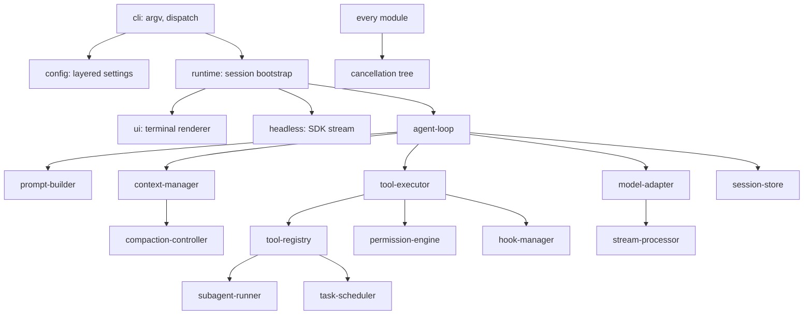

# 05. Independent implementation specification

A blueprint for a clean-room agent CLI that reproduces the observable behaviour documented
in this repository. Two kinds of statements appear and are kept apart:

- **REPRODUCE**: behaviour observed in Claude Code 2.1.296 (evidence id given). Match it if
  compatibility with existing hooks, settings, SDK hosts or transcripts matters.
- **CHOICE**: a design decision of this specification. Nothing was observed that forces it.

No source code, prompt text or tool description from the original is included or needed.
Write your own system prompt and tool descriptions. Data contracts are in
`04-internal-contracts.md`.

## 0. Module map



**CHOICE:** each box is a package with a typed interface and no access to another
package's internals. The original bundles everything into shared chunks.

## 1. cli and runtime orchestration

| | |
|---|---|
| Responsibilities | Parse argv, answer cheap commands without loading the app, select mode, build the session |
| Inputs | argv, environment, cwd, stdin (TTY or pipe) |
| Outputs | exit code, a running session |
| Dependencies | config, session-store, hooks |

REPRODUCE:

1. `--version` prints `<version> (<product>)` with no config or network access.
2. Unknown options: `error: unknown option '<x>'` on stderr, exit 1, no API call (C11).
3. A missing or unreadable cwd is a startup failure with a clear message and exit 1.
4. `-p/--print` selects headless mode. Output formats `text`, `json`, `stream-json`; input
   formats `text`, `stream-json` (C9, C10, E13).
5. Exit codes: 0 on `success`; 1 on `error_max_turns`, `error_during_execution`, API error,
   or the compaction thrash breaker (C7, E13b, E08b, E17c).
6. Session hooks fire in the order SessionStart, InstructionsLoaded (one per file),
   UserPromptSubmit (E07a).

State machine: `Init -> ArgsParsed -> ConfigLoaded -> SessionReady -> (Interactive | Headless)
-> Draining -> Exited`. Failure in any state before `SessionReady` goes straight to
`Exited(1)` with a single stderr line.

CHOICE: skip the original's fast-path ladder for daemon, background sessions, remote
control and fleet view. They are separate products layered on the same binary.

Failure cases: bad flag, unreadable cwd, malformed settings file (report the file and the
JSON path, continue with other layers), no credentials (exit with instructions).
Concurrency: single-threaded startup; prefetches (credentials, managed settings) may run
in parallel with argument parsing but must be awaited before the first request.

## 2. config

Layering, lowest to highest (REPRODUCE, C5 to C6c and static pass 01):

`process env (for env keys) < user settings < project settings < local settings <
--settings flag < managed policy`

- Objects merge key by key; a key set only in a lower layer survives (C5: `LAB_ONLY_PROJECT`).
- `--setting-sources a,b` restricts which file layers load (E01 vs E01b).
- `env` entries are exported into the process and into every child process (C5).
- Permission rule arrays (`allow`, `deny`, `ask`) concatenate across layers (static pass 01;
  not isolated at runtime).

Data contract: `Settings { env?, permissions?: {allow, deny, ask, defaultMode?}, hooks?,
model?, availableModels?, ... }`. Failure cases: unreadable file, invalid JSON, a setting a
policy forbids. CHOICE: validate each layer with a schema and report all errors at once.

## 3. prompt-builder

Inputs: settings, cwd, tool registry, instruction files, session history, per-turn
attachments. Output: a `ModelRequest` (see contracts).

REPRODUCE (E01, E08, C1 to C8):

1. `system` is an array of text blocks. Put stable text first and mark it cacheable with a
   long TTL. Keep anything per-request (billing or telemetry header) in an uncached block
   ahead of it so it does not break the cache prefix.
2. Instruction files are not part of `system`. They go in the first user message inside a
   delimited reminder block, ahead of the user's text.
3. Discovery order: ancestors of the project root from farthest to nearest, project root
   file, its `@path` includes inlined after it (depth limit 5), `.claude/CLAUDE.md`,
   unconditional rule files, `CLAUDE.local.md`, then files between the project root and cwd.
4. Files in subdirectories and rules with a `paths` filter load lazily, when a tool touches
   a matching path, and are appended as a later message. Never rewrite earlier messages:
   that would invalidate the cache.
5. The environment description (cwd, platform, date, git state) is sent once, after the
   first user message.
6. `--append-system-prompt` appends to the main block; `--system-prompt` replaces the main
   block and nothing else.
7. Place one moving cache breakpoint on the last block of the newest message.
8. Tool definitions are sent in full on every request and sit in the cached prefix.

Precedence table for instruction text (REPRODUCE order, CHOICE wording): later files in
the order above are presented later in the block; the block header tells the model that
these instructions override default behaviour.

CHOICE: use a mid-conversation `system` role only if your provider supports it (the
original relies on a beta). Otherwise send these as user messages with the same reminder
delimiter.

Pseudocode:

```
buildRequest(session, turn):
  system = [uncached(header()), cached(identity()), cached(mainPrompt(settings, tools, flags))]
  if session.messages.empty:
     first = [reminder(loadInstructionFiles(cwd)), reminder(contextFacts()), userText]
     session.append(user(first)); session.append(systemMsg(environment()))
  for a in turn.attachments: session.append(render(a))       # lazy instructions, hook context
  msgs = normalize(session.messages)                          # pair tool_use/tool_result, drop orphans
  markCacheBreakpoint(last(msgs))
  return {model, system, tools: registry.wireTools(), messages: msgs, max_tokens, thinking, stream: true}
```

Failure cases: an instruction file over the size cap (4 MiB in the original) is skipped
with a warning; an include cycle stops at the depth limit.

## 4. model-adapter and stream-processor

Responsibilities: one streamed request per call, retries, usage accounting, cancellation.

REPRODUCE (E18a to E18e, E13b, static pass 03):

| Condition | Behaviour |
|---|---|
| 429, 500, 529, connection reset | retry; delay `500 ms * 2^(n-1)` plus up to 25% jitter, cap 32 s; default 10 attempts |
| `retry-after` present | wait exactly that long |
| 400 that names an optional feature | retry once at once with the feature removed |
| 3 consecutive 529 on the primary model | switch to the fallback model if configured (static only) |
| Non-retryable error | surface as a synthetic assistant message flagged as an API error; end the turn with `is_error` |
| Abort | close the HTTP connection at once; keep text already received |

Emit an `api_retry` event per retry with `attempt, max_retries, retry_delay_ms,
error_status, error`.

Stream processing state machine per content block: `Open -> Accumulating -> Closed`.
Accumulate text, thinking plus signature, and tool input JSON fragments by block index.
Parse tool input once, at block close. Emit the completed block upward at close. A
`message_delta` carries `stop_reason` and final usage; `message_stop` closes the message.

CHOICE: implement retries in your own wrapper with the SDK's retries set to 0, as the
original does (retry count header stayed 0), so retry policy, events and cancellation live
in one place. Add an idle watchdog (the original uses 180 s without bytes and 300 s without
events by default, static only; when a stream-idle timeout is configured the 180 s byte default
is skipped and the byte timeout equals the event timeout, `chunk-nfvf6nm0.js@267300`).

Concurrency: several requests may be in flight (parallel subagents, E10). The adapter must
be reentrant and usage accounting must be per request, then summed per model.

## 5. agent-loop

```
runTurn(session, userMessage, signal):
  ctx = hooks.run("UserPromptSubmit", {prompt})            # may block or add context
  session.append(userMessage, ctx.additionalContext)
  loop:
    if context.shouldCompact(session): compaction.run(session, "auto")      # may end the turn
    req = prompt.buildRequest(session)
    executor = new StreamingExecutor(registry, perms, hooks, signal)
    for block in model.stream(req, signal):
       emit(assistantEvent(block))
       if block.type == "tool_use": executor.start(block)                   # do not wait for message_stop
    assistant = finalize(); session.append(assistant)
    results = await executor.drain()                                        # call order preserved
    if results: session.append(user(results)); emit(userEvents(results))
    if signal.aborted: return end("error_during_execution", "aborted_streaming")
    if assistant.hasToolUse: 
       if ++turns >= maxTurns: return end("error_max_turns", "max_turns")
       continue
    stop = hooks.run("Stop", {stop_hook_active, last_assistant_message})
    if stop.block and blocks++ < STOP_BLOCK_CAP:
       session.append(syntheticUser("Stop hook feedback:\n" + stop.reason)); continue
    return end("success", "completed")
```

REPRODUCE: tools start during the stream (E08); all results for one assistant message
return in one user message in call order (E08); a denied tool does not end the turn
(E06); Stop-hook block re-enters with a synthetic user message (E07h); interrupt produces a
synthetic "[Request interrupted by user]" user message and, for a running tool, an error
result for that tool (E13b, E13c).

State machine: `Idle -> Requesting -> Streaming -> ToolsRunning -> (Requesting | Stopping)
-> Idle`, with `Compacting` reachable from `Requesting` and `Aborted` reachable from every
state except `Idle`.

Invariants: every `tool_use` gets exactly one `tool_result` before the next request, even
on abort or crash recovery; the transcript is appended before the next request is sent.

## 6. tool-registry

Responsibilities: hold tool definitions, filter them per session, serialize them.

REPRODUCE: a whole-tool deny rule removes the tool from the list; a call to it returns
`No such tool available` inside an error result (E07f). Unknown tool names and schema
failures return error results, never exceptions (E12). Results over a size limit are
written to a file and replaced by a preview and the path (static pass 04: 50,000 chars per
result, 200,000 per turn). CHOICE: derive the wire JSON Schema from one typed schema per
tool so validation and advertisement cannot drift.

Minimum tool set to reproduce the experiments: Read, Edit, Write, Glob, Grep, Bash (with
`run_in_background`, timeout 120 s default and 600 s max), Agent, TaskStop.

## 7. permission-engine

```
decide(tool, input, ctx):
  if denyRule(tool, input): return deny
  if askRule(tool, input):  return ask
  t = tool.checkPermissions(input, ctx)            # path containment, command parsing
  if t.deny: return t
  if ctx.mode == bypass and not safetyCritical(t): return allow
  if allowRule(tool, input): return allow
  if ctx.mode == acceptEdits and tool.isFileEdit and inWorkingDirs(input): return allow
  return t.allow ? allow : ask

resolve(tool, input, ctx, hookDecision):
  if hookDecision == deny: return deny
  d = decide(tool, hookDecision.updatedInput ?? input, ctx)
  if d == deny: return deny                         # rules beat a hook allow
  if hookDecision == allow: return allow            # skips the prompt
  if d == ask: return ctx.approver ? ctx.approver.ask(...) : deny("no approver available")
  return d
```

REPRODUCE: precedence deny > ask > allow (E08b); hook allow skips the prompt but cannot
override deny (E07e, E07f); headless ask without an approver becomes a denial recorded in
`permission_denials` (E06); shell commands are split into sub-commands and each is checked;
commands with unexpanded variables are refused for rule matching; listing or reading
outside the working directories is refused (E05, E05b, C5).

CHOICE: omit the model-based classifier mode. Its inputs are not reconstructible.
Failure case: a rule that fails to parse must fail closed (treat as ask).

## 8. hook-manager

REPRODUCE (E07a to E07h, E17c):

- Config: `hooks: { <Event>: [{ matcher?: string, hooks: [{ type: "command", command, timeout? }] }] }`.
- All hooks matching an event start together; wait for all before acting.
- Stdin is one JSON object (fields in contracts). Children inherit the session environment
  plus `CLAUDE_PROJECT_DIR` and a writable env file path.
- Exit 0: parse stdout as JSON if it is JSON. Exit 2: blocking, stderr goes to the model.
  Other codes: logged, non-blocking.
- Events to support: SessionStart, InstructionsLoaded, UserPromptSubmit, PreToolUse,
  PostToolUse, Stop, SubagentStop, PreCompact, PostCompact, SessionEnd.
- Emit `hook_started` and `hook_response` events with exit code and outcome.

CHOICE: default timeout 60 s rather than the original's 600 s. Document the difference if
you care about drop-in compatibility. When several hooks disagree, apply deny > ask > allow.

## 9. task-scheduler and subagent-runner

REPRODUCE (E10, E11, E12, E14):

- A subagent is a nested agent loop in the same process with its own system prompt, a
  filtered tool list, its own message history starting from the delegated prompt, and the
  parent's instruction reminders.
- Sibling subagent calls run concurrently.
- Lifecycle events: `task_started`, `task_progress`, `task_updated`, `task_notification`.
- Foreground result: a tool result whose text is framed as untrusted model output from a
  delegate, not as a user message.
- Unknown agent type: error result listing valid types; nothing is spawned.
- Background shell: return an id and an output file path at once; `TaskStop` kills the
  process tree and reports `killed` / `stopped`.
- Limits to adopt: depth 3, 20 concurrent (static pass 05).

Cancellation: a foreground child shares the parent's abort signal; a background child has
its own and survives a parent interrupt (static pass 05, not exercised). Store child
transcripts next to the parent's session file.

## 10. context-manager and compaction-controller

REPRODUCE (E17a, E17c, static pass 02):

- Token count comes from the API's `usage` of the last response plus an estimate for
  messages added since (4 chars per token). For a large file read, call the count-tokens
  endpoint first.
- Trigger: `tokens >= window - min(maxOutputTokens, 20000) - 13000`.
- The summarization call reuses the session's `system`, `tools` and history, and appends
  the instruction to the last user message, so the prompt cache is hit.
- Afterwards: write a boundary record (trigger, pre and post tokens), replace history with
  one summary message, re-attach up to 5 recently read files (5,000 tokens each, 50,000
  total), fire SessionStart with source `compact`, then PostCompact.
- Stop with a clear error if the context refills to the limit within 3 turns, three times
  in a row. Stop retrying after 3 consecutive summarization failures. The first rule is
  runtime-verified by E17c; the second is a static/spec requirement that runtime
  evidence **contradicts on the reactive route**: E37 saw 25 consecutive failed compactions in
  one process with no breaker, and the CLI instead ended each blocked turn with `blocking_limit`.
  The spec should require a breaker as a CHOICE, not as observed behaviour.

CHOICE: make the re-attachment budget proportional to the window. In E17c (100k window,
about 36k tokens of fixed prefix, 22.6k-token reads) the rebuilt context of about 15k
tokens plus one more read was enough to cross the threshold again, so every compaction was
followed by another within one or two turns. A smaller re-attachment share would have
delayed that; it would not have removed it, because the task itself needed more context
than the window allowed.

## 11. session-store

REPRODUCE (E15, transcript schema): one append-only JSONL per session under a per-project
directory named from the sanitized cwd; rows linked by `uuid` and `parentUuid`; metadata
rows for last prompt, mode and cost; subagent transcripts in a `subagents/` folder;
`--resume`, `--continue`, `--fork-session`.

CHOICE: add a schema version field to every row and fsync at turn boundaries. Recovery
rule: on load, drop a trailing assistant `tool_use` with no result and mark the turn
interrupted (the original does the equivalent, static pass 05).

## 12. terminal interface

Not verified at runtime (no PTY harness on this host). CHOICE: any retained-mode terminal
UI with diff rendering, a frame cap near 60 Hz, synchronized output when supported, and
streamed Markdown. Keep it strictly a consumer of the same event stream the headless mode
emits, so the two cannot diverge.

## 13. Cancellation and recovery

One abort tree: session > turn > {model request, each tool, each foreground subagent}.
Aborting a node aborts its children. On abort: close the HTTP stream (E13b: under 5 ms),
terminate tool processes (SIGTERM then SIGKILL after 1.5 s, static pass 04), synthesize the
missing tool results, append the interrupt marker, emit `result`. The session stays usable
for the next turn (E13c).

## 14. Extension points

Hooks (section 8), MCP servers as extra tool sources (naming `mcp__<server>__<tool>`,
static pass 04), custom agents from Markdown files with frontmatter, skills as on-demand
instruction bundles, and the SDK control protocol for hosts.

## 15. Testing strategy

Use the experiment set as the acceptance suite. Each row of the behavioural matrix in
`06-verification-matrix.md` is one test:

1. **Gate tests (deterministic, no network):** drive the loop with a scripted model stub
   that replays recorded SSE shapes from `runtime-logs/*/http-summary.json`. Assert message
   ordering, tool start before `message_stop`, permission outcomes, hook ordering and
   stdin fields, retry timing with a fake clock, compaction trigger arithmetic, transcript
   chain integrity, and resume and fork behaviour.
2. **Fault tests:** reuse the proxy's fault modes (status, reset, stall) against the real
   adapter.
3. **Differential tests:** run the same synthetic prompts through the original and the
   reimplementation behind the capture proxy and diff the structural summaries
   (`summarize_captures.py` output), ignoring prompt text.
4. **Periodic evals (model in the loop):** task-level success on a small coding suite, with
   a pass threshold, since model choices vary run to run.
