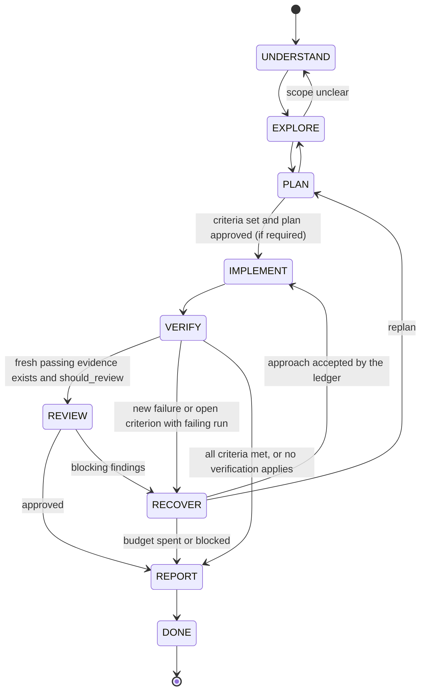

# 04. DaVinci workflow controller

Independent design, written from the requirements below and from the observed gaps in file 03. It contains no Claude
Code code or prompt text. Reference implementation: `controller/davinci_controller.py` (about 400 lines, standard
library only). Tests: `tests/test_davinci_controller.py` (30 tests, run in the gate lane).

Principle: the model proposes, the controller decides what may be **claimed** and which transitions are **legal**. All
decisions are pure functions of the serialized state, so they are testable and survive compaction.

## 1. Requirements and where each is met

| # | Requirement | Mechanism | Code |
|---|---|---|---|
| R1 | Explicit acceptance criteria for implementation tasks | PLAN to IMPLEMENT is refused with no criteria; ids unique | `Controller.set_criteria`, `move` |
| R2 | Verification evidence before reporting "verified" | VERIFIED needs fresh passing evidence for every criterion | `Controller.report`, `may_claim` |
| R3 | No tests required for non-executable tasks | `static` criteria are met by inspection evidence; `classify_change` marks docs-only edits | `classify_change`, `_satisfied` |
| R4 | New failures differ from pre-existing ones | Baseline recorded before editing; failures split into new, preexisting, fixed | `record_baseline`, `classify_failures` |
| R5 | Track failed approaches, stop unproductive repetition | Signature ledger, diagnosis rule, same-failure escalation, attempt budget | `begin_approach` |
| R6 | State survives compaction | JSON round trip; deterministic resume block keeps failed approaches | `TaskState.to_json/from_json`, `resume_block` |
| R7 | Independent review where it adds value | Reasons list; reviewer sees criteria, fresh evidence and diff only | `should_review`, `review_packet` |
| R8 | No silent commit, push or destructive action | Authorization strings only the user grants; `sudo` denied; opaque shell syntax rejected | `evaluate_action`, `_parse_action_command` |
| R9 | Distinct outcomes | VERIFIED, UNVERIFIED, BLOCKED, FAILED, each with unmet, new failures, stale list, notes | `Outcome`, `Report` |

## 2. State machine



Illegal transitions raise `ControllerError` with the missing precondition in the message, so the model sees what to do.

## 3. Outcome rules (the whole decision table)

Computed by `Controller.report()` from the state; first matching row wins.

| Order | Condition | Outcome |
|---|---|---|
| 1 | `blocked_reason` set | BLOCKED |
| 2 | Fresh failing evidence names a test that is not in the baseline (or no baseline exists and something failed) | FAILED |
| 3 | Every criterion has fresh effectively-passing evidence (`passed`, or every failing test was already failing in the baseline); `review` criteria need an approved review at the current digest | VERIFIED |
| 4 | Failed approaches have reached `max_attempts` | FAILED |
| 5 | Otherwise (evidence missing or stale, nothing new failing) | UNVERIFIED |

"Fresh" means the evidence's tree digest equals the current one. Any edit changes the digest, so a pass before the
edit no longer counts. For several runs of the same command at the same digest the last one wins.

## 4. Interfaces

```python
class Controller:
    def __init__(self, state: TaskState)
    def move(self, to: Phase) -> None                      # legal transitions only, with preconditions
    def set_criteria(self, criteria: list[Criterion]) -> None
    def record_baseline(self, failing: list[str], digest: str) -> None
    def record_edit(self, paths: list[str], digest: str) -> None
    def begin_approach(self, strategy: str, files: list[str], diagnosis: str = "") -> Approach
    def record_verification(self, command, passed, failing, criteria, digest, kind="run", output_digest="") -> Evidence
    def record_review(self, blocking: list[str]) -> Review
    def block(self, reason: str) -> None
    def report(self) -> Report                             # outcome, unmet, new_failures, preexisting_failures, stale, notes
    def may_claim(self, claim: str) -> tuple[bool, str]    # "verified" | "tests_pass" | "done"
    def next_action(self) -> str
    def resume_block(self, max_chars: int = 2000) -> str

def tree_digest(root, ignore=...) -> str                  # content hash, independent of git and mtimes
def classify_change(paths) -> "executable" | "non_executable" | "none"
def classify_failures(baseline, failing_now) -> {"new", "preexisting", "fixed"}
def evaluate_action(command, authorizations) -> (decision, reason)  # allow | needs_authorization | deny
def should_review(changed_lines, changed_paths, recover_rounds, public_api_changed) -> list[str]
def review_packet(state, diff_text) -> dict
```

Everything is JSON-serializable (`TaskState.to_json`), so the host stores it next to the transcript.

## 5. Integration: where the controller sits in the agent loop

```text
state = load_or_create(task)
controller = Controller(state)
loop:
    reply = model(messages + [controller.resume_block()])        # block is rebuilt every turn, so compaction cannot drop it
    for call in reply.tool_calls:
        if call.is_shell:
            decision, why = evaluate_action(call.command, state.authorizations)
            if decision != "allow": return_tool_error(call, why); continue     # never silently ask for or grant authorization
        if call.is_edit and state.phase not in (IMPLEMENT, RECOVER): return_tool_error(call, "not in an edit phase"); continue
        if call.is_edit and state.phase == RECOVER and no approach begun: return_tool_error(call, "begin_approach first"); continue
        result = run(call)
        if call.is_edit:  controller.record_edit(paths(call), tree_digest(root))
        if call.is_test_run:
            controller.record_verification(call.command, result.exit == 0, parse_failures(result), criteria_for(call), tree_digest(root))
    if reply.has_final_message:
        for claim in claims_in(reply.text):                       # a small matcher: "verified", "all tests pass", "done"
            ok, why = controller.may_claim(claim)
            if not ok: append_system_message("Cannot claim " + claim + ": " + why); continue loop
        return render(controller.report())                        # the user sees outcome, unmet, stale, pre-existing failures
```

Three things the host does that the controller does not: parse test output into failing ids, map a command to the
criteria it covers, and detect claims in prose. All three are replaceable and testable on their own; the controller
accepts their results as data.

A user-facing equivalent already exists in Claude Code: a `Stop` hook that blocks while tests fail (E50v). The
controller is the same idea with four additions: freshness (edits invalidate evidence), baseline comparison,
a failed-approach ledger and a typed outcome.

## 6. Test cases

Every row is a test in `tests/test_davinci_controller.py` unless marked.

| Behavior | Test |
|---|---|
| Legal path; cannot skip planning; needs criteria | `TransitionTests.test_legal_path_and_illegal_jump` |
| Plan approval required | `test_plan_approval_gate` |
| Review needs fresh pass | `test_review_requires_fresh_passing_run` |
| Duplicate or empty criteria rejected | `test_duplicate_or_missing_criteria_rejected` |
| Edits only in IMPLEMENT/RECOVER | `test_edits_only_in_implement_or_recover` |
| VERIFIED needs every criterion | `VerificationTests.test_verified_needs_fresh_evidence_for_every_criterion` |
| Edit after pass makes evidence stale | `test_edit_after_pass_makes_evidence_stale` |
| New failure is FAILED and blocks claims | `test_new_failure_is_failed_and_blocks_claims` |
| Pre-existing failure alone does not block | `test_preexisting_failure_alone_does_not_block_verified` |
| Missing baseline means all failures new | `test_missing_baseline_treats_failures_as_new` |
| Failed run with no ids still fails | `test_run_failed_without_test_ids_is_a_failure` |
| Flaky rerun at same digest: last wins | `test_last_run_of_a_command_wins_at_the_same_digest` |
| Evidence validation | `test_evidence_validation` |
| BLOCKED outranks | `test_blocked_outranks_everything` |
| Review criterion at current digest | `test_review_criterion_needs_approved_review_at_current_tree` |
| Docs-only task verifies with no test run | `NonExecutableChangeTests.test_docs_only_task_verifies_without_running_tests` |
| Change classification | `test_classify_change` |
| Same approach cannot repeat | `ApproachTests.test_same_approach_cannot_repeat_after_failure` |
| Diagnosis required and must change | `test_diagnosis_required_and_must_change` |
| Attempt budget | `test_attempt_budget` |
| Same failure across approaches escalates | `test_same_failure_across_approaches_escalates` |
| Pre-existing-only failure is not an approach failure | `test_preexisting_only_failure_is_not_an_approach_failure` |
| Action policy table (commit, push, force push, rm -rf, reset --hard, DROP, kubectl delete, sudo) | `ActionPolicyTests.test_table` |
| Shell continuation cannot downgrade force-push authorization | `ActionPolicyTests.test_shell_continuation_cannot_downgrade_force_push` |
| Authorization never inferred | `test_authorization_is_never_inferred` |
| Review reasons | `ReviewTests.test_should_review_reasons` |
| Review packet has no reasoning, only fresh evidence | `test_review_packet_has_no_reasoning_and_only_fresh_evidence` |
| Round trip and resume after compaction | `PersistenceTests.test_round_trip_and_resume_after_compaction` |
| Resume block keeps failed approaches when trimmed | `test_resume_block_keeps_failed_approaches_when_trimmed` |
| Tree digest ignores git and caches, tracks content | `TreeDigestTests.test_digest_tracks_content_not_git_or_cache` |
| Next action names open criteria | `NextActionTests.test_next_action_names_the_open_criteria` |

Not yet tested (needs the host): parsing real test output, claim detection in prose, concurrent edits by several agents.

## 7. Where it would break (read before trusting it)

1. **Weak criteria.** If the model writes a criterion its own check cannot fail ("the code compiles"), VERIFIED means
   little. The controller checks that evidence exists and is fresh, not that the criterion is meaningful. Mitigation:
   a `review` criterion for non-trivial tasks, and criteria written or approved by the user.
2. **Test selection.** Evidence says "this command passed". If the command does not exercise the change, the outcome
   is still VERIFIED. Mitigation: the host maps commands to criteria and the review packet shows both.
3. **Baseline cost and flakiness.** Recording a baseline needs a test run before editing. A flaky test that fails in
   the baseline hides a real regression in the same test. Mitigation: record the baseline twice and keep only
   consistent failures (not implemented).
4. **Digest granularity.** Any file change invalidates every pass, including a change to a README. This is conservative
   on purpose; a smarter scope per criterion would reduce reruns but adds a way to be wrong.
5. **Claim detection is outside.** A model can avoid the words the matcher looks for. The report is rendered by the host
   from `Report`, so the user sees the outcome even when the prose is vague; the gate only stops the *claim*.
6. **Approach signature is exact.** A trivially different strategy string with the same files and diagnosis shape
   passes the repeat check; the diagnosis-must-change rule and the same-failure escalation are the second and third
   nets.
7. **`classify_change` is path-based.** A `.md` file that is executed (docs tests, notebooks) is misclassified; unknown
   extensions are treated as executable, which errs toward asking for evidence.
8. **The state is only as honest as the host's inputs.** The controller trusts `record_verification`. The host must run
   the command itself and parse its own output, never accept a pass reported by the model.
9. **Action parsing is intentionally conservative.** The policy parses one direct command after shell line continuations
   are normalized. Compound commands, expansions, substitutions and malformed quoting are denied because a regex over raw
   shell text can disagree with the shell and downgrade a protected action. This can reject safe commands; the host should
   split them into separately authorized direct calls.

## 8. Measured outcome this design is tied to

The metric is the **false-completion rate** and the **resolve rate** on the benchmark in file 05: the share of runs
that claimed completion while the hidden acceptance tests failed, and the share that passed them. No result exists yet.
The design predicts a lower false-completion rate at an equal or small cost in wall time; that prediction is a
hypothesis until the benchmark runs.
