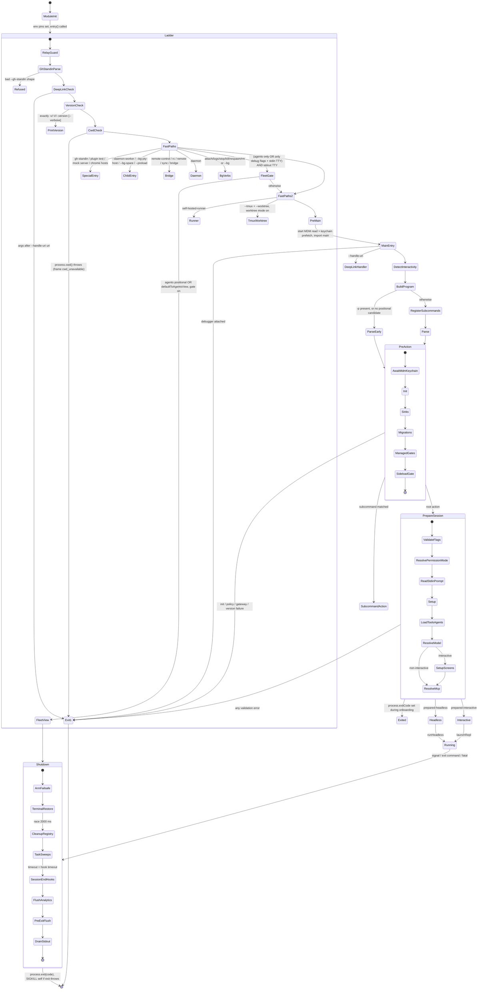
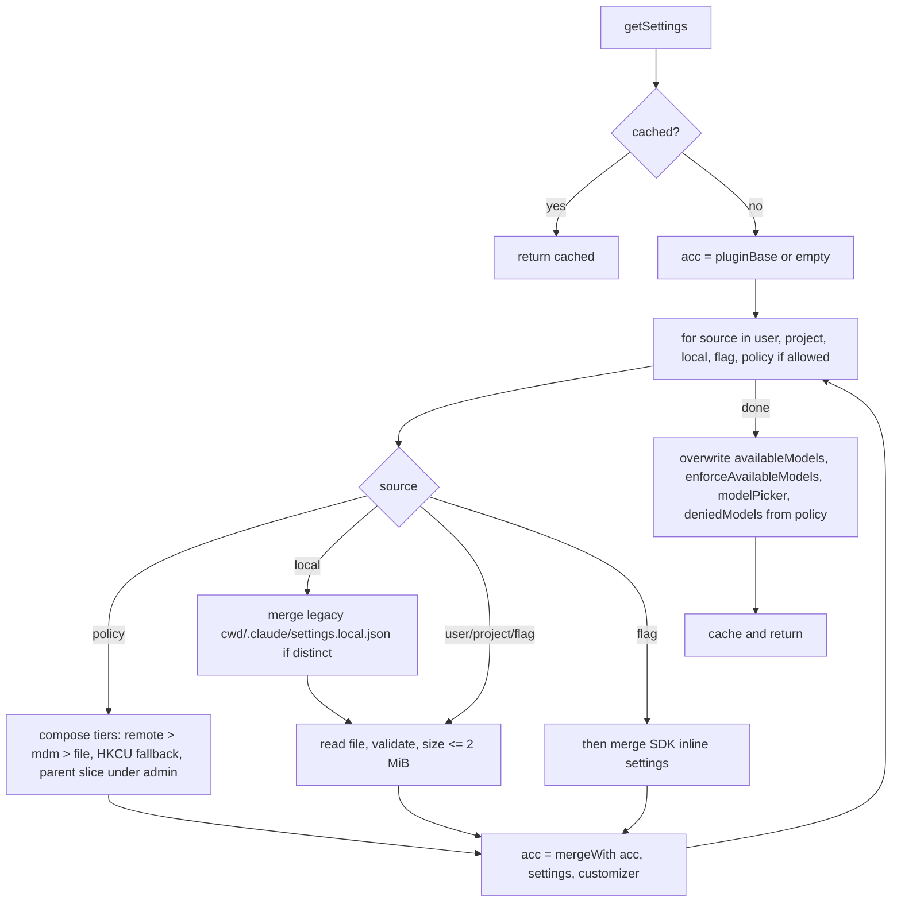

# Static 01: startup, CLI dispatch, configuration, settings precedence, environment, shutdown

Target: Claude Code CLI 2.1.296, Windows x64 Bun standalone. All offsets are character
offsets into the extracted module named, as printed by `cq.py`. Mangled identifiers are
quoted as shipped. Names in *italics* are conceptual names I chose.

Labels: **VS** = VERIFIED-STATIC, **SI** = STRONGLY INFERRED, **HY** = HYPOTHESIS,
**UNK** = UNKNOWN. Static evidence shows the code exists. Every "does X" below means
"does X when that branch is reached".

---

## 1. Scope and coverage

Read in full:

- `cli` (23,964 chars): the whole fast-path ladder.
- `chunk-zvnaqyp5.js` body (non-import part, 20000..84976): `main` (`Ac`), `run` (`Ni`),
  onboarding wrapper (`Fi`), interactive session runner (`Li`), subcommand registration.
- `chunk-jzzwheky.js` 41015..73093: program builder `VOo` (preAction hook, every root option,
  default action), plus the tail of the headless launcher `Xt`.
- `chunk-m44bzxs2.js` 103758..146000 in three slices: session preparation `_Hr`
  (about 70% read; the 110,000..117,400 and 139,000..145,000 ranges were skimmed by grep only).
- `chunk-rb1fj9a1.js`, `chunk-qn110zvq.js`, `chunk-w1fy6hed.js`, `chunk-eshh1gca.js`,
  `chunk-h8tvh2dn.js`, `chunk-cevevzs2.js`: argv helpers.
- `chunk-we7c2g4z.js`: `init` (`z`).
- `chunk-9djsrrzk.js` 17854..25400: `setup` (`ho`).
- `chunk-phacttch.js` 91658..105800: `ShutdownCoordinator` (`Ies`).
- `chunk-ff982hys.js` selected ranges: settings path resolution, merge, managed settings walk,
  policy tier composition.
- `chunk-mx6ygzc6.js` 86000..99500: settings context builder and accessors.
- `chunk-db4p09wg.js`, `chunk-w8x21rf4.js`: source lists, `--settings` and `--setting-sources` parsing.
- `chunk-cvvnq4he.js` selected ranges: trust lookup, global config lock and save.
- `chunk-45qan3kr.js` 7406..14400: `showSetupScreens` and the setup step list.
- `chunk-wa87dk5k.js`, `chunk-7r9zgs5y.js`, `chunk-794b9744.js`, `chunk-b0mxffcc.js`,
  `chunk-a49wgjkd.js`, `chunk-csx1nphr.js`, `chunk-ww4e4yyz.js`: MDM read, keychain prefetch,
  fast-path policy, startup failure frames, exit helpers, stdout drain.
- `chunk-47shaprq.js`: the typed environment registry (1,121 entries extracted by script).

Not reached (stated so nothing below is read as covering them):

- The body of `applyConfigEnvironmentVariables` / `applySafeConfigEnvironmentVariables`
  (only the call sites and export names were read).
- The merge primitive `A1` itself (its call shape and the customizer `UY` were read; the
  primitive was not).
- `runHeadless` (`chunk-fzzrkchm.js`) and `launchRepl` internals. Only the call sites.
- `u2r` (permission mode resolution) and `us` (tool permission context) internals. Owned by
  the permissions pass; only inputs and outputs at the call site are recorded.
- Daemon, bridge, pty host, spare, preload and self-hosted-runner entry bodies. Only the
  dispatch conditions and what each branch imports.
- macOS MDM (plist) read: the Windows build has that branch compiled out
  (`plistStdouts:null`, `chunk-wa87dk5k.js@1855`).
- Remote managed settings fetch, policy helper execution, GrowthBook.

Tools used: `cq.py show/grep/info/who`, plus three throwaway read-only Python scripts in the
session scratchpad (anchor offset lookup, env registry extraction, import-stripped body print).
Nothing was written outside this report file. `claude` was not run. No credential, config or
transcript file was opened.

---

## 2. Findings

### 2.1 Q1: the fast-path ladder in `cli`

Module-level side effects that run before the ladder (`cli@~1100..1560`), all **VS**:

| Order | Action | Evidence |
|---|---|---|
| 0a | `process.env.NoDefaultCurrentDirectoryInExePath="1"` | `cli@~1290` `"NoDefaultCurrentDirectoryInExePath"` |
| 0b | `process.env.COREPACK_ENABLE_AUTO_PIN="0"` | `cli@~1340` `COREPACK_ENABLE_AUTO_PIN="0"` |
| 0c | `VGn()`: set `AI_AGENT` to `claude-code_2-1-296_harness` unless it already holds a value that does not start with `claude-code_` or `claude-code/` | `chunk-cevevzs2.js@2315` `process.env.AI_AGENT=JCo("harness")` |
| 0d | If `CLAUDE_CODE_REMOTE==="true"`, append `--max-old-space-size=8192` to `NODE_OPTIONS` | `cli@1493` `--max-old-space-size=8192` |

The ladder is the async function `Bt` (`cli@2569`), called with no await at the end of the
module. `t = process.argv.slice(2)`. Each row returns (or exits) when its condition holds, so
order is load-bearing. All rows **VS** unless noted.

| # | Condition | What it does | Imports (lazy) | Evidence |
|---|---|---|---|---|
| 1 | `CCR_AGENT_PROXY_TOKEN_FILE_DESCRIPTOR !== undefined` or argv includes `--session-tunnel` | Not a branch: runs `guardRelayTokenDescriptor()` synchronously, then continues | `chunk-5bjjxefv.js` via `import.meta.require` | `cli@2693` `guardRelayTokenDescriptor` |
| 2 | `t[0]==="--gh-standin"` | `jSs()` parses `--gh-standin <port> <caBundlePath> [--any-host \| --hosts=a,b] -- <gh args>`. Port must match `/^[1-9]\d{0,4}$/` and be <= 65535. Bad shape prints a refusal to stderr, sets `process.exitCode=1`, returns `"refused"` and the ladder returns at once. A good shape is kept in `s` and consumed at row 7 | none yet | `chunk-eshh1gca.js@683` `"--gh-standin"` |
| 3 | `--handle-uri <uri>` followed by any further argv element | `E$n` returns an error string; `console.error` then `process.exit(1)` | none | `chunk-h8tvh2dn.js@615` `rejected deep-link invocation` |
| 4 | `t` is exactly `[--version\|-v\|-V]` or that plus `--verbose` | Prints `2.1.296 (Claude Code)`; with `--verbose` also `Commit: <GIT_SHA>`. Zero imports beyond the static ones | none | `cli@~2900` `(Claude Code)` |
| 5 | `process.cwd()` throws | `st()` builds a message (ENOENT gets a distinct text), prints it, calls `writeStartupFailureResult({reason:"cwd_unavailable"})`, `process.exit(1)` | `chunk-5mxbg89m.js`, `crypto` | `cli@4720` `cwd_unavailable` |
| 5a | always | `profileCheckpoint("cli_entry")` | `chunk-491r18xx.js` | `cli@~4800` `cli_entry` |
| 5b | `t[0]` is not `--preload`/`--bg-spare` and `CLAUDE_CODE_HOVER_REST` is set | `r = pinStorageV5FromEnv()` (the *storage v5 env pin*, threaded into almost every later branch) | `chunk-bvf52rcv.js` | `cli@4906` `CLAUDE_CODE_HOVER_REST` |
| 5c | not `--preload`/`--bg-spare` | `setTimeout(() => Bun.unsafe.setJITPolicy?.(1), 10000).unref()` | none | `cli@5058` `setJITPolicy` |
| 6 | (see row 2) `s !== undefined` | `loadFastPathPolicy(r)`; on error string, `exitWithError`. Then `ghStandinMain(s)` | `chunk-fsryh77n.js`, `chunk-s0pjy013.js`, `chunk-xfrssfy2.js` | `cli@~5200` `ghStandinMain` |
| 7 | `t[0]==="plugin" && t[1]==="test"` | Loads policy and plugin test gates in parallel. With `--file` and a refusal, writes `REPORT_MARK` + JSON to stdout. Otherwise sets `process.exitCode` from `pluginTestMain` and calls `endPluginTest` | `chunk-fsryh77n.js`, `chunk-486e64v7.js`, `chunk-49kbn9qf.js`, `chunk-86nks6pc.js`, `chunk-aqp6zs2c.js` | `cli@5359` `t[0]==="plugin"&&t[1]==="test"` |
| 8 | `process.argv[2]==="--eval-mock-server"` | `runEvalMockServer(argv[3], argv[4])`; on throw prints and sets exit code 1 | `chunk-h6rn694t.js` | `cli@6157` `"--eval-mock-server"` |
| 9 | `process.argv[2]==="--claude-in-chrome-mcp"` | `runClaudeInChromeMcpServer(r)` | `chunk-fxmgek97.js` | `cli@6462` |
| 10 | `process.argv[2]==="--chrome-native-host"` | `runChromeNativeHost()` | `chunk-91r5wcga.js` | `cli@6648` |
| 11 | `t[0]==="--daemon-worker"` | `loadFastPathPolicy(r)` (error only written to stderr, not fatal). `sessionFactsRestored(r)`; when non-null, prints a worker ending and `process.exit(code)`. Else `runDaemonWorker(t[1], r)` | `chunk-fsryh77n.js`, `chunk-7amszres.js`, `chunk-s560gnmj.js`, `chunk-erj1t65b.js` | `cli@6799` |
| 12 | `t[0]==="--bg-pty-host"` | `ensureFastPathSettingsLoaded(r)` inside try/catch (a throw is logged and ignored: "supervisor already gated"), then `runPtyHost(t.slice(1))` | `chunk-fsryh77n.js`, `chunk-jn2r7nez.js` | `cli@7292` `ptyHost: settings bootstrap threw` |
| 13 | `t[0]==="--bg-spare"` | `ensureFastPathSettingsLoaded(undefined)`, `runBgSpare(t.slice(1))` | `chunk-fsryh77n.js`, `chunk-9s22eqxb.js` | `cli@7640` |
| 14 | `t[0]==="--preload"` | `ensureFastPathSettingsLoaded(undefined)`, `runPreload(t.slice(1))` | `chunk-fsryh77n.js`, `chunk-v8jk3662.js` | `cli@7855` |
| 15 | `t[0]` in `remote-control`, `rc`, `remote`, `sync`, `bridge` | Policy load (fatal on error), `sessionFactsRestored` (fatal on non-null), local and eligibility refusals, credential and GrowthBook priming when the v5 gate `j()` is on, sinks, 1P event logging, then `startRemoteControl(u, t.slice(1), h, D)` | `chunk-fsryh77n.js`, `chunk-7amszres.js`, `chunk-jepctn55.js`, `chunk-6jetctc6.js`, `chunk-0we1sg63.js`, `chunk-2brqfxeq.js`, `chunk-ccngwn0r.js`, `chunk-224cheyj.js`, `chunk-9yd0kr91.js`, `chunk-0fg6rxrn.js`, `chunk-r4mwvsts.js`, `chunk-x7qnqp0z.js` | `cli@8069` `cli_bridge_path` |
| 16 | `$Ss(t) !== null`: after skipping any leading `--dangerously-skip-permissions` / `--allow-dangerously-skip-permissions`, the next token is `daemon` | `ensureFastPathSettingsLoaded(r)`, `initializeErrorLogSink()`, `daemonMain(rest, r)` | `chunk-fsryh77n.js`, `chunk-f0k5ntry.js`, `chunk-39q3j8sd.js` | `cli@9780` `cli_daemon_path`; `chunk-w1fy6hed.js@2480` |
| 17 | A background-session verb is present, or argv includes `--bg` / `--background`. Verb detection: some arg in `logs, attach, stop, kill, respawn, rm`, then `backgroundSessionVerbIndex(t, {behindRootOptions: CLAUDE_CODE_SESSION_KIND!=="bg"})` returns an index | See 2.1.1 | `chunk-3fsd4nbm.js`, `chunk-qs8ksj9w.js`, `chunk-fsryh77n.js`, `chunk-7amszres.js`, `chunk-tebmbcrz.js`, `chunk-060stnq8.js`, analytics chunks | `cli@10400` `cli_bg_path` |
| 18 | *Agents fleet view*: `(T \|\| (nt(t) && process.stdin.isTTY)) && process.stdout.isTTY`, then inner gate `P` | See 2.1.2 | many, see 2.1.2 | `cli@13983` `hasAgentsPositional&&nt(k)` |
| 19 | `t[0]==="self-hosted-runner"` | Sub-dispatch on `t[1]`: `orchestrator`, `setup`, `doctor`, `code-sign`, `decode-token`, else `selfHostedRunnerMain(t.slice(1))` | `chunk-d5qahqht.js`, `chunk-3rp0eq4e.js`, `chunk-vg9d06jc.js`, `chunk-p50d1v39.js`, `chunk-dr6v7nm5.js`, `chunk-g8typhpc.js` | `cli@20565` |
| 20 | argv includes `--tmux` or `--tmux=classic`, and includes `-w`, `--worktree` or `--worktree=...` | `--desktop` conflict exits 1. `eagerLoadSettings()`, policy (fatal), `configureFastPathGlobalAgents()`. Only if `isWorktreeModeEnabled()`: `execIntoTmuxWorktree(t, P, R)`; `handled` returns, otherwise `exitWithError(h.error)`. If worktree mode is off the code falls through to row 21 | `chunk-qs8ksj9w.js`, `chunk-fsryh77n.js`, `chunk-8r7hebbc.js`, `chunk-zdg9e5aj.js`, `chunk-tbhxcq54.js` | `cli@21546` `cli_tmux_worktree_fast_path` |
| 21 | `t` is exactly `[--update]` or `[--upgrade]` | Rewrites `process.argv` to `[argv0, argv1, "update"]`. Falls through | none | `cli@22907` |
| 22 | `--bare` appears before any `--` | `process.env.CLAUDE_CODE_SIMPLE="1"`. Falls through | none | `cli@23044` `includes("--bare")` |
| 23 | `argv[2]` not in `NON_REPL_SUBCOMMANDS` (`update, upgrade, doctor, forward-home-settings`) and not `mcp serve`, not `plugin(s) eval`, not `remote-control`/`rc` anywhere, not `agents ... --json` | `startCapturingEarlyInput()` (typed-ahead keystrokes are buffered before the UI mounts) | `chunk-qn110zvq.js`, `chunk-0p1t5w5n.js` | `cli@23102`; `chunk-qn110zvq.js@615` `"forward-home-settings"` |
| 24 | always | `startMdmRawRead()` and `startKeychainPrefetch()` fired without await; `configureZodForStartup()`; `import main`; `await main(r)` | `chunk-afchyb42.js`, `chunk-d0ahhcg3.js`, `chunk-bcx93zkm.js`, `chunk-zvnaqyp5.js` | `cli@23731` `cli_before_main_import` |

`isProjectVerbInvocation` is a constant `false` in this build (`chunk-qn110zvq.js@~640`
`function i(o){return!1}`). **VS**

#### 2.1.1 Row 17 detail: background verbs and `--bg`

**VS** from `cli@10400..13800`.

1. `--desktop` anywhere before `--` exits 1 with one of two messages.
2. If the verb sits behind root options (`x > 0`), `--settings` and `--managed-settings` are
   parsed eagerly from the tokens before the verb (`eagerParseCliFlag`) and loaded.
3. `loadFastPathPolicy(r)`. For the tolerant verbs `logs, stop, kill, rm` an error is only
   written to stderr. For everything else `exitWithError`.
4. `sessionFactsRestored(r)`: non-null and not a tolerant verb is fatal; for a tolerant verb
   the reason is written to stderr and analytics init is skipped.
5. `ensureFleetGateHydrated`, then `isAgentsFleetEnabled()`. When off, `fleetGateRejected(verb)`.
6. Dispatch: `logs|attach|stop|kill|respawn|rm` call the matching handler in
   `chunk-060stnq8.js` (`kill` maps to `stopHandler`). Default (the `--bg` flag form) logs
   `tengu_background` and calls `handleBgFlag(t, n)`.
7. Both arms end with `Promise.race([flush 1P + Datadog, sleep(500)])` then
   `process.exit(process.exitCode ?? 0)`. Evidence: `cli@~12600` `u(500,void 0,{unref:!0})`.

`backgroundSessionVerbIndex` (`eRo`, `chunk-rb1fj9a1.js@4799`) accepts a verb at index 0
always; behind root options only when the next token is an 8-hex id (`/^[a-f0-9]{8}$/`) or
`respawn --all`, and only when every preceding token is a known value-taking or boolean root
flag and none is in the refusal set (`-p, --print, --bg, --background, --routine, -h, --help,
-v, -V, --version`, `--routine=...`, or a bundled short cluster `/^-[A-Za-z]{2,}$/`). **VS**

#### 2.1.2 Row 18 detail: agents fleet view

**VS** from `cli@13806..20560`.

- `Yat(t)` (`chunk-w1fy6hed.js@615`) is a tiny hand parser. It pulls out the first bare
  `agents` token (`hasAgentsPositional`), `--cwd`, `--settings`, `--managed-settings`,
  `--setting-sources` (value consumed and dropped here), `--add-dir`, `--plugin-dir`,
  `--plugin-dir-no-mcp`, `--mcp-config`, `--strict-mcp-config`, `--restricted`, and returns the
  remainder in `rest`.
- `config.restricted ||= CLAUDE_CODE_RESTRICTED in {1,true,yes,on}` (case-insensitive, trimmed).
- `xt(rest)` extracts dispatch defaults: `--dangerously-skip-permissions`
  (mode `bypassPermissions`), `--allow-dangerously-skip-permissions`, `--permission-mode`,
  `--inherit-permission-mode`, `--model`, `--effort`, `--agent`.
- `nt(list)` is true when the list holds only debug flags (`--debug`, `-d`,
  `--debug-to-stderr`, `-d2e`, `--debug=...`, `--debug-file=...`, `--debug-file <v>`).
- `T = hasAgentsPositional && nt(remaining)`.
- Outer gate: `(T || (nt(t) && process.stdin.isTTY)) && process.stdout.isTTY`. So a bare
  `claude` (or `claude --debug`) on a TTY also enters this block.
- Inside: `startCapturingEarlyInput()`, `startMdmRawRead()`, `startKeychainPrefetch()`,
  `enableConfigs()`, then `R = getGlobalConfig().defaultToAgentsView === true` and
  `P = T || R`. A throw from config load is swallowed and leaves `P=false`.
- If `P` is false the code falls out of the block and continues to row 19.
- If `P`: load `--settings`/`--managed-settings`, inline plugin dirs, policy (fatal on
  error), `CLAUDE_CODE_PLUGIN_DIRS`, sideload policy check, then `isAgentsFleetEnabled()`.
  When enabled it mounts the fleet view (`mountFleetViewWithComposerBack`,
  `chunk-spf2wra0.js`) after a workspace trust step (`ensureAgentsWorkspaceTrust`,
  `chunk-3r8r2y54.js`) and ends with `gracefulShutdown(0, "other", {suppressResumeHint:true})`.
  When the fleet gate is off and `T` is true: `fleetGateRejected("claude agents")`. When the
  gate is off and only `R` was true, the code falls through to `main`.
- Session start type is set to `"agents_view"` and `setIsInteractive(true)` is called
  directly (`cli@~16000` `_t("agents_view")`).

### 2.2 Q2: argv parsing in `main`

#### 2.2.1 Library

**SI**: Commander.js. The program object is `new JBe()` and uses
`.configureHelp()`, `.enablePositionalOptions()`, `.hook("preAction", ...)`,
`.hook("preSubcommand", ...)`, `.addOption(new ds(...).choices().argParser().hideHelp().implies().preset().default())`,
`.getOptionValueSource()`, `.allowExcessArguments()`, `.allowUnknownOption()`,
`.helpOption()`, `.version()`, `.parseAsync(process.argv)`, and throws `new XBe(msg)` from
arg parsers (`InvalidArgumentError` shape). Evidence: `chunk-jzzwheky.js@41068`
`enablePositionalOptions`, `@41191` `r.hook("preAction"`. The exports `JBe`, `ds`, `Oin`,
`see` come from `chunk-10qq00fk.js`. The library version is **UNK**.

#### 2.2.2 `main` (`Ac`, `chunk-zvnaqyp5.js@37690`) before Commander

**VS**, in order:

1. Module top level (runs at import): `if (Pi()) process.exit(1)` where `Pi()` detects a
   debugger: `process.execArgv` matching `/--inspect(-brk)?/`, `NODE_OPTIONS` matching
   `/--inspect(-brk)?|--debug(-brk)?/`, or `require("inspector").url()` truthy.
   Evidence: `@35970` `if(Pi())process.exit(1)`.
2. `Cn()`: installs a `process.on("warning")` handler that dedupes into a map capped at
   1000 keys and emits `tengu_node_warning`; wraps `setTimeout`/`setInterval` in a Proxy that
   clamps over-range delays. Evidence: `@30304` `function Sn()`.
3. `process.on("exit", ...)` writes a terminal reset sequence (`q0`) to stderr if it is a
   TTY, else stdout if it is a TTY. Evidence: `@37760`.
4. `--handle-uri <uri>` present: re-check for injected args, `enableConfigs`,
   `handleDeepLinkUri(uri)`, `process.exit(code)`. Evidence: `@37857`.
5. `W7o(argv)` non-null (the `import` shorthand rewrite): either rewrites `process.argv` or
   exits with a config error.
6. `vn({interactivity:{kind:"detect"}})`: see 2.3.
7. `Ni(...)` (`@38620`): builds the program via `VOo`, then one of three parse strategies:
   - `-p`/`--print` present and no `cc://` / `cc+unix://` argument: `parseAsync` at once,
     **without registering any subcommand**. Evidence: `@~39130` `if(D&&!U)return so("run_before_parse")`.
   - No positional candidate at all (`nRo`: no token that lacks a leading `-`, no `--`, no
     `--help`, no short cluster containing `h`) and no `cc://` URL: same early parse.
   - Otherwise registers every subcommand (2.2.4) and then parses.

   Reimplementation note: this is a start-up cost optimization. Print mode never sees
   subcommands, so `claude -p mcp` treats `mcp` as the prompt.

#### 2.2.3 The `preAction` hook (`chunk-jzzwheky.js@41191`)

Runs before every action (root or subcommand). **VS** sequence:

1. `--desktop` given on the CLI together with a subcommand: exit 1.
2. If root action, `--await-initialize`, `--input-format stream-json`, no `--sdk-url`, and
   stdin is not a TTY: start reading the SDK `initialize` request from stdin now (`mUo(Epn)`).
3. `await Promise.all([Ddt(), Atn()])`: wait for the MDM read and the keychain prefetch that
   `cli` row 24 started. Metric `pre_action_mdm_keychain_ms`.
4. `--project-config-root`: must be absolute and local, must exist and be listable, must not
   resolve to a network path. Three distinct exit-1 messages (`@41848`).
5. `s = await init({...})` (`uOr`, memoized promise; 2.9). `s` is the storage handle that
   every `withStorageV5` action wrapper receives.
6. `process.title = "claude"` unless `CLAUDE_CODE_DISABLE_TERMINAL_TITLE` (`@43324`).
7. `initSinks()` (`chunk-0fg6rxrn.js`).
8. `await gUo()`: the result of the early `initialize` read. `kind:"violation"` exits 1.
9. Inline plugins from `--plugin-dir`, `--plugin-dir-no-mcp`, `--plugin-url` (plus any from
   the initialize request).
10. Migrations: `Rr(s)` (`@44082`).
11. Managed settings gates: policy helper run, forced remote settings refresh
    (`forceRemoteSettingsRefresh`), gateway mode settings fetch, `version_below_minimum`
    check (`@46250`). Each can exit through `xe(...)`, which writes a startup failure frame
    (2.9).
12. Sideload policy check: if policy disables sideload flags and any of `--plugin-dir`,
    `--plugin-dir-no-mcp`, `--plugin-url`, `--agents`, or `CLAUDE_CODE_PLUGIN_DIRS` was used,
    exit 1.
13. For the root action without `--worktree` and without `CLAUDE_CODE_SYNC_PLUGIN_INSTALL`:
    register `--add-dir` directories and kick the plugin load early (not awaited).
14. `IQr(q)`: `markStartupActionStarted(expectsUiMount)` for the startup watchdog.

#### 2.2.4 Subcommands

All **VS**. "H" = hidden from help.

| Command | Role | Handler chunk | Evidence |
|---|---|---|---|
| `gateway --config <path>` | Enterprise auth/telemetry gateway; `drainOnSignal` | `chunk-4r0sfc2z.js`, `chunk-0y4p3rn1.js` | `chunk-zvnaqyp5.js@39364` |
| `mcp ...` | Registered by `registerMcpCommands` | `chunk-0n43kagf.js` | `@~39900` `registerMcpCommands` |
| `edit-hook --json` (H) | One hook edit as JSON on stdin, for the VS Code extension. Refuses a TTY stdin. Input cap 524,288 chars | `chunk-dtbnbfzs.js` | `@25924` |
| (registered by `HDr`) | Not read | `chunk-0fahwjme.js` | `@~40000` `HDr(s,r)` |
| `auth login [--email] [--sso] [--console] [--claudeai]` | Sign in | `chunk-27gwfh2h.js` | `@40043` |
| `auth status [--json] [--text]` | Auth status | same | |
| `auth logout` | Log out | same | |
| `purge [path] [--dry-run] [-y] [-i] [--all]` | Delete all state for a project | `chunk-8q5wva37.js` | `@27205` |
| `project purge` (H) | Deprecated alias of `purge` | same | `@27096` |
| `plugin ...` | `registerPluginCommands` | `chunk-qc0vh0ty.js` | |
| `setup-token` | Long-lived token setup | `chunk-qqtrssa6.js` | `@41424` |
| `agents [...]` | Manage background agents; options mirror the fleet view parser plus `--json`, `--all` | `chunk-fe0fgn7b.js` | `@41757` |
| `attach`, `logs`, `stop` (alias `kill`), `respawn`, `rm` | Help-only stubs injected into `visibleCommands`. Real handling is ladder row 17 | none | `@25032` `new JBe("attach")` |
| `ultrareview [target] [--json] [--timeout] [--post] [--no-post]` | Cloud review; ends with `process.exit(0)` | `chunk-tc64gzgk.js` | `@43916` |
| `auto-mode defaults\|config\|reset\|critique` | Auto mode classifier config | `chunk-fdfzrbjd.js` | `@44672` |
| `remote-control` alias `rc` (H) | Refuses certain root options, then `enterRemoteControl` | `chunk-jepctn55.js` | `@46525` |
| `doctor` | Health check, reads settings without trust prompt | `chunk-qqtrssa6.js` | `@46954` |
| `XJt` (name not resolved, H) | Review and accept project settings for cloud sessions (`applyProjectSettingsHandler`). The argv[2] literal checked elsewhere is `apply-project-settings` | `chunk-tkwv2p6h.js` | `chunk-w8x21rf4.js@~1660` `"apply-project-settings"` |
| `sandbox install\|status` (H) | Windows sandbox install and posture | `chunk-nsfswvwx.js` | `@47730` |
| `update` alias `upgrade` | Updater | `chunk-3hc9966s.js` | `@48370` |
| `install [target] [--force]` | Native build install | `chunk-qqtrssa6.js` | `@48560` |
| `import [source] [--dry-run] [--yes]` | Prints usage and exits; the real flow is the argv rewrite in `main` step 5 | none | `@48885` |
| `import-conversations <exportPath>` (H) | Import archive | `chunk-1ab2bp2y.js` | `@49414` |

Two action wrappers exist: `withStorageV5` (`h`, prepends the storage handle `s`) and
`withStartupHandles` (`w`, prepends `s` and credentials `f`). Evidence:
`chunk-jzzwheky.js@~41130` `h=(u)=>(...y)=>u(s,...y)`.

#### 2.2.5 Root options

Full list, in registration order, from `chunk-jzzwheky.js@46900..70680`. All **VS**.
"H" = `.hideHelp()`.

| Option | Arg | Default / parser | H |
|---|---|---|---|
| `[prompt]` | positional | `String` | |
| `-h, --help` | | | |
| `-d, --debug [filter]` | optional | parser returns `true` (the filter text is re-read from raw argv elsewhere) | |
| `-d2e, --debug-to-stderr` | | `Boolean`, implies `debug:true` | H |
| `--debug-file <path>` | required | parser returns `true` | |
| `--verbose` | | | |
| `-p, --print` | | | |
| `--bare` | | | |
| `--safe-mode` | | | |
| `--init`, `--init-only`, `--maintenance` | | | H |
| `--output-format <format>` | | choices `text, json, stream-json` | |
| `--json-schema <schema>` | | `String` | |
| `--include-hook-events`, `--include-partial-messages`, `--forward-subagent-text` | | | |
| `--session-mirror`, `--await-claim` | | | H |
| `--input-format <format>` | | choices `text, stream-json` | |
| `--await-initialize` | | | H |
| `--dangerously-skip-permissions`, `--allow-dangerously-skip-permissions` | | | |
| `--thinking <mode>` | | choices `enabled, adaptive, disabled` | H |
| `--thinking-display <display>` | | choices `J3e` (not resolved) | H |
| `--max-thinking-tokens <tokens>`, `--max-turns <turns>` | | numeric parser, NaN throws | H |
| `--max-budget-usd <amount>` | | must be > 0 | |
| `--task-budget <tokens>` | | positive integer | H |
| `--replay-user-messages` | | | |
| `--prompt-suggestions [value]` | optional | choices `true,false,1,0,yes,no,on,off`, preset `"true"` | |
| `--enable-auth-status` | | default `false` | H |
| `--allowedTools, --allowed-tools <tools...>` | variadic | | |
| `--tools <tools...>` | variadic | | |
| `--restricted` | | | |
| `--disallowedTools, --disallowed-tools <tools...>` | variadic | | |
| `--mcp-config <configs...>` | variadic | | |
| `--permission-prompt-tool <tool>` | | `String` | H |
| `--permission-prompts <target>` | | choices `s9o` (`host`, `none` per help text), default `"host"` | |
| `--system-prompt <prompt>`, `--append-system-prompt <prompt>` | | `String` | |
| `--system-prompt-file <file>`, `--append-system-prompt-file <file>` | | `String` | H |
| `--system-prompt-snapshot <on\|off>` | | parsed to boolean | |
| `--append-subagent-system-prompt <prompt>`, `...-file <file>` | | | H |
| `--plan-mode-instructions <instructions>` | | | H |
| `--exclude-dynamic-system-prompt-sections` | | default `false` | |
| `--permission-mode <mode>` | | choices `Je`, parser `Qe` | |
| `--inherit-permission-mode <mode>` | | parser `Qe` | H |
| `-c, --continue` | | | |
| `-r, --resume [value]` | optional | `value \|\| true` | |
| `--fork-session` | | | |
| `--watch-artifact <artifact>`, `--watch-artifact-no-autoreact <artifact>` | | | H |
| `--prefill <text>`, `--deep-link-origin`, `--deep-link-repo <slug>`, `--deep-link-last-fetch <ms>`, `--prefill-b64 <b64>`, `--deep-link-cwd-b64 <b64>` | | base64url decoders on the b64 pair | H |
| `--from-pr [value]` | optional | `value \|\| true` | |
| `--no-session-persistence` | | negatable: `sessionPersistence===false` | |
| `--resume-session-at <message id>`, `--resume-drops-turn <message id>`, `--reply-on-resume`, `--rewind-files <user-message-id>` | | | H |
| `--model <model>` | | | |
| `--effort <level>` | | parser `Uit`, may print a warning to stderr | |
| `--agent <agent>` | | | |
| `--betas <betas...>` | variadic | | |
| `--fallback-model <model>` | | comma list | |
| `--workload <tag>` | | | H |
| `--settings <file-or-json>` | | | |
| `--client-data-url <url>` | | | H |
| `--managed-settings <json>` | | | H |
| `--add-dir <directories...>` | variadic | | |
| `--project-config-root <dir>` | | | H |
| `--ide`, `--desktop`, `--strict-mcp-config` | | | |
| `--session-id <uuid>` | | | |
| `-n, --name <name>` | | | |
| `--agents <json-or-file>` | | | |
| `--setting-sources <sources>` | | | |
| `--plugin-dir <path>` | repeatable | accumulator, default `[]` | |
| `--plugin-dir-no-mcp <path>` | repeatable | default `[]` | H |
| `--plugin-url <url>` | repeatable | splits on whitespace, default `[]` | |
| `--disable-slash-commands` | | | |
| `--chrome`, `--no-chrome` | | | |
| `--file <specs...>` | variadic | `file_id:relative_path` | |
| `-v, --version` | | prints `2.1.296 (Claude Code)` | |
| `-w, --worktree [name]` | optional | | |
| `--tmux` | | | |
| `--advisor <model>` | | | H |
| `--autocompact <auto\|tokens>` | | `auto` or 100k..1M | |
| `--enable-auto-mode` | | deprecated | H |
| `--proactivity <level>` | | choices `Ine`; hidden unless gate `Gre()` | cond. |
| `--bg, --background` | | | |
| `--messaging-socket-path <path>` | | | H |
| `--brief`, `--ax-screen-reader` | | | |
| `--channels <servers...>`, `--dangerously-load-development-channels <servers...>` | variadic | | H |
| `--agent-id`, `--agent-name`, `--team-name`, `--agent-color`, `--plan-mode-required`, `--parent-session-id`, `--agent-type` | | teammate plumbing | H |
| `--teammate-mode <mode>` | | choices `auto, tmux, iterm2, in-process` | H |
| `--sdk-url <url>` | | | H |
| `--teleport [session]` | optional | | |
| `--cloud [description\|session_id\|url]` | optional | | |
| `--forward-home-settings <true\|false>` | | choices `true,false,1,0` | H |
| `--remote [...]` | | deprecated alias of `--cloud` | H |
| `--attach-serve <session_id>` | | | H |
| `--environment <environment_id>` | | | |
| `--pool <pool_id>` | | deprecated alias of `--environment` | H |
| `--correlation-id <id>`, `--ref <ref>`, `--on-branch <branch>` | | | H |
| `--remote-control [name]` | optional | `value \|\| true` | |
| `--rc [name]` | optional | alias | H |
| `--remote-control-session-name-prefix <prefix>` | | | |

A second, hand-maintained table of flag arity lives in `chunk-rb1fj9a1.js@~620`: set `i`
(flags that take one value), set `NAr` (variadic), set `a` (optional value), set `p`
(booleans). It is used by the pre-Commander scanners (`UA`, `qv`, `rpt`, `eRo`). It names two
flags that have no Commander registration in the code I read: `--routine` and `--exec` / `-m`,
plus `--hard-fail` and `--project`. **VS** for presence in the table; their consumers are
**UNK** (not in my subsystem's chunks).

#### 2.2.6 How each named flag is consumed

All from `_Hr` (`chunk-m44bzxs2.js@103758`) unless another location is given. **VS**.

| Flag | Consumption |
|---|---|
| `-p/--print` | Read three times. (a) Raw argv in `u8e` to fix interactivity before Commander exists (2.3). (b) Raw argv in `Ni` to choose the early-parse path. (c) `o.print` in `_Hr` (`yt`); forced true when `--sdk-url` is set. |
| `--output-format` | `Z`. Defaults to `stream-json` when `--sdk-url` is set. Controls where permission warnings go (stderr unless `json`/`stream-json` or a bg session). Also read from raw argv by `isStreamJsonLaunch` to decide whether startup failure frames may be written. |
| `--input-format` | `U`. Validated: must be `text` or `stream-json`; `stream-json` requires output `stream-json` and non-interactive. Evidence `@123059`. Selects the stdin reader in `Rs` (`@21563`). |
| `--resume`, `--continue` | Validated together with `--session-id`, `--fork-session`, `--sdk-url` by `zs`. They suppress `--agents` validation and the "agent not found" error. Consumed for real in `Li` (interactive, `chunk-zvnaqyp5.js@~61900`) or `runHeadless` options. |
| `--model` | `ko = o.model`; resolved by `ea({userSpecifiedModel, agentModel, ...})` into `effectiveModel`, `initialMainLoopModel`, `resolvedInitialModel`. Telemetry `tengu_startup_manual_model_config` records CLI flag, `ANTHROPIC_MODEL`, `ANTHROPIC_DEFAULT_MODEL`, and the settings value with its source. |
| `--permission-mode` | `Xe`, passed with `--inherit-permission-mode`, `--dangerously-skip-permissions`, `--allow-dangerously-skip-permissions`, and the agent's own `permissionMode` to `u2r(...)` (`@113794`) which returns `{mode, notification, proactivity, modeSuppliedOnInvocation}`. |
| `--settings` | Eagerly, from raw argv, by `eagerLoadSettings` / `loadSettingsFromFlag` (2.4.6). Re-serialized into child argv by `Roe(Xat(...))`. |
| `--setting-sources` | Eagerly, from raw argv, by `applySettingSourcesFlagFromArgv` (2.4.5). |
| `--mcp-config` | Each entry trimmed; parsed as inline JSON first, else as a file path; scope `"dynamic"`; validation errors exit 1 with `Error: Invalid MCP configuration:` (`@115426`). Then policy filtering. |
| `--agents` | Inline JSON, or (print mode only) a file path. A file path in interactive mode exits 1. Invalid JSON exits 1 with `Error: Invalid --agents configuration:` (`@106213`). Validation is skipped on resume/continue. |
| `--system-prompt`, `--system-prompt-file` | File is read as utf8 and joined ahead of the inline text with a blank line (`Mr`). ENOENT exits 1 (`@111166`). Then merged with env and settings by `bhs({cli, env, settings})`. |
| `--append-system-prompt(-file)` | Same pattern. Both together are refused in a Remote Control session. |
| `--allowedTools`, `--disallowedTools`, `--tools`, `--add-dir` | Passed to `us({allowedTools, disallowedTools, baseTools, restricted, permissionMode, allowDangerouslySkipPermissions, addDirs})` (`@12316`) which returns `toolPermissionContext` and warnings. `--add-dir` is also registered early in `preAction`. |
| `--bare` | Sets `CLAUDE_CODE_SIMPLE=1` twice: in `cli` row 22 from raw argv, and in `_Hr` from `o.bare` (`@104629`). The predicate `mr()` is `truthy(CLAUDE_CODE_SIMPLE) \|\| argv has --bare` (`chunk-g17170nn.js@3828`). |
| `--safe-mode` | `Rr()`; `_Hr` sets `CLAUDE_CODE_SAFE_MODE=1` and `CLAUDE_CODE_DISABLE_CLAUDE_MDS=1` (`@104672`). |
| `--debug`, `--debug-file`, `-d2e` | Not consumed through Commander values. A logger config object reads raw argv at construction: `--debug=<filter>`, `--debug-to-stderr`/`-d2e`, `--debug-file=<p>` or `--debug-file <p>`. `debugFromLaunch = truthy(DEBUG) \|\| truthy(DEBUG_SDK) \|\| --debug \|\| -d \|\| toStderr \|\| filter \|\| filePath`. Evidence `chunk-j0pppawn.js@49069` `this.debugFromLaunch=`. |

### 2.3 Q3: interactive versus non-interactive

**VS** predicate, `u8e` in `chunk-rb1fj9a1.js@3293`:

```
nonInteractive =
     hasFlag("-p") || hasFlag("--print")
  || hasFlag("--init-only")
  || anyArg(startsWith "--sdk-url")
  || !process.stdout.isTTY
```

The flag scan (`rpt`) stops at `--` and skips values of known value-taking flags, so a prompt
that happens to contain `-p` as a value does not count.

Points that matter for a reimplementation:

- **stdin is not part of the predicate.** A piped stdin with a TTY stdout is still
  interactive. Piped stdin is handled separately (below).
- `--output-format stream-json` and `--input-format stream-json` do not make the session
  non-interactive by themselves. `_Hr` rejects `--input-format=stream-json` when the session
  is interactive (`@123197` `requires --print.`).
- The predicate is evaluated once, in `vn` (`chunk-zvnaqyp5.js@31188`), before Commander is
  built, and stored through `zxo(!w)` which calls `host.launchOptions.replaceIsInteractive`
  (`chunk-w3dhb84t.js@93505`). Every later check is `ke()` = `!launchOptions.isInteractive()`
  (`@92737`).
- When non-interactive, `vn` calls `sK()` = `stopCapturingEarlyInput`.
- `--sdk-url` later forces `print`, `stream-json` both ways, and `verbose` (`@107781`).

`vn` also derives the *client type* (`ePo(r)`), **VS** (`@~31700`), first match wins:
`GITHUB_ACTIONS` truthy -> `github-action`; `CLAUDE_CODE_ENTRYPOINT` `sdk-ts` ->
`sdk-typescript`; `sdk-py` -> `sdk-python`; `sdk-cli`; `claude-vscode`; `local-agent`;
`claude-desktop`; `CLAUDE_CODE_ENTRYPOINT==="remote"` or any session-ingress token source
present -> `remote`; else `cli`.

Downstream split, **VS**:

- `_Hr` returns `{kind:"prepared-headless", ...}` when no UI root was created and
  `{kind:"prepared-interactive", ..., root, getFpsMetrics, stats, terminalInput}` otherwise
  (`chunk-m44bzxs2.js@145558..145597`). A third result `{kind:"exited"}` is returned when
  `process.exitCode` was set during onboarding (`@136534`).
- The root action (`chunk-jzzwheky.js@64114`) routes: `prepared-headless` ->
  `Xt(F, k, openLiveBackgroundSessionForResume)` -> `runHeadless(...)` from
  `chunk-fzzrkchm.js` (`@36705`). Otherwise `runInteractiveSession(F, k)` = `Li` in
  `chunk-zvnaqyp5.js@55281`, which builds the initial app state and ends in
  `uHt(root, ctx, props, renderAndRun)` (`@~84800`; `uHt` is exported by `chunk-0fahwjme.js`
  and is the REPL launcher; an error string in the same function names it `launchRepl`).
- Only the interactive path calls `runOnboarding` (`Fi`, `@49973`) ->
  `showSetupScreens` (trust dialog and the other first-run dialogs).
- Only the non-interactive path: `LL(true)` early (a trust-related latch, name not
  resolved), `applyConfigEnvironmentVariables()` right after `setup()` (`JC()` at
  `@~128300`), and the 3P provider default fallback check.

Piped stdin (`Rs`, `chunk-m44bzxs2.js@21563`), **VS**:

- Runs only when `!process.stdin.isTTY` and the first positional is not `mcp`.
- `stream-json` input: returns an async generator over stdin lines (or the stash left by
  the early `initialize` read).
- Otherwise: reads utf8 chunks until end, with a hard cap `Ts = 10,485,760` chars
  (exit 1 with a "piped stdin input exceeds 10MB" message), and a peek timer: if **no**
  data and no end arrives within 3000 ms it prints a warning and proceeds without stdin.
  The result is `[promptArg, stdinText].filter(Boolean).join("\n")`.

### 2.4 Q4: settings sources and precedence

#### 2.4.1 Source list and merge order

**VS**. The canonical ordered list is
`ws = ["userSettings","projectSettings","localSettings","flagSettings","policySettings"]`
(`chunk-db4p09wg.js@3859`). The loader `lRr` (`chunk-ff982hys.js@428702`) walks
`Fnn(ctx)` = `ws` filtered to allowed sources, with `flagSettings` and `policySettings`
always added (`@387211`). Each source is merged on top of the accumulator with
`r = A1(r, next, UY)`. So **later wins**:

```
pluginBase (lowest)  <  user  <  project  <  local  <  flag  <  policy (highest)
```

`pluginBase` is a settings object contributed by plugins (`e.store.pluginBase`), merged
first.

Human labels for the sources (`Hv`, `@~3990`): `user`, `project`, `project, gitignored`,
`cli flag`, `managed`.

The merged result is cached in `store.mergedSettings` and read through `ft()` /
`getSettings` (`chunk-mx6ygzc6.js@96849`, `@97163`). A re-entrancy guard returns
`{settings:{}, errors:[]}` when a load is already in progress (`isLoadingFromDisk`).

`bO(key)` (`@97051`) answers "which source set this key" by walking the enabled sources
from highest to lowest and returning the first whose own settings define the key.

#### 2.4.2 Merge semantics

**VS** for the customizer `UY` (`chunk-ff982hys.js@428331`):

| Case | Result |
|---|---|
| key is `modelPicker` and the incoming value is defined | incoming replaces existing (shallow clone, `options` entries cloned) |
| both sides are arrays, key is `fallbackModel` | incoming replaces existing |
| both sides are arrays, any other key | `L([...existing, ...incoming])`: concatenate, then `L` |
| key is `extraKnownMarketplaces` or `managedMcpServers` and both are plain objects | special merge `w0t(existing, incoming)` |
| anything else | customizer returns `undefined`, default behaviour of `A1` applies |

**VS (upgraded by audit)**: `L` is a de-duplicating function (`[...new Set]`) and `A1` is lodash `mergeWith`
(recursive deep merge of plain objects, scalar overwrite), confirmed at `chunk-ff982hys.js@343959` to
`@344011` and in `chunk-2atrpakp.js`. The call shape
`A1(target, source, customizer)` and the "return undefined to fall back" contract match.

Post-merge policy overrides, **VS** (`@~430700`): if a policy tier exists, then
`availableModels`, `enforceAvailableModels` and `modelPicker` are **overwritten** with the
policy value when policy defines them, and `deniedModels` is set from policy or **deleted**
when policy does not define it. Lower sources cannot add to these. Audit correction: the
`delete` sits outside the `if(policy)` block (`chunk-ff982hys.js@430728`, `else delete r.deniedModels`), so
`deniedModels` is dropped from the merged result even when no policy tier exists at all.

Sandbox note, **VS**: when managed settings set `sandbox.filesystem.allowManagedReadPathsOnly`
or `sandbox.network.allowManagedDomainsOnly`, entries from other files are reported as
ignored with a `statusOnly` warning.

#### 2.4.3 File paths

`ctx.cwd` is the session's original cwd (`Gl()`), `ctx.projectConfigDir` is
`--project-config-root`. *configHome* is `ve()`.

| Source | Path | Evidence | Label |
|---|---|---|---|
| userSettings | `<configHome>/settings.json`; file name becomes `cowork_settings.json` when `coworkPlugins` or `CLAUDE_CODE_USE_COWORK_PLUGINS` | `chunk-ff982hys.js@400947` `case"userSettings":return Se($nn(e,n),k_(n))`; `Uv={default:"settings.json",cowork:"cowork_settings.json"}` | VS |
| projectSettings | `<projectConfigDir ?? cwd>/.claude/settings.json` | `@398269` `case"projectSettings":return fe(n.projectConfigDir??Pzn(n))`; `EO` | VS |
| localSettings | `<base>/.claude/settings.local.json` where `base` = `projectConfigDir` if set, else `RF(cwd, canonicalGitRoot)` | `@398269` `case"localSettings"` | VS |
| localSettings (legacy) | `<cwd>/.claude/settings.local.json`, only when `base` differs from cwd and no `projectConfigDir`. Merged **before** the canonical local file | `@401359` `function Sse(` | VS |
| flagSettings | the path given to `--settings`, or a temp file for inline JSON, plus an in-memory "SDK inline settings" object merged after it | `@400947` `case"flagSettings":return n.flagPath` | VS |
| policySettings | composed, see 2.4.4 | | |

`RF` (`@~398700`): the *canonical git root* is used as the local settings base only when
the directory ownership check passes. On a platform without `process.getuid`/`geteuid` the
function logs "this platform has no uid semantics ... canonicalization is POSIX-only" and
keeps the session cwd. **VS** for the message; consequence for Windows: local settings live
under the session cwd, never the git root. **SI** (Bun on Windows lacks `getuid`).

Project settings are **not** discovered by walking up to the git root. They are read from
`cwd/.claude/settings.json` only. **VS** (no upward walk in `$nn`/`Dz`).

If the project settings path equals the user settings path (running in the home directory
with configHome at `~/.claude`), the project tier is skipped. **VS**
(path dedupe set `c` in `lRr`, `chunk-ff982hys.js@428702`). Audit correction: the earlier
citation of `S_()` at `chunk-mx6ygzc6.js@~88200` was wrong; `S_()` only feeds read and warning logic.

*configHome* on each OS: `CLAUDE_CONFIG_DIR` if set, else `<homedir>/.claude`.
**VS (upgraded by audit)**: `ve` in `chunk-g17170nn.js` is `(CLAUDE_CONFIG_DIR ?? join(homedir, ".claude")).normalize("NFC")`;
note `??` keeps an empty string, while the global config path (`chunk-47shaprq.js@4536`) uses `||`.
Two further call sites spell out the same fallback
(`chunk-g8typhpc.js@20611` `process.env.CLAUDE_CONFIG_DIR||ut(Lu(),".claude")`,
`chunk-4gghv5aa.js@783434` `pg(VB.homedir(),".claude","ide")`). So:

| OS | userSettings | 
|---|---|
| Windows | `%USERPROFILE%\.claude\settings.json` |
| macOS | `~/.claude/settings.json` |
| Linux | `~/.claude/settings.json` |

Settings file size limit: `Of = 2,097,152` bytes (2 MiB), `chunk-ff982hys.js@394710`. **VS**

#### 2.4.4 Managed (policy) settings

Four physical inputs plus two logical ones. **VS** unless marked.

**(a) File tier.** Directory `My()` (`chunk-ff982hys.js@360397`):

| OS | Directory |
|---|---|
| macOS | `/Library/Application Support/ClaudeCode` |
| Windows | `C:\Program Files\ClaudeCode` |
| other | `/etc/claude-code` |
| WSL, when `wslInherits` | also `/mnt/c/Program Files/ClaudeCode`, tried first (`chunk-7r9zgs5y.js@830`) |

**VS (upgraded by audit)**: `ZT()` returns `Ad.getManagedFilePath()`, which caches `My()`
(`chunk-ff982hys.js@359850` to `@360397`); `My()` holds the only path literals.

Inside the directory (`fEo`, `@388896`): `managed-settings.json` is the base, then every
entry of `managed-settings.d/` that is a file or symlink, ends in `.json`, and does not start
with `.`, **sorted by name**, each merged over the accumulated result with the same `UY`
customizer. `ENOENT`/`ENOTDIR` on the drop-in directory is silent; any other error marks the
tier `didNotLoad` and logs `managed-settings.d read failed`.

**(b) MDM tier (Windows).** `startMdmRawRead` spawns
`%SYSTEMROOT%\System32\reg.exe query <key> /v Settings` for both keys in parallel
(`chunk-wa87dk5k.js@1855`, `@2119`):

- `HKLM\SOFTWARE\Policies\ClaudeCode` -> *mdm* tier (admin).
- `HKCU\SOFTWARE\Policies\ClaudeCode` -> *hkcu* tier (user-writable, lowest).

The registry value named `Settings` holds a JSON document. Spawn options:
`timeout 5000 ms`, `windowsHide:true`, `maxBuffer 2,097,152`. A maxBuffer overflow on HKLM
is reported as "the value exceeds 2 MiB". Under WSL the binary is
`/mnt/c/Windows/System32/reg.exe`, but `zMt()` is a constant `false` in this build so that
branch is dead here.

**(c) MDM tier (macOS).** **UNK** from this artifact. The result object has a
`plistStdouts` field (always `null` here), which shows that another build fills it from one
or more plist reads. The domain and command are not in the Windows binary.

**(d) Remote managed settings** (`V8`, `@392680`): fetched from Anthropic or a gateway,
cached. Highest admin tier.

**(e) Parent-managed slice**: JSON passed by a spawning parent through `--managed-settings`
(`loadManagedSettingsFromFlag`, `chunk-w8x21rf4.js@2516`). Invalid JSON is ignored with a
warning and a flag is set (`parentManagedSettingsInvalid`).

**(f) Policy helper**: an executable configured in managed settings whose output can become
the tier (`composes==="tier"`) or fill the remote slot (`composes==="remoteSlot"`).

Composition (`IA`, `@410081` and `nPs`, `@424599`), **VS** for structure:

- Tier rank: remote > mdm (HKLM or plist) > file. A higher tier that holds only values that
  "could not be applied as written" yields to the next one but its fail-closed reading stays
  bound beside it.
- `managedSourcesBehavior` (read from the highest applicable tier) selects **first-wins**
  (default) or `"merge"` across the three admin tiers.
- If no admin tier and no parent slice exists, the HKCU document is used alone. HKCU is
  therefore only a fallback, never merged over an admin tier.
- The parent slice is merged **under** the admin tier: `A1({}, parentSlice ?? {}, admin ?? {}, UY)`,
  and only when `parentSettingsBehavior` allows (`"merge"`, or the default which depends on
  `AL()`: `merge` when true, else `first-wins`).
- `env` from all tiers is unioned unless `CLAUDE_CODE_DISABLE_ADMIN_ENV_UNION` is true.
- User-writable managed documents have a set of keys stripped with the warning
  `is only honored from administrator-controlled managed settings`
  (`chunk-mx6ygzc6.js@~9700`).

#### 2.4.5 `--setting-sources`

**VS**. `Uvo(value)` (`chunk-db4p09wg.js@5100`): empty string -> `[]`; otherwise split on
`,`, trim, map `user|project|local` to the internal names; any other token throws
`Invalid setting source: X. Valid options are: user, project, local`. The caller prints
`Error processing --setting-sources: ...` and exits 1.

The default allowed list is all five sources (`chunk-w3dhb84t.js@62996` `function dn()`).
Because `flagSettings` and `policySettings` are always re-added by `Fnn`/`No`, the flag can
only remove user, project and local.

Other callers that narrow the list (`cbr`, `chunk-w8x21rf4.js@3114`):

- `--restricted` on argv, or `CLAUDE_CODE_RESTRICTED` truthy: sources become `[]` and the
  session is marked restricted.
- `argv[2]==="apply-project-settings"`: project and local are removed.
- A workspace restriction state removes project and local at read time
  (`allowedSettingSourcesWithoutRepoDirSources`).

The effective value is forwarded to child processes as `--setting-sources=<list>` only when
it differs from the full default (`Kue`, `@~5350`).

#### 2.4.6 `--settings`

**VS**, `wFs` (`chunk-w8x21rf4.js@1652`):

- Value trimmed; starts with `{` and ends with `}` -> inline JSON. Parsed; failure exits 1
  `Error: Invalid JSON provided to --settings`. The parsed value is re-serialized with
  C1 controls escaped (`MHn`) and assigned a content-addressed temp path
  `tPe("claude-settings", ".json", {contentHash})`; the text is kept in memory as the
  *expected content* so the loader does not need to trust the file.
- Otherwise a path: resolved (symlinks followed unless the path is a Windows special path),
  read with the 2 MiB limit. Distinct exit-1 messages for not found, too large, and other
  read errors.
- Then `Pr()` invalidates the settings cache.

This runs in `eagerLoadSettings` (`yfo`, `@2888`), which reads `--settings`,
`--managed-settings` and `--setting-sources` from raw argv through `UA` (last occurrence
wins, both `--flag value` and `--flag=value`).

#### 2.4.7 Env and CLI args relative to settings

- CLI flags do not go through the settings merge. Each consumer resolves
  `cli > env > settings` itself. Example: `bhs({cli, env: process.env, settings: ft()})` for
  system prompts, `_hs({cli, env, settings})` for fallback models
  (`chunk-m44bzxs2.js@~112200`, `@~134000`). **VS** for the call shapes, **SI** for the
  order inside them.
- The `env` block of merged settings is written into `process.env` in two phases: a *safe*
  subset during `init` before trust (`applySafeConfigEnvironmentVariables`, `ioe()`), and the
  full set after trust (`applyConfigEnvironmentVariables`, `JC()`), called from the setup
  screens once trust is established and directly in non-interactive mode. A constant
  `PROJECT_SCOPE_BLOCKED_ENV_VARS` is exported by the same module
  (`chunk-qnh2sasd.js` exports). **VS** for the two-phase structure and call sites;
  the allow and block lists are **UNK** (bodies not read).
- A snapshot of the pre-settings environment is kept (`getPreSettingsEnvSnapshot`). **VS**
  (export name only).

### 2.5 Q5: global config versus settings

#### 2.5.1 Location

**VS**, `chunk-47shaprq.js@4536`:

```
globalConfigFile():
  legacy = <configHome>/.config.json
  if exists(legacy): return legacy
  return join(process.env.CLAUDE_CONFIG_DIR || homedir(), ".claude" + oauthSuffix() + ".json")
```

`oauthSuffix()` (`t3`, `chunk-2k7phr0h.js@747`): `-custom-oauth` when
`CLAUDE_CODE_CUSTOM_OAUTH_URL` is set, else by OAuth environment: `-local-oauth`,
`-staging-oauth`, or empty for prod. So on a default install the file is `~/.claude.json`
(`%USERPROFILE%\.claude.json`), and with `CLAUDE_CONFIG_DIR=X` it is `X/.claude.json`.

Note the asymmetry: with `CLAUDE_CONFIG_DIR` unset the global config lives in the home
directory, **beside** `.claude/`, not inside it.

#### 2.5.2 What lives where

Global config keys seen at call sites in my subsystem (all **VS** as reads or writes):
`numStartups`, `projects[<path>].hasTrustDialogAccepted`, `hasCompletedOnboarding`,
`lastOnboardingVersion`, `oauthAccount`, `cachedGrowthBookFeatures`, `startupPrefetchedAt`,
`defaultToAgentsView`, `showExpandedTodos`, `claudeInChromeDefaultEnabled`,
`hasCompletedClaudeInChromeOnboarding`, `chromeExtension.pairedDeviceId`, and per project
`lastCost`, `lastDuration`, `lastAPIDuration`, `lastToolDuration`, `lastLinesAdded`,
`lastLinesRemoved`, `lastTotalInputTokens`, `lastTotalOutputTokens`,
`lastTotalCacheCreationInputTokens`, `lastTotalCacheReadInputTokens`.
The full key lists are exported as `GLOBAL_CONFIG_KEYS` and `PROJECT_CONFIG_KEYS` from
`chunk-0we1sg63.js` (not dumped).

Division of labour, **SI** from usage: `settings.json` holds declarative, mergeable, policy
governed configuration (permissions, env, hooks, model, sandbox, plugins). The global config
holds machine state the program itself mutates: counters, onboarding and trust flags, account
identity, caches, and a `projects` map keyed by normalized path.

#### 2.5.3 Locking and write strategy

**VS**, `saveConfigWithLock` (`Oi`, `chunk-cvvnq4he.js@582684`):

1. `mkdir` the parent.
2. Acquire a lock at `<file>.lock` (`Wa(file, {lockfilePath, onCompromised})`). On
   `ELOCKED`, retry with delays `[200, 400, 800, 1600, 3200, 4000]` ms, each multiplied by
   `1 + Math.random()`; give up after the list or when the *boot phase* abort signal fires.
   The boot phase signal aborts after `1500` ms while the boot phase is open (window
   `30000` ms).
3. If acquisition took more than 100 ms, log and emit `tengu_config_lock_contention`.
4. Compare the file's current `mtimeMs` and `size` with the stats captured at last read;
   mismatch emits `tengu_config_stale_write` (telemetry only, the write still proceeds on the
   fresh re-read below).
5. **Re-read the file under the lock** (`kf`), retrying a read error after `[50, 150, 450]`
   ms.
6. If the re-read is a parse error and a cached config exists, repair from the cache
   (`tengu_config_auto_repaired`).
7. Apply the updater function to the re-read value. If the result is identical (same
   reference) and no repair happened, return `false` without writing.
8. Write, release.

So the model is read-modify-write under an advisory lock file with an updater callback
(`Ce(updater, storage)` at call sites), not last-writer-wins on an in-memory copy.

Fallback when the lock cannot be taken (`Rl`, `@~579900`): writes only the keys whose JSON
differs from `DEFAULT_GLOBAL_CONFIG`, mode `384` (0o600), 2-space JSON. This fallback is
**skipped** when the lock is still held by a live process ("to avoid clobbering the lock
holder", gh-73364) and when the re-read failed.

Backups (`Ol`, `@~580900`): copies named `<basename>.backup.<epoch ms>` in a backup
directory, at most one per `60000` ms, newest `5` kept.

`enableConfigs` (`yct`, `@591409`) must run before any read; it is called from the fleet
view path, the deep-link path, `ensureFastPathSettingsLoaded`, and `init`.

### 2.6 Q6: environment variables

The binary carries a **typed environment registry**: `chunk-47shaprq.js` defines one parser
per variable (`D.bool()`, `D.str()`, `D.int({min,max})`, `D.enum([...])`, `D.triBool()`),
groups them into namespace objects, merges them into `Zx`, and exposes a lazy accessor
`a = SPe(Zx, p)` (`@68833`). Each property getter re-parses only when the raw string in
`process.env` changed; `a.set(k,v)` and `a.unset(k)` write through. **VS**.

A script over that chunk recovered **1,121** registered names with their parser type. A
second regex pass over all chunks for `process.env.NAME` found **416** names, of which
**118** are not in the registry (mostly third-party SDK variables: Azure, gRPC, GCP
metadata, plus `SELF_HOSTED_RUNNER_*`). Union: **1,244**. The complete machine-extracted
list is Appendix A. Per-variable roles for all 1,244 were not written by hand; that would
be invention for most of them. The table below covers the ones whose effect I read in the
startup path. All rows **VS**.

Startup control-flow variables (these change which branch runs):

| Variable | Effect | Evidence |
|---|---|---|
| `CLAUDE_CODE_REMOTE` | `"true"` raises V8 heap via `NODE_OPTIONS`; truthy skips fd-based credential reads in `vn`, enables agent proxy init in `init`, changes many policy branches | `cli@1493`; `chunk-we7c2g4z.js@~8200` `initAgentProxy` |
| `CCR_AGENT_PROXY_TOKEN_FILE_DESCRIPTOR` | Triggers `guardRelayTokenDescriptor` before anything else | `cli@2693` |
| `CLAUDE_CODE_HOVER_REST` | Enables the storage v5 env pin passed to every branch | `cli@4906` |
| `CLAUDE_CODE_SESSION_KIND` | `"bg"`: background verbs are not searched behind root options; permission warnings go to the log, not stderr | `cli@~10100`; `chunk-m44bzxs2.js@~121100` |
| `CLAUDE_CODE_RESTRICTED` | `1/true/yes/on`: restricted session; setting sources become `[]` | `cli@13887`; `chunk-g17170nn.js@3974` |
| `CLAUDE_CODE_PLUGIN_DIRS` | Extra inline plugin dirs; subject to sideload policy | `cli@~15000` |
| `CLAUDE_CODE_SIMPLE` | Bare mode predicate `mr()`. Set by `--bare` | `chunk-g17170nn.js@3828` |
| `CLAUDE_CODE_SAFE_MODE` | Safe mode predicate `Rr()`. Set by `--safe-mode` | `@3897` |
| `CLAUDE_CODE_DISABLE_CLAUDE_MDS` | Set to `1` by safe mode | `chunk-m44bzxs2.js@104672` |
| `CLAUDE_CODE_ENTRYPOINT` | Selects client type; also the `AI_AGENT`-style product label | `chunk-zvnaqyp5.js@~31700` |
| `GITHUB_ACTIONS` | Client type `github-action` | same |
| `CLAUDE_CODE_OAUTH_TOKEN_FILE_DESCRIPTOR`, `CLAUDE_CODE_GATEWAY_TOKEN_FILE_DESCRIPTOR`, `CLAUDE_CODE_API_KEY_FILE_DESCRIPTOR`, `CLAUDE_CODE_WEBSOCKET_AUTH_FILE_DESCRIPTOR` | Each triggers an early read of a credential from an inherited fd (skipped when `CLAUDE_CODE_REMOTE`) | `@~31300` |
| `CLAUDE_BG_AUTH_SNAPSHOT_PATH`, `CLAUDE_CODE_OAUTH_TOKEN` | Snapshot path triggers the OAuth fd read only when not bare and no explicit token | same |
| `CLAUDE_CODE_SESSION_ACCESS_TOKEN`, `CLAUDE_SESSION_INGRESS_TOKEN_FILE` | Presence makes the client type `remote` | same |
| `CLAUDE_CODE_QUESTION_PREVIEW_FORMAT`, `CLAUDE_CODE_QUESTION_EXTENDED`, `CLAUDE_CODE_QUESTION_OPTIONAL_DESCRIPTIONS`, `CLAUDE_CODE_AGENT_PROGRESS_SUMMARIES` | SDK-host feature toggles applied in `vn` | `@~32300` |
| `NODE_OPTIONS` | Inspected for `--inspect`/`--debug` (process exits 1), `--use-system-ca`, `--use-openssl-ca` | `@35678` |
| `CLAUDE_CONFIG_DIR` | configHome and global config directory | `chunk-47shaprq.js@4636` |
| `CLAUDE_CODE_CUSTOM_OAUTH_URL` | Global config file suffix `-custom-oauth` | `chunk-2k7phr0h.js@747` |
| `CLAUDE_CODE_USE_COWORK_PLUGINS` | User settings file name becomes `cowork_settings.json` | `chunk-ff982hys.js@~400800` |
| `CLAUDE_CODE_PROVIDER_MANAGED_BY_HOST` | Host-managed provider mode in policy composition | `chunk-mx6ygzc6.js@86898` |
| `CLAUDE_CODE_DISABLE_ADMIN_ENV_UNION` | Disables union of `env` across admin tiers | `chunk-ff982hys.js@~425900` |
| `SYSTEMROOT` | Base for `reg.exe` (default `C:\Windows`) | `chunk-wa87dk5k.js@1855` |
| `CLAUDE_CODE_GROWTHBOOK_KICK_FROM_INIT` | Moves the feature-flag fetch kick into `init` | `chunk-jzzwheky.js@~42900` |
| `CLAUDE_CODE_DISABLE_TERMINAL_TITLE` | Skips `process.title="claude"` | `@43324` |
| `CLAUDE_CODE_SYNC_PLUGIN_INSTALL` | Disables the early plugin kick in `preAction` | `@~46600` |
| `CLAUDE_BG_POST_CLEAR_RESPAWN` | Treated like resume for `--agents` / `--agent` validation | `chunk-m44bzxs2.js@~105900` |
| `CLAUDE_CODE_AGENT` | **Written** from `--agent` | `@106294` |
| `CLAUDE_REMOTE_CONTROL_SESSION_NAME_PREFIX` | **Written** from the flag | `@~109900` |
| `CLAUDE_CODE_CLIENT_DATA_URL` | **Written** from `--client-data-url` | `@~133200` |
| `CLAUDE_CODE_INCLUDE_PARTIAL_MESSAGES`, `CLAUDE_CODE_FORWARD_SUBAGENT_TEXT` | Env equivalents of the flags; silently dropped (not an error) when output is not stream-json | `@~107600`, `@~124900` |
| `CLAUDE_CODE_MAX_TURNS` | Fallback for `--max-turns`; non-positive-integer throws and exits 1 | `chunk-g17170nn.js@~3400` |
| `CLAUDE_CODE_REMOTE_SESSION_ID`, `ANTHROPIC_BASE_URL` | Used for `--file` downloads | `chunk-m44bzxs2.js@~110800` |
| `CLAUDE_CODE_SUBPROCESS_ENV_SCRUB` | Makes `--await-claim` an error | `@~124300` |
| `CLAUDE_CODE_CCR_EARLY_HYDRATE_PREFETCH`, `CLAUDE_CODE_CCR_EARLY_REMOTE_CONNECT` | Start remote work early when resuming with `--sdk-url` | `@~124000` |
| `CLAUDE_CODE_ENABLE_PROXY_AUTH_HELPER` | Defers early plugin and skills sync | `@~127500` |
| `CLAUDE_CODE_SKIP_BEDROCK_AUTH`, `CLAUDE_CODE_SKIP_VERTEX_AUTH`, `CLAUDE_CODE_SKIP_MANTLE_AUTH` | Any set skips the 3P default fallback probe in headless mode | `@~132700` |
| `CLAUDE_BG_BACKEND` | `"daemon"`: controlling-terminal acquisition and a rendezvous server in `setup` | `chunk-9djsrrzk.js@~18150` |
| `CLAUDE_CODE_MESSAGING_SOCKET`, `CLAUDE_CODE_MESSAGING_TOKEN` | **Unset** at the start of `setup` | `@~18800` |
| `CLAUDE_CODE_EXIT_AFTER_FIRST_RENDER` | Input to the startup-hints prefetch decision | `@~24500` |
| `CLAUDE_CODE_USE_POWERSHELL_TOOL` | On Windows without Git Bash, value `0` makes startup fatal (`shell_tool_missing`) | `chunk-we7c2g4z.js@9176` |
| `CLAUDE_CODE_ENABLE_TELEMETRY`, `OTEL_LOGS_EXPORTER` | Decide whether 3P telemetry init is expected | `@~11400` |
| `CLAUDE_CODE_SANDBOXED` | Trust check returns true | `chunk-cvvnq4he.js@563559` |
| `CLAUBBIT` | Skips the trust dialog step and several other setup steps | `chunk-45qan3kr.js@~9300` |
| `IS_DEMO` | Skips all setup screens | `@~8500` |
| `CLAUDE_BRIDGE_REATTACH_SESSION`, `CLAUDE_BRIDGE_REATTACH_OUTBOUND_ONLY` | No-dialog setup path; bridge mode selection | `@~7600`; `chunk-zvnaqyp5.js@~33500` |
| `CLAUDE_BG_WORKSPACE_TRUSTED` | Background session may treat the workspace as trusted when a second check passes | `chunk-45qan3kr.js@7647` |
| `CLAUDE_CODE_POWERUP_ONBOARDING` | `banner`/`step` re-show onboarding | `@~8900` |
| `CLAUDE_CODE_SUPERVISED` | Uncaught exception or unhandled rejection exits with code 70 | `chunk-g17170nn.js@4218`; `chunk-mwtqc60a.js@632` |
| `CLAUDE_JOB_DIR` | Directory where `exit-cause` and `exit-detail` files are written | `chunk-ww4e4yyz.js@850` |
| `CLAUDE_CODE_STARTUP_FAILURE_RESULTS` | Enables machine-readable startup failure frames on stdout | `chunk-a49wgjkd.js@995` |
| `DEBUG`, `DEBUG_SDK` | Debug mode on | `chunk-j0pppawn.js@49069` |
| `CLAUDE_DEBUG` | Node warnings are also written to the debug log | `chunk-zvnaqyp5.js@~30900` |
| `CLAUDE_CODE_FORCE_WINDOWS_CREDMAN` | `"1"` forces the Windows Credential Manager backend | `chunk-ckxd0e9f.js@~12950` |
| `ANTHROPIC_MODEL`, `ANTHROPIC_DEFAULT_MODEL` | Model selection inputs (recorded in startup telemetry) | `chunk-zvnaqyp5.js@~56700` |
| `NODE_EXTRA_CA_CERTS`, `CLAUDE_CODE_CLIENT_CERT`, `CLAUDE_CODE_CERT_STORE` | TLS configuration (recorded in startup telemetry) | `@~36700` |

Variables the process **sets on itself** at startup: `NoDefaultCurrentDirectoryInExePath`,
`COREPACK_ENABLE_AUTO_PIN`, `AI_AGENT`, `NODE_OPTIONS` (remote only), `CLAUDE_CODE_SIMPLE`,
`CLAUDE_CODE_SAFE_MODE`, `CLAUDE_CODE_DISABLE_CLAUDE_MDS`, `CLAUDE_CODE_AGENT`,
`CLAUDE_REMOTE_CONTROL_SESSION_NAME_PREFIX`, `CLAUDE_CODE_CLIENT_DATA_URL`. **VS**

Telemetry allow-list: `tengu_startup_telemetry` reports the names of set env vars but maps
any name outside the registries (plus a 33-name extra set `li`,
`chunk-zvnaqyp5.js@27885`) to the literal `"other"`. **VS**

### 2.7 Q7: working directory, project discovery, trust

#### 2.7.1 State

**VS**, `chunk-w3dhb84t.js@~53500..80200`. The session object holds a `project` record with
three normalized paths:

- `originalCwd` (`we()`): where the session started; drives settings and trust lookups.
- `projectRoot` (`cr()`): identity root for the project.
- `cwd` (`zA()`): the current shell working directory, mutable.

All three are initialized to the same value (`Wi(e=mOo())`,
`project:{originalCwd:e,projectRoot:e,cwd:e}` at `@~76700`). `mOo` was not resolved;
**SI** it is `process.cwd()` normalized.

A per-async-context override exists: `Wm(cwd, fn)` runs `fn` inside an `AsyncLocalStorage`
store `{cwd}`, and `getCwd` (`hon`) returns the store's cwd if present, else the session
cwd (`chunk-qh8hnnnf.js@~2000..2300`). **VS**. This is how concurrent subagents can have
different working directories without `process.chdir`.

`Vm(path)` = `process.chdir(path)` followed by a tolerant `process.cwd()`
(`chunk-j0pppawn.js@79946`). `op(path)` sets the shell cwd in session state and emits
`tengu_shell_set_cwd`.

#### 2.7.2 Where cwd changes during startup

All **VS**:

1. `cli` row 5: `process.cwd()` must not throw, or the process exits 1.
2. Deep link (`--deep-link-cwd-b64`): `chdir`, set cwd, `setOriginalCwd`, `setProjectRoot`,
   clear caches, reload settings (`chunk-m44bzxs2.js@~104100`).
3. `setup(cwd, ...)` (`chunk-9djsrrzk.js@17854`): `op(cwd)`; failure prints
   `Error: Can't access working directory`, writes exit cause `setcwd`, exits 1 (`@20938`).
4. `--worktree`: requires a git repo or a `WorktreeCreate` hook (else exit 1, `@21361`).
   In a git repo it resolves the main repository root; if the cwd is itself a linked
   worktree it first moves to the main root. Then it creates the worktree, `chdir`s into it,
   and resets cwd, `originalCwd`, `projectRoot`, settings and caches. A failed chdir has
   three distinct messages (missing, permission, other) and exit cause
   `worktree_chdir:<code>`.
5. Teleport resume may `chdir` to a different repo checkout (`chunk-zvnaqyp5.js@~78900`).

`setup` also enforces `process.version` major >= 22 (`@18035`
`requires Node.js version 22 or higher`), exit 1 otherwise. Under Bun this reads Bun's
reported Node compatibility version. **VS**

#### 2.7.3 Git root

Git root is **not** used to find project settings (2.4.3). It is used for: the local
settings base (POSIX only), the trust lookup boundary, worktree creation, and repository
detection (`detectCurrentRepositoryWithHost`, `chunk-rkjjzpqw.js`), which itself is held
back until trust (`setRepoDetectionGuards({trustProbe})`). **VS** for the call sites.

#### 2.7.4 Trust

Check (`ks`, `chunk-cvvnq4he.js@560518`; `XB`, `@563559`), **VS**:

```
checkHasTrustDialogAccepted():
  if no project (xi()): return false
  if session latch trustAccepted: return true
  result = XB(); if result: latch = true
  return result

XB():
  if CLAUDE_CODE_SANDBOXED: return true
  if wwe(): return true                      # not resolved
  cfg = globalConfig
  if cfg.projects[currentProjectKey].hasTrustDialogAccepted: return true
  return walkUp(cfg, originalCwd) !== null

walkUp (Cw): from normalized originalCwd, test cfg.projects[p].hasTrustDialogAccepted,
  then move to parent, stopping at the enclosing repository root (boundary) or filesystem root.
  Special case: when the nearest root marker is not a verified git root ("rootOnly"),
  only that root itself is tested.
```

So trust is stored in the **global config**, per normalized absolute path, and is inherited
from ancestor directories up to the repository root. The latch is positive-only: once true
in a session it is not re-read.

`lO()` returns true in non-interactive mode regardless of the stored flag (`@~560700`
`if(ke())return!0;return ks()`). **VS**. Which call sites use `lO` rather than `ks` was not
enumerated.

The dialog (`TrustDialog`, `chunk-mkk751j1.js`) is the second step of the setup list
(`UMs`, `chunk-45qan3kr.js@8638`): shown when trust is not already accepted, skipped when
`CLAUBBIT` is set, or when a probe `UGo()` resolves true.

Gated on trust (each **VS** at the cited call site):

| Gated behaviour | Evidence |
|---|---|
| Full `env` from settings into `process.env` (`applyConfigEnvironmentVariables`) | `cli@~17900` `if(rt())Ft(),Lt(C)`; `chunk-45qan3kr.js@~7800` |
| Telemetry init after trust (`initializeTelemetryAfterTrust`) | same |
| Hook modules "held for trust" (`loadHooksModulesHeldForTrust`) | `chunk-45qan3kr.js@~9600` |
| Repository detection with host | `chunk-zvnaqyp5.js@~57100`; `chunk-m44bzxs2.js@~120800` |
| Memory watcher start | `chunk-9djsrrzk.js@~24200` `!jn()&&ks()` |
| Project-or-local `proxyAuthHelper` | `chunk-hp2av5g8.js@760` `trustAccepted:ks` |
| MCP config resolution is redone after trust is newly granted | `chunk-zvnaqyp5.js@~51200` `(!y&&ks()\|\|!S&&Dm())` |
| Re-derivation of the permission context after trust (may exit auto mode) | `@~57000` |
| Project `@skills-dir` plugin rediscovery | `chunk-45qan3kr.js@~9500` `post-trust: re-discover` |

Background and reattached sessions never show the dialog; an untrusted directory logs
"continuing as an untrusted session (hooks and project settings env stay off)"
(`chunk-45qan3kr.js@~7700`). **VS**

`-p` skips the dialog entirely. The option's own help text says so
(`chunk-jzzwheky.js@47416`), and structurally `runOnboarding` is only called when
`!nonInteractive`. **VS**

### 2.8 Q8: signals and shutdown

One `ShutdownCoordinator` (`Ies`, `chunk-phacttch.js@91889`) per host, installed by
`setupGracefulShutdown(handles)` (`PQr`, `@105399`), called from `init`
(`chunk-we7c2g4z.js@6907`) and from the fleet view path. `install` is idempotent. All **VS**.

#### 2.8.1 Handlers

| Event | Behaviour | Exit code |
|---|---|---|
| `SIGINT` | If print mode has registered its own handlers (`printModeSignalHandlersRegistered`), do nothing. Else log `shutdown_signal`, mark stdout drain as externally clocked, `shutdown(0)` | 0 |
| `SIGTERM` | Logs uptime, whether ppid changed, stdin EOF/destroyed/TTY; emits `tengu_shutdown_signal`. If print-mode handlers are registered, stop there. Else `shutdown(143)` | 143 |
| `SIGBREAK` | `shutdown(0)` | 0 |
| `SIGHUP` | `shutdown(129)` | 129 |
| stdio stream errors (`registerProcessIOErrorHandlers`) | Only when the UI is mounted (`Op()`): `shutdown(0)` | 0 |
| `uncaughtException` | See 2.8.3 | 1 or 70 |
| `unhandledRejection` | See 2.8.3 | 1 or 70 |
| `exit` (registered in `main`) | Write terminal reset bytes to the TTY | n/a |
| `warning` | Telemetry and optional debug log, never exits | n/a |

Orphan detection: `armOrphanCheck()` (`@100195`) starts a 30,000 ms unref'd interval when
stdin is a TTY. If stdout is not writable or stdin not readable, it logs
`orphan_detected` and calls `shutdown(129)`.

During worktree removal at exit, extra `SIGINT`/`SIGTERM`/`SIGBREAK`/`SIGHUP` listeners
interrupt the wait (SIGHUP can be ignored for that phase).

#### 2.8.2 `shutdown(code, reason, opts)` sequence

`@101341`. Re-entrant calls return at once (`shutdownInProgress`).

```
1.  shutdownInProgress = true; process.exitCode = code
2.  sessionEndTimeout = getSessionEndHookTimeoutMs()  (fallback: default constant)
3.  arm failsafe timer = max(5000, sessionEndTimeout + 5000) ms
4.  cleanupTerminalModes(); printResumeHint()
5.  race( cleanup registry drain, 2000 ms )            # DZ
6.  if Tst(): re-arm failsafe = max(15000, sessionEndTimeout + 5000)
7.  await Est(); Akn(); await FSt(); await eat()        # background task and process-group sweeps
8.  if opts.removeWorktree: removeWorktreeAtExit (budget default 600000 ms)
9.  unless sLt(): executeSessionEndHooks(reason, signal = AbortSignal.timeout(sessionEndTimeout))
10. Akn(); FSt(); Son(); scroll telemetry summary; Rkn("session_end")
11. wait up to 2000 ms for an in-flight OAuth refresh
12. mL(); flushAnalyticsSinks()
13. write opts.finalMessage to stderr
14. rPe(); pwe(); pre-exit flush registry drain
15. re-arm failsafe = stdoutDrainBudget + 1500 ms; drain stdout
16. forceExit(code)
```

`forceExit` (`@93131`): clears the failsafe, drains stdin, `process.exit(code)`; if that
throws, `process.kill(process.pid, "SIGKILL")`.

Failsafe timer (`armShutdownFailsafe`, `@98517`): on fire, clean terminal modes, print the
resume hint, drain stdout for at most 500 ms, `forceExit(code)`. It is unref'd.

`gracefulShutdownSync(code, reason)` sets `process.exitCode` and starts the async shutdown
without awaiting; on rejection it falls back to drain plus `forceExit`.

Resume hint, printed once to stdout when stdout is a TTY and the UI was mounted:
`claude --resume <id or "name">` (prefixed with `--worktree <name>` when applicable), or
`claude --cloud <id>` for a cloud session.

#### 2.8.3 Uncaught errors

- `uncaughtException`: an HTTP/2 stream-teardown error is "recovered" (process kept alive)
  up to 50 times per 60,000 ms window. Under `CLAUDE_CODE_SUPERVISED`, any other error exits
  with code **70**. Otherwise a circuit breaker counts errors: **10 within 5,000 ms** prints
  the first 3 captured errors and `shutdown(1)`. A background session (`Ft()`) shuts down
  with 1 on the first one. Otherwise the error is logged and the process continues, with a
  startup watchdog armed.
- `unhandledRejection`: AbortErrors and `http.Server` ECONNRESET are swallowed. MCP
  ConnectionClosed during shutdown is swallowed. Supervised -> 70. Background -> 1.
  Otherwise log and continue, arming the watchdog.
- Startup mount watchdog: 10,000 ms after such an error, if the UI never mounted and the
  process is not in a non-UI subcommand and not already shutting down, print
  `Claude Code could not start: <message>` to stderr and `shutdown(1)`.

#### 2.8.4 Cleanup registries

Two registries on the session host (`chunk-j0pppawn.js@~4470`): `cleanup.register(fn)`
(`St`) drained at step 5 with a 2,000 ms race, and `preExitFlush.register(fn)` (`HP`)
drained at step 14. `init` registers at least two cleanups (`St(pXo)` and session team
cleanup). **VS**

#### 2.8.5 Exit codes

| Code | Meaning | Evidence |
|---|---|---|
| 0 | Normal; SIGINT; SIGBREAK; stdio gone | `chunk-phacttch.js@~93700` |
| 1 | CLI validation error (`an`), config error, startup failure, uncaught-exception loop, debugger detected, cwd unavailable | `chunk-csx1nphr.js@796` |
| 2 | Unknown daemon worker kind | `chunk-g72zgfkm.js@14931` |
| 70 | Uncaught error under `CLAUDE_CODE_SUPERVISED` | `chunk-mwtqc60a.js@632` `UWn=70` |
| 75 | Temporary failure; the daemon supervisor respawns with backoff | `chunk-39q3j8sd.js@47742` `exited tempfail` |
| 78 | Permanent failure; the supervisor does not respawn | `@47890` `exited permanently` |
| 129 | SIGHUP or orphan detected | `chunk-phacttch.js@94347` |
| 143 | SIGTERM | `@94151` |

### 2.9 Q9: startup error propagation

Four exit helpers, all **VS**:

| Helper | Behaviour | Evidence |
|---|---|---|
| `an(msg, cause="cli_error")` | `console.error(red(msg))`, write exit cause, `process.exit(1)` | `chunk-csx1nphr.js@796` |
| `qo(msg)` | Same, but flushes analytics sinks first | `@1289` |
| `xo(code)` | Flush analytics, `process.exit(code)` | `@1234` |
| `exitWithError(msg)` (`O8e`, used by `cli`) | `console.error(msg)`, exit cause `exit_with_error`, `process.exit(1)`. No color, no analytics flush | `chunk-ww4e4yyz.js@4194` |

A different function also named `exitWithError` is exported by `chunk-naj6e7dq.js` and
takes `(root, message, beforeExit?)`: it renders the message through the mounted UI root.
Used by `Fi`/`Li` as `ne(x, msg, () => Zn(1))`. **VS** for the call shape.

*Exit cause file*: `Ky(cause)` writes the string to `<CLAUDE_JOB_DIR>/exit-cause`
(no-op when the variable is unset). A sibling writes `exit-detail` (first 200 chars).
Causes seen: `cli_error`, `exit_with_error`, `setcwd`, `worktree_create`,
`worktree_chdir:<code>`, `uncaught:<name>`, `unhandled:<name>`, and the constant
`session_in_use`. `chunk-ww4e4yyz.js@795..1000`. **VS**

*Startup failure frames* (`writeStartupFailureResult`, `Mse`, `chunk-a49wgjkd.js@1307`),
**VS**:

- Written only when `CLAUDE_CODE_STARTUP_FAILURE_RESULTS` is truthy **and** the launch is
  non-interactive **and** raw argv has `--output-format stream-json`, and stdout is still
  writable.
- Frame: a result message built by `RL(sessionId, [message])` extended with
  `startup_failure_reason` and `result_index` (default 0). One JSON line on stdout.
- Session id: `--session-id` from raw argv when present (validated as UUID unless
  `--sdk-url` is set), else the caller's id (a fresh `randomUUID()` in the cwd case).
- The write waits at most 1,000 ms for the stream callback.

Reasons seen in my chunks: `cwd_unavailable` (`cli@4720`), `proxy_invalid`
(`chunk-we7c2g4z.js@7841`), `shell_tool_missing` (`@9176`), `temp_dir_unusable`
(`chunk-m44bzxs2.js@126563`), `managed_settings_invalid` (`@133599`),
`remote_settings_required_unavailable`, `gateway_signin_required`, `gateway_access_denied`
(`chunk-jzzwheky.js@71113..72850`).

`init` error handling (`chunk-we7c2g4z.js@~9900`), **VS**: a `bg` (typed startup) error
writes its message to stderr and calls `gracefulShutdownSync(1)`. A config parse error
(`qA`) in an interactive session opens `showInvalidConfigDialog`; otherwise prints
`Configuration error in <file>: <message>` and `gracefulShutdownSync(1)`. Anything else is
rethrown.

Top level: `Bt()` in `cli` is called without `.catch`. A rejection escapes to the
`unhandledRejection` path (2.8.3) when the coordinator is installed, otherwise to the
runtime default. **VS** for the missing catch; the runtime default behaviour is **UNK**
statically.

Invalid settings files: in interactive mode validation errors open
`launchInvalidSettingsDialog` with an `onExit` of `gracefulShutdownSync(1)`, and the user
can pick "fix", which prepends a generated repair prompt to the first user prompt
(`buildSettingsFixPrompt`, `chunk-m33714cs.js`). In `-p` they are silently ignored (the
`--print` help text states this). **VS**

### 2.10 Q10: child processes and background work at startup

| What | When | Mechanism | Supervision | Label |
|---|---|---|---|---|
| MDM registry read | `cli` rows 18 and 24, before `main` is imported | Two `reg.exe query ... /v Settings` processes (`execFile`-shaped callback API) in parallel | Timeout 5,000 ms, `windowsHide`, maxBuffer 2 MiB. The promise is memoized (`class a`, `start()` is idempotent) and awaited in `preAction` and in `ensureFastPathSettingsLoaded`. Failure degrades to "no MDM" | VS `chunk-wa87dk5k.js@1855` |
| Keychain prefetch | same two places | On this build: `Bun.secrets.get({service, name})` in-process, **no child process**. If the first read is null it reads a manifest entry `<name>#m` (`{n, l}`) and then `n` chunk entries `<name>#0..n-1`, joined and base64-decoded (max 256 chunks of 2,400 chars). A `security find-generic-password` spawn exists in the same module (macOS path) | 10,000 ms probe timeout. Skipped in bare mode. Awaited in `preAction` | VS `chunk-794b9744.js@1118..2300` |
| Early stdin capture | `cli` rows 18 and 23 | In-process raw stdin buffering | Stopped by `stopCapturingEarlyInput` when non-interactive, or consumed when the UI mounts | VS |
| JIT policy timer | `cli` 5c | `setTimeout(..., 10000).unref()` | none | VS |
| `--preload` / `--bg-spare` | ladder rows 13, 14 | These are **the child side**: a pre-warmed process started by some parent (daemon or SDK host). Their parent-side spawn was not read | n/a | VS for the child entry; parent UNK |
| `--daemon-worker`, `--bg-pty-host` | rows 11, 12 | Child side of the daemon supervisor (`chunk-39q3j8sd.js`), which respawns on exit code 75 with backoff and stops on 78 | Exit-code protocol (2.8.5) | VS for the protocol lines read |
| Git / repo detection | `_Hr`, after trust or in headless | `detectCurrentRepositoryWithHost()` fired without await | Errors swallowed | VS call site |
| Plugin load, MCP config resolution, commands, agent definitions | `preAction` and `_Hr` | Promises started early and awaited later (`mcpConfigPromise`, `commandsPromise`, `agentDefsPromise`) | Each has `.catch(() => {})` at the kick site | VS |
| Hooks worker | lazy | `new Worker(url, ...)` with two `SharedArrayBuffer`s (`chunk-phacttch.js@1834264`). The URL constant `HOOKS_WORKER_URL` points at `src/plugins/functionHooks/hooks-worker/hooks-worker.js` | Not started by any code I read in the startup path; spawned through a `spawnWorker` indirection | VS for existence, SI that it is lazy |
| Background housekeeping | fleet view and resume paths | `startBackgroundHousekeeping(host, storage)` from `chunk-ktxhzhjm.js` | not read | VS call site |
| Cross-session messaging server | `setup` | In-process UDS / named pipe listener (`startCrossSessionInbox`); late-binds if the gate turns on later | Failure logged, non-fatal | VS |
| tmux session | `setup` with `--worktree --tmux` | Creates a tmux session; killed again if the following chdir fails | | VS |
| Startup prefetches | end of `_Hr` | Several fire-and-forget fetches, throttled by global config `startupPrefetchedAt` and gate value `tengu_cicada_nap_ms` | `.catch(log)` | VS |

No daemon is started by a plain `claude` launch in the code I read. **SI** (absence
claims are weak statically; the daemon may be reached from chunks outside this pass).

---

## 3. Reconstructed control flow

### 3.1 Entry and ladder

```
module cli:
  env.NoDefaultCurrentDirectoryInExePath = "1"
  env.COREPACK_ENABLE_AUTO_PIN = "0"
  setAiAgentMarker()
  if env.CLAUDE_CODE_REMOTE == "true": env.NODE_OPTIONS += " --max-old-space-size=8192"
  entry()                                   # not awaited, no catch

async entry():
  if env.CCR_AGENT_PROXY_TOKEN_FILE_DESCRIPTOR or argv has --session-tunnel: guardRelayTokenDescriptor()
  gh = parseGhStandin(); if gh == "refused": return
  if deepLinkArgInjection(argv): stderr; exit(1)
  t = argv.slice(2)
  if isVersionOnly(t): print version; return
  if cwdUnavailable(): stderr; writeStartupFailureResult(cwd_unavailable); exit(1)
  pin = (t[0] not in {--preload,--bg-spare} and env.CLAUDE_CODE_HOVER_REST) ? pinStorageV5FromEnv() : undefined
  if gh: policy(pin) or die; ghStandinMain(gh); return
  if t[0..1] == [plugin,test]: ...; return
  if argv[2] == --eval-mock-server | --claude-in-chrome-mcp | --chrome-native-host: ...; return
  if t[0] == --daemon-worker | --bg-pty-host | --bg-spare | --preload: ...; return
  if t[0] in {remote-control, rc, remote, sync, bridge}: ...; return
  if daemonArgs(t): ...; return
  if bgVerb(t) or t has --bg/--background: ...; exit(exitCode ?? 0)
  if (agentsPositionalOnly or (onlyDebugFlags(t) and stdin.isTTY)) and stdout.isTTY:
      startEarlyInput(); startMdmRead(); startKeychainPrefetch()
      enableConfigs()
      if agentsPositionalOnly or globalConfig.defaultToAgentsView:
          ... if fleetEnabled: mount fleet view; gracefulShutdown(0); return
          if agentsPositionalOnly: fleetGateRejected; return
  if t[0] == self-hosted-runner: ...; return
  if tmux+worktree flags: ... if worktreeMode: exec into tmux or die
  if t == [--update] or [--upgrade]: argv = [.., "update"]
  if --bare before "--": env.CLAUDE_CODE_SIMPLE = "1"
  if not nonReplInvocation(argv): startEarlyInput()
  startMdmRead(); startKeychainPrefetch()
  configureZodForStartup()
  await (import main)(pin)
```

### 3.2 `main`, `run`, `preAction`, action

```
async main(pin):
  installWarningHandler(); wrapTimers()
  process.on("exit", resetTerminal)
  if argv has --handle-uri X: enableConfigs(); exit(handleDeepLinkUri(X))
  maybeRewriteImportShorthand()
  nonInteractive = -p | --print | --init-only | --sdk-url* | !stdout.isTTY
  setIsInteractive(!nonInteractive); if nonInteractive: stopEarlyInput()
  setClientType(...)
  await run(pin)

async run(pin):
  program = buildProgram({hooks...})          # registers preAction + all root options
  if (hasPrint and no cc:// url) or (noPositionalCandidate and no cc:// url):
      return program.parseAsync(argv)          # subcommands never registered
  registerSubcommands(program)
  return program.parseAsync(argv)

preAction(thisCommand, actionCommand):
  await all(mdmReadDone, keychainPrefetchDone)
  validate --project-config-root
  storage = await init()                       # memoized
  process.title = "claude"
  initSinks()
  apply inline plugins
  runMigrations(storage)
  managed-settings gates (may exit with a startup failure frame)
  sideload policy gate (may exit 1)
  early plugin kick
  markStartupActionStarted(expectsUi)

rootAction(prompt, options):
  if options.desktop: launchDesktopFromCli(); exit
  prepared = await prepareSession(prompt, options, ...)
  switch prepared.kind:
    "exited":               return
    "prepared-headless":    runHeadless(...)
    "prepared-interactive": runInteractiveSession(prepared, options)   # -> launchRepl
```

### 3.3 `prepareSession` (`_Hr`), condensed

```
apply --bare / --safe-mode env
validate maxTurns, agents JSON/file, tmux/worktree, teammate triple, session-id
resolve cloud/remote/pool intent (may exit)
read system prompt files; merge cli/env/settings prompts
resolve permission mode  -> (mode, notification)
parse --mcp-config (may exit)
build tool permission context (allowed/disallowed/tools/add-dir)
validate input/output format combinations (may exit)
inputPrompt = readPipedStdinOrPrompt()                 # 3 s peek, 10 MiB cap
ensure temp dir usable (else failure frame temp_dir_unusable)
wasTrusted = checkHasTrustDialogAccepted()             # captured BEFORE setup
await setup(cwd, mode, ...)                            # cwd, worktree, hooks snapshot, watchers
if nonInteractive: applyConfigEnvironmentVariables(); kick git status / context
load tools, commands, agents
resolve model (may exit: managed_settings_invalid, advisor errors)
if interactive:
    root = createRoot(); showSetupScreens()            # onboarding, TRUST DIALOG, approvals
if process.exitCode set: return {kind:"exited"}
resolve MCP configs, policy filter
return {kind: interactive ? "prepared-interactive" : "prepared-headless", ...}
```

### 3.4 Startup state machine



### 3.5 Settings load



---

## 4. Data contracts

Observed fields are taken from object literals in the shipped code. Proposed fields and
types are marked.

```ts
// Result of the hand parser used by the agents fast path (chunk-w1fy6hed.js@615). Observed.
interface FleetArgvParse {
  hasAgentsPositional: boolean;
  cwdFilter: string | undefined;
  config: {
    addDir: string[];
    pluginDir: string[];
    pluginDirNoMcp: string[];
    settings: string | undefined;
    managedSettings: string | undefined;
    mcpConfig: string[];
    strictMcpConfig: boolean;
    restricted: boolean;
  };
  rest: string[];
}

// cli@~1700. Observed.
interface DispatchDefaults {
  permissionMode?: string;
  permissionModeInherited?: true;   // only when --inherit-permission-mode supplied the mode
  model?: string;
  effort?: string;
  agent?: string;
  allowBypass?: true;
}

// chunk-eshh1gca.js@683. Observed.
interface GhStandinArgs {
  port: number;                // 1..65535
  caBundlePath: string;
  ghesHosts: "any" | string[];
  ghArgs: string[];
}

// Settings source identifiers. Observed (chunk-db4p09wg.js@3859).
type SettingSource =
  | "userSettings" | "projectSettings" | "localSettings"
  | "flagSettings" | "policySettings";

// Settings load context (chunk-mx6ygzc6.js@86898). Field names observed, types proposed.
interface SettingsContext {
  store: SettingsStore;
  cwd: string | null;
  projectConfigDir: string | undefined;        // --project-config-root
  allowedSources: SettingSource[];
  parentManaged: object | null;                // --managed-settings
  hostManagedProvider: boolean;                // CLAUDE_CODE_PROVIDER_MANAGED_BY_HOST
  flagInline: object | null;                   // SDK inline settings
  flagPath: string | undefined;                // --settings path or temp path
  flagExpectedContent: string | undefined;     // pinned text for inline JSON
  flagInlineJson: boolean;
  coworkPlugins: boolean;
  canonicalGitRoot: (cwd: string) => string | null;
  mdm: () => PolicyDoc;                        // HKLM / plist
  hkcu: () => PolicyDoc;
  helper: () => unknown;
  wslInherits: () => boolean;
  file?: () => PolicyDoc;
  onLegacyLocalSettingsRead: (site: string) => void;
}

// Observed (chunk-ff982hys.js lRr, fEo).
interface SettingsLoadResult { settings: object; errors: SettingsError[] }

// Field names observed in the destructuring at chunk-ff982hys.js@~360700.
interface SettingsError {
  file?: string; path: string; message: string;
  severity?: "warning" | string;
  statusOnly?: boolean; startupFatal?: boolean;
  expected?: string; suggestion?: string; invalidValue?: string;
  docLink?: string; errorClass?: string; errno?: string;
  preserveOnWrite?: boolean; userWritable?: boolean; wslIgnored?: boolean;
  substituted?: boolean; onlySubstitutes?: boolean; removal?: unknown;
  mcpErrorMetadata?: { skipReason?: string; serverName?: string };
}

// chunk-wa87dk5k.js. Observed.
interface MdmRawRead {
  plistStdouts: null | unknown;                // always null in the Windows build
  hklmStdout: string | null;
  hklmUnreadReason?: string;
  hkcuStdout: string | null;
  outcomes: { hklm: SpawnOutcome | null; hkcu: SpawnOutcome | null };
}
interface SpawnOutcome {
  status: "ok" | "spawn_error" | "timeout" | "killed" | "exited";
  exitCode: number | null; errno: string | null; signal: string | null;
  durationMs: number;
}

// Startup failure frame (chunk-a49wgjkd.js@1145). The base shape comes from RL(), not read.
interface StartupFailureResult /* extends SDK result message */ {
  startup_failure_reason?:
    | "cwd_unavailable" | "proxy_invalid" | "shell_tool_missing"
    | "temp_dir_unusable" | "managed_settings_invalid"
    | "remote_settings_required_unavailable"
    | "gateway_signin_required" | "gateway_access_denied" | string;
  result_index?: number;       // default 0
}

// Return of prepareSession. Discriminant observed; payload has ~80 fields (see @145000..145600).
type PreparedSession =
  | { kind: "exited" }
  | ({ kind: "prepared-headless" } & PreparedCommon)
  | ({ kind: "prepared-interactive"; root: unknown; getFpsMetrics: unknown;
       stats: unknown; terminalInput: unknown } & PreparedCommon);

// Subset of PreparedCommon that my subsystem cares about. Observed names.
interface PreparedCommon {
  session: unknown; storageV5: unknown; credentials: unknown;
  toolPermissionContext: unknown; tools: unknown[]; commands: unknown[];
  resolvedInitialModel: string; rawModelRequest?: string; restrictedModel?: string;
  userSpecifiedFallbackModel?: unknown;
  strictMcpConfig: boolean; regularMcpConfigs: object; sdkMcpConfigs: object;
  verbose: boolean; resolvedMaxTurns?: number;
  sessionNameArg?: string; setupTrigger?: unknown;
  wasTrustedBeforeSetup: boolean; wasPersistedTrustedBeforeSetup: boolean;
  remote: unknown; teleport: unknown; remoteControl: boolean;
}

// gracefulShutdown options. Observed.
interface ShutdownOptions {
  suppressResumeHint?: boolean;
  finalMessage?: string;
  removeWorktree?: { path: string; run: () => Promise<string>; budgetMs?: number; ignoresHangup?: boolean };
}

// Proposed shape of the slice of ~/.claude.json this subsystem touches.
interface GlobalConfigSlice {
  numStartups?: number;
  hasCompletedOnboarding?: boolean;
  lastOnboardingVersion?: string;
  defaultToAgentsView?: boolean;
  startupPrefetchedAt?: number;
  cachedGrowthBookFeatures?: Record<string, unknown>;
  oauthAccount?: unknown;
  projects?: Record<string /* normalized abs path */, {
    hasTrustDialogAccepted?: boolean;
    lastCost?: number; lastDuration?: number; /* ...last* counters */
  }>;
}
```

---

## 5. Constants

| Role | Value | Evidence |
|---|---|---|
| Version / build time / git sha | `2.1.296` / `2026-10-09T01:31:52Z` / `fdb6c17a97b6e0e3cf15e3566663fca58e7c43a9` | `cli@~2900` `VERSION:"2.1.296"` |
| V8 heap for remote sessions | `--max-old-space-size=8192` | `cli@1493` |
| JIT policy switch delay | 10,000 ms, value `1` | `cli@5058` `setJITPolicy?.(1)},1e4)` |
| Fast-path analytics flush budget | 500 ms | `cli@~12600` `u(500,void 0,{unref:!0})` |
| gh stand-in port pattern | `/^[1-9]\d{0,4}$/`, <= 65535 | `chunk-eshh1gca.js@~900` |
| Background session id pattern | `/^[a-f0-9]{8}$/` | `chunk-rb1fj9a1.js@~4750` |
| Node warning dedupe map cap | 1000 keys | `chunk-zvnaqyp5.js@~29900` `var di=1000` |
| Warning key message prefix | 50 chars | `@~30600` `h.slice(0,50)` |
| Piped stdin cap | 10,485,760 chars | `chunk-m44bzxs2.js@21092` `Ts=10485760` |
| Piped stdin peek timeout | 3,000 ms | `@~22400` `zon(process.stdin,3000)` |
| `edit-hook` stdin cap | 524,288 chars | `chunk-zvnaqyp5.js@~26700` `T.length<=524288` |
| `ultrareview` default timeout | 45 minutes (help text) | `@~44100` `(default: 45)` |
| Settings file size limit | 2,097,152 bytes | `chunk-ff982hys.js@394710` `Of=2097152` |
| Settings error text truncation | 512 chars | `@~360600` `Cd=512` |
| MDM `reg.exe` timeout | 5,000 ms | `chunk-7r9zgs5y.js@771` `KAs=5000` |
| MDM `reg.exe` maxBuffer | 2,097,152 bytes | `@~780` `jvo=2097152` |
| Registry keys / value name | `HKLM\SOFTWARE\Policies\ClaudeCode`, `HKCU\SOFTWARE\Policies\ClaudeCode`, `Settings` | `@666` |
| Managed dirs | `/Library/Application Support/ClaudeCode`, `C:\Program Files\ClaudeCode`, `/etc/claude-code`, WSL `/mnt/c/Program Files/ClaudeCode` | `chunk-ff982hys.js@360397`; `chunk-7r9zgs5y.js@830` |
| Keychain probe timeout | 10,000 ms | `chunk-794b9744.js@1118` `g=1e4` |
| Keychain chunking | max 256 chunks, 2,400 chars each | `@~620` `Ttn=2400,hWn=256` |
| Config lock retry delays | `[200,400,800,1600,3200,4000]` ms, jitter x(1..2) | `chunk-cvvnq4he.js@579052` |
| Config boot-phase save budget | 1,500 ms; boot window 30,000 ms | `@~579090` `YHs=1500,uH=30000` |
| Config read retry delays | `[50,150,450]` ms | `@579355` |
| Config crash-marker re-enqueue delays | `[30000,120000]` ms | `@567099` `VHs=[30000,120000]` |
| Config lock contention telemetry threshold | 100 ms | `@~583300` `if(H>100)` |
| Config backup interval / retention | 60,000 ms / 5 files | `@580861` `Uw=60000,Bw=5` |
| Config fallback write mode | `384` (0o600) | `@~580300` `mode:384` |
| Min Node major (as reported by runtime) | 22 | `chunk-9djsrrzk.js@18035` |
| Startup failure frame write timeout | 1,000 ms | `chunk-a49wgjkd.js@854` `var i=1000` |
| Exit detail length | 200 chars; file read cap 65,536 bytes | `chunk-ww4e4yyz.js@~840` `P=200` |
| Shutdown failsafe | `max(5000, sessionEndHookTimeout + 5000)` ms | `chunk-phacttch.js@~101900` |
| Exit handoff failsafe | 15,000 ms (`EXIT_HANDOFF_FAILSAFE_MS`) | `@~91813` `INs=15000` |
| Cleanup registry drain | 2,000 ms | `chunk-j0pppawn.js@4465` `DZ=2000` |
| Final failsafe margin over drain budget | 1,500 ms | `chunk-phacttch.js@~91830` `OHn=1500` |
| Failsafe-fired stdout drain | 500 ms | `@~98800` `BDt(500,` |
| Stdout drain budget | default 2,000 ms; scaled `ceil(bytes*1000/262144)`; cap 30,000 ms | `chunk-ww4e4yyz.js@4023` `_=262144,w=30000` |
| OAuth refresh wait at exit | 2,000 ms (+250 ms telemetry) | `chunk-cvvnq4he.js@696533` `Uvr=2000,K$=250` |
| Worktree removal budget | 600,000 ms | `chunk-phacttch.js@~91850` `DHn=600000` |
| Orphan check interval | 30,000 ms | `@~100500` `},30000)` |
| Startup mount grace (`STARTUP_MOUNT_GRACE_MS`) | 10,000 ms | `@~91805` `PNs=1e4` |
| Uncaught breaker | 10 errors in 5,000 ms; first 3 kept for display | `@91759` `PHn=10,fAe=5000,MHn=3` |
| HTTP/2 recovery budget | 50 per 60,000 ms; 10 Datadog reports | `@~91790` `RNs=50,ANs=60000,xNs=10` |
| Uncaught error text caps | message 2,000, stack 4,000, display 200 chars | `@~103300` |
| Exit codes | 0, 1, 2, 70, 75, 78, 129, 143 | 2.8.5 |
| Chrome extension scan timeout before offer | 1,500 ms | `chunk-45qan3kr.js@~12700` |
| Artifact roster fetch timeout | 5,000 ms | `chunk-m44bzxs2.js@~127000` `timeoutMs:5000` |

---

## 5b. Audit addendum (second-pass review)

A second reviewer checked this report claim group by claim group against the extracted
source: 198 groups, 146 verified, 48 partial (some detail checked, some not re-read), 1
contradicted, 3 not source-checkable (process statements). All 194 pre-appendix anchors
resolve. Corrections already applied in place are marked "Audit correction" or "upgraded by
audit" above. The items below are split into those I re-read in source and those that remain unverified leads.

**Verified in source and stated here (the original wording is superseded):**

- 2.1 row 4: `--version` prints `${VERSION} (Claude Code)${QB()}`, so a `QB()` suffix may follow
  (`cli@3503`, `chunk-jzzwheky.js@65293`).
- 2.1 row 2: the `--gh-standin` handler `jSs` destructures `process.argv.slice(2)` and, when the
  first argument is `--gh-standin`, truncates `process.argv` to three entries
  (`chunk-eshh1gca.js@683`).
- 2.6: a second fatal `shell_tool_missing` path exists. After the PowerShell branch, `YR()===null`
  prints a message, calls `Mse({reason:"shell_tool_missing"})` and exits 1 (`chunk-we7c2g4z.js@9176`).
  The reason is part of the startup-failure enum (`chunk-80kqkekd.js@284215`).
- 4: the `SettingsContext` object returned by `M()` also has `helperArmedFromRemote`,
  `helperMergesOutput`, `helperWarnings`, `helperArmedFromUserWritableBase`,
  `credentialHelperKeysFrom` and `launchFolderKeysFrom` (`chunk-mx6ygzc6.js@87329`). The
  contract in section 4 omits them.
- 2.4.5: a C1/control-character class `[-Ÿ]` (which includes DEL) is used by several
  sanitizers, for example `chunk-0a3kw9bb.js@3268`; I did not confirm which one the reviewer meant
  at `chunk-w8x21rf4.js@1526`.

**Still unverified leads (not merged):**

- 2.1.2: the fleet-view path also has a fatal `sessionFactsRestored` check after the fleet gate and
  calls `ensureFleetGateHydrated` before `isAgentsFleetEnabled` (`cli@~15000`).
- 2.2.3: in `preAction` the `CLAUDE_CODE_PLUGIN_DIRS` merge and the sideload check run before the
  `version_below_minimum` gate `gbs()` (`chunk-jzzwheky.js@~46250`), the reverse of the order stated.
- 2.4.3: the project-root helper `RF` also requires root, `.git` and `.claude` to be owned by the
  current user, and returns cwd when the root equals cwd or the real home directory.
- 2.4.4: parent-slice gating is `S$s(Ie,he)`: no admin tier, or merge behaviour, or a flag.
- 2.5.x: `ioe()` (safe env apply) runs in `preAction` after init, not inside init
  (`chunk-jzzwheky.js@~43300`).
- Env-var table: about 27 of roughly 57 rows in 2.6 were spot-checked by the reviewer, the rest
  were not.

## 6. Open questions for runtime experiments

1. **macOS MDM source.** Run the macOS build's extracted chunk equivalent of
   `chunk-wa87dk5k.js` through the same static pass, or trace `execFile` at startup on a Mac,
   to learn the plist domain(s) and command that fill `plistStdouts`.
2. **`ve()` and `ZT()` indirections.** Launch with `CLAUDE_CONFIG_DIR=<tmp>` and
   `--debug-file`, then check which `settings.json` path the debug log names, to confirm
   configHome. For the managed directory, a process-monitor trace of file opens at startup
   settles whether `C:\Program Files\ClaudeCode\managed-settings.json` is the only path
   probed on Windows.
3. **Merge primitive.** Create user and project settings with (a) the same array key with
   overlapping entries, (b) a nested object with disjoint keys, (c) `fallbackModel` arrays,
   then read the effective config (`claude auto-mode config` or `/status`). Expected from
   static reading: (a) concatenated and de-duplicated, user entries first; (b) deep-merged;
   (c) project replaces user.
4. **Windows local settings base.** In a git repo, start from a subdirectory with a
   `settings.local.json` both at the repo root `.claude/` and at the subdirectory `.claude/`.
   Static reading predicts only the subdirectory file is read on Windows.
5. **Project settings are cwd-relative.** Same setup with `settings.json`: start in a
   subdirectory and confirm the repo-root `.claude/settings.json` is **not** applied.
6. **HKCU as fallback only.** Set `HKCU\SOFTWARE\Policies\ClaudeCode\Settings` to a JSON
   document with one visible key, with and without a `managed-settings.json` present.
   Predicted: HKCU applies only when no admin tier exists.
7. **Print mode hides subcommands.** `claude -p doctor` with stdout piped: predicted to
   send "doctor" as a prompt instead of running the health check.
8. **Interactivity with piped stdin.** `echo hi | claude` on a real TTY stdout: predicted to
   start the interactive UI with "hi" as the initial prompt (stdin is not in the predicate).
   And `claude > out.txt` without `-p`: predicted non-interactive.
9. **Stdin peek.** `sleep 5 | claude -p "x"`: predicted warning
   "no stdin data received in 3s" after 3 s and the run proceeds with only the argument.
10. **Signal exit codes.** Send SIGTERM and SIGHUP to an idle interactive session on
    Linux/macOS and read `$?` (predicted 143 and 129). On Windows, Ctrl+Break should map to
    SIGBREAK and exit 0.
11. **Startup failure frame.** With `CLAUDE_CODE_STARTUP_FAILURE_RESULTS=1`, run
    `claude -p x --output-format stream-json` from a deleted directory. Predicted: one JSON
    line on stdout with `startup_failure_reason:"cwd_unavailable"`, exit 1. Capture the full
    frame to fill in the base shape from `RL()`.
12. **Unhandled rejection in the ladder.** `Bt()` has no catch. Force an early import
    failure (not possible without modifying the artifact) or observe a natural one, to learn
    Bun's default exit code for that case.
13. **Trust inheritance.** Accept trust in `<repo>`, then start in `<repo>/sub`: predicted no
    dialog. Accept trust in `<repo>/sub` only, then start in `<repo>`: predicted dialog.
14. **Fleet view default.** With `defaultToAgentsView:true` in the global config, a bare
    `claude` on a TTY should open the agents view; `claude "prompt"` should not (the gate
    requires only debug flags on argv).
15. **`--settings` inline JSON temp path.** Run with `--settings '{"x":1}'` and
    `--debug-file`; find where the `claude-settings-<hash>.json` temp file is placed and
    whether it is deleted at exit.
16. **Safe versus full `env` phases.** Put `env: {"FOO":"1", "ANTHROPIC_BASE_URL":"..."}` in
    project settings in an untrusted directory and inspect a hook-free child process
    environment before and after accepting trust, to recover the safe list empirically.

---

## Appendix A: environment variable inventory (machine-extracted)

Method: (1) every `NAME:()=>ident` namespace export in `chunk-47shaprq.js` joined to its
`ident=D.<type>(...)` definition; (2) every `process.env.NAME` / `process.env["NAME"]`
across all chunks. "type" is the registry parser; `raw` means the name is only read through
`process.env` directly (count of read sites in parentheses). "Evidence" is the offset of the
parser definition (registry) or of the first read site (raw). Roles are given in 2.6 for the
startup-relevant ones only. **Audit correction.** Every name below appears in shipped code,
but not every name is read: eight raw rows are only assigned (`COREPACK_ENABLE_AUTO_PIN` at
`cli@1332` and seven `SELF_HOSTED_RUNNER_*` timeout names in `chunk-g8typhpc.js`), and the
first cited site for `CLAUDE_CODE_COORDINATOR_MODE` is a write (it has other read sites). Five typed rows are anchored
outside `chunk-47shaprq.js` (`CLAUDE_CODE_MCP_SERVE_TOOL_OUTPUT`, `CLAUDE_CODE_MESSAGING_SOCKET`,
`CLAUDE_CODE_MESSAGING_TOKEN`, `CLAUDE_CODE_TETHER_LIVE`, `CCR_AGENT_PROXY_TOKEN_FILE_DESCRIPTOR`),
so "every export of `chunk-47shaprq.js`" is not exact; the 1,121 count in 1 and 2.6 is. The
raw-only count (118) was not independently recomputed. Read this appendix as "the name
occurs in shipped code" and nothing more.

Totals: registry 1126, raw `process.env` 416, raw-only 118, union 1244.


### A.CLAUDE_CODE_* (630)

| Name | Type | Constraint | Evidence |
|---|---|---|---|
| `CLAUDE_CODE_3P_PROBE_WROTE_HAIKU_DEFAULT` | str |  | `chunk-47shaprq.js@62233` |
| `CLAUDE_CODE_3P_PROBE_WROTE_OPUS_DEFAULT` | str |  | `chunk-47shaprq.js@62222` |
| `CLAUDE_CODE_3P_PROBE_WROTE_SONNET_DEFAULT` | str |  | `chunk-47shaprq.js@62211` |
| `CLAUDE_CODE_3P_SEEDED_OPUS_DEFAULT` | str |  | `chunk-47shaprq.js@62255` |
| `CLAUDE_CODE_3P_SEEDED_SONNET_DEFAULT` | str |  | `chunk-47shaprq.js@62244` |
| `CLAUDE_CODE_ACCESSIBILITY` | bool |  | `chunk-47shaprq.js@34700` |
| `CLAUDE_CODE_ACCOUNT_TAGGED_ID` | str |  | `chunk-47shaprq.js@16790` |
| `CLAUDE_CODE_ACCOUNT_UUID` | str |  | `chunk-47shaprq.js@16779` |
| `CLAUDE_CODE_ACTION` | str |  | `chunk-47shaprq.js@56268` |
| `CLAUDE_CODE_ACT_DONT_REDERIVE` | triBool |  | `chunk-47shaprq.js@34712` |
| `CLAUDE_CODE_ADDITIONAL_DIRECTORIES_CLAUDE_MD` | str |  | `chunk-47shaprq.js@56279` |
| `CLAUDE_CODE_ADDITIONAL_PROTECTION` | bool |  | `chunk-47shaprq.js@58155` |
| `CLAUDE_CODE_ADOPT_UNDERIVABLE_PARKED_PERMISSION` | bool |  | `chunk-47shaprq.js@58814` |
| `CLAUDE_CODE_AGENT` | str |  | `chunk-47shaprq.js@56290` |
| `CLAUDE_CODE_AGENT_PROGRESS_SUMMARIES` | bool |  | `chunk-47shaprq.js@56301` |
| `CLAUDE_CODE_AGENT_PROXY_GH_SHIM` | bool |  | `chunk-47shaprq.js@68249` |
| `CLAUDE_CODE_AGENT_PROXY_GIT_CONFIG` | bool |  | `chunk-47shaprq.js@68237` |
| `CLAUDE_CODE_AGENT_PROXY_GIT_HOSTS` | str |  | `chunk-47shaprq.js@68261` |
| `CLAUDE_CODE_ALT_SCREEN_FULL_REPAINT` | bool |  | `chunk-47shaprq.js@32816` |
| `CLAUDE_CODE_ALWAYS_ENABLE_EFFORT` | bool |  | `chunk-47shaprq.js@62437` |
| `CLAUDE_CODE_AMBER_ASTROLABE` | bool |  | `chunk-47shaprq.js@34289` |
| `CLAUDE_CODE_API_BASE_URL` | str |  | `chunk-47shaprq.js@67659` |
| `CLAUDE_CODE_API_KEY_FILE_DESCRIPTOR` | str |  | `chunk-47shaprq.js@16284` |
| `CLAUDE_CODE_API_KEY_HELPER_TTL_MS` | int |  | `chunk-47shaprq.js@16573` |
| `CLAUDE_CODE_APPEND_PROMPT_HEAD` | str |  | `chunk-47shaprq.js@56313` |
| `CLAUDE_CODE_ARTIFACT` | str |  | `chunk-47shaprq.js@56324` |
| `CLAUDE_CODE_ARTIFACTS_API_BASE_URL` | str |  | `chunk-47shaprq.js@56346` |
| `CLAUDE_CODE_ARTIFACTS_API_TOKEN` | str |  | `chunk-47shaprq.js@56357` |
| `CLAUDE_CODE_ARTIFACT_ASSETS` | triBool |  | `chunk-47shaprq.js@35126` |
| `CLAUDE_CODE_ARTIFACT_ASSET_BASE_URL` | str |  | `chunk-47shaprq.js@56368` |
| `CLAUDE_CODE_ARTIFACT_AUTO_OPEN` | str |  | `chunk-47shaprq.js@56335` |
| `CLAUDE_CODE_ARTIFACT_COMMENTS` | triBool |  | `chunk-47shaprq.js@34874` |
| `CLAUDE_CODE_ARTIFACT_COMMENTS_AUTOREACT` | triBool |  | `chunk-47shaprq.js@34889` |
| `CLAUDE_CODE_ARTIFACT_COMMENT_FAST_ACK` | triBool |  | `chunk-47shaprq.js@34919` |
| `CLAUDE_CODE_ARTIFACT_COMMENT_FAST_ACK_FIXED` | triBool |  | `chunk-47shaprq.js@34934` |
| `CLAUDE_CODE_ARTIFACT_COMMENT_RESPONDER` | triBool |  | `chunk-47shaprq.js@34904` |
| `CLAUDE_CODE_ARTIFACT_DB` | triBool |  | `chunk-47shaprq.js@34949` |
| `CLAUDE_CODE_ARTIFACT_DB_STR_REPLACE` | triBool |  | `chunk-47shaprq.js@34964` |
| `CLAUDE_CODE_ARTIFACT_DELETE` | triBool |  | `chunk-47shaprq.js@34994` |
| `CLAUDE_CODE_ARTIFACT_FRESH_READ` | triBool |  | `chunk-47shaprq.js@35246` |
| `CLAUDE_CODE_ARTIFACT_HOT` | triBool |  | `chunk-47shaprq.js@35156` |
| `CLAUDE_CODE_ARTIFACT_LIVE_BASE_URL` | str |  | `chunk-47shaprq.js@56379` |
| `CLAUDE_CODE_ARTIFACT_MULTI_FILE` | triBool |  | `chunk-47shaprq.js@35141` |
| `CLAUDE_CODE_ARTIFACT_OPENING_PREFETCH` | triBool |  | `chunk-47shaprq.js@35261` |
| `CLAUDE_CODE_ARTIFACT_OPEN_ACTION` | triBool |  | `chunk-47shaprq.js@35039` |
| `CLAUDE_CODE_ARTIFACT_PATH_PIN` | triBool |  | `chunk-47shaprq.js@35171` |
| `CLAUDE_CODE_ARTIFACT_PIN` | triBool |  | `chunk-47shaprq.js@35054` |
| `CLAUDE_CODE_ARTIFACT_PRESENCE` | triBool |  | `chunk-47shaprq.js@35111` |
| `CLAUDE_CODE_ARTIFACT_PREVIEW` | triBool |  | `chunk-47shaprq.js@35009` |
| `CLAUDE_CODE_ARTIFACT_PREVIEW_EMULATOR` | triBool |  | `chunk-47shaprq.js@35024` |
| `CLAUDE_CODE_ARTIFACT_QUICKSTART` | triBool |  | `chunk-47shaprq.js@35231` |
| `CLAUDE_CODE_ARTIFACT_REPL` | triBool |  | `chunk-47shaprq.js@34979` |
| `CLAUDE_CODE_ARTIFACT_ROOM` | triBool |  | `chunk-47shaprq.js@35096` |
| `CLAUDE_CODE_ARTIFACT_SHARE` | triBool |  | `chunk-47shaprq.js@35069` |
| `CLAUDE_CODE_ARTIFACT_START_KIT` | triBool |  | `chunk-47shaprq.js@35276` |
| `CLAUDE_CODE_ARTIFACT_SYNC_BASE_URL` | str |  | `chunk-47shaprq.js@56390` |
| `CLAUDE_CODE_ARTIFACT_TOOLSET` | triBool |  | `chunk-47shaprq.js@35186` |
| `CLAUDE_CODE_ARTIFACT_TYPES` | triBool |  | `chunk-47shaprq.js@35201` |
| `CLAUDE_CODE_ARTIFACT_TYPE_CATALOG` | triBool |  | `chunk-47shaprq.js@35216` |
| `CLAUDE_CODE_ARTIFACT_TYPE_CLOUD_CREATE` | triBool |  | `chunk-47shaprq.js@35291` |
| `CLAUDE_CODE_ARTIFACT_VERIFY` | triBool |  | `chunk-47shaprq.js@35306` |
| `CLAUDE_CODE_ARTIFACT_VERSIONS` | bool |  | `chunk-47shaprq.js@35084` |
| `CLAUDE_CODE_ARTIFACT_VIEWER_BASE_URL` | str |  | `chunk-47shaprq.js@56401` |
| `CLAUDE_CODE_ATTRIBUTION_ANNOUNCEMENT` | triBool |  | `chunk-47shaprq.js@34727` |
| `CLAUDE_CODE_ATTRIBUTION_HEADER` | str |  | `chunk-47shaprq.js@64521` |
| `CLAUDE_CODE_ATTRIBUTION_STATUS_TIMEOUT_MS` | int | `{min:0}` | `chunk-47shaprq.js@56412` |
| `CLAUDE_CODE_AUTH_FAIL_EXIT_MS` | int | `{min:0}` | `chunk-47shaprq.js@16555` |
| `CLAUDE_CODE_AUTOUPDATER_DISABLED_BY_HOST` | bool |  | `chunk-47shaprq.js@36971` |
| `CLAUDE_CODE_AUTO_COMPACT_WINDOW` | str |  | `chunk-47shaprq.js@56442` |
| `CLAUDE_CODE_AUTO_CONNECT_IDE` | triBool |  | `chunk-47shaprq.js@35321` |
| `CLAUDE_CODE_AUTO_MODE_EXTERNAL_PERMISSIONS` | bool |  | `chunk-47shaprq.js@58167` |
| `CLAUDE_CODE_AUTO_MODE_MODEL` | str |  | `chunk-47shaprq.js@62345` |
| `CLAUDE_CODE_AUTO_MODE_SERVER` | str |  | `chunk-47shaprq.js@35336` |
| `CLAUDE_CODE_AWS_CHAIN_RESOLVE_TIMEOUT_MS` | int | `{min:1,max:2147483647}` | `chunk-47shaprq.js@16691` |
| `CLAUDE_CODE_BASALT_COVE` | bool |  | `chunk-47shaprq.js@32981` |
| `CLAUDE_CODE_BASE_REF` | str |  | `chunk-47shaprq.js@56453` |
| `CLAUDE_CODE_BASE_REFS` | str |  | `chunk-47shaprq.js@56464` |
| `CLAUDE_CODE_BASH_EDIT_DIFF` | triBool |  | `chunk-47shaprq.js@32876` |
| `CLAUDE_CODE_BASH_OUTPUT_AUDIENCE_NOTE` | triBool |  | `chunk-47shaprq.js@34844` |
| `CLAUDE_CODE_BASH_SANDBOX_SHOW_INDICATOR` | bool |  | `chunk-47shaprq.js@35347` |
| `CLAUDE_CODE_BENCH_LIVE_COUNTS` | bool |  | `chunk-47shaprq.js@19427` |
| `CLAUDE_CODE_BG_CLASSIFIER_MODEL` | str |  | `chunk-47shaprq.js@62356` |
| `CLAUDE_CODE_BG_TASKS_REPORT_RUNNING` | triBool |  | `chunk-47shaprq.js@33169` |
| `CLAUDE_CODE_BISON_CAIRN` | triBool |  | `chunk-47shaprq.js@34301` |
| `CLAUDE_CODE_BLOCKING_LIMIT_OVERRIDE` | str |  | `chunk-47shaprq.js@56475` |
| `CLAUDE_CODE_BREEZY_HORIZON` | str |  | `chunk-47shaprq.js@32993` |
| `CLAUDE_CODE_BRIDGE_CHILD_ARTIFACT` | bool |  | `chunk-47shaprq.js@56749` |
| `CLAUDE_CODE_BRIDGE_CHILD_AUTO_DEFAULT` | bool |  | `chunk-47shaprq.js@56737` |
| `CLAUDE_CODE_BRIDGE_CHILD_MACHINE_SETTINGS` | bool |  | `chunk-47shaprq.js@56761` |
| `CLAUDE_CODE_BRIDGE_MCP_CARRIER` | enum | `["1","spent"]` | `chunk-47shaprq.js@56486` |
| `CLAUDE_CODE_BRIDGE_OWNER_ACCOUNT_UUID` | str |  | `chunk-47shaprq.js@56511` |
| `CLAUDE_CODE_BRIDGE_OWNER_ORG_UUID` | str |  | `chunk-47shaprq.js@56522` |
| `CLAUDE_CODE_BRIDGE_PROMPT_SHA256` | str |  | `chunk-47shaprq.js@56544` |
| `CLAUDE_CODE_BRIDGE_SESSION_ID` | str |  | `chunk-47shaprq.js@56555` |
| `CLAUDE_CODE_BRIDGE_SOURCE_DIR` | str |  | `chunk-47shaprq.js@56533` |
| `CLAUDE_CODE_BRIEF` | bool |  | `chunk-47shaprq.js@58193` |
| `CLAUDE_CODE_BRIEF_UPLOAD` | bool |  | `chunk-47shaprq.js@58205` |
| `CLAUDE_CODE_BUBBLEWRAP` | bool |  | `chunk-47shaprq.js@35359` |
| `CLAUDE_CODE_BYOC_ENABLE_DATADOG` | bool |  | `chunk-47shaprq.js@19520` |
| `CLAUDE_CODE_CALM_MOCHI` | str |  | `chunk-47shaprq.js@34621` |
| `CLAUDE_CODE_CCR_EARLY_HYDRATE_PREFETCH` | bool |  | `chunk-47shaprq.js@35371` |
| `CLAUDE_CODE_CCR_EARLY_PLUGINS_SYNC` | bool |  | `chunk-47shaprq.js@35419` |
| `CLAUDE_CODE_CCR_EARLY_REMOTE_CONNECT` | bool |  | `chunk-47shaprq.js@35383` |
| `CLAUDE_CODE_CCR_EARLY_SKILLS_SYNC` | bool |  | `chunk-47shaprq.js@35431` |
| `CLAUDE_CODE_CCR_FOLD_FIRST_TURN_RESCAN` | bool |  | `chunk-47shaprq.js@35443` |
| `CLAUDE_CODE_CCR_SKIP_FRESH_MIGRATIONS` | bool |  | `chunk-47shaprq.js@35455` |
| `CLAUDE_CODE_CCR_SURFACE` | str |  | `chunk-47shaprq.js@58755` |
| `CLAUDE_CODE_CERT_STORE` | str |  | `chunk-47shaprq.js@64466` |
| `CLAUDE_CODE_CHILD_SESSION` | bool |  | `chunk-47shaprq.js@35482` |
| `CLAUDE_CODE_CHROME_MCP_ORG_DENIED` | bool |  | `chunk-47shaprq.js@35509` |
| `CLAUDE_CODE_CLASSIFIER_SUMMARY` | str |  | `chunk-47shaprq.js@56577` |
| `CLAUDE_CODE_CLIENT_CERT` | str |  | `chunk-47shaprq.js@64421` |
| `CLAUDE_CODE_CLIENT_DATA_URL` | str |  | `chunk-47shaprq.js@62546` |
| `CLAUDE_CODE_CLIENT_KEY` | str |  | `chunk-47shaprq.js@64432` |
| `CLAUDE_CODE_CLIENT_KEY_PASSPHRASE` | str |  | `chunk-47shaprq.js@64443` |
| `CLAUDE_CODE_COLD_COMPACT` | bool |  | `chunk-47shaprq.js@35521` |
| `CLAUDE_CODE_CONFIG_PROBE` | bool |  | `chunk-47shaprq.js@56773` |
| `CLAUDE_CODE_CONFIG_WATCH_EVENTS` | bool |  | `chunk-47shaprq.js@56785` |
| `CLAUDE_CODE_CONTAINER_ID` | str |  | `chunk-47shaprq.js@56588` |
| `CLAUDE_CODE_COORDINATOR_EXTRA_TOOLS` | raw (1) | | `chunk-1d17dz3t.js@1722` |
| `CLAUDE_CODE_COORDINATOR_FORCE_WORKER_INHERIT_MODEL` | bool |  | `chunk-47shaprq.js@33184` |
| `CLAUDE_CODE_COORDINATOR_MODE` | raw (4) | | `chunk-306ef358.js@3326` |
| `CLAUDE_CODE_COORDINATOR_SKILL_GUIDANCE` | bool |  | `chunk-47shaprq.js@58217` |
| `CLAUDE_CODE_COWORK_FRAME_ARTIFACTS` | bool |  | `chunk-47shaprq.js@33220` |
| `CLAUDE_CODE_COZY_TEAPOT` | enum | `["strict","relaxed"]` | `chunk-47shaprq.js@32891` |
| `CLAUDE_CODE_CURRIED_TRINKET` | enum | `["control","lean","short","short_v2","capped"]` | `chunk-47shaprq.js@32923` |
| `CLAUDE_CODE_CUSTOM_OAUTH_URL` | str |  | `chunk-47shaprq.js@16383` |
| `CLAUDE_CODE_DAEMON_COLD_START` | bool |  | `chunk-47shaprq.js@58229` |
| `CLAUDE_CODE_DATADOG_FLUSH_INTERVAL_MS` | int | `{min:1}` | `chunk-47shaprq.js@19484` |
| `CLAUDE_CODE_DD_ERROR_TRACKING_FLUSH_INTERVAL_MS` | int | `{min:1}` | `chunk-47shaprq.js@19502` |
| `CLAUDE_CODE_DEBUG_LOGS_DIR` | str |  | `chunk-47shaprq.js@19268` |
| `CLAUDE_CODE_DEBUG_LOG_LEVEL` | str |  | `chunk-47shaprq.js@19257` |
| `CLAUDE_CODE_DEBUG_REPAINTS` | bool |  | `chunk-47shaprq.js@19279` |
| `CLAUDE_CODE_DECSTBM` | str |  | `chunk-47shaprq.js@56599` |
| `CLAUDE_CODE_DESIGN_OAUTH_CLIENT_ID` | str |  | `chunk-47shaprq.js@16361` |
| `CLAUDE_CODE_DESKTOP_APP_VERSION` | str |  | `chunk-47shaprq.js@56610` |
| `CLAUDE_CODE_DESKTOP_SKILL_SWITCHES` | bool |  | `chunk-47shaprq.js@33244` |
| `CLAUDE_CODE_DEV_RAW_CHANGELOG_URL` | str |  | `chunk-47shaprq.js@56621` |
| `CLAUDE_CODE_DIAGNOSTICS_FILE` | str |  | `chunk-47shaprq.js@19291` |
| `CLAUDE_CODE_DISABLE_1M_CONTEXT` | bool |  | `chunk-47shaprq.js@62500` |
| `CLAUDE_CODE_DISABLE_ADAPTIVE_THINKING` | bool |  | `chunk-47shaprq.js@33303` |
| `CLAUDE_CODE_DISABLE_ADMIN_ENV_UNION` | bool |  | `chunk-47shaprq.js@33279` |
| `CLAUDE_CODE_DISABLE_ADVISOR_TOOL` | bool |  | `chunk-47shaprq.js@33315` |
| `CLAUDE_CODE_DISABLE_AGENT_VIEW` | bool |  | `chunk-47shaprq.js@33327` |
| `CLAUDE_CODE_DISABLE_ALTERNATE_SCREEN` | bool |  | `chunk-47shaprq.js@33339` |
| `CLAUDE_CODE_DISABLE_ARTIFACT` | bool |  | `chunk-47shaprq.js@33351` |
| `CLAUDE_CODE_DISABLE_ATTACHMENTS` | bool |  | `chunk-47shaprq.js@33363` |
| `CLAUDE_CODE_DISABLE_ATTRIBUTION_BASELINE_REUSE` | bool |  | `chunk-47shaprq.js@56430` |
| `CLAUDE_CODE_DISABLE_ATTRIBUTION_CROSS_REPO` | bool |  | `chunk-47shaprq.js@33375` |
| `CLAUDE_CODE_DISABLE_AUTH_REFRESH_LOCK` | bool |  | `chunk-47shaprq.js@33387` |
| `CLAUDE_CODE_DISABLE_AUTO_MEMORY` | bool |  | `chunk-47shaprq.js@33399` |
| `CLAUDE_CODE_DISABLE_AWAITING_USER_IDLE` | bool |  | `chunk-47shaprq.js@33411` |
| `CLAUDE_CODE_DISABLE_BACKGROUND_TASKS` | bool |  | `chunk-47shaprq.js@33423` |
| `CLAUDE_CODE_DISABLE_BEDROCK_CONTENT_TYPE_DEFAULT` | bool |  | `chunk-47shaprq.js@33447` |
| `CLAUDE_CODE_DISABLE_BEDROCK_CONTENT_TYPE_GUARD` | bool |  | `chunk-47shaprq.js@33459` |
| `CLAUDE_CODE_DISABLE_BG_EXIT_HANDOFF` | bool |  | `chunk-47shaprq.js@33471` |
| `CLAUDE_CODE_DISABLE_BG_SHELL_PRESSURE_REAP` | bool |  | `chunk-47shaprq.js@58241` |
| `CLAUDE_CODE_DISABLE_BG_STABLE_PATH` | bool |  | `chunk-47shaprq.js@33483` |
| `CLAUDE_CODE_DISABLE_BUNDLED_SKILLS` | bool |  | `chunk-47shaprq.js@33495` |
| `CLAUDE_CODE_DISABLE_CFC_PROMPT` | bool |  | `chunk-47shaprq.js@33507` |
| `CLAUDE_CODE_DISABLE_CLAUDE_API_SKILL` | bool |  | `chunk-47shaprq.js@33519` |
| `CLAUDE_CODE_DISABLE_CLAUDE_CODE_SKILL` | bool |  | `chunk-47shaprq.js@33531` |
| `CLAUDE_CODE_DISABLE_CLAUDE_MDS` | bool |  | `chunk-47shaprq.js@33543` |
| `CLAUDE_CODE_DISABLE_CRON` | bool |  | `chunk-47shaprq.js@33555` |
| `CLAUDE_CODE_DISABLE_DANGEROUS_RM_TIMEOUT` | bool |  | `chunk-47shaprq.js@33567` |
| `CLAUDE_CODE_DISABLE_EXPERIMENTAL_BETAS` | bool |  | `chunk-47shaprq.js@33579` |
| `CLAUDE_CODE_DISABLE_EXPLORE_INHERIT_CAP` | bool |  | `chunk-47shaprq.js@62402` |
| `CLAUDE_CODE_DISABLE_EXPLORE_PLAN_AGENTS` | bool |  | `chunk-47shaprq.js@33603` |
| `CLAUDE_CODE_DISABLE_FAST_MODE` | bool |  | `chunk-47shaprq.js@62464` |
| `CLAUDE_CODE_DISABLE_FEEDBACK_SURVEY` | bool |  | `chunk-47shaprq.js@33615` |
| `CLAUDE_CODE_DISABLE_FILE_CHECKPOINTING` | bool |  | `chunk-47shaprq.js@33627` |
| `CLAUDE_CODE_DISABLE_GIT_INSTRUCTIONS` | triBool |  | `chunk-47shaprq.js@33639` |
| `CLAUDE_CODE_DISABLE_HOOK_FORWARDING` | bool |  | `chunk-47shaprq.js@56644` |
| `CLAUDE_CODE_DISABLE_INLINE_SHELL_RM_PROMPT` | bool |  | `chunk-47shaprq.js@34010` |
| `CLAUDE_CODE_DISABLE_LAUNCH_COMPOSER` | bool |  | `chunk-47shaprq.js@33654` |
| `CLAUDE_CODE_DISABLE_LEGACY_MODEL_REMAP` | bool |  | `chunk-47shaprq.js@62414` |
| `CLAUDE_CODE_DISABLE_MCP_TASK_BACKGROUND` | bool |  | `chunk-47shaprq.js@33435` |
| `CLAUDE_CODE_DISABLE_MEMORY_BULK_INFLATE` | bool |  | `chunk-47shaprq.js@33666` |
| `CLAUDE_CODE_DISABLE_MEMORY_MASS_DELETE_HOLD` | bool |  | `chunk-47shaprq.js@33678` |
| `CLAUDE_CODE_DISABLE_MEMORY_PERIODIC_RESYNC` | bool |  | `chunk-47shaprq.js@33690` |
| `CLAUDE_CODE_DISABLE_MEMORY_RO_UNSAVED_NOTICE` | bool |  | `chunk-47shaprq.js@33702` |
| `CLAUDE_CODE_DISABLE_MEMORY_STREAM_LIST` | bool |  | `chunk-47shaprq.js@33714` |
| `CLAUDE_CODE_DISABLE_MODEL_ACCESS_FALLBACK` | bool |  | `chunk-47shaprq.js@62390` |
| `CLAUDE_CODE_DISABLE_MOUSE` | triBool |  | `chunk-47shaprq.js@33785` |
| `CLAUDE_CODE_DISABLE_MOUSE_CLICKS` | triBool |  | `chunk-47shaprq.js@33800` |
| `CLAUDE_CODE_DISABLE_MTLS_RELOAD_ON_STALE_CONNECTION` | bool |  | `chunk-47shaprq.js@64454` |
| `CLAUDE_CODE_DISABLE_NESTED_CHAIN_IDLE` | bool |  | `chunk-47shaprq.js@33815` |
| `CLAUDE_CODE_DISABLE_NESTED_USER_REPAIR` | bool |  | `chunk-47shaprq.js@33827` |
| `CLAUDE_CODE_DISABLE_NONESSENTIAL_TRAFFIC` | bool |  | `chunk-47shaprq.js@33839` |
| `CLAUDE_CODE_DISABLE_NONSTREAMING_FALLBACK` | bool |  | `chunk-47shaprq.js@33851` |
| `CLAUDE_CODE_DISABLE_NOTIFICATION_PRESENCE_CHECK` | bool |  | `chunk-47shaprq.js@33863` |
| `CLAUDE_CODE_DISABLE_OFFICIAL_MARKETPLACE_AUTOINSTALL` | bool |  | `chunk-47shaprq.js@33875` |
| `CLAUDE_CODE_DISABLE_ORG_MEMORY` | bool |  | `chunk-47shaprq.js@33887` |
| `CLAUDE_CODE_DISABLE_PERMISSION_PROMPT_NOTIFY_HOOKS` | bool |  | `chunk-47shaprq.js@33726` |
| `CLAUDE_CODE_DISABLE_PLUGIN_FORWARDING` | bool |  | `chunk-47shaprq.js@56656` |
| `CLAUDE_CODE_DISABLE_POLICY_SKILLS` | bool |  | `chunk-47shaprq.js@33899` |
| `CLAUDE_CODE_DISABLE_POWERSHELL_CMD_RM_DENY` | bool |  | `chunk-47shaprq.js@33911` |
| `CLAUDE_CODE_DISABLE_PRECOMPACT_SKIP` | bool |  | `chunk-47shaprq.js@33923` |
| `CLAUDE_CODE_DISABLE_PROACTIVITY` | bool |  | `chunk-47shaprq.js@33935` |
| `CLAUDE_CODE_DISABLE_REFUSAL_FALLBACK` | bool |  | `chunk-47shaprq.js@33947` |
| `CLAUDE_CODE_DISABLE_REFUSAL_RETRY` | bool |  | `chunk-47shaprq.js@33959` |
| `CLAUDE_CODE_DISABLE_STARTUP_WORK_GATE` | bool |  | `chunk-47shaprq.js@34022` |
| `CLAUDE_CODE_DISABLE_STRUCTURED_OUTPUTS` | bool |  | `chunk-47shaprq.js@33591` |
| `CLAUDE_CODE_DISABLE_SUBSTITUTION_RM_PROMPT` | bool |  | `chunk-47shaprq.js@33998` |
| `CLAUDE_CODE_DISABLE_TERMINAL_TITLE` | bool |  | `chunk-47shaprq.js@34034` |
| `CLAUDE_CODE_DISABLE_THINKING` | bool |  | `chunk-47shaprq.js@34061` |
| `CLAUDE_CODE_DISABLE_TURN_HANDOFF` | bool |  | `chunk-47shaprq.js@56668` |
| `CLAUDE_CODE_DISABLE_UNKNOWN_MODEL_WINDOW_ENFORCEMENT` | bool |  | `chunk-47shaprq.js@62512` |
| `CLAUDE_CODE_DISABLE_VIRTUAL_SCROLL` | bool |  | `chunk-47shaprq.js@34073` |
| `CLAUDE_CODE_DISABLE_VITALS_EMITTER` | bool |  | `chunk-47shaprq.js@56680` |
| `CLAUDE_CODE_DISABLE_WEB_FETCH` | bool |  | `chunk-47shaprq.js@34085` |
| `CLAUDE_CODE_DISABLE_WINDOWS_SHELL_LAUNCHER` | bool |  | `chunk-47shaprq.js@36290` |
| `CLAUDE_CODE_DISABLE_WORKFLOWS` | bool |  | `chunk-47shaprq.js@34097` |
| `CLAUDE_CODE_DISABLE_WORKING_SYNC` | bool |  | `chunk-47shaprq.js@56692` |
| `CLAUDE_CODE_DONT_INHERIT_ENV` | bool |  | `chunk-47shaprq.js@58253` |
| `CLAUDE_CODE_DOWNLOAD_DEADLINE_MS_FOR_TESTING` | str |  | `chunk-47shaprq.js@56704` |
| `CLAUDE_CODE_EAGER_FLUSH` | bool |  | `chunk-47shaprq.js@65061` |
| `CLAUDE_CODE_EDITOR_CODELIVERY` | bool |  | `chunk-47shaprq.js@33196` |
| `CLAUDE_CODE_EFFORT_LEVEL` | str |  | `chunk-47shaprq.js@62426` |
| `CLAUDE_CODE_ELEGANT_MEADOW` | triBool |  | `chunk-47shaprq.js@33154` |
| `CLAUDE_CODE_EMIT_SESSION_STATE_EVENTS` | bool |  | `chunk-47shaprq.js@58265` |
| `CLAUDE_CODE_EMIT_STARTUP_TIMING` | bool |  | `chunk-47shaprq.js@58289` |
| `CLAUDE_CODE_EMIT_TOOL_USE_SUMMARIES` | bool |  | `chunk-47shaprq.js@58301` |
| `CLAUDE_CODE_ENABLE_APPEND_SUBAGENT_PROMPT` | bool |  | `chunk-47shaprq.js@34124` |
| `CLAUDE_CODE_ENABLE_AWAY_SUMMARY` | bool |  | `chunk-47shaprq.js@34136` |
| `CLAUDE_CODE_ENABLE_BACKGROUND_PLUGIN_REFRESH` | bool |  | `chunk-47shaprq.js@34148` |
| `CLAUDE_CODE_ENABLE_CFC` | triBool |  | `chunk-47shaprq.js@34160` |
| `CLAUDE_CODE_ENABLE_DESIGN_SYNC` | bool |  | `chunk-47shaprq.js@34175` |
| `CLAUDE_CODE_ENABLE_EXPERIMENTAL_ADVISOR_TOOL` | bool |  | `chunk-47shaprq.js@34187` |
| `CLAUDE_CODE_ENABLE_FEEDBACK_SURVEY_FOR_OTEL` | bool |  | `chunk-47shaprq.js@34199` |
| `CLAUDE_CODE_ENABLE_FINE_GRAINED_TOOL_STREAMING` | triBool |  | `chunk-47shaprq.js@34211` |
| `CLAUDE_CODE_ENABLE_GATEWAY_MODEL_DISCOVERY` | bool |  | `chunk-47shaprq.js@68144` |
| `CLAUDE_CODE_ENABLE_LAUNCH_COMPOSER` | bool |  | `chunk-47shaprq.js@34226` |
| `CLAUDE_CODE_ENABLE_MENU_KIND_LANES` | bool |  | `chunk-47shaprq.js@34238` |
| `CLAUDE_CODE_ENABLE_PROMPT_SUGGESTION` | triBool |  | `chunk-47shaprq.js@34395` |
| `CLAUDE_CODE_ENABLE_PROXY_AUTH_HELPER` | bool |  | `chunk-47shaprq.js@16584` |
| `CLAUDE_CODE_ENABLE_REFRESH_MCP_TOOLS` | bool |  | `chunk-47shaprq.js@34410` |
| `CLAUDE_CODE_ENABLE_REMOTE_RECAP` | triBool |  | `chunk-47shaprq.js@34422` |
| `CLAUDE_CODE_ENABLE_SDK_FILE_CHECKPOINTING` | bool |  | `chunk-47shaprq.js@34437` |
| `CLAUDE_CODE_ENABLE_TASKS` | triBool |  | `chunk-47shaprq.js@34449` |
| `CLAUDE_CODE_ENABLE_TELEMETRY` | raw (6) | | `chunk-836rnpsa.js@16243` |
| `CLAUDE_CODE_ENABLE_TODO_TOOLS` | bool |  | `chunk-47shaprq.js@34464` |
| `CLAUDE_CODE_ENABLE_TOKEN_USAGE_ATTACHMENT` | bool |  | `chunk-47shaprq.js@34476` |
| `CLAUDE_CODE_ENABLE_XAA` | bool |  | `chunk-47shaprq.js@34488` |
| `CLAUDE_CODE_ENHANCED_TELEMETRY_BETA` | bool |  | `chunk-47shaprq.js@19439` |
| `CLAUDE_CODE_ENTRYPOINT` | str |  | `chunk-47shaprq.js@56715` |
| `CLAUDE_CODE_ENVIRONMENT_KIND` | str |  | `chunk-47shaprq.js@56726` |
| `CLAUDE_CODE_ENVIRONMENT_RUNNER_VERSION` | str |  | `chunk-47shaprq.js@56797` |
| `CLAUDE_CODE_EVAL_CONFINED` | bool |  | `chunk-47shaprq.js@58680` |
| `CLAUDE_CODE_EVAL_INTERVIEW_SESSION` | bool |  | `chunk-47shaprq.js@36064` |
| `CLAUDE_CODE_EXIT_AFTER_FIRST_RENDER` | bool |  | `chunk-47shaprq.js@58313` |
| `CLAUDE_CODE_EXIT_AFTER_STOP_DELAY` | int |  | `chunk-47shaprq.js@59215` |
| `CLAUDE_CODE_EXPERIMENTAL_AGENT_TEAMS` | bool |  | `chunk-47shaprq.js@35533` |
| `CLAUDE_CODE_EXPERIMENTAL_OBSERVER_AGENTS` | bool |  | `chunk-47shaprq.js@35545` |
| `CLAUDE_CODE_EXTRA_BODY` | str |  | `chunk-47shaprq.js@64499` |
| `CLAUDE_CODE_EXTRA_METADATA` | str |  | `chunk-47shaprq.js@64510` |
| `CLAUDE_CODE_FEDERATION_CACHE_DIR` | str |  | `chunk-47shaprq.js@16735` |
| `CLAUDE_CODE_FILE_READ_MAX_OUTPUT_TOKENS` | int |  | `chunk-47shaprq.js@64565` |
| `CLAUDE_CODE_FLAG_FETCH_WAIT_MS` | int | `{min:0}` | `chunk-47shaprq.js@58325` |
| `CLAUDE_CODE_FLEETVIEW_SIMPLE` | bool |  | `chunk-47shaprq.js@34250` |
| `CLAUDE_CODE_FOOTER_INDICATOR` | str |  | `chunk-47shaprq.js@56808` |
| `CLAUDE_CODE_FORCE_BRIDGE` | bool |  | `chunk-47shaprq.js@58343` |
| `CLAUDE_CODE_FORCE_EVALUATE_MEMORY` | bool |  | `chunk-47shaprq.js@58355` |
| `CLAUDE_CODE_FORCE_FULLSCREEN_UPSELL` | bool |  | `chunk-47shaprq.js@58367` |
| `CLAUDE_CODE_FORCE_MEMORY_SURVEY` | bool |  | `chunk-47shaprq.js@58379` |
| `CLAUDE_CODE_FORCE_MID_CONVERSATION_SYSTEM` | bool |  | `chunk-47shaprq.js@35644` |
| `CLAUDE_CODE_FORCE_SESSION_PERSISTENCE` | bool |  | `chunk-47shaprq.js@35608` |
| `CLAUDE_CODE_FORCE_STRIKETHROUGH` | bool |  | `chunk-47shaprq.js@35620` |
| `CLAUDE_CODE_FORCE_SYNC_OUTPUT` | bool |  | `chunk-47shaprq.js@65073` |
| `CLAUDE_CODE_FORCE_TERMINAL_IMAGES` | bool |  | `chunk-47shaprq.js@35632` |
| `CLAUDE_CODE_FORCE_TIP_ID` | str |  | `chunk-47shaprq.js@56819` |
| `CLAUDE_CODE_FORCE_WINDOWS_CREDMAN` | str |  | `chunk-47shaprq.js@35671` |
| `CLAUDE_CODE_FORK_SUBAGENT` | triBool |  | `chunk-47shaprq.js@35557` |
| `CLAUDE_CODE_FORWARD_SUBAGENT_TEXT` | bool |  | `chunk-47shaprq.js@35682` |
| `CLAUDE_CODE_FORWARD_USER_INTENT` | bool |  | `chunk-47shaprq.js@33208` |
| `CLAUDE_CODE_FRAME_TIMING_LOG` | str |  | `chunk-47shaprq.js@19360` |
| `CLAUDE_CODE_FRAME_TIMING_SAMPLE_EVERY` | int |  | `chunk-47shaprq.js@19371` |
| `CLAUDE_CODE_GATEWAY_HINT_HEADERS` | triBool |  | `chunk-47shaprq.js@36314` |
| `CLAUDE_CODE_GATEWAY_MODEL_DISCOVERY_TIMEOUT_MS` | int | `{min:1,max:2147483647,digitsOnly:!0}` | `chunk-47shaprq.js@68156` |
| `CLAUDE_CODE_GATEWAY_TOKEN_FILE_DESCRIPTOR` | str |  | `chunk-47shaprq.js@16306` |
| `CLAUDE_CODE_GB_BASE_URL` | str |  | `chunk-47shaprq.js@68203` |
| `CLAUDE_CODE_GB_DISK_CACHE_WHEN_TELEMETRY_OFF` | bool |  | `chunk-47shaprq.js@34262` |
| `CLAUDE_CODE_GB_REFRESH_INTERVAL_MS` | int |  | `chunk-47shaprq.js@68214` |
| `CLAUDE_CODE_GENTLE_PARASOL` | str |  | `chunk-47shaprq.js@32850` |
| `CLAUDE_CODE_GIT_BASH_PATH` | str |  | `chunk-47shaprq.js@56830` |
| `CLAUDE_CODE_GLOB_HIDDEN` | bool |  | `chunk-47shaprq.js@35572` |
| `CLAUDE_CODE_GLOB_NO_IGNORE` | bool |  | `chunk-47shaprq.js@35584` |
| `CLAUDE_CODE_GLOB_TIMEOUT_SECONDS` | int | `{min:1}` | `chunk-47shaprq.js@59226` |
| `CLAUDE_CODE_GOAL_CHECKIN_MINUTES` | int | `{min:0,max:10080,digitsOnly:!0}` | `chunk-47shaprq.js@59244` |
| `CLAUDE_CODE_GORSE_PLOVER` | bool |  | `chunk-47shaprq.js@34328` |
| `CLAUDE_CODE_GROWTHBOOK_KICK_FROM_INIT` | bool |  | `chunk-47shaprq.js@35395` |
| `CLAUDE_CODE_GROWTHBOOK_KICK_ON_WARM_CACHE` | bool |  | `chunk-47shaprq.js@35407` |
| `CLAUDE_CODE_GZIP_CCR_REQUEST_BODIES` | triBool |  | `chunk-47shaprq.js@64839` |
| `CLAUDE_CODE_GZIP_DATADOG_LOGS` | triBool |  | `chunk-47shaprq.js@64854` |
| `CLAUDE_CODE_GZIP_REQUEST_BODIES` | triBool |  | `chunk-47shaprq.js@64824` |
| `CLAUDE_CODE_GZIP_REQUEST_BODY_BLOCKS` | int | `{min:0,max:2,digitsOnly:!0}` | `chunk-47shaprq.js@64907` |
| `CLAUDE_CODE_GZIP_REQUEST_BODY_LEVEL` | int | `{min:0,max:9,digitsOnly:!0}` | `chunk-47shaprq.js@64869` |
| `CLAUDE_CODE_HARBOR_KITE` | str |  | `chunk-47shaprq.js@34500` |
| `CLAUDE_CODE_HARBOR_KITE_CLOUD` | bool |  | `chunk-47shaprq.js@34523` |
| `CLAUDE_CODE_HARBOR_KITE_PACING_OFF` | bool |  | `chunk-47shaprq.js@34511` |
| `CLAUDE_CODE_HARMONIC_RIDDLE` | str |  | `chunk-47shaprq.js@34610` |
| `CLAUDE_CODE_HFI_BEARER_TOKEN` | str |  | `chunk-47shaprq.js@16229` |
| `CLAUDE_CODE_HIDE_CWD` | bool |  | `chunk-47shaprq.js@35596` |
| `CLAUDE_CODE_HIDE_SETTINGS_HINT` | str |  | `chunk-47shaprq.js@56841` |
| `CLAUDE_CODE_HOLD_REPORT_PARK_AT_INIT` | bool |  | `chunk-47shaprq.js@58874` |
| `CLAUDE_CODE_HOME_SEED_HOLD_TIMEOUT_MS` | int | `{min:0}` | `chunk-47shaprq.js@56852` |
| `CLAUDE_CODE_HOME_SEED_VERDICT_TIMEOUT_MS` | int | `{min:0}` | `chunk-47shaprq.js@56870` |
| `CLAUDE_CODE_HOOKS_SAME_THREAD` | bool |  | `chunk-47shaprq.js@37043` |
| `CLAUDE_CODE_HOSTED_DESKTOP` | bool |  | `chunk-47shaprq.js@58403` |
| `CLAUDE_CODE_HOST_AUTH_ENV_VAR` | str |  | `chunk-47shaprq.js@16436` |
| `CLAUDE_CODE_HOST_AUTH_REFRESH_TIMEOUT_MS` | int | `{min:1}` | `chunk-47shaprq.js@16418` |
| `CLAUDE_CODE_HOST_CREDS_FILE` | str |  | `chunk-47shaprq.js@16447` |
| `CLAUDE_CODE_HOST_GATEWAY_LINEAGE` | bool |  | `chunk-47shaprq.js@68014` |
| `CLAUDE_CODE_HOST_PLATFORM` | str |  | `chunk-47shaprq.js@56888` |
| `CLAUDE_CODE_HOST_PROMPT_SUPERSEDES_RECORD` | bool |  | `chunk-47shaprq.js@58391` |
| `CLAUDE_CODE_HOST_SCHEDULED_RUN` | bool |  | `chunk-47shaprq.js@33232` |
| `CLAUDE_CODE_HOST_SESSION_ID` | str |  | `chunk-47shaprq.js@56899` |
| `CLAUDE_CODE_HOST_SKILL_CATALOG` | str |  | `chunk-47shaprq.js@56910` |
| `CLAUDE_CODE_HOST_WORKTREE` | str |  | `chunk-47shaprq.js@56921` |
| `CLAUDE_CODE_HOST_WORKTREE_FENCE` | str |  | `chunk-47shaprq.js@56932` |
| `CLAUDE_CODE_HOVER_REST` | triBool |  | `chunk-47shaprq.js@34274` |
| `CLAUDE_CODE_HUMBLE_HAMMOCK` | triBool |  | `chunk-47shaprq.js@33064` |
| `CLAUDE_CODE_IDE_HOST_OVERRIDE` | str |  | `chunk-47shaprq.js@56943` |
| `CLAUDE_CODE_IDE_SKIP_AUTO_INSTALL` | bool |  | `chunk-47shaprq.js@35694` |
| `CLAUDE_CODE_IDE_SKIP_VALID_CHECK` | bool |  | `chunk-47shaprq.js@35706` |
| `CLAUDE_CODE_IDLE_COMPACT_MIN_TOKENS` | int | `{min:1,wholeValue:!0}` | `chunk-47shaprq.js@56954` |
| `CLAUDE_CODE_IDLE_THRESHOLD_MINUTES` | int |  | `chunk-47shaprq.js@59286` |
| `CLAUDE_CODE_IDLE_TOKEN_THRESHOLD` | int |  | `chunk-47shaprq.js@59297` |
| `CLAUDE_CODE_INCLUDE_PARTIAL_MESSAGES` | bool |  | `chunk-47shaprq.js@35718` |
| `CLAUDE_CODE_INLINE_TOOLS` | triBool |  | `chunk-47shaprq.js@35656` |
| `CLAUDE_CODE_IS_COWORK` | bool |  | `chunk-47shaprq.js@58415` |
| `CLAUDE_CODE_JUNIPER_SUNDIAL` | int | `{min:1,digitsOnly:!0}` | `chunk-47shaprq.js@34363` |
| `CLAUDE_CODE_KB_COHESION_FIXES` | bool |  | `chunk-47shaprq.js@34688` |
| `CLAUDE_CODE_LANTERN_PRISM` | bool |  | `chunk-47shaprq.js@34535` |
| `CLAUDE_CODE_LARCH_CISTERN` | bool |  | `chunk-47shaprq.js@34316` |
| `CLAUDE_CODE_LEGACY_BUNDLE` | bool |  | `chunk-47shaprq.js@56632` |
| `CLAUDE_CODE_LOOP_KEEPALIVE` | triBool |  | `chunk-47shaprq.js@58427` |
| `CLAUDE_CODE_LOOP_PERSISTENT` | bool |  | `chunk-47shaprq.js@58442` |
| `CLAUDE_CODE_MANAGED_CONFIG_PREFETCH` | triBool |  | `chunk-47shaprq.js@35467` |
| `CLAUDE_CODE_MANAGED_SETTINGS_PATH` | str |  | `chunk-47shaprq.js@56986` |
| `CLAUDE_CODE_MAX_CONCURRENT_SUBAGENTS` | int | `{min:1,digitsOnly:!0}` | `chunk-47shaprq.js@59308` |
| `CLAUDE_CODE_MAX_CONTEXT_TOKENS` | int |  | `chunk-47shaprq.js@64554` |
| `CLAUDE_CODE_MAX_EFFORT_REMINDER` | triBool |  | `chunk-47shaprq.js@62449` |
| `CLAUDE_CODE_MAX_MCP_DESCRIPTION_LENGTH` | int | `{min:1,digitsOnly:!0}` | `chunk-47shaprq.js@60120` |
| `CLAUDE_CODE_MAX_OUTPUT_TOKENS` | int |  | `chunk-47shaprq.js@64543` |
| `CLAUDE_CODE_MAX_RETRIES` | int |  | `chunk-47shaprq.js@64532` |
| `CLAUDE_CODE_MAX_SUBAGENT_SPAWN_DEPTH` | int | `{min:1,digitsOnly:!0}` | `chunk-47shaprq.js@59340` |
| `CLAUDE_CODE_MAX_TOOL_USE_CONCURRENCY` | int | `{min:1}` | `chunk-47shaprq.js@64576` |
| `CLAUDE_CODE_MAX_TURNS` | str |  | `chunk-47shaprq.js@64594` |
| `CLAUDE_CODE_MAX_WEB_SEARCHES_PER_SESSION` | int | `{min:1,digitsOnly:!0}` | `chunk-47shaprq.js@59372` |
| `CLAUDE_CODE_MCP_ALLOWLIST_ENV` | str |  | `chunk-47shaprq.js@56997` |
| `CLAUDE_CODE_MCP_APPS_HOST` | bool |  | `chunk-47shaprq.js@60108` |
| `CLAUDE_CODE_MCP_AUTO_BACKGROUND_MS` | int |  | `chunk-47shaprq.js@60018` |
| `CLAUDE_CODE_MCP_CONNECTOR_PREWAIT_MS` | int | `{min:1}` | `chunk-47shaprq.js@60029` |
| `CLAUDE_CODE_MCP_MEMORY_CGROUP` | str |  | `chunk-47shaprq.js@59005` |
| `CLAUDE_CODE_MCP_PREWAIT_SERVERS` | str |  | `chunk-47shaprq.js@60065` |
| `CLAUDE_CODE_MCP_PREWAIT_SERVERS_MS` | int | `{min:0,digitsOnly:!0}` | `chunk-47shaprq.js@60076` |
| `CLAUDE_CODE_MCP_SERVE_TOOL_OUTPUT` | bool |  | `chunk-pqa8vhhw.js@1136` |
| `CLAUDE_CODE_MCP_STARTUP_WAIT_MS` | int | `{min:0}` | `chunk-47shaprq.js@60047` |
| `CLAUDE_CODE_MCP_TOOL_IDLE_TIMEOUT` | int |  | `chunk-47shaprq.js@60007` |
| `CLAUDE_CODE_MEMORY_PUSH_DELETE_MODE` | enum | `["corroborate","immediate","never"]` | `chunk-47shaprq.js@33738` |
| `CLAUDE_CODE_MEMORY_SUBAGENT_APPEND` | bool |  | `chunk-47shaprq.js@57966` |
| `CLAUDE_CODE_MESSAGING_SOCKET` | str |  | `chunk-qa64skwy.js@1032` |
| `CLAUDE_CODE_MESSAGING_TOKEN` | str |  | `chunk-qa64skwy.js@1042` |
| `CLAUDE_CODE_MOCK_REMOTE_SETTINGS` | str |  | `chunk-47shaprq.js@58454` |
| `CLAUDE_CODE_MOCK_TRIAL` | bool |  | `chunk-47shaprq.js@58465` |
| `CLAUDE_CODE_MODEL_CAPABILITIES` | str |  | `chunk-47shaprq.js@34742` |
| `CLAUDE_CODE_MODEL_CATALOG` | str |  | `chunk-47shaprq.js@62524` |
| `CLAUDE_CODE_MODEL_CATALOG_URL` | str |  | `chunk-47shaprq.js@62535` |
| `CLAUDE_CODE_NANKEEN_KESTREL` | bool |  | `chunk-47shaprq.js@33291` |
| `CLAUDE_CODE_NATIVE_CURSOR` | bool |  | `chunk-47shaprq.js@35730` |
| `CLAUDE_CODE_NEW_INIT` | bool |  | `chunk-47shaprq.js@35742` |
| `CLAUDE_CODE_NONBLOCKING_STDOUT` | triBool |  | `chunk-47shaprq.js@35769` |
| `CLAUDE_CODE_NONSTREAMING_TIMEOUT_RETRIES` | int | `{min:0,digitsOnly:!0}` | `chunk-47shaprq.js@64649` |
| `CLAUDE_CODE_NO_FLICKER` | triBool |  | `chunk-47shaprq.js@35754` |
| `CLAUDE_CODE_NO_MODEL_FALLBACK` | bool |  | `chunk-47shaprq.js@62378` |
| `CLAUDE_CODE_OAUTH_401_WAIT_MS` | int | `{min:0}` | `chunk-47shaprq.js@16537` |
| `CLAUDE_CODE_OAUTH_CLIENT_ID` | str |  | `chunk-47shaprq.js@16350` |
| `CLAUDE_CODE_OAUTH_REFRESH_TOKEN` | str |  | `chunk-47shaprq.js@16339` |
| `CLAUDE_CODE_OAUTH_SCOPES` | str |  | `chunk-47shaprq.js@16372` |
| `CLAUDE_CODE_OAUTH_TOKEN` | str |  | `chunk-47shaprq.js@16119` |
| `CLAUDE_CODE_OAUTH_TOKEN_FILE_DESCRIPTOR` | str |  | `chunk-47shaprq.js@16295` |
| `CLAUDE_CODE_ORGANIZATION_UUID` | str |  | `chunk-47shaprq.js@16801` |
| `CLAUDE_CODE_OTEL_CONTENT_MAX_LENGTH` | int | `{min:1,digitsOnly:!0}` | `chunk-47shaprq.js@19818` |
| `CLAUDE_CODE_OTEL_DIAG_STDERR` | bool |  | `chunk-47shaprq.js@19532` |
| `CLAUDE_CODE_OTEL_FLUSH_TIMEOUT_MS` | int |  | `chunk-47shaprq.js@19451` |
| `CLAUDE_CODE_OTEL_HEADERS_HELPER_DEBOUNCE_MS` | int |  | `chunk-47shaprq.js@19473` |
| `CLAUDE_CODE_OTEL_SHUTDOWN_TIMEOUT_MS` | int |  | `chunk-47shaprq.js@19462` |
| `CLAUDE_CODE_OVERLOADED_RETRY_BASE_DELAY_MS` | int | `{min:500,max:32000,digitsOnly:!0}` | `chunk-47shaprq.js@64681` |
| `CLAUDE_CODE_OVERLOADED_RETRY_MAX_DELAY_MS` | int | `{min:32000,max:64000,digitsOnly:!0}` | `chunk-47shaprq.js@64725` |
| `CLAUDE_CODE_OVERRIDE_DATE` | str |  | `chunk-47shaprq.js@57008` |
| `CLAUDE_CODE_PACKAGE_MANAGER_AUTO_UPDATE` | bool |  | `chunk-47shaprq.js@35784` |
| `CLAUDE_CODE_PARKED_PERMISSION_WAIT_MS` | int | `{min:0}` | `chunk-47shaprq.js@58796` |
| `CLAUDE_CODE_PARKED_RUN_BEFORE_CLEAR` | bool |  | `chunk-47shaprq.js@58862` |
| `CLAUDE_CODE_PARKED_STOP_RETIRES` | bool |  | `chunk-47shaprq.js@58850` |
| `CLAUDE_CODE_PARSED_WILLOW` | triBool |  | `chunk-47shaprq.js@33109` |
| `CLAUDE_CODE_PERFETTO_TRACE` | str |  | `chunk-47shaprq.js@19338` |
| `CLAUDE_CODE_PERFETTO_WRITE_INTERVAL_S` | int |  | `chunk-47shaprq.js@19349` |
| `CLAUDE_CODE_PERFORCE_MODE` | str |  | `chunk-47shaprq.js@57031` |
| `CLAUDE_CODE_PEWTER_OWL` | triBool |  | `chunk-47shaprq.js@36329` |
| `CLAUDE_CODE_PEWTER_OWL_TOOL` | triBool |  | `chunk-47shaprq.js@36344` |
| `CLAUDE_CODE_PLAN_MODE_REQUIRED` | bool |  | `chunk-47shaprq.js@35796` |
| `CLAUDE_CODE_PLAN_V2_AGENT_COUNT` | int |  | `chunk-47shaprq.js@59436` |
| `CLAUDE_CODE_PLAN_V2_EXPLORE_AGENT_COUNT` | int |  | `chunk-47shaprq.js@59447` |
| `CLAUDE_CODE_PLUGIN_ATTRIBUTION` | str |  | `chunk-47shaprq.js@57042` |
| `CLAUDE_CODE_PLUGIN_BINARY_ASSETS` | bool |  | `chunk-47shaprq.js@36242` |
| `CLAUDE_CODE_PLUGIN_CACHE_DIR` | str |  | `chunk-47shaprq.js@57053` |
| `CLAUDE_CODE_PLUGIN_DIRS` | str |  | `chunk-47shaprq.js@37070` |
| `CLAUDE_CODE_PLUGIN_DIR_WATCH` | triBool |  | `chunk-47shaprq.js@37055` |
| `CLAUDE_CODE_PLUGIN_GIT_TIMEOUT_MS` | int |  | `chunk-47shaprq.js@59458` |
| `CLAUDE_CODE_PLUGIN_KEEP_MARKETPLACE_ON_FAILURE` | bool |  | `chunk-47shaprq.js@36230` |
| `CLAUDE_CODE_PLUGIN_PREFER_HTTPS` | bool |  | `chunk-47shaprq.js@36266` |
| `CLAUDE_CODE_PLUGIN_SEED_DIR` | str |  | `chunk-47shaprq.js@57064` |
| `CLAUDE_CODE_PLUGIN_USE_ZIP_CACHE` | bool |  | `chunk-47shaprq.js@36254` |
| `CLAUDE_CODE_POLISHED_DEWDROP` | enum | `["drop","block","off"]` | `chunk-47shaprq.js@33019` |
| `CLAUDE_CODE_POLL_EVENTS` | bool |  | `chunk-47shaprq.js@35808` |
| `CLAUDE_CODE_POLL_EVENT_DECLARATIONS` | str |  | `chunk-47shaprq.js@35820` |
| `CLAUDE_CODE_POST_TURN_MEMORY` | bool |  | `chunk-47shaprq.js@58477` |
| `CLAUDE_CODE_POST_TURN_MEMORY_CONFIG` | str |  | `chunk-47shaprq.js@57075` |
| `CLAUDE_CODE_POST_TURN_MEMORY_SYNC` | bool |  | `chunk-47shaprq.js@58489` |
| `CLAUDE_CODE_POWERSHELL_RESPECT_EXECUTION_POLICY` | bool |  | `chunk-47shaprq.js@36278` |
| `CLAUDE_CODE_POWERUP_ONBOARDING` | str |  | `chunk-47shaprq.js@57086` |
| `CLAUDE_CODE_PRINT_BG_WAIT_CEILING_MS` | int | `{min:0}` | `chunk-47shaprq.js@65108` |
| `CLAUDE_CODE_PROACTIVE` | bool |  | `chunk-47shaprq.js@35831` |
| `CLAUDE_CODE_PROFILE_STARTUP` | bool |  | `chunk-47shaprq.js@19326` |
| `CLAUDE_CODE_PROJECTS_SESSION` | bool |  | `chunk-47shaprq.js@36218` |
| `CLAUDE_CODE_PROJECT_DIR_NAME` | str |  | `chunk-47shaprq.js@57097` |
| `CLAUDE_CODE_PROMPT_CACHE_TTL` | enum | `h8e` | `chunk-47shaprq.js@36894` |
| `CLAUDE_CODE_PROPAGATE_TRACEPARENT` | bool |  | `chunk-47shaprq.js@36302` |
| `CLAUDE_CODE_PROVIDER_MANAGED_BY_HOST` | bool |  | `chunk-47shaprq.js@68002` |
| `CLAUDE_CODE_PROXY_AUTH_HELPER_TTL_MS` | int |  | `chunk-47shaprq.js@16596` |
| `CLAUDE_CODE_PROXY_RESOLVES_HOSTS` | bool |  | `chunk-47shaprq.js@68038` |
| `CLAUDE_CODE_PWSH_PARSE_TIMEOUT_MS` | int |  | `chunk-47shaprq.js@59469` |
| `CLAUDE_CODE_QUESTION_EXTENDED` | bool |  | `chunk-47shaprq.js@57119` |
| `CLAUDE_CODE_QUESTION_OPTIONAL_DESCRIPTIONS` | bool |  | `chunk-47shaprq.js@57131` |
| `CLAUDE_CODE_QUESTION_PREVIEW_FORMAT` | str |  | `chunk-47shaprq.js@57108` |
| `CLAUDE_CODE_RATE_LIMIT_TIER` | str |  | `chunk-47shaprq.js@16834` |
| `CLAUDE_CODE_REFUSAL_FALLBACK_CATCH_ALL` | triBool |  | `chunk-47shaprq.js@33971` |
| `CLAUDE_CODE_RELAUNCH_HOME_TRUST` | str |  | `chunk-47shaprq.js@57143` |
| `CLAUDE_CODE_RELAUNCH_PROACTIVITY_BASELINE` | str |  | `chunk-47shaprq.js@57154` |
| `CLAUDE_CODE_RELAUNCH_PROACTIVITY_DECIDED` | str |  | `chunk-47shaprq.js@57165` |
| `CLAUDE_CODE_RELAUNCH_PROACTIVITY_EVER_ON` | str |  | `chunk-47shaprq.js@57176` |
| `CLAUDE_CODE_RELAUNCH_PROACTIVITY_LEVEL` | str |  | `chunk-47shaprq.js@57187` |
| `CLAUDE_CODE_RELAUNCH_TERMINAL_SIZE` | str |  | `chunk-47shaprq.js@57198` |
| `CLAUDE_CODE_REMOTE` | bool |  | `chunk-47shaprq.js@58501` |
| `CLAUDE_CODE_REMOTE_ENVIRONMENT_TYPE` | str |  | `chunk-47shaprq.js@57209` |
| `CLAUDE_CODE_REMOTE_HERMETIC_MODE` | bool |  | `chunk-47shaprq.js@58513` |
| `CLAUDE_CODE_REMOTE_MEMORY_DIR` | str |  | `chunk-47shaprq.js@57220` |
| `CLAUDE_CODE_REMOTE_RAW_EVENTS_FILE` | str |  | `chunk-47shaprq.js@57231` |
| `CLAUDE_CODE_REMOTE_SDK_URL` | str |  | `chunk-47shaprq.js@57242` |
| `CLAUDE_CODE_REMOTE_SEND_KEEPALIVES` | bool |  | `chunk-47shaprq.js@58525` |
| `CLAUDE_CODE_REMOTE_SESSION_ID` | str |  | `chunk-47shaprq.js@57253` |
| `CLAUDE_CODE_REMOTE_SESSION_ORIGIN` | str |  | `chunk-47shaprq.js@57264` |
| `CLAUDE_CODE_REMOTE_SETTINGS_PATH` | str |  | `chunk-47shaprq.js@57275` |
| `CLAUDE_CODE_REMOTE_SETTINGS_POLL_MS` | int |  | `chunk-47shaprq.js@59480` |
| `CLAUDE_CODE_REMOTE_TOOLS_FORWARD` | bool |  | `chunk-47shaprq.js@37081` |
| `CLAUDE_CODE_REMOTE_TOOLS_HOST_ALLOWS_UNATTENDED` | str |  | `chunk-47shaprq.js@33268` |
| `CLAUDE_CODE_REMOTE_TOOLS_PIN_STORED_LOGIN` | bool |  | `chunk-47shaprq.js@33256` |
| `CLAUDE_CODE_REMOVE_PROMPT_STRINGS` | str |  | `chunk-47shaprq.js@34340` |
| `CLAUDE_CODE_REPL` | triBool |  | `chunk-47shaprq.js@58537` |
| `CLAUDE_CODE_REPORT_FINDINGS` | bool |  | `chunk-47shaprq.js@33986` |
| `CLAUDE_CODE_REPO_CHECKOUTS` | str |  | `chunk-47shaprq.js@57286` |
| `CLAUDE_CODE_RESTRICTED` | bool |  | `chunk-47shaprq.js@58552` |
| `CLAUDE_CODE_RESTRICT_PERSONAL_CONFIG` | bool |  | `chunk-47shaprq.js@58564` |
| `CLAUDE_CODE_RESULT_NONCE` | str |  | `chunk-47shaprq.js@56566` |
| `CLAUDE_CODE_RESUME_FROM_SESSION` | str |  | `chunk-47shaprq.js@57297` |
| `CLAUDE_CODE_RESUME_INTERRUPTED_TURN` | bool |  | `chunk-47shaprq.js@58576` |
| `CLAUDE_CODE_RESUME_INTERRUPTED_TURN_MAX_AGE_MS` | str |  | `chunk-47shaprq.js@58599` |
| `CLAUDE_CODE_RESUME_PROMPT` | str |  | `chunk-47shaprq.js@57308` |
| `CLAUDE_CODE_RESUME_REASON` | str |  | `chunk-47shaprq.js@58657` |
| `CLAUDE_CODE_RESUME_SESSIONSTART_HOOKS_WAIT_MS` | int | `{min:1,max:2147483647,wholeValue:!0}` | `chunk-47shaprq.js@58610` |
| `CLAUDE_CODE_RESUME_SOURCE_ALIVE` | str |  | `chunk-47shaprq.js@58588` |
| `CLAUDE_CODE_RESUME_THRESHOLD_MINUTES` | int |  | `chunk-47shaprq.js@59491` |
| `CLAUDE_CODE_RESUME_TOKEN_THRESHOLD` | int |  | `chunk-47shaprq.js@59502` |
| `CLAUDE_CODE_RESUME_TOLERATES_CONTEXT_APPENDS` | bool |  | `chunk-47shaprq.js@58826` |
| `CLAUDE_CODE_RESUME_TOLERATES_CONTEXT_SEEDS` | bool |  | `chunk-47shaprq.js@58838` |
| `CLAUDE_CODE_RETRY_WATCHDOG` | bool |  | `chunk-47shaprq.js@65017` |
| `CLAUDE_CODE_RETRY_WATCHDOG_MAX_WAIT_MS` | int | `{min:1,digitsOnly:!0}` | `chunk-47shaprq.js@65029` |
| `CLAUDE_CODE_RIPPLING_TULIP` | str |  | `chunk-47shaprq.js@34599` |
| `CLAUDE_CODE_RUSTLING_PIXEL` | str |  | `chunk-47shaprq.js@33053` |
| `CLAUDE_CODE_SAFE_MODE` | bool |  | `chunk-47shaprq.js@58668` |
| `CLAUDE_CODE_SANDBOXED` | bool |  | `chunk-47shaprq.js@58692` |
| `CLAUDE_CODE_SCRIPT_CAPS` | int |  | `chunk-47shaprq.js@59513` |
| `CLAUDE_CODE_SCROLL_SPEED` | str |  | `chunk-47shaprq.js@57319` |
| `CLAUDE_CODE_SDK_HAS_HOST_AUTH_REFRESH` | bool |  | `chunk-47shaprq.js@16406` |
| `CLAUDE_CODE_SDK_HAS_OAUTH_REFRESH` | bool |  | `chunk-47shaprq.js@16394` |
| `CLAUDE_CODE_SDK_READS_SESSION_STATE` | bool |  | `chunk-47shaprq.js@58277` |
| `CLAUDE_CODE_SEND_FEEDBACK` | triBool |  | `chunk-47shaprq.js@34046` |
| `CLAUDE_CODE_SESSIONEND_HOOKS_TIMEOUT_MS` | int | `{min:1}` | `chunk-47shaprq.js@59524` |
| `CLAUDE_CODE_SESSION_ACCESS_TOKEN` | str |  | `chunk-47shaprq.js@16458` |
| `CLAUDE_CODE_SESSION_ATTENDED` | triBool |  | `chunk-47shaprq.js@35494` |
| `CLAUDE_CODE_SESSION_ID` | str |  | `chunk-47shaprq.js@57330` |
| `CLAUDE_CODE_SESSION_KIND` | str |  | `chunk-47shaprq.js@57341` |
| `CLAUDE_CODE_SESSION_LOG` | str |  | `chunk-47shaprq.js@19382` |
| `CLAUDE_CODE_SESSION_NAME` | str |  | `chunk-47shaprq.js@57352` |
| `CLAUDE_CODE_SESSION_ORIGIN` | enum | `["claude_ai_chat"]` | `chunk-47shaprq.js@57363` |
| `CLAUDE_CODE_SESSION_START_ANNOUNCEMENTS_BEFORE_PROMPT` | bool |  | `chunk-47shaprq.js@58704` |
| `CLAUDE_CODE_SHELL` | str |  | `chunk-47shaprq.js@57393` |
| `CLAUDE_CODE_SHELL_PREFIX` | str |  | `chunk-47shaprq.js@57404` |
| `CLAUDE_CODE_SILENT_TURN_REMINDER` | triBool |  | `chunk-47shaprq.js@34768` |
| `CLAUDE_CODE_SILENT_TURN_REMINDER_SECONDS` | int | `{min:1,wholeValue:!0}` | `chunk-47shaprq.js@34801` |
| `CLAUDE_CODE_SILENT_TURN_REMINDER_TEXT` | str |  | `chunk-47shaprq.js@34833` |
| `CLAUDE_CODE_SILENT_TURN_REMINDER_TURNS` | int | `{min:1}` | `chunk-47shaprq.js@34783` |
| `CLAUDE_CODE_SIMPLE` | bool |  | `chunk-47shaprq.js@58716` |
| `CLAUDE_CODE_SIMPLE_SYSTEM_PROMPT` | str |  | `chunk-47shaprq.js@57415` |
| `CLAUDE_CODE_SIMULATE_PROXY_USAGE` | bool |  | `chunk-47shaprq.js@68026` |
| `CLAUDE_CODE_SKILL_ATTRIBUTION` | str |  | `chunk-47shaprq.js@57426` |
| `CLAUDE_CODE_SKILL_PROPOSALS` | bool |  | `chunk-47shaprq.js@35843` |
| `CLAUDE_CODE_SKIP_ANTHROPIC_AWS_AUTH` | bool |  | `chunk-47shaprq.js@16643` |
| `CLAUDE_CODE_SKIP_ANTHROPIC_GOOGLE_CLOUD_AUTH` | bool |  | `chunk-47shaprq.js@16655` |
| `CLAUDE_CODE_SKIP_AWS_CRED_CACHE` | bool |  | `chunk-47shaprq.js@16679` |
| `CLAUDE_CODE_SKIP_BEDROCK_AUTH` | bool |  | `chunk-47shaprq.js@16607` |
| `CLAUDE_CODE_SKIP_FAST_MODE_NETWORK_ERRORS` | bool |  | `chunk-47shaprq.js@62476` |
| `CLAUDE_CODE_SKIP_FAST_MODE_ORG_CHECK` | bool |  | `chunk-47shaprq.js@62488` |
| `CLAUDE_CODE_SKIP_FOUNDRY_AUTH` | bool |  | `chunk-47shaprq.js@16631` |
| `CLAUDE_CODE_SKIP_HFI_VERSION_CHECK` | bool |  | `chunk-47shaprq.js@68438` |
| `CLAUDE_CODE_SKIP_MANTLE_AUTH` | bool |  | `chunk-47shaprq.js@16667` |
| `CLAUDE_CODE_SKIP_MODEL_ACCESS_MEMORY` | bool |  | `chunk-47shaprq.js@62266` |
| `CLAUDE_CODE_SKIP_PLUGIN_MCP_SERVERS` | bool |  | `chunk-47shaprq.js@35855` |
| `CLAUDE_CODE_SKIP_PLUGIN_MCP_SERVERS_EXCEPT` | str |  | `chunk-47shaprq.js@35867` |
| `CLAUDE_CODE_SKIP_PROJECT_BACKFILL` | bool |  | `chunk-47shaprq.js@35878` |
| `CLAUDE_CODE_SKIP_PROMPT_HISTORY` | bool |  | `chunk-47shaprq.js@35890` |
| `CLAUDE_CODE_SKIP_REPO_UPLOAD` | bool |  | `chunk-47shaprq.js@35902` |
| `CLAUDE_CODE_SKIP_VERTEX_AUTH` | bool |  | `chunk-47shaprq.js@16619` |
| `CLAUDE_CODE_SLEEP_COMPACT` | bool |  | `chunk-47shaprq.js@57437` |
| `CLAUDE_CODE_SLEEP_COMPACT_AFTER_MS` | int | `{min:1,wholeValue:!0}` | `chunk-47shaprq.js@57449` |
| `CLAUDE_CODE_SLOW_OPERATION_THRESHOLD_MS` | int |  | `chunk-47shaprq.js@65097` |
| `CLAUDE_CODE_SNAPPY_PELICAN` | triBool |  | `chunk-47shaprq.js@33004` |
| `CLAUDE_CODE_SPAWN_TIMESTAMP_MS` | int |  | `chunk-47shaprq.js@59542` |
| `CLAUDE_CODE_SQUISHY_NEWT` | triBool |  | `chunk-47shaprq.js@33139` |
| `CLAUDE_CODE_SSE_PORT` | int |  | `chunk-47shaprq.js@59553` |
| `CLAUDE_CODE_STALL_TIMEOUT_MS_FOR_TESTING` | str |  | `chunk-47shaprq.js@57481` |
| `CLAUDE_CODE_STARTUP_FAILURE_RESULTS` | bool |  | `chunk-47shaprq.js@57019` |
| `CLAUDE_CODE_STELLAR_DRIFT` | triBool |  | `chunk-47shaprq.js@33079` |
| `CLAUDE_CODE_STOP_HOOK_BLOCK_CAP` | int |  | `chunk-47shaprq.js@59564` |
| `CLAUDE_CODE_STREAMED_BUMBLEBEE` | triBool |  | `chunk-47shaprq.js@34632` |
| `CLAUDE_CODE_STREAMED_BUMBLEBEE_TEXT` | str |  | `chunk-47shaprq.js@34647` |
| `CLAUDE_CODE_SUBAGENT_CACHE_EVICT` | bool |  | `chunk-47shaprq.js@35914` |
| `CLAUDE_CODE_SUBAGENT_CONFIG_WARNING` | triBool |  | `chunk-47shaprq.js@34658` |
| `CLAUDE_CODE_SUBAGENT_MODEL` | str |  | `chunk-47shaprq.js@62311` |
| `CLAUDE_CODE_SUBAGENT_MODEL_FORCE` | bool |  | `chunk-47shaprq.js@62322` |
| `CLAUDE_CODE_SUBAGENT_PROMPT_CACHE_TTL` | enum | `h8e` | `chunk-47shaprq.js@36909` |
| `CLAUDE_CODE_SUBAGENT_PROMPT_SNAPSHOT` | bool |  | `chunk-47shaprq.js@35926` |
| `CLAUDE_CODE_SUBPROCESS_ENV_SCRUB` | triBool |  | `chunk-47shaprq.js@58728` |
| `CLAUDE_CODE_SUBSCRIPTION_TYPE` | str |  | `chunk-47shaprq.js@16823` |
| `CLAUDE_CODE_SUPERVISED` | bool |  | `chunk-47shaprq.js@58743` |
| `CLAUDE_CODE_SUPPRESS_SESSION_ATTRIBUTION` | bool |  | `chunk-47shaprq.js@35938` |
| `CLAUDE_CODE_SYNC_PLUGINS` | bool |  | `chunk-47shaprq.js@35962` |
| `CLAUDE_CODE_SYNC_PLUGINS_BUFFERED_DOWNLOAD` | bool |  | `chunk-47shaprq.js@58766` |
| `CLAUDE_CODE_SYNC_PLUGINS_DOWNLOAD_STALL_MS` | int | `{min:1}` | `chunk-47shaprq.js@58778` |
| `CLAUDE_CODE_SYNC_PLUGINS_INSTALL_TIMEOUT_MS` | int | `{min:1}` | `chunk-47shaprq.js@59593` |
| `CLAUDE_CODE_SYNC_PLUGINS_MCP_TIMEOUT_MS` | int | `{min:0}` | `chunk-47shaprq.js@59611` |
| `CLAUDE_CODE_SYNC_PLUGIN_INSTALL` | bool |  | `chunk-47shaprq.js@35950` |
| `CLAUDE_CODE_SYNC_PLUGIN_INSTALL_TIMEOUT_MS` | int | `{min:1}` | `chunk-47shaprq.js@59575` |
| `CLAUDE_CODE_SYNC_REUSE_WITHIN_MS` | int | `{min:0,max:86400000}` | `chunk-47shaprq.js@59629` |
| `CLAUDE_CODE_SYNC_SESSION_REFS` | bool |  | `chunk-47shaprq.js@58886` |
| `CLAUDE_CODE_SYNC_SKILLS` | bool |  | `chunk-47shaprq.js@35974` |
| `CLAUDE_CODE_SYNC_SKILLS_INSTALL_TIMEOUT_MS` | int |  | `chunk-47shaprq.js@59660` |
| `CLAUDE_CODE_SYNC_SKILLS_WAIT_TIMEOUT_MS` | int |  | `chunk-47shaprq.js@59671` |
| `CLAUDE_CODE_SYNTAX_HIGHLIGHT` | str |  | `chunk-47shaprq.js@58898` |
| `CLAUDE_CODE_SYSTEM_PROMPT_GB_FEATURE` | str |  | `chunk-47shaprq.js@57492` |
| `CLAUDE_CODE_TAGS` | str |  | `chunk-47shaprq.js@57503` |
| `CLAUDE_CODE_TAG_ISMETA_MESSAGES` | bool |  | `chunk-47shaprq.js@35986` |
| `CLAUDE_CODE_TASK_LIST_ID` | str |  | `chunk-47shaprq.js@57525` |
| `CLAUDE_CODE_TEAM_TEARDOWN_PARK_TIMEOUT_MS` | int | `{min:1000,max:60000}` | `chunk-47shaprq.js@59682` |
| `CLAUDE_CODE_TEE_SDK_STDOUT` | bool |  | `chunk-47shaprq.js@19415` |
| `CLAUDE_CODE_TERMINAL_MCP_TOOLS` | str |  | `chunk-47shaprq.js@57514` |
| `CLAUDE_CODE_TERMINAL_RECORDING` | str |  | `chunk-47shaprq.js@19404` |
| `CLAUDE_CODE_TEST_ALLOW_REAL_NETWORK` | bool |  | `chunk-47shaprq.js@58909` |
| `CLAUDE_CODE_TEST_FIXTURES_ROOT` | str |  | `chunk-47shaprq.js@57536` |
| `CLAUDE_CODE_TEST_NO_GIT_BASH` | str |  | `chunk-47shaprq.js@58935` |
| `CLAUDE_CODE_TEST_NO_PWSH` | str |  | `chunk-47shaprq.js@58946` |
| `CLAUDE_CODE_TETHER_LIVE` | triBool |  | `chunk-vz2s7a8k.js@993` |
| `CLAUDE_CODE_THINKING_DISPLAY_UPDATES` | triBool |  | `chunk-47shaprq.js@34859` |
| `CLAUDE_CODE_THISTLE_GREBE` | str |  | `chunk-47shaprq.js@32828` |
| `CLAUDE_CODE_THRIFTY_SONIC` | triBool |  | `chunk-47shaprq.js@32861` |
| `CLAUDE_CODE_TMPDIR` | str |  | `chunk-47shaprq.js@57547` |
| `CLAUDE_CODE_TMUX_PREFIX` | str |  | `chunk-47shaprq.js@57558` |
| `CLAUDE_CODE_TMUX_PREFIX_CONFLICTS` | bool |  | `chunk-47shaprq.js@58957` |
| `CLAUDE_CODE_TMUX_SESSION` | str |  | `chunk-47shaprq.js@57569` |
| `CLAUDE_CODE_TOASTY_THIMBLE` | str |  | `chunk-47shaprq.js@32839` |
| `CLAUDE_CODE_TODO_REMINDER_MODE` | enum | `["baseline","off"]` | `chunk-47shaprq.js@34547` |
| `CLAUDE_CODE_TOOL_MEMORY_CGROUP_EXCLUDE` | str |  | `chunk-47shaprq.js@58983` |
| `CLAUDE_CODE_TOOL_MEMORY_LIMIT` | str |  | `chunk-47shaprq.js@58994` |
| `CLAUDE_CODE_TOTAL_TOKENS_REMINDER` | str |  | `chunk-47shaprq.js@34577` |
| `CLAUDE_CODE_TOTAL_TOKENS_REMINDER_AFTER_USER_TURN` | triBool |  | `chunk-47shaprq.js@34673` |
| `CLAUDE_CODE_TOTAL_TOKENS_REMINDER_BUDGET` | int |  | `chunk-47shaprq.js@34588` |
| `CLAUDE_CODE_TRANSCRIPT_LOCAL_GC` | triBool |  | `chunk-47shaprq.js@35998` |
| `CLAUDE_CODE_TRIGGER_ID` | str |  | `chunk-47shaprq.js@57580` |
| `CLAUDE_CODE_TUI_JUST_SWITCHED` | str |  | `chunk-47shaprq.js@59016` |
| `CLAUDE_CODE_TUI_TRIAL` | str |  | `chunk-47shaprq.js@59027` |
| `CLAUDE_CODE_TURN_UPDATES` | triBool |  | `chunk-47shaprq.js@34753` |
| `CLAUDE_CODE_TWO_STAGE_CLASSIFIER` | bool |  | `chunk-47shaprq.js@36013` |
| `CLAUDE_CODE_ULTRAREVIEW_PREFLIGHT_FIXTURE` | str |  | `chunk-47shaprq.js@57591` |
| `CLAUDE_CODE_ULTRAREVIEW_QUOTA_FIXTURE` | str |  | `chunk-47shaprq.js@57602` |
| `CLAUDE_CODE_USER_DIALOG_TIMEOUT_MS` | int | `{wholeValue:!0}` | `chunk-47shaprq.js@59713` |
| `CLAUDE_CODE_USER_EMAIL` | str |  | `chunk-47shaprq.js@16812` |
| `CLAUDE_CODE_USE_ANTHROPIC_AWS` | bool |  | `chunk-47shaprq.js@67597` |
| `CLAUDE_CODE_USE_ANTHROPIC_GOOGLE_CLOUD` | bool |  | `chunk-47shaprq.js@67609` |
| `CLAUDE_CODE_USE_BEDROCK` | bool |  | `chunk-47shaprq.js@67561` |
| `CLAUDE_CODE_USE_COWORK_PLUGINS` | bool |  | `chunk-47shaprq.js@36025` |
| `CLAUDE_CODE_USE_FOUNDRY` | bool |  | `chunk-47shaprq.js@67585` |
| `CLAUDE_CODE_USE_GATEWAY` | bool |  | `chunk-47shaprq.js@68050` |
| `CLAUDE_CODE_USE_MANTLE` | bool |  | `chunk-47shaprq.js@67621` |
| `CLAUDE_CODE_USE_NATIVE_FILE_SEARCH` | bool |  | `chunk-47shaprq.js@36037` |
| `CLAUDE_CODE_USE_POWERSHELL_TOOL` | triBool |  | `chunk-47shaprq.js@36049` |
| `CLAUDE_CODE_USE_VERTEX` | bool |  | `chunk-47shaprq.js@67573` |
| `CLAUDE_CODE_VOICE_FORWARD_INTERIMS_TYPED` | bool |  | `chunk-47shaprq.js@59038` |
| `CLAUDE_CODE_WEBFETCH_CACHE_TTL_MS` | int | `{min:1,digitsOnly:!0}` | `chunk-47shaprq.js@36091` |
| `CLAUDE_CODE_WEBFETCH_DEADLINE_MS` | int | `{min:0,digitsOnly:!0}` | `chunk-47shaprq.js@36123` |
| `CLAUDE_CODE_WEBFETCH_USE_CCR_PROXY` | bool |  | `chunk-47shaprq.js@36155` |
| `CLAUDE_CODE_WEBSEARCH_CITATIONS` | bool |  | `chunk-47shaprq.js@36179` |
| `CLAUDE_CODE_WEBSEARCH_CITATIONS_DECLARED` | bool |  | `chunk-47shaprq.js@36191` |
| `CLAUDE_CODE_WEBSEARCH_USE_CCR_PROXY` | bool |  | `chunk-47shaprq.js@36167` |
| `CLAUDE_CODE_WEBSOCKET_AUTH_FILE_DESCRIPTOR` | str |  | `chunk-47shaprq.js@16317` |
| `CLAUDE_CODE_WEB_FETCH_AGENT` | triBool |  | `chunk-47shaprq.js@36076` |
| `CLAUDE_CODE_WEB_SEARCH_FAST_ARG` | triBool |  | `chunk-47shaprq.js@36203` |
| `CLAUDE_CODE_WEB_SEARCH_REFILLS_PER_HOUR` | int | `{min:0,digitsOnly:!0}` | `chunk-47shaprq.js@59404` |
| `CLAUDE_CODE_WHIMSICAL_ELEPHANT` | triBool |  | `chunk-47shaprq.js@33124` |
| `CLAUDE_CODE_WILLOW_TERN` | bool |  | `chunk-47shaprq.js@34351` |
| `CLAUDE_CODE_WISE_COMET` | triBool |  | `chunk-47shaprq.js@33094` |
| `CLAUDE_CODE_WORKER_CHECKIN_SCHEDULE` | str |  | `chunk-47shaprq.js@57613` |
| `CLAUDE_CODE_WORKER_EPOCH` | int |  | `chunk-47shaprq.js@59739` |
| `CLAUDE_CODE_WORKFLOWS` | triBool |  | `chunk-47shaprq.js@34109` |
| `CLAUDE_CODE_WORKFLOW_MAX_CONCURRENT_AGENTS` | int | `{min:1,max:256,digitsOnly:!0}` | `chunk-47shaprq.js@36461` |
| `CLAUDE_CODE_WORKFLOW_PREFIX_STAGGER_MS` | int | `{min:0}` | `chunk-47shaprq.js@36443` |
| `CLAUDE_CODE_WORKFLOW_SIZE_WARNING_AGENTS` | int | `{min:1}` | `chunk-47shaprq.js@36407` |
| `CLAUDE_CODE_WORKFLOW_SIZE_WARNING_TOKENS` | int | `{min:1}` | `chunk-47shaprq.js@36425` |
| `CLAUDE_CODE_WORKFLOW_SUBAGENT_MODEL` | str |  | `chunk-47shaprq.js@62334` |
| `CLAUDE_CODE_WORKSPACE_HOST_PATHS` | str |  | `chunk-47shaprq.js@57624` |

### A.CLAUDE_* (other) (107)

| Name | Type | Constraint | Evidence |
|---|---|---|---|
| `CLAUDE_AFK_COUNTDOWN_MS` | int |  | `chunk-47shaprq.js@59124` |
| `CLAUDE_AFK_TIMEOUT_MS` | int |  | `chunk-47shaprq.js@59135` |
| `CLAUDE_AFTER_LAST_COMPACT` | str |  | `chunk-47shaprq.js@55878` |
| `CLAUDE_AGENTS_SELECT` | str |  | `chunk-47shaprq.js@55889` |
| `CLAUDE_AGENT_SDK_CLIENT_APP` | str |  | `chunk-47shaprq.js@55900` |
| `CLAUDE_AGENT_SDK_DISABLE_BUILTIN_AGENTS` | bool |  | `chunk-47shaprq.js@58071` |
| `CLAUDE_AGENT_SDK_DISABLE_MCP_MANIFESTS` | bool |  | `chunk-47shaprq.js@58083` |
| `CLAUDE_AGENT_SDK_MCP_NO_PREFIX` | bool |  | `chunk-47shaprq.js@58095` |
| `CLAUDE_AGENT_SDK_VERSION` | str |  | `chunk-47shaprq.js@55911` |
| `CLAUDE_ASYNC_AGENT_STALL_TIMEOUT_MS` | int | `{min:1,max:2147483647,digitsOnly:!0}` | `chunk-47shaprq.js@59146` |
| `CLAUDE_AUTOCOMPACT_PCT_OVERRIDE` | str |  | `chunk-47shaprq.js@55936` |
| `CLAUDE_AUTO_BACKGROUND_TASKS` | bool |  | `chunk-47shaprq.js@58107` |
| `CLAUDE_AX_ANNOUNCEMENT_HOLD_MS` | int | `{min:0}` | `chunk-47shaprq.js@32756` |
| `CLAUDE_AX_PREPARK_MS` | int | `{min:0}` | `chunk-47shaprq.js@32738` |
| `CLAUDE_AX_REWRITE_HELD_ANNOUNCEMENT` | triBool |  | `chunk-47shaprq.js@32774` |
| `CLAUDE_AX_SCREEN_READER` | triBool |  | `chunk-47shaprq.js@32705` |
| `CLAUDE_AX_STARTUP_QUIET_MS` | int | `{min:0}` | `chunk-47shaprq.js@32720` |
| `CLAUDE_BASH_MAINTAIN_PROJECT_WORKING_DIR` | bool |  | `chunk-47shaprq.js@58119` |
| `CLAUDE_BG_AUTH_SNAPSHOT_PATH` | str |  | `chunk-47shaprq.js@55947` |
| `CLAUDE_BG_AUTO_MEMORY_OFF` | str |  | `chunk-47shaprq.js@56024` |
| `CLAUDE_BG_BACKEND` | str |  | `chunk-47shaprq.js@55958` |
| `CLAUDE_BG_CARRIED_PROMPTS_SHA256` | str |  | `chunk-47shaprq.js@56136` |
| `CLAUDE_BG_CLAIM_AUTH` | str |  | `chunk-47shaprq.js@55969` |
| `CLAUDE_BG_DISPATCHER_RATE_LIMIT_TIER` | str |  | `chunk-47shaprq.js@55980` |
| `CLAUDE_BG_DISPATCHER_SUBSCRIPTION_TYPE` | str |  | `chunk-47shaprq.js@55991` |
| `CLAUDE_BG_ISOLATION` | str |  | `chunk-47shaprq.js@56002` |
| `CLAUDE_BG_MEMORY_TOGGLED_OFF` | str |  | `chunk-47shaprq.js@56013` |
| `CLAUDE_BG_POST_CLEAR_RESPAWN` | bool |  | `chunk-47shaprq.js@56035` |
| `CLAUDE_BG_PTY_AUTH` | str |  | `chunk-47shaprq.js@56047` |
| `CLAUDE_BG_RENDEZVOUS_SOCK` | str |  | `chunk-47shaprq.js@56058` |
| `CLAUDE_BG_RV_AUTH` | str |  | `chunk-47shaprq.js@56069` |
| `CLAUDE_BG_SESSION_PERMISSION_RULES` | str |  | `chunk-47shaprq.js@56080` |
| `CLAUDE_BG_SOCKET_TOKENS_PATH` | str |  | `chunk-47shaprq.js@56091` |
| `CLAUDE_BG_SOURCE` | str |  | `chunk-47shaprq.js@56102` |
| `CLAUDE_BG_STARTUP_WEDGE_MS` | int |  | `chunk-47shaprq.js@59193` |
| `CLAUDE_BG_TCC_DISCLAIMED` | str |  | `chunk-47shaprq.js@56113` |
| `CLAUDE_BG_WORKSPACE_TRUSTED` | bool |  | `chunk-47shaprq.js@56124` |
| `CLAUDE_BRIDGE_BASE_URL` | str |  | `chunk-47shaprq.js@56147` |
| `CLAUDE_BRIDGE_OAUTH_TOKEN` | str |  | `chunk-47shaprq.js@56158` |
| `CLAUDE_BRIDGE_REATTACH_GROUPING` | str |  | `chunk-47shaprq.js@56169` |
| `CLAUDE_BRIDGE_REATTACH_NO_BACKFILL` | bool |  | `chunk-47shaprq.js@58131` |
| `CLAUDE_BRIDGE_REATTACH_OUTBOUND_ONLY` | bool |  | `chunk-47shaprq.js@58143` |
| `CLAUDE_BRIDGE_REATTACH_OWNER_ACCT` | str |  | `chunk-47shaprq.js@56180` |
| `CLAUDE_BRIDGE_REATTACH_OWNER_ORG` | str |  | `chunk-47shaprq.js@56191` |
| `CLAUDE_BRIDGE_REATTACH_SEQ` | int |  | `chunk-47shaprq.js@59204` |
| `CLAUDE_BRIDGE_REATTACH_SESSION` | str |  | `chunk-47shaprq.js@56202` |
| `CLAUDE_BRIDGE_SESSION_INGRESS_URL` | str |  | `chunk-47shaprq.js@56213` |
| `CLAUDE_BYTE_STREAM_IDLE_TIMEOUT_MS` | int | `{min:1}` | `chunk-47shaprq.js@64963` |
| `CLAUDE_CHROME_CLASSIFIER_FLOOR` | triBool |  | `chunk-47shaprq.js@32789` |
| `CLAUDE_CHROME_PAIRED_DEVICE_ID` | str |  | `chunk-47shaprq.js@56224` |
| `CLAUDE_CHROME_PERMISSION_MODE` | str |  | `chunk-47shaprq.js@56235` |
| `CLAUDE_CHROME_TAB_GROUP_KEY` | str |  | `chunk-47shaprq.js@56246` |
| `CLAUDE_CLIENT_PRESENCE_FILE` | str |  | `chunk-47shaprq.js@56257` |
| `CLAUDE_CONFIG_DIR` | str |  | `chunk-47shaprq.js@57635` |
| `CLAUDE_COWORK_MEMORY_EXTRA_GUIDELINES` | str |  | `chunk-47shaprq.js@57646` |
| `CLAUDE_COWORK_MEMORY_GUIDELINES` | str |  | `chunk-47shaprq.js@57657` |
| `CLAUDE_COWORK_MEMORY_INDEX_CONTENT` | str |  | `chunk-47shaprq.js@57668` |
| `CLAUDE_COWORK_MEMORY_PATH_OVERRIDE` | str |  | `chunk-47shaprq.js@57679` |
| `CLAUDE_DEBUG` | bool |  | `chunk-47shaprq.js@19234` |
| `CLAUDE_DISABLE_ADOPT` | bool |  | `chunk-47shaprq.js@36359` |
| `CLAUDE_ENABLE_BYTE_WATCHDOG` | triBool |  | `chunk-47shaprq.js@64782` |
| `CLAUDE_ENABLE_BYTE_WATCHDOG_BEDROCK` | bool |  | `chunk-47shaprq.js@64797` |
| `CLAUDE_ENABLE_STREAM_WATCHDOG` | triBool |  | `chunk-47shaprq.js@64809` |
| `CLAUDE_ENV_FILE` | str |  | `chunk-47shaprq.js@57690` |
| `CLAUDE_FORCE_DISPLAY_SURVEY` | bool |  | `chunk-47shaprq.js@59050` |
| `CLAUDE_GATEWAY_ALLOW_LOOPBACK` | bool |  | `chunk-47shaprq.js@68062` |
| `CLAUDE_GATEWAY_DRAIN_TIMEOUT_MS` | int | `{min:1,max:2147000000,digitsOnly:!0}` | `chunk-47shaprq.js@68097` |
| `CLAUDE_GATEWAY_LOG_LEVEL` | str |  | `chunk-47shaprq.js@68086` |
| `CLAUDE_GATEWAY_PROXY_IS_EGRESS_BOUNDARY` | bool |  | `chunk-47shaprq.js@68074` |
| `CLAUDE_IMPORT_CONVERSATIONS` | bool |  | `chunk-47shaprq.js@36371` |
| `CLAUDE_INTERNAL_ASSISTANT_TEAM_NAME` | str |  | `chunk-47shaprq.js@57701` |
| `CLAUDE_INTERNAL_FC_OVERRIDES` | str |  | `chunk-47shaprq.js@57712` |
| `CLAUDE_JOB_DIR` | str |  | `chunk-47shaprq.js@57723` |
| `CLAUDE_LOCAL_OAUTH_API_BASE` | str |  | `chunk-47shaprq.js@16504` |
| `CLAUDE_LOCAL_OAUTH_APPS_BASE` | str |  | `chunk-47shaprq.js@16515` |
| `CLAUDE_LOCAL_OAUTH_CONSOLE_BASE` | str |  | `chunk-47shaprq.js@16526` |
| `CLAUDE_MEMORY_STORES` | str |  | `chunk-47shaprq.js@57734` |
| `CLAUDE_MOCK_HEADERLESS_429` | bool |  | `chunk-47shaprq.js@65085` |
| `CLAUDE_PROJECT_UUID` | str |  | `chunk-47shaprq.js@57745` |
| `CLAUDE_PTY_HEARTBEAT_MS` | int | `{min:1}` | `chunk-47shaprq.js@59750` |
| `CLAUDE_PTY_HOST_EXEC` | str |  | `chunk-47shaprq.js@57756` |
| `CLAUDE_PTY_HOST_NO_STABLE_PATH` | str |  | `chunk-47shaprq.js@57767` |
| `CLAUDE_PTY_ORPHAN_CHECK_MS` | int | `{min:1}` | `chunk-47shaprq.js@59768` |
| `CLAUDE_PTY_RECORD` | str |  | `chunk-47shaprq.js@19393` |
| `CLAUDE_RELAUNCH_SESSION_ADD_DIRS` | str |  | `chunk-47shaprq.js@57778` |
| `CLAUDE_REMOTE_CONTROL_SESSION_NAME_PREFIX` | str |  | `chunk-47shaprq.js@57789` |
| `CLAUDE_REMOTE_WORKFLOW_ARGS` | str |  | `chunk-47shaprq.js@57800` |
| `CLAUDE_REMOTE_WORKFLOW_SCRIPT` | str |  | `chunk-47shaprq.js@57811` |
| `CLAUDE_RUNNER_ACTIVITY_FD` | int | `{min:3}` | `chunk-47shaprq.js@59786` |
| `CLAUDE_RUNNER_DISABLE_AWAITING_ACTION_OVERRIDE` | bool |  | `chunk-47shaprq.js@36383` |
| `CLAUDE_RUNNER_FETCH_DEPTH` | str |  | `chunk-47shaprq.js@57822` |
| `CLAUDE_RUNNER_FETCH_SERVER_PROGRESS_CAP_MS` | str |  | `chunk-47shaprq.js@57833` |
| `CLAUDE_RUNNER_SKIP_GIT_VERIFY` | raw (1) | | `chunk-b9cn2w21.js@8326` |
| `CLAUDE_RUNNER_USE_GIT_PROXY` | raw (1) | | `chunk-g8typhpc.js@210084` |
| `CLAUDE_SECURESTORAGE_CONFIG_DIR` | str |  | `chunk-47shaprq.js@57844` |
| `CLAUDE_SERVE_DRAIN_TIMEOUT_MS` | int | `{min:1}` | `chunk-47shaprq.js@59804` |
| `CLAUDE_SESSION_INGRESS_TOKEN_FILE` | str |  | `chunk-47shaprq.js@16328` |
| `CLAUDE_SLOW_FIRST_BYTE_MS` | int | `{min:1}` | `chunk-47shaprq.js@64999` |
| `CLAUDE_SNIP` | str |  | `chunk-47shaprq.js@57855` |
| `CLAUDE_SSH_LOCAL_BINARY` | str |  | `chunk-47shaprq.js@57866` |
| `CLAUDE_SSH_VERSION` | str |  | `chunk-47shaprq.js@57877` |
| `CLAUDE_STAGE_FILE_ROOT` | str |  | `chunk-47shaprq.js@57888` |
| `CLAUDE_STREAM_FIRST_BYTE_TIMEOUT_MS` | int | `{min:1}` | `chunk-47shaprq.js@64981` |
| `CLAUDE_STREAM_IDLE_TIMEOUT_MS` | int | `{min:1}` | `chunk-47shaprq.js@64945` |
| `CLAUDE_TMPDIR` | str |  | `chunk-47shaprq.js@57899` |
| `CLAUDE_TRUSTED_DEVICE_TOKEN` | str |  | `chunk-47shaprq.js@16469` |
| `CLAUDE_WORKFLOW_NAME_ONLY` | bool |  | `chunk-47shaprq.js@36395` |

### A.ANTHROPIC_* (47)

| Name | Type | Constraint | Evidence |
|---|---|---|---|
| `ANTHROPIC_API_KEY` | str |  | `chunk-47shaprq.js@16097` |
| `ANTHROPIC_AUTH_TOKEN` | str |  | `chunk-47shaprq.js@16108` |
| `ANTHROPIC_AWS_API_KEY` | str |  | `chunk-47shaprq.js@16141` |
| `ANTHROPIC_AWS_BASE_URL` | str |  | `chunk-47shaprq.js@67716` |
| `ANTHROPIC_AWS_WORKSPACE_ID` | str |  | `chunk-47shaprq.js@67727` |
| `ANTHROPIC_BASE_URL` | str |  | `chunk-47shaprq.js@67633` |
| `ANTHROPIC_BEDROCK_BASE_URL` | str |  | `chunk-47shaprq.js@67670` |
| `ANTHROPIC_BEDROCK_MANTLE_BASE_URL` | str |  | `chunk-47shaprq.js@67705` |
| `ANTHROPIC_BEDROCK_REGION_PREFIX` | enum | `j` | `chunk-47shaprq.js@67681` |
| `ANTHROPIC_BEDROCK_SERVICE_TIER` | str |  | `chunk-47shaprq.js@67694` |
| `ANTHROPIC_BETAS` | str |  | `chunk-47shaprq.js@64477` |
| `ANTHROPIC_CONFIG_DIR` | str |  | `chunk-47shaprq.js@55867` |
| `ANTHROPIC_CUSTOM_HEADERS` | str |  | `chunk-47shaprq.js@64488` |
| `ANTHROPIC_CUSTOM_MODEL_OPTION` | str |  | `chunk-47shaprq.js@62278` |
| `ANTHROPIC_CUSTOM_MODEL_OPTION_DESCRIPTION` | str |  | `chunk-47shaprq.js@62300` |
| `ANTHROPIC_CUSTOM_MODEL_OPTION_NAME` | str |  | `chunk-47shaprq.js@62289` |
| `ANTHROPIC_DEFAULT_FABLE_MODEL` | str |  | `chunk-47shaprq.js@62079` |
| `ANTHROPIC_DEFAULT_FABLE_MODEL_DESCRIPTION` | str |  | `chunk-47shaprq.js@62101` |
| `ANTHROPIC_DEFAULT_FABLE_MODEL_NAME` | str |  | `chunk-47shaprq.js@62090` |
| `ANTHROPIC_DEFAULT_HAIKU_MODEL` | str |  | `chunk-47shaprq.js@62178` |
| `ANTHROPIC_DEFAULT_HAIKU_MODEL_DESCRIPTION` | str |  | `chunk-47shaprq.js@62200` |
| `ANTHROPIC_DEFAULT_HAIKU_MODEL_NAME` | str |  | `chunk-47shaprq.js@62189` |
| `ANTHROPIC_DEFAULT_MODEL` | str |  | `chunk-47shaprq.js@62057` |
| `ANTHROPIC_DEFAULT_OPUS_MODEL` | str |  | `chunk-47shaprq.js@62112` |
| `ANTHROPIC_DEFAULT_OPUS_MODEL_DESCRIPTION` | str |  | `chunk-47shaprq.js@62134` |
| `ANTHROPIC_DEFAULT_OPUS_MODEL_NAME` | str |  | `chunk-47shaprq.js@62123` |
| `ANTHROPIC_DEFAULT_SONNET_MODEL` | str |  | `chunk-47shaprq.js@62145` |
| `ANTHROPIC_DEFAULT_SONNET_MODEL_DESCRIPTION` | str |  | `chunk-47shaprq.js@62167` |
| `ANTHROPIC_DEFAULT_SONNET_MODEL_NAME` | str |  | `chunk-47shaprq.js@62156` |
| `ANTHROPIC_FEDERATION_RULE_ID` | str |  | `chunk-47shaprq.js@16724` |
| `ANTHROPIC_FOUNDRY_API_KEY` | str |  | `chunk-47shaprq.js@16152` |
| `ANTHROPIC_FOUNDRY_AUTH_TOKEN` | str |  | `chunk-47shaprq.js@16163` |
| `ANTHROPIC_FOUNDRY_BASE_URL` | str |  | `chunk-47shaprq.js@67815` |
| `ANTHROPIC_FOUNDRY_RESOURCE` | str |  | `chunk-47shaprq.js@67826` |
| `ANTHROPIC_GOOGLE_CLOUD_BASE_URL` | str |  | `chunk-47shaprq.js@67771` |
| `ANTHROPIC_GOOGLE_CLOUD_LOCATION` | str |  | `chunk-47shaprq.js@67749` |
| `ANTHROPIC_GOOGLE_CLOUD_PROJECT` | str |  | `chunk-47shaprq.js@67738` |
| `ANTHROPIC_GOOGLE_CLOUD_WORKSPACE_ID` | str |  | `chunk-47shaprq.js@67760` |
| `ANTHROPIC_MODEL` | str |  | `chunk-47shaprq.js@62046` |
| `ANTHROPIC_ORGANIZATION_ID` | str |  | `chunk-47shaprq.js@16746` |
| `ANTHROPIC_PROFILE` | str |  | `chunk-47shaprq.js@16768` |
| `ANTHROPIC_SMALL_FAST_MODEL` | str |  | `chunk-47shaprq.js@62068` |
| `ANTHROPIC_SMALL_FAST_MODEL_AWS_REGION` | str |  | `chunk-47shaprq.js@67980` |
| `ANTHROPIC_UNIX_SOCKET` | str |  | `chunk-47shaprq.js@67991` |
| `ANTHROPIC_VERTEX_BASE_URL` | str |  | `chunk-47shaprq.js@67782` |
| `ANTHROPIC_VERTEX_PROJECT_ID` | str |  | `chunk-47shaprq.js@67793` |
| `ANTHROPIC_WORKSPACE_ID` | str |  | `chunk-47shaprq.js@16757` |

### A.CCR_* (16)

| Name | Type | Constraint | Evidence |
|---|---|---|---|
| `CCR_AGENT_PROXY_CA_CERT_B64` | str |  | `chunk-47shaprq.js@68330` |
| `CCR_AGENT_PROXY_CA_WATCH_ENABLED` | bool |  | `chunk-47shaprq.js@68341` |
| `CCR_AGENT_PROXY_ENABLED` | bool |  | `chunk-47shaprq.js@68225` |
| `CCR_AGENT_PROXY_FRAME_HOSTS` | str |  | `chunk-47shaprq.js@68353` |
| `CCR_AGENT_PROXY_INCLUDE_HOSTS` | str |  | `chunk-47shaprq.js@68283` |
| `CCR_AGENT_PROXY_NO_PROXY_LOCAL_ONLY` | bool |  | `chunk-47shaprq.js@68318` |
| `CCR_AGENT_PROXY_RECEIVE_GATE_DISABLED` | bool |  | `chunk-47shaprq.js@68294` |
| `CCR_AGENT_PROXY_RELAY_MODE` | str |  | `chunk-47shaprq.js@68272` |
| `CCR_AGENT_PROXY_TOKEN_FILE_DESCRIPTOR` | str |  | `chunk-pqa8vhhw.js@1160` |
| `CCR_AGENT_PROXY_UPLOAD_GATE_DISABLED` | bool |  | `chunk-47shaprq.js@68306` |
| `CCR_ENABLE_BUNDLE` | bool |  | `chunk-47shaprq.js@68364` |
| `CCR_FORCE_BUNDLE` | bool |  | `chunk-47shaprq.js@68376` |
| `CCR_ON_BRANCH_DEFAULT_GUARD` | enum | `["enforce","observe","off"]` | `chunk-47shaprq.js@68388` |
| `CCR_SESSION_PROFILE` | bool |  | `chunk-47shaprq.js@58035` |
| `CCR_SHR_SSE_HINTS` | raw (1) | | `chunk-g8typhpc.js@264894` |
| `CCR_SPAWN_TIMESTAMP_MS` | raw (5) | | `chunk-8ata1jqc.js@3420` |

### A.SELF_HOSTED_RUNNER_* (31)

| Name | Type | Constraint | Evidence |
|---|---|---|---|
| `SELF_HOSTED_RUNNER_BASE_DIR` | raw (1) | | `chunk-g8typhpc.js@209508` |
| `SELF_HOSTED_RUNNER_CLIENT_LABEL` | raw (1) | | `chunk-g8typhpc.js@209959` |
| `SELF_HOSTED_RUNNER_CONFIGURE_GIT` | raw (1) | | `chunk-g8typhpc.js@210141` |
| `SELF_HOSTED_RUNNER_CONFINE_REPO_SETTINGS` | raw (1) | | `chunk-g8typhpc.js@210516` |
| `SELF_HOSTED_RUNNER_DEBUG_DIR` | raw (1) | | `chunk-d5qahqht.js@17344` |
| `SELF_HOSTED_RUNNER_DEBUG_TOKEN_DIR` | raw (1) | | `chunk-g8typhpc.js@209837` |
| `SELF_HOSTED_RUNNER_DEFER_SHUTDOWN_MAX_MS` | raw (1) | | `chunk-g8typhpc.js@216941` |
| `SELF_HOSTED_RUNNER_DRAIN_GRACE_MS` | raw (1) | | `chunk-g8typhpc.js@215980` |
| `SELF_HOSTED_RUNNER_DRAIN_MARKER_FILE` | raw (3) | | `chunk-g8typhpc.js@206998` |
| `SELF_HOSTED_RUNNER_DRAIN_WAIT_MS` | raw (2) | | `chunk-g8typhpc.js@206625` |
| `SELF_HOSTED_RUNNER_ENVIRONMENT_SECRET` | raw (2) | | `chunk-d5qahqht.js@43349` |
| `SELF_HOSTED_RUNNER_EXEC_PATH` | raw (1) | | `chunk-g8typhpc.js@209649` |
| `SELF_HOSTED_RUNNER_HEALTH_PORT` | raw (2) | | `chunk-d5qahqht.js@17185` |
| `SELF_HOSTED_RUNNER_HOOKS_DIR` | raw (9) | | `chunk-d5qahqht.js@17078` |
| `SELF_HOSTED_RUNNER_HOST_CONFIG_DIR` | raw (2) | | `chunk-g8typhpc.js@20551` |
| `SELF_HOSTED_RUNNER_HOST_CONFIG_SNAPSHOT` | raw (1) | | `chunk-g8typhpc.js@210670` |
| `SELF_HOSTED_RUNNER_IDLE_SHUTDOWN_MS` | raw (1) | | `chunk-g8typhpc.js@214103` |
| `SELF_HOSTED_RUNNER_LOCK_TO_ACCOUNT` | raw (1) | | `chunk-g8typhpc.js@209900` |
| `SELF_HOSTED_RUNNER_LOG_FILE` | raw (1) | | `chunk-g8typhpc.js@209714` |
| `SELF_HOSTED_RUNNER_MAX_LIFETIME_MS` | raw (1) | | `chunk-g8typhpc.js@213775` |
| `SELF_HOSTED_RUNNER_POOL_SECRET` | raw (2) | | `chunk-d5qahqht.js@43426` |
| `SELF_HOSTED_RUNNER_POST_SESSION_HOOK_TIMEOUT_MS` | raw (1) | | `chunk-g8typhpc.js@214941` |
| `SELF_HOSTED_RUNNER_PUSH_OUTCOME_ON_RELEASE` | raw (1) | | `chunk-g8typhpc.js@210211` |
| `SELF_HOSTED_RUNNER_REMOVE_SESSION_STATE` | raw (1) | | `chunk-g8typhpc.js@210437` |
| `SELF_HOSTED_RUNNER_RETIRE_AT` | raw (2) | | `chunk-g8typhpc.js@206803` |
| `SELF_HOSTED_RUNNER_SERVER_AUTO_MODE_LISTS` | raw (1) | | `chunk-g8typhpc.js@210593` |
| `SELF_HOSTED_RUNNER_SESSION_IDLE_MS` | raw (1) | | `chunk-g8typhpc.js@216259` |
| `SELF_HOSTED_RUNNER_SESSION_STOP_GRACE_MS` | raw (1) | | `chunk-g8typhpc.js@214415` |
| `SELF_HOSTED_RUNNER_SIGKILL_TIMEOUT_MS` | raw (1) | | `chunk-g8typhpc.js@243863` |
| `SELF_HOSTED_RUNNER_STARTUP_TIMEOUT_MS` | raw (2) | | `chunk-g8typhpc.js@142534` |
| `SELF_HOSTED_RUNNER_TRUST_WORKSPACE` | raw (1) | | `chunk-g8typhpc.js@210322` |

### A.OTEL_* (32)

| Name | Type | Constraint | Evidence |
|---|---|---|---|
| `OTEL_ATTRIBUTE_VALUE_LENGTH_LIMIT` | int | `{min:0}` | `chunk-47shaprq.js@19764` |
| `OTEL_EXPORTER_OTLP_ENDPOINT` | str |  | `chunk-47shaprq.js@19577` |
| `OTEL_EXPORTER_OTLP_HEADERS` | str |  | `chunk-47shaprq.js@19588` |
| `OTEL_EXPORTER_OTLP_INSECURE` | raw (1) | | `chunk-datxr2m3.js@390370` |
| `OTEL_EXPORTER_OTLP_LOGS_ENDPOINT` | str |  | `chunk-47shaprq.js@19610` |
| `OTEL_EXPORTER_OTLP_LOGS_HEADERS` | str |  | `chunk-47shaprq.js@19621` |
| `OTEL_EXPORTER_OTLP_LOGS_PROTOCOL` | str |  | `chunk-47shaprq.js@19632` |
| `OTEL_EXPORTER_OTLP_METRICS_ENDPOINT` | str |  | `chunk-47shaprq.js@19643` |
| `OTEL_EXPORTER_OTLP_METRICS_HEADERS` | str |  | `chunk-47shaprq.js@19654` |
| `OTEL_EXPORTER_OTLP_METRICS_PROTOCOL` | str |  | `chunk-47shaprq.js@19665` |
| `OTEL_EXPORTER_OTLP_METRICS_TEMPORALITY_PREFERENCE` | str |  | `chunk-47shaprq.js@19676` |
| `OTEL_EXPORTER_OTLP_PROTOCOL` | str |  | `chunk-47shaprq.js@19599` |
| `OTEL_EXPORTER_OTLP_TRACES_ENDPOINT` | str |  | `chunk-47shaprq.js@19687` |
| `OTEL_EXPORTER_OTLP_TRACES_HEADERS` | str |  | `chunk-47shaprq.js@19698` |
| `OTEL_EXPORTER_OTLP_TRACES_PROTOCOL` | str |  | `chunk-47shaprq.js@19709` |
| `OTEL_EXPORTER_PROMETHEUS_HOST` | raw (1) | | `chunk-z5mmwk4n.js@5115` |
| `OTEL_EXPORTER_PROMETHEUS_PORT` | raw (1) | | `chunk-z5mmwk4n.js@5207` |
| `OTEL_LOGRECORD_ATTRIBUTE_VALUE_LENGTH_LIMIT` | int | `{min:0}` | `chunk-47shaprq.js@19782` |
| `OTEL_LOGS_EXPORTER` | str |  | `chunk-47shaprq.js@19555` |
| `OTEL_LOGS_EXPORT_INTERVAL` | int |  | `chunk-47shaprq.js@19731` |
| `OTEL_LOG_ASSISTANT_RESPONSES` | triBool |  | `chunk-47shaprq.js@19862` |
| `OTEL_LOG_MANAGED_SETTINGS` | bool |  | `chunk-47shaprq.js@19901` |
| `OTEL_LOG_RAW_API_BODIES` | bool |  | `chunk-47shaprq.js@19913` |
| `OTEL_LOG_TOOL_CONTENT` | bool |  | `chunk-47shaprq.js@19877` |
| `OTEL_LOG_TOOL_DETAILS` | bool |  | `chunk-47shaprq.js@19889` |
| `OTEL_LOG_USER_PROMPTS` | bool |  | `chunk-47shaprq.js@19850` |
| `OTEL_METRICS_EXPORTER` | str |  | `chunk-47shaprq.js@19544` |
| `OTEL_METRIC_EXPORT_INTERVAL` | int |  | `chunk-47shaprq.js@19720` |
| `OTEL_RESOURCE_ATTRIBUTES` | str |  | `chunk-47shaprq.js@19753` |
| `OTEL_SPAN_ATTRIBUTE_VALUE_LENGTH_LIMIT` | int | `{min:0}` | `chunk-47shaprq.js@19800` |
| `OTEL_TRACES_EXPORTER` | str |  | `chunk-47shaprq.js@19566` |
| `OTEL_TRACES_EXPORT_INTERVAL` | int |  | `chunk-47shaprq.js@19742` |

### A.AWS_* (23)

| Name | Type | Constraint | Evidence |
|---|---|---|---|
| `AWS_ACCESS_KEY_ID` | str |  | `chunk-47shaprq.js@67892` |
| `AWS_BEARER_TOKEN_BEDROCK` | str |  | `chunk-47shaprq.js@16130` |
| `AWS_CA_BUNDLE` | str |  | `chunk-47shaprq.js@41920` |
| `AWS_CONFIG_FILE` | str |  | `chunk-47shaprq.js@67870` |
| `AWS_CONTAINER_CREDENTIALS_FULL_URI` | str |  | `chunk-47shaprq.js@16207` |
| `AWS_CONTAINER_CREDENTIALS_RELATIVE_URI` | str |  | `chunk-47shaprq.js@16196` |
| `AWS_DEFAULT_REGION` | str |  | `chunk-47shaprq.js@67848` |
| `AWS_ENDPOINT_URL` | str |  | `chunk-47shaprq.js@67925` |
| `AWS_ENDPOINT_URL_BEDROCK` | str |  | `chunk-47shaprq.js@67936` |
| `AWS_ENDPOINT_URL_BEDROCK_RUNTIME` | str |  | `chunk-47shaprq.js@67947` |
| `AWS_ENDPOINT_URL_STS` | str |  | `chunk-47shaprq.js@67958` |
| `AWS_EXECUTION_ENV` | str |  | `chunk-47shaprq.js@43131` |
| `AWS_LAMBDA_BENCHMARK_MODE` | raw (1) | | `chunk-vjk2mkp3.js@4679` |
| `AWS_LAMBDA_FUNCTION_NAME` | str |  | `chunk-47shaprq.js@43120` |
| `AWS_LOGIN_CACHE_DIRECTORY` | raw (1) | | `chunk-kp4n88k5.js@8201` |
| `AWS_PROFILE` | str |  | `chunk-47shaprq.js@67859` |
| `AWS_REGION` | str |  | `chunk-47shaprq.js@67837` |
| `AWS_ROLE_ARN` | str |  | `chunk-47shaprq.js@16185` |
| `AWS_SECRET_ACCESS_KEY` | str |  | `chunk-47shaprq.js@67903` |
| `AWS_SESSION_TOKEN` | str |  | `chunk-47shaprq.js@67914` |
| `AWS_SHARED_CREDENTIALS_FILE` | str |  | `chunk-47shaprq.js@67881` |
| `AWS_USE_FIPS_ENDPOINT` | str |  | `chunk-47shaprq.js@67969` |
| `AWS_WEB_IDENTITY_TOKEN_FILE` | str |  | `chunk-47shaprq.js@16174` |

### A.AZURE_* (16)

| Name | Type | Constraint | Evidence |
|---|---|---|---|
| `AZURE_ADDITIONALLY_ALLOWED_TENANTS` | raw (1) | | `chunk-7abx2se3.js@327832` |
| `AZURE_AUTHORITY_HOST` | raw (2) | | `chunk-7abx2se3.js@84168` |
| `AZURE_CLIENT_CERTIFICATE_PASSWORD` | raw (1) | | `chunk-7abx2se3.js@328805` |
| `AZURE_CLIENT_CERTIFICATE_PATH` | raw (1) | | `chunk-7abx2se3.js@328761` |
| `AZURE_CLIENT_ID` | raw (4) | | `chunk-7abx2se3.js@303944` |
| `AZURE_CLIENT_SECRET` | raw (1) | | `chunk-7abx2se3.js@328441` |
| `AZURE_CLIENT_SEND_CERTIFICATE_CHAIN` | raw (2) | | `chunk-7abx2se3.js@327986` |
| `AZURE_FEDERATED_TOKEN_FILE` | raw (5) | | `chunk-7abx2se3.js@304020` |
| `AZURE_FUNCTIONS_ENVIRONMENT` | str |  | `chunk-47shaprq.js@43263` |
| `AZURE_IDENTITY_DISABLE_MULTITENANTAUTH` | raw (1) | | `chunk-7abx2se3.js@29900` |
| `AZURE_PASSWORD` | raw (1) | | `chunk-7abx2se3.js@329089` |
| `AZURE_POD_IDENTITY_AUTHORITY_HOST` | raw (2) | | `chunk-7abx2se3.js@289822` |
| `AZURE_REGIONAL_AUTHORITY_NAME` | raw (1) | | `chunk-7abx2se3.js@292807` |
| `AZURE_TENANT_ID` | raw (5) | | `chunk-7abx2se3.js@303902` |
| `AZURE_TOKEN_CREDENTIALS` | raw (3) | | `chunk-7abx2se3.js@332110` |
| `AZURE_USERNAME` | raw (1) | | `chunk-7abx2se3.js@329060` |

### A.MCP_* (17)

| Name | Type | Constraint | Evidence |
|---|---|---|---|
| `MCP_CLIENT_SECRET` | str |  | `chunk-47shaprq.js@16262` |
| `MCP_CONNECTION_NONBLOCKING` | triBool |  | `chunk-47shaprq.js@59074` |
| `MCP_CONNECT_TIMEOUT_MS` | int |  | `chunk-47shaprq.js@59822` |
| `MCP_DISCOVERY_CACHE` | triBool |  | `chunk-47shaprq.js@59833` |
| `MCP_DISCOVERY_CACHE_MAX_STALE_S` | int | `{min:1}` | `chunk-47shaprq.js@59848` |
| `MCP_DISCOVERY_CACHE_STRIKES` | int | `{min:1}` | `chunk-47shaprq.js@59866` |
| `MCP_DISCOVERY_CACHE_TTL_S` | int | `{min:1}` | `chunk-47shaprq.js@59884` |
| `MCP_OAUTH_CALLBACK_PORT` | int | `{min:1}` | `chunk-47shaprq.js@59902` |
| `MCP_OAUTH_CLIENT_METADATA_URL` | str |  | `chunk-47shaprq.js@57910` |
| `MCP_PROTOCOL_NEGOTIATION` | str |  | `chunk-47shaprq.js@59920` |
| `MCP_REMOTE_SERVER_CONNECTION_BATCH_SIZE` | int | `{min:1}` | `chunk-47shaprq.js@59931` |
| `MCP_SDK_GENERATION` | str |  | `chunk-47shaprq.js@59967` |
| `MCP_SERVER_CONNECTION_BATCH_SIZE` | int | `{min:1}` | `chunk-47shaprq.js@59949` |
| `MCP_TIMEOUT` | int |  | `chunk-47shaprq.js@59978` |
| `MCP_TOOL_TIMEOUT` | int | `{min:1}` | `chunk-47shaprq.js@59989` |
| `MCP_TRUNCATION_PROMPT_OVERRIDE` | str |  | `chunk-47shaprq.js@57921` |
| `MCP_XAA_IDP_CLIENT_SECRET` | str |  | `chunk-47shaprq.js@16273` |

### A.DISABLE_* (25)

| Name | Type | Constraint | Evidence |
|---|---|---|---|
| `DISABLE_AUTOUPDATER` | bool |  | `chunk-47shaprq.js@36513` |
| `DISABLE_AUTO_COMPACT` | bool |  | `chunk-47shaprq.js@36501` |
| `DISABLE_BRIEF_MODE_STOP_HOOK` | bool |  | `chunk-47shaprq.js@36525` |
| `DISABLE_BUG_COMMAND` | bool |  | `chunk-47shaprq.js@36537` |
| `DISABLE_COMPACT` | raw (13) | | `chunk-9w4htdvs.js@718796` |
| `DISABLE_COST_WARNINGS` | bool |  | `chunk-47shaprq.js@36549` |
| `DISABLE_DOCTOR_COMMAND` | bool |  | `chunk-47shaprq.js@36561` |
| `DISABLE_ERROR_REPORTING` | bool |  | `chunk-47shaprq.js@36573` |
| `DISABLE_EXTRA_USAGE_COMMAND` | bool |  | `chunk-47shaprq.js@36585` |
| `DISABLE_FEEDBACK_COMMAND` | bool |  | `chunk-47shaprq.js@36597` |
| `DISABLE_GROWTHBOOK` | bool |  | `chunk-47shaprq.js@36609` |
| `DISABLE_INSTALLATION_CHECKS` | raw (4) | | `chunk-9w4htdvs.js@1600370` |
| `DISABLE_INSTALL_GITHUB_APP_COMMAND` | bool |  | `chunk-47shaprq.js@36621` |
| `DISABLE_INTERLEAVED_THINKING` | bool |  | `chunk-47shaprq.js@36633` |
| `DISABLE_LOGIN_COMMAND` | bool |  | `chunk-47shaprq.js@36645` |
| `DISABLE_LOGOUT_COMMAND` | bool |  | `chunk-47shaprq.js@36657` |
| `DISABLE_PROMPT_CACHING` | bool |  | `chunk-47shaprq.js@36669` |
| `DISABLE_PROMPT_CACHING_FABLE` | bool |  | `chunk-47shaprq.js@36717` |
| `DISABLE_PROMPT_CACHING_HAIKU` | bool |  | `chunk-47shaprq.js@36681` |
| `DISABLE_PROMPT_CACHING_MYTHOS` | bool |  | `chunk-47shaprq.js@36729` |
| `DISABLE_PROMPT_CACHING_OPUS` | bool |  | `chunk-47shaprq.js@36693` |
| `DISABLE_PROMPT_CACHING_SONNET` | bool |  | `chunk-47shaprq.js@36705` |
| `DISABLE_TELEMETRY` | bool |  | `chunk-47shaprq.js@36741` |
| `DISABLE_UPDATES` | bool |  | `chunk-47shaprq.js@36753` |
| `DISABLE_UPGRADE_COMMAND` | bool |  | `chunk-47shaprq.js@36765` |

### A.ENABLE_* (12)

| Name | Type | Constraint | Evidence |
|---|---|---|---|
| `ENABLE_BETA_TRACING_DETAILED` | bool |  | `chunk-47shaprq.js@36777` |
| `ENABLE_CLAUDEAI_MCP_SERVERS` | triBool |  | `chunk-47shaprq.js@36789` |
| `ENABLE_ENHANCED_TELEMETRY_BETA` | bool |  | `chunk-47shaprq.js@36804` |
| `ENABLE_LOCKLESS_UPDATES` | bool |  | `chunk-47shaprq.js@36816` |
| `ENABLE_LSP_TOOL` | bool |  | `chunk-47shaprq.js@36828` |
| `ENABLE_MCP_LARGE_OUTPUT_FILES` | triBool |  | `chunk-47shaprq.js@36840` |
| `ENABLE_PID_BASED_VERSION_LOCKING` | triBool |  | `chunk-47shaprq.js@36855` |
| `ENABLE_PROMPT_CACHING_1H` | bool |  | `chunk-47shaprq.js@36870` |
| `ENABLE_PROMPT_CACHING_1H_BEDROCK` | bool |  | `chunk-47shaprq.js@36882` |
| `ENABLE_SESSION_BACKGROUNDING` | bool |  | `chunk-47shaprq.js@36924` |
| `ENABLE_SESSION_PERSISTENCE` | bool |  | `chunk-47shaprq.js@36936` |
| `ENABLE_TOOL_SEARCH` | str |  | `chunk-47shaprq.js@36948` |

### A.GITHUB_* (14)

| Name | Type | Constraint | Evidence |
|---|---|---|---|
| `GITHUB_ACTIONS` | str |  | `chunk-47shaprq.js@42776` |
| `GITHUB_ACTION_PATH` | str |  | `chunk-47shaprq.js@42801` |
| `GITHUB_ACTOR` | str |  | `chunk-47shaprq.js@42812` |
| `GITHUB_ACTOR_ID` | str |  | `chunk-47shaprq.js@42823` |
| `GITHUB_ENTERPRISE_TOKEN` | str |  | `chunk-47shaprq.js@42743` |
| `GITHUB_ENV` | str |  | `chunk-47shaprq.js@42754` |
| `GITHUB_EVENT_NAME` | str |  | `chunk-47shaprq.js@42834` |
| `GITHUB_EVENT_PATH` | str |  | `chunk-47shaprq.js@42845` |
| `GITHUB_REPOSITORY` | str |  | `chunk-47shaprq.js@42856` |
| `GITHUB_REPOSITORY_ID` | str |  | `chunk-47shaprq.js@42867` |
| `GITHUB_REPOSITORY_OWNER` | str |  | `chunk-47shaprq.js@42878` |
| `GITHUB_REPOSITORY_OWNER_ID` | str |  | `chunk-47shaprq.js@42889` |
| `GITHUB_TOKEN` | str |  | `chunk-47shaprq.js@42732` |
| `GITHUB_WORKSPACE` | str |  | `chunk-47shaprq.js@42765` |

### A.GIT_* (8)

| Name | Type | Constraint | Evidence |
|---|---|---|---|
| `GIT_ASKPASS` | str |  | `chunk-47shaprq.js@42611` |
| `GIT_CONFIG_COUNT` | str |  | `chunk-47shaprq.js@42633` |
| `GIT_CONFIG_GLOBAL` | str |  | `chunk-47shaprq.js@42644` |
| `GIT_CONFIG_NOSYSTEM` | str |  | `chunk-47shaprq.js@42008` |
| `GIT_SSH_COMMAND` | str |  | `chunk-47shaprq.js@42589` |
| `GIT_SSL_CAINFO` | str |  | `chunk-47shaprq.js@41997` |
| `GIT_SSL_CAPATH` | str |  | `chunk-47shaprq.js@42019` |
| `GIT_TERMINAL_PROMPT` | str |  | `chunk-47shaprq.js@42600` |

### A.Other (266)

| Name | Type | Constraint | Evidence |
|---|---|---|---|
| `AGENT_PROXY_AUTH_TOKEN` | str |  | `chunk-47shaprq.js@16240` |
| `AGENT_PROXY_URL` | str |  | `chunk-47shaprq.js@68427` |
| `AI_AGENT` | bool |  | `chunk-47shaprq.js@58011` |
| `ALACRITTY_LOG` | str |  | `chunk-47shaprq.js@42311` |
| `ALACRITTY_WINDOW_ID` | str |  | `chunk-47shaprq.js@42322` |
| `ALLOW_ANT_COMPUTER_USE_MCP` | bool |  | `chunk-47shaprq.js@58023` |
| `ALLUSERSPROFILE` | str |  | `chunk-47shaprq.js@41733` |
| `ALL_PROXY` | str |  | `chunk-47shaprq.js@64399` |
| `ANDROID_HOME` | str |  | `chunk-47shaprq.js@42063` |
| `ANDROID_SDK_ROOT` | str |  | `chunk-47shaprq.js@42074` |
| `ANT_CLAUDE_CODE_METRICS_ENDPOINT` | str |  | `chunk-47shaprq.js@20002` |
| `ANT_OTEL_EXPORTER_OTLP_ENDPOINT` | str |  | `chunk-47shaprq.js@19925` |
| `ANT_OTEL_EXPORTER_OTLP_HEADERS` | str |  | `chunk-47shaprq.js@19936` |
| `ANT_OTEL_EXPORTER_OTLP_PROTOCOL` | str |  | `chunk-47shaprq.js@19947` |
| `ANT_OTEL_LOGS_EXPORTER` | str |  | `chunk-47shaprq.js@19958` |
| `ANT_OTEL_METRICS_EXPORTER` | str |  | `chunk-47shaprq.js@19969` |
| `ANT_OTEL_RESOURCE_ATTRIBUTES` | str |  | `chunk-47shaprq.js@19991` |
| `ANT_OTEL_TRACES_EXPORTER` | str |  | `chunk-47shaprq.js@19980` |
| `API_FORCE_IDLE_TIMEOUT` | int |  | `chunk-47shaprq.js@64771` |
| `API_TIMEOUT_MS` | int |  | `chunk-47shaprq.js@64638` |
| `APPDATA` | str |  | `chunk-47shaprq.js@41623` |
| `APP_URL` | str |  | `chunk-47shaprq.js@43274` |
| `AUTOMODE_DECISION_LOG` | raw (1) | | `chunk-phacttch.js@3288687` |
| `BASH_MAX_OUTPUT_LENGTH` | int |  | `chunk-47shaprq.js@59113` |
| `BAT_THEME` | str |  | `chunk-47shaprq.js@43329` |
| `BETA_TRACING_ENDPOINT` | str |  | `chunk-47shaprq.js@20013` |
| `BROWSER` | str |  | `chunk-47shaprq.js@41427` |
| `BUF_BIGINT_DISABLE` | raw (1) | | `chunk-4gghv5aa.js@326754` |
| `BUGHUNTER_DEV_BUNDLE_B64` | raw (2) | | `chunk-tptgwzzx.js@27384` |
| `BUGHUNTER_FLEET_SIZE` | raw (1) | | `chunk-5asn92qb.js@1927` |
| `BUILDKITE` | str |  | `chunk-47shaprq.js@42911` |
| `BUN_CHROME_PATH` | str |  | `chunk-47shaprq.js@43318` |
| `BUN_INSTALL` | str |  | `chunk-47shaprq.js@43307` |
| `C9_PID` | raw (1) | | `chunk-47shaprq.js@10963` |
| `C9_USER` | raw (1) | | `chunk-47shaprq.js@10983` |
| `CARGO_HTTP_CAINFO` | str |  | `chunk-47shaprq.js@41942` |
| `CDPATH` | str |  | `chunk-47shaprq.js@41251` |
| `CF_PAGES` | str |  | `chunk-47shaprq.js@43098` |
| `CHOKIDAR_INTERVAL` | raw (1) | | `chunk-6yyj4e6w.js@16438` |
| `CHOKIDAR_USEPOLLING` | raw (1) | | `chunk-6yyj4e6w.js@16257` |
| `CIRCLECI` | str |  | `chunk-47shaprq.js@42900` |
| `CLAUBBIT` | bool |  | `chunk-47shaprq.js@58047` |
| `CLAUDECODE` | bool |  | `chunk-47shaprq.js@58059` |
| `CLIPBOARD_NAPI_NODE_PATH` | raw (2) | | `chunk-ety8f452.js@7073` |
| `CLOUDSDK_ACTIVE_CONFIG_NAME` | str |  | `chunk-47shaprq.js@43230` |
| `CLOUDSDK_AUTH_ACCESS_TOKEN` | str |  | `chunk-47shaprq.js@16218` |
| `CLOUDSDK_CONFIG` | str |  | `chunk-47shaprq.js@43219` |
| `CLOUDSDK_CORE_CUSTOM_CA_CERTS_FILE` | str |  | `chunk-47shaprq.js@41898` |
| `CLOUD_ML_REGION` | str |  | `chunk-47shaprq.js@67804` |
| `CLOUD_RUN_JOB` | raw (2) | | `chunk-1mzwpyt3.js@44245` |
| `CODER` | str |  | `chunk-47shaprq.js@42966` |
| `CODER_WORKSPACE_NAME` | str |  | `chunk-47shaprq.js@42977` |
| `CODESPACES` | str |  | `chunk-47shaprq.js@42955` |
| `COLORFGBG` | str |  | `chunk-47shaprq.js@42124` |
| `COLORTERM` | str |  | `chunk-47shaprq.js@42113` |
| `COMPUTERNAME` | str |  | `chunk-47shaprq.js@41590` |
| `COMPUTER_USE_SWIFT_NODE_PATH` | raw (1) | | `chunk-93pksqr2.js@8044` |
| `COMSPEC` | str |  | `chunk-47shaprq.js@41328` |
| `CONTAINER_SANDBOX_MOUNT_POINT` | str |  | `chunk-47shaprq.js@41601` |
| `COREPACK_ENABLE_AUTO_PIN` | raw (1) | | `cli@1332` |
| `CURL_CA_BUNDLE` | str |  | `chunk-47shaprq.js@41887` |
| `CURSOR_TRACE_ID` | raw (3) | | `chunk-47shaprq.js@7181` |
| `ConEmuANSI` | raw (1) | | `chunk-47shaprq.js@8681` |
| `ConEmuPID` | raw (1) | | `chunk-47shaprq.js@8705` |
| `ConEmuTask` | raw (1) | | `chunk-47shaprq.js@8728` |
| `DAYTONA_WS_ID` | str |  | `chunk-47shaprq.js@43010` |
| `DEBUG` | str |  | `chunk-47shaprq.js@19246` |
| `DEBUG_AUTH` | raw (1) | | `chunk-1mzwpyt3.js@55162` |
| `DEBUG_CLAUDE_AGENT_SDK` | bool |  | `chunk-47shaprq.js@19302` |
| `DEBUG_SDK` | bool |  | `chunk-47shaprq.js@19314` |
| `DEMO_VERSION` | str |  | `chunk-47shaprq.js@43395` |
| `DENO_CERT` | str |  | `chunk-47shaprq.js@41931` |
| `DENO_DEPLOYMENT_ID` | str |  | `chunk-47shaprq.js@43109` |
| `DETECT_GCP_RETRIES` | raw (2) | | `chunk-1mzwpyt3.js@54481` |
| `DEVPOD` | raw (1) | | `chunk-47shaprq.js@10770` |
| `DEVPOD_WORKSPACE_UID` | raw (1) | | `chunk-47shaprq.js@10791` |
| `DISPLAY` | str |  | `chunk-47shaprq.js@41438` |
| `DO_NOT_TRACK` | str |  | `chunk-47shaprq.js@42135` |
| `DYNO` | str |  | `chunk-47shaprq.js@43087` |
| `EDITOR` | str |  | `chunk-47shaprq.js@41405` |
| `EMBEDDED_SEARCH_TOOLS` | bool |  | `chunk-47shaprq.js@37019` |
| `ENVIRONMENT_SERVICE_KEY` | str |  | `chunk-47shaprq.js@16251` |
| `FALLBACK_FOR_ALL_PRIMARY_MODELS` | str |  | `chunk-47shaprq.js@62367` |
| `FLY_APP_NAME` | raw (1) | | `chunk-47shaprq.js@11381` |
| `FLY_MACHINE_ID` | raw (1) | | `chunk-47shaprq.js@11407` |
| `FORCE_AUTOUPDATE_PLUGINS` | bool |  | `chunk-47shaprq.js@36959` |
| `FORCE_CODE_TERMINAL` | bool |  | `chunk-47shaprq.js@36983` |
| `FORCE_COLOR` | raw (1) | | `chunk-phacttch.js@541349` |
| `FORCE_PROMPT_CACHING_5M` | bool |  | `chunk-47shaprq.js@36995` |
| `FORCE_VCR` | bool |  | `chunk-47shaprq.js@37007` |
| `FUNCTION_NAME` | raw (2) | | `chunk-1mzwpyt3.js@44272` |
| `FUNCTION_TARGET` | raw (1) | | `chunk-1mzwpyt3.js@85918` |
| `GAE_MODULE_NAME` | raw (1) | | `chunk-1mzwpyt3.js@85839` |
| `GAE_SERVICE` | raw (1) | | `chunk-1mzwpyt3.js@85814` |
| `GCE_METADATA_HOST` | raw (2) | | `chunk-1mzwpyt3.js@52779` |
| `GCE_METADATA_IP` | raw (2) | | `chunk-1mzwpyt3.js@52750` |
| `GCLOUD_PROJECT` | str |  | `chunk-47shaprq.js@43164` |
| `GCM_INTERACTIVE` | str |  | `chunk-47shaprq.js@42622` |
| `GH_CONFIG_DIR` | str |  | `chunk-47shaprq.js@42655` |
| `GH_ENTERPRISE_TOKEN` | str |  | `chunk-47shaprq.js@42721` |
| `GH_HOST` | str |  | `chunk-47shaprq.js@42699` |
| `GH_REPO` | str |  | `chunk-47shaprq.js@42710` |
| `GH_TOKEN` | str |  | `chunk-47shaprq.js@42688` |
| `GITLAB_CI` | str |  | `chunk-47shaprq.js@42922` |
| `GITPOD_WORKSPACE_ID` | str |  | `chunk-47shaprq.js@42988` |
| `GNOME_TERMINAL_SERVICE` | str |  | `chunk-47shaprq.js@42289` |
| `GOOGLE_APPLICATION_CREDENTIALS` | str |  | `chunk-47shaprq.js@43175` |
| `GOOGLE_CLOUD_PROJECT` | str |  | `chunk-47shaprq.js@43153` |
| `GOOGLE_CLOUD_QUOTA_PROJECT` | raw (1) | | `chunk-1mzwpyt3.js@143751` |
| `GOOGLE_CLOUD_WORKSTATIONS` | str |  | `chunk-47shaprq.js@42999` |
| `GRACEFUL_FS_PLATFORM` | raw (1) | | `chunk-p00zq9d1.js@831` |
| `GRPC_DEFAULT_SSL_ROOTS_FILE_PATH` | str |  | `chunk-47shaprq.js@41964` |
| `GRPC_EXPERIMENTAL_ENABLE_OUTLIER_DETECTION` | raw (1) | | `chunk-datxr2m3.js@360851` |
| `GRPC_NODE_TRACE` | raw (1) | | `chunk-datxr2m3.js@6058` |
| `GRPC_NODE_USE_ALTERNATIVE_RESOLVER` | raw (1) | | `chunk-datxr2m3.js@205735` |
| `GRPC_NODE_VERBOSITY` | raw (1) | | `chunk-datxr2m3.js@5397` |
| `GRPC_SSL_CIPHER_SUITES` | raw (1) | | `chunk-datxr2m3.js@10991` |
| `GRPC_TRACE` | raw (1) | | `chunk-datxr2m3.js@6110` |
| `GRPC_VERBOSITY` | raw (1) | | `chunk-datxr2m3.js@5453` |
| `HEX_CACERTS_PATH` | str |  | `chunk-47shaprq.js@41986` |
| `HISTFILE` | str |  | `chunk-47shaprq.js@41810` |
| `HOME` | str |  | `chunk-47shaprq.js@41229` |
| `HOMEDRIVE` | str |  | `chunk-47shaprq.js@41678` |
| `HOMEPATH` | str |  | `chunk-47shaprq.js@41689` |
| `HOMESHARE` | str |  | `chunk-47shaprq.js@41700` |
| `HTTPLIB2_CA_CERTS` | str |  | `chunk-47shaprq.js@41909` |
| `HTTPS_PROXY` | str |  | `chunk-47shaprq.js@64344` |
| `HTTP_PROXY` | str |  | `chunk-47shaprq.js@64333` |
| `HUB_CONFIG` | str |  | `chunk-47shaprq.js@42666` |
| `INK_SCREEN_READER` | bool |  | `chunk-47shaprq.js@32804` |
| `INTELLIJ_TERMINAL_COMMAND_BLOCKS` | str |  | `chunk-47shaprq.js@42487` |
| `INTELLIJ_TERMINAL_COMMAND_BLOCKS_REWORKED` | str |  | `chunk-47shaprq.js@42498` |
| `IS_DEMO` | str |  | `chunk-47shaprq.js@43384` |
| `IS_SANDBOX` | str |  | `chunk-47shaprq.js@43373` |
| `ITERM_SESSION_ID` | str |  | `chunk-47shaprq.js@42245` |
| `JAVA_HOME` | str |  | `chunk-47shaprq.js@42041` |
| `JAVA_TOOL_OPTIONS` | str |  | `chunk-47shaprq.js@42052` |
| `KITTY_WINDOW_ID` | str |  | `chunk-47shaprq.js@42256` |
| `KONSOLE_VERSION` | str |  | `chunk-47shaprq.js@42267` |
| `KUBERNETES_SERVICE_HOST` | str |  | `chunk-47shaprq.js@43296` |
| `K_CONFIGURATION` | raw (1) | | `chunk-1mzwpyt3.js@85969` |
| `K_SERVICE` | str |  | `chunk-47shaprq.js@43142` |
| `LANG` | str |  | `chunk-47shaprq.js@41460` |
| `LC_ALL` | str |  | `chunk-47shaprq.js@41471` |
| `LC_TERMINAL` | str |  | `chunk-47shaprq.js@42179` |
| `LC_TIME` | str |  | `chunk-47shaprq.js@41482` |
| `LOCALAPPDATA` | str |  | `chunk-47shaprq.js@41634` |
| `LOCAL_BRIDGE` | bool |  | `chunk-47shaprq.js@59062` |
| `MAX_MCP_OUTPUT_TOKENS` | int |  | `chunk-47shaprq.js@64627` |
| `MAX_STRUCTURED_OUTPUT_RETRIES` | int |  | `chunk-47shaprq.js@64616` |
| `MAX_THINKING_TOKENS` | int |  | `chunk-47shaprq.js@64605` |
| `METADATA_SERVER_DETECTION` | raw (2) | | `chunk-1mzwpyt3.js@54583` |
| `MSYSTEM` | str |  | `chunk-47shaprq.js@42443` |
| `NETLIFY` | str |  | `chunk-47shaprq.js@43076` |
| `NIX_SSL_CERT_FILE` | str |  | `chunk-47shaprq.js@41975` |
| `NODE_DEBUG` | raw (4) | | `chunk-80kqkekd.js@2173` |
| `NODE_EXTRA_CA_CERTS` | str |  | `chunk-47shaprq.js@41843` |
| `NODE_OPTIONS` | str |  | `chunk-47shaprq.js@41821` |
| `NODE_PATH` | str |  | `chunk-47shaprq.js@41832` |
| `NO_PROXY` | str |  | `chunk-47shaprq.js@64355` |
| `NoDefaultCurrentDirectoryInExePath` | str |  | `chunk-47shaprq.js@41394` |
| `P4PORT` | str |  | `chunk-47shaprq.js@43340` |
| `PATH` | str |  | `chunk-47shaprq.js@41240` |
| `PATHEXT` | str |  | `chunk-47shaprq.js@41383` |
| `PIP_CERT` | str |  | `chunk-47shaprq.js@41953` |
| `PLAYWRIGHT_BROWSERS_PATH` | str |  | `chunk-47shaprq.js@43351` |
| `PREFIX` | str |  | `chunk-47shaprq.js@41273` |
| `PROGRAMDATA` | str |  | `chunk-47shaprq.js@41722` |
| `PROJECT_DOMAIN` | str |  | `chunk-47shaprq.js@43043` |
| `PWD` | str |  | `chunk-47shaprq.js@41262` |
| `ProgramData` | raw (2) | | `chunk-4gghv5aa.js@750505` |
| `ProgramFiles` | raw (1) | | `chunk-7abx2se3.js@274544` |
| `RAILWAY_ENVIRONMENT_NAME` | raw (1) | | `chunk-47shaprq.js@11172` |
| `RAILWAY_SERVICE_NAME` | raw (1) | | `chunk-47shaprq.js@11210` |
| `RENDER` | str |  | `chunk-47shaprq.js@43065` |
| `REPL_ID` | str |  | `chunk-47shaprq.js@43021` |
| `REPL_SLUG` | str |  | `chunk-47shaprq.js@43032` |
| `REQUESTS_CA_BUNDLE` | str |  | `chunk-47shaprq.js@41876` |
| `RUNNER_ENVIRONMENT` | str |  | `chunk-47shaprq.js@42944` |
| `RUNNER_OS` | str |  | `chunk-47shaprq.js@42933` |
| `SAFEUSER` | str |  | `chunk-47shaprq.js@41744` |
| `SDK_NATIVE_BIN` | str |  | `chunk-47shaprq.js@57932` |
| `SESSIONNAME` | str |  | `chunk-47shaprq.js@42355` |
| `SESSION_INGRESS_URL` | str |  | `chunk-47shaprq.js@57943` |
| `SHELL` | str |  | `chunk-47shaprq.js@41317` |
| `SLASH_COMMAND_TOOL_CHAR_BUDGET` | int | `{min:1}` | `chunk-47shaprq.js@60152` |
| `SPACE_CREATOR_USER_ID` | str |  | `chunk-47shaprq.js@43285` |
| `SRT_DEBUG` | raw (1) | | `chunk-pxvrkc8v.js@888` |
| `SSH_AUTH_SOCK` | str |  | `chunk-47shaprq.js@42578` |
| `SSH_CLIENT` | str |  | `chunk-47shaprq.js@42545` |
| `SSH_CONNECTION` | str |  | `chunk-47shaprq.js@42556` |
| `SSH_TTY` | str |  | `chunk-47shaprq.js@42567` |
| `SSL_CERT_DIR` | str |  | `chunk-47shaprq.js@41865` |
| `SSL_CERT_FILE` | str |  | `chunk-47shaprq.js@41854` |
| `STY` | str |  | `chunk-47shaprq.js@42366` |
| `SUDO_GID` | int | `{min:0,digitsOnly:!0}` | `chunk-47shaprq.js@41536` |
| `SUDO_UID` | int | `{min:0,digitsOnly:!0}` | `chunk-47shaprq.js@41504` |
| `SUDO_USER` | str |  | `chunk-47shaprq.js@41568` |
| `SWE_BENCH_INSTANCE_ID` | raw (1) | | `chunk-cvvnq4he.js@495297` |
| `SWE_BENCH_RUN_ID` | raw (1) | | `chunk-cvvnq4he.js@495245` |
| `SWE_BENCH_TASK_ID` | raw (1) | | `chunk-cvvnq4he.js@495350` |
| `SYSTEMROOT` | str |  | `chunk-47shaprq.js@41339` |
| `SYSTEM_REMINDER_MEMORY_CONTEXT` | bool |  | `chunk-47shaprq.js@57954` |
| `SystemRoot` | raw (3) | | `chunk-4gghv5aa.js@743683` |
| `TEMP` | str |  | `chunk-47shaprq.js@41306` |
| `TERM` | str |  | `chunk-47shaprq.js@42146` |
| `TERMINAL` | str |  | `chunk-47shaprq.js@42190` |
| `TERMINAL_EMULATOR` | str |  | `chunk-47shaprq.js@42201` |
| `TERMINATOR_UUID` | str |  | `chunk-47shaprq.js@42212` |
| `TERMUX_VERSION` | str |  | `chunk-47shaprq.js@42223` |
| `TERM_PROGRAM` | str |  | `chunk-47shaprq.js@42157` |
| `TERM_PROGRAM_VERSION` | str |  | `chunk-47shaprq.js@42168` |
| `TEST_ENABLE_SESSION_PERSISTENCE` | bool |  | `chunk-47shaprq.js@59089` |
| `TEST_GRACEFUL_FS_GLOBAL_PATCH` | raw (1) | | `chunk-p00zq9d1.js@7724` |
| `TILIX_ID` | str |  | `chunk-47shaprq.js@42234` |
| `TMP` | str |  | `chunk-47shaprq.js@41295` |
| `TMPDIR` | str |  | `chunk-47shaprq.js@41284` |
| `TMUX` | str |  | `chunk-47shaprq.js@42377` |
| `TMUX_PANE` | str |  | `chunk-47shaprq.js@42388` |
| `TRACEPARENT` | str |  | `chunk-47shaprq.js@43406` |
| `TRACESTATE` | str |  | `chunk-47shaprq.js@43417` |
| `ULTRAPLAN_PROMPT_FILE` | str |  | `chunk-47shaprq.js@57978` |
| `USER` | str |  | `chunk-47shaprq.js@41493` |
| `USERNAME` | str |  | `chunk-47shaprq.js@41579` |
| `USERPROFILE` | str |  | `chunk-47shaprq.js@41612` |
| `USE_API_CONTEXT_MANAGEMENT` | bool |  | `chunk-47shaprq.js@37031` |
| `USE_BUILTIN_RIPGREP` | str |  | `chunk-47shaprq.js@43362` |
| `USE_LOCAL_OAUTH` | bool |  | `chunk-47shaprq.js@16480` |
| `USE_STAGING_OAUTH` | bool |  | `chunk-47shaprq.js@16492` |
| `UV_THREADPOOL_SIZE` | str |  | `chunk-47shaprq.js@42030` |
| `VCR_RECORD` | bool |  | `chunk-47shaprq.js@59101` |
| `VERCEL` | str |  | `chunk-47shaprq.js@43054` |
| `VISUAL` | str |  | `chunk-47shaprq.js@41416` |
| `VITALS_EMITTER_BIN` | str |  | `chunk-47shaprq.js@57989` |
| `VOICE_STREAM_BASE_URL` | str |  | `chunk-47shaprq.js@58000` |
| `VSCODE_GIT_ASKPASS_MAIN` | str |  | `chunk-47shaprq.js@42520` |
| `VTE_VERSION` | str |  | `chunk-47shaprq.js@42300` |
| `VisualStudioVersion` | raw (1) | | `chunk-47shaprq.js@7680` |
| `WAYLAND_DISPLAY` | str |  | `chunk-47shaprq.js@41449` |
| `WEBSITE_SITE_NAME` | str |  | `chunk-47shaprq.js@43241` |
| `WEBSITE_SKU` | str |  | `chunk-47shaprq.js@43252` |
| `WEZTERM_PANE` | str |  | `chunk-47shaprq.js@42333` |
| `WSL_DISTRO_NAME` | str |  | `chunk-47shaprq.js@42421` |
| `WSL_INTEROP` | str |  | `chunk-47shaprq.js@42432` |
| `WT_SESSION` | str |  | `chunk-47shaprq.js@42344` |
| `XDG_CACHE_HOME` | str |  | `chunk-47shaprq.js@41788` |
| `XDG_CONFIG_HOME` | str |  | `chunk-47shaprq.js@41766` |
| `XDG_DATA_HOME` | str |  | `chunk-47shaprq.js@41777` |
| `XDG_RUNTIME_DIR` | str |  | `chunk-47shaprq.js@41755` |
| `XDG_STATE_HOME` | str |  | `chunk-47shaprq.js@41799` |
| `XTERM_VERSION` | str |  | `chunk-47shaprq.js@42278` |
| `ZDOTDIR` | str |  | `chunk-47shaprq.js@42677` |
| `ZED_TERM` | str |  | `chunk-47shaprq.js@42410` |
| `ZELLIJ` | str |  | `chunk-47shaprq.js@42399` |
| `_CLAUDE_CODE_ASSUME_FIRST_PARTY_BASE_URL` | triBool |  | `chunk-47shaprq.js@67644` |
| `__CFBundleIdentifier` | str |  | `chunk-47shaprq.js@42509` |
| `all_proxy` | str |  | `chunk-47shaprq.js@64410` |
| `comspec` | raw (1) | | `chunk-c5t01zs7.js@5764` |
| `gcloud_project` | raw (1) | | `chunk-1mzwpyt3.js@148057` |
| `google_application_credentials` | raw (1) | | `chunk-1mzwpyt3.js@144163` |
| `google_cloud_project` | raw (1) | | `chunk-1mzwpyt3.js@148085` |
| `grpc_proxy` | raw (2) | | `chunk-datxr2m3.js@212323` |
| `http_proxy` | str |  | `chunk-47shaprq.js@64366` |
| `https_proxy` | str |  | `chunk-47shaprq.js@64377` |
| `no_grpc_proxy` | raw (1) | | `chunk-datxr2m3.js@213122` |
| `no_proxy` | str |  | `chunk-47shaprq.js@64388` |
