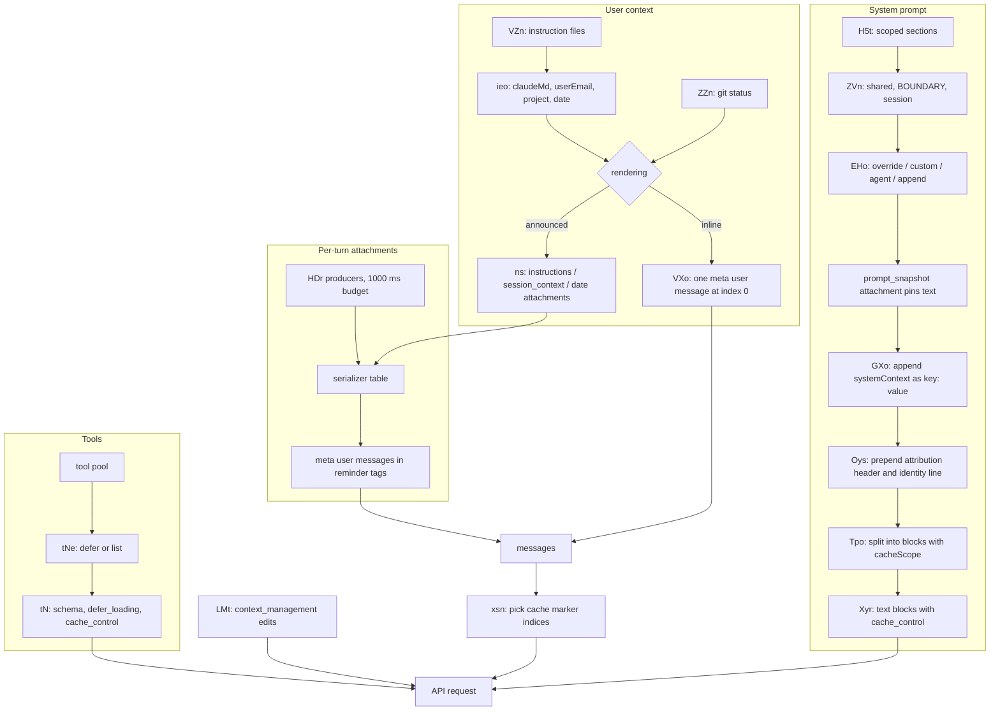
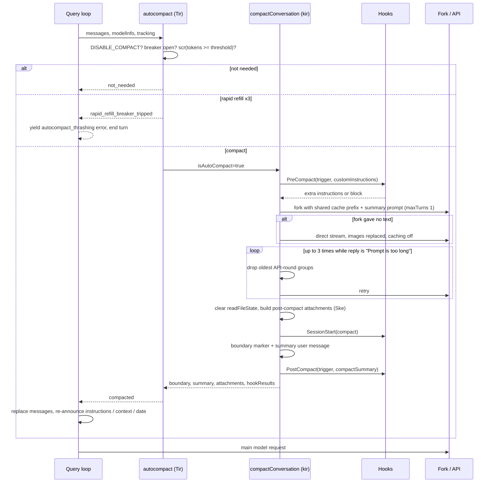

# Static pass 02: prompt assembly, instruction files, attachments, context window, compaction, memory

Target: Claude Code CLI 2.1.296 (Windows x64), extracted module graph under
`extracted\2.1.296\~BUN\root\`. Read-only static analysis. Every offset below is a character
offset into the named chunk. Mangled identifiers are quoted as shipped; names in *italics* are
conceptual names of mine.

Labels: **VS** = VERIFIED-STATIC, **SI** = STRONGLY INFERRED, **HYP** = HYPOTHESIS, **UNK** = UNKNOWN.
"VS" means the code was read in the shipped chunk. It never means the path was observed running.

---

## 1. Scope and coverage

### Searched and read

| Area | Chunk(s) | What was read |
|---|---|---|
| System prompt composer | `chunk-phacttch.js` 1,991,000 to 2,029,000; 448,797; 123,174 | `jR`, `D5t`, `H5t`, `ZVn`, `gIe`, `em`, `elt`, section function heads |
| Effective prompt (custom / append / agent) | `chunk-phacttch.js` 2,099,352 | `EHo` in full |
| System block split and cache scopes | `chunk-nfvf6nm0.js` 276,337 to 278,700; `chunk-zdd7h7by.js` 168,012 | `Tpo`, `sHn`, `ATe` |
| Message cache markers and TTL | `chunk-phacttch.js` 2,652,283 to 2,655,000; 2,751,437; 2,892,300 to 2,895,400 | `vsn`, `xsn`, `ZK`, `Jfe`, `Vyr`, `Xyr` |
| User / system context | `chunk-phacttch.js` 676,200 to 683,400; 828,640; `chunk-3qrxzjv5.js` 41,227; `chunk-93pksqr2.js` 29,300 to 35,800 | `ZZn`, `oeo`, `AC`, `ieo`, `VXo`, `GXo`, `ts`, `pr`, `ns` |
| Context announcements | `chunk-phacttch.js` 128,355 to 133,000; 135,275 | `vlt`, `Tlt`, `Rlt`, `gkn`, `q5o`, `Y2t` |
| Instruction file loader | `chunk-phacttch.js` 651,285; 655,248 to 675,900; `chunk-hk5re3tv.js` 22,300 to 23,600 | `VZn`, `YU`, `Gae`, `NLe`, `LLe`, `UZn`, `KRt`, `zie`, `kSr`, `fHe`, `ti` |
| Nested memory | `chunk-phacttch.js` 3,672,607; 3,682,562 | `r_n`, `Byn` |
| Attachment generator | `chunk-phacttch.js` 3,641,686 to 3,650,500 | `HDr`, `Bd`, `UDr`, head of `U2e` |
| Attachment serializers | `chunk-phacttch.js` 4,456,830 to 4,492,000 | key list of the serializer table; bodies of 9 entries |
| Skill listing | `chunk-phacttch.js` 2,028,900 to 2,033,000; 3,690,505; 3,691,854 | `wtt`, `J5t`, `n3t`, `MLr`, tail of `dar` |
| Tool schema build | `chunk-phacttch.js` 826,350 to 828,400; 2,774,300 to 2,777,800; `chunk-tgmspsjh.js` 3,646 | tail of `tN`, tool-set selection, `tNe` |
| Token accounting / windows | `chunk-phacttch.js` 405,864; 421,831; 855,043 to 864,700; `chunk-3qrxzjv5.js` 4,137; 39,071; `chunk-cvvnq4he.js` 393,385 to 395,000 | `Xd`, `sg`, `Hf`, `$Fe`, `I0e`, `J4`, `UFe`, `zFe`, `lv`, `f6`, `Vle`, `Cd`, `D5`, `um` |
| Auto-compaction | `chunk-phacttch.js` 2,592,014 to 2,600,000; `chunk-93pksqr2.js` 137,463 to 145,300 | `scr`, `Tir`, `Uon`, `vrr`, call site in the query loop |
| Compaction core | `chunk-phacttch.js` 2,487,637; 2,498,264; 2,504,045 to 2,507,300; 2,559,429 to 2,590,500; 4,504,878 | `kir`, head of `kZo`, `Non`, `Ske`, `zur`, `Kur`, `Mon`/`gke`, `yke`, `cke`, `L8`, `tG` |
| Server-side clearing | `chunk-3qrxzjv5.js` 99,331; 102,075 to 108,700; `chunk-phacttch.js` 855,300 to 856,300; 2,803,427 | `ggs`, `LMt`, `$ms` |
| Memory | `chunk-cvvnq4he.js` 541,728 to 546,300; `chunk-p9na5vps.js` 87,298; 135,629; 141,336; `chunk-a88xynhk.js` 823; `chunk-xkngt9ra.js` 16,142 | `Ou`, `ow`, `MY`, `fi`, `bz`, `iLn`, head of `M9t`, head of `yFr` |

### Not reached (stated so nothing is laundered into confident prose)

- **Text of each system-prompt section.** Only names, order and gating were read. Section bodies were deliberately not read beyond their first 140 characters.
- **Skill discovery directories.** The `SKILL.md` loaders at `chunk-phacttch.js@3381746` to `@3387299` and `@967569` were located but not read. Section 2.5 covers the listing and frontmatter only.
- **Skill invocation payload.** The Skill tool's `call` body and the `invoked_skills` serializer (`chunk-phacttch.js@4478041`) were located but not read.
- **Reactive compaction** (`pir`, `tqt`, the `w` precompute callback) and **partial compaction** beyond the first 2,000 characters of `kZo`.
- **`compactManually`** in `chunk-axsjqh89.js@14354` and **`applyAutoCompactWindow`** in `chunk-vpjjh7rg.js@1968`: resolved, not read.
- **Session-memory stores** (`chunk-9aj8c5b3.js` `SessionMemoryStores`), **org memory**, **memory relevance selector** beyond the anchors quoted.
- **Hook executors** `XEe` / `tkt` (`chunk-phacttch.js@2931735`, `@2932922`): call sites read, bodies not read.
- **The mid-conversation `api_system` message path** (system-role messages inside `messages`): only its cache-marker handling was read.
- **Request body assembly** between `chunk-phacttch.js@2777800` and `@2803400`.

---

## 2. Findings

### 2.1 System prompt construction (Q1)

**F1.1 (VS) The prompt is built as a list of scoped sections, then flattened.**
`jR(tools, model, opts)` at `chunk-phacttch.js@2018756` calls a composer hook `aYn` (`QP.composeSections`, `@449273`), which defaults to `H5t(tools, model, opts)`. The result is an array of `{id, text, scope}` where scope is `"shared"` or `"session"`. `ZVn(sections, boundary)` at `@448797` emits all `shared` texts, then the boundary string if there is at least one shared section, then all `session` texts. Each string then passes through `vEe` (a prompt-ablation filter keyed on configured strings, `@819777`).
Anchor: `ZVn(s,lue()?wO:null).map((h)=>vEe(h))`.

**F1.2 (VS) The dynamic boundary is a literal sentinel string.**
`wO="__SYSTEM_PROMPT_DYNAMIC_BOUNDARY__"` at `chunk-ff982hys.js@75308`. It is only inserted when `lue()` is true. `lue()` at `chunk-cvvnq4he.js@405247` returns true only when two gate functions `kh()` and `wi()` pass and the provider is `"firstParty"` or `"anthropicAws"`.
Anchor: `return e==="firstParty"||e==="anthropicAws"`.

**F1.3 (VS) Ordered section list for the normal (non-lean) prompt.** From `H5t` at `chunk-phacttch.js@2019875`.

*Shared scope (static, before the boundary), in order:*

| # | Section id | Builder | Role | Depends on |
|---|---|---|---|---|
| 1 | `intro` | `cBo(outputStyle)` `@1999384` | identity sentence plus security preamble | whether an output style is active (two intro variants `I5t` / `M5t`) |
| 2 | `system` | `mBo(model)` `@2000324` | how output is displayed, tags, hooks, context handling | model (selects reminder wording via `O5t`) |
| 3 | `doing_tasks` | `gBo()` `@2001457` | coding task conduct | emitted only when output style is null or `keepCodingInstructions===true` |
| 4 | `actions` | `hBo()` `@2005523` | reversibility and blast radius | none seen |
| 5 | `tools` | `_Bo(toolNameSet)` `@2009298` | tool usage policy | which tools are enabled (todo/task tool, Agent tool) |
| 6 | `tone` | `bBo()` `@2013721` | tone and style | none seen |
| 7 | `memory_static` | `Tfs(model)` | memory guidance, static form | only when `excludeDynamicSections` (SDK preset) |

*Session scope (dynamic, after the boundary), in order.* Each is an `em(name, compute)` entry resolved by `elt`:

| # | Section name | Gate (as read) |
|---|---|---|
| 1 | `communication[:L][:send_user_msg]` | always; variant by lean model and brief mode |
| 2 | `pronouns` | constant |
| 3 | `action_caution[:L]` | model |
| 4 | `task_continuity` | canonical model |
| 5 | (name in `X0o`) via `Z0o(model)` | model family; one arm is `claude-fable-5-1` |
| 6 | `tool_param_json` | model family and flag `tengu_silent_harbor` |
| 7 | `session_guidance[:L][:sdk]:<PV()>` via `SBo` | enabled tools, loaded skills, lean, SDK preset |
| 8 | `memory[:L]` via `M9t` | omitted when `excludeDynamicSections`; auto-memory state |
| 9 | `env_info_static` or `env_info_simple` via `ABo` | SDK preset picks the static name |
| 10 | `bg-session` via `PBo` | `CLAUDE_CODE_SESSION_KIND==="bg"` and `CLAUDE_JOB_DIR` |
| 11 | `context_management` | constant `MBo` |
| 12 | `brief` | brief mode enabled |
| 13 | `focus_mode[:L]` | focus view mode |
| 14 | `act_dont_rederive` | env `CLAUDE_CODE_ACT_DONT_REDERIVE` or flag `tengu_cedar_lantern` (default true) |
| 15 | `delivering_work_max` | env `CLAUDE_CODE_BISON_CAIRN` or model predicate |
| 16 | `overcorrection` | model predicate |
| 17 | `subagent_steer_delegation` | Agent tool present and an experiment arm |
| 18 | `opus5_reduced_delegation` | model predicate and flag `tengu_slate_bittern` (default true) |
| 19 | `heron_brook`, `brook_heron`, `willow_tern` | server-supplied experiment text |
| 20 | `autonomy_append` | flag `tengu_amber_sextant` (default true) and model predicate |
| 21 | `endconv_deferred_hint` | end-conversation tool present |
| 22 | `total_tokens` via `K5t` | off when `CLAUDE_CODE_DISABLE_ATTACHMENTS` or `CLAUDE_CODE_SIMPLE` |
| 23 | `user_pays` | flag `tengu_wobbly_dahl` (default false) |
| 24 | `repl_working` | `CBo` returns null in this build |

Anchor for the shape: `return[...gIe("shared",[...Te,...]),...gIe("session",[..._e.map(`.

**F1.4 (VS) Two alternate shapes.**
- *Bare mode*: when `RFe()` is true the whole prompt is one session section `bare` containing only `CWD:` and `Date:` lines, or empty for the SDK preset. Anchor: `gIe("session",[["bare",\`CWD: ${se()}`.
- *Lean mode*: when `V4(model)` is true the six shared sections are replaced by one `lean_body` section from `wBo` (`@2014347`).

**F1.5 (VS) Session sections are memoized per session.** `elt` at `@123330` reads a section cache (`Wpt()`, the exported `getSystemPromptSectionCache`). A section with `cacheBreak:false` is computed once and reused; `em()` always sets `cacheBreak:false`. The cache is cleared by `a6` (`clearSystemPromptSectionState`). Consequence for a reimplementation: a dynamic section's text is frozen at first computation until an explicit invalidation.
Anchor: `if(!h.cacheBreak&&s.has(h.name))return s.get(h.name)??null`.

**F1.6 (VS) Replacement and append rules.** `EHo` at `chunk-phacttch.js@2099352`:

| Input | Effect |
|---|---|
| `overrideSystemPrompt` | prompt is exactly `[override]`; nothing else is added |
| coordinator mode and no main-thread agent | `[getCoordinatorSystemPrompt(...), append?]` |
| `customSystemPrompt` (string) | split at the boundary by `ATe`, replaces the default list |
| `customSystemPrompt` (array) | used as is |
| main-thread agent definition | agent prompt **replaces** the base list, unless the agent has `appendSystemPrompt`, in which case it is placed **after** the base list |
| `skillsPersistencePrompt` | appended after agent/base |
| `MLn(tools)` result | appended next (role not read, **UNK**) |
| `appendSystemPrompt` | always last |

Anchor: `prompt:Ei([...G?[G]:V,...S?[S]:[],...he?[he]:[],...D?[D]:[]])`.
Output styles do not go through `EHo`: they change the `intro` variant and drop `doing_tasks` (F1.3), and an `output_style` / `output_style_instructions` attachment carries the style text (F4.2).

**F1.7 (VS) Subagent prompt tail.** `aKt` at `@2023466` appends to an agent's prompt: a sentence about messages from the launching agent, a `Notes:` block, and the `total_tokens` line when enabled.

**F1.8 (VS) Identity line is chosen separately and prepended at request time.** `sHn` at `chunk-nfvf6nm0.js@276337` picks one of three strings (`Nl`, `bm`, `ym`): Vertex always gets `Nl`; non-interactive with an append prompt gets `bm`; non-interactive without gets `ym`; otherwise `Nl`. `Oys` builds `[attributionHeader, identityLine, ...sections]`.
Anchor: `h=Ei([s,r,...e].filter(Boolean))`.

**F1.9 (VS) System context is appended to the system prompt as `key: value` lines.** `GXo` at `chunk-phacttch.js@828640` joins the systemContext map as one extra block. In this build systemContext contains only `perforceMode` (when `CLAUDE_CODE_PERFORCE_MODE`) and optionally `cacheBreaker`. Git status is no longer here (F3.2).
Anchor: `Object.entries(n).map(([r,s])=>\`${r}: ${s}\`)`.

**F1.10 (VS) Split into cacheable system blocks.** `Tpo(blocks, opts)` at `chunk-nfvf6nm0.js@276985` classifies each string: starts with `B4e` (attribution header), is one of the three identity lines, equals `GXt` (a third special block, role **UNK**), or other. Three outcomes:

| Condition | Blocks emitted (in order) with `cacheScope` |
|---|---|
| global cache on, `skipGlobalCacheForSystemPrompt`, no boundary | header `null`; identity `"org"`; `GXt` `null`; rest joined `"org"` |
| global cache on, boundary found | header `null`; identity `null`; `GXt` `null`; **static joined `"global"`**; **dynamic joined `"org"`** |
| otherwise (including boundary missing) | header `null`; identity `"org"`; `GXt` `null`; rest joined `"org"` |

`Xyr` at `chunk-phacttch.js@2895200` turns these into `{type:"text", text, cache_control?}`; a block gets `cache_control` only when caching is enabled and `cacheScope!==null`. `ZK({scope, ttl})` at `@2751437` produces `{type:"ephemeral", ttl?, scope:"global"?}`: `scope` is only written for `"global"`; `"org"` yields a plain ephemeral marker.
Anchors: `D.push({text:j,cacheScope:"global"})`; `...e==="global"&&{scope:e}`.
Telemetry events: `tengu_sysprompt_boundary_found`, `tengu_sysprompt_missing_boundary_marker`, `tengu_sysprompt_using_tool_based_cache`.

**F1.11 (VS) TTL selection.** `vsn` then `Jfe` (`@2652283`, `@2751437`), first match wins:

1. `FORCE_PROMPT_CACHING_5M` set: `5m`.
2. Env `CLAUDE_CODE_PROMPT_CACHE_TTL` (main-class query sources) or `CLAUDE_CODE_SUBAGENT_PROMPT_CACHE_TTL` (others).
3. Settings `promptCacheTtl` / `subagentPromptCacheTtl`.
4. Agent frontmatter TTL (ignored when it asks `1h` while on overage).
5. `ENABLE_PROMPT_CACHING_1H`, or `ENABLE_PROMPT_CACHING_1H_BEDROCK` on Bedrock: `1h`.
6. Not a subscriber (`wt()` false) or on overage: `5m`.
7. Query source not in the allowlist from flag `tengu_prompt_cache_1h_config` (default `["repl_main_thread*","sdk","auto_mode","memdir_relevance"]`): `5m`.
8. Flag `tengu_tidy_frost` and a model match: `5m`.
9. Otherwise `1h`.

**F1.12 (VS) Message cache markers.** `xsn` at `@2653651` returns a set of message indices. The main marker is the last message that is not `api_system`, not an ephemeral user message, and has a stampable final block; with `skipCacheWrite` it steps back one more. An `api_system` tail can take the marker instead when allowed. Up to two more markers: one before a divergence or parent-reply assistant message, and a fork-point pin. `tyr` / `nyr` at `@2754203` put `cache_control` on the **last content block** of each marked message. Thinking, redacted thinking and empty text blocks cannot carry the marker (`s6e`).
Anchor: `...S===h.length-1?r?{cache_control:ZK({ttl:s})}:{}:{}`.

**F1.13 (VS) Tools can carry a cache marker.** `tN` writes `ro.cache_control=n.cacheControl` when its caller passes one (`@827969`). Which tool gets it was not read (**UNK**).

### 2.2 Instruction-file discovery (Q2)

**F2.1 (VS) Filenames and walk.** `VZn` at `chunk-phacttch.js@667300`. Load order, which is also the order of appearance in the injected text:

| Order | Type label | Path(s) |
|---|---|---|
| 1 | Managed | `<managed dir>/CLAUDE.md` (`DY("Managed")`) |
| 2 | Managed | policy-helper text (`RWn()`), synthetic path `"<policyHelper>"` |
| 3 | Managed | `policySettings.claudeMd` string from managed settings, synthetic path `ORt` |
| 4 | Managed | every `*.md` under `<managed dir>/.claude/rules/` (recursive) |
| 5 | User | `<config home>/CLAUDE.md` (only when user settings source is enabled) |
| 6 | User | every `*.md` under `<config home>/rules/` |
| 7 | Project / Local | for each directory from the filesystem root **down to** the original cwd: `CLAUDE.md`, `.claude/CLAUDE.md`, `.claude/rules/**/*.md`, then `CLAUDE.local.md` |
| 8 | (hook) | files from a registered reader `qie.peek(session)?.read` |
| 9 | Project / Local | for each additional directory (`jLe()`): `CLAUDE.md`, `.claude/CLAUDE.md`, `.claude/rules/`, `CLAUDE.local.md` |
| 10 | AutoMem | the auto-memory index `MEMORY.md` (F13.1) |

Anchors: `for(let tn=nt;tn!==void 0&&tn!==RZn(tn).root;tn=NE(tn))ct.unshift(tn)`; `projectFiles:io?[eg(tn,"CLAUDE.md"),eg(tn,".claude","CLAUDE.md")]`.

Notes:
- The upward walk goes to the filesystem root, not the git root. The root directory itself is excluded by the loop condition.
- Project files are skipped for a directory that is inside the main repo but outside the current worktree (`hwt`, `@666049`).
- Project files require the `projectSettings` source; local files require `localSettings`.
- **AGENTS.md is not loaded as instructions.** The only read is an existence probe `zZn` (`@666200`, `eg(e,"AGENTS.md")`) feeding telemetry, plus a file-watch list `fRt` (`@651285`) that names `AGENTS.md` and `.claude/AGENTS.md`. Label for "not loaded": **SI** (no loader call with that name was found in the walk; other chunks reference AGENTS.md for import tooling).

**F2.2 (VS) Stated precedence is by position plus a preamble.** `fHe` at `chunk-hk5re3tv.js@23524` prefixes the concatenation with a fixed preamble (`ei`, begins `Codebase and user instructions are shown below.`) and each file with `Contents of <path><suffix>:`. Suffixes from `ti` (`@22900`):

| Type | Suffix role |
|---|---|
| Project | project instructions, checked in |
| Local | user's private project instructions |
| AutoMem | user's auto-memory, persists across conversations |
| Managed | organization-managed policy instructions |
| User | user's private global instructions |

There is no code-level merge or override. Later files simply appear later. Files nearer the cwd come after files nearer the root.

**F2.3 (VS) Disable switches.** `CLAUDE_CODE_DISABLE_CLAUDE_MDS` returns empty from the rule and nested loaders (`@674300`). `isClaudeMdLoadingDisabled` (`CT`, `chunk-zcfhbsps.js@1633`) zeroes the `claudeMd` user-context value in `ieo`. Setting `claudeMdExcludes` (schema at `chunk-ff982hys.js@270917`) excludes User, Project and Local files by picomatch pattern; Managed files cannot be excluded (`qRt`, `@660416`).

**F2.4 (VS) `@path` includes.** `UZn` at `@659300`:
- Regex `/(?:^|\s)@((?:[^\s\\]|\\ )+)/g` run over markdown **text** tokens only. `code` and `codespan` tokens are skipped. HTML comments are stripped first.
- A `#fragment` is cut off. `\ ` is unescaped to a space.
- Accepted forms: `./x`, `~/x`, absolute `/x`, or a bare name starting with `[a-zA-Z0-9._-]`.
- Resolved relative to the including file's directory.
- Depth limit `$nr=5` (`KRt`: `s>=$nr` returns). A `processedPaths` set prevents cycles and double loads.
- Non-text extensions are skipped (`Skipping non-text file in @include`).
- Included files keep the parent's type and record `parent`.

**F2.5 (VS) External include approval.** An include outside the original cwd (`YL(path)` false) is loaded only when `includeExternal` is true. For Project and Local files that flag is `hasClaudeMdExternalIncludesApproved` from project config, or a forced-true call. User files always allow external includes. The approval UI is `ClaudeMdExternalIncludesDialog` (`chunk-bbp15k0r.js`), body not read.
Anchor: `if(h>0&&!V&&!YL(he))return[]`.

**F2.6 (VS) Size cap.** `DU=4194304` bytes (`@655248`). A file over the cap or not a regular file is skipped with the log line `not a regular file or exceeds ${DU} byte limit`. No truncation of CLAUDE.md content was found; the file is dropped whole.

**F2.7 (VS) Rule frontmatter.** `LZn` at `@656270` reads frontmatter key `paths`, strips a trailing `/**`, and drops the list if it is empty or all `**`. The result is stored as `globs`. `zie` at `@675322` loads a rules directory with `conditionalRule:true` and keeps only rules whose globs match the target path, using gitignore-style matching (`.ignores(G)`) on a path relative to the project root. **SI**: the eager walk (`conditionalRule:false`) keeps only rules without globs; the filter line inside `Gae` was cut off in my read.

**F2.8 (VS) Nested / lazy loading.** `Byn` at `@3682562` runs each turn as attachment label `nested_memory`. Tools push file paths into `pendingNestedMemoryTriggers`; `Byn` moves them into `nestedMemoryAttachmentTriggers` and calls `r_n(path, ...)` for each. `r_n` (`@3672607`) iterates `iar(path, ...)` to collect instruction files for directories between the cwd and the touched file plus conditional rules that match it, and returns `nested_memory` attachments. Files that cannot be shown are tracked as `withheld_memory`.
Serialization: `nested_memory` becomes a meta message `Contents of <path>:\n\n<content>` wrapped in the reminder tag (`@4461765`). **Audit correction (runtime):** on the wire this message has `role:"system"`, not user. Captures C2 and E08 show it, driven by `systemTurns` and the `mid-conversation-system` beta (`@2689200`, `@135509`); the first version never connected the two. The environment block travels the same way.

**F2.9 (VS) Injection path: two renderings.** This is the main structural finding of this pass.

- *Inline rendering* (legacy): `VXo` at `@828900` prepends **one meta user message** to the message list. Content is `Tyr` + one `# <key>\n<value>` entry per user-context key + `Bms`. `Tyr` opens the `<system-reminder>` tag and `Bms` closes it (`chunk-3qrxzjv5.js@41227`). The `claudeMd` key holds the `fHe` text.
- *Announced rendering* (default): `ts` in `chunk-93pksqr2.js@30700` empties `userContext` and routes the content into **attachments**: `instructions` (the files), `session_context` (email, project, git status, perforce), `date`, `context_sections`, `coordinator_context`. Each becomes its own meta user message wrapped in the reminder tag.

Selection (**audit correction**): the first version said flag `tengu_foamy_spring` selects the rendering. `ts` (`chunk-93pksqr2.js@30700`) has one call site and no flag gate. It takes the inline branch only when a recorded snapshot says inline (`yc(messages) ?? hc(messages)` equals `"inline"`) or via the catch fallback `ea`; otherwise it is announced. `Y2t()` (`chunk-phacttch.js@135275`) reads `rf()`, the flag with default true (`chunk-cvvnq4he.js@142950`), but that only controls honouring and recording a rendering. A conversation that already has a `session_context` attachment stays announced (`hc`). `bareFork` skips routing. Runtime E01 agrees: four text blocks in `messages[0]`.
Anchors: `rendering:"announced"`; `xe({content:Tyr+Object.entries(n).map(([r,s])=>\`# ${r}`.

**F2.10 (VS) Instruction updates are deltas.** `q5o` at `@130600` compares the current file set against the last full `instructions` attachment plus later deltas (`gkn`). It emits `{files: changedOrNew, removed?, changed:true}` or nothing. `Rlt` renders a delta with a sentence saying each file replaces its earlier copy and lists `Instructions no longer present: <path>`.

### 2.3 User context vs system context (Q3)

**F3.1 (VS) User context keys.** `ieo` at `chunk-phacttch.js@681700` builds `{claudeMd, userEmail?, attachedProject?, currentDate}`. `userEmail` is omitted when `ANTHROPIC_UNIX_SOCKET` is set. The promise is cached per session and invalidated by `kx(session, reason)`.
Anchor: `currentDate:\`Today's date is ${Sdo(e)}.\``.

**F3.2 (VS) Git status.** `ZZn` at `@676400` runs `git --no-optional-locks status --short`, `log --oneline -n 5`, `config user.name`, plus branch and main-branch lookups. Status is truncated at `GLe=2000` characters with a notice. It is skipped in remote mode, when `CLAUDE_CODE_REMOTE` is set, when `CLAUDE_CODE_DISABLE_GIT_INSTRUCTIONS` is set, or when setting `includeGitInstructions` is false. In announced rendering it travels as `announced.gitStatus` inside `session_context` (`pr` in `chunk-93pksqr2.js@33600`), and a value already announced in the transcript is reused rather than recomputed.

**F3.3 (VS) First turn vs later turns.** `ns` at `chunk-93pksqr2.js@34300` runs before every model request and emits only what is missing or changed:
- `instructions`: full on first turn, delta later.
- `session_context`: first turn, or when values differ (`changed:true` and a `reason`).
- `date`: first turn, or when the calendar date differs from the last `date` attachment (`changed:true`).
- `context_sections`: once per conversation.
Refresh reasons enumerated in `JB` (`@128355`): `session_start`, `compaction`, `policy_refresh`, `directory_added`, `settings_sync`, `account_change`, `hooks_invalidate`, `policy_verdict`, `memory_paused`, `memory_resumed`, `auto_memory_off`, `auto_memory_back_on`.
Auxiliary query sources skip most announcements (`y=as(n)==="auxiliary"`).

**F3.4 (VS) A `prompt_snapshot` attachment pins the prompt.** Schema `tjn` at `@135290` stores `systemPrompt: string[]`, `tools[]` (name, description, schema, server), `cliPrefix`, `contextRendering` and several wire-shape booleans. `qU` reads the latest one back. `tN` prefers `recordedEntry` / `recordedDescription` over the freshly computed tool definition. **SI**: this keeps the system prompt and tool schemas byte-stable for a conversation across restarts so the prompt cache survives.

### 2.4 Attachments (Q4)

**F4.1 (VS) Generator.** `HDr(input, ctx, ideSelection, queued, messages, querySource, opts)` at `chunk-phacttch.js@3641686`. Each producer is wrapped by `Bd(label, fn)`, which swallows errors (returns `[]`) and samples 5% for telemetry `tengu_attachment_compute_duration`. A shared `AbortController` is aborted after **1000 ms**. Subagents get the first two groups only; the third is main-thread only.

Short-circuits: returns `[]` for one agent-context kind; with `CLAUDE_CODE_SIMPLE` only queued commands; with `CLAUDE_CODE_DISABLE_ATTACHMENTS` or `bareFork` only queued commands, agent listing, sandbox instructions and one more delta.

| Group | Label | Fires when |
|---|---|---|
| input | `at_mentioned_files` | user text contains `@file` mentions |
| input | `mcp_resources` | user text references MCP resources |
| input | `agent_mentions` | text names an active agent |
| input | `skill_mentions` | human-typed prompt on main thread, Skill tool present |
| input | `peer_mentions` | human-typed prompt with pre-expansion input |
| all | `queued_commands` | queued prompts or task notifications exist |
| all | `sandbox_instructions` | sandbox instruction text changed vs transcript |
| all | `artifact_opening_prefetch` | feature gate |
| all | `environment` | environment snapshot changed vs transcript |
| all | `model` | model identity changed vs transcript |
| all | `session_settings` | session settings changed |
| all | `ultrathink_effort` | keyword in input |
| all | `deferred_tools_delta` | deferred tool set changed vs what was announced |
| all | `agent_listing_delta` | agent list changed |
| all | `mcp_instructions_delta` | MCP server instructions changed |
| all | `mcp_dropped_tools_delta` | MCP tools dropped |
| all | `tool_hosts_notice`, `tool_hosts_correction` | remote tool hosts |
| all | `changed_files` | a previously read file has a newer mtime |
| all | `nested_memory` | pending triggers (F2.8) |
| all | `dynamic_skill` | new skill directories discovered |
| all | `skill_listing` | skills not yet sent to this agent (F5.2) |
| all | `plan_mode`, `plan_mode_exit` | permission mode transitions |
| all | `proactivity`, `auto_mode`, `auto_mode_exit` | mode state |
| all | `todo_reminders` | todo/task tools enabled (`s2()`); task or todo variant by `Fx()` |
| all | `tool_search_usage_reminder` | gate `M_o()` |
| all | `teammate_mailbox`, `team_context` | team mode |
| all | `agent_pending_messages` | messages queued for this agent |
| all | `critical_system_reminder` | SDK-provided reminder |
| all | `silent_turn_reminder`, `elapsed_time_reminder` | turn with no user input, model predicates |
| all | `total_tokens_reminder`, `budget_usd` | token/budget options |
| main | `workflow_keyword_request`, `ultra_effort_enter`, `workflow_size_guideline_change` | workflow feature on |
| main | `ide_selection`, `ide_opened_file`, `queued_ide_selections` | IDE integration state |
| main | `output_style` | output style active |
| main | `diagnostics`, `lsp_diagnostics` | new diagnostics |
| main | `unified_tasks` | background task state |
| main | `async_hook_responses` | async hooks finished |
| main | `memory_update`, `withheld_memory` | memory file changes |
| main | `token_usage` | token usage option |

Anchor: `Bd("deferred_tools_delta",()=>Promise.resolve(a4t(`.

**F4.2 (VS) Serialization.** A table of `type -> (attachment) => Message[]` sits at `chunk-phacttch.js@4456830` to `@4471125` (88 top-level keys by brace-aware parse, audit correction from 84), followed by a `switch` with 22 outer cases. The list below is corrected: `image`, `pdf`, `notebook`, `text` are nested inside `case "file"`, and the switch also handles `agent_listing_delta`, `mcp_instructions_delta`, `mcp_dropped_tools_delta`, `memory_update`, which the first version omitted. First-version list (`file`, `image`, `pdf`, `notebook`, `mcp_resource`, `queued_command`, `relevant_memories`, `invoked_skills`, `plan_mode`, `plan_mode_reentry`, `auto_mode`, `todo_reminder`, `task_reminder`, `task_status`, `diagnostics`, `hook_success`, `async_hook_response`, `deferred_tools_delta`, `tool_search_usage_reminder`, `attention_budget`, `context_efficiency`, `text`).

The common pattern is `_l([xe({content, isMeta:true})])`: an internal **user-role** message flagged `isMeta` (on the wire, nested memory and the environment block are sent as `role:"system"` when the mid-conversation-system beta is on; see F2.8), whose text blocks are each wrapped by `Kl` in the reminder tag (`_l` at `@4441076`). Many types serialize to `[]` (UI-only): for example `withheld_memory`, `prompt_snapshot`, `prompt_render_point`, `deferred_tools_record`, `already_read_file`, `hook_cancelled`, `max_turns_reached`.
Anchor: `nested_memory:(e)=>_l([xe({content:\`Contents of ${e.content.path}:`.

Deferred-tool announcements use five fixed lead sentences at `@4471150` (deferred tools now available via tool search; tools just became available; updated definitions; no longer available; now available).

### 2.5 Skills (Q5)

**F5.1 (UNK) Discovery locations** were not read. Evidence that exists: `loadedFrom` takes values `"plugin"` and `"skills"` (regex over `chunk-phacttch.js`), `"SKILL.md"` loaders at `@3381746` to `@3387299`, bundled skills via `registerBundledSkill` (`chunk-6ntbbsfg.js`), MCP skills via `skills/list` and `skills/get` (`chunk-ct4zdnxj.js@1741`).

**F5.2 (VS) Frontmatter fields consumed** (plugin command/skill loader at `chunk-phacttch.js@960825`): `allowed-tools`, `argument-hint`, `arguments`, `when_to_use`, `version`, `name`, `model` (`inherit` allowed), `effort`, `disable-model-invocation`, `user-invocable` (default true), `shell`, `hooks`. `${CLAUDE_SKILL_DIR}` is substituted in skill mode. `description` is used via `hasUserSpecifiedDescription`.

**F5.3 (VS) The listing reaches the model as an attachment, not in the tool description.** The Skill tool description (`e3t`, `@2032700`) says skills "appear in a system-reminder listing". `dar` (`@3691208`) emits `{type:"skill_listing", content, skillCount, isInitial, names}`; the serializer (`@4462857`) renders `The following skills are available for use with the Skill tool:\n\n<content>` as a meta user message.
`MLr` (`@3690505`) keeps a per-agent `sentSkillNames` set and returns only skills not yet sent, so later turns get a delta. `resumeSeedNames` pre-marks skills already listed in a resumed transcript.

**F5.4 (VS) Budget.** `wtt(contextWindow, bytesPerToken)` at `@2029306`:

```
budgetChars = env SLASH_COMMAND_TOOL_CHAR_BUDGET            if set and > 0
            else floor((contextWindow ?? 200000) * bytesPerToken(4) * fraction)
fraction    = settings.skillListingBudgetFraction ?? 0.01
```

Default: 200000 x 4 x 0.01 = 8000 characters. Per-entry description cap `settings.skillListingMaxDescChars ?? 1536` with an ellipsis (`jBo`). Entry text is `- <name>: <description>[ - <whenToUse>]`. When the total exceeds the budget (`n3t`, `@2030900`): bundled skills and name-only skills keep full entries; the others are sorted by a usage score and keep their description only while the remaining budget allows; the rest fall back to `- <name>`. A warning is logged: `Skill listing over budget`.

**F5.5 (UNK) What invoking a skill injects** was not read. Post-compaction re-injection is covered in F10.4.

### 2.6 Tool definitions (Q6)

**F6.1 (VS) Per-tool schema.** `tN(tool, opts)` ends at `chunk-phacttch.js@827800` and returns `{name, description, input_schema, strict?, eager_input_streaming?, defer_loading?, cache_control?}`. `citations:{enabled:true}` is added for one tool under a gate. When `E$()` is true (experimental betas disabled) every key outside `name, description, input_schema, cache_control` (and `defer_loading` unless `tXt()`) is stripped.
Anchor: `if(n.deferLoading)ro.defer_loading=!0`.

**F6.2 (VS) Which tools defer.** `tNe(tool, set)` at `chunk-tgmspsjh.js@3646`: never defers when `alwaysLoad===true`, when the tool is in the always-listed set (`s`: includes the tool-search tool `wl`, another fixed tool `va`, the Agent tool when fork subagents are on), or when `LMn()` is true. Otherwise defers when `isMcp===true`, or the tool is in a configured name list, or `shouldDefer===true`.
Anchor: `if(e.isMcp===!0)return!0`.

**F6.3 (VS) Tool search mode.** At `@2774300`: mode is `"tool_search"` when tool search is on, else `"tool_addition"` when `Wn`, else none. With no deferred tools and no pending MCP servers it logs `Tool search disabled: no deferred tools available to search` and turns off. In tool-search mode the request keeps non-deferred tools, the search tool, and deferred tools already discovered in the transcript (`bJ`). In no-search mode the search tool is filtered out. A stub tool `{name:xFe, description, input_schema:{type:"object",properties:{}}, defer_loading:true}` exists behind flag `tengu_deferred_stub_tool` (default true), `@2652500`.

**F6.4 (VS) Ordering.** The final list is `K2(xOn(fo))`; `K2` is the identity function in this build (`chunk-0a3kw9bb.js@34126`). `xOn` was not read, so the sort key is **UNK**.

**F6.5 (VS) MCP naming.** `gh` and `_Ke` at `chunk-0a3kw9bb.js@34260`: an MCP tool name starts with `mcp__`, and the server name is `name.split("__")[1]`. So the form is `mcp__<server>__<tool>`.

### 2.7 Token accounting (Q7)

**F7.1 (VS) Hybrid count: last API usage plus an estimate of the tail.** `Hf(messages, bytesPerToken)` at `chunk-phacttch.js@855043`:
1. `$Fe` scans backwards. A `compact_boundary` gives `{tokens:0, anchorIndex}`. Otherwise the last assistant message with non-zero usage is the anchor; the anchor index is walked back over sibling messages sharing the same response id.
2. Anchor tokens = `KI(usage)` = `input_tokens + cache_creation_input_tokens + cache_read_input_tokens + output_tokens` (`chunk-3qrxzjv5.js@39500`). If `usage.iterations` exists, the last entry that is not `advisor_message` or `compaction` is used instead.
3. Result = anchor tokens + `sg(messages after anchor)`.

**F7.2 (VS) Estimator.** `Cd(text, n=4)` = `Math.round(text.length / n)` (`chunk-3qrxzjv5.js@4137`). The divisor is 2 for `json`, `jsonl`, `jsonc` (`bo`). `sg` sums `gV(content)` over user, assistant and `api_system` messages; attachments are counted by rendering them first. `bytesPerToken` is per model (`vh(model)` in `Xd`).

**F7.3 (VS) Server-cleared tokens are added back.** `I0e` reads `message.context_management.applied_edits` on the latest assistant message and sums `cleared_input_tokens` for `clear_tool_uses_20250919` edits (`$ms`). The autocompact check uses `Hf(...) - snipFreed + I0e(...)`.

**F7.4 (VS) Context window.** `um(model, betas)` at `chunk-cvvnq4he.js@394576`:
- If `DISABLE_COMPACT` is set and `CLAUDE_CODE_MAX_CONTEXT_TOKENS > 0`, that value wins.
- 1,000,000 when the model id has a `[1m]` suffix, or the 1M beta header is active on a capable model, or the catalog says `context.native_1m`.
- Otherwise the catalog's declared window, capped by a "believed" ceiling `u3e` unless the model is known to exceed it.
- `cz=200000` is the default window constant; `CLAUDE_CODE_DISABLE_1M_CONTEXT` disables all 1M paths.
The per-model table is catalog data (`al(model)?.context`), not a literal table in these functions (**SI**).

**F7.5 (VS) Effective window.** `f6(modelInfo, configuredWindow)` at `@862600`:

```
reserved  = min(model.maxOutputTokens, 20000)          // Srr = 20000
effective = lv(model, configured).window - reserved
```

`lv` (`@860717`) resolves the compaction window, first match wins: env `CLAUDE_CODE_AUTO_COMPACT_WINDOW` (clamped to 100,000..1,000,000, then `min` with the model window); settings `autoCompactWindow` (global or per model via `modelSettings.<model>.autoCompactWindow`, `"auto"` allowed); client-data value; experiment value; `200000` for some sub-1M models; a model-default table (`XMt` lists `claude-sonnet-5` at 500,000 on two surfaces, 1M default); the full model window. The `source` field records which rule fired: `env`, `settings`, `clientdata`, `experiment`, `model-default`, `unknown-model`, `auto`.

### 2.8 Auto-compaction (Q8)

**F8.1 (VS) Thresholds.** `J4`, `UFe`, `zFe` at `chunk-phacttch.js@858730`:

```
compactThreshold(effective):
    base = effective - 13000
    if CLAUDE_AUTOCOMPACT_PCT_OVERRIDE = p, 0 < p <= 100:
        return min(floor(effective * p / 100), base)
    return base

level(tokens, effective, cfg, hardWindow):
    T        = compactThreshold(effective)
    S        = cfg.enabled ? T : effective
    warnAt   = S - 20000
    blockAt  = CLAUDE_CODE_BLOCKING_LIMIT_OVERRIDE (if > 0) else hardWindow - 3000
    if tokens >= blockAt:              "blocked"
    if cfg.enabled and tokens >= T:    "compact"
    if tokens >= warnAt:               "warn"
    else                               "ok"
    pctLeft = max(0, round((S - tokens) / S * 100))
```

`hardWindow` is `model.contextWindow - min(maxOutputTokens, 20000)` (`wrr`). There is no separate "error" threshold constant in this build; the three states are `warn`, `compact`, `blocked`.
A second threshold for precomputed compaction: `UFe = min(effective - round(effective * fraction), T)` with `fraction` from flag `tengu_amber_rokovoko` (default `zle=0.2`) or a table flag `tengu_amber_moleskin`.

Worked example (my arithmetic, not from the binary): 200,000 window, 32,000 max output. reserved = 20,000; effective = 180,000; compact at 167,000; warn at 147,000; blocked at 177,000.

**F8.2 (VS) Enable switches.** `jm()` at `chunk-nfvf6nm0.js@318655`: `DISABLE_COMPACT` or `DISABLE_AUTO_COMPACT` turns auto-compaction off. `Zp()` otherwise reads setting `autoCompactEnabled` (default true). `DISABLE_COMPACT` additionally makes `Tir` return `not_needed` unconditionally.

**F8.3 (VS) Should-compact predicate.** `scr` at `@2593000` returns false for excluded query sources (`ePt`, `VFe`), when a 1M-native condition `PEn` holds, when auto-compact is disabled, or when a reactive-only mode is on without an explicit window. Otherwise it computes tokens (F7.3) and returns true for level `compact` or `blocked`. It logs `autocompact: tokens=… level=… effectiveWindow=…`.

**F8.4 (VS) Circuit breakers.**
- *Failure breaker*: `Won=3`. `Uon` increments `consecutiveFailures`; at 3 it logs `circuit breaker tripped` and emits `tengu_auto_compact_circuit_breaker`. `Tir` returns `failure_breaker_open` while the count is at or above 3. A successful compaction resets it to 0 (`v5r`). **Runtime note (E35 to E37):** 25 consecutive failed compactions in one stream-json process, all routed through the reactive path, produced no breaker line and no `failure_breaker_open`; each blocked turn re-attempted compaction and ended `blocking_limit`. The route that increments `Uon` was not reached.
- *Rapid-refill breaker*: `rIt=3`. If the previous compaction was fewer than 3 turns ago, a counter increments; at 3 consecutive such refills `Tir` returns `rapid_refill_breaker_tripped`. The loop then yields an API-error-shaped message with `apiError:"autocompact_thrashing"` and ends the turn with reason `rapid_refill_breaker`. The user text begins `Autocompact is thrashing`.

**F8.5 (VS) Where the check runs.** In the query loop (`chunk-93pksqr2.js@139300`), once per loop iteration, **before** context announcements, prompt snapshot and the API call: `yield* I.autocompact(messages, ctx, modelInfo, cacheSafeParams, querySource, tracking, snipFreed, …)`. Profiling marks: `query_autocompact_start` / `query_autocompact_end`.

**F8.6 (VS) Larger-model retry.** Before the normal path, if the last assistant message requested a model with a larger window than the current one and the current level is `blocked`, `Tir` recurses once with that model and `compactionApiAttemptsLeft:{count:1}` (`acr`, `@2594500`).

### 2.9 Compaction request assembly (Q9)

**F9.1 (VS) Entry.** `kir(messages, ctx, cacheSafeParams, suppressFollowUps, opts)` at `chunk-phacttch.js@2565344`. Throws `Not enough messages to compact.` on an empty list.

**F9.2 (VS) PreCompact hook.** `XEe(session, {trigger:"auto"|"manual", customInstructions}, …)` runs first. Its `newCustomInstructions` are merged into the custom instructions (`$tt`), its `userDisplayMessage` is kept for the result, and `blockedBy` aborts with `Compaction blocked by PreCompact hook` (`RJ`).

**F9.3 (VS) Summarization prompt structure, by role.** `cke(custom, arm, hasTranscriptPath)` at `@2504347`:
1. A leading block that forbids tool calls and states the reply shape (`wnn`).
2. The arm's instructions. Arms: `control`, `lean`, `short`, `short_v2`, `capped`, chosen by env `CLAUDE_CODE_CURRIED_TRINKET` or flag `tengu_curried_trinket` (default `control`).
3. Optional `Additional Instructions:` with user and hook text.
4. A trailing reminder repeating the no-tools rule (`xnn`).
For the default `control` arm, the reply is expected to hold an `<analysis>` block and a `<summary>` block; `Qdr` strips the analysis and rewrites the summary tag to `Summary:`. Other arms were not runtime-verified.
The prompt is sent as a normal **user** message appended after the conversation.

**F9.4 (VS) Two transport paths.**
- *Forked agent, shared prompt cache* (default; gate `tengu_compact_cache_prefix` default true, off when `stripNonEssential`): `MC({promptMessages:[summaryRequest], cacheSafeParams, querySource:"compact", forkLabel:"compact", maxTurns:1, skipCacheWrite:true, skipTranscript:true, canUseTool: deny-all, …})`. It reuses the parent's system prompt, tools and message prefix so the parent's cache is read. Telemetry `tengu_compact_cache_sharing_success` / `_fallback`.
- *Direct streaming fallback*: system prompt is the single sentence `You are a helpful AI assistant tasked with summarizing conversations.`; `enablePromptCaching:false`; `querySource:"compact"`; `mcpTools:[]`; tools are the file-read tool only, or read plus one more tool plus MCP tools when tool search applies, or none with `stripNonEssential`.

**F9.5 (VS) What is stripped (direct path).** `yke` at `@2560052` replaces `image` blocks with the text `[image]` and `document` blocks with `[document]`, including inside `tool_result` content, and reduces some attachments (`Uur`). Tool results themselves are **kept**. With `stripNonEssential` (env `CLAUDE_CODE_COLD_COMPACT`) two more reducers run (`jur`, `Wur`, not read).

**F9.6 (VS) Model.** `cacheSafeParams.model ?? ctx.options.mainLoopModel`, with a fallback chain `oue(model, fallbackModel)`. A policy branch can substitute another model or throw `Compaction unavailable: …`.

**F9.7 (VS; runtime scoped) Max output tokens.** No explicit cap was found in `Non`; runtime E17a and E17c captured `max_tokens: 128000` for the default/control compaction arm. Other prompt arms remain untested.

**F9.8 (VS) Prompt-too-long retry.** If the summary text starts with `Prompt is too long` (`pH`), `Mon` drops the oldest API-round groups: enough groups to cover the reported overflow when the error carries a token gap, else `floor(groups * 0.2)` (at least 1, at most `groups-1`). If the remainder starts with an assistant message, a meta user message `[earlier conversation truncated for compaction retry]` is prepended. Up to `N8=3` retries, then error `Conversation too long. Press esc twice to go up a few messages and try again.` and telemetry `tengu_compact_failed{reason:"prompt_too_long"}`. **Runtime note (E34):** with `--autocompact 100k` the CLI routed through a separate *reactive* compaction path instead; it parsed the token gap from a 400, retried three times with a rising preserve ratio, bailed, started a second round with a last-resort request, and ended with `terminal_reason:"prompt_too_long"`. This path is not described by F9.8; see `03-runtime-experiments.md` E34.

**F9.9 (VS) Partial compaction.** `kZo(messages, index, ctx, params, {userFeedback, direction})` at `@2571700`, direction `"from"` (summarize after the index, keep before) or `"up_to"` (summarize before, keep after). It uses a different prompt builder `Ann(custom, direction)`. Only the first 2,000 characters were read.

**F9.10 (VS) PostCompact and SessionStart hooks.** `tkt(session, {trigger, compactSummary}, …)` runs after the summary is built. `CJ(session, "compact", {model, …})` runs SessionStart hooks with source `compact` inside `Ske`, skipped for one agent-context kind and when settings hooks are off. Progress events: `hooks_start` with `hookType` `pre_compact`, `post_compact`, `session_start`.

### 2.10 Post-compaction state (Q10)

**F10.1 (VS) Boundary marker.** `tG(trigger, preTokens, logicalParentUuid, userContext, messagesSummarized)` at `chunk-phacttch.js@4504878`:

```
{ type:"system", subtype:"compact_boundary", content:"Conversation compacted",
  isMeta:false, level:"info", timestamp, uuid,
  compactMetadata:{ trigger, preTokens, userContext, messagesSummarized },
  logicalParentUuid? }
```

`kir` then adds `compactMetadata.preCompactDiscoveredTools` (sorted names of deferred tools already loaded), `postTokens`, `durationMs`. Partial compaction also uses `compactMetadata.preservedMessages.anchorUuid` (seen in `ss`, `chunk-93pksqr2.js@35900`).

**F10.2 (VS) Summary message.** A **user** message with `isCompactSummary:true` and `isVisibleInTranscriptOnly:true`. Text from `L8` (`@2504760`): optional warning about foreign artifact content, a fixed lead sentence (`SRt`, `chunk-8mpz435d.js@32634`, begins `This session is being continued from a previous conversation`), the cleaned summary, an optional pointer to the transcript path, an optional note that the earliest part was not covered, and follow-up guidance **only when `suppressFollowUpQuestions` is true** (`@2505860`; `kir` passes true for auto compaction). Audit correction: the first version said "when not suppressed", which is the opposite. The guidance reads "Continue the conversation from where it left off without asking the user any further questions. Resume directly ...", plus a prompt-arm line and "Pick up the last task as if the break never happened."

**F10.3 (VS) Result shape and order.** `kir` returns `{boundaryMarker, summaryMessages, messagesToKeep:[], attachments, hookResults, userDisplayMessage, preCompactTokenCount, postCompactTokenCount, truePostCompactTokenCount, compactionUsage, ptlAttempts, promptCacheSharingEnabled}`. Full compaction keeps **no** original messages.

**F10.4 (VS) Re-attached state.** `Ske` at `@2585926`, in output order:

| # | Item | Limits |
|---|---|---|
| 1 | Recently read files (`zur`) | newest `RYe=5` files; each re-read with `maxTokens: CYe=5000`; total budget `Fur=50000` estimated tokens; plan file and memory files excluded |
| 2 | Local agent task status | non-retrieved, non-pending agents |
| 3 | Running background shell tasks | description cut to 200 chars, command to 500 |
| 4 | Peer hand-back queued commands | after the last assistant message |
| 5 | Plan file reference | when a plan exists |
| 6 | One more item from `OYe` | role **UNK** |
| 7 | Invoked skills (`Kur`) | newest first; each body truncated to `$ur=5000` tokens; total `xYe=25000` |
| 8 | Deferred-tools delta, agent listing delta, MCP instructions delta, MCP dropped-tools delta, sandbox instructions, `JZo` (environment restatement), `QZo` (model identity restatement), two more deltas | recomputed against an empty transcript |
| 9 | Goal status, one more item from `NYe` | main thread only |
| 10 | Two tool-related attachments | when tool declarations changed |

Then the SessionStart(compact) hook results. The read-file state is cleared (`readFileState.clear()`) and the memory selector reset before re-attachment.
After the compacted list is in place, the next loop iteration re-announces instructions, session context and date because the transcript no longer contains them (reason `compaction`); `ss` (`chunk-93pksqr2.js@35700`) handles the kept-tail case under flag `tengu_calm_noodle` (default true).

**F10.5 (VS) Telemetry.** `tengu_compact` with pre/post token counts, `willRetriggerNextTurn`, cache token counts, `promptCacheSharingEnabled`, `summaryPromptArm`. Request headers defined nearby: `x-cc-context-compacted`, `x-cc-compaction-request`, `x-claude-code-compaction`, `x-claude-code-context-compacted` (`@856250`); where they are attached was not read.

### 2.11 Microcompaction and server-side context management (Q11)

**F11.1 (VS) `context_management` request field.** `LMt({hasThinking, toolClearing})` at `chunk-phacttch.js@856023` returns `{edits:[…]}` or undefined:
- `{type:"clear_thinking_20251015", keep:"all"}` when the request has thinking.
- the tool-clearing edit when one was planned.
Call site: `Kk=LMt({hasThinking:ch,toolClearing:jq?.edit})` at `@2803427`.

**F11.2 (VS) Tool-result clearing after idle.** `ggs` at `chunk-3qrxzjv5.js@102400`. Mode from flag `tengu_zany_pike`: `on`, `shadow`, or off (default off; `unknown` when the flag value is a fallback). Config `wn` at `@102075`:

| Field | Value |
|---|---|
| `minIdleSeconds` | 3900 |
| `keepToolUses` | 5 |
| `clearAtLeastTokens` | 20000 |
| `triggerToolUsesBelowCount` | 3 |
| `minTriggerToolUses` | 20 |

Edit shape: `{type:"clear_tool_uses_20250919", trigger:{type:"tool_uses", value}, keep:{type:"tool_uses", value:5}, clear_at_least:{type:"input_tokens", value:20000}, exclude_tools:[…]}`. The server reports back in `context_management.applied_edits[].cleared_tool_uses` / `cleared_input_tokens`; telemetry `tengu_tool_result_clearing_after_idle_server_report`.
**SI**: the intent is to clear old tool results on the first request after a long idle gap, when the prompt cache has expired anyway (3900 s is just past a 1 h TTL).

**F11.3 (VS, corrected by audit) Client-side placeholder.** `gLn="[Old tool result content cleared]"` at `chunk-phacttch.js@4399104` is only recognized there (detectors `Cqr` / `Aqr`). The identical literal exists as `Tt` in `chunk-3qrxzjv5.js@99080` and **is written** as tool-result content: `mgs` (`@101370`) collects candidates, and `FXt` (`@100834`) replaces matching `tool_result` content with the persisted-output text or `Tt`. `mgs` has a live caller in `chunk-pcraa501.js` (`mgs(e,n,{keepRecent:5,persist,agentId})`, labelled `[CONTEXT_HINT_REJECT]`, reached from the `compact_hint_reject` path). So a client-side tool-result clearing exists in this build. The earlier claim that it only recognizes legacy placeholders was wrong: the zero-hit search covered one chunk only. Trigger conditions of the hint path were not read (**UNK**).

**F11.4 (VS, corrected by audit) Legacy microcompact names.** In `chunk-phacttch.js`, `tengu_cached_microcompact`, `tengu_time_based_microcompact`, `tengu_microcompact`, `cache_edits` have zero hits. Across the whole package `tengu_time_based_microcompact` exists once, at `chunk-3qrxzjv5.js@101708`, emitted by `mgs` with trigger `context_hint`; the other three names have zero hits anywhere. "Gone" is therefore false for one of the four. A "snip" mechanism exists (`snipTokensFreed` parameter in the autocompact call); its body was not read (**UNK**).

### 2.12 Failure handling (Q12)

| Case | Behavior | Evidence |
|---|---|---|
| Summary response starts with `Prompt is too long` | drop oldest groups, retry up to 3 times, then fail | F9.8 |
| No text in summary | throws `Failed to generate conversation summary - response did not contain valid text content`; `tengu_compact_failed{reason:"no_summary"}` | `chunk-phacttch.js@2566800` |
| Summary is an API error message | `tengu_compact_failed{reason:"api_error"}` | same |
| Abort | error constant `SP`; not counted toward logging as error | `@2598700` |
| Cache-sharing fork yields no text | falls back to direct streaming; `tengu_compact_cache_sharing_fallback{reason}` | `@2578200` |
| Auto-compact throws | `Uon` increments the failure counter; result `{kind:"failed", compactFailure:{reason}}` with reason `aborted`, `exhausted`, `too_few_groups` or `error` | `@2598800` |
| 3 consecutive failures | breaker open, later attempts skipped this session | F8.4 |
| Thrashing | synthetic API error `autocompact_thrashing`, turn ends | F8.4 |
| Fixed prefix alone exceeds threshold | log `compaction cannot help`, telemetry `tengu_auto_compact_prefix_overflow`; compaction still proceeds | `@2595900` |
| Manual compaction error | `Lon(err, onNotification)` surfaces a notification; auto path stays silent | `@2569900` |
| PreCompact hook blocks | error prefix `Compaction blocked by PreCompact hook`; auto path returns `hook_blocked` | F9.2 |
| `blocked` level at request time | not traced in this pass (**UNK**) | |

### 2.13 Persistent memory (Q13)

**F13.1 (VS) Directory and index.** `MB="MEMORY.md"`, `nw="memory"` at `chunk-cvvnq4he.js@543400`. Base dir `MY()` = env `CLAUDE_CODE_REMOTE_MEMORY_DIR` or the config home. Default memory dir = `<base>/projects/<key>/memory/` where the key derives from the canonical working-copy root, else the git root, else the project root (`defaultKey`, `@545000`). Overrides, in order: env `CLAUDE_COWORK_MEMORY_PATH_OVERRIDE`; setting `autoMemoryDirectory` read from policy, flag, (local and project when allowed) and user settings. Index path `bz()` = `<memory dir>/MEMORY.md`.
Anchor: `function bz(){return yi(fi(),MB)}`.

**F13.2 (VS) Enablement.** `Ou()` at `@541728`. Off when: a customization-disabled check; env `CLAUDE_CODE_DISABLE_AUTO_MEMORY` truthy; `CLAUDE_CODE_SIMPLE`; `CLAUDE_CODE_REMOTE` without a memory-dir override; a model-specific gate (`gct`). Forced on when that env var is explicitly falsy. Otherwise setting `autoMemoryEnabled` (default true). Session-level pause states exist (`memory_paused`, `auto_memory_off` refresh reasons).

**F13.3 (VS) Index limits.** `iLn` at `chunk-p9na5vps.js@135629` with `lF=200` lines and `Ioe=25000` bytes (`chunk-a88xynhk.js@823`). Over either limit, the content is cut at a line boundary and a `> WARNING:` line is appended that says how much was cut and advises one-line entries under about 200 characters.

**F13.4 (VS) Injection.** Two channels:
- *Guidance* in the system prompt: session section `memory` from `M9t` (`chunk-p9na5vps.js@141336`), heading `# auto memory`. Env `CLAUDE_COWORK_MEMORY_GUIDELINES` replaces the guidance body.
- *Index content* as an instruction file of type `AutoMem`, loaded last in `VZn` (F2.1) and rendered with the auto-memory suffix. It rides the `instructions` attachment (or the inline `claudeMd` block). When the memory-recall mode `A7()` is on (flag `tengu_moth_copse` or env `CLAUDE_MEMORY_STORES`), `Kie` filters `AutoMem` files out of the instruction set.

**F13.5 (VS) Memory types.** `XDn=["user","feedback","project","reference"]` at `chunk-p9na5vps.js@87400`. Topic files carry frontmatter `type`, `description`, and a `modified` stamp (schema at `chunk-80kqkekd.js@490969`). Links between memories use `[[name]]`.

**F13.6 (VS) Relevant-memory recall.** `wLr` at `chunk-phacttch.js@3683500` selects up to **5** memory files per turn (`.slice(0,5)`), skipping files already read or already attached, and emits `{type:"relevant_memories", memories}`. A selector model call exists at `@3637889` with a JSON-schema output `selected_memories` and query source `memdir_relevance`. A per-session byte cap `MAX_SESSION_BYTES` is referenced; its value was not read.

**F13.7 (VS) Background extraction.** `initExtractMemories` (`yFr`, `chunk-xkngt9ra.js@16142`) builds a post-turn runner with a cursor over the transcript, an idle-flush timer (`idleFlushSeconds`), and a skip when the conversation already wrote to memory in the range (`tengu_extract_memories_skipped_direct_write`). Env `CLAUDE_CODE_POST_TURN_MEMORY` with `CLAUDE_CODE_POST_TURN_MEMORY_CONFIG` configures it. Query source `extract_memories` appears in the cache-TTL code. Body not read beyond 1,700 characters.

**F13.8 (SI) Difference from session history.** Memory is files on disk outside the transcript, keyed by project, loaded into every new session through the instruction pipeline and through per-turn recall. Session history is the JSONL transcript, reduced by compaction. After compaction the memory index is re-announced like any instruction file.

---

## 3. Reconstructed control flow

### 3.1 Prompt assembly graph



### 3.2 Compaction sequence



### 3.3 Pseudocode: `buildRequest()` (conceptual name)

```
buildRequest(state):
    # 0. compaction gate runs first (see maybeCompact)
    msgs = state.messages

    # 1. context routing
    userCtx = getUserContext()        # {claudeMd, userEmail?, attachedProject?, currentDate}
    sysCtx  = getSystemContext()      # {perforceMode?, cacheBreaker?}
    routing = route(userCtx, sysCtx, msgs)       # "inline" | "announced" (default)
    if routing.rendering == "announced":
        routing.announced.gitStatus = lastAnnouncedGitStatus(msgs) ?? await gitStatus()
        for att in announcements(msgs, routing):  # instructions, session_context,
            msgs.append(att)                      # coordinator_context, context_sections, date
            # each only if absent or changed vs transcript

    # 2. system prompt
    base    = flatten(sections(tools, model))     # shared..., BOUNDARY, session...
    prompt  = effective(base, override, custom, agent, skillsPersistence, append)
    prompt  = snapshotOrReuse(msgs, prompt)       # prompt_snapshot attachment
    prompt  = prompt + [ "k: v" lines of sysCtx ]
    system  = [attributionHeader, identityLine] + prompt
    blocks  = splitByBoundary(system)             # scopes: null / global / org
    systemParam = [ {type:text, text, cache_control? = ephemeral(scope, ttl)} ]

    # 3. messages
    if routing.rendering == "inline":
        msgs = [ metaUser(REMINDER_OPEN + "# k\nv"... + REMINDER_CLOSE) ] + msgs
    wire = normalize(msgs)                        # attachments -> meta user messages
    marks = pickCacheMarkers(wire)                # last stampable message (+ up to 2 pins)
    for i in marks: wire[i].content[-1].cache_control = ephemeral(ttl)

    # 4. tools
    mode  = toolSearchOn ? "tool_search" : (toolAddition ? "tool_addition" : none)
    pool  = select(tools, mode, discoveredInTranscript)
    toolsParam = [ schema(t, defer_loading = isDeferred(t) and mode != none) for t in pool ]

    # 5. context management
    cm = edits( hasThinking ? clear_thinking(keep all) : none,
                idleClearingPlanned ? clear_tool_uses(...) : none )

    return { model, system: systemParam, messages: wire, tools: toolsParam,
             context_management: cm, betas, thinking, max_tokens, ... }
```

### 3.4 Pseudocode: `maybeCompact()` (conceptual name)

```
maybeCompact(msgs, ctx, model, tracking, snipFreed):
    if tryLargerModelFirst(msgs, model): return recurse(largerModel, attempts=1)
    if env.DISABLE_COMPACT: return not_needed
    if tracking.consecutiveFailures >= 3: return failure_breaker_open

    enabled = not (DISABLE_COMPACT or DISABLE_AUTO_COMPACT) and settings.autoCompactEnabled
    window  = resolveWindow(model, ctx.autoCompactWindow)      # env > settings > clientdata > ...
    effective = window - min(model.maxOutputTokens, 20000)
    T = effective - 13000
    if env.CLAUDE_AUTOCOMPACT_PCT_OVERRIDE = p in (0,100]:
        T = min(floor(effective * p / 100), T)

    tokens = lastUsageTokens(msgs) + estimate(tail) - snipFreed + serverClearedTokens(msgs)
    if not enabled or tokens < T: return not_needed

    refills = (tracking.compacted and tracking.turnCounter < 3)
                ? tracking.consecutiveRapidRefills + 1 : 0
    if refills >= 3: return rapid_refill_breaker_tripped

    try:
        result = compactConversation(msgs, ctx, isAuto=true)
        return compacted(result, consecutiveRapidRefills=refills)
    catch e:
        if e is hook block: return hook_blocked
        failures = tracking.consecutiveFailures + 1
        if failures >= 3: log breaker tripped
        return failed(failures, reason)
```

---

## 4. Data contracts

Observed fields are marked `// obs`. Proposed fields (my inference about shape) are marked `// proposed`.

```ts
// System prompt section (chunk-phacttch.js@449184)
interface PromptSection { id: string; text: string; scope: "shared" | "session" }      // obs

// Split block (chunk-nfvf6nm0.js@277500)
interface SystemBlock { text: string; cacheScope: "global" | "org" | null }             // obs

// Wire cache marker (chunk-phacttch.js@2751437)
interface CacheControl { type: "ephemeral"; ttl?: "5m" | "1h"; scope?: "global" }       // obs
// tool-result variant seen once: { type:"ephemeral", ttl?, evict_on_complete: true }   // obs @2803982

// Instruction file (chunk-phacttch.js@656900)
interface InstructionFile {
  path: string;                                                    // obs
  type: "User" | "Project" | "Local" | "Managed" | "AutoMem";      // obs
  content: string;                                                 // obs
  globs?: string[];                                                // obs (from frontmatter `paths`)
  parent?: string;                                                 // obs (including file)
  contentDiffersFromDisk: boolean; rawContent?: string;            // obs
  linkedFrom?: string;                                             // obs (name only)
}

// User context (chunk-phacttch.js@682287)
interface UserContext { claudeMd: string; userEmail?: string; attachedProject?: string; currentDate: string } // obs

// Announcement attachments (chunk-phacttch.js@128900..130700)
type Reason = "session_start" | "compaction" | "policy_refresh" | "directory_added" | "settings_sync"
            | "account_change" | "hooks_invalidate" | "policy_verdict" | "memory_paused"
            | "memory_resumed" | "auto_memory_off" | "auto_memory_back_on";              // obs
interface InstructionsAttachment { type: "instructions"; files: {path; type; content}[]; removed?: string[]; changed?: boolean; reason?: Reason } // obs
interface SessionContextAttachment { type: "session_context";
  context: Partial<Record<"userEmail" | "attachedProject" | "gitStatus" | "perforceMode", string>>;
  changed?: boolean; reason?: Reason }                                                   // obs
interface DateAttachment { type: "date"; date: string; changed?: boolean }               // obs
interface ContextSectionsAttachment { type: "context_sections"; sections: {name: string; text: string}[] } // obs

// Prompt snapshot (chunk-phacttch.js@135290)
interface PromptSnapshot { type: "prompt_snapshot"; systemPrompt: string[];
  tools?: {name: string; description: string; schema?: object; server?: string}[];
  cliPrefix?: string; contextRendering?: "inline" | "announced";                         // obs (enum Wlt assumed to be these two: proposed)
  reminderFold?: boolean; systemTurns?: boolean; toolChangeHeader?: boolean; inlineTools?: boolean;
  keptReminders?: boolean; toolResultSafeguards?: boolean; echoWireToolInputs?: boolean } // obs

// Skill listing (chunk-phacttch.js@3691854)
interface SkillListingAttachment { type: "skill_listing"; content: string; skillCount: number; isInitial: boolean; names: string[] } // obs

// Tool schema on the wire (chunk-phacttch.js@827800)
interface WireTool { name: string; description: string; input_schema: object;
  strict?: true; eager_input_streaming?: true; defer_loading?: true; cache_control?: CacheControl } // obs

// Context management (chunk-phacttch.js@856023, chunk-3qrxzjv5.js@102500)
type Edit =
  | { type: "clear_thinking_20251015"; keep: "all" }
  | { type: "clear_tool_uses_20250919"; trigger: {type: "tool_uses"; value: number};
      keep: {type: "tool_uses"; value: number}; clear_at_least: {type: "input_tokens"; value: number};
      exclude_tools: string[] };                                                         // obs
interface AppliedEdit { type: string; cleared_tool_uses?: number; cleared_input_tokens?: number } // obs

// Compaction (chunk-phacttch.js@4504878, @2569500)
interface CompactBoundary { type: "system"; subtype: "compact_boundary"; content: "Conversation compacted";
  isMeta: false; level: "info"; timestamp: string; uuid: string; logicalParentUuid?: string;
  compactMetadata: { trigger: "auto" | "manual"; preTokens: number; userContext?: unknown;
    messagesSummarized?: unknown; preCompactDiscoveredTools?: string[]; postTokens?: number;
    durationMs?: number; preservedMessages?: { anchorUuid?: string } } }                 // obs
interface CompactionResult { boundaryMarker: CompactBoundary; summaryMessages: UserMessage[];
  messagesToKeep: Message[]; attachments: AttachmentMessage[]; hookResults: Message[];
  userDisplayMessage?: string; preCompactTokenCount: number; postCompactTokenCount: number;
  truePostCompactTokenCount: number; compactionUsage?: Usage; ptlAttempts: number;
  promptCacheSharingEnabled: boolean }                                                   // obs
type AutoCompactOutcome =
  | { kind: "not_needed"; consecutiveFailures?: number }
  | { kind: "failure_breaker_open" } | { kind: "rapid_refill_breaker_tripped" }
  | { kind: "hook_blocked"; routedThroughReactive: boolean }
  | { kind: "failed"; consecutiveFailures: number; compactFailure?: {reason: string; detail?: string} }
  | { kind: "compacted"; result: CompactionResult; consecutiveRapidRefills: number;
      thresholdSource?: string; routedThroughReactive: boolean };                        // obs
interface CompactTracking { compacted: boolean; turnId: string; turnCounter: number;
  consecutiveFailures: number; consecutiveRapidRefills: number }                         // obs (v5r)
```

---

## 5. Constants

| Role | Value | Evidence |
|---|---|---|
| Dynamic boundary sentinel | `__SYSTEM_PROMPT_DYNAMIC_BOUNDARY__` | `chunk-ff982hys.js@75308` `wO=` |
| Attachment compute abort | 1000 ms | `chunk-phacttch.js@3642500` `setTimeout((At)=>At.abort(),1000,he)` |
| Attachment telemetry sample | 5% | `@3648900` `Math.random()<0.05` |
| Instruction file size cap | 4,194,304 bytes | `@655248` `DU=4194304` |
| `@include` max depth | 5 | `@660400` `$nr=5` |
| Git status char cap | 2000 | `@676260` `GLe=2000` |
| Git log entries | 5 | `@677200` `"log","--oneline","-n","5"` |
| Skill listing budget fraction | 0.01 | `@2029040` `FBo=0.01` |
| Skill listing bytes per token | 4 | `@2029050` `Q5t=4` |
| Skill listing default window | 200000 | `@2029056` `$Bo=200000` |
| Skill description cap | 1536 chars | `@2029070` `BBo=1536` |
| Token estimate divisor | 4 (2 for json/jsonl/jsonc) | `chunk-3qrxzjv5.js@4137` `Cd(e,n=4)` |
| Default context window | 200000 | `chunk-cvvnq4he.js@393385` `cz=200000` |
| 1M window | 1,000,000 | `chunk-phacttch.js@860451` `qle=1e6` |
| Auto-compact window env bounds | 100,000 .. 1,000,000 | `chunk-djm41101.js@1373` `SL=1e5,AF=1e6` |
| Reserved output tokens (max) | 20000 | `chunk-phacttch.js@859775` `Srr=20000` |
| Auto-compact buffer | 13000 | `@858730` `r=e-13000` |
| Warning offset | 20000 below the compact threshold | `@858990` `w=S-20000` |
| Blocking offset | 3000 below the hard window | `@859020` `s-3000` |
| Precompute buffer fraction | 0.2 | `@857963` `zle=0.2` |
| Failure breaker | 3 consecutive failures | `@2592130` `Won=3` |
| Rapid-refill breaker | 3 refills, each within 3 turns | `@864560` `rIt=3`, `turnCounter<3` |
| PTL retries in compaction | 3 | `@2562428` `N8=3` |
| PTL fallback drop share | 20% of groups | `@2562700` `h.length*0.2` |
| Post-compact files restored | 5 | `@2559429` `RYe=5` |
| Post-compact per-file tokens | 5000 | `@2559445` `CYe=5000` |
| Post-compact file budget | 50000 | `@2559435` `Fur=50000` |
| Post-compact per-skill tokens | 5000 | `@2559454` `$ur=5000` |
| Post-compact skills budget | 25000 | `@2559463` `xYe=25000` |
| Post-compact shell command / description caps | 500 / 200 chars | `@2559473` `Bur=500,Hur=200` |
| Idle clearing: min idle | 3900 s | `chunk-3qrxzjv5.js@102075` `minIdleSeconds:3900` |
| Idle clearing: keep tool uses | 5 | same, `keepToolUses:5` |
| Idle clearing: clear at least | 20000 tokens | `@99331` `WNn=20000` |
| Idle clearing: trigger floor / min trigger | 3 / 20 | `triggerToolUsesBelowCount:3,minTriggerToolUses:20` |
| Memory index line cap | 200 | `chunk-a88xynhk.js@823` `lF=200` |
| Memory index byte cap | 25000 | same, `Ioe=25000` |
| Relevant memories per turn | 5 | `chunk-phacttch.js@3684600` `.slice(0,5)` |
| 1h-cache query source allowlist | `repl_main_thread*`, `sdk`, `auto_mode`, `memdir_relevance` | `@2652600` `Z4e=` |

Environment variables read in this subsystem (all **VS** by name): `CLAUDE_AUTOCOMPACT_PCT_OVERRIDE`, `CLAUDE_CODE_BLOCKING_LIMIT_OVERRIDE`, `CLAUDE_CODE_AUTO_COMPACT_WINDOW`, `DISABLE_COMPACT`, `DISABLE_AUTO_COMPACT`, `CLAUDE_CODE_MAX_CONTEXT_TOKENS`, `CLAUDE_CODE_DISABLE_1M_CONTEXT`, `CLAUDE_CODE_COLD_COMPACT`, `CLAUDE_CODE_CURRIED_TRINKET`, `FORCE_PROMPT_CACHING_5M`, `ENABLE_PROMPT_CACHING_1H`, `ENABLE_PROMPT_CACHING_1H_BEDROCK`, `CLAUDE_CODE_PROMPT_CACHE_TTL`, `CLAUDE_CODE_SUBAGENT_PROMPT_CACHE_TTL`, `CLAUDE_CODE_DISABLE_ATTACHMENTS`, `CLAUDE_CODE_SIMPLE`, `CLAUDE_CODE_DISABLE_CLAUDE_MDS`, `CLAUDE_CODE_DISABLE_GIT_INSTRUCTIONS`, `CLAUDE_CODE_PERFORCE_MODE`, `SLASH_COMMAND_TOOL_CHAR_BUDGET`, `CLAUDE_CODE_DISABLE_AUTO_MEMORY`, `CLAUDE_CODE_REMOTE_MEMORY_DIR`, `CLAUDE_COWORK_MEMORY_PATH_OVERRIDE`, `CLAUDE_COWORK_MEMORY_GUIDELINES`, `CLAUDE_MEMORY_STORES`, `CLAUDE_CODE_POST_TURN_MEMORY`, `CLAUDE_CODE_ACT_DONT_REDERIVE`, `CLAUDE_CODE_SESSION_KIND`, `CLAUDE_JOB_DIR`.

---

## 5b. Audit addendum (second-pass review)

A second reviewer checked about 156 claim entries against the extracted source and runtime
logs: 126 verified, 25 partial, 4 contradicted, 1 not found. The four contradictions are
corrected in place above (F2.9 rendering selection, F4.2 key count and switch list, F10.2
follow-up guidance, F11.3 and F11.4 client-side clearing); I checked the source for the
F2.9, F10.2 and F11.3 corrections myself. The `getSystemPromptSectionCache` and
`clearSystemPromptSectionState` names (F1.5) occur in no chunk; the behaviour is right and
the names are author labels. Runtime evidence does not contradict a verified static claim.
**Verified in source or runtime by me and stated here (the original wording is superseded):**

- F1.3: the `tool_param_json` section is returned only when `xTs()` is true, or when `ZH(...)` or
  `Dbe(...)` is true and flag `tengu_silent_harbor` (default false) is on, else `null`
  (`chunk-phacttch.js@2020438`).
- F13.3: `Ioe = 25000` is compared with `byteCount: text.length` (`chunk-a88xynhk.js@831`), so the
  limit counts characters, not bytes. The 4x constant `ywr = 4*Ioe` is defined beside it.
- F10: the compaction metadata sent to hosts carries `cumulative_dropped_tokens` and the preserved
  segment fields (`chunk-jwmqjyrb.js@34378`). Runtime E17a and E17c stream summaries contain
  `cumulative_dropped_tokens`, `preserved_messages` and `preserved_segment`. The contract in
  `04-internal-contracts.md` section 4 omits them.
- Section 6, Q1 and Q2: runtime E01 shows the announced rendering (four text blocks in
  `messages[0]`) and the slim profile sends 3 system blocks (74, 62 and 8,777 characters) with no
  `scope:"global"`, so the "4 or 5 blocks" expectation does not hold for that profile.
- F9: runtime E17a and E17c requests carry `max_tokens: 128000`; whether every compaction arm uses
  that value is not established.
- F2.1 row 9: `CLAUDE_CODE_ADDITIONAL_DIRECTORIES_CLAUDE_MD` exists as a registered env name; one
  confirmed use is the container `add_directory` handler (`chunk-fzzrkchm.js@566798`). The loader
  gate the reviewer described was not located by me.

**Still unverified leads (not merged):**

- F1.9: `GXo` is at `@828427` and `cacheBreaker` is not set in `oeo`. F1.8: `sHn` has a missing
  `e.recorded` override branch. F3: `pr` is at `@32503` and honours `omitGitStatus`.
- F5: `loadedFrom` takes four values (`commands_DEPRECATED`, `plugin`, `skills`, `syncedSkills`);
  I saw `skills`, `commands_DEPRECATED` and `syncedSkills` in source, not `plugin`. F6:
  `mcpInfo.serverName` takes precedence over the split of the tool name.
- F7.x: `um` has a `tyo` clamp and a `claude-sonnet-4-6` override. F8: breaker offsets
  `Won@2591976`, `rIt@864391`; autocompact call at `chunk-93pksqr2.js@137197`; `acr` has extra
  guards. F9: only the `control` prompt arm expects analysis plus summary.
- F10.x: `OYe` is the `plan_mode` reminder, only in plan mode. None of the four compaction headers
  appears on a runtime request in E17. F12: `Lon` at `@2576463` is silent for `Ohe` and `RJ`.
  F13.6: `MAX_SESSION_BYTES` is 61440 (`@3641661`); I found `61440` only in unrelated chunks.
- Contracts: `CacheControl` `ttl` can be omitted rather than `"5m"`; `WireTool` lacks `citations`.
- Wrong anchors reported: `KI` at `chunk-3qrxzjv5.js@38320`; `tyr` at 2754063 and `nyr` at 2754788;
  `Jfe` at 2751535; `ns` starts at `@32964`. The constants table drifts by up to about 400 characters.

## 6. Open questions for runtime experiments

1. **Which rendering is live.** Capture one first-turn request. Check whether instruction files arrive as a single user message at index 0 containing `# claudeMd` (inline) or as separate reminder-wrapped messages (announced). Flag `tengu_foamy_spring` decides; static default is announced. **Answered at runtime (E01, C1, C2):** the announced rendering is live in the slim profile (reminder blocks in `messages[0]`).
2. **System block count and scopes.** In the same capture, list `system[]` blocks with their `cache_control`. The static expectation was 4 or 5 blocks with a `scope:"global"` block. **Answered at runtime (E01):** three system blocks and no `scope:"global"` in the slim profile; other profiles and providers are untested.
3. **Role of the `GXt` block and of `MLn(tools)`.** Diff `system[]` with and without the relevant tools to see what text appears.
4. **Cache marker placement.** Count `cache_control` occurrences in `messages[]` across three consecutive turns; confirm the single-tail-marker rule and when a second marker appears.
5. **TTL in practice.** Record `ttl` on a subscriber account for `repl_main_thread` vs a subagent request, with and without `ENABLE_PROMPT_CACHING_1H`.
6. **Compaction `max_tokens` on other arms.** E17a and E17c captured `max_tokens: 128000` for the default/control arm. Capture a non-control prompt arm and read `max_tokens`, `model`, `thinking`, and whether `system`/`tools` equal the parent's (fork path) or the one-sentence summarizer prompt (fallback path).
7. **Threshold check.** Set `CLAUDE_AUTOCOMPACT_PCT_OVERRIDE=10`, run a session, and read the debug line `autocompact: tokens=… level=… effectiveWindow=…`. Compare `effectiveWindow` with `window - min(maxOutput, 20000)`.
8. **Blocking behavior.** Set `CLAUDE_CODE_BLOCKING_LIMIT_OVERRIDE` low with `DISABLE_AUTO_COMPACT=1` and observe the user-visible message and whether the request is sent. The `blocked` consumer was not traced statically.
9. **Rule glob semantics.** Create `.claude/rules/a.md` with `paths: ["src/**"]` and one without `paths`. Confirm the first is absent at session start and arrives as `nested_memory` after reading a file under `src/`.
10. **AGENTS.md.** Put a marker string in `AGENTS.md` only and confirm it never reaches a request.
11. **Include limits.** Chain six files with `@` includes and confirm the sixth is absent; include a file outside the project and confirm the approval dialog gates it.
12. **Skill discovery and invocation.** List the directories probed (file-system trace on `SKILL.md`) and capture the messages added by one Skill tool call. Both were not read statically.
13. **Tool order.** Capture `tools[]` names in two sessions with different MCP connection order to learn the sort applied by `xOn`.
14. **Idle clearing.** With flag `tengu_zany_pike` on (if obtainable), idle longer than 3900 s, send a turn, and check `context_management.edits` in the request and `applied_edits` in the response.
15. **Post-compaction content.** After `/compact`, dump the next request's `messages[]` and map each message to the list in F10.4, including the order of the SessionStart(compact) hook output.
16. **Memory recall.** Seed a memory directory with more than five topic files and confirm at most five arrive as `relevant_memories`, plus the request shape of the `memdir_relevance` selector call.
