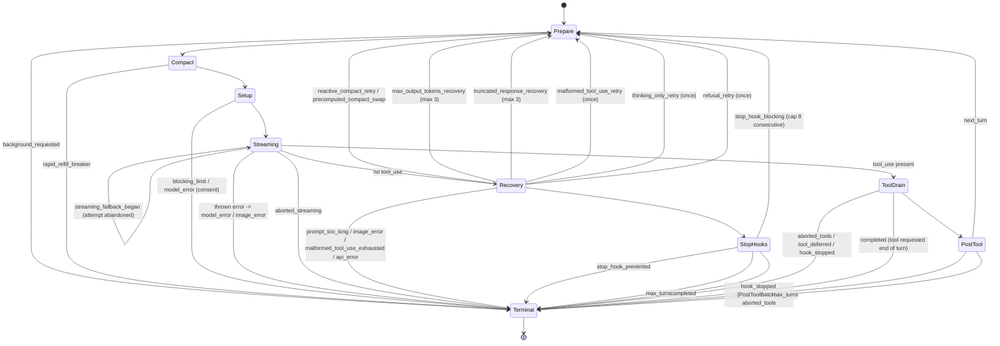

# Static pass 03: agent loop, model transport, streaming, retries, cancellation, usage, headless output

Target: Claude Code CLI 2.1.296 (Windows x64 Bun standalone), extracted module graph under
`extracted\2.1.296\~BUN\root\`. Everything below was read from the shipped chunks. Static evidence
shows the code exists and what it does when reached. It does not show that a path runs.

Evidence format: `chunk-xxxxxxxx.js@<char offset>` plus a short anchor. Offsets are the position of
the anchor or of the slice it was read from (accurate to a few hundred characters inside minified
single-line files). Mangled identifiers are quoted as mangled; names in *italics* are my own
conceptual names.

Labels: **VS** = VERIFIED-STATIC, **SI** = STRONGLY INFERRED, **HYP** = HYPOTHESIS, **UNK** = UNKNOWN.

---

## 1. Scope and coverage

### Correction to the starting points

- `chunk-q0w9mgb8.js` export `query` is **not** the core loop. It is the Agent SDK entry point that
  spawns the CLI as a child process (imports `child_process`, `readline`; body ends with
  `r.spawn()` and `export{An as query}`). **VS** `chunk-q0w9mgb8.js@76211` `"export{An as query}"`.
- The real loop is in `chunk-93pksqr2.js` (201 KB): exported generator `Y0` (wrapper) and the
  internal generator `Ad` (loop body, about 63 KB). **VS** `chunk-93pksqr2.js@126966`
  `"async function*Y0(e)"`, `@129362` `"async function*Ad(e,o,n,r)"`.

### Chunks read

| Chunk | Role | How much was read |
|---|---|---|
| `chunk-93pksqr2.js` | query loop `Y0`/`Ad`, streaming tool executor class `gs`, stop-hook driver `Za`, guards | loop body read end to end (124500 to 200100), executor 44000 to 54100, stop hooks partially |
| `chunk-phacttch.js` (4.7 MB) | `callModel` (`Zvt`), request builder and stream consumer (`pln`), retry wrapper (`Gke`), attempt-decision machine (`Wan`/`Q6e`), non-streaming fallback (`cyr`/`qrt`), message constructors, `yT` normalizer, tool-result pairing repair | targeted slices: 2719000 to 2745500, 2755400 to 2764000, 2791600 to 2811000, 2838700 to 2890000, 4377000 to 4383500, 4406220 to 4414000, 4516900 to 4520500 |
| `chunk-nfvf6nm0.js` | API client factory `n$`, default headers, base URLs, `metadata.user_id`, idle-timeout config, rate-limit header parsing | 253500 to 267800, 278700 to 280300, 303000, 317393 |
| `chunk-ckxd0e9f.js`, `chunk-0cb2e3jn.js` | backoff `L$`, generic `tk`, error predicates, stream error classes | relevant functions |
| `chunk-cvvnq4he.js` | query-source classes, price rows, cost formula | 257700, 284300 to 292000 |
| `chunk-wns1g1rg.js` | abort reason table | whole relevant region |
| `chunk-jr646ga5.js` | session engine: turns the loop's yields into SDK messages and the `result` | 57300 to 71000 |
| `chunk-fzzrkchm.js` | headless runner: output formats, SDK message filter, control requests, signals, exit code | targeted slices |
| `chunk-80kqkekd.js` | SDK and control protocol schemas, terminal-reason list | targeted slices |
| `chunk-8c1qfwg5.js` | `system/init` builder | 3300 to 5800 |
| `chunk-jwmqjyrb.js` | batched (non-streaming) tool runner, concurrency constant | 28141 region |

### Not reached

- The body of the "heal" handlers inside the `onError` chain beyond their names and return tokens
  (each strips one beta or one block and returns `"retry:<reason>"`).
- Refusal-fallback / "fallback credit" / server-side fallback internals. They occupy roughly a
  third of the loop. Only their loop-visible effects are described.
- Compaction internals (`autocompact`, reactive compact, precomputed compact). Only the call sites
  and the loop transitions are covered.
- Transcript persistence fields `parentUuid` / `isSidechain` (assigned at write time, outside the
  chunks read here).
- The interactive REPL key handling. Only the method that calls `abort()` was located.
- The full `yT` normalizer (about 30 KB). The first 8 KB and the pairing repair were read.
- Every control-request handler body. The subtype list is complete; only `interrupt`,
  `can_use_tool`, and the envelope were read.

---

## 2. Findings

### Q1. Shape of the loop

**F1.1 The loop is an async generator with a terminal return value. VS**
`Y0(e)` is `async function*`. It delegates to `Ad` (through an optional observer tap `lm`),
then yields post-turn work and `command_lifecycle` events, and returns the terminal object
`{reason, ...}`. `chunk-93pksqr2.js@126966` `"u=yield*rSn()?lm(e,o,r,s):s.through(Ad(e,o,r,s))"`.

**F1.2 Parameter object. VS** (destructured at `chunk-93pksqr2.js@129362` and read as `e.<name>`
through the body)

`messages, systemPrompt, userContext, systemContext, canUseTool, toolUseContext, fallbackModel,
querySource, spawnedBySkill, maxTurns, skipCacheWrite, skipMessageCacheMarkers, relayFork,
compactionRequestKind, apiAttemptsLeft, evictCacheOnComplete, agentCacheTtlOverride,
forkPointUuid, divergesAtMessageId, thinkingStripPlan, advisorStripPlan, deps, promptRenderEpoch,
stopHookActive, stickyBetas, modelFacts, forkOrigin, maxOutputTokensOverride, taskBudget,
keepPartialMessageOnAbort`.

`deps` is an injection seam with defaults `{callModel: Zvt, autocompact: Tir, uuid: randomUUID,
now: () => new Date().toISOString()}`. **VS** `chunk-93pksqr2.js@112400`
`"return{callModel:Zvt,autocompact:Tir,uuid:Wp,now:"`.

**F1.3 What it yields. VS** (all are literal `yield{type:...}` or yielded message objects in `Ad`)

- `{type:"stream_request_start"}` once per iteration, before any request work (`@134900`).
- `stream_event` (raw API SSE event wrapper), `assistant` messages (one per completed content
  block), `user` messages (tool results, meta nudges, interrupt markers), `attachment`,
  `progress`, `system` messages (`model_fallback`, `model_refusal_fallback`,
  `model_refusal_no_fallback`, `model_consent_fallback`, `api_error` retry notices).
- Control-plane events consumed by the host, not sent to the model: `tombstone`
  (`{type:"tombstone",message,displayOnly?}`), `query_model_change`, `refusal_continuation`
  (`phase:"begin"|"end"`), `set_in_progress_tool_use_ids`, `command_lifecycle`, `hint_clears`,
  `compact_progress`, `sdk_status`, `notification`, `tool_use_summary`.

**F1.4 Loop state. VS** `chunk-93pksqr2.js@130200`
`"Q={guards:{...ws,refusalRetrySpent:!1,stopHookActive:e.stopHookActive??!1,turnCount:1},messages:e.messages,toolUseContext:..."`.
State object `Q` = `{guards, messages, toolUseContext, compactTracking, transition,
resumeIncompleteThinking?, pendingToolUseSummary?, prevToolDurations?}`. Guards default (`ws`,
`@112500`): `maxOutputTokensRecoveryCount:0, hasAttemptedReactiveCompact:false,
reactiveCompactDeeperPass:"none", thinkingOnlyNudged:false, malformedToolUseRetried:false,
stopHookBlockingCount:0`. The loop is `while(true)`; every continuation rebuilds `Q` with a
`transition:{reason}` and `continue`s. There is no recursion (the profiling marker is still named
`"query_recursive_call"`, `@199300`).

**F1.5 Iteration order. VS** (offsets in `chunk-93pksqr2.js`)

Before the loop (once per `Ad` call):
1. Memory recall wait and memory-context attachments appended and yielded (`@130500` to `@131300`).
2. Queued "poll events" and queued commands folded in as attachments (turn-start fold)
   (`@131300` to `@133000`).

Each iteration:
1. If `shouldStopBeforeNextApiCall()` is true (main thread only): return
   `{reason:"background_requested"}` (`@134278`).
2. Yield `stream_request_start`. Bump `queryTracking` `{chainId, depth+1}` (`@134900`).
3. Take the "messages after last compact boundary" view (`ni(gt)`), apply tool-result content
   replacement budget (`Gis`) (`@135400`).
4. Live model switch adoption if the user changed the model mid-turn (`tengu_live_model_switch`,
   `@136000`).
5. Resolve request model `fg({permissionMode, mainLoopModel, exceeds200kTokens})` (plan mode above
   200k tokens can pick a different model) (`@136400`).
6. `yield* deps.autocompact(...)` (`@136500`). Outcomes: `compacted` (messages replaced by summary
   plus attachments, post-compact messages yielded), `failed`/`not_needed` (failure count kept),
   `rapid_refill_breaker_tripped` (terminal `rapid_refill_breaker`, `@137952`).
7. Assorted pre-request attachments are yielded and appended: dir-sync notices, PostModelSwitch
   hook context, context-routing records, model announcements, deferred-tool records, system-prompt
   snapshot record (`@139300` to `@142000`).
8. Build the streaming tool executor and per-attempt collections (`Nl(...)`, `@142700`):
   `assistantMessages`, `toolResults`, `toolUseBlocks`, `needsFollowUp`.
9. Usage-credits consent gate for models that require it (may switch model or end with
   `model_error`) (`@145000` to `@149000`).
10. Hard context block: if not just compacted and the token estimate is at level `"blocked"`,
    yield a synthetic API-error assistant message and return `{reason:"blocking_limit"}`
    (`@149549`).
11. Inner attempt loop `while(An)` (`@150100`): call `deps.callModel(...)` wrapped by `Ca` (which
    interleaves `tool_drain_tick` wakeups), consume every yielded item (see Q4, Q6).
    On `model_fallback_triggered` the attempt is abandoned (tombstones yielded), the fallback
    chain index advances, and the inner loop repeats with the next model (`@175000`).
12. After the stream: abort check (`aborted_streaming`), recovery branches (Q3), stop hooks if
    no tool calls, otherwise drain remaining tool results (`getRemainingResults`, `@190900`).
13. Post-tool: abort check (`aborted_tools`), `tool_deferred`, `hook_stopped`, tool-requested
    end of turn, `PostToolBatch` hooks (`@193700`), tool pool refresh (`@195500`), mid-turn
    queued command and poll-event absorption as attachments (`@196000` to `@198500`).
14. Max-turns check (`@199183`), else continue with
    `messages:[...P,...assistant,...toolResults]`, `turnCount+1`,
    `transition:{reason:"next_turn"}` (`@199381`).

### Q2. Internal message representation and normalization

**F2.1 Message union observed in the loop. VS** (type tags compared in `Ad`, `yT`, and the SDK
filter `kk` at `chunk-fzzrkchm.js@184045`):
`user`, `assistant`, `system`, `attachment`, `progress`, `tombstone`, `tool_use_summary`,
`stream_event`, `stream_request_start`, plus an API-shaped `api_system` row produced inside the
normalizer.

**F2.2 Assistant message constructor. VS** `chunk-phacttch.js@4377700`
`"return{type:\"assistant\",uuid:he(),timestamp:Y(),message:{diagnostics:null,id:he(),container:null,model:bi,role:\"assistant\""`.
Synthetic assistant messages have `message.stop_reason:"stop_sequence"`, `stop_sequence:""`,
zeroed `usage`, and carry `requestId:undefined, apiError, apiErrorParams, apiErrorIsTransient,
quotaLimits, error, errorDetails, truncatedAfterOutput, isApiErrorMessage, isVirtual`.
`Is({...})` is the API-error variant (`isApiErrorMessage:true`), `ql({...})` the plain synthetic
variant.

Streamed assistant messages (built at `content_block_stop`, `chunk-phacttch.js@2859500`) carry:
`message` (API message envelope with a single-block `content`), `apiBlockIndex`, `requestId`,
`requestRef`, `requestedModel`, `type:"assistant"`, `uuid`, `timestamp`, optional
`thinkingDurationMs`, `thinkingDisplay`, `batchToolUses`, `wireToolInputs`, `advisorModel`,
`effort`, `perTurnEffort`, `perTurnTiming`. The loop later adds `permissionModeAtRequest`,
`resumedFromIncompleteThinking`, `supersedesUuids` (`chunk-93pksqr2.js@170200`).

**F2.3 User message constructor `xe`. VS** `chunk-phacttch.js@4380802`. Fields:
`type:"user"`, `message:{role:"user",content}`, `uuid`, `timestamp`, `isMeta`, `ephemeral`,
`turnCompanion`, `isVirtual`, `isCompactSummary`, `isVisibleInTranscriptOnly`, `toolUseResult`,
`toolDenialKind`, `toolDenialEndsTurn`, `sourceToolAssistantUUID`, `permissionMode`, `origin`,
`promptSource`, `promptId`, `interruptedMessageId`, `refusedMessageId`, `interruptedByShutdown`,
`imagePasteIds`, `mcpMeta`, `toolEndsTurn`, and several classifier fields. Empty content is
replaced by the placeholder constant `Mu`.

**F2.4 `parentUuid`, `isSidechain`. UNK** for this pass. They are not set by the constructors
above. They appear as the literal `'"parentUuid":'` in the transcript scanner
(`chunk-8vzhp2zx.js@5008`), so they are assigned at persistence time.

**F2.5 Normalization before the API (`yT`). VS / SI** `chunk-phacttch.js@4406220`
`"function yT(e,n=[],r,s)"`. Read directly (VS):
- Applies a thinking strip plan and an advisor strip plan (`s.thinkingStripPlan`,
  `s.advisorStripPlan`).
- Skips `progress` rows and virtual rows.
- Converts qualifying `system` rows (local command output) to user messages and merges them into
  the previous user message (`nD(prev, next)`): consecutive user messages are merged.
- API-error assistant messages are not sent. Instead each known error text maps to a set of block
  kinds to strip from the earlier user message that caused it ("heal" map built at `@4407200`),
  so a rejected image/PDF is removed from later requests.
- Task-notification user messages are re-wrapped; tool-reference blocks are stripped or kept
  depending on tool-search availability.
- Attachments are rendered into reminder text and folded into the neighbouring user turn or into
  an `api_system` row (`qo()` flush, `@4411500`).
SI (helper names and telemetry events around `@4507000` to `@4512500`): trailing thinking blocks
on the last assistant message are removed (`tengu_filtered_trailing_thinking_block`, replacement
text `"[No message content]"` when nothing remains); whitespace-only assistant messages are
dropped (`tengu_filtered_whitespace_only_assistant`); empty assistant content gets a placeholder
text block (`tengu_fixed_empty_assistant_content`); orphaned thinking-only messages are dropped
(`tengu_filtered_orphaned_thinking_message`).

**F2.6 Tool-use / tool-result pairing repair. VS** `chunk-phacttch.js@4516900` to `@4520400`
(self-named in its log string `"ensureToolResultPairing: repaired missing tool_result blocks"`):
- Duplicate `tool_use` ids and server tool uses without results are removed from the assistant
  message; if a removed block sat between two thinking blocks it is replaced by text
  `"[Tool use removed]"`; an emptied assistant message becomes `"[Tool use interrupted]"`.
- For every `tool_use` without a matching `tool_result` in the next user message, a synthetic
  `{type:"tool_result", tool_use_id, content:"[Tool result missing due to internal error]",
  is_error:true}` is prepended (`aqr`, `chunk-phacttch.js@4366426`).
- Orphan and duplicate `tool_result` blocks are dropped; a user message emptied this way becomes
  `"[Orphaned tool result removed due to conversation resume]"` when it is the first message.
- A strict mode (`wsn()`) throws instead of repairing. Repair emits
  `tengu_tool_result_pairing_repaired`.

### Q3. Termination conditions

**F3.1 Complete terminal-reason list. VS** `chunk-80kqkekd.js@168400`
`hH=["blocking_limit","rapid_refill_breaker","prompt_too_long","image_error","model_error","api_error","malformed_tool_use_exhausted","aborted_streaming","aborted_tools","stop_hook_prevented","hook_stopped","tool_deferred","max_turns","background_requested","completed"]`,
plus engine-level `uH=["budget_exhausted","structured_output_retry_exhausted","tool_deferred_unavailable","turn_setup_failed"]`.

Where each is produced in `chunk-93pksqr2.js`:

| reason | offset | condition | extra fields / emitted first |
|---|---|---|---|
| `background_requested` | 134278 | `shouldStopBeforeNextApiCall()` | none |
| `rapid_refill_breaker` | 137952, 181349 | compaction thrash breaker tripped | synthetic API error, `apiError:"autocompact_thrashing"` |
| `blocking_limit` | 149549 | context at hard block level before request | synthetic API error `error:"invalid_request"` |
| `model_error` | 144223, 146862, 147704, 176725 | thrown error in the request phase, unanswered consent, model blocked | `{error}`; orphan `tool_use` blocks get synthetic error results first |
| `image_error` | 144194 | image size/resize error class | synthetic API error |
| `aborted_streaming` | 146179, 177685 | abort signal set after the stream phase | interrupt user message (unless reason is in the quiet set, see Q9) |
| `prompt_too_long` / `image_error` | 180900, 184900 | withheld 413 / media error and reactive compaction could not recover | the withheld API-error message is finally yielded |
| `malformed_tool_use_exhausted` | 186715 | `stop_reason:"tool_use"` with zero parsed tool blocks, after one retry | synthetic API error |
| `api_error` | 187573 | last assistant message is an API error message | `{errorKind, isTransient, quotaLimits}` |
| `stop_hook_prevented` | 187939 | Stop hook returned `preventContinuation` | none |
| `max_turns` | 188345, 199183 | `maxTurns && nextTurn > maxTurns` | `{turnCount}`; attachment `max_turns_reached` yielded first |
| `completed` | 188965, 189249, 192949, 193269 | no tool calls and stop hooks pass; or stop-hook block cap hit; or tool requested end of turn | `{goalPass}` |
| `aborted_tools` | 192342, 194938 | abort during tool phase or PostToolBatch | interrupt user message with tool-use wording |
| `tool_deferred` | 192459 | a hook deferred a tool (`hook_deferred_tool` attachment) | none |
| `hook_stopped` | 192581, 195220 | `hook_stopped_continuation` attachment seen, or PostToolBatch hook blocked | turn-end reaction hooks run first |

**F3.2 Non-terminal transitions (loop re-entry). VS**

| transition.reason | offset | trigger | what is appended |
|---|---|---|---|
| `next_turn` | 199381 | tool results exist | assistant msgs + tool results + attachments |
| `stop_hook_blocking` | 189203 | Stop hook returned blocking errors | assistant msgs + the blocking-error user messages; sets `stopHookActive:true`, `stopHookBlockingCount+1`, `turnCount+1` |
| `max_output_tokens_recovery` | 185383 | last message has `apiError:"max_output_tokens"` | meta user nudge (or nothing when resuming an incomplete thinking block) |
| `truncated_response_recovery` | 185951 | stream died after output (`truncatedAfterOutput`) in subagent or non-interactive main | meta user nudge |
| `malformed_tool_use_retry` | 186524 | `stop_reason:"tool_use"` but no tool blocks | all assistant msgs tombstoned, meta user nudge, once |
| `thinking_only_retry` | 187227 | `end_turn`/`stop_sequence` with no non-empty text and no tool use | meta user nudge, once |
| `refusal_retry` | 179858 | same-model retry after refusal | kept msgs + "not run" tool results + nudge, once (`refusalRetrySpent`) |
| `reactive_compact_retry` / `precomputed_compact_swap` | 183900 | withheld prompt-too-long / media error and compaction succeeded | post-compact messages |

**F3.3 Stop hooks and re-entry. VS** `chunk-93pksqr2.js@187700` to `@189300`.
With no tool calls and no API error, the loop runs `Za(...)` (Stop / SubagentStop hooks plus
internal end-of-turn checks). Result `{blockingErrors, preventContinuation, goalPass}`.
- `preventContinuation` -> terminal `stop_hook_prevented`.
- `blockingErrors.length>0` -> if `maxTurns` exceeded: `max_turns`. Else if the consecutive block
  count exceeds the cap: warning text yielded and terminal `completed`. Else continue with
  transition `stop_hook_blocking`; the blocking errors are appended as user messages so the model
  sees them, and `stopHookActive` becomes true for the next Stop hook input.
- Cap: `CLAUDE_CODE_STOP_HOOK_BLOCK_CAP ?? 8` (`@188500` `"a.CLAUDE_CODE_STOP_HOOK_BLOCK_CAP??8"`);
  a cap of 0 or less disables the check.
- `Za` also injects internal meta nudges that act like blocking results (brief-mode enforcement,
  "you must call the structured output tool", subagent hand-back) (`@67408` to `@70600`).
- Stop hooks are skipped when the query is aborted in a bare/print "wn()" mode, or when
  `settingsHooksOff` is set (`@67408`).

**F3.4 Output-limit recovery. VS**
- The API client yields a synthetic API-error assistant message when `stop_reason` is
  `max_tokens` or `model_context_window_exceeded`, with `apiError:"max_output_tokens"`
  (`chunk-phacttch.js@2865900` `"exceeded the ${ZS} output token maximum"`).
- The loop withholds that message from the consumer (`Cd(M)` sets `qt=true`,
  `chunk-93pksqr2.js@172300`) and, after the stream, retries up to `Cr = 3` times
  (`@112700` `"var Cr=3"`), appending a meta nudge. If the truncated turn was a single thinking
  block, it instead re-sends without the partial message and sets `resumeIncompleteThinking`.
- After 3 attempts the withheld error (rewritten by `$l`) is yielded and the turn ends as
  `api_error`.
- A separate one-shot adjustment happens inside the retry wrapper for HTTP 400
  "input length and `max_tokens` exceed context limit": see Q7.

### Q4. Tool-call handling inside the loop

**F4.1 Recognition. VS** `chunk-93pksqr2.js@173700`
`"let De=te.message.content.filter((Ie)=>Ie.type===\"tool_use\");if(De.length>0)wt.push(...De),_e.needsFollowUp=!0;for(let Ie of De)_e.streamingToolExecutor.addTool(Ie,te)"`.
Tool calls are taken from each yielded assistant message (one per completed content block). The
decision to continue is `needsFollowUp`, set by the presence of `tool_use` blocks, not by
`stop_reason`.

**F4.2 Execution starts while the stream is still open. VS**
`addTool` calls `processQueue()` immediately (`chunk-93pksqr2.js@46967`). The loop wraps the model
stream in `Ca(...)` (`@54033`), which races the next stream item against
`executor.waitForDrainable(gen)` and emits `{type:"tool_drain_tick"}`; on each tick and after each
stream item the loop runs `Rn()` to yield completed results (`@157300`, `@174100`). A tool call is
dispatched only after its content block is complete (the assistant message exists only after
`content_block_stop`, Q6).

**F4.3 Concurrency rule. VS** `chunk-93pksqr2.js@47172`
`"canExecuteTool(e){let o=this.tools.filter((n)=>n.status===\"executing\");return o.length===0||e&&o.every((n)=>n.isConcurrencySafe)}"`.
- `isConcurrencySafe` = `tool.isConcurrencySafe(parsedInput)` when the input passes the tool's
  schema, else false. An exception inside it counts as false.
- A safe tool starts if nothing is executing or everything executing is safe. An unsafe tool
  starts only when nothing is executing, and it blocks the queue behind it (`processQueue` breaks
  at the first unsafe tool that cannot start).
- The streaming executor has **no numeric concurrency cap**. **VS** (no counter in `gs`).
- A separate batched runner (`Zo` in `chunk-jwmqjyrb.js@28141`) partitions tool blocks into
  consecutive safe/unsafe groups and uses `CLAUDE_CODE_MAX_TOOL_USE_CONCURRENCY ?? 10`
  (`"function $a(){return a.CLAUDE_CODE_MAX_TOOL_USE_CONCURRENCY??10}"`). Which callers still use
  the batched runner was not traced. **UNK**.

**F4.4 Result ordering. VS** `getCompletedResults()` (`chunk-93pksqr2.js@52300`) walks tools in
arrival order, yields progress for all, yields results for `completed` tools, and stops at the
first still-executing unsafe tool. Results for safe tools are therefore yielded in request order
as long as earlier ones are done; a finished later tool waits behind an unfinished earlier
**unsafe** tool only. After each tool's results it yields
`{type:"set_in_progress_tool_use_ids",op:{action:"remove",ids:[id]}}`.

**F4.5 Unknown tool. VS** `chunk-93pksqr2.js@46410`: an immediately "completed" entry with a
`tool_result` `is_error:true` and content
`"<tool_use_error>Error: No such tool available: <name>…</tool_use_error>"`.

**F4.6 Sibling cancellation on error is disabled in this build. VS**
In `executeTool` the sibling-error latch is constant-folded: `"N||=!1"` and
`"getAbortReason(e,ee,N)"` with `"...!1"` in the options (`chunk-93pksqr2.js@51300`, `@48760`).
A tool returning an error does not cancel its siblings. Each tool gets a child AbortController
(`hg(parent)`); if a child aborts for its own reason and the parent is not aborted, it aborts the
parent (`@50400`).

**F4.7 Synthetic results on abort / discard. VS** `createSyntheticErrorMessage`
(`chunk-93pksqr2.js@47445`) and `CEn` (`chunk-phacttch.js@2245765`). All are user messages with one
`tool_result`, `is_error:true`:

| cause | abort reason | `toolDenialKind` | content role |
|---|---|---|---|
| user interrupt | `user-cancel`, `remote-cancel`, `shutdown`, other | `user-rejected` | standard "user doesn't want to proceed" rejection text (`pv`) |
| queued message cut the turn | `turn-abort` | `interrupted` | `"[Tool call did not complete: the turn was ended to deliver the message that follows. …]"` (`chunk-fd5j6erd.js@5755`) |
| backgrounding | `background` | `cancelled` | background-cancel text (`Gk`) |
| model ended conversation | `end_conversation` | none | `"<tool_use_error>Cancelled: Claude ended the conversation</tool_use_error>"` |
| streaming fallback / discarded attempt | executor `discarded` | none | `"<tool_use_error>Error: Streaming fallback - tool execution discarded</tool_use_error>"` |

`CEn` returns no abort (tool keeps running) for reasons `interrupt` and `permission-stop`, and for
an already-running shell tool under one condition (`ckn`).

**F4.8 Turn ends on error with tool calls outstanding. VS** `chunk-93pksqr2.js@143300` (`Ur`) and
`@123955` (`Td`): finished results are drained, then every unanswered `tool_use` receives a
synthetic `tool_result` (`is_error:true`) whose text says the turn ended on an error and the call
was cancelled (`ad(e)`, `@118000`), or the image-error / safety-monitor variants.

### Q5. Transport

**F5.1 Client. VS** `chunk-nfvf6nm0.js@256096` `"async function n$({apiKey:e,maxRetries:r,model:n,…"`.
The Anthropic TypeScript SDK client (`obe`, with `x-stainless-*` header strings in the same chunk)
is constructed per attempt series with `maxRetries: 0` from the CLI's own retry wrapper
(`chunk-phacttch.js@2840800` `"n$({maxRetries:0,model:Y.model"`). The call is
`client.beta.messages.create({...params, stream:true}, {signal, headers}).withResponse()`
(`chunk-phacttch.js@2842829`). Common options: `timeout: API_TIMEOUT_MS ?? 600000`,
`dangerouslyAllowBrowser:true`, custom `fetch` wrapper `bw(...)` (`@257600`).

**F5.2 Provider selection. VS** `chunk-bnqade36.js@30341`:
`gateway` (if a cloud-gateway session exists), else by env in this order
`CLAUDE_CODE_USE_BEDROCK` -> `bedrock`, `CLAUDE_CODE_USE_FOUNDRY` -> `foundry`,
`CLAUDE_CODE_USE_ANTHROPIC_AWS` -> `anthropicAws`, `CLAUDE_CODE_USE_ANTHROPIC_GOOGLE_CLOUD` ->
`anthropicGoogleCloud`, `CLAUDE_CODE_USE_MANTLE` -> `mantle`, `CLAUDE_CODE_USE_VERTEX` ->
`vertex`, else `firstParty`. Provider SDK classes are loaded by dynamic import
(`AnthropicBedrock`, `AnthropicBedrockMantle`, `AnthropicFoundry`, `AnthropicAws`,
`AnthropicGoogleCloud`, `AnthropicVertex`).

**F5.3 Base URLs. VS** `chunk-nfvf6nm0.js@265500` (`lw`):
firstParty `ANTHROPIC_BASE_URL || <built-in BASE_API_URL>`; bedrock
`ANTHROPIC_BEDROCK_BASE_URL || https://bedrock-runtime.<region>.amazonaws.com`; mantle
`ANTHROPIC_BEDROCK_MANTLE_BASE_URL || https://bedrock-mantle.<region>.api.aws`; anthropicAws
`ANTHROPIC_AWS_BASE_URL || https://aws-external-anthropic.<region>.api.aws`; anthropicGoogleCloud
`ANTHROPIC_GOOGLE_CLOUD_BASE_URL || https://claude.googleapis.com`; vertex
`ANTHROPIC_VERTEX_BASE_URL || <regional default>`; foundry from resource or
`ANTHROPIC_FOUNDRY_BASE_URL`; gateway from the gateway session.

**F5.4 Auth header selection (shapes only). VS / SI**
- `ANTHROPIC_AUTH_TOKEN` or the output of `apiKeyHelper` is placed in
  `Authorization: Bearer <token>` on the default headers when the user is not a subscriber and no
  gateway session exists. **VS** `chunk-nfvf6nm0.js@265326`
  `"e.Authorization=\`Bearer ${y}\`,h?\"ANTHROPIC_AUTH_TOKEN\":\"apiKeyHelper\""`.
- First party: `uSs({isSubscriber, apiKey, oauthAccessToken})` returns the pair
  `{apiKey, authToken}` handed to the SDK. **SI**: subscriber -> `authToken` = OAuth access token
  (SDK sends `Authorization: Bearer`), otherwise `apiKey` (SDK sends `X-Api-Key`). The body of
  `uSs` was not read.
- Workload-identity path: `Authorization: Bearer <token from provider>` with `apiKey:null`
  (`@263700`).
- Bedrock: `AWS_BEARER_TOKEN_BEDROCK` -> `Authorization: Bearer`, else SigV4 with resolved
  credentials or a provider chain; `X-Api-Key` and `Authorization` are explicitly nulled
  otherwise (`@258400`). `CLAUDE_CODE_SKIP_BEDROCK_AUTH`, `..._SKIP_VERTEX_AUTH`,
  `..._SKIP_FOUNDRY_AUTH`, `..._SKIP_MANTLE_AUTH`, `..._SKIP_ANTHROPIC_AWS_AUTH` exist.

**F5.5 Default headers set by the CLI. VS** `chunk-nfvf6nm0.js@253758` and `@256400`:
`x-app: "cli"` (or `"cli-bg"` for a background session), `User-Agent` (from `oL()`), a session-id
header (name in constant `AIt`), custom headers parsed from `ANTHROPIC_CUSTOM_HEADERS`,
`x-claude-remote-container-id`, `x-claude-remote-session-id`, `x-client-app`
(from `CLAUDE_AGENT_SDK_CLIENT_APP`), `x-claude-code-agent-id`, `x-claude-code-parent-agent-id`,
`x-anthropic-additional-protection: "true"` (when `CLAUDE_CODE_ADDITIONAL_PROTECTION`).
Per request (`chunk-phacttch.js@2756500`, `@2842300`): `x-client-request-id` (random UUID, first
party), optional `traceparent`, dispatch/priority headers, and fallback stamp headers
`x-cc-fallback-from-model`, `x-cc-fallback-category`, `x-cc-fallback-trigger`,
`x-cc-original-request-id` (names at `chunk-nfvf6nm0.js@230762`). An `anthropic-beta` entry in
custom headers is ignored when org policy disables experimental betas (`@266700`).

**F5.6 Request body. VS** `chunk-phacttch.js@2805900`:

```
{ model, messages, system, tools?, tool_choice, betas?, metadata, max_tokens, thinking,
  temperature?, context_management?, safeguards?, <cache_control top-level?>, <server-fallback fields?>,
  <extra body params>, output_config?, speed?, thread?, diagnostics? }
```

- `metadata` = `{user_id: JSON.stringify({device_id, account_uuid, session_id,
  parent_session_id?, ...})}`, optionally merged with a JSON object from
  `CLAUDE_CODE_EXTRA_METADATA` subject to a size limit. **VS** `chunk-nfvf6nm0.js@278710`
  `"device_id:cO(),account_uuid:"` and `"return{user_id:_(A)}"`.
- `max_tokens` = `min(retryOverride || maxOutputTokensOverride || modelDefault, modelDefault)`
  (`@2802100`).
- `thinking`: `{type:"adaptive",display}` or `{type:"enabled",budget_tokens,display}` with
  `budget_tokens = max(1024, min(max_tokens-1, budget))`, or `{type:"disabled"}` on first party
  when thinking is off and the model accepts it. `CLAUDE_CODE_DISABLE_THINKING` forces it off
  (`@2802200`).
- `temperature`: only when thinking is off and the model accepts it: `temperatureOverride ?? 1`
  (`@2804700`).
- `tool_choice`: a forced `{type:"tool"}` is demoted to `{type:"auto"}` when thinking is active
  (`@2803500`).
- `output_config`: carries `effort` (clamped when thinking is disabled), task budget, output
  format (`@2800600`, `@2803700`).
- `speed:"fast"` when fast mode is on and allowed (`@2804000`).
- `context_management` when the context-editing beta is in the list (`@2806100`).
- `betas` is the de-duplicated beta header list; on Bedrock some betas travel in the body as
  `anthropic_beta` (`@2800100`, log string `"via body.anthropic_beta"`).
- `CLAUDE_CODE_SIMULATE_PROXY_USAGE` strips nearly all betas (`@2804500`).

### Q6. Streaming

**F6.1 Stream state machine. VS** `chunk-phacttch.js@2854801` to `@2866400`.

| event | handling |
|---|---|
| `message_start` | store partial message `vp` (drop `resumable`), record TTFT, seed usage via `Dhe`, compare served model |
| `content_block_start` | `uh[index]` = block; `tool_use`/`server_tool_use` start with `input:""`; `text` with `text:""`; `thinking` with `thinking:"", signature:""`. A start on an already-closed index throws `K7("closed")` |
| `content_block_delta` | `text_delta` appends to `.text`; `thinking_delta` appends to `.thinking` (ignored for `redacted_thinking`); `signature_delta` **assigns** `.signature`; `input_json_delta` appends `partial_json` to the **string** `.input`; `citations_delta` pushes to `.citations`. Type mismatches throw `K7("unreadable")`; unknown/closed index throws `K7` |
| `content_block_stop` | finalize the block through `oYt([block], tools, …)` (this is where accumulated tool-input JSON is parsed and normalized), build **one assistant message containing only this block**, push to `np`, yield it |
| `message_delta` | merge usage, capture `stop_reason`, `stop_details`, `context_management`; **mutate every already-yielded assistant message of this response** to set `usage`, `stop_reason`, `stop_details`; credit cost once; emit refusal / max_tokens side effects |
| `message_stop` | bookkeeping only |

Every event is also re-yielded as `{type:"stream_event", event, ttftMs? (message_start only),
apiMessageId?}` (`@2866500`).

**F6.2 One assistant message per content block. VS** `chunk-phacttch.js@2859500`
`"du={message:{...vp,content:md},…apiBlockIndex:ms.index,requestId:"`. All messages of one response
share `message.id`. Consumers needing the whole response must group by `message.id`.
A wrapper (`d6e`, `@2679128`) joins adjacent text-only blocks when
`CLAUDE_CODE_WEBSEARCH_CITATIONS` is set in non-interactive mode.

**F6.3 Tool JSON parse timing. VS** Input stays a string until `content_block_stop`; dispatch
(Q4) needs the finished message, so a tool never runs on partial JSON.

**F6.4 Watchdogs. VS**

- Event-level idle watchdog, enabled by `CLAUDE_ENABLE_STREAM_WATCHDOG ?? true`
  (`chunk-phacttch.js@2850831`). Timeout `Kk = max(CLAUDE_STREAM_IDLE_TIMEOUT_MS or settings
  stream_idle_timeout_ms or 0, 300000)` ms (`chunk-nfvf6nm0.js@267016`
  `"function WJt(){return Math.max(am()??0,300000)}"`). So the env var can only raise it.
  A warning is logged at `Kk/2`. On expiry: `tengu_streaming_idle_timeout` `tier:"event"`, the
  response body is cancelled (`Nk()`), and the loop exit throws
  `"Stream idle timeout - no chunks received"` (`@2840047`, `@2867409`).
- Byte-level watchdog inside the fetch wrapper: default 180000 ms on first party, otherwise the
  event timeout; override `CLAUDE_BYTE_STREAM_IDLE_TIMEOUT_MS`; clamped to [10000, 1800000]
  (`chunk-nfvf6nm0.js@267300` `"uw=180000"`). First-byte window override
  `CLAUDE_STREAM_FIRST_BYTE_TIMEOUT_MS`. Bedrock opt-in `CLAUDE_ENABLE_BYTE_WATCHDOG_BEDROCK`.
- Reset rule: each real event re-arms the watchdog; `ping` events re-arm it only for the first 30
  consecutive pings (`wyr=30`, `@2853200`).
- Stall telemetry: gap over 30000 ms between events logs `tengu_streaming_stall` (`@2853500`).
- Slow first byte: log after `CLAUDE_SLOW_FIRST_BYTE_MS || 30000` (`@2841700`).
- UI "stalled" status callback after 20000 ms without bytes (`t5e=20000`, `@2840000`).
- Synthetic `ping` yielded every 10000 ms while bytes are arriving but no full event
  (`cln=1e4`, `@2763575`).

**F6.5 Clean-end validation. VS** `chunk-phacttch.js@2867300` to `@2868200`: after the iterator
ends without error the code throws if (a) the stream ended inside an open block, (b) no
`message_start` or no completed block and no stop reason arrived (`StreamNoEventsError`), or (c)
the envelope is open without a terminal `message_delta`.

**F6.6 Failure handling after partial output. VS** `chunk-phacttch.js@2870500` to `@2883500`.
The failure is classified by `Gan(...)` into `{cause, progress, stopReasonReceived}` where
`progress` is `nothing | started | partialOutput | thinkingOnly | output` and fed to the attempt
decision machine (Q7). Outcomes:
- `keepPartial` with completed blocks: synthesize `stop_reason` (`"tool_use"` if any block is a
  tool use, else `"end_turn"`) on the yielded messages, then yield a synthetic API-error assistant
  message (`error:"server_error"`, `truncatedAfterOutput:true` when there is output and no tool
  use). Text roles: "stopped arriving", "server error mid-response", "malformed stream",
  "computer went to sleep", "connection lost". If `message_delta` with a stop reason was already
  received the response is treated as complete and nothing is synthesized
  (`tengu_streaming_close_after_complete`).
- `retry`: re-open the stream (`continue e`), after tombstoning thinking-only output.
- `useFallbackModel`: throw the fallback exception (`gM`).
- `retryWithoutStreaming`: non-streaming fallback (F6.7).
- `fail`: rethrow.

**F6.7 Non-streaming fallback. VS**
- Trigger A: stream failure where the decision is `retryWithoutStreaming`. The generator yields
  `{type:"streaming_fallback_began", cause}` then runs `qrt` -> `cyr`
  (`chunk-phacttch.js@2883300`, `@2835964`, `@2757700`).
- Trigger B: stream creation failed with HTTP 404 and the decision machine allows it
  (`cause:"404_stream_creation"`, `@2884200`).
- Disabled when `CLAUDE_CODE_DISABLE_NONSTREAMING_FALLBACK` is set, or flag
  `tengu_disable_streaming_to_non_streaming_fallback` is on, or (after a watchdog abort) when
  `CLAUDE_CODE_REMOTE` or flag `tengu_watchdog_skip_nonstreaming_fallback` (`@2872100`).
- The request is `beta.messages.create({...params, stream:false})` with `max_tokens` capped to
  64000 and thinking budget capped below it (`Jyr`, `@2896891`; `NRr=64000`,
  `chunk-z1z3mney.js@8056`), timeout `min(API_TIMEOUT_MS, max)` or 120000 ms when
  `CLAUDE_CODE_REMOTE` else 300000 ms (`rln`, `@2756300`).
- Loop effect: on `streaming_fallback_began` the loop tombstones every assistant message and tool
  result of the attempt, aborts and rebuilds the tool executor (running tools get the "Streaming
  fallback - tool execution discarded" result), and once per session shows a warning on the main
  thread for causes `no_events` / `stream_truncated` (`chunk-93pksqr2.js@169318`).

### Q7. Retries

**F7.1 Wrapper. VS** `chunk-phacttch.js@2723307` `"async function*Gke(e,n,r)"`: an async generator
taking `(getClient, operation(client, attempt, ctx), options)`. It yields retry-notice system
messages (`kG(...)`, surfaced as `system/api_error` then SDK `system/api_retry`) and returns the
operation result. Errors that end retries are thrown wrapped in `kc` (`name:"RetryError"`,
`originalError`, `retryContext`); model fallback is thrown as `gM`.

**F7.2 Attempt budget. VS** `@2740700` (`q6e`) and constants at `@2721047`:
- Default max retries `Lgr = 10`. `CLAUDE_CODE_MAX_RETRIES` overrides, clamped to `T6e = 15`
  unless watchdog mode. Watchdog mode (`CLAUDE_CODE_RETRY_WATCHDOG`) default `Ngr = 300`.
- Loop: `for (attempt = 1; attempt <= maxRetries + 1; attempt++)`.
- A caller-supplied `apiAttemptsLeft` ledger can cut this short (`takeApiAttempt`).

**F7.3 Backoff. VS** `chunk-ckxd0e9f.js@13700` `"function L$(e,r,n=32000,s=Math.random,a=we)"`,
`we=500`, `xwo=0.25`; generic `tk` at `chunk-0cb2e3jn.js@615`:

```
base  = min(capMs, 500 * 2^(attempt-1))          // capMs default 32000
delay = round(base + random() * 0.25 * base)     // proportional jitter, upward only
if retry-after header parses as integer seconds: delay = max(retryAfter*1000, delay)
```

For 529 errors `CLAUDE_CODE_OVERLOADED_RETRY_BASE_DELAY_MS` and
`CLAUDE_CODE_OVERLOADED_RETRY_MAX_DELAY_MS` replace base and cap (`@2733700`). Outside watchdog
mode, if the computed delay exceeds `max(60000, ceil(overloadedCap * 1.25))` the wrapper gives up
with `api_request_retry_after_too_long` (`Ygr=60000`).

**F7.4 What retries. VS** `_hr` at `chunk-phacttch.js@2738900` to `@2740000`:
- Never: spend-cap / out-of-credits 429 variants (`Shr`), certain SDK connection error codes,
  `x-should-retry: false` (returns false for all statuses).
- `x-should-retry: true` -> retry (for 429 only under subscriber/enterprise conditions).
- Connection errors (no status) -> retry.
- Status 408, 409 -> retry. 401 -> retry (after clearing the cached key / refreshing).
  429 -> retry unless the user is a subscriber without the enterprise/overage exception
  (`"return!wt()||Jbe()||Man(e)"`). 5xx -> retry. Message containing
  `"type":"overloaded_error"` -> retry.
- Non-retryable -> if a fallback model is configured and the status is not one of
  `{401,407,429,404,403,413}` (`rhr`) and not a known request-shape error: throw fallback with
  reason `last_resort` (`tengu_api_fallback_last_resort`). Otherwise `RetryError`.

**F7.5 529 handling and model fallback. VS** `@2730000` to `@2730800`:
- Background query sources get no 529 retries: `if (is529 && !Cbe(querySource) && !watchdog)`
  throw (`tengu_api_529_background_dropped`). The foreground set `Fh`
  (`chunk-cvvnq4he.js@257900`) is: `repl_main_thread*`, `sdk`, anything starting `agent:`,
  `compact`, `hook_agent`, `hook_prompt`, `side_question`, `web_search_tool`, `web_fetch_apply`,
  `auto_mode`, `compact_fab_check`, `auto_mode_critique`, `auto_mode_setup_propose`,
  `chrome_mcp`, `artifact_comment_reply`. An undefined source counts as foreground.
- Consecutive-529 counter increments when `FALLBACK_FOR_ALL_PRIMARY_MODELS` is set, or a fallback
  model exists, or (non-subscriber and the model is in certain families). At `J8 = 3`: with a
  fallback model throw `gM(model, fallbackModel, "overloaded")` (`tengu_api_opus_fallback_triggered`);
  without one throw a custom "repeated overload" error unless `IS_SANDBOX` or watchdog mode.
- The loop catches `gM` (as the `model_fallback_triggered` item from `Zvt`,
  `chunk-phacttch.js@2756019`), advances the fallback chain, yields `query_model_change` and a
  `system/model_fallback` warning, and retries the same iteration
  (`chunk-93pksqr2.js@175000` to `@176600`). `CLAUDE_CODE_NO_MODEL_FALLBACK` disables substitution.
- Other fallback triggers: 404 model-not-found or 403 model permission error with a fallback
  available (reasons `model_not_found`, `permission_denied`); 5xx (not 529) with a fallback
  (reason `server_error`) (`@2729500`).

**F7.6 Auth refresh. VS** `@2724300` to `@2725700`: before re-creating the client after a 401
(or revoked-token 403, or cloud credential errors) the wrapper refreshes the OAuth token
(`SS(token, …)`), giving up after `Ugr = 2` refreshes that leave the token unchanged
(`api_request_oauth_refresh_exhausted`); host-supplied token callback limit `jgr = 2`; AWS and GCP
credential refresh limits `Ean = 2`, `Ran = 2`; apiKeyHelper failures `qgr = 2`; remote-session
401/403 limit `$gr = 2` with fixed 1000 ms delay (`Hgr`). Stale keep-alive connection errors
disable keep-alive for the retry; mTLS client material is reloaded when
`CLAUDE_CODE_CLIENT_CERT` is set.

**F7.7 Context-overflow `max_tokens` adjustment. VS** `@2732300`, parser `zke` at `@2736900`:
on HTTP 400 matching
`/input length and \`max_tokens\` exceed context limit: (\d+) \+ (\d+) > (\d+)/` the next attempt
uses `maxTokensOverride = contextLimit - inputTokens - 1000`. If that is below
`Tan = 3000` or does not shrink, the error is rethrown. Telemetry
`tengu_max_tokens_context_overflow_adjustment`.

**F7.8 "Heal and resend" hook. VS** `@2726900`: `options.onError(err)` may return a token
`"retry:<reason>"`. Each distinct token is honoured once (`Set`), does not consume an attempt
(`on--`), and re-runs the operation with the mutated request. Tokens seen: `retry:afk-beta`,
`retry:advisor-strip`, `retry:web-search-strip`, `retry:media-item-limit:<n>`,
`retry:thinking-type`, `retry:thinking-signature-strip`, `retry:context-hint`,
`retry:dispatch-header-strip`, `retry:fallback-credit-strip`, `retry:server-fallback-strip`,
`retry:kept-reminder-clear-at`, `retry:tether-header`, `retry:prompt-end-mark`,
`retry:advisor-entry-refused`, `retry:safeguards-unclaimed`.

**F7.9 Fast-mode cooldown. VS** `@2729900`: in fast mode a 429/529 with `retry-after` under
`x6e = 20000` ms sleeps and retries in fast mode; otherwise fast mode is disabled for
`max(retryAfter ?? 1800000, 600000)` ms and the request repeats at normal speed.

**F7.10 Persistent ("watchdog") mode. VS** `CLAUDE_CODE_RETRY_WATCHDOG`: 429/529 retry without
consuming attempts, backoff cap 300000 ms (`Qgr`), single wait capped at 21600000 ms (`D6e`),
total budget `CLAUDE_CODE_RETRY_WATCHDOG_MAX_WAIT_MS` (default unlimited), sleep sliced into
30000 ms chunks (`OXr`) with a status callback each slice; 429 uses
`anthropic-ratelimit-unified-reset` as the wake time when present (`Mhr`, `@2741060`).

**F7.11 Stream-level attempt decision machine. VS** `chunk-phacttch.js@2741300` to `@2745000`
(`Q6e`, `Wan`). Counters `{retries, sleptThrough, overloaded, stalls, truncations,
afterThinkingOnly, outputFiltered, triedWithoutStreaming}`; limits `{maxRetries,
maxSleptThrough = min(maxRetries,10), maxOverloaded = 3, maxOutputFiltered = 1, hasFallbackModel,
persistent, background}`. Decisions: `retry | retryWithoutStreaming | useFallbackModel |
keepPartial | fail`. Per-cause extra limits: stalls 1, truncations 1, after-thinking-only 2
(1 for timeouts). The table is in the pseudocode section.

### Q8. Rate limits and usage

**F8.1 Unified rate-limit headers read. VS** `chunk-nfvf6nm0.js` (first offsets):
`anthropic-ratelimit-unified-status` (279606), `-reset` (298694), `-fallback` (301691),
`-representative-claim` (185067), `-5h-reset` (185609), `-7d-reset` (185651),
`-overage-status` (185121), `-overage-reset` (298838), `-overage-disabled-reason` (185170),
`-overage-scope` (185227), `-overage-in-use` (185274),
`-overage-period-monthly-utilization` (302151), `-overage-period-channel-utilization` (302287),
`-upgrade-paths` (302053), `-grace-5h-utilization` (279684), `-grace-7d-utilization` (279743),
`-slow-offer`, `-slow-status`, `-slow-retry-after`, `-slow-max-wait`, `-slow-budget-reset`,
`-slow-budget-utilization` (183094 to 183834), plus `anthropic-usage-limit` (183052),
`retry-after`, `retry-after-ms`, `x-should-retry`.
Parsing happens on every successful response (`pfo(headers, model, …)` ->
`extractQuotaStatusFromHeaders`, `chunk-phacttch.js@2869300`) and on 429 errors
(`extractQuotaStatusFromError`, `@2885700`). The resulting status object has
`status: "allowed" | "allowed_warning" | "rejected"`, `resetsAt`, `rateLimitType`
(`five_hour` / `seven_day` seen), overage fields (`chunk-nfvf6nm0.js@303032`). Skipped for the
gateway provider.

**F8.2 Usage accumulation. VS** `Dhe(prev, delta)` at `chunk-phacttch.js@2889801`: input and cache
token counts are replaced only when the new value is non-null and greater than 0; `output_tokens`
takes the new value; nested `cache_creation.{ephemeral_5m,ephemeral_1h}_input_tokens`,
`server_tool_use.{web_search_requests,web_fetch_requests}`, `service_tier`, `inference_geo`,
`iterations`, `speed` carried forward. Applied at `message_start` and each `message_delta`.

**F8.3 Per-model totals. VS** `V2n` at `chunk-phacttch.js@411900`: per model
`{inputTokens, outputTokens, thinkingTokens, cacheReadInputTokens, cacheCreationInputTokens,
webSearchRequests, costUSD, contextWindow, maxOutputTokens, canonicalModel, provider, costBasis}`.
`rVe` (`@412744`) adds the request cost and usage to session totals and OpenTelemetry counters
(types `input`, `output`, `cacheRead`, `cacheCreation`), and recursively accounts advisor-model
iterations. Cost is credited once per response when the stop reason arrives (state
`fC: none -> pending -> credited`, `@2861700`), or in `finally` for a non-streamed message.

**F8.4 Cost formula and price table. VS** `chunk-cvvnq4he.js@287385`:

```
usd = ( input/1e6*p.inputTokens + output/1e6*p.outputTokens
      + cacheRead/1e6*p.promptCacheReadTokens + cacheWriteCost(p, usage) ) * multiplier(usage)
      + webSearchRequests * p.webSearchRequests
```

Price rows are object literals at `chunk-cvvnq4he.js@285200` (for example
`{inputTokens:5,outputTokens:25,promptCacheWriteTokens:6.25,promptCacheWrite1hTokens:10,promptCacheReadTokens:0.5,webSearchRequests:0.01}`),
mapped per canonical model in table `l8`, with a default row and an admin override/multiplier
layer (`modelPricing`, `@289900`). Units are USD per million tokens.

**F8.5 What reaches the final result. VS** `chunk-jr646ga5.js@68300`: `total_cost_usd`
(`dy()`), `usage` (`ns()`), `modelUsage` (`$O()`), `duration_api_ms` (`ML()`),
`permission_denials`, `terminal_reason`, `fast_mode_state`, `subagent_stats`, `safety_stops`.

### Q9. Cancellation

**F9.1 Abort reason vocabulary. VS** `chunk-wns1g1rg.js@2700`: `DOMException(<reason>,
"AbortError")` instances for `user-cancel`, `remote-cancel`, `shutdown`, `interrupt`,
`turn-abort`, `background`, `refusal-fallback-edit`, `recovery-timeout`, `permission-stop`, plus
`server-fallback-tombstone` and `subagent-park`. `mi(reason)` extracts the string.
- Set that propagates from parent to child controllers: `{user-cancel, remote-cancel, shutdown,
  interrupt, turn-abort}`.
- "Quiet" set for which **no** interrupt marker message is synthesized (`N7`):
  `{interrupt, turn-abort, refusal-fallback-edit, permission-stop}`.

**F9.2 Sources. VS**
- Interactive: the REPL controller's cancel method aborts the turn controller with
  `user-cancel` or `remote-cancel` and calls `_engine.interrupt(...)`
  (`chunk-9w4htdvs.js@1393150` `"De?.abort(pc(_t))"`). The key binding wiring was not traced
  (**SI** that Esc reaches this method).
- Submitting a "send now" message mid-turn aborts with `user-cancel` or `interrupt`
  (`@1393612`, `@1383796`); queued-message delivery uses `turn-abort` (`@1408751`).
- Headless SIGINT: abort with `user-cancel`, then exit code 0 (`chunk-fzzrkchm.js@491823`).
  SIGTERM: abort and exit 143 (`@491900`).
- SDK control request `interrupt` -> `remote-cancel` (`chunk-fzzrkchm.js@213282`, `@569497`);
  `end_session` -> `shutdown` (`@573221`).
- A permission denial with `endsTurn` aborts the turn controller with `permission-stop`
  (`chunk-phacttch.js@2289304`).

**F9.3 Propagation. VS**
- HTTP: the same `signal` is passed to `beta.messages.create(..., {signal})`
  (`chunk-phacttch.js@2842829`). In the catch block an SDK abort with `signal.aborted` is rethrown
  as a user abort after yielding any kept partial text (`@2871500`).
- Retry sleeps reject on abort (`J(delay, signal, {abortError})`, `chunk-0cb2e3jn.js@900`).
- Tools: each tool call gets a child controller of the turn controller
  (`chunk-93pksqr2.js@50400`); on abort the executor substitutes the synthetic result from F4.7
  for any tool that has not produced one.

**F9.4 Messages synthesized on interrupt. VS**
- `bE({toolUse})` (`chunk-phacttch.js@4382712`): a user message with one text block:
  `"[Request interrupted by user]"` or `"[Request interrupted by user for tool use]"`
  (`chunk-fd5j6erd.js@5755`), carrying `interruptedMessageId` (the API `msg_*` id in flight, only
  for `user-cancel`/`remote-cancel` on the main thread) and `interruptedByShutdown`.
- Emitted at `aborted_streaming` (`toolUse:false`) and `aborted_tools` (`toolUse:true`) unless the
  reason is in the quiet set (`chunk-93pksqr2.js@177500`, `@192000`).
- Partial text kept on abort: when `querySource==="sdk"` or `keepPartialMessageOnAbort`, the
  in-progress text block is yielded as an assistant message flagged `isAbortedMidStream:true`
  (`chunk-phacttch.js@2850900`).
- Before returning on abort the loop drains `getRemainingResults()` so every started tool has a
  result row (`chunk-93pksqr2.js@177100`).

**F9.5 Persistence. SI** Everything above is yielded through the normal message stream, so it is
recorded the same way as other messages. The write path itself was not read.

### Q10. Non-interactive modes

**F10.1 Pipeline. VS** headless runner (`chunk-fzzrkchm.js`) -> session engine generator
(`chunk-jr646ga5.js@57300`, function `z`) -> `Y0`. The engine turns each loop item into zero or
more SDK frames and builds one `result` per turn. The runner filters frames through `kk`
(`chunk-fzzrkchm.js@184045`) and writes them according to `--output-format`.

**F10.2 Output formats. VS** `chunk-fzzrkchm.js@481500`:
- `text` (default): prints `result.result` at turn end; error subtypes print fixed lines
  (`"Execution error"`, `"Error: Reached max turns (N)"`, `"Error: Exceeded USD budget (N)"`)
  (`@404900`).
- `json`: prints the final `result` object as one JSON line; with `--verbose` prints the JSON
  array of all frames. Missing result -> stderr `"Error: No messages returned from query"` and
  exit 1.
- `stream-json`: each frame written as it is produced. Requires `--verbose` with `--print`
  (`@474176` `"--output-format=stream-json requires --verbose"`), else exit 1.

**F10.3 Exit code. VS** `chunk-fzzrkchm.js@483134`:
`exit( (lastResult.is_error || transportClosedPermanently) ? 1 : outputFormat==="stream-json" ? 0 : (localCommandExitCode ?? 0) )`.
Missing prompt/stdin -> 1. SIGINT -> 0. SIGTERM -> 143.

**F10.4 Frames emitted in headless mode (filter `kk`). VS**
- `assistant`, `user`, `progress`-derived frames: passed through a converter (`_k`).
- `system` subtypes passed: `init`, `status` (the `"requesting"` status only with partial
  messages on), `notification`, `api_retry`, `model_refusal_fallback`,
  `model_refusal_no_fallback`, `model_fallback`, `model_consent_fallback`, `memory_recall`,
  `thinking_tokens`, `compact_boundary`, `informational`. Other subtypes are dropped by this
  filter.
- `stream_event`: only with `--include-partial-messages`. Shape
  `{type:"stream_event", event, session_id, parent_tool_use_id:null, uuid, ttft_ms?,
  thinking_display?, api_message_id?, abandoned_blocks?, text_runs_joined?}` (`@182300`).
- `result`: always.
- `tool_use_summary`: passed.
- Queued-command attachments are replayed as user frames with `--replay-user-messages`.
- Dropped: `tombstone`, `stream_request_start`, `tool_progress`, `command_lifecycle`,
  `sdk_status`, `compact_progress`, `refusal_continuation`, `query_model_change`,
  `set_in_progress_tool_use_ids`, `hint_clears`, and others listed at `@186300`.

Engine-level mappings (`chunk-jr646ga5.js@63800`): loop `stream_request_start` ->
`system/status status:"requesting"`; loop `system/api_error` -> also
`system/api_retry {attempt, max_retries, retry_delay_ms, error_status, error}`; shell progress ->
`tool_progress {tool_use_id, tool_name, parent_tool_use_id, elapsed_time_seconds, task_id}`;
`tool_heartbeat` -> `tool_progress {..., heartbeat:true}`.

**F10.5 `system/init`. VS** `chunk-8c1qfwg5.js@3876`: `type, subtype:"init", cwd, session_id,
tools[], mcp_servers[{name,status,source?}], model, permissionMode, slash_commands[],
terminal_slash_commands?, apiKeySource, betas, claude_code_version, output_style, agents[],
skills[], plugins[], plugin_errors?, plugin_warnings?, capabilities?, mcp_server_errors?,
analytics_disabled, product_feedback_disabled, uuid, memory_paths?, scratchpad_path?,
worker_epoch?, messaging_socket_path?, fast_mode_state, fast_mode_disabled_reason,
footer_indicator?, effort?`.

**F10.6 `result`. VS** `M7` at `chunk-80kqkekd.js@168284` and assembly at
`chunk-jr646ga5.js@68300`. Common fields: `type:"result"`, `uuid`, `duration_ms`,
`duration_api_ms`, `is_error`, `num_turns`, `stop_reason`, `session_id`, `total_cost_usd`,
`usage`, `modelUsage`, `permission_denials`, `terminal_reason`, `fast_mode_state`,
`fast_mode_disabled_reason`, `origin`, `subagent_stats`, `safety_stops`. Variants, chosen in this
order:

| subtype | condition | extra |
|---|---|---|
| `error_max_budget_usd` | budget check tripped (`terminal_reason:"budget_exhausted"`) | `errors[]`, `is_error:true` |
| `error_max_turns` | a `max_turns_reached` attachment was seen and no thrown error | `errors:["Reached maximum number of turns (N)"]`, `num_turns = turnCount` |
| `error_during_execution` | generator threw, or terminal reason is an abort, or last message is not a valid ending | `errors[]` |
| `success` | otherwise | `result` (last assistant text, or API error text, or JSON of structured output), `is_error` = last message was an API error, `api_error_status`, `api_error_code?`, `api_error?`, `structured_output?`, `ttft_ms?`, `deferred_tool_use?` |

So an API error ends a headless turn as `subtype:"success"` with `is_error:true`.
`error_max_structured_output_retries` also exists (`chunk-fzzrkchm.js@349706`).
`num_turns` starts at 1 and increments on each `user` message yielded by the loop.

**F10.7 Control protocol. VS** envelopes at `chunk-80kqkekd.js@653842` to `@658900`:
`{type:"control_request", request_id, request:{subtype,...}}`,
`{type:"control_response", response:{subtype:"success", request_id, response?} | {subtype:"error", request_id, error, ...}}`,
`{type:"control_cancel_request", request_id}`, `{type:"keep_alive"}`.
- CLI -> host `can_use_tool` request fields: `tool_name, mcp_server?, input,
  permission_suggestions?, blocked_path?, decision_reason?, decision_reason_type?,
  decision_reason_code?, classifier_approvable?, suppress_always_allow_rule?, tool_use_id, ...`
  (`@471004`). Response payload uses `behavior:"allow"|"deny"` (deny carries `message`)
  (`chunk-fzzrkchm.js@61435`).
- Host -> CLI request subtypes handled (`chunk-fzzrkchm.js@572833` to `@649128`): `interrupt`,
  `end_session`, `initialize`, `set_permission_mode`, `set_proactivity_level`, `set_model`,
  `set_cwd`, `claim_session`, `get_status`, `export_conversation`, `mcp_message`,
  `rewind_files`, `cancel_async_message`, `poll_event`, `rewind_conversation`,
  `fork_conversation`, `read_file`, `list_directory`, `get_workspace_diff`, `get_plan`,
  `stage_file`, `add_directory`, `file_suggestions`, `seed_read_state`, `mcp_set_servers`,
  `reload_plugins`, `reload_skills`, `mcp_call`, `mcp_authenticate`, `mcp_oauth_callback_url`,
  `mcp_clear_auth`, `claude_authenticate`, `claude_oauth_callback`,
  `claude_oauth_wait_for_completion`, `apply_flag_settings`, `get_settings`,
  `get_hooks_listing`, `update_settings`, `list_permission_rules`, `submit_feedback`,
  `side_question`, `ultrareview_launch`, `message_rated`, `remote_control`,
  `register_device_hooks`, `remote_tools_announce`, `turn_handoff`, `channel_enable`,
  `set_prompt_suggestions_paused`, and a family of `ui_*` and `get_*_dialog` subtypes.
- `interrupt` may carry `cancel_queued` and a target message uuid; the reply is a receipt
  describing whether a turn was stopped (`@569497`).

**F10.8 `--input-format stream-json`. SI** stdin lines are the same frame types (`user` messages
with `message:{role,content}`, optional `uuid`, `parent_tool_use_id`, `priority`; `control_*`
frames). The user-message schema extension is at `chunk-80kqkekd.js@238927`; the stdin reader was
not read.

### Q11. Error taxonomy

**F11.1 Three representations. VS**

| Kind | Representation | Loop effect |
|---|---|---|
| Transport / API error | Synthetic **assistant** message, `isApiErrorMessage:true`, `message.model` synthetic, text = user-facing explanation, plus `error` (category), `apiError` (code), `errorDetails`, `apiErrorStatus`, `apiErrorCode`, `requestId`, `apiErrorIsTransient`, `quotaLimits`, `resendCannotCure` | never sent to the API (normalizer drops it); ends the turn as `api_error` unless a recovery branch claims it (`max_output_tokens`, prompt-too-long, media error, truncated output) |
| Tool error | **User** message with `tool_result` `is_error:true`, content often wrapped in `<tool_use_error>…</tool_use_error>`, `toolUseResult` string, optional `toolDenialKind` | sent back to the model; loop continues with `next_turn` |
| Model refusal | real assistant message with `stop_reason:"refusal"` and `stop_details{category,explanation}`, then either a `fallback_request` item (retry on another model), or `refusal_no_fallback` item plus a synthetic API-error message (`Pwt("refusal", …)`), surfaced as `system/model_refusal_fallback` or `system/model_refusal_no_fallback` | may retry on a fallback model, may retry once on the same model (`refusal_retry`), else ends as `api_error` |

**F11.2 Error-to-message mapper. VS** `s6`/`dao` at `chunk-phacttch.js@900073`. `error` categories
found in its body: `account_on_hold, authentication_failed, billing_error,
cloud_credential_error, invalid_request, model_not_found, oauth_org_not_allowed, rate_limit,
server_error, unknown, verification_required` (plus `max_output_tokens` from the stream path).
`apiError` codes found: `advisor_incompatible, api_key_auth_disabled, effort_requires_thinking,
invalid_credential_header, long_context_credits_required, model_requires_usage_credits,
no_response, org_disabled_credential, pdf_password_protected, pdf_too_large,
provider_credentials, tool_history_mismatch, usage_limit_reached` (plus `max_output_tokens`,
`autocompact_thrashing`, `consent_unanswered`, `model_substitution_disabled`,
`no_allowed_fallback` from the loop).

**F11.3 Where API errors become messages. VS** the outer catch of the request generator
(`chunk-phacttch.js@2885300`): unwraps `RetryError`, returns silently on user abort, records quota
state from a 429, logs, then `yield {...s6(err, model, {...})}`. The generator never throws for
ordinary API failures; it throws only for model fallback (`gM`) and unexpected exceptions, which
the loop converts through `Ur` into a synthetic error message and terminal `model_error`.

---

## 3. Reconstructed control flow

### 3.1 `queryLoop()` (conceptual name for `Ad`)

```
async function* queryLoop(params):
  state = { messages: params.messages, toolUseContext, guards: defaults + {turnCount:1}, transition: undefined }
  yield* memoryRecallAndContextAttachments(state)
  yield* foldQueuedCommandsAtTurnStart(state)

  loop:
    if isMainThread and ctx.shouldStopBeforeNextApiCall(): return {reason:"background_requested"}
    yield {type:"stream_request_start"}
    msgs = afterLastCompactBoundary(state.messages)
    msgs = applyToolResultReplacementBudget(msgs)
    model = resolveModel(permissionMode, mainLoopModel, exceeds200k(msgs))

    ac = yield* deps.autocompact(msgs, ...)
    if ac.kind == "rapid_refill_breaker_tripped": yield apiError(...); return {reason:"rapid_refill_breaker"}
    if ac.kind == "compacted": yield* postCompactMessages; msgs = postCompact
    msgs += yield* preRequestAttachments(msgs)                 // announcements, records, hook context

    attempt = newAttempt(StreamingToolExecutor(tools, canUseTool, ctx))
    if ac.kind != "compacted" and contextLevel(msgs) == "blocked":
      yield apiError(...); return {reason:"blocking_limit"}

    try:
      retryAttempt = true
      while retryAttempt:
        retryAttempt = false
        try:
          for await item of interleaveDrainTicks(deps.callModel({messages: msgs, systemPrompt, tools, signal, options}), attempt.executor):
            switch item.type:
              "tool_drain_tick":            yield* drainCompleted(attempt)
              "model_fallback_triggered":   fallbackErr = item.error; break stream
              "streaming_fallback_began":   yield* attempt.abandon("streaming_fallback")   // tombstones + rebuild executor
              "server_fallback" | "fallback_request" | "refusal_no_fallback": (refusal handling)
              "attachment":                 yield item; msgs += item
              default:
                withhold = isRecoverable(item)      // max_output_tokens, 413, media error, truncated output
                if not withhold: yield item
                if item.type == "assistant":
                  attempt.assistantMessages.push(item)
                  for block in item.content where block.type == "tool_use":
                    attempt.toolUseBlocks.push(block); attempt.needsFollowUp = true
                    attempt.executor.addTool(block, item)       // may start running now
            yield* drainCompleted(attempt)
        catch e: thrown = e
        if fallbackErr and nextModelInChain exists:
          yield* attempt.abandon("chain_advance"); model = next
          yield {type:"query_model_change"}; yield systemWarning("model_fallback")
          retryAttempt = true; continue
        if thrown: throw thrown
    catch e:
      return yield* endTurnOnError(e)            // synthetic tool_results for open tool_use, apiError, {reason:"model_error"|"image_error"}

    if signal.aborted:
      yield* executor.getRemainingResults()
      if not quiet(signal.reason): yield interruptMessage(toolUse=false)
      return {reason:"aborted_streaming"}

    last = attempt.assistantMessages.at(-1)
    if not attempt.needsFollowUp:
      if isPromptTooLong(last) or isMediaError(last):
        r = yield* reactiveCompact(...)
        if r: state = {messages: r.messages, transition:"reactive_compact_retry"}; continue
        yield last; return {reason:"prompt_too_long"|"image_error"}
      if isMaxOutputTokens(last):
        if guards.maxOutputTokensRecoveryCount < 3:
          state = {messages: msgs + assistant + nudge, guards.count+1, transition:"max_output_tokens_recovery"}; continue
        yield exhaustedError(last)
      if isTruncatedAfterOutput(last) and count < 3: nudge; transition "truncated_response_recovery"; continue
      if stopReason == "tool_use" and no tool blocks:
        if not guards.malformedToolUseRetried: tombstone all; nudge; transition "malformed_tool_use_retry"; continue
        yield apiError; return {reason:"malformed_tool_use_exhausted"}
      if stopReason in (end_turn, stop_sequence) and no text and not guards.thinkingOnlyNudged:
        nudge; transition "thinking_only_retry"; continue
      if last.isApiErrorMessage: return {reason:"api_error", errorKind, isTransient, quotaLimits}

      hooks = yield* runStopHooks(msgs, assistant, ...)
      if hooks.preventContinuation: return {reason:"stop_hook_prevented"}
      if hooks.blockingErrors.length:
        if maxTurns and turnCount+1 > maxTurns: yield attachment(max_turns_reached); return {reason:"max_turns"}
        if cap > 0 and blockCount+1 > cap: yield warning; return {reason:"completed"}
        state = {messages: msgs + assistant + hooks.blockingErrors, stopHookActive:true, blockCount+1, turnCount+1,
                 transition:"stop_hook_blocking"}; continue
      return {reason:"completed"}

    for await r of executor.getRemainingResults(): yield r.message; toolResults.push(normalize(r.message)); ctx = r.newContext ?? ctx
    if signal.aborted: yield interruptMessage(toolUse=true); return {reason:"aborted_tools"}
    if attempt.toolWasDeferred: return {reason:"tool_deferred"}
    if attempt.shouldPreventContinuation: return {reason:"hook_stopped"}
    if attempt.toolRequestedEndTurn: yield* endTurnWork; return {reason:"completed"}
    yield* postToolBatchHooks()        // may return {reason:"hook_stopped"} or {reason:"aborted_tools"}
    refreshToolsAndMcpClients(ctx)
    yield* absorbQueuedCommandsAsAttachments(toolResults)
    if maxTurns and turnCount+1 > maxTurns: yield attachment(max_turns_reached); return {reason:"max_turns", turnCount}
    state = {messages: msgs + assistant + toolResults, turnCount+1, transition:"next_turn"}
```

### 3.2 `streamResponse()` (conceptual name for `pln`, one call per loop iteration)

```
async function* streamResponse(messages, system, thinking, tools, signal, opts):
  apiMessages = normalizeForApi(messages, tools); ensureToolResultPairing(apiMessages)
  buildParams = (retryCtx) => { model, messages(with cache markers), system, tools, tool_choice, betas,
                                metadata:{user_id: json}, max_tokens, thinking, temperature?, context_management?,
                                output_config?, speed?, ... }
  decisions = attemptDecisionMachine(limits)
  outer: forever
    armIdleWatchdog()
    stream = yield* withRetry(getClient, (client, attempt, ctx) =>
                 client.beta.messages.create({...buildParams(ctx), stream:true}, {signal, headers}).withResponse(),
               {onError: healAndReturnRetryToken, ...})
    blocks = []; partial = undefined; usage = zero; stopReason = null; yielded = []
    try:
      for await ev of withSyntheticPings(stream):
        if ev.type == "ping": maybeRearmWatchdog(); yield streamEvent(ev); continue
        rearmWatchdog()
        switch ev.type:
          message_start:        partial = ev.message; usage = merge(usage, ev.message.usage)
          content_block_start:  blocks[i] = init(ev.content_block)        // input:"" / text:"" / thinking:"",signature:""
          content_block_delta:  append text | thinking | partial_json; assign signature; push citation
          content_block_stop:   m = assistantMessage({...partial, content: finalize(blocks[i])}, apiBlockIndex=i)
                                yielded.push(m); yield m
          message_delta:        usage = merge(usage, ev.usage); stopReason = ev.delta.stop_reason
                                for m in yielded: m.message.usage = usage; m.message.stop_reason = stopReason
                                creditCostOnce()
                                if stopReason == "refusal": yield fallback_request | (refusal_no_fallback + apiError); 
                                if stopReason == "max_tokens": yield apiError(apiError:"max_output_tokens")
          message_stop:         -
        yield streamEvent(ev)
      if signal.aborted: yield keptPartialText?; return
      if watchdogFired: throw IdleTimeout
      validateCleanEnd(partial, yielded, stopReason)      // else throw as dropped connection / no events
      recordRateLimitHeaders(response.headers)
      break outer
    catch e:
      if signal.aborted: yield keptPartialText?; throw e
      d = decisions.onStreamFailed(classify(e, progress), allowNonStreaming)
      switch d:
        "retry":                 tombstone thinking-only output; sleep(backoff); continue outer
        "useFallbackModel":      throw ModelFallback(model, fallbackModel, reason)
        "keepPartial":           synthesize stop_reason on yielded; yield apiError(truncatedAfterOutput?); break outer
        "retryWithoutStreaming": yield {type:"streaming_fallback_began", cause}
                                 msg = yield* withRetry(..., create({...params, stream:false, max_tokens:min(.,64000)}))
                                 yield assistantMessage(msg); break outer
        "fail":                  throw e
  // outer try/catch of the whole function:
  //   ModelFallback -> rethrow (callModel converts it to {type:"model_fallback_triggered"})
  //   user abort    -> return
  //   anything else -> yield errorToAssistantMessage(e)
  finally: logApiSuccessOrError(usage, cost, ttft, ...)
```

### 3.3 `withRetry()` (conceptual name for `Gke`)

```
async function* withRetry(getClient, operation, o):
  max = o.maxRetries ?? (env CLAUDE_CODE_MAX_RETRIES clamped to 15, default 10; watchdog mode default 300)
  ctx = { model: o.model, fastMode, maxTokensOverride: undefined }
  client = null; lastErr = undefined; n529 = o.initialConsecutive529Errors ?? 0; healed = new Set()
  for attempt = 1 .. max+1:
    if o.signal.aborted: throw Abort
    try:
      if client == null or authError(lastErr) or staleConnection(lastErr):
        if authError(lastErr): refreshCredentials()          // bounded: 2 unchanged refreshes then give up
        client = await getClient()
      return await operation(client, attempt, ctx)
    catch err:
      if err is Abort or already RetryError: throw
      if denied by DLP / safety monitor / output filter / verification required: throw RetryError(err)
      lastErr = err
      token = await o.onError?.(err)
      if token and not healed.has(token): healed.add(token); attempt--; continue      // free resend
      if modelAccessRefused(err) and accessFallback: throw ModelFallback("permission_denied")
      if (modelNotFound(err) or modelPermission(err) or (5xx and not 529)) and fallback != model:
        throw ModelFallback("model_not_found" | "permission_denied" | "server_error")
      if fastMode and (429 or 529): shortRetryAfter ? sleep and continue : disable fast mode, attempt--?, continue
      if is529(err) and isBackgroundSource(o.querySource) and not watchdog: throw RetryError(err)
      if is529(err) and countsTowardFallback(o):
        if ++n529 >= 3:
          if o.fallbackModel: throw ModelFallback("overloaded")
          if not sandbox and not watchdog: throw RetryError(RepeatedOverload)
      if attempt > max and not (watchdog and (429 or 529)): throw RetryError(err)     // one credential-renewal exception
      if not shouldRetry(err):
        if o.fallbackModel and status not in {401,407,429,404,403,413}: throw ModelFallback("last_resort")
        throw RetryError(err)
      if overflow = parseContextOverflow(err):                      // HTTP 400, "input length and max_tokens exceed…"
        avail = overflow.contextLimit - overflow.inputTokens - 1000
        if avail < 3000 or avail >= ctx.maxTokensOverride: throw err
        ctx.maxTokensOverride = avail; continue
      delay = backoff(attempt, retryAfterHeader(err), caps)          // 500 * 2^(n-1), cap 32000, +0..25% jitter, >= retry-after
      if not watchdog and delay > max(60000, 1.25 * overloadedCap): throw RetryError(err)
      yield retryNotice(err, delay, attempt, max); o.onRetryStatus?.({kind:"retrying", ...})
      await sleep(delay, o.signal)                                    // wakeable through o.subscribeRetryWake
      if watchdog and (429 or 529): attempt--
  throw RetryError(lastErr)
```

### 3.4 Attempt decision table for stream failures (`Bhr`, `chunk-phacttch.js@2741900`)

`progress`: `nothing` (no event), `started` (events, no output), `partialOutput` (visible output,
no finished block), `thinkingOnly` (finished blocks, none visible), `output` (a finished visible
block).

| cause \ progress | nothing / started / partialOutput | thinkingOnly | output |
|---|---|---|---|
| denied | fail | fail | fail |
| outputFiltered | retry once if no stop reason and progress is nothing/started, else fail | fail | fail |
| stalled | nothing: 1 retry then non-streaming; else non-streaming | keepPartial if stop reason seen, else 1 retry then keepPartial | keepPartial |
| truncated | non-streaming if stop reason seen, else 1 retry then non-streaming | up to 2 retries then keepPartial | keepPartial |
| connectionLost | general retry budget then non-streaming | up to 2 retries then keepPartial | keepPartial |
| suspended (sleep) | "slept through" budget then general retries | up to 2 retries then keepPartial | keepPartial |
| serverError | non-streaming (2 retries first if the stream outlasted the non-streaming timeout) | fallback model if configured, else up to 2 retries then fail | keepPartial |
| timedOut | non-streaming | fallback model if configured, else 1 retry then fail | keepPartial |
| overloaded | overloaded counter (limit 3) then fallback model or non-streaming; background sources go straight to fallback / fail | same counter | keepPartial |
| malformed | non-streaming | up to 2 retries then keepPartial | keepPartial |
| badRequest / unknown | non-streaming | fail | fail |

"non-streaming" means `retryWithoutStreaming`, which becomes `fail` when the fallback is disabled.

### 3.5 Sequence diagram

```mermaid
sequenceDiagram
    autonumber
    participant Host as Host (REPL or headless engine)
    participant Loop as queryLoop (Ad)
    participant Exec as StreamingToolExecutor (gs)
    participant CM as callModel (Zvt -> pln)
    participant RT as withRetry (Gke)
    participant API as Messages API
    participant Tool as Tool.call

    Host->>Loop: Y0({messages, systemPrompt, canUseTool, toolUseContext, querySource, maxTurns, ...})
    Loop-->>Host: yield stream_request_start
    Loop->>Loop: autocompact, pre-request attachments, context block check
    Loop->>CM: callModel(messages, system, tools, signal, options)
    CM->>CM: normalizeForApi + ensureToolResultPairing + build params
    CM->>RT: operation = beta.messages.create({stream:true})
    RT->>API: POST (headers: x-app, User-Agent, auth, betas)
    alt retryable failure
        API-->>RT: 429 / 5xx / 529 / connection error
        RT-->>Loop: yield retry notice (system api_error)
        RT->>RT: sleep(backoff, signal)
        RT->>API: POST again
    end
    API-->>CM: SSE message_start
    CM-->>Loop: yield stream_event
    loop each content block
        API-->>CM: content_block_start / deltas / content_block_stop
        CM-->>Loop: yield stream_event(s)
        CM-->>Loop: yield assistant message (single block)
        Loop-->>Host: yield assistant message
        opt block is tool_use
            Loop->>Exec: addTool(block, message)
            Exec->>Tool: start if concurrency rule allows
        end
        Exec-->>Loop: tool_drain_tick
        Loop-->>Host: yield completed tool results (user messages)
    end
    API-->>CM: message_delta (stop_reason, usage)
    CM->>CM: back-patch usage and stop_reason on yielded messages, credit cost
    API-->>CM: message_stop
    CM-->>Loop: generator ends
    alt tool calls present
        Loop->>Exec: getRemainingResults()
        Tool-->>Exec: results
        Exec-->>Loop: results in request order
        Loop-->>Host: yield user(tool_result) messages
        Loop->>Loop: PostToolBatch hooks, queued commands, max turns check
        Loop->>Loop: continue (transition next_turn)
    else no tool calls
        Loop->>Loop: recovery branches, then Stop hooks
        alt Stop hook blocks
            Loop->>Loop: append blocking errors, continue (stop_hook_blocking)
        else passes
            Loop-->>Host: return {reason:"completed"}
        end
    end
    opt abort (Esc, SIGINT, control interrupt)
        Host->>Loop: abortController.abort(reason)
        Loop->>API: fetch aborted through signal
        Loop->>Exec: tools see child signal, synthetic tool_result
        Loop-->>Host: yield user "[Request interrupted by user…]" (unless quiet reason)
        Loop-->>Host: return {reason:"aborted_streaming" | "aborted_tools"}
    end
```

### 3.6 Loop state machine



---

## 4. Data contracts

`// observed` = field read in shipped code. `// proposed` = my naming for a reimplementation.

```ts
// ---- loop ----
interface QueryParams {                      // observed (chunk-93pksqr2.js@129362)
  messages: Message[];
  systemPrompt: unknown; userContext: unknown; systemContext: unknown;
  canUseTool: CanUseToolFn;
  toolUseContext: ToolUseContext;
  querySource: string;                       // "repl_main_thread[:…]" | "sdk" | "agent:…" | "compact" | "side_question" | …
  fallbackModel?: string | string[];         // chain built by oue(model, fallbackModel)
  maxTurns?: number;
  maxOutputTokensOverride?: number;
  stopHookActive?: boolean;
  taskBudget?: { total: number };
  keepPartialMessageOnAbort?: boolean;
  apiAttemptsLeft?: { count: number };
  skipCacheWrite?: boolean; skipMessageCacheMarkers?: boolean;
  thinkingStripPlan?: unknown; advisorStripPlan?: unknown;
  deps?: { callModel; autocompact; uuid(): string; now(): string };
  // also: spawnedBySkill, relayFork, compactionRequestKind, evictCacheOnComplete, agentCacheTtlOverride,
  //       forkPointUuid, divergesAtMessageId, promptRenderEpoch, stickyBetas, modelFacts, forkOrigin
}

type TerminalReason =                        // observed (chunk-80kqkekd.js@168400)
  | "blocking_limit" | "rapid_refill_breaker" | "prompt_too_long" | "image_error" | "model_error"
  | "api_error" | "malformed_tool_use_exhausted" | "aborted_streaming" | "aborted_tools"
  | "stop_hook_prevented" | "hook_stopped" | "tool_deferred" | "max_turns" | "background_requested"
  | "completed"
  | "budget_exhausted" | "structured_output_retry_exhausted" | "tool_deferred_unavailable" | "turn_setup_failed"; // engine level

interface Terminal {                         // observed
  reason: TerminalReason;
  error?: unknown;                           // model_error
  turnCount?: number;                        // max_turns
  errorKind?: string; isTransient?: boolean; quotaLimits?: unknown;   // api_error
  goalPass?: unknown;                        // completed
}

interface LoopGuards {                       // observed (ws / kr)
  maxOutputTokensRecoveryCount: number;      // limit 3
  hasAttemptedReactiveCompact: boolean;
  reactiveCompactDeeperPass: "none" | "available" | "spent";
  thinkingOnlyNudged: boolean;
  malformedToolUseRetried: boolean;
  refusalRetrySpent: boolean;
  stopHookActive: boolean;
  stopHookBlockingCount: number;             // cap CLAUDE_CODE_STOP_HOOK_BLOCK_CAP ?? 8
  turnCount: number;                         // starts at 1
}

// ---- messages ----
interface AssistantMessage {                 // observed
  type: "assistant"; uuid: string; timestamp: string;
  message: ApiMessage;                       // content holds ONE block for streamed messages
  requestId?: string; requestedModel?: string; apiBlockIndex?: number;
  isApiErrorMessage?: boolean;
  error?: string; apiError?: string; errorDetails?: string;
  apiErrorStatus?: number; apiErrorCode?: string; apiErrorIsTransient?: boolean;
  quotaLimits?: unknown; truncatedAfterOutput?: boolean; resendCannotCure?: boolean;
  streamWatchdogGaveUp?: boolean; isAbortedMidStream?: boolean; isVirtual?: boolean;
  effort?: string; thinkingDurationMs?: number; advisorModel?: string;
  supersedesUuids?: string[]; permissionModeAtRequest?: string;
}

interface UserMessage {                      // observed (chunk-phacttch.js@4380802)
  type: "user"; uuid: string; timestamp: string;
  message: { role: "user"; content: string | ContentBlock[] };
  isMeta?: boolean; ephemeral?: boolean; turnCompanion?: boolean; isVirtual?: boolean;
  isCompactSummary?: boolean; isVisibleInTranscriptOnly?: boolean;
  toolUseResult?: unknown; sourceToolAssistantUUID?: string;
  toolDenialKind?: "interrupted" | "cancelled" | "user-rejected" | string;
  interruptedMessageId?: string; interruptedByShutdown?: boolean; refusedMessageId?: string;
  origin?: { kind: string }; promptId?: string; permissionMode?: string;
}

type LoopYield =                             // observed tags
  | AssistantMessage | UserMessage
  | { type: "attachment"; attachment: { type: string } }
  | { type: "progress"; toolUseID: string; data: { type: string } }
  | { type: "system"; subtype: string; level?: string; content?: string }
  | { type: "stream_event"; event: ApiStreamEvent; ttftMs?: number; apiMessageId?: string }
  | { type: "stream_request_start" }
  | { type: "tombstone"; message: Message; displayOnly?: boolean }
  | { type: "query_model_change"; toModel: string }
  | { type: "refusal_continuation"; phase: "begin" | "end"; salvageText?: string }
  | { type: "set_in_progress_tool_use_ids"; op: { action: "remove"; ids: string[] }; reason?: string }
  | { type: "command_lifecycle"; uuid: string; state: "started" | "completed" | "cancelled" }
  | { type: "tool_use_summary" } | { type: "hint_clears"; ids: string[] } | { type: "notification" };

// ---- request ----
interface MessagesRequestBody {              // observed (chunk-phacttch.js@2805900)
  model: string;
  messages: ApiMessageParam[];
  system: SystemBlock[];
  tools?: ToolParam[];
  tool_choice?: { type: "auto" | "any" | "tool"; name?: string };
  betas?: string[];
  metadata: { user_id: string };             // JSON string: {device_id, account_uuid, session_id, parent_session_id?}
  max_tokens: number;
  thinking?: { type: "adaptive"; display? } | { type: "enabled"; budget_tokens: number; display? } | { type: "disabled" };
  temperature?: number;
  context_management?: unknown;
  output_config?: { effort?: string };
  speed?: "fast";
  stream: boolean;
}

// ---- SDK output ----
interface SDKResult {                        // observed (chunk-jr646ga5.js@68300, chunk-80kqkekd.js@168284)
  type: "result";
  subtype: "success" | "error_during_execution" | "error_max_turns" | "error_max_budget_usd"
         | "error_max_structured_output_retries";
  uuid: string; session_id: string;
  is_error: boolean; num_turns: number;
  duration_ms: number; duration_api_ms: number;
  stop_reason: string | null; terminal_reason?: TerminalReason;
  total_cost_usd: number; usage: ApiUsage; modelUsage: Record<string, ModelUsage>;
  permission_denials: { tool_name: string; tool_use_id: string; tool_input: unknown }[];
  result?: string; structured_output?: unknown;            // success
  api_error_status?: number | null; api_error_code?: string; api_error?: string; ttft_ms?: number;
  errors?: string[];                                       // error subtypes
  fast_mode_state?: unknown; subagent_stats?: unknown; safety_stops?: number;
}

interface ControlRequest  { type: "control_request";  request_id: string; request: { subtype: string } }   // observed
interface ControlResponse { type: "control_response";
  response: { subtype: "success"; request_id: string; response?: unknown }
          | { subtype: "error";   request_id: string; error: string } }                                     // observed
```

---

## 5. Constants

| Role | Value | Evidence |
|---|---|---|
| Max output-token recovery attempts | 3 | `chunk-93pksqr2.js@112700` `"var Cr=3"` |
| Stop-hook consecutive block cap | `CLAUDE_CODE_STOP_HOOK_BLOCK_CAP ?? 8` | `chunk-93pksqr2.js@188500` |
| Batched tool runner concurrency | `CLAUDE_CODE_MAX_TOOL_USE_CONCURRENCY ?? 10` | `chunk-jwmqjyrb.js@28141` |
| Streaming executor concurrency cap | none | `chunk-93pksqr2.js@47172` `canExecuteTool` |
| Default max retries | 10 | `chunk-phacttch.js@2721047` `"Lgr=10"` |
| Max retries clamp (`CLAUDE_CODE_MAX_RETRIES`) | 15 | `@2721062` `"T6e=15"` |
| Default max retries in watchdog mode | 300 | `@2721054` `"Ngr=300"` |
| Consecutive 529s before fallback / give-up | 3 | `@2721078` `"J8=3"` |
| Backoff base / cap / jitter ratio | 500 ms / 32000 ms / 0.25 | `chunk-ckxd0e9f.js@13700` `"we=500,xwo=0.25"`, `"n=32000"` |
| Give-up threshold for a single computed delay | 60000 ms | `chunk-phacttch.js@2721169` `"Ygr=60000"` |
| Floor for context-overflow `max_tokens` adjust | 3000 tokens (safety margin 1000) | `@2721069` `"Tan=3000"`, `@2732400` |
| OAuth refresh attempts without token change | 2 | `"Ugr=2"` |
| AWS / GCP credential refresh attempts | 2 / 2 | `"Ean=2,Ran=2"` |
| Remote-session 401/403 retries, delay | 2, 1000 ms | `"$gr=2,Hgr=1000"` |
| No-response (first byte) retries | 1 | `"Oan=1"` |
| Non-streaming timeout retries | 2 | `"zgr=2"` |
| Watchdog-mode backoff cap / max single wait / sleep slice | 300000 / 21600000 / 30000 ms | `"Qgr=300000,D6e=21600000,OXr=30000"` |
| Fast mode: short retry-after threshold | 20000 ms | `@2740943` `"x6e=20000"` |
| Fast mode cooldown default / minimum | 1800000 / 600000 ms | `"whr=1800000"`, `"Ehr=600000"` |
| Decision machine: maxOverloaded, stalls, truncations, afterThinkingOnly, outputFiltered | 3, 1, 1, 2 (1 for timeout), 1 | `@2741300` `"V6e=1;var Y6e=2,$an=1,Vke=1,Ban=10"` |
| Slept-through retry cap | min(maxRetries, 10) | `"Ban=10"`, `Uan` |
| SDK request timeout | `API_TIMEOUT_MS ?? 600000` ms | `chunk-nfvf6nm0.js@257500` |
| Event idle timeout | max(env or settings, 300000) ms | `chunk-nfvf6nm0.js@267016` |
| Byte idle timeout (first party default) | 180000 ms, clamp 10000 to 1800000 | `@267300` `"Us=1e4,Il=1800000,uw=180000"` |
| Idle warning | half the idle timeout | `chunk-phacttch.js@2850900` `"hC=Kk/2"` |
| Stall log threshold | 30000 ms | `@2853100` `"Xa=30000"` |
| Slow first byte log | `CLAUDE_SLOW_FIRST_BYTE_MS \|\| 30000` | `@2841700` |
| UI stalled status delay | 20000 ms | `@2763500` `"t5e=20000"` |
| Synthetic ping interval | 10000 ms | `"cln=1e4"` |
| Pings that re-arm the idle watchdog | first 30 consecutive | `"wyr=30"` |
| Non-streaming fallback timeout | 300000 ms (120000 when `CLAUDE_CODE_REMOTE`) | `@2756300` |
| Non-streaming fallback `max_tokens` cap | 64000 | `chunk-z1z3mney.js@8056` `"NRr=64000"` |
| Minimum thinking budget | 1024 | `chunk-phacttch.js@2802600` |
| Headless post-run drain wait | 5000 ms | `chunk-fzzrkchm.js@482300` |
| SIGTERM exit code | 143 | `chunk-fzzrkchm.js@491900` |

Env vars that tune the above (all read in the cited code): `CLAUDE_CODE_MAX_RETRIES`,
`CLAUDE_CODE_RETRY_WATCHDOG`, `CLAUDE_CODE_RETRY_WATCHDOG_MAX_WAIT_MS`,
`CLAUDE_CODE_OVERLOADED_RETRY_BASE_DELAY_MS`, `CLAUDE_CODE_OVERLOADED_RETRY_MAX_DELAY_MS`,
`CLAUDE_CODE_NONSTREAMING_TIMEOUT_RETRIES`, `CLAUDE_CODE_DISABLE_NONSTREAMING_FALLBACK`,
`FALLBACK_FOR_ALL_PRIMARY_MODELS`, `CLAUDE_CODE_NO_MODEL_FALLBACK`, `API_TIMEOUT_MS`,
`CLAUDE_STREAM_IDLE_TIMEOUT_MS`, `CLAUDE_BYTE_STREAM_IDLE_TIMEOUT_MS`,
`CLAUDE_STREAM_FIRST_BYTE_TIMEOUT_MS`, `CLAUDE_ENABLE_STREAM_WATCHDOG`,
`CLAUDE_ENABLE_BYTE_WATCHDOG_BEDROCK`, `CLAUDE_SLOW_FIRST_BYTE_MS`,
`CLAUDE_CODE_MAX_OUTPUT_TOKENS`, `CLAUDE_CODE_DISABLE_THINKING`,
`CLAUDE_CODE_STOP_HOOK_BLOCK_CAP`, `CLAUDE_CODE_MAX_TOOL_USE_CONCURRENCY`,
`CLAUDE_CODE_EXTRA_METADATA`, `ANTHROPIC_CUSTOM_HEADERS`, `ANTHROPIC_BASE_URL`,
`CLAUDE_CODE_EMIT_TOOL_USE_SUMMARIES`, `CLAUDE_CODE_DISABLE_FAST_MODE`.

---

## 6. Open questions for runtime experiments

1. **Assistant message granularity on the wire.** Static reading says one `assistant` frame per
   content block sharing `message.id`. Experiment: `claude -p --output-format stream-json
   --verbose` on a prompt that produces text plus two tool calls; count `assistant` frames per
   `message.id` and check whether early frames show `stop_reason:null` (they are serialized before
   the `message_delta` back-patch).
2. **Tool start before `message_stop`.** Experiment: with `--include-partial-messages`, prompt two
   read-only tool calls; compare timestamps of the first `user` tool_result frame against the
   `stream_event` `message_stop` of the same `api_message_id`.
3. **Parallel vs serial.** Experiment: request three independent Read calls and one Bash call in
   one turn with a PreToolUse hook that logs start/end times; confirm overlapping reads and an
   exclusive Bash.
4. **Sibling tools after an error.** Static reading says a failing tool no longer cancels
   siblings. Experiment: one failing Bash plus one slow Bash in the same assistant message; check
   that the second still produces a real result.
5. **Which caller uses the batched runner with the cap of 10.** Needs a trace on
   `CLAUDE_CODE_MAX_TOOL_USE_CONCURRENCY=1` to see whether main-thread behavior changes at all.
6. **Auth header choice.** Capture request headers through a local proxy
   (`ANTHROPIC_BASE_URL=http://127.0.0.1:…`) with (a) API key, (b) `ANTHROPIC_AUTH_TOKEN`,
   (c) subscription login, recording only header names. Confirms `X-Api-Key` vs
   `Authorization: Bearer` and the exact name of the session-id header.
7. **Exact body field set on a default request.** Same proxy: record top-level body keys, the
   `betas` list, the parsed `metadata.user_id` key names, `thinking.type`, and whether
   `temperature` is present.
8. **Retry timing.** Proxy returning 529 N times: verify delays near 0.5/1/2/4 s with up to 25%
   added, the switch to the fallback model on the third 529 when `--fallback-model` is set, and
   the immediate give-up for a background query source.
9. **`retry-after` handling.** Proxy returning 429 with `retry-after: 5` and `x-should-retry`
   true/false, under API key and under subscription auth.
10. **Context-overflow adjustment.** Proxy returning the 400 text once; verify the second request's
    `max_tokens` equals `limit - input - 1000`.
11. **Idle watchdog floor.** Set `CLAUDE_STREAM_IDLE_TIMEOUT_MS=15000` and stall the proxy stream
    after `message_start`; static reading predicts the event watchdog still waits 300 s while the
    byte watchdog (180 s first party, or `CLAUDE_BYTE_STREAM_IDLE_TIMEOUT_MS`) fires first.
12. **Non-streaming fallback.** Close the SSE connection before any event; verify a second POST
    with `stream:false`, `max_tokens <= 64000`, and that `streaming_fallback_began` produces no
    SDK frame.
13. **Interrupt artifacts.** Send a `control_request` `interrupt` during a long Bash in
    `--input-format stream-json` mode; record the frames that follow (tool_result text,
    interrupt marker text, `result.subtype`, `terminal_reason`) and the process exit code.
14. **Headless API error result.** Point at a proxy that always returns 400; verify
    `result.subtype:"success"` with `is_error:true`, `api_error_status:400`, and exit code 1.
15. **Stop-hook loop cap.** Stop hook that always blocks: count iterations until the override
    warning (predicted on the 9th consecutive block) and check `stop_hook_active` in hook input
    from the second run on.
16. **`max_tokens` recovery.** `CLAUDE_CODE_MAX_OUTPUT_TOKENS=200` with a long-output prompt: count
    recovery requests (predicted 3 after the first) and inspect the nudge message role
    (`isMeta` user message).
17. **`num_turns` semantics.** Compare `result.num_turns` with the number of API requests for a
    turn with two tool rounds and one Stop-hook block.
