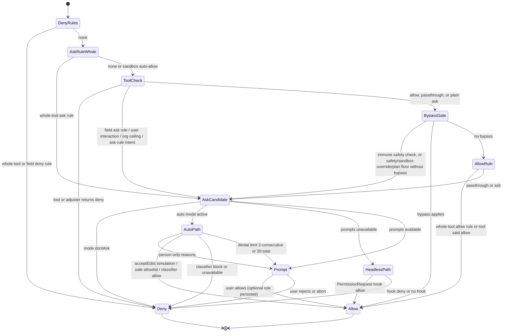
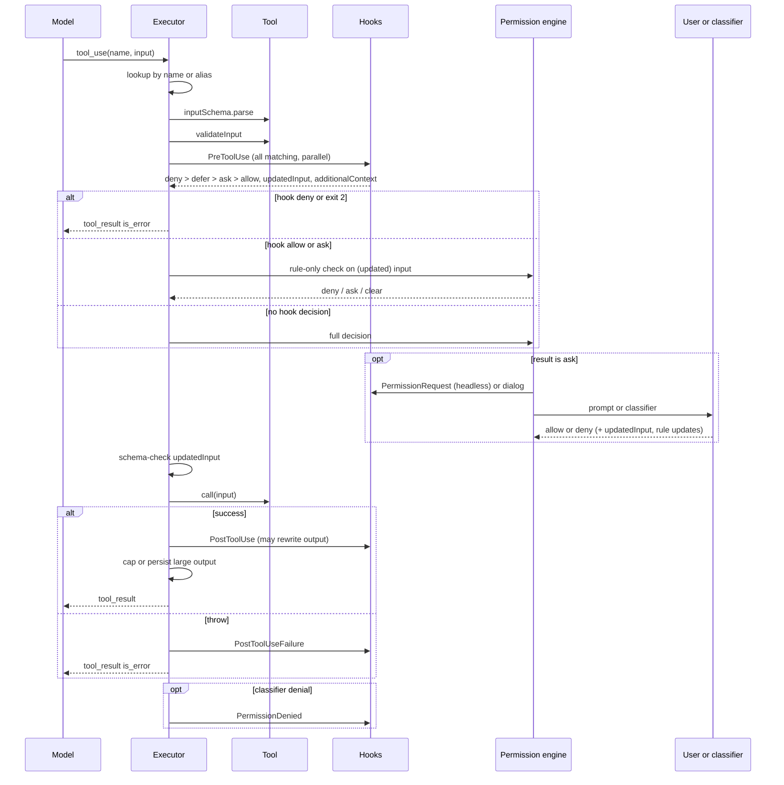

# Static pass 04: tools, permissions, hooks, sandbox, MCP tool integration

Target: Claude Code CLI 2.1.296 (Windows x64, Bun standalone), extracted module graph under
`extracted\2.1.296\~BUN\root\`. Read-only static analysis. Every claim says what the code
does *when reached*; nothing here proves a path runs.

Labels: **VS** = VERIFIED-STATIC, **SI** = STRONGLY INFERRED, **HYP** = HYPOTHESIS, **UNK** = UNKNOWN.
Evidence format: `chunk@offset "anchor"`. Offsets are character offsets into the chunk file.
`~` before an offset means "within a few hundred characters" (the anchor string is exact).
Mangled identifiers are quoted as shipped (`Hpn`, `jxr`, `Qj`). Names in *italics* are conceptual.

---

## 1. Scope and coverage

### Structural fact that shapes everything else

**VS** The chunks named in the brief (`chunk-snfhkfn3.js`, `chunk-7xzs7f0h.js`, `chunk-gaxady3f.js`,
`chunk-j20wf7b0.js`, `chunk-mgfeezsf.js`, ...) are re-export shims. Their body is one `export{...}`
statement that renames symbols imported from `chunk-phacttch.js` (4,762,804 chars). Example:
`chunk-snfhkfn3.js@13835 "Bu as hasPermissionsToUseTool"`, `chunk-7xzs7f0h.js@13965 "VR as executeHooks"`.
The real code for tool dispatch, permissions and hooks lives in `chunk-phacttch.js`; rule matching
lives in `chunk-xahmeshe.js`; mode tables in `chunk-12pz9g58.js` and `chunk-ff982hys.js`.

### Read in full or near-full

| Region | What |
|---|---|
| `chunk-phacttch.js@3321100-3362800` | `hasPermissionsToUseTool`, auto-mode branch, `Hpn` core algorithm, `mE` rule-only check |
| `chunk-phacttch.js@2258300-2315000` | `Qj` (*runToolUse*), `RWo`, `AWo` (validate, hooks, permission, call, result) |
| `chunk-phacttch.js@2232371-2246000` | PreToolUse / PostToolUse / PostToolUseFailure wrappers, hook-vs-permission resolver |
| `chunk-phacttch.js@2955100-2983000` | hook constants, base input, output parser, command spawner `YF` |
| `chunk-phacttch.js@2983292-2987000`, `3002100-3046500` | matcher logic, hook source assembly, `executeHooks` |
| `chunk-xahmeshe.js` body | rule lookup (`Vo`, `ac`, `x5`, `_h`), rule sources, dangerous-prefix lists |
| `chunk-12pz9g58.js` body | mode list, circuit-breaker table, reason constants |
| `chunk-ghf2w5kp.js` body | large-result persistence |
| `chunk-ff982hys.js@101000-110000`, `@23000-32000` | hook config schema, sandbox settings schema |

### Sampled with targeted greps (partial)

Tool registry (`chunk-rpwh4z9c.js@155896`), tool API serialization (`chunk-phacttch.js@825300-829300`),
streaming executor (`chunk-93pksqr2.js@46000-49000`), shell child process class (`chunk-phacttch.js@82788`),
Bash read-only check (`chunk-phacttch.js@3189000`), sandbox runtime (`chunk-4gghv5aa.js`), MCP client
(`chunk-9158d2ng.js`), subagent permission context (`chunk-jwmqjyrb.js@123650`).

### Not reached

- The interactive permission dialog component and its option list (the React tree in `chunk-9w4htdvs.js`).
  Only the update objects it emits were seen.
- `--permission-prompt-tool` headless path beyond its reason constants.
- MCP connection lifecycle, reconnect policy, OAuth, resource and prompt listing. Only constants,
  transport switch labels, tool composition and result mapping were read.
- Bash compound-command splitter and the tree-sitter based parser internals (`Eb().parse`, `fV`).
- Path permission checks (`checkReadPermissionForTool`, `checkWritePermissionForTool`,
  `getPathsForPermissionCheck`). Only protected-directory lists and error strings were read.
- Prompt-type and agent-type hook executors (`vln`, `Oln`), HTTP hook sender (`mRn`).
- ToolSearch / deferred tool discovery beyond the `defer_loading` emission site.
- Auto-mode classifier request construction (`hhe`).

---

## 2. Findings

### Q1. Tool interface, inventory, registry

**Default tool properties. VS.** A shared defaults object is spread into tools:
`chunk-3qrxzjv5.js@~121000 "isEnabled:()=>!0,isConcurrencySafe:(e)=>!1,isReadOnly:(e)=>!1,isDestructive:(e)=>!1"`
plus `remoteExecution: {supported:false}`, `toAutoClassifierInput: ()=>""`, `userFacingName: ()=>""`.
So a tool is serial, non-read-only and non-destructive unless it overrides.

**Observed tool members. VS** (each read at a call site in `chunk-phacttch.js` unless noted):

| Member | Where it is consumed | Evidence |
|---|---|---|
| `name`, `aliases[]` | lookup; alias use is logged once per alias | `@2268196 "D.aliases?.includes(w)"` |
| `inputSchema` (zod), `inputJSONSchema` (raw JSON schema, MCP) | parse, API schema | `@3355769 "e.inputSchema.parse(n)"`, `@~825900 "\"inputJSONSchema\"in e"` |
| `outputSchema` | validates a hook-rewritten output | `@~2303700 "e.outputSchema?.safeParse(pi)"` |
| `strict`, `strictInputJSONSchema` | API `strict` flag | `@~828700 "has strict: true but its schema is not strict-compatible"` |
| `prompt(ctx)` / `description()` | model-facing description | `chunk-phacttch.js@~2314500 "await h.prompt({getToolPermissionContext"` |
| `isEnabled()` | registry filter | `chunk-rpwh4z9c.js@~157400 "f.map((v)=>v.isEnabled())"` |
| `isConcurrencySafe(input)` | scheduler | `chunk-93pksqr2.js@~47050 "Boolean(n.isConcurrencySafe(r.data))"` |
| `isReadOnly(input, ctx)` | plan-mode floor, write gating | `@~3355500 "!e.isReadOnly(n,r)"` |
| `isDestructive(input)` | MCP policy, telemetry | `@~3324500 "e.isDestructive?.(n)??!1"` |
| `isOpenWorld()` | MCP annotation passthrough | `chunk-9158d2ng.js@~128500 "openWorldHint"` |
| `checkPermissions(parsedInput, ctx)` | step 5 of the algorithm | `@3360889` region `"V=await e.checkPermissions(Ve,r)"` |
| `validateInput(input, ctx)` | after schema parse | `@~2279300 "e.validateInput?.(co,{...s,toolUseId:n})"` |
| `coerceInput(raw)` | pre-parse repair | `@2272882 "e.coerceInput!==void 0"` |
| `validationErrorSteer`, `validationErrorRemedy` | extra text on schema failure | `@~2278500` |
| `call(input, ctx, canUseTool, assistantMessage, onProgress, extra)` | execution | `@~2296500 "e.call(vt,{...di,toolUseId:n,permissionPhase:Hn"` |
| `mapToolResultToToolResultBlockParam(data, toolUseId)` | result block | `@~2298900` |
| `maxResultSizeChars`, `persistenceThresholdCeiling`, `skipAggregateToolResultBudget` | size cap | `chunk-ghf2w5kp.js@~5316 "n.maxResultSizeChars,n.persistenceThresholdCeiling"` |
| `requiresUserInteraction()` | forces `ask`, blocks auto fast paths | `@3360889` region |
| `excludedFromModeBypassAllow()` | bypass does not auto-allow | same |
| `ignoresWholeToolAllowRule(input)` | bare `Tool` allow rule skipped | same |
| `suppressesAlwaysAllowRule(input)`, `suppressesAllPermissionUpdates(input)` | hides "always allow" | `@~3351000` |
| `classifierOnly()` returning `{onBlock:"refuse"|"flag"}` | only the classifier may allow | `@2229435 "e.classifierOnly?.()"` |
| `excludedFromAutoModeAllowlist()` | auto-mode safe list | `@3293344` |
| `toAutoClassifierInput(input)` | classifier serialization | defaults object |
| `permissionCheckFailureDecision(input, ctx)` | fail-closed posture when `checkPermissions` throws | `@~3356300` |
| `sandboxNetworkLists(input)` | `allowed_domains` review | `@3301519` |
| `mcpInfo {serverName, toolName, serverType, source, effectiveMaxPermission, ...}`, `isMcp` | MCP identity | `chunk-032sc1gt.js@~4100` |
| `familyParentToolName`, `toFamilyParentInput`, `ruleContentField` | rule inheritance from a parent tool | `chunk-xahmeshe.js@13228` |
| `stripForCreation`, `stripForStorage`, `restoreTransientForRemap` | transcript storage shaping | `@~2301300` |
| `userFacingName()`, `renderToolUseMessage()` | UI | `chunk-032sc1gt.js@~4100` |

Return value of `call`: an object with `data`, optional `newMessages`, `contextLayers`, `mcpMeta`,
`endsTurn`, `remedy`, `classifierContext`, `detached {text}`, `structured_output`,
`subagentFrameResult`. **VS** `chunk-phacttch.js@~2300000 "gr.contextLayers"`, `"gr.detached"`.
Progress is delivered through the `onProgress` callback, not by yielding. **VS** `@~2296900 "await ui(s,_e)"`.
`interruptBehavior` and `shouldDefer` were not found under those names in the regions read. **UNK**.

**Inventory. VS for names, SI for the full set.** `getAllBaseTools` is `rv` at
`chunk-rpwh4z9c.js@155896`; it returns a flat array with many entries gated by feature checks.
Tool name constants resolved to literals: `Bash`, `PowerShell`, `Read`, `Edit`, `Write`,
`NotebookEdit`, `Glob`, `Grep`, `Agent`, `AskUserQuestion`, `WebFetch`, `WebSearch`, `ToolSearch`,
`WaitForMcpServers`, `SendMessage`, `Artifact`, `Poll`, `StructuredOutput`, `Skill`, `Monitor`,
`SendUserMessage`, `ExitPlanMode`, `REPL`, `TodoWrite`, `TaskCreate`, `TaskUpdate`, `TaskGet`,
`TaskList`, `TaskStop`, `GetTask`, `ScheduleWakeup`, `LSP`, `EnterWorktree`, `ExitWorktree`,
`RefreshMcpTools`, `ReportFindings`, `ReadNotifications`, `SendFeedback`, `TestingPermission`,
`ShareOnboardingGuide`, `ShowOnboardingRolePicker`, `OfferChromeSetup`, `memory_read`,
`memory_write`, `memory_list`. Enabling conditions seen in `rv`:
`PowerShell` behind `YLe()`; `RefreshMcpTools` behind `CLAUDE_CODE_ENABLE_REFRESH_MCP_TOOLS`;
`Glob`/`Grep` dropped when their names are in the removed set `Nte()`. The per-tool mapping of the
remaining mangled entries to names was not completed. **UNK** for those.

**Registry assembly. VS.** `chunk-rpwh4z9c.js@~156500`:

1. `getTools(permCtx, opts)` = `ZL`. In `CLAUDE_CODE_SIMPLE` mode it returns a tiny fixed set.
   Otherwise: `rv()` minus four special tools, then `a5(list, permCtx)` (removes tools hit by a
   whole-tool deny rule), then REPL-mode and web-fetch-delegation filters, then `isEnabled()`.
2. `assembleToolPool(permCtx, mcpTools, opts)` = `iUt`: built-ins sorted by name, then
   deny-filtered MCP tools sorted by name, concatenated, de-duplicated by `name`
   (`"hi(s.toSorted(ade).concat(y.sort(ade)),\"name\")"`). Built-ins come first, so a built-in wins
   a name collision.
3. Agent restrictions are applied later by the subagent launcher (`LR(...)` → `resolvedTools`,
   `chunk-jwmqjyrb.js@~125300`). Not read in detail. **SI**.

### Q2. Serialization for the model

**VS** `chunk-phacttch.js@~828400-829200`. The API tool object is built as
`{name, description, input_schema}` plus optional `strict`, `eager_input_streaming`,
`defer_loading`, `cache_control`, and for WebSearch `citations:{enabled:true}`.

- `description` comes from `tool.prompt(...)`, post-processed (`vEe`) for non-MCP tools, then passed
  through tool-describe hooks unless `withoutToolDescribeHooks`.
- `input_schema` comes from `HPt(tool, ...)`. For tools with `inputJSONSchema` (MCP) the raw schema
  is used and takes part in the cache key (`"e.name}:${y.schemaKey(e.inputJSONSchema)}"`). The zod to
  JSON-schema converter is called `EM` at another site (`@~2274700 "_(EM(e.inputSchema))"`). **SI**
  that `HPt` uses the same converter for zod tools.
- `strict:true` is set only when structured outputs are on and the schema passes `Tfr`;
  otherwise it logs and sends non-strict.
- `defer_loading:true` when the caller passes `deferLoading`; `cache_control` when the caller passes
  `cacheControl`. A deferred stub tool also exists: `@~2652900 "defer_loading:!0"` with empty schema.
- On some providers (`E$()`) every field other than name, description, input_schema, cache_control
  (and defer_loading when supported) is stripped.
- The result is memoized by a composite cache key that includes many feature bits.

**MCP naming. VS** `chunk-z3rhyxhg.js@1238 "return`${Bo(e)}${In(n)}`"` with `Bo(e)="mcp__"+In(e)+"__"`.
Parsing: `chunk-z3rhyxhg.js@774`, split on `__`, first part must be `mcp`, second is the server,
the rest joined with `__` is the tool. SDK servers can skip the prefix with
`CLAUDE_AGENT_SDK_MCP_NO_PREFIX` (`chunk-9158d2ng.js@~130700`).

### Q3. Tool-call lifecycle

Order below is **VS** from `Qj` (`chunk-phacttch.js@2268196`), `RWo` (`@2272882`), `AWo` (`@2275985`).

| # | Step | Failure shape |
|---|---|---|
| 0 | Streaming executor queues the block. Unknown tool or parse failure makes it non-concurrent. Concurrency rule: run if nothing is executing, or if this tool and every executing tool are concurrency-safe. `chunk-93pksqr2.js@~47200 "canExecuteTool"` | n/a |
| 1 | Lookup by name with alias map (`pn(tools, name, toolAliases)`). If absent and the name looks like a pending MCP tool, wait for the server and re-enter. | `tool_result`, `is_error:true`, content `<tool_use_error>Error: No such tool available: NAME + hint</tool_use_error>`. Hint text depends on why (case mismatch, subagent-only, MCP server state...). `@2260635` |
| 2 | Abort check | cancel result (see Q10) |
| 3 | Isolation and remote-routing gates (`Esr`, `Dcs`) | `<tool_use_error>` + `is_error:true` |
| 4 | `tool.call` plugin hook wrapper (`I7t(...).tool.call`) wraps the rest | n/a |
| 5 | Input parse (`W9t`). JSON-string input that will not parse | `<tool_use_error>InputValidationError: ... could not be parsed as JSON ...</tool_use_error>`, `is_error:true`. `@~2276700` |
| 6 | Zod validation | `<tool_use_error>InputValidationError: {formatted issues}</tool_use_error>`, `is_error:true`. When the tool was deferred and its schema never sent, a "load it with ToolSearch" note is appended. `@~2278900`, `@~2274500` |
| 7 | `validateInput` | `<tool_use_error>{message}</tool_use_error>`, `is_error:true`, `toolUseResult:"Error: ..."`. `@~2279500` |
| 8 | PreToolUse hooks (`vsr`, `@2240429`) | see Q8/Q9. A `stop` ends the call with a cancel-shaped result |
| 9 | Permission resolution (`wsr` → `eWo`, `@2237362`) | non-allow: `tool_result` with `is_error:true` and the **raw** decision message (no `<tool_use_error>` wrapper). `@~2287500 "content:ts,is_error:!0"` |
| 10 | Re-validate `updatedInput` from the permission handler against the schema (ignores `unrecognized_keys`) | `<tool_use_error>The permission handler returned updatedInput ... failed schema validation</tool_use_error>`, `is_error:true`. `@~2289600` |
| 11 | Write-lock wait (`yps`), abort re-check, mark in-progress, heartbeat timer start | cancel result |
| 12 | `tool.call(...)` | throw → step 16 |
| 13 | `mapToolResultToToolResultBlockParam`, then PostToolUse hooks (`bsr`, `@2232371`) which may yield `updatedToolOutput` | bad rewrite: original output kept plus a `hook_error_during_execution` attachment |
| 14 | Size cap / persistence (`Nqe` → `Z`, `chunk-ghf2w5kp.js@5225`) | n/a |
| 15 | Emit the user message holding the `tool_result`, then hook attachments, then `newMessages` | n/a |
| 16 | On throw: telemetry, PostToolUseFailure hooks (`Ssr`, `@2235023`), then `tool_result` with `is_error:true` and content from `wWo(err)` | outer catch in `Qj`: `<tool_use_error>Error calling tool (NAME): msg</tool_use_error>` |

Details:

- **Progress. VS.** Progress messages are enqueued on a side stream; a `tool_heartbeat` progress
  event is emitted every 30,000 ms for main-thread tools (`@2245164 "C9r=30000"`, `"tool_heartbeat"`).
- **Slow-hook logging threshold. VS** 2,000 ms (`@2254664 "yqe=2000"`).
- **Empty output. VS.** Replaced by `(NAME completed with no output)` (`chunk-ghf2w5kp.js@~5700`).
- **Large output. VS.** Threshold = `min(tool.maxResultSizeChars, 50000)` unless a remote flag
  overrides per tool; default when a tool gives none is 400,000. Content containing image or
  document blocks is never persisted. Above the threshold the text is written to
  `<tool-results dir>/<tool_use_id>.txt` (or `.json` for block arrays) with exclusive create, and
  the model receives:
  `<persisted-output>` / `Output too large (SIZE). Full output saved to: PATH` / blank /
  `Preview (first 2KB):` / preview cut at the last newline if that is past half the budget /
  `...` / `</persisted-output>`. Preview budget 2,000 chars. If the file cannot be written in a
  storage-backed session a `<truncated-output>` wrapper is used instead.
  Evidence: `chunk-ghf2w5kp.js@~1900 "o5=\"<persisted-output>\""`, `"nCe=2000"`,
  `chunk-fd5j6erd.js@1312 "p0=50000"`, `@1370 "ACs=400000"`.
- **Per-message aggregate budget. VS** 200,000 chars across the tool results of one assistant
  turn, largest results persisted first, gated by a remote flag
  (`chunk-fd5j6erd.js@1381 "ujn=200000"`, `chunk-ghf2w5kp.js@~8600 "tengu_hawthorn_steeple"`).
- **Final message shape. VS.** A user-role message whose `content` is
  `[tool_result, ...optional text block (accept feedback), ...optional content blocks]` with side
  fields `toolUseResult`, `sourceToolAssistantUUID`, `toolDenialKind`
  (`"cancelled" | "interrupted" | "permission-rule" | "user-rejected" | ...`), `toolResultRemedy`,
  `mcpMeta`, `permissionDecision {decision, source, reasonType}`.
- **Telemetry. VS.** OTel-style events `tool_decision` and `tool_result` (success `"true"`/`"false"`,
  `duration_ms`, sizes, `decision_source`) at `@~2285500` and `@~2299800`; analytics events
  `tengu_tool_use_error`, `tengu_tool_use_interrupted`.

### Q4. Permission modes

**VS** `chunk-12pz9g58.js@678 "k0=[\"acceptEdits\",\"auto\",\"bypassPermissions\",\"default\",\"dontAsk\",\"plan\"]"`.
`"manual"` is an input alias for `default` (`"th(e){return e===\"manual\"?\"default\":e}"`).
An internal seventh mode `bubble` exists for subagents (`chunk-ff982hys.js@~69230`
`"cr={plan:0,bubble:1,default:1,dontAsk:1,acceptEdits:2,auto:3,bypassPermissions:4}"`). That table
is a permissiveness rank used to stop a child from widening its parent's mode.

| Mode | Effect in the decision code | Evidence |
|---|---|---|
| `default` | no shortcut; `passthrough` becomes `ask` | `@3360889` tail |
| `acceptEdits` | no branch in `Hpn`; file tools' own `checkPermissions` read the mode. Auto mode re-runs `checkPermissions` with mode forced to `acceptEdits` as a fast path | `@~3331900 "mode:\"acceptEdits\""` |
| `plan` | non-read-only calls from MCP tools and tool-host tools get `ask` with reason `{type:"mode",mode:"plan"}`; `plan` counts as bypass when bypass is available; `plan` counts as auto when auto is active | `@~3355300 "Cannot call ${e.name} while in plan mode."`, `chunk-ff982hys.js@69118`, `chunk-80kqkekd.js@151745` |
| `bypassPermissions` | after deny rules, ask rules and immune safety checks: `allow` with reason `{type:"mode"}` | `@3360889` |
| `dontAsk` | any `ask` becomes `deny` with a fixed message | `@~3323000 "Ae===\"dontAsk\"&&!Ve"`, `@4364241` |
| `auto` | an `ask` goes through fast paths, then a classifier | `@3321594` |
| `bubble` | subagent keeps prompts and forwards them to the parent | `chunk-jwmqjyrb.js@~124800 "De===\"bubble\"||fe||Ie?!1:y"` |

**Effective mode per tool. VS** `qE(tool, ctx)` at `chunk-ff982hys.js@68523`: a per-MCP-server
override (`mcpPermissionModeOverrides[serverName]`) replaces the mode when the session is in a
permissive mode; certain MCP classes and `excludedFromModeBypassAllow` tools are downgraded to
`auto` (if the classifier can run) or `default`.

**Cycle (shift+tab). VS** `chunk-pq75k3y4.js@~1500`:
`default → acceptEdits → plan → bypassPermissions (if available) → auto (if available) → default`;
from `bypassPermissions`: `auto` if available else `default`; from `dontAsk`: `default`.

**Policy gates. VS.** `permissions.disableBypassPermissionsMode === "disable"` removes bypass
(`chunk-kqxewm47.js@~15700`); settings keys `disableAutoMode`, `permissions.disableAutoMode`
exist in the restrictive-key table (`chunk-ff982hys.js@~25800`). `setMode: bypassPermissions` is
never persisted as `defaultMode` (`chunk-p9na5vps.js@~197900 "is session-scoped; not persisting"`).
Plan exit transitions were not read. **UNK**.

### Q5. Permission decision algorithm

Two layers. **VS** for both.

**Layer A, `Hpn` (`chunk-phacttch.js@3360889`), returns allow / deny / ask.** Exact order:

1. Abort → throw.
2. Whole-tool deny rule (`$pn` → `Vo`) → `deny`, message `Permission to use NAME has been denied.`
3. Field-scoped deny rule (`_h(ctx, tool, input, "deny")`) → `deny`.
4. Whole-tool ask rule (`ac`) → run `checkPermissions`; its `deny` stands, its `ask` is returned
   tagged `matchedAskRule`, otherwise `ask` with the rule as reason. Skipped for sandboxed Bash
   when `autoAllowBashIfSandboxed` is on and the command will run sandboxed.
5. `tool.checkPermissions(parsedInput, ctx)`. Unrecognized input keys are set aside and the result
   marked `checkIncomplete` (an `allow` is downgraded to `passthrough`). A throw is mapped by the
   tool's declared fail-closed posture or becomes `passthrough`.
   Plan-mode floor: `passthrough` from a qualifying non-read-only tool becomes `ask`.
6. Post-adjusters: classifier-only tools (`cqe`), `allowed_domains` review (`j9e`), desktop-tool
   review (`U9e`).
7. `deny` from 5 or 6 → return.
8. Field-scoped ask rule → `ask` (keeps the tool's own ask detail if present).
9. `requiresUserInteraction()` → `ask`.
10. Server-held shell allow reroute (auto mode with server-side classifier) → `ask`.
11. `ask` that carries ask-rule intent → return.
12. MCP `effectiveMaxPermission === "ask"` → `ask` (org ceiling).
13. Bypass test: `bypass = (mode is bypassPermissions, or plan with bypass available and not a
    remote execution) and tool does not opt out`. If the result is `ask` and
    (bypass and a **bypass-immune** safety check is present) or (sandbox override under the
    outside-read block) or (not bypass and any safety check / sandbox override / plan floor) → return `ask`.
14. `bypass` → `allow`, reason `{type:"mode", mode}`.
15. Whole-tool allow rule (`x5`) → `allow`, reason `{type:"rule"}` (several carve-outs).
16. `passthrough` → `ask`. Tool's own `allow` is returned as is.

Bypass-immune circuit breakers (**VS** `chunk-12pz9g58.js@~900`, table `Gnn`):
`dangerousRemoval`, `isolatePeerMachines`, `restrictedMode`, `outsideReadsBlocked`.
Not immune: `backgroundOperator`, `suspiciousWindowsPath`, `claudeSettingsFile`, `internalHardDeny`.
So in bypass mode an `ask` for editing a Claude settings file is auto-allowed by step 14, while a
dangerous `rm` still asks.

**Layer B, `jxr` (`@3321594`), converts `ask`.** Order:

1. Run Layer A through `decideWithToolCheckHooks` (`f8r`, plugin `tool.check` handlers can only
   make the answer stricter for gated tools).
2. `allow` → return (resets the auto-mode denial streak).
3. `ask` and effective mode `dontAsk` → `deny`.
4. `ask` and auto mode active: ordered fast paths, then classifier. Fast paths: safety check with
   `autoModeDeny` (hard deny or timed dialog); non-classifier-approvable safety check, ask rule,
   org ceiling, plan floor → keep `ask` (or headless deny); `requiresUserInteraction` → `ask`;
   **acceptEdits simulation** (re-run `checkPermissions` as if in `acceptEdits`; allow means allow
   without classifier); **safe allowlist** (`Vwt`); plugin-origin and harness-synthesized skips;
   then the classifier (`hhe`, local or server-side). Classifier outcomes: allowed → `allow`
   reason `{type:"classifier"}`; blocked → `deny` (or prompt after the denial limit);
   unavailable → `deny` fail-closed with retry guidance; transcript too long → fall back to
   prompt, or abort in headless.
5. `ask` in `bypassPermissions` with an `autoModeDeny` safety check → deny or timed dialog (`vpn`).
6. Otherwise `bpn`: if `shouldAvoidPermissionPrompts`, run PermissionRequest hooks (`Dxr`,
   `@3317987`); a hook `allow`/`deny` is the answer, else `deny` with reason
   `{type:"asyncAgent", reason:"Permission prompts are not available in this context"}`.
   If prompts are available the `ask` is returned and the caller's `canUseTool` raises the dialog.

Auto-mode denial limits: **VS** `@2533539 "nG={maxConsecutive:3,maxTotal:20}"`. On reaching either,
the next block falls back to prompting; in headless it throws
`"Agent aborted: too many classifier denials in headless mode"` (`@~3350400`).

**Rule syntax. VS** `chunk-1e8shh70.js@~2900` (`gpe`, `Un`):
`Tool` or `Tool(content)`; the opening paren must be unescaped, the closing paren must be the last
character, and the name part may not contain parens. `Tool()` and `Tool(*)` normalize to bare
`Tool`. `\(`, `\)`, `\\` are unescaped in content. CLI lists split on commas and spaces outside
parens (`Nu`).

**Matching. VS.**
- Whole-tool rule (`P`, `chunk-xahmeshe.js@~9000`): exact name; or the tool's
  `familyParentToolName`; or glob on the name when the rule name has glob characters; or MCP
  server coverage: rule `mcp__server` or `mcp__server__*` covers every tool of that server, and
  `mcp__server__<glob>` matches by glob (`chunk-z3rhyxhg.js@2890`).
- Field-scoped rule (`_h`, `@13228`): content of the form `key:pattern` is matched against
  `input[key]` (string-coerced, trimmed) with a glob matcher, for any tool, unless `key` is the
  tool's own `ruleContentField` (that case is left to the tool's `checkPermissions`).
- Bash content (`chunk-ff982hys.js@~183400`): three kinds. `prefix` (legacy `cmd:*`),
  `wildcard` (unescaped `*`, compiled to a regex with `*` → `.*`, dotall; a single trailing ` *`
  is optional so `git *` also matches bare `git`), else `exact`.
- Aliases: deny/ask rules written for one file tool apply to related tools through a table
  (`chunk-xahmeshe.js@~10400`: a `Read` path rule of the "everything" shape also covers
  `Grep`/`Glob` and, for deny, `Edit`/`Write`).

**Sources and precedence. VS.** Source order (`chunk-xahmeshe.js@~7700`, `chunk-db4p09wg.js@3863`):
`userSettings, projectSettings, localSettings, flagSettings, policySettings, cliArg, command,
session, toolsNarrowing, mcpServerPolicy, hostCredential`. Rules are flattened in that order and the
first match is returned, so order only decides *which rule is reported*. Behavior precedence is
fixed by the algorithm: deny, then ask, then tool check, then allow. In auto mode, allow rules
that match the dangerous-prefix lists (interpreters, `curl`, `wget`, `kubectl exec`, `sudo`,
`eval`, ...) are dropped from the allow set (`FM`, `@8017`; lists at `@~4700`).

**Persistence of "always allow". VS** `chunk-p9na5vps.js@197706`. Update types: `addRules`,
`replaceRules`, `removeRules`, `addDirectories`, `removeDirectories`, `setMode`. Only destinations
`localSettings`, `userSettings`, `projectSettings` are written to disk
(`permissions.allow|deny|ask`, `permissions.additionalDirectories`, `permissions.defaultMode`);
`session` and `cliArg` stay in memory. Default suggestion destination for tool-generated
suggestions is `localSettings` (for example the MCP tool suggestion
`chunk-9158d2ng.js@~129700`). Rules from `policySettings`, `flagSettings`, `command` cannot be
deleted (`chunk-phacttch.js@~3363400 "Cannot delete permission rules from read-only settings"`).

### Q6. Bash, PowerShell and file-tool safety

**Bash read-only fast path. VS** `chunk-phacttch.js@~3189000`. Order: length cap → parse →
reject "too-complex" → reject subshell → reject `&` → reject bare assignment to a non-allowlisted
env var → reject unquoted variable expansion → `ask` on Windows UNC path → `cd` + `git` compound →
bare-repo indicator check → "creates git internal files and runs git" → git outside original cwd
when sandboxed → per-command checks (only safe redirects, no `/dev/tcp|udp`, safe env prefixes,
glob use only for an allowlisted set of commands, then a read-only command table). All commands
passing gives `allow`; anything else gives `passthrough` (not deny), so normal rules still apply.

**Compound commands. SI.** Results per subcommand are carried in a reason of type
`subcommandResults` (a `Map` of subcommand text to result), and safety checks inside it are found
by recursive search (`Dl`, `@3365672`). The splitter itself was not read.

**Sandbox auto-allow. VS.** Reason constant
`chunk-12pz9g58.js@~3300 "Auto-allowed with sandbox (autoAllowBashIfSandboxed enabled)"`.

**PowerShell. VS for the check list.** `chunk-x9p5trte.js@64000-88000` holds one `ask` per risk:
`Invoke-Expression`, dynamic command name, encoded parameters, nested PowerShell, download and
execute, BITS transfer, `certutil` URL fetch, .NET compile/load, COM objects, elevation, script
blocks, `$()` subexpressions, expandable strings, splatting, stop-parsing token, .NET method calls,
env var modification, module install, alias/variable creation, UNC paths, `cd` + `git` compound,
writes into `.git/`, arbitrary redirections. Dangerous allow-rule prefixes for PowerShell are
listed at `chunk-xahmeshe.js@~6300`.

**File tools. VS for strings, SI for enforcement point.**
- Read-before-edit: `chunk-80kqkekd.js@~165300 "File has not been read yet. Read it first before writing to it."`.
  The UI maps it to "File must be read first". The check site (expected in Edit/Write
  `validateInput`, using `readFileState`) was not read.
- Deny strings: `"File is in a directory that is denied by your permission settings."`,
  `"File is covered by a Read deny rule ..."` (same offset region).
- Protected directories for the path safety check: `chunk-p9na5vps.js@~200250`
  `[".git",".vscode",".idea",".claude",".husky",".cargo",".devcontainer",".yarn",".mvn"]` plus
  `.config/git`; name comparison lowercases and folds two Unicode lookalikes.
- Sandbox-level protected files: `chunk-pxvrkc8v.js@~1300`
  `[".gitconfig",".gitmodules",".bashrc",".bash_profile",".zshrc",".zprofile",".profile",".ripgreprc",".mcp.json"]`
  and dirs `.git`, `.vscode`, `.idea`, `.claude/commands`, `.claude/agents`.
- Outside-working-directory reads can be blocked by `permissions.blockReadsOutsideWorkingDirectories`
  (bypass-immune breaker `outsideReadsBlocked`).

### Q7. Sandbox

**When. VS** `Ey` = `shouldUseSandbox`, `chunk-phacttch.js@3287586`:

```
if forced-by-host: true
if !isSandboxingEnabled(): false
if shell is bash, OS is Windows, and Git Bash is absent: false
strict = caller.disableUnsandboxedCommands || policy.unsandboxedCommandsDisabled || EVAL_CONFINED
if input.dangerouslyDisableSandbox && !strict && (userTyped || areUnsandboxedCommandsAllowed()): false
if no command: return strict
if !strict && command matches excludedCommands: false
return true
```

**Escape hatch. VS.** Bash input field `dangerouslyDisableSandbox`
(`@~4324700`). When it flips a command from sandboxed to unsandboxed and the rest of the check did
not already ask or deny, Bash returns `ask` with reason `{type:"sandboxOverride"}` and message
`Run outside of the sandbox` (`@~4338100`). That reason type blocks every auto-mode fast path and is
not auto-allowed outside bypass (Layer A step 13). Setting `sandbox.allowUnsandboxedCommands:false`
makes the field ignored.

**Mechanism. VS** (`chunk-4gghv5aa.js`, a bundled sandbox runtime):
- macOS: `/usr/bin/sandbox-exec -p <profile>` (`@740378`).
- Linux: `bwrap` with bind mounts, deny-read tmpfs overlays, and an optional seccomp filter that
  blocks Unix sockets (`@721510 "Wrapped command with bwrap"`, `"seccomp(unix-block)"`).
- Windows: a helper named `srt-win` with an install step that needs elevation and installs WFP
  filters (`@~753300 "srt-win install timed out — the UAC prompt may still be open"`,
  `"WFP filter install failed"`). **SI** that it enforces network policy through WFP.

**Config keys. VS** `chunk-ff982hys.js@~24300`: `sandbox.enabled`, `failIfUnavailable`,
`autoAllowBashIfSandboxed`, `allowUnsandboxedCommands`, `network`, `filesystem`, `credentials`,
`ignoreViolations` (map of command → patterns), `enableWeakerNestedSandbox`,
`enableWeakerNetworkIsolation`, `allowAppleEvents`, `excludedCommands`, `ripgrep`, `bwrapPath`,
`socatPath`. Network and filesystem sub-schemas were not expanded. **UNK** for their fields.

**Violation flow. SI.** Bash telemetry records `had_sandbox_violation` (`@~4342500`); the path from
a violation to model-visible text was not read.

### Q8. Hooks

**Events (33). VS** `chunk-ff982hys.js@74707`: PreToolUse, PostToolUse, PostToolUseFailure,
PostToolBatch, Notification, UserPromptSubmit, UserPromptExpansion, SessionStart, SessionEnd,
Stop, StopFailure, SubagentStart, SubagentStop, PreCompact, PostCompact, PreModelSwitch,
PostModelSwitch, PermissionRequest, PermissionDenied, Setup, TeammateIdle, TaskCreated,
TaskCompleted, Elicitation, ElicitationResult, ConfigChange, WorktreeCreate, WorktreeRemove,
InstructionsLoaded, CwdChanged, FileChanged, DirectoryAdded, MessageDisplay.

**Config schema. VS** `chunk-ff982hys.js@~101100-104500`:
`hooks: { [Event]: Array<{ matcher?: string, hooks: HookEntry[] }> }`. Entry types in the settings
union: `command`, `prompt`, `agent`, `http`, `mcp_tool`. Runtime-only types seen in the executor:
`callback` (SDK), `function` (session/plugin function hooks), `script`. Fields are in section 4.

**Sources. VS** `chunk-av1znmt1.js@1584` (`B`) and `chunk-phacttch.js@3002479` (`TG`). Per event the
matcher list is concatenated in this order:
1. settings snapshot (`q4()`: hooks merged from settings files, captured at startup and on updates),
2. main-thread agent frontmatter hooks (`Xse()`), skipped when managed-only,
3. registered hooks (`UF()`: plugin hooks, SDK host hooks, device-forwarded hooks),
4. session hooks for the current session or agent id (`sessionHooksRegistry.get(id, event)`),
5. session function hooks.
Order is only emission order; all matched hooks start in parallel.

**Policy gates. VS** `chunk-vb0592bn.js@2521-2951`:
- `policySettings.disableAllHooks === true` → nothing but non-plugin registered hooks survive in
  `B`, and the managed-only path returns `[]`.
- Managed-only is true when `policySettings.allowManagedHooksOnly === true`, **or** when a
  non-policy source sets `disableAllHooks` while policy does not (so a user-level
  `disableAllHooks` disables the user's hooks but leaves managed hooks running), or in restricted
  mode. Then agent hooks and non-managed plugin hooks are dropped and session hooks are skipped.
- Untrusted workspace → all hooks skipped (`@3013525 "workspace trust not accepted"`).

**Matching. VS** `chunk-phacttch.js@2983857-2987000`. The match query per event (`F5e`):
tool events → `tool_name`; SessionStart → `source`; Setup/PreCompact/PostCompact → `trigger`;
Notification → `notification_type`; SessionEnd → `reason`; SubagentStart/Stop → `agent_type`;
Elicitation* → `mcp_server_name`; ConfigChange/DirectoryAdded → `source`; InstructionsLoaded →
`load_reason`; StopFailure → `error`; UserPromptExpansion → `command_name`; FileChanged → file
name; UserPromptSubmit, Stop, TeammateIdle, TaskCreated, TaskCompleted → no query (always match).
Matcher semantics (`pX`): empty or `*` matches everything. If the matcher consists only of
`[A-Za-z0-9_|, -]` it is a literal list split on `|` or `,` and compared for exact equality
(also against the tool's family-parent names and aliases). Otherwise it is compiled as a regex and
tested against the name and its aliases. A bare `mcp__server` literal matches no tool and the code
logs a hint to use `mcp__server__.*` (`@~2985900`).
`if` condition: a permission-rule string such as `Bash(git *)`; evaluated only for tool events;
on non-tool events a hook with `if` is skipped (`@~3007900 "cannot be evaluated for non-tool event"`).
Identical command hooks are de-duplicated (`bG`). HTTP hooks are dropped for SessionStart and Setup.

**Stdin JSON. VS.** Base fields from `$d` (`@2958370`): `session_id`, `transcript_path`, `cwd`,
`scratchpad_dir?`, `prompt_id?`, `permission_mode`, `agent_id?`, `agent_type?`, `effort?`.
Then `hook_event_name` and event fields (section 4). The JSON is written to the child's stdin
followed by a newline, then stdin is closed (`@~2976900`). Oversized input fails the hook
(`"hook_input_too_large"`).

**Environment. VS** `@~2972700`: inherits the process env, plus `CLAUDE_PROJECT_DIR`; `COLUMNS`
and `LINES` from the terminal; for plugin hooks `CLAUDE_PLUGIN_ROOT`, `CLAUDE_PLUGIN_DATA`,
`CLAUDE_PLUGIN_OPTION_<KEY>`; for skill hooks `CLAUDE_PLUGIN_ROOT` set to the skill root;
`CLAUDE_ENV_FILE` only for SessionStart, Setup, CwdChanged, FileChanged and only for non-PowerShell
hooks. Exec form (`args` present) substitutes `${CLAUDE_PROJECT_DIR}`, `${CLAUDE_PLUGIN_ROOT}`,
`${CLAUDE_PLUGIN_DATA}` per element with no shell. Shell choice: `hook.shell` or a default;
on Windows the bash form requires Git Bash, else the hook throws with an instruction to add
`"shell":"powershell"`. `CLAUDE_CODE_SHELL_PREFIX` wraps shell-form commands.
Child is spawned `detached` on non-Windows, `windowsHide:true`.

**Execution model. VS.** All matched hooks are started together and their results are merged as
they arrive (`@~3037800 "uEn(ns)"`), so hooks for one event run in parallel, not serially.
Callback hooks run first in a separate loop only when every matched hook is an internal callback.

**Timeouts. VS.**

| Role | Value | Evidence |
|---|---|---|
| default per-hook timeout | 600,000 ms | `@2915934 "lu=600000"` |
| per-hook override | `timeout` seconds × 1000 | `@~2972600 "e.timeout?e.timeout*1000:lu"` |
| UserPromptSubmit event timeout | 30,000 ms | `"S5e=30000"`, `@~2952400` |
| PreModelSwitch / PostModelSwitch | 30,000 ms | `"w5e=30000"` |
| SessionEnd default | 1,500 ms, env `CLAUDE_CODE_SESSIONEND_HOOKS_TIMEOUT_MS` | `@2955308 "MZo=1500"` |
| SessionEnd bound | `max(1500, min(largest configured timeout, 60000))` | `@2955612`, `"vkr=60000"` |
| async-rewake flush wait at exit | 30,000 ms | `"Ekr=30000"` |

No separate maximum was found for the `timeout` field (schema: positive number). **VS** for the
schema, **UNK** for any runtime clamp.

**Exit codes for command hooks. VS** `@~3031000-3035500`. After the process ends:
1. Aborted → `hook_cancelled` attachment (`timedOut` true when the parent was not aborted).
2. stdout starts with `{` and validates against the output schema → JSON path (below). If it
   validates and exit code is 2 with no `blockingError` from JSON, a blocking error is synthesized
   from stderr.
3. JSON present but invalid: exit 2 → treated as plain exit 2; other codes → non-blocking error
   showing the validation message.
4. No JSON: exit 0 → `hook_success` with stdout as content; exit 2 → blocking error
   `[command]: {stderr or "No stderr output"}` (unless it looks like a missing script, which is
   downgraded to non-blocking); any other code → `hook_non_blocking_error` with stderr.
`onFailure:"block"` turns start failures, timeouts, other exit codes and invalid JSON into exit-2
behavior (schema text at `chunk-ff982hys.js@~101400`); ignored for async hooks and for Stop,
SubagentStop, TaskCompleted, TeammateIdle.

What "blocking" means per event is decided by each caller: PreToolUse → deny the call;
PostToolUse → `hook_blocking_error` attachment after the tool ran; UserPromptSubmit → prompt
blocked with `UserPromptSubmit operation blocked by hook:`; Stop/SubagentStop → feedback that
continues the turn; ConfigChange for `policy_settings` → never blocking (`@~2933900`).

**Stdout JSON. VS** `cX` at `@2961410`:
- Common: `continue:false` → `preventContinuation` (+ `stopReason`); `decision:"approve"|"block"`
  (legacy; `block` produces a blocking error using `reason`); `systemMessage`; `suppressOutput`;
  `terminalSequence` (allowlisted OSC only); `async:true` (+ `asyncTimeout`).
- `hookSpecificOutput.hookEventName` must equal the running event or the hook errors.
- PreToolUse: `permissionDecision: "allow"|"deny"|"ask"|"defer"`, `permissionDecisionReason`,
  `updatedInput`, `additionalContext`.
- PermissionRequest: `decision: {behavior:"allow", updatedInput?, updatedPermissions?} |
  {behavior:"deny", message?, interrupt?}`.
- PostToolUse: `additionalContext`, `updatedToolOutput`, `updatedMCPToolOutput` (legacy),
  `classifierContext`.
- UserPromptSubmit: `additionalContext`, `sessionTitle`, `suppressOriginalPrompt`.
- SessionStart: `additionalContext`, `initialUserMessage`, `sessionTitle`, `watchPaths`, `reloadSkills`.
- PermissionDenied: `retry`. Elicitation / ElicitationResult: `action`, `content`.
  MessageDisplay: `displayContent`. Others: `additionalContext`.

**Precedence among hooks. VS** `@~3041000`: aggregated `permissionBehavior` follows
`deny > defer > ask > allow`; a blocking error counts as `deny`. `updatedInput` is forwarded only
from a hook whose own decision equals the aggregate and is `allow` or `ask`.

**Surfacing. VS.** Results become `attachment` messages with types `hook_success`,
`hook_blocking_error`, `hook_non_blocking_error`, `hook_cancelled`, `hook_additional_context`,
`hook_system_message`, `hook_stopped_continuation`, `hook_error_during_execution`,
`hook_permission_decision`, `hook_deferred_tool`. Progress events of type `hook_progress` carry
`statusMessage` for the spinner. How each attachment type is rendered into model-visible reminder
text is in another subsystem. **UNK** here.

**Async hooks. VS** `@2956004` (`I5e`) and `@~2977800`. A command hook goes to the background when
(a) config has `async:true`, or (b) config has `asyncRewake:true`, or (c) its first stdout JSON
object is `{"async":true}`. `forceSyncExecution` disables this. Plain async hooks are registered
for later delivery (`jTt`; batch attachment type `async_hook_response_batch` seen in
`chunk-fzzrkchm.js@~34900`). `asyncRewake` hooks wake the model only on exit code 2, by queuing a
message with body `Stop hook blocking error from command "NAME": {stderr or stdout}`.

### Q9. Hook ordering relative to permissions

All **VS**.

1. PreToolUse runs **after** schema parse and `validateInput` and **before** any permission
   evaluation (`AWo`: `gsr` at `@~2279300`, `vsr` loop at `@~2280000`, `wsr` at `@~2284200`).
2. Hook `deny` (or exit 2) → final deny; rules are not consulted (`eWo`: `"Hook denied tool use"`).
3. Hook `allow` does **not** bypass deny rules, ask rules or safety checks. `eWo` calls the
   rule-only checker `mE` on the (possibly rewritten) input:
   - `mE` returns `deny` → deny (`"but deny rule overrides"`).
   - `mE` returns `ask` → full pipeline through `canUseTool` (prompt).
   - otherwise → allow without prompt (`"bypassing permission prompt"`), **except** when
     `requireCanUseTool` is set, or in auto mode for classes that must be classified
     (`"auto mode requires classifier adjudication"`).
4. Hook `ask` → same `mE` check; if nothing stricter, `canUseTool` is called with the hook's ask
   as a forced decision, and a later classifier allow is re-surfaced as that ask (`hookAskFloor`).
5. `updatedInput` from PreToolUse is validated with `inputSchema.safeParse`; any issue other than
   `unrecognized_keys` turns the hook result into a deny with a schema error (`@~2241600`).
   It is not passed through `validateInput` again. **VS** that no second `validateInput` call
   exists between `vsr` and `e.call` in `AWo`.
6. `updatedInput` from the permission stage (dialog, PermissionRequest hook, prompt tool) is
   schema-checked at step 10 of Q3.
7. `permissionDecision:"defer"` is honored only in non-interactive mode and only when the
   assistant message holds exactly one tool_use; it emits a `hook_deferred_tool` attachment and
   returns without a tool_result (`@~2281400`).
8. PermissionRequest hooks run only when the decision is `ask`. In the headless branch a hook
   `allow` with `updatedInput` (or for a user-interaction tool) is re-checked with `mE`; a
   resulting `ask` becomes a deny because nobody can answer (`@3317987`).
9. PermissionDenied hooks run only for auto-mode classifier denials (`@~2288300`); `retry:true`
   adds a meta message telling the model it may retry.
10. PostToolUse runs after `call` succeeds and before the result message is built;
    PostToolUseFailure runs in the catch path with `is_interrupt`.

### Q10. Timeouts and cancellation

- **Bash. VS** `chunk-3ed3dp76.js@~760`: default 120,000 ms (`BASH_DEFAULT_TIMEOUT_MS`), max
  600,000 ms (`BASH_MAX_TIMEOUT_MS`, never below the default). Output read-back default 30,000
  chars, upper limit 150,000 (`chunk-gfq70w8v.js@1427`, `BASH_MAX_OUTPUT_LENGTH`); setting
  `bashOutputMaxChars` is clamped to 4,000–128,000.
- **Shell child class. VS** `chunk-phacttch.js@82788` (`dAe`). On timeout: if the command may
  auto-background, it is backgrounded; else killed with synthetic code 143 and the text
  `Command timed out after {duration}`. On abort: killed unless the abort reason is `interrupt`
  (or a turn-scoped exemption). Kill = SIGTERM to the process tree (`J_(pid,"SIGTERM")`), poll every
  100 ms for exit, after 1,500 ms send SIGKILL to the process group (`process.kill(-pid)`), to the
  recorded descendants, and to the tree again. Interrupted exit code is reported as 137.
  Output file watchdog: every 5,000 ms; kill when the output file exceeds 5 GB.
  Constants: `@80721 "pK=137,zit=143,fHn=1500,pHn=100"`, `"gHn=5000"`, `chunk-9613h2kb.js@2346 "DRt=5368709120"`.
- **What the model sees after cancel. VS.**
  - Abort before or during a call: `tool_result` with the "user doesn't want to take this action
    right now. STOP ..." text, `toolDenialKind:"cancelled"` (`q9`, `@2274965`).
  - Queued tools never started, in the streaming executor (`chunk-93pksqr2.js@47402`): reason
    `turn-abort` → `[Tool call did not complete: the turn was ended to deliver the message that
    follows...]`; reason `background` → the STOP text; otherwise the user-rejected text;
    model-ended conversation → `<tool_use_error>Cancelled: Claude ended the conversation</tool_use_error>`;
    streaming fallback → `<tool_use_error>Error: Streaming fallback - tool execution discarded</tool_use_error>`.
    All with `is_error:true`.
- **Hook kill. VS.** Hook children are wrapped in the same class (`wee(child, signal, timeoutMs, ...)`,
  `@~2976500`), so they get the same SIGTERM-then-SIGKILL sequence.

### Q11. MCP

- **Scopes. VS** `chunk-ff982hys.js@~59300`:
  `["local","user","project","dynamic","enterprise","claudeai","managed","agent"]`.
- **Transport types in config. VS** same offset: `["stdio","sse","sse-ide","http","ws","sdk"]`;
  the client switch also handles `ws-ide` and `claudeai-proxy` (`chunk-9158d2ng.js@70618-70829`).
- **Constants. VS.**

  | Role | Value | Evidence |
  |---|---|---|
  | connect/request timeout (`MCP_TIMEOUT`) | 30,000 ms | `chunk-pyztzyft.js@~700` |
  | `MCP_CONNECT_TIMEOUT_MS` default | 5,000 ms | same |
  | tool call timeout default | 100,000,000 ms (about 27.8 h) | `chunk-9158d2ng.js@45264 "_a=1e8"` |
  | tool call timeout resolution | per-server `timeout` (≥1000) ?? `MCP_TOOL_TIMEOUT` ?? default, clamped to [1000, 2^31-1] | `@~51500` |
  | tool idle timeout | stdio 1,800,000 ms; remote 300,000 ms; none for `sse-ide`, `ws-ide`, `sdk`; env `CLAUDE_CODE_MCP_TOOL_IDLE_TIMEOUT` | `@~51650` |
  | HTTP per-request floor | 60,000 ms | `@~66750 "Ss=60000"` |
  | connection batch size | local 3, remote 20 | `@~67600` |
  | output token cap | 25,000 tokens (`MAX_MCP_OUTPUT_TOKENS`) | `chunk-y7nenkdd.js@~1060 "g=25000"` |
  | auth stub tool result cap | 10,000 chars | `chunk-032sc1gt.js@4159` |

- **Tool composition. VS** `chunk-9158d2ng.js@~128300`: `isReadOnly` and `isConcurrencySafe` from
  `annotations.readOnlyHint`; `isDestructive` from `destructiveHint`; `isOpenWorld` from
  `openWorldHint`; `inputJSONSchema` from the server schema; `checkPermissions` returns
  `passthrough` with an `addRules` suggestion for the full tool name to `localSettings` (or `ask`
  with `suppressAlwaysAllowRule` for interaction-required tools); user-facing name
  `SERVER - TITLE (MCP)`.
- **Result mapping. VS** `@162533`: `text` → text block; `image` with a supported mime
  (jpeg, png, gif, webp) → image block (resized), else stored as a blob file with a text pointer
  `[Image from SERVER] `; `audio` → blob file pointer `[Audio from SERVER] `; `resource` with text →
  `[Resource from SERVER at URI] text`; `resource` with blob → image or blob file;
  `resource_link` → `[Resource link: NAME] URI (description)`. `structuredContent`, `_meta` and
  `resourceLinks` ride on the message as `mcpMeta`, not in the tool_result content (`@136964`).
  `isError` results throw an `Iv` error whose text becomes the `is_error:true` result (`@~173700`).
- **Server permission policy. VS** `chunk-z3rhyxhg.js@~1300`: remote servers may carry per-tool
  `permission_policy` of `always_allow | always_ask | always_deny`; these become rules with source
  `mcpServerPolicy`.
- **Elicitation. SI.** Schema for `elicitation/create` and actions `accept|decline|cancel` are
  present (`chunk-6y1jd448.js@11191`); `Elicitation` and `ElicitationResult` hooks can answer or
  block (`chunk-phacttch.js@2934503`). The UI flow was not read.
- Connection lifecycle, auth, resource/prompt listing: **UNK** (not reached).

### Q12. Subagents

**VS** `chunk-jwmqjyrb.js@~123650-124900`:
- The child starts from the parent's permission context. An agent-declared `permissionMode` is
  applied only when the parent is not in `bypassPermissions`, `acceptEdits` or `auto`.
- `bypassPermissions` requested by a child is honored only if the parent session authorizes it;
  otherwise the parent mode is kept and a warning logged. `auto` is kept only if auto mode is
  available to the subagent (`Osr`, `chunk-phacttch.js@3606025`).
- `bubble` under a `plan` or `dontAsk` parent keeps the parent mode.
- `shouldAvoidPermissionPrompts` is set to true for async/background agents unless the agent is in
  `bubble` mode, or the caller supplied a dialog channel. Agents that can show prompts get
  `awaitAutomatedChecksBeforeDialog`.
- When the launcher passes an explicit allowed-tool list, the child's allow rules are replaced by
  `{cliArg: parent's, mcpServerPolicy: parent's, session: [that list]}`; settings-file allow rules
  are not inherited in that case.
- Forked contexts get `shouldAvoidPermissionPrompts:true` by default
  (`chunk-phacttch.js@2540046`).
- With `shouldAvoidPermissionPrompts`, an `ask` goes to PermissionRequest hooks and otherwise
  denies with the "requires interactive approval" message (Layer B step 6).
- Hook input carries `agent_id` and `agent_type`; subagent stop fires `SubagentStop` instead of
  `Stop` with `agent_transcript_path` (`@~2946200`). Session hooks are looked up under the agent id.

---

## 3. Reconstructed control flow

### 3.1 `runToolUse()` (conceptual name for `Qj` + `RWo` + `AWo`)

```
async function* runToolUse(toolUse, assistantMsg, canUseTool, ctx):
    tool = findTool(ctx.options.tools, toolUse.name, ctx.options.toolAliases)
    if !tool and looksLikePendingMcp(toolUse.name):
        r = await waitForMcpTool(toolUse.name)
        if r.tool: return yield* runToolUse(..., ctx with r.tools)
        if r.aborted: yield cancelResult(); return
    if !tool:
        yield errorResult("<tool_use_error>Error: No such tool available: " + name + hint + "</tool_use_error>")
        return
    try:
        if ctx.signal.aborted: yield cancelResult(); return
        if isolationDenies(tool): yield errorResult(wrapped(denyMessage)); return
        yield* withToolCallPluginHooks(() => checkPermissionsAndCall(...))
    catch err:
        yield errorResult("<tool_use_error>Error calling tool (" + tool.name + "): " + msg + "</tool_use_error>")

async function checkPermissionsAndCall(tool, id, rawInput, ctx, canUseTool, assistantMsg):
    parsed = parseInput(tool, rawInput)            # JSON string repair, coerceInput, zod
    if parsed.jsonError:  return [errorResult(wrapped("InputValidationError: ...not valid JSON..."))]
    if parsed.zodError:   return [errorResult(wrapped("InputValidationError: " + formatted))]
    v = await tool.validateInput?.(parsed.input, ctx)
    if aborted: return cancelResult("validate_input")
    if v && !v.result: return [errorResult(wrapped(v.message))]

    out = []; input = parsed.input; hookDecision = undefined; stopAfter = false
    for await ev of runPreToolUseHooks(ctx, tool, input, id):
        message            -> out.push or progress
        hookPermissionResult -> hookDecision = ev
        hookUpdatedInput   -> input = ev.updatedInput
        preventContinuation -> stopAfter = true
        additionalContext  -> out.push(attachment)
        defer              -> (headless + single tool_use only) out.push(hook_deferred_tool); return out
        stop               -> out.push(cancelShapedResult(ev.stopReason)); return out

    {decision, input} = await resolveHookAndPermission(hookDecision, tool, input, ctx, canUseTool)
    if decision.behavior != "allow":
        if aborted: return cancelResult("permission")
        out.push(resultMsg({type:"tool_result", content: decision.message, is_error:true}))
        if decision is auto-mode classifier denial: run PermissionDenied hooks
        if decision.endsTurn: abort("permission-stop")
        return out
    if decision.updatedInput:
        if schemaIssues(tool, decision.updatedInput): out.push(errorResult(wrapped(...))); return out
        input = decision.updatedInput

    await writeLock(tool, input); if aborted: return cancelResult("pre_call")
    startHeartbeat(30_000)
    try:
        res = await tool.call(input, ctxWithToolUseId, canUseTool, assistantMsg, onProgress, extra)
        block = res.detached ? {type:"tool_result", content: res.detached.text}
                             : tool.mapToolResultToToolResultBlockParam(res.data, id)
        data = res.data
        for await h of runPostToolUseHooks(ctx, tool, id, input, data):
            if h.updatedToolOutput: data = h.updatedToolOutput; rewritten = true
            else collect(h)
        if rewritten: block = validateAndRemap(tool, data) or keep original + hook_error attachment
        block = await capOrPersist(block, tool)            # <persisted-output> path
        out.push(resultMsg([block, ...acceptFeedback, ...contentBlocks]))
        out.push(...collected, ...res.newMessages)
        if stopAfter: out.push(hook_stopped_continuation)
        return out
    catch err:
        for await h of runPostToolUseFailureHooks(ctx, tool, id, input, text(err), isInterrupt): collect(h)
        if userAborted: return cancelResult("call")
        out.push(resultMsg({type:"tool_result", content: text(err), is_error:true}), ...collected)
        return out
```

### 3.2 `resolveHookAndPermission()` (`eWo`) and `decidePermission()` (`jxr` + `Hpn`)

```
async function resolveHookAndPermission(hook, tool, input, ctx, canUseTool):
    if settingsProblemBlocksAll(): return deny
    if hook?.behavior == "deny": return finalize(hook)
    if hook?.behavior not in ("allow","ask"): return canUseTool(tool, input, ctx)   # normal path
    input = hook.updatedInput ?? input
    r = await ruleOnlyCheck(tool, input, ctx)          # mE: deny rules, ask rules, checkPermissions, safety
    if r?.behavior == "deny": return finalize(r)
    if r?.behavior == "ask":  return canUseTool(tool, input, hook.behavior=="ask" ? ctx+hookAskFloor : ctx)
    if hook.behavior == "allow":
        if ctx.requireCanUseTool: return canUseTool(tool, input, ctx)
        if autoModeNeedsClassifier(tool, ctx) and !tool.requiresUserInteraction?.():
            return canUseTool(tool, input, ctx + hookAllowVouched)
        return finalize(hook)                           # allow, no prompt
    return finalize(hook)                               # ask -> canUseTool(tool, input, ctx, forced=hook)

async function decidePermission(tool, input, ctx):      # hasPermissionsToUseTool
    r = await coreCheck(tool, input, ctx)               # Hpn, wrapped by tool.check plugin hooks
    if r.behavior == "allow": return r
    if r.behavior == "deny":  return r
    mode = effectiveMode(tool, ctx)
    if mode == "dontAsk": return deny(DONT_ASK_MESSAGE)
    if isAuto(mode):
        if hardSafetyDeny(r): return deny or timed dialog
        if personOnly(r) or askRule(r) or orgCeiling(tool) or planFloor(r):
            return ctx.avoidPrompts ? denyHeadless(r) : r
        if tool.requiresUserInteraction?.(): return r
        if wouldBeAllowedInAcceptEdits(tool, input): return allow(mode:auto)
        if onSafeAllowlist(tool, input): return allow(mode:auto)
        c = await classify(...)
        if c.allowed: return allow(classifier)
        if c.unavailable: return deny(failClosed)
        if c.transcriptTooLong: return ctx.avoidPrompts ? throwAbort : r
        track denial; if limitReached(3 consecutive | 20 total): ctx.avoidPrompts ? throwAbort : r+fallback
        return deny(classifier reason)
    if ctx.avoidPrompts:
        h = await runPermissionRequestHooks(tool, input, ctx)
        return h ?? deny("Permission prompts are not available in this context")
    return r                                            # caller raises the dialog

async function coreCheck(tool, input, ctx):             # Hpn, 16 steps listed in Q5
    if wholeToolDeny: return deny
    if fieldDeny: return deny
    if wholeToolAsk and not sandboxAutoAllow: return askFromRule(tool.checkPermissions)
    t = safeCheck(tool.checkPermissions(parse(input), ctx))   # plan floor applied here
    t = adjust(t)
    if t.deny: return t
    if fieldAsk: return ask
    if tool.requiresUserInteraction?.(): return ask
    if t.ask and askRuleIntent(t): return t
    if tool.mcpInfo?.effectiveMaxPermission == "ask": return ask
    bypass = bypassApplies(tool, ctx)
    if t.ask and (bypass ? bypassImmune(t) : (safety(t) or sandboxOverride(t) or planFloor(t))): return t
    if bypass: return allow(mode)
    if wholeToolAllow: return allow(rule)
    return t.passthrough ? ask : t
```

### 3.3 `runHooks()` (`VR` → `dSr`)

```
async function* runHooks({hookInput, toolUseID, matchQuery, signal, timeoutMs = 600_000, ctx}):
    if !workspaceTrusted(): return
    matchers = collectMatchers(event, ctx)             # settings, agent, registered, session, function
    hooks = matchers.filter(m => matcherMatches(m.matcher, matchQuery)).flatMap(m => m.hooks)
    hooks = dedupeByCommand(hooks).filter(h => !h.if || ifConditionMatches(h.if, hookInput))
    if hooks.length == 0 or signal.aborted: return
    for h in hooks: yield progress(hook_progress, h.statusMessage)
    json = JSON.stringify(hookInput)                   # size-checked

    runs = hooks.map(async function*(h):
        limit = h.timeout ? h.timeout*1000 : timeoutMs
        switch h.type:
          callback: yield await h.callback(hookInput, toolUseID, abortAfter(limit))
          function: yield runFunctionHook(h, messages)
          prompt:   yield await runPromptHook(h, json, ...)
          agent:    yield await runAgentHook(h, json, ...)     # not allowed for PermissionRequest
          http:     yield interpretHttp(await post(h.url, json))
          mcp_tool: yield interpretMcp(await callMcp(h.server, h.tool, h.input))
          command/script:
              r = await spawnHook(h, json, env, cwd, abortAfter(limit))
              if r.backgrounded: yield success; return
              if r.aborted: yield cancelled(timedOut = !signal.aborted); return
              parsed = parseHookOutput(r.stdout)
              if parsed.json: yield interpretJson(parsed.json, r)    # exit 2 adds blocking error
              else if r.status == 0: yield success(stdout)
              else if r.status == 2: yield blocking("[cmd]: " + (r.stderr || "No stderr output"))
              else yield nonBlockingError(r.stderr)
    )

    agg = undefined
    for await res of mergeAsTheyArrive(runs):          # parallel
        forward res.message, additionalContext, systemMessage, updatedToolOutput, ...
        if res.blockingError: yield {blockingError}; agg = "deny"
        switch res.permissionBehavior:
            deny:  agg = "deny"
            defer: if agg != "deny": agg = "defer"
            ask:   if agg not in ("deny","defer"): agg = "ask"
            allow: if !agg: agg = "allow"
        if res.permissionBehavior and agg == res.permissionBehavior:
            yield {permissionBehavior: agg, reason, updatedInput: (allow|ask) ? res.updatedInput : undefined}
        if res.permissionRequestResult: yield it
```

### 3.4 Permission state machine



### 3.5 Hook ordering around one tool call



---

## 4. Data contracts

Fields marked `// observed` were read at a named site. `// proposed` are my typing of an untyped use.

```ts
// Permission result, chunk-phacttch.js@3360889 and callers
type PermissionResult =
  | { behavior: "allow"; updatedInput?: unknown; decisionReason?: DecisionReason;
      userModified?: boolean; acceptFeedback?: string; contentBlocks?: ContentBlock[] }   // observed
  | { behavior: "deny"; message: string; decisionReason: DecisionReason;
      endsTurn?: boolean; invalidInput?: boolean; decideLocation?: "pre-ask" }            // observed
  | { behavior: "ask"; message: string; updatedInput?: unknown; decisionReason?: DecisionReason;
      suggestions?: PermissionUpdate[]; matchedAskRule?: PermissionRule;
      suppressAlwaysAllowRule?: boolean; checkIncomplete?: boolean; blockedPath?: string;
      contentBlocks?: ContentBlock[]; userFeedback?: string }                             // observed
  | { behavior: "passthrough"; message: string; checkIncomplete?: boolean;
      suggestions?: PermissionUpdate[] };                                                 // observed

// chunk-12pz9g58.js "vut=[...]"
type DecisionReason =
  | { type: "rule"; rule: PermissionRule }
  | { type: "mode"; mode: PermissionMode }
  | { type: "subcommandResults"; reasons: Map<string, PermissionResult> }
  | { type: "permissionPromptTool"; toolResult: unknown }
  | { type: "hook"; hookName: string; hookSource?: string; reason?: string }
  | { type: "asyncAgent"; reason: string }
  | { type: "sandboxOverride"; reason: string }
  | { type: "workingDir"; reason?: string }
  | { type: "safetyCheck"; reason: string; classifierApprovable: boolean;
      circuitBreaker?: CircuitBreaker; also?: CircuitBreaker[] }
  | { type: "classifier"; classifier: "auto-mode"; reason: string;
      noVerdict?: boolean; classifierAllowed?: boolean }
  | { type: "other"; reason: string };

type CircuitBreaker = "dangerousRemoval" | "backgroundOperator" | "suspiciousWindowsPath"
  | "isolatePeerMachines" | "restrictedMode" | "outsideReadsBlocked"
  | "claudeSettingsFile" | "internalHardDeny";                                            // observed

type PermissionMode = "default" | "acceptEdits" | "plan" | "bypassPermissions" | "dontAsk" | "auto"
  | "bubble" /* internal */;                                                              // observed

type RuleSource = "userSettings" | "projectSettings" | "localSettings" | "flagSettings"
  | "policySettings" | "cliArg" | "command" | "session" | "toolsNarrowing"
  | "mcpServerPolicy" | "hostCredential";                                                 // observed
interface PermissionRule { source: RuleSource; ruleBehavior: "allow" | "deny" | "ask";
  ruleValue: { toolName: string; ruleContent?: string } }                                 // observed

type PermissionUpdate =                                                                   // observed, chunk-p9na5vps.js@197706
  | { type: "addRules" | "replaceRules" | "removeRules"; rules: PermissionRule["ruleValue"][];
      behavior: "allow" | "deny" | "ask"; destination: RuleSource }
  | { type: "addDirectories" | "removeDirectories"; directories: string[]; destination: RuleSource }
  | { type: "setMode"; mode: PermissionMode; destination: RuleSource };

interface ToolPermissionContext {                                                         // observed fields
  mode: PermissionMode;
  alwaysAllowRules: Partial<Record<RuleSource, string[]>>;
  alwaysDenyRules:  Partial<Record<RuleSource, string[]>>;
  alwaysAskRules:   Partial<Record<RuleSource, string[]>>;
  additionalWorkingDirectories: Map<string, { path: string; source: RuleSource }>;
  isBypassPermissionsModeAvailable?: boolean; isAutoModeAvailable?: boolean;
  shouldAvoidPermissionPrompts?: boolean; awaitAutomatedChecksBeforeDialog?: boolean;
  blockReadsOutsideWorkingDirectories?: boolean; canAutoClassifierRun?: boolean;
  mcpPermissionModeOverrides?: Record<string, PermissionMode>;
  toolAliases?: Record<string, string>; prePlanMode?: PermissionMode;
}

// Hook config, chunk-ff982hys.js@~101100
type HookEntry =
  | { type: "command"; command: string; args?: string[]; if?: string; shell?: "bash" | "powershell";
      timeout?: number /* seconds */; onFailure?: "continue" | "block"; statusMessage?: string;
      once?: boolean; async?: boolean; asyncRewake?: boolean;
      rewakeMessage?: string; rewakeSummary?: string; cloud?: "device" | "skip" }
  | { type: "prompt"; prompt: string; if?: string; timeout?: number; model?: string;
      continueOnBlock?: boolean; statusMessage?: string; once?: boolean }
  | { type: "agent"; prompt: string; if?: string; timeout?: number; model?: string;
      statusMessage?: string; once?: boolean }
  | { type: "http"; url: string; if?: string; timeout?: number; onFailure?: "continue" | "block";
      headers?: Record<string, string>; allowedEnvVars?: string[]; statusMessage?: string;
      once?: boolean; cloud?: "device" | "skip" }
  | { type: "mcp_tool"; server: string; tool: string; input?: Record<string, unknown>; if?: string;
      timeout?: number; statusMessage?: string; once?: boolean };
type HooksConfig = Partial<Record<HookEvent, { matcher?: string; hooks: HookEntry[] }[]>>;

// Hook stdin, chunk-phacttch.js@2958370 + per-event builders
interface HookInputBase { session_id: string; transcript_path: string; cwd: string;
  scratchpad_dir?: string; prompt_id?: string; permission_mode?: string;
  agent_id?: string; agent_type?: string; effort?: { level: string } }
type HookInput = HookInputBase & (
  | { hook_event_name: "PreToolUse"; tool_name: string; tool_input: unknown; tool_use_id: string; mcp_server?: object }
  | { hook_event_name: "PostToolUse"; tool_name: string; tool_input: unknown; tool_response: unknown;
      tool_use_id: string; duration_ms?: number; mcp_server?: object }
  | { hook_event_name: "PostToolUseFailure"; tool_name: string; tool_input: unknown; tool_use_id: string;
      error: string; is_interrupt: boolean; duration_ms?: number }
  | { hook_event_name: "PostToolBatch"; tool_calls: unknown[] }
  | { hook_event_name: "PermissionRequest"; tool_name: string; tool_input: unknown; permission_suggestions?: PermissionUpdate[] }
  | { hook_event_name: "PermissionDenied"; tool_name: string; tool_input: unknown; tool_use_id: string; reason: string }
  | { hook_event_name: "UserPromptSubmit"; prompt: string; session_title?: string }
  | { hook_event_name: "UserPromptExpansion"; expansion_type: string; command_name: string;
      command_args: string; command_source: string; prompt: string }
  | { hook_event_name: "SessionStart"; source: string; agent_type?: string; model?: string; session_title?: string }
  | { hook_event_name: "SessionEnd"; reason: "clear" | "resume" | "logout" | "prompt_input_exit" | "other" }
  | { hook_event_name: "Stop"; stop_hook_active: boolean; last_assistant_message?: string }
  | { hook_event_name: "SubagentStop"; stop_hook_active: boolean; agent_id: string;
      agent_transcript_path: string; agent_type: string; last_assistant_message?: string }
  | { hook_event_name: "SubagentStart"; agent_id: string; agent_type: string }
  | { hook_event_name: "StopFailure"; error: string; error_details?: unknown; last_assistant_message?: string }
  | { hook_event_name: "PreCompact"; trigger: string; custom_instructions?: string }
  | { hook_event_name: "PostCompact"; trigger: string; compact_summary: string }
  | { hook_event_name: "Notification"; message: string; title?: string; notification_type: string }
  | { hook_event_name: "Setup"; trigger: string }
  | { hook_event_name: "ConfigChange"; source: string; file_path?: string }
  | { hook_event_name: "CwdChanged"; old_cwd: string; new_cwd: string }
  | { hook_event_name: "FileChanged"; file_path: string; event: string }
  | { hook_event_name: "DirectoryAdded"; directory: string; source: string }
  | { hook_event_name: "InstructionsLoaded"; file_path: string; memory_type: string; load_reason: string;
      globs?: string[]; trigger_file_path?: string; parent_file_path?: string }
  | { hook_event_name: "Elicitation"; mcp_server_name: string; message: string; mode?: string;
      url?: string; elicitation_id?: string; requested_schema?: unknown }
  | { hook_event_name: "ElicitationResult"; mcp_server_name: string; elicitation_id?: string;
      mode?: string; action: string; content?: unknown }
  | { hook_event_name: "PreModelSwitch" | "PostModelSwitch"; from_model: string; to_model: string;
      requested_model?: string; source: string }
  | { hook_event_name: "TeammateIdle"; teammate_name: string; team_name: string }
  | { hook_event_name: "TaskCreated" | "TaskCompleted"; task_id: string; task_subject: string;
      task_description?: string; teammate_name?: string; team_name?: string }
  | { hook_event_name: "WorktreeCreate"; name: string }
  | { hook_event_name: "WorktreeRemove"; worktree_path: string }
  | { hook_event_name: "MessageDisplay"; turn_id: string; message_id: string; index: number; final: boolean; delta: string }
);

// Hook stdout, chunk-phacttch.js@2961410
interface HookOutput {
  continue?: boolean; stopReason?: string; suppressOutput?: boolean; systemMessage?: string;
  decision?: "approve" | "block"; reason?: string; terminalSequence?: string;
  async?: boolean; asyncTimeout?: number; metrics?: unknown; rewakeSummary?: string;
  hookSpecificOutput?: { hookEventName: HookEvent } & Record<string, unknown>;   // per-event keys in Q8
}

// Tool result message (proposed shape; fields observed at chunk-phacttch.js@~2301000)
interface ToolResultUserMessage {
  type: "user";
  message: { role: "user"; content: Array<
    { type: "tool_result"; tool_use_id: string; content: string | ContentBlock[]; is_error?: boolean } | ContentBlock> };
  toolUseResult?: unknown; sourceToolAssistantUUID: string;
  toolDenialKind?: string; toolDenialEndsTurn?: boolean; toolResultRemedy?: unknown;
  mcpMeta?: { _meta?: unknown; structuredContent?: unknown; resourceLinks?: unknown };
  permissionDecision?: { decision: "accept" | "reject"; source: string; reasonType?: string };
}
```

---

## 5. Constants

| Name or role | Value | Evidence |
|---|---|---|
| Permission modes | acceptEdits, auto, bypassPermissions, default, dontAsk, plan | `chunk-12pz9g58.js@678` |
| Mode rank | plan 0, bubble 1, default 1, dontAsk 1, acceptEdits 2, auto 3, bypassPermissions 4 | `chunk-ff982hys.js@~69230` |
| Auto-mode denial limits | 3 consecutive, 20 total | `chunk-phacttch.js@2533539` |
| Tool heartbeat interval | 30,000 ms | `chunk-phacttch.js@2245164` |
| Slow hook / slow permission log threshold | 2,000 ms | `chunk-phacttch.js@2254664` |
| Result persistence ceiling | 50,000 chars | `chunk-fd5j6erd.js@1312` |
| Result persistence default when tool has none | 400,000 chars | `chunk-fd5j6erd.js@1370` |
| Per-turn aggregate tool-result budget | 200,000 chars | `chunk-fd5j6erd.js@1381` |
| Persist file size cap | 1,073,741,824 bytes | `chunk-fd5j6erd.js@1398` |
| Persisted preview size | 2,000 chars | `chunk-ghf2w5kp.js@~2330` |
| Token estimate divisor | 4 chars per token | `chunk-fd5j6erd.js@1364` |
| Typical `maxResultSizeChars` | 100,000 (Write, Glob, Edit, NotebookEdit, ToolSearch, many); Grep 20,000; Read 1 (sentinel); auth stubs 10,000 | `chunk-phacttch.js@734042, 762384, 768643, 3541279, 4160334` |
| Hook default timeout | 600,000 ms | `chunk-phacttch.js@2915934` |
| UserPromptSubmit hook timeout | 30,000 ms | same line, `S5e` |
| Model-switch hook timeout | 30,000 ms | same line, `w5e` |
| SessionEnd hook default / cap | 1,500 ms / 60,000 ms | `chunk-phacttch.js@2955308` |
| Async rewake flush wait | 30,000 ms | `chunk-phacttch.js@~2955400` |
| Rewake summary max length | 300 chars | `chunk-phacttch.js@~2955430` |
| Blocking-capable hook events | PreToolUse, PermissionRequest, PreModelSwitch, UserPromptSubmit, UserPromptExpansion, ConfigChange, Elicitation, ElicitationResult, PostToolBatch, TaskCreated, PreCompact | `chunk-phacttch.js@564417` |
| Guard events (unloadable hook blocks) | PreToolUse, PermissionRequest | `chunk-ff982hys.js@109855` |
| Bash default / max timeout | 120,000 / 600,000 ms | `chunk-3ed3dp76.js@~760` |
| Bash output default / upper limit | 30,000 / 150,000 chars | `chunk-gfq70w8v.js@1427` |
| `bashOutputMaxChars` clamp | 4,000 to 128,000 | `chunk-fd5j6erd.js@1312` (`djn`, `n6e`) |
| Kill grace before SIGKILL | 1,500 ms, poll 100 ms | `chunk-phacttch.js@80736` |
| Synthetic exit codes | 137 interrupted, 143 timeout | `chunk-phacttch.js@80721` |
| Shell output file size kill | 5,368,709,120 bytes, checked every 5,000 ms | `chunk-9613h2kb.js@2346`, `chunk-phacttch.js@81062` |
| MCP request timeout | 30,000 ms | `chunk-pyztzyft.js@~700` |
| MCP connect timeout | 5,000 ms | same |
| MCP tool call default timeout | 100,000,000 ms | `chunk-9158d2ng.js@45264` |
| MCP idle timeout stdio / remote | 1,800,000 / 300,000 ms | `chunk-9158d2ng.js@~51650` |
| MCP connection batch local / remote | 3 / 20 | `chunk-9158d2ng.js@~67600` |
| MCP output token cap | 25,000 | `chunk-y7nenkdd.js@~1060` |
| MCP inline image mimes | jpeg, png, gif, webp | `chunk-9158d2ng.js@~66300` |

---

## 6. Open questions for runtime experiments

1. **`updatedInput` and `validateInput`.** Static reading says a PreToolUse `updatedInput` is
   schema-checked but not re-run through `validateInput`. Experiment: PreToolUse hook rewrites an
   Edit call's `file_path` to a file never read in the session; observe whether the
   "File has not been read yet" error appears. That also settles where read-before-edit is enforced.
2. **Hook `allow` versus rules.** Configure `deny: ["Bash(curl *)"]` plus a PreToolUse hook that
   returns `permissionDecision:"allow"`; expect a deny naming the rule. Repeat with an ask rule and
   expect a prompt. Repeat in `bypassPermissions` with `rm -rf ~` and expect a prompt (immune breaker).
3. **User-level `disableAllHooks`.** Static reading says it switches to managed-only instead of
   disabling managed hooks. Experiment needs a managed settings file with one hook; confirm it still fires.
4. **Parallel hooks.** Two PreToolUse hooks, one sleeping 3 s and one instant; check total latency
   is about 3 s and that a `deny` from the slow one still wins over an early `allow`.
5. **Matcher literal vs regex.** Matchers `Bash|Edit`, `Bash, Edit`, `mcp__srv`, `mcp__srv__.*`,
   `^Ba.*`; record which fire. Expect the bare `mcp__srv` to match nothing.
6. **Exit code table.** Command hooks exiting 0, 1, 2 on PreToolUse, PostToolUse, UserPromptSubmit,
   Stop, SessionStart; capture the transcript attachments and the model-visible text for each.
7. **Large output.** Tool output of 49,999 / 50,001 / 400,001 chars from Bash and from an MCP tool;
   confirm the threshold used, the file location, and the exact `<persisted-output>` text.
8. **Sandbox on Windows.** Whether `sandbox.enabled` does anything on this build without Git Bash
   and whether `srt-win` is ever installed; observe with `sandbox.failIfUnavailable:true`.
9. **Mode cycle.** Press shift+tab from each mode with and without
   `--dangerously-skip-permissions` and with auto mode available; compare with the static cycle.
10. **Subagent prompts.** Background agent calling a tool that needs approval, with and without a
    PermissionRequest hook; confirm the auto-deny text and that `bubble`-mode agents surface the
    dialog in the parent.
11. **Tool order sent to the API.** Capture one request body; confirm built-ins sorted by name
    first, MCP tools sorted by name after, and which entries carry `defer_loading`, `strict`,
    `cache_control`.
12. **Cancellation text.** Press Esc during a long Bash call and during a queued parallel batch;
    record each `tool_result` text and `is_error` value.
13. **MCP timeout.** Set `MCP_TOOL_TIMEOUT=2000` against a slow tool and a per-server
    `timeout: 500` (expected to be ignored as below 1000); record the error text.
