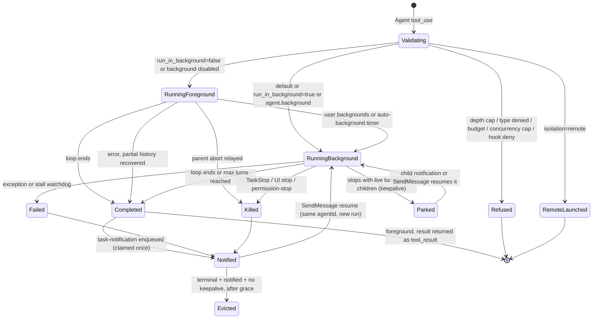
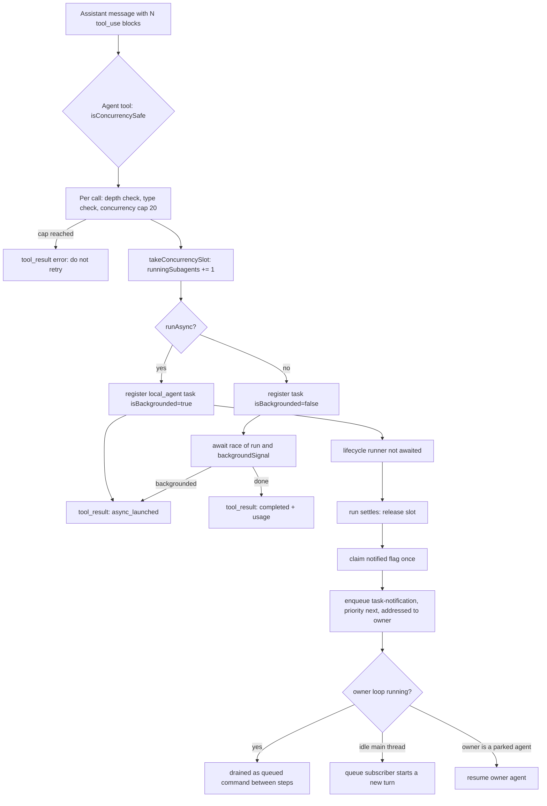
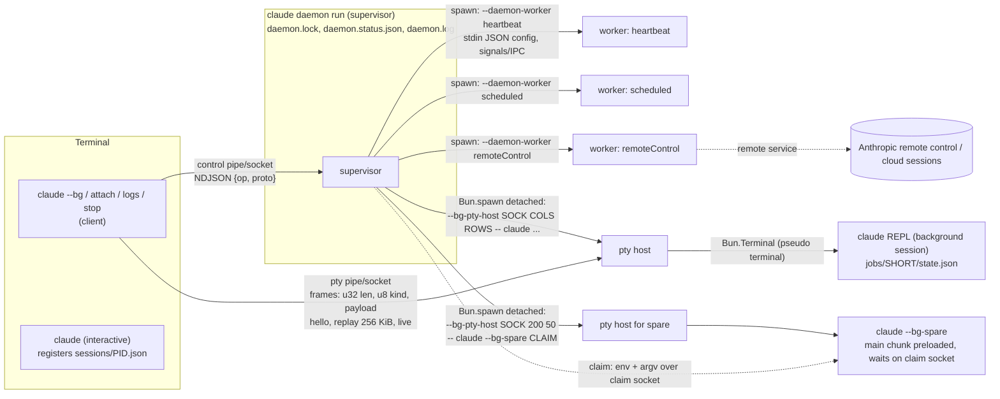

# Static pass 05: subagents, tasks, background work, session persistence and resume, terminal rendering

Target: Claude Code CLI 2.1.296 (Windows x64 Bun standalone), extracted module graph.
Evidence format: `chunk-xxxxxxxx.js@<char offset>` plus a short quoted anchor.
Labels: **VERIFIED-STATIC** (read in shipped code), **STRONGLY INFERRED**, **HYPOTHESIS**, **UNKNOWN**.
Static evidence shows the code exists. Every "does X" below means "does X when reached".

Mangled identifiers are quoted as they appear (`vC`, `kX`, `avt`). Names in *italics* are conceptual.

---

## 1. Scope and coverage

### What was read

A structural fact that shapes everything else: the small chunks named in the brief
(`chunk-yy3r64d0.js`, `chunk-1stv0pyw.js`, `chunk-6q3v99kv.js`, `chunk-zfk1cmmq.js`, ...) are
**re-export shims**. Their bodies are a few hundred bytes of `export{vC as runAgent,...}` after a
long import list. The implementation lives in a handful of large chunks. **VERIFIED-STATIC**
(`chunk-yy3r64d0.js` body is 181 chars: `export{Fzr as clearWorktreeFromAgentMetadata,...vC as runAgent`).

| Area | Defining chunk (real code) | Read |
|---|---|---|
| Agent tool (`Agent`) schema, launch path | `chunk-h6wy99cb.js` (52 KB) | 6000 to end, nearly in full |
| `runAgent` (`vC`), lifecycle runner (`kX`), tool filter (`LR`, `Cl`) | `chunk-jwmqjyrb.js` | 83500-94500, 104200-117200, 121161-146500 |
| Agent definitions, loader, precedence | `chunk-phacttch.js` 2086200-2097000, 438161, 1850754 | in full for those ranges |
| `createSubagentContext` (`gir`) | `chunk-phacttch.js@2539713` | in full |
| Task registry | `chunk-3evzq53a.js`, `chunk-883fj0m4.js` | registry factory, id generator, eviction |
| Task registration, backgrounding, kill, notification | `chunk-phacttch.js` 4225600-4236500, `chunk-5sfap31d.js` | in full for those functions |
| Agent resume (`SendMessage` continuation) | `chunk-r06rdesa.js` 8100-14600 | preconditions only |
| Transcript store (*Project* class) | `chunk-phacttch.js` 4539300-4720000 | targeted: policy table, write queue, `appendEntry`, `insertMessageChain`, `recordTranscript`, load reducer, chain builder, leaf selection |
| Path derivation | `chunk-sy9frekf.js`, `chunk-b4kymy1n.js` | in full for path functions |
| Resume repair and restore | `chunk-phacttch.js` 1283000-1295000, `chunk-9x333bd0.js` 7653-27000 | classifier and `processResumedConversation` |
| Housekeeping, retention | `chunk-vccj0dts.js`, `chunk-91kaxfwm.js`, `chunk-cvvnq4he.js` 466000-471000 | constants and control flow |
| Daemon paths and wire framing | `chunk-k6k3h9nt.js` | in full |
| Daemon CLI, worker spawn, pty host, bg spare | `chunk-39q3j8sd.js`, `chunk-g72zgfkm.js`, `chunk-jn2r7nez.js`, `chunk-e9h2r1b7.js`, `chunk-r5vwp451.js`, `cli` | entry points and spawn sites |
| Terminal renderer | `chunk-tzda8nh4.js`, `chunk-v44rfc3q.js` | see section C for what was reached |

### What was not reached

- ~~The body of the daemon supervisor loop (`Mt`)~~ is now read (see the A8 supervisor supplement). The bg manager `Pt`, worker class `Ke`, auth manager and the (stubbed, Windows) service module are now read. Still not read: the macOS aqua wrap internals, and the launchd/systemd install bodies (absent from this build).
- `TaskOutput`, `TaskStop`, `SendMessage` tool bodies. Their names and the functions they call (`gE`, `Ve`/`kn` resume) were read, their input schemas were not.
- Workflow, teammate (swarm), cron, monitor and remote-agent task internals. They are placed in the task model from the registry tables only.
- `history.jsonl` line schema, `session-env` contents, todos/tasks file schema. Directory names are verified, file formats are not.
- The storage abstraction called `storageV5` in the code (a key/namespace backend that can replace direct filesystem access, gated by `j()`). Every persistence function has a `storageV5` branch. This report documents the plain-filesystem branch.
- Remote mirroring (`persistToRemote`, `internalEventWriter`, `hydrateRemoteSession`): existence verified, protocol not read.

---

## 2. Findings

## A. Subagents and tasks

### A1. Agent definitions

**Built-in agents** (**VERIFIED-STATIC** unless noted). `getBuiltInAgents` is `L0e` at
`chunk-phacttch.js@2086295`. It returns `[]` when `CLAUDE_AGENT_SDK_DISABLE_BUILTIN_AGENTS` is set in a
non-interactive session, the coordinator set when coordinator mode is on, otherwise a list built
conditionally:

| agentType | Evidence | Properties observed | Included when |
|---|---|---|---|
| `general-purpose` | `chunk-phacttch.js@2067564` `Xj={agentType:"general-purpose"` | `tools:["*"]`, no model (inherits by default rule) | always (default mode) |
| `statusline-setup` | `chunk-phacttch.js@2081433` | `tools:["Read","Edit"]`, `model:"sonnet"`, `color:"orange"` | `!Rr()` (not safe mode, STRONGLY INFERRED from the `--safe-mode` string near `Rr()`) |
| `claude` | `chunk-4vndrz3k.js@2544` `qze={agentType:"claude"` | `tools:["*"]`, `appendSystemPrompt:true`, described as the fleet default | `!wEt()` |
| `Explore` | `chunk-phacttch.js@201549` | `disallowedTools:[Agent, ...H7, Tw, Edit, Write, NotebookEdit]`, `model:"inherit"`, `omitClaudeMd:true` | `tH()` gate |
| `Plan` | `chunk-phacttch.js@204673` | same `disallowedTools` as Explore, `tools:XT.tools`, `model:"inherit"`, `omitClaudeMd:true` | `tH()` gate |
| web-fetch agent (type constant `fE`, value not resolved) | `chunk-phacttch.js@2084316` | `model:"inherit"`, `color:"blue"`, `maxTurns:15`, `omitClaudeMd:true` (`@2086200`) | `n1()`: web-fetch-agent enabled, not `CLAUDE_CODE_SIMPLE`, not `CLAUDE_CODE_DISABLE_WEB_FETCH` |
| guide agent (type constant `H5r`; the `whenToUse` text is the Claude Code / Agent SDK / API help agent) | `chunk-phacttch.js@2063600` | not read | entrypoint is not `sdk-ts`, `sdk-py`, `sdk-cli` |
| `fork` (constant `e$`) | `chunk-phacttch.js@1981657` `Yj={agentType:e$` | `tools:["*"]`, `maxTurns:200`, `model:"inherit"`, `permissionMode:"bubble"`, empty system prompt | selected only by `subagent_type:"fork"`, never listed by `L0e` |
| coordinator worker (constant `Vze`) | `chunk-3k69rd2t.js@4093` | `tools:["*"]`, `maxTurns:500`, `permissionMode:"bubble"` | coordinator mode only |
| `workflow-subagent` | `chunk-8hbrzh7z.js@40034` | `tools:["*"]`, `disallowedTools:[qf, Agent, Workflow]` | internal to workflow scripts |
| `comment-thread-analyst` | `chunk-8f1dpmg0.js@6946` | `tools:[Artifact]`, `model:"inherit"`, `maxTurns:6`, `omitClaudeMd:true` | internal |
| `main-session` | `chunk-phacttch.js@4239986` | pseudo agent for a backgrounded main session | internal |

The Explore model is special-cased: `Fge` (`chunk-phacttch.js@201760`) returns `"inherit"` or
`{inheritCap:"opus"}` (`wct="opus"`), with env override `CLAUDE_CODE_DISABLE_EXPLORE_INHERIT_CAP`.
**VERIFIED-STATIC**.

**Custom agent file locations** (**VERIFIED-STATIC**, `DVn` at `chunk-phacttch.js@438161`, called as
`Mte("agents", cwd, ...)`):

1. Managed: `<managed settings dir>/.claude/agents` -> `source:"policySettings"` (`FC(ZT(),".claude",e)`).
2. User: `<config home>/agents` -> `source:"userSettings"` (`FC(ve(),e)`), skipped unless the `userSettings` source is enabled.
3. Project: every `.claude/agents` found by `eJ(e,n)` (walk from cwd upward, STRONGLY INFERRED) -> `source:"projectSettings"`.
4. Additional directories (`od()`): `<dir>/.claude/agents` -> `source:"projectSettings"` with `fromAdditionalDirectory:true`.
5. Plugin agents: `Wet(n)`; plus runtime-registered plugin agents from `$.agent.register` (`W3t`, `registeredAtRunTime:true`).
6. `--agents` JSON flag: `parseAgentsFromJson` (`Lwt@2094468`), default `source:"flagSettings"`.

Files are found by a recursive `.md` walk that follows symlinks, dedups directories by `dev:ino`, and has a
3000 ms abort (`AbortSignal.timeout(3000)` in `pU`, `@~441000`). Files resolving to the same inode are
loaded once (`"Skipping duplicate file"`).

**Precedence** (**VERIFIED-STATIC**, `u2` at `chunk-phacttch.js@2088270`): groups are applied in the order
`[built-in, plugin, userSettings, projectSettings (additional dirs first, then the rest sorted), flagSettings, policySettings]`
into a `Map` keyed by `agentType`, so a later group replaces an earlier one. Effective priority, highest
first: **policy > flag (`--agents`) > project > user > plugin > built-in**. Duplicates within one
source and directory are logged (`"[agents] Duplicate agent name"`).

**Frontmatter fields consumed by the Markdown parser** (`Nwt@2095264`, **VERIFIED-STATIC**):

| Field | Handling |
|---|---|
| `name` | required string; must not start with `-`; max length `h9`; NFKC form must not contain `:` |
| `description` | required string; literal `\n` sequences become newlines; stored as `whenToUse` |
| `tools` | parsed by `o0e`; `undefined` means all tools. If agent memory is on and `memory` is set, `Write`, `Edit`, `Read` are force-added |
| `disallowedTools` | parsed by `o0e` |
| `model` | trimmed; case-insensitive `inherit` normalised |
| `effort` | named level from `Ia` or an integer |
| `permissionMode` | must be in `Bv`; invalid values are logged and dropped |
| `mcpServers` | array of server names or single-key `{name: config}` objects (schema `Ame`) |
| `hooks` | validated by `sZ()`; a top-level `PreToolUse`/`PermissionRequest` outside `hooks` makes the agent **not load** (`unloadableGuard`) |
| `maxTurns` | positive integer |
| `autoCompactWindow` | integer in `[SL, AF]` |
| `skills` | list (`db`), preloaded at spawn |
| `initialPrompt` | non-empty string |
| `memory` | `user` \| `project` \| `local` |
| `background` | `true` or `"true"` only |
| `omitClaudeMd` | `true` or `"true"` only |
| `isolation` | `worktree` \| `remote` |
| `color` | must be in `B_` |
| `observer`, `observerMessage`, `observeSubagents` | observer pairing fields |
| cache TTL | via `ghr(r)` -> `cacheTtl` |

The body of the file (trimmed) is the system prompt; when memory is enabled an agent-memory section is appended.
The JSON form (`Z3` schema, `chunk-phacttch.js@1850754`) uses `prompt` instead of a body and otherwise the same keys.

### A2. The Agent tool: from tool call to `runAgent`

**Tool object**: `aUt` in `chunk-h6wy99cb.js@~44200`. `name: yt` where `yt="Agent"`
(`chunk-zg424atw.js@692`), with one alias `Wf`. `isReadOnly()` and `isConcurrencySafe()` both return
`true`. `maxResultSizeChars: zit` (`1e5`, `chunk-zg424atw.js@1003`). **VERIFIED-STATIC**.

**Input schema** (**VERIFIED-STATIC**, `chunk-h6wy99cb.js@10900-13800`):

```ts
{
  description: string,
  prompt: string,
  subagent_type?: string,
  model?: "sonnet" | "opus" | "haiku" | "fable",
  effort?: <named level>             // plus "lower" | "higher" when R0e() is on
  run_in_background?: boolean,
  name?: string,                     // regex XCs; reserved names refused
  team_name?: string,                // "Deprecated; ignored."
  mode?: <permission mode>,          // "Deprecated; ignored."
  isolation?: "worktree" | "remote",
  cwd?: string                       // removed from the model-facing schema by .omit({cwd:true})
}
```

Schema shaping at build time: `run_in_background` is removed when background launches are disabled or
fork mode is on; `model` is removed under `CLAUDE_CODE_SUBAGENT_MODEL_FORCE`; `effort` is removed when
`VM()` is set.

**Output union** (`jo`, `@~14300`): `status:"completed"` (sync result), `status:"async_launched"`,
`status:"remote_launched"`, and at runtime also `status:"teammate_spawned"`.

**Permission check**: `checkPermissions` returns `allow` unless the mode predicate `si(mode)` holds; in
that case it allows only the vetted web-fetch dispatch and otherwise returns `passthrough` with
`"Agent tool requires permission to spawn subagents."`.

**Launch path** (`xo` in `chunk-h6wy99cb.js@~15000`, **VERIFIED-STATIC**), in order:

1. **Depth cap.** `Xu(agentContext) >= _v()` throws `"Subagent nesting limit reached (depth N of M)"`. `_v()` reads `CLAUDE_CODE_MAX_SUBAGENT_SPAWN_DEPTH`, else a remote flag `tengu_hazel_trellis`, else `3` (`chunk-d1zbawpk.js@560` `var n=3`).
2. Refuse if the caller agent has a stop pending.
3. Teammate restrictions: teammates cannot spawn teammates; in-process teammates cannot spawn background agents.
4. **Type resolution.** Explicit `subagent_type` is checked against permission deny rules `Agent(<type>)` and the caller's `allowedAgentTypes`. Omitted type falls back to `general-purpose` only when it is available, otherwise an error listing available agents. Names are normalised (`ohe`) for a fuzzy single match; multiple matches produce `"is ambiguous"`.
5. **Sync vs async decision** (`po@6066`):
   ```
   wantAsyncByDefault = (isCoordinator && !callerIsTeammate) || forceAsync
                        || (!(callerIsTeammate || callerIsHeadlessSubagent) && run_in_background !== false)
   shouldRunAsync = isRemote || ((run_in_background === true || agent.background === true
                                   || (!isWebFetchAgent && wantAsyncByDefault))
                                  && !backgroundTasksDisabled)
   ```
   So when background tasks are enabled, **omitting `run_in_background` runs the agent in the background**. Only an explicit `false` forces the foreground. This matches the schema text "Agents run in the background by default".
6. **Abort and budget gate** (`ht`): throws if the parent is aborted (an `"interrupt"` abort is tolerated for a background launch), and refuses when `maxBudgetUsd` is exhausted.
7. Wait up to 30000 ms for `requiredMcpServers`, then verify them.
8. Plugin `agent.spawn` hook (`J9n`) may deny, retype, rewrite prompt/model/cwd/background; a rewrite is re-checked against permission rules.
9. **Model**: `QU(Fge(agent, parentModel), parentModel, toolModelParam, permissionMode)`. Forks always pass `"inherit"`.
10. **Remote isolation**: creates a cloud session (`mD({source:"remote_agent"...})`), registers a `remote_agent` task and returns `remote_launched`. **Delegated to a remote service.**
11. **System prompt and initial messages**:
    - normal agent: `Et = aKt([agentPrompt], model, budget)`; `we = [...carriedCopies, userMessage(prompt)]` where the carried copies come from `fEs(parent.messages, ...)` (a small set of selected parent rows, not the conversation).
    - fork: `Dt = parent's already-rendered system prompt` (or rebuilt identically), `we = M5r(prompt, assistantMessage)`, and `forkContextMessages = parent.messages`.
12. **Tool pool**: normal agents get a freshly assembled pool `toolCatalog.assembleToolPool({...permCtx, mode: agent.permissionMode ?? parentMode}, mcpTools)`; forks get `parent.options.tools` with `useExactTools:true`.
13. **Worktree** (if `isolation === "worktree"`): `v2e(UQo(agentId))` creates it before launch.
14. **Concurrency slot** (audit correction, not re-verified by me: the reviewer reports the `Ln` check actually runs early, right after the sync/async decision and the abort/budget gate, and again in `Kn` just before the slot is taken, `chunk-h6wy99cb.js@~18711`, `@~24315`, not after worktree creation as ordered here): `Ln(e)` refuses when `taskRegistry.getConcurrentSubagents() >= isr()`; `isr()` is `CLAUDE_CODE_MAX_CONCURRENT_SUBAGENTS ?? 20` (`kFo=20`, `chunk-phacttch.js@1872101`). The refusal is skipped by flag `tengu_amber_kestrel` or ultracode mode. The slot is a counter in app state (`runningSubagents`), released by an idempotent closure.
15. Dispatch to the async or sync branch (section A4 and A3).

**What `runAgent` (`vC`, `chunk-jwmqjyrb.js@121161`) builds** (**VERIFIED-STATIC**):

| Piece | Construction |
|---|---|
| agent id | `override.agentId ?? Lh()`. Format regex: `^a(?:[\w-]{1,63}-)?[0-9a-f]{16}$` (`chunk-70h570pg.js@~900`) |
| abort controller | `override.abortController`, else `new AbortController` when async, else **the parent's controller object itself** |
| file-state cache | `override.readFileState`, else for a fork a clone of the parent's with seeded entries stripped (`Mre(..., {stripSeededFromContext:true})`), else a fresh empty cache `cS(ME)` |
| user/system context | parent's `AC(...)`/`a2(...)`; with `omitClaudeMd` the CLAUDE.md content is dropped (`gd`) |
| permission mode | resolved lazily per app-state read (`yn`). The agent's declared `permissionMode` applies only when the parent is **not** in `bypassPermissions`, `acceptEdits` or `auto`. `bubble` degrades to the parent mode when the parent is in `plan` or `dontAsk`. `bypassPermissions` is refused unless the session authorises it. |
| prompt avoidance | `shouldAvoidPermissionPrompts = true` for async agents unless mode is `bubble`, a dialog relay exists, or `canShowPermissionPrompts` is passed. Async agents that can prompt get `awaitAutomatedChecksBeforeDialog`. |
| allowed-tools override | if `allowedTools` is passed, session allow rules are replaced by it (CLI-arg and MCP policy rules are kept) |
| worktree | added to `additionalWorkingDirectories` |
| tools | `LR(agent, pool, isBackground, false, isTeammate, depth, memoryMode)` unless `useExactTools`; plus agent-frontmatter MCP tools; zero tools is a hard error (`"would be spawned with zero tools"`) |
| system prompt | `override.systemPrompt` or `cd(agent, ...)`; optional append of `appendSubagentSystemPrompt` (env `CLAUDE_CODE_ENABLE_APPEND_SUBAGENT_PROMPT`) and a memory note |
| hooks | runs `SubagentStart` hooks; additional context becomes a `hook_additional_context` attachment; registers agent-frontmatter hooks in the session registry scoped to the agent id |
| skills | first `fn` names from `skills` are preloaded as meta user messages |
| thinking config | derived by `Rks(parent.thinkingConfig, {isAsync, ...})` |
| options | `isNonInteractiveSession` is forced `true` for background shape (`JJn`); `Explore` and `Plan` get `omitGitStatus:true`; `maxBudgetUsd` inherited |
| query | `options.runQuery({messages, systemPrompt, userContext, systemContext, canUseTool, toolUseContext, querySource, maxTurns: maxTurnsParam ?? agent.maxTurns, forkPointUuid, ...})` |

`createSubagentContext` (`gir`, `chunk-phacttch.js@2539713`) shows what is shared and what is isolated:

- **Shared by reference**: `messageQueue`, `taskRegistry`, `sessionHooksRegistry`, `toolState`, `agentLifecycle`, `sessionEnvVars`, `credentials`, `storageV5`, `rootToolSurface`, `permissionRelays`, `requestDialog`.
- **Isolated**: `readFileState` (clone), `toolDecisions` (new Map), `nestedMemoryAttachmentTriggers`, `dynamicSkillDirTriggers`, `localDenialTracking`, `queryTracking` (`depth + 1`, new chain id).
- **`setAppState`**: shared only when `shareSetAppState` (sync agents pass `!isAsync`). Otherwise only the keys in `Rur` propagate to the parent.
- **File history**: only `touch` operations reach the parent unless `shareFileHistory`.
- **Abort**: default is `hg(parent.abortController)`, a child controller linked to the parent.

**Tools children never get** (**VERIFIED-STATIC**, `Cl` at `chunk-jwmqjyrb.js@83520` and sets in
`chunk-svt0njrf.js@13400-13950`). Filter order per tool:

1. MCP tools pass (subject to memory-mode filter).
2. `ExitPlanMode` passes when the agent's mode is `plan`.
3. **Always removed** (set `vot`): `ExitPlanMode`, `EnterPlanMode`, `memory_list`, `memory_read`, `memory_write`, `AskUserQuestion`, `Poll`, `ConnectGitHub`, `OfferChromeSetup`, `propose_skills`, `WaitForMcpServers`, `RefreshMcpTools`, `Workflow`, `ScheduleWakeup`, `ReadNotifications`, `ProposeGoal`, `PublishPlugin`, `EndConversation`, and an app-artifact REPL tool.
4. Custom (non built-in) agents: same set (`Ccs = new Set([...vot])`).
5. Headless-only removals (`Rcs`): `SuggestPluginInstall`, `SuggestSkills`, `PushNotification`, `ShowOnboardingRolePicker`.
6. `Agent` is kept only while `depth < _v()`.
7. **Async agents** keep only the allowlist `kot`: `Read`, `WebSearch`, `TodoWrite`, `Grep`, `WebFetch`, `Glob`, `Bash`, the PowerShell tool, `Edit`, `Write`, `NotebookEdit`, `Skill`, `StructuredOutput`, `ToolSearch`, `EnterWorktree`, `ExitWorktree`, `REPL`, `LSP`, `Monitor`, `TaskStop`, `GetTask`, `SendMessage`, `Artifact`, `SearchPlugins`, `SearchSkills`, `ListPlugins`, `ListSkills`. In-process teammates additionally keep `TaskCreate`, `TaskGet`, `TaskList`, `TaskUpdate`, `SendMessage`, `CronCreate`, `CronDelete`, `CronList`.

Then `LR` applies `disallowedTools` (bare names, `Tool(rule)` forms, and `mcp__server` / `mcp__server__*` server-level denials) and resolves the `tools` allowlist. An `Agent(a,b)` entry in `tools` becomes `allowedAgentTypes`.

**Prompt-cache sharing with the parent** (**VERIFIED-STATIC** for the mechanism, **STRONGLY INFERRED** for the effect):

- A fork reuses the parent's exact system prompt bytes (`override:{systemPrompt:Dt, parentSystemPrompt:true}`), the parent's exact tool array (`useExactTools:true`), the parent's messages as prefix, and the parent's `stickyBetas`. `runQuery` receives `forkPointUuid` (`hir(St)`). That is the prefix a cache hit needs.
- A normal agent has its own system prompt and its own filtered tool list, so it cannot share the parent's cache prefix.
- `filterIncompleteToolCalls` (`Nzr@145568`) drops parent assistant messages whose `tool_use` has no `tool_result` before using them as fork context.
- `onCacheSafeParams` hands `{systemPrompt, userContext, systemContext, toolUseContext, forkContextMessages, stickyBetas, agentCacheTtlOverride}` to the lifecycle runner, used for progress summarisation forks.
- Recursive forks are refused: `"Fork is not available inside a forked worker."` and fork with `isolation:"remote"` is refused.

### A3. Parent-child communication

**While a foreground child runs** (**VERIFIED-STATIC**, `Ft` callback in `chunk-h6wy99cb.js@~40500`):
the parent's `onProgress` receives

```ts
{ type:"progress", toolUseID:`agent_${assistantMessage.message.id}`,
  data:{ type:"agent_progress", message, prompt, agentId, agentType, isBuiltIn, description,
         resolvedModel, modelsUsed } }
```

- First event carries the child's initial user message and the prompt.
- After that, only child messages whose first content block is `tool_use` or `tool_result` are forwarded, unless `options.forwardSubagentText` is set.
- Child `bash_progress` / `powershell_progress` are forwarded with their own `toolUseID`.
- API retries surface as `data.type:"agent_api_retry"` with `attempt`, `maxRetries`, `retryDelayMs`, `errorStatus`, `errorCategory`; a later non-error event emits `resolved:true`.
- Assistant text length is reported as `{type:"response_length", op:"add", delta}`.
- After `Fo = 2000` ms a `background_hint` tool-progress event is emitted (when backgrounding is possible).

**Final result of a foreground agent**: `{status:"completed", prompt, ...ZJn(messages, agentId, metadata), worktreePath?, worktreeBranch?, canContinueAgent}` where `ZJn` supplies `agentId`, `content[]`, `totalTokens`, `totalToolUseCount`, `totalDurationMs`, `agentType`.

**tool_result text** (`mapToolResultToToolResultBlockParam`, `@~46500`, **VERIFIED-STATIC**):

- `completed`: the agent's content blocks, or `"(Subagent completed but returned no output.)"`, followed by a trailer:
  ```
  agentId: <id> (use SendMessage with to: '<id>', ... to continue this agent)
  worktreePath: ...            (only when a worktree was kept)
  worktreeBranch: ...
  <usage>subagent_tokens: N
  tool_uses: N
  duration_ms: N</usage>
  ```
  The continuation hint is omitted when `canContinueAgent === false`. For agent types in `hxt` with no worktree the trailer is omitted entirely.
- `async_launched`: a fixed instruction block with `agentId`, and when the caller has Read/Bash, `output_file: <path>` with an instruction not to read it (it is the full JSONL transcript).
- `remote_launched`: `taskId`, `session_url`, `output_file`.
- `teammate_spawned`: `agent_id`, `name`.

**Sidechain transcripts** (**VERIFIED-STATIC**): `runAgent` calls `Uhe(messages, agentId, parentUuid)`
(`recordSidechainTranscript`, `chunk-phacttch.js@4596975`), which calls
`insertMessageChain(rows, isSidechain=true, agentId, parentUuid)`. Rows with `isSidechain && agentId`
are written to `cg(agentId)` = `<projectDir>/<sessionId>/subagents[/<subdir>]/agent-<agentId>.jsonl`
(`chunk-b4kymy1n.js@1877`). A sidecar `agent-<agentId>.meta.json` (`jZe`, `chunk-phacttch.js@~4542000`)
stores spawn metadata written by `ad(...)`: `agentType`, `isFork`, `worktreePath`, `worktreeBranch`,
`inheritedWorktreePath`, `spawnedWithWorktree`, `cwd`, `spawnMode`, `description`, `name`, `toolUseId`,
`parentAgentId`, `spawnDepth`, `requestShape`, `requestNonInteractive`, `model`, `effort`.
For a fork of the main conversation the parent prefix is **not** copied: a `fork-context-ref` entry
`{agentId, parentSessionId, parentLastUuid, contextLength}` is written instead (`YJr`).

### A4. Background execution

**Task registry** (**VERIFIED-STATIC**, `chunk-3evzq53a.js@~37900`, `chunk-883fj0m4.js@1490`).
State is `appState.tasks: Record<id, Task>` plus `appState.transcripts`. API: `register`, `update`,
`updateTranscript`, `getTranscript`, `remove`, `evictTerminal`, `applyOffsetsAndEvict`, `get`, `all`,
`takeConcurrencySlot`, `getConcurrentSubagents`, web-search budget.

| Task type | Id prefix | Display noun | Local or remote |
|---|---|---|---|
| `local_bash` | `b` | shell | local |
| `local_agent` | `a` | subagent | local |
| `remote_agent` | `r` | cloud session | **remote service**, local row is a tracker |
| `in_process_teammate` | `t` | teammate | local, same process |
| `local_workflow` | `w` | workflow | local |
| `monitor_mcp` | `m` | monitor | local, watches an MCP server |
| `monitor_ws` | `s` | monitor | local |
| `mcp_task` | `k` | MCP task | **delegated to an MCP server** |
| `dream` | `d` | dream | local |
| `auto_mode_scan` | `e` | auto-mode scan | local |
| `local_memory_import` | `n` | memory import | local |

Generic id: prefix + 8 characters from `0-9a-z`, from random bytes (`_k`). A `local_agent` task uses the
agent id as its task id instead (the `ine`/`FQo` functions pass `agentId` to `e_`).

Base record (`e_`): `{id, type, status:"pending", description, toolUseId, startTime, outputFile?, outputOffset:0, notified:false}`.
Status values on the wire: `pending | running | completed | failed | killed | paused` (`chunk-80kqkekd.js@~368000`).

`local_agent` adds (`G8r`/`ine`, `chunk-phacttch.js@4233906`): `agentId, ownerAgentId, parentAgentId,
spawnDepth, prompt, model, effort, cwd, selectedAgent, agentType, abortController, isBackgrounded,
isIdle, pendingMessages:[], retain:false, diskLoaded:false, keepaliveReasons:Set, retrieved,
lastReportedToolCount, lastReportedTokenCount`, and optionally `autoBackgroundArmed`, `directCall`,
`outputFileUnreadable`, `ownerCanContinueAgents`, `awaitedByCaller`, `isObserver`, `forkedSkillName`.

**Explicit background launch** (async branch of `xo`): `ine(...)` registers a task with
`isBackgrounded:true`, then `kX({... makeStream: (...) => vC({... override:{agentId, agentContext, abortController}})})`
is started **without awaiting**, and the tool returns `async_launched` immediately.

**Auto-backgrounding** (**VERIFIED-STATIC**): a foreground agent registers through `FQo`
(`chunk-phacttch.js@4235511`) with `backgroundSignal` (a promise) and, if `autoBackgroundMs > 0`, a timer.
`autoBackgroundMs` is `Bo()`: `120000` when `CLAUDE_AUTO_BACKGROUND_TASKS` is set, else `0` (off).
The tool awaits `Promise.race([run, backgroundSignal])`. When the signal wins, the same running agent is
left running, the parent abort relay is detached, and the tool returns `async_launched`. Manual
backgrounding (`y2e`) resolves the same signal. The timer does not fire while a tool call that must run
alone is queued behind the Agent call (`"call_queued_behind"`); it re-arms at `min(ms, 1000)`.

**Completion delivery** (**VERIFIED-STATIC**, `avt` = *enqueueAgentNotification*,
`chunk-phacttch.js@4226700`; XML builder `Hi`, `chunk-5sfap31d.js@884`):

```xml
<task-notification>
<task-id>{agentId}</task-id>
<tool-use-id>{toolUseId}</tool-use-id>
<output-file>{path}</output-file>
<status>{completed|failed|killed}</status>
<summary>Agent "{description}" {finished | failed: {error} | was stopped by user | was stopped by Claude | stopped at its N-turn limit (partial result...)}</summary>
<note>...</note>
<result>{final text}</result>
<usage><subagent_tokens>N</subagent_tokens><tool_uses>N</tool_uses><duration_ms>N</duration_ms></usage>
<worktree><worktreePath>...</worktreePath><worktreeBranch>...</worktreeBranch></worktree>
</task-notification>
```

Tag names come from constants in `chunk-04wty0yg.js@9112` (`Hu="task-notification"`, `nU="task-id"`,
`rU="tool-use-id"`, `MF="task-type"`, `Dpe="output-file"`, `iw="status"`, `eE="summary"`, `Z1="note"`).
Empty fields are omitted.

It is enqueued with `Qa({value, mode:"task-notification", skipAttachments:true, priority:"next", agentId:<owner>, taskId, runId?, usage?})`
(`tst="next"`). Properties of the queue path:

- **Exactly-once per run**: `_5(taskId, registry)` claims the task's `notified` flag; a second call logs `"already-notified"`.
- **Routing**: the notification goes to the owner agent's queue if that owner is itself a live backgrounded agent, otherwise to the main thread (`lvt`).
- **Size cap**: a task-notification value over `lMt = 1e5` characters is truncated (`"task-notification capped from"`, `chunk-phacttch.js@226502`).
- **Priorities**: `now | next | later` (`@210437`); default for other producers is `later`.
- **Idle wake**: queue subscribers start a turn when a queued command exists; the REPL coalesces more than `Fve = 3` pending task notifications into one summary line (`chunk-9w4htdvs.js@1312475`). A 60000 ms re-poll timer covers notifications addressed to an agent that is not running (`chunk-fzzrkchm.js@228525`).
- **Mid-turn**: queued commands addressed to the running loop are drained as attachments between steps (`getQueuedCommandAttachments`, `chunk-2pksgq12.js`). **STRONGLY INFERRED** from the export name and the `mode==="task-notification" && agentId===r` filter at `chunk-phacttch.js@219109`.

**Output files**: `outputFile = Au(taskId)` (`getTaskOutputPath`, `chunk-m7wc9cf3.js`). For a
`local_agent` the output file is the agent's JSONL transcript (the tool result text says so). Tasks carry
`outputOffset` so `TaskOutput` can return deltas (`getTaskOutputDelta`). **VERIFIED-STATIC** for the
fields, **STRONGLY INFERRED** for the symlink arrangement (`initTaskOutputAsSymlink` exists).

**Eviction**: a terminal, notified task is removed from state unless `retain` with `evictAfter` in the
future, or it holds `keepaliveReasons`. `RI = 30000` ms grace applies to `mcp_task` rows and to the
`evictAfter` stamp set when the last keepalive is released (`chunk-3evzq53a.js@~37600`).

**Continuing an agent (`SendMessage`)** (**VERIFIED-STATIC** for the preconditions, `kn` in
`chunk-r06rdesa.js@9390`): three entry modes, `notification` (`resumeAgentBackground`), `inline`
(`resumeAgentInline`) and `reply`. A per-agent in-flight set prevents double resume
(`AgentResumeInProgressError`). The resume:

1. refuses if the agent or the resumer is still stopping (`AgentStillStoppingError`);
2. marks the task `resuming:true`;
3. loads the agent transcript (`Mle` = `getAgentTranscript`) and the `.meta.json` sidecar in parallel; an oversized transcript is a permanent refusal;
4. refuses if `stoppedByUser` and the resume is not user-initiated (`AgentStoppedByUserError`);
5. validates forked-skill scoping records;
6. re-runs `runAgent` with `recordedUuids` so already-persisted rows are not rewritten, with `invocationKind:"resume"`.

A resumed subagent "is always registered in the background" (SDK schema text, `chunk-80kqkekd.js@366935`).
If the agent is still running, messages are appended to `task.pendingMessages` and drained by the agent
loop (`LEe`, `hJ`, `chunk-phacttch.js@~4226000`).

### A5. Concurrency and nesting

- **Parallel scheduling**: the tool declares `isConcurrencySafe() -> true`, so several `Agent` tool_use blocks in one assistant message are eligible for the executor's concurrent batch. The executor itself belongs to another pass. **VERIFIED-RUNTIME** (audit merge): runtime E10 shows two `Agent` calls from one message started their requests 339 ms apart and were in flight at the same time (`03-runtime-experiments.md`, E10).
- **Concurrent cap**: 20 by default, env `CLAUDE_CODE_MAX_CONCURRENT_SUBAGENTS`. Error text: `"Concurrent subagent limit reached. You can run N subagents at once. Do not retry."` **VERIFIED-STATIC**. **Runtime (E44b):** 22 parallel calls spawned 20 and refused 2 with this text plus `If the user wants more concurrent subagents, ask them to increase CLAUDE_CODE_MAX_CONCURRENT_SUBAGENTS.`
- **Nesting**: subagents can spawn subagents up to depth 3 by default (env `CLAUDE_CODE_MAX_SUBAGENT_SPAWN_DEPTH`, flag `tengu_hazel_trellis`). The `Agent` tool is also stripped from the child's pool once `depth >= cap` (`agentToolRemovedByDepth`). `spawn_depth` is 1 for a top-level spawn. **VERIFIED-STATIC**.
- **Shared-cwd note**: when an unisolated write-capable agent is launched into a directory where another is running, the result carries `sharesCwd:true` and the model receives a note.

**Worktree isolation** (**VERIFIED-STATIC**, `chunk-h6wy99cb.js@~32500-34000`; helpers in
`chunk-tbhxcq54.js`): `createAgentWorktree` returns
`{worktreePath, worktreeBranch, headCommit, baseChangeset, sessionDir, gitRoot, hookBased}`. The agent
runs with `cwd = worktreePath`. For a fork a meta user message tells the model about the path change.
Cleanup (`Fe`) at settle:

1. hook-based worktree without a baseline: kept;
2. owner backgrounded and parked on keepalive: kept;
3. otherwise check for changes (`rKt(path, headCommit)` or a changeset diff); **if unchanged, remove it** (`lne(..., "agent_tool")`) and clear the worktree fields from the agent metadata;
4. if changed, keep it and return `worktreePath`/`worktreeBranch` in the result.

`cleanupStaleAgentWorktrees` exists for leftovers (`chunk-tbhxcq54.js`), run from housekeeping.

### A6. Cancellation, timeouts, errors

**Abort linkage** (**VERIFIED-STATIC**):

| Agent kind | Controller | Parent interrupt reaches it? |
|---|---|---|
| foreground | new controller `Ae`, relayed from the parent by `QAe(parent, Ae)` (`FQo`) | yes, while in the foreground |
| foreground moved to background | same controller, relay **detached** (`detachParentAbortRelay`) | no |
| launched in background | `ine` is called from the Agent tool **without** `parentAbortController`, so `lr()` creates an independent controller | no |

So an Esc interrupt of the parent turn does not stop background agents. **Runtime contradiction (E39a, scoped):** the stream-json `interrupt` control request did kill a background agent (`task_updated` status `killed`, `exitPath=cancelled`) while the same script without an interrupt completed; the TUI Esc path was not run. They are stopped by `TaskStop`
or the task UI, which call `gE(taskId, registry, killedBy)` (`chunk-phacttch.js@4228625`): aborts the
controller, sets `status:"killed"`, `killedBy: "user" | "parent" | "system"`, `endTime`, clears
keepalives, kills monitors and orphaned shell tasks owned by the agent, and emits a `killed` notification
if not already notified.

**Abort reasons** read from `signal.reason`: `"interrupt"`, `"background"`, `"permission-stop"`.

**Stall watchdog** (background agents, `kX`): if no stream progress for `jzr()` ms and no tool is in
flight, the agent is aborted and reported `failed` with `"Agent stalled: no progress for Ns"`.
`jzr()` = `CLAUDE_ASYNC_AGENT_STALL_TIMEOUT_MS`, else `600000` when the stream watchdog is disabled, else
`min(WJt() + 300000, 2147483647)`. The value of `WJt()` (the stream-watchdog base) was not resolved.

**Max turns**: `maxTurns` from the call or the definition is passed to `runQuery`. A
`max_turns_reached` attachment ends the loop; the notification summary becomes
`"stopped at its N-turn limit (partial result...)"`. Built-in limits: fork 200, coordinator worker 500,
web-fetch agent 15, comment analyst 6. Other agents: no limit unless frontmatter sets one.

**Sync error handling** (`chunk-h6wy99cb.js@~42800`): on an exception that is not a user abort the tool
recovers partial history (`Pqo`) and still returns a `completed` result with a harness note prepended. A
user abort rethrows (the tool call is cancelled). **Async error**: task set failed (`Wor`), notification
with `status:"failed"` and `failed: <message>`.

**Cleanup stages** in `runAgent`'s `finally` (in order): SubagentStop hooks if not already run (5000 ms
budget), agent MCP clients, session hooks, prompt-cache tracking, read-file cache clear, sent-skill names,
message arrays, tracing spans, transcript subdir, todos, sandbox write grant, monitors, shell tasks. Stages
marked `keepaliveGated` (monitors, shells) are skipped when the agent stays parked with live background
children.

### A7. Other task kinds in the same model

- **Background shells** (`local_bash`): local child processes; ids `b........`; completion notifications use the same queue (`enqueueShellTerminalNotification`, `chunk-g1kdq2cq.js`); summary prefix `"Background command "`.
- **Monitors** (`monitor_mcp`, `monitor_ws`): local watchers; events arrive as `"Monitor event:"` notifications (`enqueueMonitorEvent`).
- **Workflows** (`local_workflow`): local script orchestration that spawns `workflow-subagent` agents; `tr=5`, `_s=90000` constants in `chunk-8hbrzh7z.js@40500` (roles not resolved).
- **Teammates / swarm** (`in_process_teammate`): same process, mailbox-driven, flat roster (no nested teammates), cannot spawn background agents.
- **Remote / cloud agents** (`remote_agent`): the work runs in a cloud session created by `mD(...)`; the local task only tracks and relays permissions. **Remote.**
- **MCP tasks** (`mcp_task`): long-running operations on an MCP server (`driveMcpTask`, `restoreMcpTasks`). **Remote to the MCP server.**
- **Cron / scheduled** (`CronCreate`, `ScheduleWakeup`, `useScheduledTasks`): session cron tasks live in app state (`addSessionCronTask`); a `session_cron_carry` attachment carries them across resume (`chunk-phacttch.js@4539400`). The daemon also has a `scheduled` worker kind (A8).

### A8. Daemon and background sessions

**Entry points in `cli`** (**VERIFIED-STATIC**): fast paths on `argv[0]`:
`--daemon-worker <kind>` (`cli@6806`) -> `runDaemonWorker`; `--bg-pty-host` (`cli@7300`) -> `runPtyHost`;
`--bg-spare` (`cli@7648`) -> `runBgSpare`; `--preload` (`cli@7865`) -> `runPreload`;
`--bg` / `--background` / `--routine` and the background verbs (`cli@10358`) -> `chunk-060stnq8.js`
handlers after the fleet gate (`isAgentsFleetEnabled`). `claude daemon <sub>` -> `daemonMain`.

**`claude daemon` subcommands** (`chunk-39q3j8sd.js@71231`): `list`, `scheduled`, `remote-control`, `hub`
(TTY only), `run`, `install`, `start`, `restart` and more. On this Windows build `install`/`start` print
that the service is unavailable: `"the daemon still runs on demand when a client connects"`.
`run` sets `process.title="claude daemon"`, traps SIGINT/SIGTERM (second signal forces exit).

**Files** (**VERIFIED-STATIC**, `chunk-k6k3h9nt.js`, `chunk-54set51h.js@1532`, `chunk-exenffgb.js`, `chunk-syr8fhvp.js@1198`):

| Path | Role |
|---|---|
| `~/.claude/daemon.lock` | supervisor singleton lock (holder pid and origin, per the `lock.pid` uses) |
| `~/.claude/daemon.json` | daemon config |
| `~/.claude/daemon.log`, `daemon.log.1` | log and one rotation |
| `~/.claude/daemon.status.json` | `{supervisorPid, supervisorProcStart, writtenAt, workers}` |
| `~/.claude/daemon/pipe.key` | 16-hex nonce naming Windows pipes, mode 0600, created with `wx` |
| `~/.claude/daemon/control.key` | 32-hex control secret |
| `~/.claude/daemon/roster.json` | session roster |
| `~/.claude/daemon/dispatch/`, `dispatch/rejected/` | dispatch request files |
| `~/.claude/daemon/attach-journal`, `auth/<id>.json`, `auth/<id>.tokens.json`, `host-managed/`, `pty-pids/<id>.pid` | attach log, per-session auth, pty host pid files |
| `~/.claude/jobs/<short>/state.json` | per background-session job state (`short` = first 8 chars of session id); `jobs/settled/*.json` |
| `~/.claude/sessions/<pid>.json` | live-process registry (section B13) |

**IPC endpoints**:

- Windows: named pipes `\\.\pipe\cc-daemon-<pipe.key>-<name>` with names `control`, `rv-<id>`, `pty-<id>`.
- POSIX: `/tmp/cc-daemon-<uid>/<sha256(configDir)[0:8]>/` holding `control.sock`, `rv/<id>.sock`, `pty/<id>.sock`, `spare/<id>.pty.sock`, `spare/<id>.claim.sock`. Directories are forced to mode 0700 and must be owned by the caller's uid.

**Wire formats**:

- Control socket: newline-delimited JSON requests carrying `op` and `proto`. Ops seen: `ping`, `list`, `leases` (`chunk-8vgjktqq.js@5811`). Liveness probe writes `{"op":"ping"}\n` with a 1000 ms timeout.
- PTY socket: binary frames `uint32be length | uint8 kind | payload`. `kind 0` = raw terminal bytes, `kind 1` = JSON control. Max frame `1048576`; a larger frame or unknown kind closes the parser.
- PTY control messages (`chunk-jn2r7nez.js`): host -> client `hello{replPid, version}`, `live`, `ping`, `exit{code, signal}`, `auth-required`; client -> host `pong`, `resize{cols, rows}` (each bounded by 10000), `kill{sig}` (SIGTERM, escalated to SIGKILL after 5000 ms).

**PTY host** (`runPtyHost`): argv `--bg-pty-host <sock> <cols> <rows> -- <file> [args...]`, defaults
200x50. It creates `new Bun.Terminal({cols, rows, data})` and `Bun.spawn([file, ...args], {terminal, env:{...env, TERM:"xterm-256color"}})`.
Output is kept in a ring buffer of `262144` bytes and replayed to each attaching client before `live`.
A client whose write backlog exceeds `1048576` bytes is dropped. Input is gated on a per-socket auth
token (`CLAUDE_BG_PTY_AUTH` or a tokens file).

**Workers** (`chunk-g72zgfkm.js@14233`): kinds `heartbeat`, `scheduled` (needs OAuth), `remoteControl`
(needs OAuth). The supervisor spawns `<claude> --daemon-worker <kind> [n]` with piped stdio (plus a Node
IPC channel when an auth manager is present) and writes a JSON config on the worker's stdin
(`{config, initialAccessToken}`). Workers abort on SIGTERM/SIGINT or an IPC message.

**Worker respawn policy** (**VERIFIED-STATIC**): `chunk-mwtqc60a.js@11` defines temporary-failure exit code
`75` and permanent exit code `78`. The supervisor's `onExit` handler in `chunk-39q3j8sd.js` retries code 75
after a randomized 15-45 second delay and increments `temporaryEndsInARow`; the next spawn appends that count to
the worker argv. Code 78 is logged as permanent and is not respawned. Other nonzero exits use exponential crash
backoff whose pre-jitter base is capped at 300 seconds; the effective randomized delay can approach 450 seconds. A clean zero exit after at least 60 seconds respawns immediately; a shorter zero
exit is treated as a crash unless the process-wrapper launcher branch parks it. The 60-second threshold is
`Er=60000`, the 30-second temporary-failure base is `Dr=30000`, and the 5-minute crash cap is `Pr=300000`
(`chunk-39q3j8sd.js`); the launcher grace threshold is `yYe=12000` (`chunk-3vxgtxrt.js@11`). A direct
`scheduled`-unavailable probe returned exit code 78, corroborating the permanent code; supervisor respawn execution
was not exercised.

**Source-level decompilation supplement (fresh pass, 2026-10-14).** The per-worker class `Ke` (the supervisor is `Mt`/`Ct`) constructs worker
children at `chunk-39q3j8sd.js@43782` and spawns `--daemon-worker <kind>` with a newline-delimited JSON object
containing `config` and `initialAccessToken`; it optionally adds a Node IPC channel and logs child stdout/stderr
(`chunk-39q3j8sd.js@45244`). Its `onExit` handler (`chunk-39q3j8sd.js@47617`) retries exit 75 after a 15 to 45 second jitter and forwards the
consecutive temporary-failure count in the next argv; exit 78 is permanent. A wrapper exit 0 before 12 seconds is
parked as permanent, while other nonzero exits and zero exits before 60 seconds use exponential backoff with a
pre-jitter cap of 300 seconds and a 0.5 to 1.5 multiplier. Timers are unref'd. A clean zero after at least 60
seconds respawns immediately. Config reconciliation (`Ct`, `chunk-39q3j8sd.js@49845`) adds, removes, and restarts workers with a
two-second stagger; supervisor constants are at `chunk-39q3j8sd.js@43591`. Exit constants 75 and 78 are imported from
`chunk-mwtqc60a.js@615`. **VERIFIED-STATIC.**

Worker dispatch `Tie` and schema validation `MBs` are at `chunk-g72zgfkm.js@14234` and `@14736`. Heartbeat
starts with a default 30-second interval and sleeps between writes (`chunk-g72zgfkm.js@14448`); the parent watcher polls every 30
seconds (`chunk-g72zgfkm.js@16390`). Scheduled workers require auth and exit 1 when unavailable (`chunk-x6jtde8m.js@5171`), then poll
cron state every second with schema-default `maxConcurrent` and `maxQueued` of 1 each (configurable, `maxQueued` per
task) and a default 30-minute task timeout. The only 60 s constant in that chunk is an empty keepalive
`setInterval(()=>{},60000)` used when the task list is empty (`chunk-x6jtde8m.js@5868`); no idle-shutdown logic was found. Remote-control workers reject missing tokens with exit 1 and use a 78 permanent gate (`chunk-g72zgfkm.js@9997`).
These paths are **VERIFIED-STATIC**; actual OAuth-gated launches remain runtime-unknown.

**Supervisor body `Mt` (fresh pass, `chunk-39q3j8sd.js@53230`).** This resolves the "supervisor body not read" caveat
below. **VERIFIED-STATIC**; none of it was executed.

- *Start.* Logs `daemon start` with version, pid and origin (`service`, `transient`, or other). If `daemon.lock` is held by
  a live `transient` daemon and this one is not transient, it sends `{op:"yield"}` on the control socket and polls the lock
  for up to 5,000 ms in 100 ms steps (`tengu_daemon_yield_takeover`); a failed handover or any non-transient holder makes
  it log `another daemon is already running` and return `exitCode:1`. A transient daemon never displaces a running one.
- *Lock.* It pins the current binary identity (`Tt`), probes its own process start time (`fc`, retried once after 250 ms),
  then tries to acquire the lock (`Wjo`). On failure it classifies the holder: alive and matching means "lost the race",
  exit 1; a pid it cannot signal but whose lock predates boot, or whose pid now belongs to another process, is a stale lock
  and is replaced (`R8n`, `tengu_daemon_stale_lock_replaced`). After a replace it waits 100 ms and re-reads the lock to
  confirm it still owns it, else exits 1.
- *Flags.* One closure `Re()` ORs the stop reasons: signal abort, `ie` yield, `we` shutdown op, `ke` idle exit, `Z`
  upgrade, `se` service recall, `Se` bg-manager failure, `Ee` displaced.
- *Idle exit (transient only).* `ee()` arms a timer only when `origin==="transient"`. While any lease or live handle exists
  (`leaseCount()+liveHandleCount()>0`) the timer is cleared and `A` (had a client) is set. With none, the grace is 5,000 ms
  once a client has existed (`It`) and 50,000 ms before any client (`jr = yG+It`, `yG=45000` in `chunk-7m3pan6t.js@49394`).
  On expiry, if an upgrade is pending it re-arms, otherwise it logs `idle <n>s with no clients - exiting`, emits
  `tengu_daemon_idle_exit`, and unblocks the main wait. Configured workers do not pin the supervisor.
- *Upgrade poll.* A 60,000 ms interval (`Lr`) calls `Be()`. `Be` re-stats the pinned binary; unchanged identity does
  nothing; an older build is refused (`tengu_daemon_refuse_stale_upgrade`, override `claude daemon stop --any`); for a
  non-`service` origin, a missing or unrunnable launcher or process wrapper defers the restart (a `service` origin skips that check). If workers report a mid-turn session, the restart is deferred
  while the pending record is kept, suspended while the binary is unreadable, and capped at 1,800,000 ms (`Wr`, 30
  minutes), after which it proceeds anyway (`tengu_daemon_upgrade_deferred_busy`, `cap_expired`). Otherwise it sets `Z`,
  logs `self-restarting for upgrade`, and unblocks the main wait. `onNudge` from a client also calls `Be`.
- *Other poll duties.* In `service` mode a recall flag drains workers and uninstalls the service. A `transient` daemon
  re-reads the lock each poll and yields if another pid now holds it (`displaced`).
- *Shutdown.* The cause is chosen in this order: upgrade (unless displaced), service_recall, displaced, yield,
  shutdown_op, idle_exit, bg_manager_failed, signal, unknown. It logs uptime, leases and live workers, calls
  `announceExit`, releases the lock only if it still owns it, closes the bg manager, stops workers (`B.stop`, with
  `"upgrade"` or `"yield"` as the reason), and returns `{upgradeDetected, exitCode}` where only a bg-manager failure
  gives `exitCode:1`. A `service` daemon whose bg manager fails keeps registry workers running and does not exit.
- *Sub-command gates (`chunk-39q3j8sd.js@67619`, dispatch at `@70243`).* `sn = {run, status, stop, uninstall}` are the
  subcommands allowed when the daemon feature check `TVe()` is false; the `install` case itself is at `@73752`. Any other subcommand first runs the policy helper
  (`OHn`, failure exits 1) and then returns the generic "unavailable" message if `TVe()` is false, while for `run` and
  `status` a policy-helper failure only logs a warning. `an = {list, scheduled, remote-control, hub}` additionally need the
  `K6()` gate (`remote-control` needs `yJe("remoteControl")` instead). `jt = {status, stop, uninstall}` skip the
  fire-and-forget startup call `ka()` that every other subcommand makes. `hub` needs a TTY on both stdin and stdout.
  `run` exits 0 with a message when background agents are disabled by 3P/opt-out.
- Not read: the macOS aqua wrap internals. The auth manager and the service paths are covered below; the bg manager follows.

**Daemon auth manager `Y$o` (fresh pass, `chunk-g72zgfkm.js@2172`).** **VERIFIED-STATIC.** It owns the one OAuth access
token for all workers; no worker reads the keychain itself when an IPC channel exists.
- *State.* `m` holds `{accessToken, scopes, subscriptionType, rateLimitTier}`; `ready` resolves after the first load. At init
  it reads the stored Claude.ai OAuth tokens; if there is none and a 3P provider is active it sets a flag and skips OAuth
  entirely (`auth: 3P provider active`). Otherwise it schedules a proactive refresh and runs one `checkAndRefresh` pass.
- *Proactive refresh.* Scheduled at `clamp(expiresAt - now - 240000 (re), 5000, 86400000 (Ae))` ms. On run it refreshes,
  re-reads, and pushes the new token to every attached worker as IPC `{type:"token_update", accessToken}` (`N`). A refresh
  that fails while the token is still valid retries in about 60 s; one that fails with the token expired clears the state,
  writes the re-auth marker and starts the keychain re-check loop.
- *Keychain re-check.* With no token it polls every 30 s (`ge=30000`), unref'd, skipping the keychain when a 3P provider is
  active and no worker consumes OAuth; it accepts a newer unexpired token or a successful refresh-token refresh.
- *401 handling.* A worker sends IPC `{type:"auth_401", failedToken, requestId}`; the manager runs `handleOAuth401Error`,
  and replies `{type:"auth_401_result", refreshed, requestId}` to every attached worker (always sends a reply, `false` on
  error). Failure clears the token and signals re-auth. The worker-side client `de` (`chunk-g72zgfkm.js@8441`) keeps the
  latest `token_update`, times a pending 401 report out after 30 000 ms, and without an IPC channel falls back to
  reading the credential store directly.
- *Headless login.* The daemon never opens a browser: `oe` skips if an API key exists or a 3P provider has no OAuth worker,
  honours a 5-minute cooldown file `daemon-auth-cooldown` (`Te=300000`), writes `daemon-auth-status.json`
  `{status:"auth_required", since}`, and logs `run claude auth login to refresh`.
- `we=300000` is the "still valid soon" margin used when judging a refresh. A new worker is attached with `attachWorker`,
  which immediately sends it the current token.

**Service install paths (fresh pass).** **VERIFIED-STATIC** for this Windows build. `daemon install` runs, in order:
the version gate `CVe()` (a remote feature gate, `E("tengu_amber_anchor", false)` at `chunk-rgx3wed7.js@1435`, default false;
its runtime value on this host was not observed, and the `is disabled in this version - the daemon runs on demand` text is
the branch taken when it is false), then platform support `j1e()` (hard-coded `return!1` in this build), then refuses a
non-default `CLAUDE_CONFIG_DIR`, a launcher that would run unwrapped (`_Ye`), and a running foreground daemon (`EBt`)
(`chunk-39q3j8sd.js@73752`). In `chunk-7m3pan6t.js` the whole service module is
reduced for `win32`: `j1e()` and `bt()` return `false`, `IFt` returns `{ok:false, error:"service install not available on win32"}`,
`rmt` returns `service uninstall not available on win32`, and `start`/`stop`/`restart` (`it`) have an unreachable
`if(!1) switch(...)` body. The unit identity constants that remain are the service id `com.anthropic.claude-daemon` and
the Linux unit path `${XDG_CONFIG_HOME||~/.config}/systemd/user/<id>.service`. The macOS and Linux install bodies were
removed from this build, so launchd and systemd install behaviour is **UNKNOWN** from this binary. `claude daemon run`
under a `service` origin exits with code 70 (`Xr=70`) after an upgrade so the service manager restarts it; other origins
re-exec themselves (`pn`).

**Background manager `Pt` (fresh pass, `chunk-39q3j8sd.js@23115` to `@50865`).** **VERIFIED-STATIC.** Returned object:
`{handles, dispatch, leaseCount, announceExit, liveHandleCount, snapshotConsumerCount, pendingSettleWrites, killAll, close}`.
- *Start.* Binds the control socket (`JLo`), creates the pty-pid directories (mode 0700 on POSIX), loads the roster (`PD`),
  and **adopts** every roster worker (`iie.adopt`). A worker whose pid is gone is marked dead (`vqe`, state `failed`,
  detail `process gone while supervisor was down`, resumable `auto-resume`) and its pty, rendezvous and credential files
  are deleted; a `pendingRespawn:"upgrade"` worker whose recorded CLI is older than the daemon is respawned instead
  (`tengu_bg_adopt_upgrade_respawn`), unless the roster is older than 48 h (`NTt=172800000`, `chunk-j144endc.js@44961`).
  It then logs `bg adopt: adopted=N respawned=N dead=N`. Post-adopt orphan reaping (`hr`: roster-less pty hosts) and the
  roster rewrite run only while this process still holds `daemon.lock`; the orphan reap and `fIr` additionally need
  `!parseFailed`, and the roster rewrite needs `!inspectFailed`.
- *Dispatch `re`.* A dispatch carries `short` id, `cwd`, `source`, `launch.mode` and optional `nonce`. Steps: refuse a
  vanished cwd (1 s probe, `yt=1000`; `tengu_bg_spawn_cwd_gone`); write a host tombstone for qualifying dispatches;
  a duplicate `short` that is still settling is retried every 100 ms up to 30 times with a `SIGKILL` escalation at
  attempt 15, otherwise `dup-live` or `dropped`; under low memory with existing handles it eagerly retires settled workers
  first; a `spare` dispatch is skipped under low memory. If a warm spare exists, matches the daemon's CLI version, the
  spare gate is on and the launch is not `exec`, it **claims** the spare (`pIr`) and returns `claimed`; a claim error
  disposes the spare and falls through to a fresh `iie.spawn` (returns `spawned`).
- *Spare pool `oe`.* Refills only when: the spare feature gate is on, memory is not low, a client has leased or any dispatch or post-adopt
  worker has marked the manager as used (guard `Q`), the control socket is not displaced, no spare-exit flag is set, and the platform
  is not Windows (`O()==="windows"` returns early, the guard cited in the Windows-spare paragraph). A spare's exit retriggers a refill
  only if it lived at least 12 s (`yYe`) with a launcher or 2 s (`mr`) without.
- *Sweep.* Every 60 s (`Me`, one run at a time). If the wall-clock gap beyond one interval exceeds the interval, i.e. more than 2x (120 s; host slept), it only shifts
  grace clocks forward and returns. Otherwise it respawns idle-stale pinned workers, then retires settled workers: 1 h
  (`lr=3600000`) normally, with `cr=28800000` (8 h) passed as a third threshold whose role is STRONGLY INFERRED, or 60 s (`Qe`) under low memory, escalating
  to monitoring-only shedding and finally pinned workers. Outside low memory it pre-warms up to
  `tengu_bg_prewarm_per_sweep` (default 3; at most 12 refused candidates per sweep) idle workers running an older CLI, refusing downgrades.
- *Prewarm burst.* After a takeover `Be` waits `tengu_bg_prewarm_burst_delay_ms` (15 s), then respawns stale idle workers at
  `tengu_bg_prewarm_burst_concurrency` (3) in 2 s steps for at most 5 minutes (`pr=300000`), stopping early on low memory
  or a stale anchor.
- *Settle handler `et`.* On a worker settling (`done`, `killed`, `crashed`) it writes the job `state.json`
  (`done`, `stopped` or `failed`), removes the roster entry, deletes spent credential and pty files, and for `exec`
  launches keeps the handle 5 minutes before dropping it. A `crashed` or `resuming` state update is mirrored to the job state.
- *Close.* Stops every handle, closes the control socket (skipping unlink if displaced), and removes the daemon directory
  tree only when not displaced, empty, parsed and not on Windows.

**Worker class `Ke` (fresh pass, `chunk-39q3j8sd.js@43782`).** Confirms the respawn policy from the class itself.
`onExit` (ignored when `stopping`) increments `temporaryEndsInARow` on exit 75 and resets it otherwise; 75 retries after
`Rt(30000)` = 15 to 45 s; 78 logs `exited permanently` and emits `tengu_daemon_worker_permanent_exit`; a `0` exit within
12 s of spawn when a launcher is configured is a permanent launcher-contract failure; any nonzero exit or uptime under 60 s
increments `consecutiveCrashes` and retries after `Rt(min(1000*2^n, 300000))`, i.e. 0.5 to 1.5 times the base; otherwise it
is a clean exit and respawns at once. A pre-spawn launcher check that fails parks the worker and retries after 60 s (`Rr=60000`). A spawn error with a launcher
configured and ENOENT/EACCES/EPERM is fed through the exit-75 path (15 to 45 s); other spawn errors are crashes. `stop()` clears the temp-failure counter and backoff timer, sends IPC
`{type:"shutdown",cause?}`, sends `SIGTERM` unless Windows with a successful IPC send, and force-kills after 5 s.
`isBusy()` is true only for 5 minutes after the last `rc_busy:true`. A reload that changes only a worker's config
restarts it with a 2 s stagger. These match the runtime-observed heartbeat IPC shutdown (exit 0) and the direct exit-78
probe, but the supervisor-driven respawn itself was never executed.

**PTY source-level contract (fresh pass).** Frame parsing (`chunk-k6k3h9nt.js@7067`, `chunk-k6k3h9nt.js@7235`, `chunk-k6k3h9nt.js@7383`) is
`UInt32BE length | UInt8 kind`, with kind 0 for terminal DATA and kind 1 for JSON CTRL; payloads over 1 MiB,
malformed frames, and unknown kinds close the parser. The host `_e` (`chunk-jn2r7nez.js@1906`) broadcasts output
through `K` (`chunk-jn2r7nez.js@2994`) and handles control through `z` (`chunk-jn2r7nez.js@3498`). It reads a per-socket token from the environment or
token file, removes the token from the child environment, and gates only DATA forwarding with constant-time token
comparison `f0` (`chunk-5zh5q8ee.js@1564`). Hello/live/output frames and resize/kill controls are not gated by that
DATA token in the source path. Exact gate (`chunk-jn2r7nez.js@5288`, `chunk-jn2r7nez.js@5636`): on connect the host
writes the buffered ring chunks, then `live` and `ping`, before reading any client frame; a DATA frame is dropped
with a once-per-connection `auth-required` only when a token is configured and that socket has not sent a matching
`auth` control (`if(k&&!H.has(e))`). With no token configured, DATA is forwarded unconditionally. This is consistent
with E92 receiving 30,979 host-to-client bytes with no auth sent, but does not by itself show what the child did with
the unauthenticated marker. The client `ae` (`chunk-e9h2r1b7.js@4352`) sends pong then auth control, queues and
splits writes below 1 MiB, reconnects with 50 to 2,000 ms backoff up to 30 attempts, applies 10-second backpressure,
and escalates kill after 5 seconds. Host heartbeat ping and orphan checks are non-Windows paths. **VERIFIED-STATIC**;
named-pipe ACLs, Bun.Terminal behavior, and runtime reachability remain unknown. The Windows spare guards fall through with a bare `return` in `Pt`'s `oe` (`chunk-39q3j8sd.js@23115`) and return `null` in `uIr` (`chunk-e9h2r1b7.js@63851`), so no claim or spare PTY is
created on Windows. **VERIFIED-STATIC.**

**Spares and preload** (`chunk-e9h2r1b7.js@62386`): on supported non-Windows hosts a spare is a pre-warmed
process started as `--bg-pty-host <sock> 200 50 -- <claude> --bg-spare <claimSock>`. It imports the main chunk
(`chunk-zvnaqyp5.js`) eagerly, then waits on the claim socket for the real session's env and argv (`kin`), exits
if `process.ppid` changes (polled every 2000 ms), and on claim runs the normal main (`Ein`). The actual
`runBgSpare` path returns `null` on Windows (`chunk-e9h2r1b7.js@64739`), so the spare pool is disabled on this
host. `--preload` (`chunk-v8jk3662.js@6352`) is the same idea without a pty: load the main chunk, then run.

**Lifecycle** (STRONGLY INFERRED from strings; the supervisor body `Mt` is now read, see the supplement above, and it confirms
the idle-exit rule for `transient` daemons only): the daemon starts on demand
when a client needs it and exits when the last client disconnects
(`"the daemon runs on demand and exits when the last client disconnects"`). A background session survives
its launching terminal because the pty host is spawned `detached:true` and owns the REPL process.

**Runtime note [daemon-lifecycle, VERIFIED/PARTIAL]:** pinned 2.1.296 `daemon --help` reports that service
installation is disabled in this build, the daemon runs on demand, and it exits when the last client disconnects.
`daemon status` on this host reported no running daemon, unreachable control, and zero workers. A separate
`claude --bg --help` invocation did not take the help fast path: it started a background session and was stopped
immediately. Subsequent direct `--bg` attempts showed two gates: `--bg` conflicts with `--print`, and non-print
launches require workspace trust before a session is created. This confirms the CLI surface and idle contract text,
but not a trusted client attach/detach cycle, spare PTY, worker respawn, or PTY auth. After completing onboarding and trust in an isolated config, E82 launched a
background session and observed one `background` registry row in `state:"blocked"`, `status:"idle"`; `stop` plus
`rm` removed it. E83 started `claude attach` against a live trusted registry entry, observed attach output, then
 detached and cleaned the entry. E84 stopped a trusted entry, ran `respawn` successfully, observed a replacement
`background` row in `state:"working"`, `status:"idle"`, and cleaned it. E85 attached through a Windows PTY,
received 7,303 bytes including ANSI control bytes, sent input, and cleaned the session; this verifies PTY byte
transport while the session was blocked/idle, not model terminal semantics. The spare pool is host-blocked on
Windows by the static `runBgSpare` guard. Daemon worker kinds, stdin/parent-watchdog contracts, invalid-kind handling,
and PTY auth control messages are recorded in `runtime-logs/daemon-entrypoints/summary.json`. The heartbeat worker was
launched through the pinned CLI with the documented stdin shape and a Node IPC channel; it emitted startup and heartbeat
records, accepted a `shutdown` message, and exited with code 0. A separate parent-disappearance probe reached the
runtime watchdog and emitted `parent supervisor gone - exiting`. A daemon-managed unauthenticated PTY client then
received `auth-required`; its synthetic marker was not observed in host-to-client terminal frames. Supervisor
respawn execution remains untested. See `runtime-logs/worker-lifecycle/summary.json` and `runtime-logs/pty-auth/summary.json`.

## B. Session persistence and resume

### B9. On-disk layout

Config home is `ve()` (`~/.claude`, or `CLAUDE_CONFIG_DIR`). **VERIFIED-STATIC** unless noted.

```
~/.claude/
  projects/                                   Df() / kp()   chunk-sy9frekf.js@13382
    <projectKey>/                             Vv(cwd)
      <sessionId>.jsonl                       Gu()          chunk-b4kymy1n.js@1663
      <sessionId>/
        subagents/[<subdir>/]agent-<agentId>.jsonl      cg(agentId)
        subagents/[<subdir>/]agent-<agentId>.meta.json  jZe(agentId)
        tool-results/                         zSe="tool-results"  chunk-z1z3mney.js@43435
      memory/                                 (named in the purge tool: "transcripts (.jsonl) and memory/")
  file-history/<sessionId>/                   chunk-8q5wva37.js@27428
  history.jsonl                               prompt history across all projects
  sessions/<pid>.json, .fleetview-heartbeat   live-process registry
  session-env/, shell-snapshots/, todos/, tasks/, plans/*.md, debug/, paste-cache/, image-cache/, backups/
  jobs/<short>/, daemon/, daemon.lock, daemon.json, daemon.log
  .last-cleanup                               retention sentinel
```

**Project key rule** (`chunk-sy9frekf.js@12501-12700`):

```js
k(e)  = e.replace(/[^a-zA-Z0-9]/g, "-")
OO(e) = k(e).length <= 200 ? k(e) : `${k(e).slice(0,200)}-${Math.abs(Hse(e)).toString(36)}`
Vv(e) = oin() ?? OO(e)          // oin(): pinned override, when set
```

- `MAX_SANITIZED_LENGTH = 200` (`Ppe`).
- The hash `Hse` is computed over the **original** path. Its algorithm was not resolved. **UNKNOWN**.
- Example: `C:\Users\me\proj` -> `C--Users-me-proj`.
- The key is lossy, so different paths can collide. The code guards this: `recordedCwdCollidesWithProjectResolved` compares the `cwd` recorded in entries with the expected one.
- `findProjectDirs` also considers the legacy key and, for long paths, prefix matches of the first 200 chars.

Session file name: `<sessionId>.jsonl`, session id is a UUID (`validateUuid` regex at `@2064`).
`resolveProjectDir` uses the session's pinned project dir, else `d_(originalCwd)`.

The file is **created lazily**: `sessionFile` stays `null` and entries are buffered in `pendingEntries`
until the first `user`, `assistant` or `system` row is inserted (`materializeSessionFile`,
`chunk-phacttch.js@4582100`). A session that never produces such a row leaves no transcript.

### B10. JSONL entry schema

One JSON object per line. Entry types and their append policy come from the `ENTRY_APPEND_POLICY` table
(`rNs`, `chunk-phacttch.js@4539653`, **VERIFIED-STATIC**):

| Policy | Types |
|---|---|
| `dedup-transcript` (message rows, deduplicated by `uuid`) | `user`, `assistant`, `attachment`, `system`, `progress` |
| `always` (metadata, appended every time) | `summary`, `custom-title`, `ended-by-model`, `continued-in`, `ai-title`, `last-prompt`, `tag`, `relocated`, `agent-name`, `agent-color`, `agent-setting`, `pr-link`, `frame-link`, `artifact-comment-monitor`, `artifact-autoreact-ledger`, `bridge-session`, `history-suppression`, `file-history-snapshot`, `file-history-delta`, `attribution-snapshot`, `mode`, `permission-mode`, `isolation-latch`, `dev-mods`, `memory-mode`, `atis-latch`, `worktree-state`, `cost-state`, `queue-operation` |
| `route-by-agent` (written to the agent file when `agentId` is set, else the session file) | `content-replacement`, `api-request-shape`, `api-request-blob`, `api-request`, `fork-context-ref`, `observer-ref` |

**Message row** (built in `insertMessageChain`, `chunk-phacttch.js@4582928`):

```js
{ parentUuid, logicalParentUuid, isSidechain, teamName, agentName, promptId, agentId,
  ...message,                       // type, uuid, timestamp, message, and type-specific fields
  sessionKind, userType, entrypoint, cwd, sessionId, version,   // Far(sessionId)
  version, gitBranch, slug }
```

- `parentUuid`: previous chain row's uuid; `null` for the first row and for a compact boundary.
- `logicalParentUuid`: set only on a compact boundary, to the uuid that preceded it.
- For a `user` row carrying `sourceToolAssistantUUID` (a tool result), `parentUuid` is that assistant uuid when it is known to be persisted. Otherwise the running parent is kept and `tengu_phantom_parent_write` is logged.
- `userType` is the constant `"external"` in this build (`Har`).
- `entrypoint` is `process.env.CLAUDE_CODE_ENTRYPOINT`.
- `version` keeps the row's own version if it has one, else the running version.
- `promptId` is set on `user` rows only.
- `toolUseResult` on user rows is passed through a sanitiser (`DLn`).
- `progress` rows do not advance the parent pointer (`Cle`).

Per-type metadata fields seen in the load reducer (`S$n`, `chunk-phacttch.js@4685423`) and writers:

| Type | Fields |
|---|---|
| `summary` | `leafUuid`, `summary` |
| `last-prompt` | `lastPrompt?`, `leafUuid` (uuid or `null`), `explicit?`, `rewound?`, `sessionId` |
| `custom-title` | `sessionId`, `customTitle` |
| `ai-title` | `sessionId`, `aiTitle` |
| `tag` | `sessionId`, `tag` |
| `relocated` | `sessionId`, `relocatedCwd` |
| `agent-name` / `agent-color` / `agent-setting` | `sessionId`, `agentName` / `agentColor` / `agentSetting` |
| `mode` | `sessionId`, `mode` (`coordinator` \| `normal`) |
| `permission-mode` | `sessionId`, `permissionMode` |
| `isolation-latch` | `sessionId`, `side` |
| `memory-mode` | `sessionId`, `mode` (`on` \| `off`), `afterUuid`, `timestamp`, `reason?`, `account?`, `accountChoice?` |
| `atis-latch` | `sessionId`, `atis` (printable ASCII) |
| `worktree-state` | `sessionId`, `worktreeSession` |
| `file-history-snapshot` | `messageId`, `snapshot`, `isSnapshotUpdate` |
| `content-replacement` | `sessionId`, `agentId?`, `replacements` |
| `fork-context-ref` | `agentId`, `parentSessionId`, `parentLastUuid`, `contextLength` |
| `observer-ref` | observer fields plus `timestamp` |
| `api-request-shape` / `api-request-blob` / `api-request` | `sessionId`, `agentId?`, `hash`, payload (request replay records) |
| `ended-by-model` | `sessionId` |
| `queue-operation`, `attribution-snapshot`, `file-history-delta`, `pr-link`, `cost-state`, `bridge-session`, others | written verbatim by their producers; fields not enumerated here |

### B11. Write path

**VERIFIED-STATIC**, `chunk-phacttch.js@4558600-4590000`.

- `recordTranscript` (`_E@4595820`) takes the full message list each time, filters rows already in the per-session uuid set (`sessionMessages`), and inserts only the new suffix. The parent hint for the first new row is the last already-persisted chain row.
- `appendEntry` routes by policy. For message rows the uuid set is the **dedup**: a main-chain row is written only if its uuid is not in the set. Sidechain rows are always enqueued to the agent file.
- Writes are **batched per file**: `enqueueWrite` pushes `{entry, resolve}` onto `writeQueues[file]` and `scheduleDrain()` arms one timer of `FLUSH_INTERVAL_MS = 100`. A drain concatenates serialized lines into chunks under `MAX_CHUNK_BYTES = 104857600` and calls `appendToFile` once per chunk.
- **Ordering**: drains are serialized through `drainChain` (a promise chain), and each queue is FIFO, so line order within a file equals enqueue order. A remove or compact item in the queue forces a flush of the lines before it.
- **Flush**: `flush()` cancels the timer, awaits the active drain, drains again, and loops while tracked writes are pending. `flushSessionStorageAtExit` exists for shutdown; `sealAppendsForShutdown` then makes further appends no-ops.
- **Torn tail repair**: if a previous process died mid-line, the next append first writes a newline (`sealTornTailSync`).
- **Write failure**: logged (`"Transcript write failed"`), pending promises are still resolved, and a store fence stops further writes for certain errors.
- **In-place compaction (local GC)**: after `bytesSinceCompact >= 20971520` (20 MiB, `dq`) the session file is rewritten to drop pre-compact-boundary rows (`performCompactTranscript`). `COMPACT_MIN_FILE_BYTES = 5242880`. A rewrite that would reclaim less than 10% is considered low-yield (`g2r = 0.1`).

**Deliberately not persisted**:

- Everything, when persistence is off (`Fa()`): test env, the explicit disable flag (`jP()`, the `--no-session-persistence` path, STRONGLY INFERRED), `CLAUDE_CODE_SKIP_PROMPT_HISTORY`, or a nested-session marker.
- `progress` rows of ephemeral kinds (`bash_progress`, `powershell_progress`, `mcp_progress`, `tool_heartbeat`, `agent_api_retry`, `artifact_publish_retry`) are recognised as legacy and skipped on load (`h2r`).
- Stream events and other non-transcript types fail `isTranscriptMessage`.
- On resume, `system` rows of subtype `bridge_status` and `cloud_session_status` are filtered out of the restored list.

**Remote mirroring**: `appendEntry` calls `persistToRemote(sessionId, entry)` for main-chain message rows
when a remote ingress or internal event writer is configured; session mirrors can be attached
(`addSessionMirror`, `fireMirror`). Existence **VERIFIED-STATIC**, protocol **UNKNOWN**.

### B12. Read and resume path

**CLI rules** (**VERIFIED-STATIC**):

- `--session-id` together with `--continue` or `--resume` is an error unless `--fork-session` is given: `"--session-id can only be used with --continue or --resume if --fork-session is also specified."` (`chunk-m44bzxs2.js@58109`).
- `--resume <uuid>` without `--fork-session` and without `--session-id` switches the process session id to that uuid before loading (`maybeSwitchSessionForResume`, `chunk-9x333bd0.js@7653`).
- `--continue` loads the most recent session for the cwd (`IEe(undefined, ...)`); failure text `"No conversation found to continue"` (`chunk-zvnaqyp5.js@62383`).
- `--bg` manages the session id itself and ignores a user `--session-id`.

**Picker listing** uses lite reads (`readSessionLite`, `chunk-sy9frekf.js@11827`): `stat`, then read the
first `65536` bytes and the last `65536` bytes (`LITE_READ_BUF_SIZE`), and extract fields with string
scans (`extractJsonStringField`, `extractLastJsonStringField`) instead of parsing the file. Sessions whose
`entrypoint` is `sdk-cli`, `sdk-ts` or `sdk-py`, or whose `sessionKind` is `daemon` / `daemon-worker`,
are hidden from the picker (`isHiddenFromSessionPicker@1776`). Index scan windows:
`INDEX_HEAD_SCAN_BYTES=256`, `INDEX_BOUNDARY_SCAN_BYTES=4096`, `INDEX_LAST_PROMPT_SCAN_BYTES=1024`,
`LAST_PROMPT_PREFIX_SCAN_BYTES=64`.

**Full load** (`loadTranscriptFile`, `Ole@4694390`):

- Files larger than `SKIP_PRECOMPACT_THRESHOLD = 5242880` bytes are scanned for the last `"compact_boundary"` marker and only the tail from there is parsed, unless `CLAUDE_CODE_DISABLE_PRECOMPACT_SKIP` is set.
- `MAX_TRANSCRIPT_READ_BYTES = 52428800`.
- Each line goes through the reducer `S$n`, which fills maps for messages (by uuid), summaries, titles, tags, modes, worktree state, file-history snapshots, attribution snapshots, content replacements, and `leafUuids`.
- Legacy `progress` rows are bridged: children of a progress row are re-parented to the progress row's own parent.

**Leaf selection** (`TNs@4700746`): the leaf is the last message that is in `leafUuids`, is not a
sidechain row, and is `user` or `assistant`. If no leaf uuids were recorded, the last non-sidechain
message is used. `last-prompt` entries with `explicit:true` pin or clear the leaf (this is how rewind is
persisted).

**Chain rebuild** (`buildConversationChain`, `Akt@4627113`): walk `parentUuid` from the leaf to the root,
with a visited set (a cycle logs `"Cycle detected in parentUuid chain"` and returns the partial list).
A missing parent triggers a timestamp-based fallback search (`q2r`, window constant `z2r = 5000`).
The list is reversed, then non-conversational children (attachments, system rows) that hang off chain
members are re-attached in timestamp order (`G2r`). A transcript whose rows carry no `parentUuid` at all
loses everything but the last row and logs an explicit error (`aQr`). Branches that are not ancestors of
the leaf are simply not visited.

**Repairs** (`chunk-phacttch.js@1288300-1294400`, **VERIFIED-STATIC** for the control flow):

1. Sanitise row fields: unknown `permissionMode`, `promptId`, invalid `turnOrigin`/`turnPosition` are dropped.
2. Remove unresolved `tool_use` blocks and their dependents (`iVe`, with the collected set of trailing unresolved ids).
3. Classify the tail (`PUe`/`Eho`):
   - last row is an assistant reply -> `none`;
   - last row is a plain user prompt with no reply -> `interrupted_prompt` (the prompt is re-submittable);
   - last row is a tool result, a task notification, or a note after the prompt -> `interrupted_turn`;
   - a turn that ended at max turns -> `none` (`because:"max_turns"`).
4. For `interrupted_turn`, append a **meta user message** with content `"Continue from where you left off."` (constant `B5`, env override `CLAUDE_CODE_RESUME_PROMPT`) and return `{kind:"interrupted_prompt", message}`.
5. Staleness guards: a rewind anchor suppresses continuation; a trailing API error older than the bound (default `21600000` ms = 6 h, flag-tunable between 60000 and 2592000000) suppresses it.
6. A row flagged `interruptedByShutdown` marks a turn cut by process shutdown (`ENs@~4699500`).

Automatic re-submission of the interrupted turn happens only with `CLAUDE_CODE_RESUME_INTERRUPTED_TURN`
set (used for background crash-respawn, `"Auto-resuming interrupted turn for bg crash-respawn"`).

**State restored beyond messages** (`processResumedConversation`, `Mpn`, `chunk-9x333bd0.js@22282`):

| State | Source |
|---|---|
| session id | adopted from the transcript unless forking (`$Ne`); `adoptResumedSessionFile` re-points the writer at the existing file |
| fork | new session id; metadata copied without worktree and relocated-cwd state; content replacements re-recorded |
| coordinator vs normal mode | `mode` entry, re-saved |
| worktree session | `worktree-state` entry (`GIe`), with a warning message if it cannot be restored |
| main-thread agent | `agent-setting` entry resolved against current definitions; a miss adds a visible warning and falls back to default |
| model | recovered from messages (`jIe`/`WIe`) |
| permission mode | `permission-mode` entry via `transitionPermissionMode`, unless the CLI set one; `auto` may be downgraded with a warning |
| agent name / color, standalone agent context | `agent-name`, `agent-color` |
| file history | `fileHistorySnapshots` copied into app state (`Ngt`) |
| todos | re-derived from the messages (`Ae(messages)`) into `appState.todos[sessionId]` |
| goal | `restoreGoalFromTranscript` |
| attribution, cost state, bridge session, memory-mode stamps, PR link | their entries |
| cwd | `relocated` entry overrides `projectPath` |

**Cross-directory resume**: picking a session whose project path differs prints
`"This conversation is from a different directory."` plus a ready command (copied to the clipboard)
instead of resuming in place (`chunk-vqp2fyh3.js@24543`, `chunk-bxbv2yy5.js@43266`). **VERIFIED-STATIC**.

**SessionStart hooks**: the loaded log carries `sessionStartHooks` and `processResumedConversation`
returns them with the result; the source string passed is `"resume"` (`E_(id,"resume",...)`). The hook
invocation site itself belongs to the hooks pass. **STRONGLY INFERRED**.

### B13. Crash recovery and retention

- **What survives a kill**: every line whose 100 ms batch reached `appendToFile`. Up to one batch window of rows can be lost. A partially written last line is sealed with a newline on the next append and skipped by the parser.
- **Interrupted turn**: detected structurally on load (B12 step 3), not from a marker file.
- **Transcript heartbeat**: every `TRANSCRIPT_HEARTBEAT_INTERVAL_MS = 3600000` the session file's mtime is touched (`War@4607012`), so a long idle session is not aged out by retention.
- **Process registry**: `~/.claude/sessions/<pid>.json` holds `{pid, sessionId, cwd, startedAt, procStart, version, peerProtocol, name, ...}`, updated on session switch and cwd change, deleted on exit (`chunk-cvvnq4he.js@468022`). `.fleetview-heartbeat` is fresh if its mtime is under `5000` ms old.
- **Retention**: `cleanupPeriodDays`, default `30` (`rRt`, `chunk-4gghv5aa.js@782818`); `0` disables the sweep cutoff (`P_` returns `null`). The sweep runs from `startBackgroundHousekeeping` (`chunk-vccj0dts.js@12610`): first attempt 5000 ms after start, skipped if `~/.claude/.last-cleanup` is younger than 24 h (`86400000`), deferred by `600000` ms while the user was active in the last 60 s. The sweep is skipped entirely when settings have validation errors or the user settings source is disabled.
- `PERSISTED_SESSION_RESUME_WINDOW_MS = 900000` and `BRIDGE_POINTER_TTL_MS = 14400000` (`chunk-k8y0tzxn.js`) govern remote-control pointer reuse, not local transcripts.

## C. Terminal rendering

### C14. Rendering stack (briefest section, by priority)

Reached: the renderer root class, frame pacer, frame writer, mode constants, input tokenizer state,
capability probing, streaming Markdown component, and (fresh pass) the screen-diff body `Zd` and patch optimizer. the key and kitty decoding tables (`Wo`, `N1`, `md`, `ky`), and the `transcriptFrontCutRows` producer. Not reached: the tokenizer `KSe`
internals and the print-mode output path.

**Stack** (**VERIFIED-STATIC**):

- A **custom fork of Ink** in `chunk-v44rfc3q.js` (360 KB) with the public surface (`createRoot`, `render`, `Box`, `Text`, `Ansi`, `RawAnsi`, `Link`, `NoSelect`, `useAnimationFrame`, `measureElement`) in `chunk-8b588q8f.js` (7,242 chars). Audit correction: the first version attributed this surface to `chunk-tzda8nh4.js`; those names occur in neither `chunk-tzda8nh4.js` nor `chunk-v44rfc3q.js`, whose export lists are minified. I confirmed by searching all chunks that `RawAnsi`, `measureElement` and `useAnimationFrame` occur only in `chunk-8b588q8f.js`. The `chunk-tzda8nh4.js` facade carries render, Box, Text, Link and NoSelect. Host node names are Ink's: `ink-root`, `ink-text`, `ink-virtual-text`, `ink-link` (`@178299`).
- **React reconciler bundled in the same chunk** (`Be.createContainer`, `Be.updateContainer`, `updateContainerSync` at `@122679`, `@126685`), with event priorities: `keydown/keyup/click/focus/blur/paste/action` are discrete, `resize/scroll/wheel/mousemove` are continuous (`@175638`).
- **Layout engine: a JavaScript implementation of the Yoga API**, not a WASM binary. `calculateLayout` at `@148887` is plain JS that tracks `nodesVisited`, `measureCalls`, `measureCacheHits`. Root is created with `hs.Config.create()`. The root width is the terminal column count on a TTY; off a TTY it lays out at auto width capped at `8192` (`qs`, `@305005`).
- **Screen model**: frames are cell grids with pooled chars, styles and hyperlinks (`screen.cells`, `charPool`, `hyperlinkPool`, `stylePool`). Two frames are kept (`frontFrame`, `backFrame`) and the log renderer (`this.log.render(prev, next, altScreenActive, useScrollRegions)`, `@324865`) emits a patch list.

**Output diffing** (**VERIFIED-STATIC** for the patch vocabulary, `iNr` at `chunk-wej3z55z.js@5329`): patch
types are `stdout`, `clear{count}`, `clearTerminal{altScreen, viewportRows, reason}`, `cursorHide`,
`cursorShow`, `cursorMove{x,y}`, `cursorTo{col}`, `carriageReturn`, `hyperlink{uri}`, `styleStr`. All
patches of a frame are concatenated into **one string and written once**. A resize or a frame taller
than the viewport produces a full `clearTerminal` repaint (`Xl(u,"resize",...)`, `@255503`). In
alt-screen mode a `scrollHint{top,bottom,delta}` lets the renderer shift rows with a scroll region
(DECSTBM) instead of repainting; this is gated off under tmux/zellij (`"DECSTBM: enabled|gated"`,
`@230395`) and by `CLAUDE_CODE_ALT_SCREEN_FULL_REPAINT`.

**Frame pacing** (**VERIFIED-STATIC**, `scheduleFrame` at `chunk-v44rfc3q.js@319644`, constants in
`chunk-b539jwxr.js@619`):

- minimum interval between frames `tg = 16` ms;
- `sUo = 4` ms while `now < inputPriorityUntil` (after input, for typing latency);
- if the non-blocking stdout queue holds more than `iUo = 16384` bytes, the frame is held and retried after `IFr = 250` ms (back-pressure);
- the frame itself runs in a microtask (`queueMicrotask(() => this.onRender())`);
- a pending scroll drain re-renders after `tg >> 2` = 4 ms.

**Fresh scheduler decompilation (2026-10-14).** `rootNode.onRender` points to `scheduleRender` and
`onImmediateRender` points directly to `onRender` (`chunk-v44rfc3q.js@311434`).
`requestInputPriorityFrame` sets `inputPriorityUntil = now + 50` ms (`chunk-v44rfc3q.js@319390`). `scheduleFrame`
coalesces a pending microtask and chooses the 4 ms input-priority interval or the 16 ms normal interval
(`chunk-v44rfc3q.js@319644`). `queuePacedFrame` cancels a prior timer, defers for 250 ms when nonblocking stdout exceeds
16,384 queued bytes, otherwise queues the render microtask (`chunk-v44rfc3q.js@320043`); `onRender` performs layout, diff,
and the write (`chunk-v44rfc3q.js@320611`). Unmount cancels the timer (`chunk-v44rfc3q.js@342608`). The scheduler has no OS
`requestAnimationFrame`; constants are `tg=16`, `oUo=50`, `sUo=4`, `iUo=16384`, `IFr=250`
(`chunk-b539jwxr.js@619`). **VERIFIED-STATIC.**

**Synchronized output** (**VERIFIED-STATIC**): every frame is wrapped in `CSI ? 2026 h` ... `CSI ? 2026 l`
unless `skipSyncMarkers()` is true (stdout not a TTY, capability absent, or TTY handlers not yet attached).
Support is decided by a DECRQM probe (`"probe: DECRPM 2026 status="`, accepted for status 1, 2 or 3),
with `CLAUDE_CODE_FORCE_SYNC_OUTPUT` as an override outside tmux (`yve`, `chunk-wej3z55z.js@3629`).

**Terminal modes** (`chunk-7kwz7nym.js@665`): `CURSOR_VISIBLE 25`, `ALT_SCREEN 47`,
`ALT_SCREEN_CLEAR 1049`, `MOUSE_NORMAL 1000`, `MOUSE_BUTTON 1002`, `MOUSE_ANY 1003`, `MOUSE_SGR 1006`,
`MOUSE_SGR_PIXELS 1016`, `FOCUS_EVENTS 1004`, `BRACKETED_PASTE 2004`, `THEME_NOTIFY 2031`,
`SYNCHRONIZED_UPDATE 2026`, `WIN32_INPUT_MODE 9001`. Enter and leave sequences are built as
`CSI ? <n> h` / `CSI ? <n> l`. On unmount `m3n` (`@303999`) resets every mode it set, disables mouse
pixel mode, focus events, theme notify and bracketed paste, shows the cursor, and restores the kitty
keyboard state.

**Alternate screen / fullscreen** (**VERIFIED-STATIC**): an `<AlternateScreen>` component switches the
renderer to `altScreenActive`. In that mode the frame height is clamped to the terminal rows (overflow is
clipped and logged: `"something is rendering outside <AlternateScreen>"`), the viewport is `rows + 1`,
and the cursor is parked on the last row. Outside it, the UI renders inline in the main buffer and
finished output scrolls into native scrollback. The diff body and the kept-bytes mechanism are now read (next two
paragraphs); the `<Static>` row-freezing producer is only partly resolved (see its boundary below).

**Screen diff `Zd` (fresh pass, `chunk-v44rfc3q.js@254020`).** **VERIFIED-STATIC.** `render(prev, next, altScreen, scrollOk)`:
- Non-TTY: returns `[]` if the cell arrays are identical (`av`, `@205844`), else one `stdout` patch with every row trimmed
  of trailing spaces and joined by newlines (`renderFullFrame`). No cursor addressing is used.
- TTY full-repaint triggers (`Xl(next, reason, ...)` emits one `clearTerminal` patch with a reason, then repaints every
  row via `cg`): `forceFullReset()` (`"clear"`); viewport shrank, viewport grew while the cursor sat below the screen, or
  the width changed (`"resize"`); `"offscreen"` has three causes: a shrink where the previous screen height minus the
  new screen height exceeds the new viewport height; a cursor below the screen with a next height at most the previous
  viewport height and a shrink; or a changed cell above the scrolled-out boundary, which counts only in alt-screen, on a
  shrink, or at a row at or past the boundary (otherwise the cell is ignored) (with `triggerY`, `prevLine`, `nextLine` kept for the
  `[REPAINT]` debug log).
- Otherwise it walks changed cells only. `mv` (`@211935`) unions the two frames' damage rectangles (`uo`, `@200322`: min of origins, max of far edges), widens it for a size
  difference, and compares the packed `Int32` cell pairs (char id, style/width) row by row (`J1`/`$1` when widths differ).
  For each changed cell it moves the cursor (`Ls`: `cursorMove` when the row differs or the cursor is past the edge,
  else `cursorTo`), emits a style transition (`stylePool.transition`) and hyperlink change, then the glyph (`dg`).
  Double-width and emoji-presentation glyphs get extra `cursorTo` padding; a wide glyph that would cross the
  right edge is skipped (`dg` returns false before pushing any patch); the cursor wraps only when it already sits at or past the width. A cell that became empty is written as one space, and a run of trailing empties is cleared once per
  row (`Kx`).
- Height changes: a shrink emits `clear{count}` plus `cursorMove`; growth appends rows through `cg`. A cursor below the
  screen is walked back with `Zl`/`Ps` newline patches.
- Scroll region: in alt-screen mode only, and only when the caller allows it, a `scrollHint{top,bottom,delta}` shifts the
  previous frame's rows in memory (`Es`) and emits a DECSTBM scroll before diffing the remainder.
- Cost guard: a render above 50 ms logs `Slow render` with the damage rectangle and patch count.
- The patch list then goes through `ef` (`@262647`): drops empty patches, folds adjacent `cursorMove` (cancelling to
  nothing when they sum to zero), keeps the last of consecutive `cursorTo`, concatenates `styleStr`, drops a repeated
  identical `hyperlink`, and keeps the last of consecutive `cursorShow`/`cursorHide`. `onRender` (`@320611`) then adds
  alt-screen erase and park patches, cursor repositioning for the declared native cursor, and queued terminal-image
  bytes (`terminalImages.drain`), and writes everything through `iNr` as one string.

**Kept bytes and front-cut rows (fresh pass).** **VERIFIED-STATIC.** Out-of-band terminal writes (mode toggles, mouse
mode, pixel reports) go through `writeAfterKept` (defined `@339476`, call site `@340240`): if kept bytes are already buffered the new bytes append to
them, otherwise they write straight to stdout. A caller that must precede the next frame's patches uses the kept
buffer (`@339100`); the first non-empty append schedules `setImmediate(writeKeptForNextFrame)` so the bytes still reach
the terminal if no frame follows. `onRender` passes `takeKeptForNextFrame()` into `iNr` (`@327531`), prepending it to
the frame, and leaving alt-screen since the last frame, or unmount, rejects new kept bytes. `transcriptFrontCutRows`
is a field on the `ink-root` node (`@169402`): `eNr(n)` (`@301428`) walks from `n` up to the `ink-root` and stores `n` itself, a node (the caller passes `lp.current`), `Lg(n)` reads and
clears it (`@301558`, consumed at `@330376`). **Producer (fresh pass):** the only caller is the message-list component
`$w` in `chunk-f0h0v7h4.js` (`@166726` onward; the call is at `@174260`). It computes `lt = scrollViewport != null && !Ze`
(a scroll viewport is active) and `nn = !lt && gm()`, so the front-cut marker is only set in the inline, non-viewport
renderer and only when `gm()` is true. `gm()` is `isEnabled()` of the **screen-reader accessibility mode**
(`chunk-2ty8bc0k.js@4513`): on when the `--ax-screen-reader` flag, the `CLAUDE_AX_SCREEN_READER` env value or the
`axScreenReader` setting is truthy, and the `tengu_ax_screen_reader` gate (default true) allows it. A per-render effect sums
`preCap.advances + slice.advances` plus a counter that increments when the visible list's first element has left the list
while the previous list contained the new first element (the head slid forward). When that sum changes it calls
`eNr(ref.current)` with the list's root node. The consumer is the separate screen-reader line renderer, not the cell diff
`Zd`: it reads the marker with `Lg(rootNode)` (`chunk-v44rfc3q.js@330376`) and calls `applyTranscriptFrontCut`
(`chunk-v44rfc3q.js@334604`). That method runs only when the previous screen-reader frame's anchor is `clean` and the
previous output is taller than the terminal; it finds the cut node's row in the new lines, searches for a shift `N` such
that the remaining previous lines equal the new lines moved up by `N` for at least `terminalRows` non-empty rows, and then
splices those `N` rows out of `prevScreenReaderLines` (adjusting the saved cursor park row) so the next line-by-line
comparison does not see a full rewrite. It declines if the cursor park row falls inside the cut. `renderOffset` and `renderableMessages` come from slicing the message array with a cap
(`cl(messages, preCap, 2*n)`) and `rS`, which backs the window start up to include a labelled reply run and a leading
`speaker_label`. **VERIFIED-STATIC** for the call site, its conditions and the consumer's algorithm; this corrects an earlier
inference in this report that the marker served scrollback trimming for the normal renderer. The `chunk-phacttch.js` function also named `eNr` is an unrelated `budget_usd` helper.

**Streaming Markdown** (**VERIFIED-STATIC**, `zDr` in `chunk-6zffedxp.js@18200`): the streaming text
component keeps per-instance state `{chunks, frozenSource, stablePrefix, openFence, isLinkless}`.
On each update it:

1. checks the new text still starts with `frozenSource` (otherwise resets);
2. lexes only the text after the stable prefix;
3. advances `stablePrefix` to the end of the last complete top-level block, so earlier blocks are not re-lexed;
4. when the stable prefix or the unstable tail exceeds `4096` chars (`ve`), freezes that part into an immutable rendered chunk, cutting at a newline, else a space at least `1536` chars (`Jr`) from the end, without splitting a surrogate pair;
5. tracks open code fences (`` ``` `` or `~~~`) so a frozen chunk inside a fence is re-opened with the same fence.

So streaming cost is bounded by the unstable tail, not the whole message.

**Input** (**VERIFIED-STATIC** for the structure):

- Raw mode is reference counted: components that register key handlers add to a count and `setRawMode(count > 0)` is applied (`my`/`cy`, `@176836`).
- A tokenizer state machine `{mode: "NORMAL" | "IN_PASTE", incomplete, pasteBuffer, pendingByteEvents, ...}` (`@188522`) handles partial escape sequences (an `incompleteEscapeTimer` flushes a lone ESC), reassembles split UTF-8 bytes and Windows high surrogates, and turns bracketed-paste content into one `{kind:"paste", text}` event.
- Terminal replies are parsed into typed events: `da1`, `da2`, `kittyKeyboard{flags}`, `cursorPosition`, `themeNotify`, `xtversion`, `kittyGraphics` (`@187815`).
- Capabilities are probed at startup when both stdin and stdout are TTYs: XTVERSION, `CSI ? u` (kitty keyboard / extended keys), DECRQM 2026, kitty graphics, OSC 7501 program status (`@228337-230400`).
- Mouse: SGR mouse with click counting (`lastClickTime`, `clickCount`).
- Backspace mapping on Windows is special-cased (`CLAUDE_CODE_BS_AS_CTRL_BACKSPACE`, `@188700`).
- Keystrokes typed before the UI mounts are buffered (`startCapturingEarlyInput` / `consumeEarlyInput`, `chunk-fxyb3b0j.js`).

**Fresh input and Escape decompilation (2026-10-14).** Raw stdin enables a `readable` listener
(`chunk-v44rfc3q.js@233800`); `handleReadable` sends chunks through the key decoder and `processInput`
(`chunk-v44rfc3q.js@235996-236589`) dispatches paste/keyboard events inside `Gt.discreteUpdates(Tx)`. `Tx` (`chunk-v44rfc3q.js@239000`)
handles paste and keyboard dispatch, with the focused element selected by `dispatchKeyboardEvent`
(`chunk-v44rfc3q.js@349510`). Ctrl-C exits only when Ink's `exitOnCtrlC` is enabled. A separate background-worker PTY
writer forwards bytes to `this.pty.write` (`chunk-e9h2r1b7.js@39316`); its rendezvous fallback writes
bracketed-paste delimiters and a carriage return after 10 ms (`chunk-e9h2r1b7.js@41618`), while PTY data updates trackers,
the ring, and stream listeners (`chunk-e9h2r1b7.js@50389`). This is a distinct path from foreground stdin.

Escape is contextual, not a global abort. Selectors clear an in-progress entry or call `onCancel`
(`chunk-75p1g95y.js@10757`, `chunk-75p1g95y.js@16461`); the permission-file dialog maps Escape to `{type:"reject"}`
(`chunk-9w4htdvs.js@1251327`) and `lho` maps it to `{behavior:"deny"}` (`chunk-9w4htdvs.js@1249278`). Composer Escape
handles help, queue selection, and Vim state (`chunk-9w4htdvs.js@815733`, `chunk-9w4htdvs.js@836494`); the agent viewer defers it when
input owns Escape and otherwise acts on the running task or leaves the view (`chunk-9w4htdvs.js@1306665`). Local
permission resolution creates a single-claim dialog/abort race (`chunk-57pw7ky5.js@51135`, `chunk-57pw7ky5.js@55500`);
allow calls `handleUserAllow`, deny ordinarily calls `cancelAndAbort`, and cancellation ordinarily
calls `cancelAndAbort(void 0,true)` (`chunk-57pw7ky5.js@58350`, `chunk-57pw7ky5.js@6732`) with explicit special branches. Remote
permission requests validate `can_use_tool` and `request_id`, deduplicate in-flight entries, and
conditionally set `interrupt` on denial/cancellation (`chunk-9w4htdvs.js@217294`, `chunk-9w4htdvs.js@222896`,
`chunk-9w4htdvs.js@223400`). Thin-client and remote-session callbacks send that interrupt only when the response carries
it (`chunk-9w4htdvs.js@240951`, `chunk-9w4htdvs.js@256648`); bridge `onInterrupt` calls `turn.cancel()` (`chunk-9w4htdvs.js@1457209`). **VERIFIED-STATIC.**
The actual key arrival, focus races, PTY execution, and end-to-end worker cancellation remain unknown.

**Key and kitty decoding tables (fresh pass, `chunk-v44rfc3q.js@186536` to `@199009`).** **VERIFIED-STATIC.**
- *Reader `Sd` (`@199009`).* One state record holds the tokenizer parse state, `lastInputAt`, a byte-run deadline and
  mouse-prefix drop times. Input is fed through `Qy` into a tokenizer (`KSe`, with `x10Mouse` on). Timers: an incomplete
  escape sequence is flushed after `Il = 50` ms; an incomplete bracketed paste after `$y = 2000` ms; a dangling mouse prefix
  is dropped after `gd = 2000` ms (`var Il=50,$y=2000,gd=2000` at `chunk-v44rfc3q.js@198755`). On flush a lone `ESC` or `ESC [` becomes a key.
  A `Buffer` whose first byte is above 127 with no second byte is converted to `ESC` plus the 7-bit character.
- *Recognised sequence shapes (regexes at `@186536`):* meta-letter `ESC x` (`n1`); legacy and tilde keys with optional
  modifier (`i1`: `O`/`N`/`[`/`[[` forms ending in `~ ^ $` or a letter); kitty/CSI-u `ESC [ code[:shifted[:base]][;mods] u`
  (`ys`); xterm modifyOtherKeys `ESC [ 27 ; mods ; code ~` (`pd`); SGR mouse `ESC [ < b ; x ; y M|m` (`yd`, `@187037`);
  DECRPM, DA1/DA2 and other terminal replies (`o1`, `r1`, `l1`, ...).
- *Legacy table `N1` (`@192199`).* Maps final sequences to names: `[11~`..`[24~` and `[[A`..`[[E` to `f1`..`f12`;
  `[A`/`[B`/`[C`/`[D`/`OA`..`OD` and the rxvt `[a`..`[d`, `Oa`..`Od` forms to arrows; `[1~`/`[7~` home, `[4~`/`[8~` end,
  `[2~` insert, `[3~` delete, `[5~`/`[6~` pageup/pagedown, `[E`/`[e` clear, `[Z` tab. `w1` marks the rxvt shifted forms
  (`[a`.. `[8$`, `[Z`) and `_1` the rxvt ctrl forms (`Oa`.., `[2^`..`[8^`), which force `shift` or `ctrl`.
- *Modifiers `md` (`@193356`).* The kitty modifier field is `value-1` read as bits: shift 1, meta (alt) 2, ctrl 4, super 8.
- *Code map `ky` (`@193443`).* Codes 8 and 127 are `backspace`, 9 `tab`, 13 `return`, 27 `escape`, 32 `space`; the kitty
  keypad block 57399 to 57426 maps to digits, `. / * - + = ,`, keypad enter (`return`) and navigation names (`left`..`delete`);
  printable 32 to 126 lower-case to their character, and 160 to 55295 to the code point. Anything else is unnamed.
- *Ctrl aliases `Iy` (`@194365`).* With ctrl and no shift, meta or super, `[` is `escape`, `m`/`M` is `return`, `i`/`I`
  is `tab`, `h`/`H` is `backspace`.
- *Main decoder `Wo` (`@195623`).* Produces `{kind:"key", name, fn, ctrl, meta, shift, option, super, sequence, raw, code}`.
  CSI-u and modifyOtherKeys go through `md`/`ky`/`Iy`; a ctrl+meta combination on an eligible code may be re-emitted
  as a plain character (`Uy`/`Fy`, governed by a three-way `M1()` setting `off`/`force`/other). Raw bytes map as: `\r` return
  (meta if `ESC`-prefixed), `\n` enter, `\t` tab, `\b` or `\x7f` backspace (the `\b` form sets `ctrl` when `VLr()` is true,
  the Windows `CLAUDE_CODE_BS_AS_CTRL_BACKSPACE` path), `ESC` and `ESC ESC` escape, space, `\x1c` to `\x1f` as ctrl `\ ] ^ _`,
  any other control character up to `\x1a` as ctrl plus the letter, digits as `number`, and upper-case letters as shifted
  lower-case. `ESC b` / `ESC f` become meta-left / meta-right, and a few fixed sequences (`[1~`, `[4~`, `[5~`, `[6~`,
  `[1;5D`, `[1;5C`) are overridden by name. Mouse wheel (`Wy`, `@198382`) maps button bits 64/65 to `wheelup`/`wheeldown` with
  ctrl 16, meta 8, shift 4; other mouse reports use `dd` (`@195402`) and carry button, press/release and 1-based cell.
- Not read: the tokenizer `KSe` internals and the hyperlink/OSC reply parsers beyond their regexes.

**Screen-reader renderer `onRenderScreenReader` (fresh pass, `chunk-v44rfc3q.js@328786`; dispatched from `onRender` at
`@321169`).** **VERIFIED-STATIC.** When accessibility mode is on, the normal cell renderer is bypassed for a plain-text
line renderer.
- *Gating timers.* While a startup-quiet period is open (`CLAUDE_AX_STARTUP_QUIET_MS`, default 3000, max 600000) it only
  arms one timer and returns. A pending pre-park timer (`CLAUDE_AX_PREPARK_MS`, default 0, max 5000) and an announcement-hold
  timer (`CLAUDE_AX_ANNOUNCEMENT_HOLD_MS`, default 1000, max 10000) suppress renders until they fire, unless exiting.
- *Text build.* `na(rootNode)` (`@298622`) flattens the tree to `{text, preserveRanges, rowPrefixRanges}`. Lines are
  hard-wrapped to the terminal width (`Fu` with `hard:true`; prefixed rows re-wrapped by `yg`/`xIe` so the row prefix repeats
  when it fits in at least 2 columns), trailing whitespace trimmed except where a preserved range spans the line end.
  A cursor park position is computed from the declared cursor (`computeScreenReaderPark`, next to `applyTranscriptFrontCut`).
  Queued announcements (`uCs`) are appended as extra lines after the content.
- *Diff.* It compares the new lines with `prevScreenReaderLines` and finds the first differing line `G`. Equal lines and an
  unchanged park position write nothing. Otherwise: (1) a same-height single-line **append** (new line starts with the old
  one, no tab, grapheme-safe) writes only the added text after moving the cursor to the old end; (2) a same-height
  single-line **trailing delete** writes an erase (`tAr`) when the cursor was parked exactly at the old end;
  (3) otherwise it moves to the last previous row, clears the changed region (`rDt`, at most one screen of rows) and rewrites
  lines from `G` onward. A rewrite longer than `ZC = 3` rows or a quarter of the screen drops held announcements. A held
  announcement is rewritten only when `CLAUDE_AX_REWRITE_HELD_ANNOUNCEMENT` is set.
- *Anchor state machine.* `prevScreenReaderAnchor` is `clean`, `lastRowAnchored` or `broken`. It becomes `clean` when at least
  a screenful of rows is rewritten at the bottom, `broken` when the rewrite reaches rows already scrolled past the viewport,
  and `lastRowAnchored` for a shrink with the cursor on the last row. The append and delete fast paths require `clean` (or
  `lastRowAnchored` on the last row), which is why `applyTranscriptFrontCut` also requires `clean`.
- Mode is enabled by `--ax-screen-reader`, `CLAUDE_AX_SCREEN_READER`, or the `axScreenReader` setting, gated by
  `tengu_ax_screen_reader` (`chunk-2ty8bc0k.js@4513`).
- *Flattener `na` (`chunk-v44rfc3q.js@298622`).* Recursively converts the Ink node tree to text with a depth limit (`go`). A
  node is skipped when `accessibility.hidden`, `isHidden`, or yoga `display` is none. An explicit `accessibility.label`
  replaces the subtree text. `ink-text`, `ink-virtual-text` and `ink-link` concatenate their children; `ink-box` and
  `ink-root` go through `HC`, which joins non-empty children with a newline in a column layout and a space in a row
  layout (reversed for `*-reverse`). Truthy `accessibility.state` keys prefix the text as `(a, b) `; a `role` that differs
  from the parent's (and is not `blockquote`) prefixes `role: `; `preserveWhitespace` marks the whole text as a preserved
  range; `blockquote` records a row-prefix range. Ranges are shifted by the prefix length (`Is`, `Gs`). `Ys` (`chunk-v44rfc3q.js@300530`)
  resolves a node to its text offset using the same rules, and is what `applyTranscriptFrontCut` uses to locate the cut node.

**Resize** (**VERIFIED-STATIC**, `handleResize@313584`): on stdout `resize`, re-read the size; if it
changed, re-probe cell pixels and re-render the current tree immediately (not through the pacer). `SIGCONT`
has its own resume handler that re-asserts modes.

**Non-TTY** (**STRONGLY INFERRED**): the renderer still mounts but skips sync markers, cursor hiding and
the capability querier (`querier = stdout.isTTY && stdin.isTTY ? new ... : null`), and lays out at auto
width. `getBaseRenderOptions` (`chunk-7qdxjyww.js@1200`) only sets `exitOnCtrlC`, an optional stdin
override, and `isScreenReaderEnabled`. Print mode (`-p`) writing directly to stdout without the renderer
belongs to the CLI entry pass and was not verified here.

---

## 3. Reconstructed control flow

### 3.1 Agent tool call

```text
AgentTool.call(input, ctx):
  depth = spawnDepth(ctx.agentContext); if depth >= maxDepth(): throw PreconditionError
  agent = resolveAgent(input.subagent_type)          # deny rules, allowedAgentTypes, fuzzy match
  {isolation, isRemote, runAsync} = decide(agent, input.run_in_background, ctx)
  assertNotAborted(); assertBudget()
  await waitForRequiredMcp(agent, 30_000)
  spawn = await pluginSpawnHooks(...)                # may deny or rewrite
  model = resolveModel(agent, parentModel, input.model)
  if isRemote: return launchCloudSession()           # status: remote_launched
  if fork:   sys = parent.renderedSystemPrompt; msgs = forkMessages(prompt, assistantMsg); ctxMsgs = parent.messages
  else:      sys = buildAgentPrompt(agent);     msgs = [...carried, user(prompt)]
  worktree = isolation == "worktree" ? createAgentWorktree(agentId) : null
  if registry.concurrent >= cap: throw PreconditionError
  release = registry.takeConcurrencySlot()
  if runAsync:
      task = registerAsync(agentId, abort = new AbortController)     # not linked to parent
      void lifecycle(task, () => runAgent(...))                       # not awaited
      return {status:"async_launched", agentId, outputFile}
  else:
      fg = registerForeground(agentId, parentAbort, autoBackgroundMs)
      outcome = await race(lifecycle(fg, () => runAgent(...)), fg.backgroundSignal)
      if outcome == "backgrounded": detachParentRelay(); return {status:"async_launched", ...}
      return {status:"completed", content, usage, worktree?}
```

### 3.2 Subagent lifecycle state machine



### 3.3 Task scheduler model



### 3.4 Process topology (background sessions and daemon)



Solid edges are verified spawn or socket sites. The supervisor-to-spare claim edge and the client-to-supervisor
dispatch sequence are **STRONGLY INFERRED** (socket paths and spawn argv verified, the handshake order not read).

### 3.5 Resume sequence

```mermaid
sequenceDiagram
    participant U as User (claude --resume ID / --continue)
    participant M as main()
    participant S as Transcript store
    participant F as projects/KEY/ID.jsonl
    participant R as Resume repair
    participant P as processResumedConversation
    U->>M: argv
    M->>M: validate flags (--session-id needs --fork-session)
    M->>M: resume is a uuid and not forking: switch session id
    M->>S: getLastSessionLog(id) or newest for cwd
    S->>F: stat; if over 5 MiB seek last compact_boundary
    F-->>S: lines
    S->>S: reduce lines into maps (messages by uuid, metadata by sessionId, leafUuids)
    S->>S: pick leaf, walk parentUuid to root, reverse, re-attach attachments
    S-->>M: log {messages, titles, mode, permissionMode, worktreeSession, snapshots...}
    M->>R: deserialize(messages)
    R->>R: drop unresolved tool_use, classify tail
    R-->>M: messages + turnInterruptionState (none / interrupted_prompt)
    M->>P: processResumedConversation(log, {forkSession})
    alt fork
      P->>S: keep fresh session id, copy metadata, re-record content replacements
    else adopt
      P->>S: adoptResumedSessionFile (append to the same file)
      P->>P: restore worktree session
    end
    P->>P: restore agent, model, permission mode, todos, file history, goal
    P-->>M: initialState + messages + sessionStartHooks
    M->>U: REPL renders restored conversation
```

---

## 4. Data contracts

Observed fields are taken from code. Fields marked `// proposed` are my naming for values whose exact
shape was not read.

```ts
// ---- Agent definition (observed) ----
interface AgentDefinition {
  agentType: string;
  whenToUse: string;
  tools?: string[];                 // undefined = all
  disallowedTools?: string[];
  getSystemPrompt(ctx?): string;
  source: "built-in" | "plugin" | "userSettings" | "projectSettings" | "flagSettings" | "policySettings";
  baseDir?: string; filename?: string; filePath?: string;
  fromAdditionalDirectory?: boolean;
  model?: string | "inherit";
  effort?: string | number;
  permissionMode?: string;          // includes "bubble" for built-ins
  mcpServers?: (string | Record<string, object>)[];
  hooks?: object;
  maxTurns?: number;
  autoCompactWindow?: number;
  skills?: string[];
  initialPrompt?: string;
  memory?: "user" | "project" | "local";
  background?: true;
  omitClaudeMd?: true;
  isolation?: "worktree" | "remote";
  color?: string;
  cacheTtl?: unknown;
  observer?: string; observerMessage?: string; observeSubagents?: false;
  requiredMcpServers?: string[];
  plugin?: string; registeredAtRunTime?: boolean;
}

// ---- Agent tool output (observed) ----
type AgentToolOutput =
  | { status: "completed"; prompt: string; agentId: string; agentType?: string;
      content: { type: "text"; text: string }[];
      totalTokens: number; totalToolUseCount: number; totalDurationMs: number;
      worktreePath?: string; worktreeBranch?: string; canContinueAgent?: boolean }
  | { status: "async_launched"; isAsync?: true; agentId: string; description: string;
      resolvedModel?: string; modelsUsed?: string[]; prompt: string; outputFile: string;
      canReadOutputFile?: boolean; canContinueAgent?: boolean; sharesCwd?: boolean }
  | { status: "remote_launched"; taskId: string; sessionUrl: string; description: string;
      prompt: string; outputFile: string }
  | { status: "teammate_spawned"; prompt: string; agentId: string; resolvedModel: string; name?: string };

// ---- Task (observed base + local_agent) ----
interface TaskBase {
  id: string; type: TaskType;
  status: "pending" | "running" | "completed" | "failed" | "killed" | "paused";
  description: string; toolUseId?: string; startTime: number; endTime?: number;
  outputFile?: string; outputOffset: number; notified: boolean;
}
interface LocalAgentTask extends TaskBase {
  type: "local_agent"; agentId: string; ownerAgentId?: string; parentAgentId?: string;
  spawnDepth: number; prompt: string; model: string; effort?: unknown; cwd?: string;
  agentType: string; abortController?: AbortController;
  isBackgrounded: boolean; isIdle: boolean; pendingMessages: unknown[];
  retain: boolean; evictAfter?: number; keepaliveReasons: Set<string>;
  killedBy?: "user" | "parent" | "system"; stoppedByUser?: boolean; userStopCount?: number;
  resuming?: boolean; finalizing?: boolean; quietlyParked?: boolean;
  autoBackgroundArmed?: boolean; directCall?: boolean;
  progress?: { toolUseCount: number; tokenCount: number; recentActivities?: unknown[] };
  result?: AgentToolOutput;
}

// ---- Queued notification (observed) ----
interface QueuedCommand {
  value: string;                    // the <task-notification> XML
  mode: "task-notification" | "prompt" | "poll-event";
  priority: "now" | "next" | "later";
  skipAttachments?: boolean;
  agentId?: string;                 // owner loop to deliver to
  taskId?: string; runId?: string;
  usage?: { totalTokens: number; toolUses: number; durationMs: number };
  timestamp: string;
}

// ---- Session transcript line (observed) ----
interface TranscriptMessageRow {
  type: "user" | "assistant" | "attachment" | "system" | "progress";
  uuid: string;
  parentUuid: string | null;
  logicalParentUuid?: string | null;     // only on compact boundaries
  isSidechain: boolean;
  agentId?: string;                      // sidechain rows
  teamName?: string; agentName?: string;
  promptId?: string;                     // user rows
  sessionId: string;
  sessionKind?: string;                  // e.g. "interactive" | "bg" | "daemon" | "daemon-worker"
  userType: "external";
  entrypoint?: string;
  cwd?: string;
  version: string;
  gitBranch?: string;
  slug?: string;
  timestamp: string;                     // ISO 8601
  message?: object;                      // API-shaped message for user/assistant
  requestId?: string;                    // assistant rows
  toolUseResult?: unknown;               // user rows carrying a tool result
  sourceToolAssistantUUID?: string;
  isMeta?: boolean; isCompactSummary?: boolean; isApiErrorMessage?: boolean;
  interruptedByShutdown?: boolean;
  permissionMode?: string;
  attachment?: object;                   // attachment rows
  subtype?: string;                      // system rows
}

// ---- Agent sidecar: agent-<id>.meta.json (observed keys) ----
interface AgentMetadata {
  agentType: string; isFork?: boolean; isBuiltIn?: boolean;
  worktreePath?: string; worktreeBranch?: string;
  inheritedWorktreePath?: string; spawnedWithWorktree?: boolean;
  cwd?: string; spawnMode?: string; description?: string; name?: string;
  toolUseId?: string; parentAgentId?: string; spawnDepth?: number;
  requestShape: "background" | "foreground"; requestNonInteractive: boolean;
  model?: string; effort?: unknown; stoppedByUser?: boolean; pluginSteered?: boolean;
}

// ---- Process registry: sessions/<pid>.json (observed keys) ----
interface PidFile {
  pid: number; sessionId: string; cwd: string; startedAt: number; procStart: unknown;
  version: string; peerProtocol: unknown; name?: string; nameSource?: string;
  parkedJobId?: string; updatedAt?: number;
}

// ---- PTY socket frame (observed) ----
// uint32be payloadLength | uint8 kind (0 = data, 1 = JSON control) | payload
type PtyControl =
  | { t: "hello"; replPid: number; version?: string } | { t: "live" } | { t: "ping" } | { t: "pong" }
  | { t: "exit"; code: number; signal?: string } | { t: "auth-required" }
  | { t: "resize"; cols: number; rows: number } | { t: "kill"; sig: "SIGTERM" | "SIGKILL" };
```

---

## 5. Constants

| Role | Value | Evidence |
|---|---|---|
| Max subagent spawn depth (default) | 3 | `chunk-d1zbawpk.js@560` `var n=3;var _="tengu_hazel_trellis"` |
| Max concurrent subagents (default) | 20 | `chunk-phacttch.js@1872101` `kFo=20` |
| Auto-background delay when enabled | 120000 ms | `chunk-h6wy99cb.js@~10850` `if(a.CLAUDE_AUTO_BACKGROUND_TASKS)return 120000` |
| Auto-background re-arm cap | 1000 ms | `chunk-phacttch.js@~4236800` `gWr=1000` |
| Background hint delay | 2000 ms | `chunk-h6wy99cb.js@~10830` `Fo=2000` |
| Required MCP server wait | 30000 ms | `chunk-h6wy99cb.js@~26300` `maxWaitMs:30000` |
| Async stall timeout pad / cap / fallback | +300000 / 2147483647 / 600000 ms | `chunk-jwmqjyrb.js@104187` `Vl=300000`, `Xl`, `Ql=600000` |
| SubagentStop hook budget in cleanup | 5000 ms | `chunk-jwmqjyrb.js@~144000` `ble(void 0,void 0,5000` |
| Fork maxTurns | 200 | `chunk-phacttch.js@1981823` |
| Coordinator worker maxTurns | 500 | `chunk-3k69rd2t.js@4093` |
| Web-fetch agent maxTurns | 15 | `chunk-phacttch.js@2086200` |
| Agent tool max result chars | 100000 | `chunk-zg424atw.js@1003` `zit=1e5` |
| Task-notification max chars | 100000 | `chunk-fd5j6erd.js@1428` `lMt=1e5` |
| Notification coalescing threshold | 3 | `chunk-9w4htdvs.js@1312475` `Fve=3` |
| Stranded-notification re-poll | 60000 ms | `chunk-fzzrkchm.js@228525` |
| Task eviction grace | 30000 ms | `chunk-3evzq53a.js@~37550` `RI=30000` |
| Agent file directory walk timeout | 3000 ms | `chunk-phacttch.js@~441000` `AbortSignal.timeout(3000)` |
| Project key max length | 200 | `chunk-sy9frekf.js@12501` `Ppe=200` |
| Lite read window (head and tail) | 65536 bytes | `chunk-sy9frekf.js@1723` `sw=65536` |
| Transcript flush interval | 100 ms | `chunk-phacttch.js@4558605` `FLUSH_INTERVAL_MS=100` |
| Max append chunk | 104857600 bytes | same anchor `MAX_CHUNK_BYTES=104857600` |
| Compact min file size | 5242880 bytes | `chunk-phacttch.js@4540717` `ges=5242880` |
| Local GC backstop | 20971520 bytes | same region `dq=20971520` |
| Low-yield compact ratio | 0.1 | same region `g2r=0.1` |
| Pre-compact skip threshold | 5242880 bytes | `chunk-sy9frekf.js@18592` `CZ=5242880` |
| Max transcript read | 52428800 bytes | `chunk-phacttch.js@4541837` `FJr=52428800` |
| Index scan windows | 256 / 4096 / 1024 / 64 bytes | `chunk-phacttch.js@4541850` |
| Chain timestamp fallback | 5000 | `chunk-phacttch.js@~4629300` `z2r=5000` |
| Stale interrupted-turn bound | 21600000 ms (min 60000, max 2592000000) | `chunk-phacttch.js@~1284100` `fho`, `hho`, `yho` |
| Transcript heartbeat | 3600000 ms | `chunk-vccj0dts.js@12375` `e0s=3600000` |
| Housekeeping first run / defer / sentinel age | 5000 / 600000 / 86400000 ms | `chunk-vccj0dts.js@12340` |
| Retention default | 30 days | `chunk-4gghv5aa.js@782818` `rRt=30` |
| Fleet heartbeat freshness | 5000 ms | `chunk-cvvnq4he.js@466460` `sE=5000` |
| Persisted session resume window | 900000 ms | `chunk-k8y0tzxn.js@1754` |
| PTY frame header / max frame | 5 bytes / 1048576 | `chunk-k6k3h9nt.js@~7300` `f=5`, `o8t=1048576` |
| PTY replay ring | 262144 bytes | `chunk-k6k3h9nt.js` `r8t=262144` |
| PTY resize bound | 10000 | `chunk-k6k3h9nt.js` `$Ce=1e4` |
| PTY default size | 200 x 50 | `chunk-jn2r7nez.js@~2500` |
| PTY kill escalation | 5000 ms | `chunk-jn2r7nez.js@~4500` |
| Spare parent-death poll | 2000 ms | `chunk-e9h2r1b7.js@~62900` |
| Control socket ping timeout | 1000 ms | `chunk-k6k3h9nt.js@~5500` |
| Frame interval / input-priority interval | 16 ms / 4 ms | `chunk-b539jwxr.js@619` `var tg=16,oUo=50,sUo=4` |
| Stdout backlog hold threshold / retry | 16384 bytes / 250 ms | `chunk-b539jwxr.js@638` `iUo=16384,IFr=250` |
| Non-TTY layout width cap | 8192 columns | `chunk-v44rfc3q.js@305005` `qs=8192` |
| Streaming Markdown freeze threshold / tail keep | 4096 / 1536 chars | `chunk-6zffedxp.js@17181` `ve=4096`, `Jr=1536` |
| Synchronized update / alt screen / bracketed paste modes | 2026 / 1049 / 2004 | `chunk-7kwz7nym.js@665` |

---

## 5b. Audit addendum (second-pass review)

A second reviewer checked 224 claim rows against the extracted source and runtime logs: 155
verified, 63 partial (14 of these not re-read rather than faulted), 1 contradicted, 5 excluded
as scope notes. All 45 constant values in section 5 check out. Runtime evidence does not
contradict a verified static claim. Two findings are corrected in place above (renderer facade
chunk, concurrency check order). The rest are split below into items I re-read and items that remain leads.

**Verified and stated here (the original wording is superseded):**

- A3: the tool_result can be wrapped in a frame that starts `[Subagent hand-back] The text below is
  the final report of a subagent this session delegated to` (`chunk-7hzazptj.js@3966`); runtime E10
  and E11 captures contain it. The completed-output `tool_use_result` in runtime E11 also carries
  `resolvedModel`, `toolStats` and `canContinueAgent`, which the contract in section A3 omits.
  The parent also enforces a hand-back call for non-auxiliary query sources (`chunk-93pksqr2.js@70585`).
- A5: promoted to runtime-verified for parallel Agent calls (see above).
- B10 to B13: `FLUSH_INTERVAL_MS=100` was not found by name in my grep (the only matches were
  telemetry flush constants), so treat the reviewer's override claim as a lead.

**Still unverified leads (not merged):**

- Line 20: the `chunk-yy3r64d0.js` export body is 161 chars, not 181; `chunk-1stv0pyw.js` is not a
  few-hundred-byte shim (its export list is 8,480 bytes).
- A1: the "Duplicate agent name" log compares the whole combined list across sources
  (`chunk-phacttch.js@2090584`, `bHo`). The `--agents` schema `Z3` (`@1850754`) has `prompt` but no
  `color` and no `cacheTtl`, so "otherwise the same keys" is wrong.
- A3: `canContinueAgent` is required in the async schema (`chunk-h6wy99cb.js@14500`).
- A4: `Au` (getTaskOutputPath) is defined in `chunk-9613h2kb.js@3114`; on Windows
  `initTaskOutputAsSymlink` (`@19899`) uses a hardlink with a copy fallback, not a symlink.
- A6: the cleanup stages omit `tetherThreadState`, `propagateNestedMemory` and the
  `deferredWhileParked` deferral (`chunk-jwmqjyrb.js@143450`).
- B10 to B13: the `api-request-shape` transcript entry uses `shapeHash` and also carries `shape`,
  `timestamp`, `version`. `promptId` is always deleted on repair (`@1288300`). The retention sweep is
  skipped on validation errors only when a cleanup key is unknowable, and a policy setting bypasses it
  (`chunk-91kaxfwm.js@4139`).
- C14: `startCapturingEarlyInput` and `consumeEarlyInput` are in `chunk-0p1t5w5n.js`; the reply-event
  list omits `decrpm`, `cellSize`, `osc` (`chunk-v44rfc3q.js@187450`).
- Contracts: the PTY control contract omits the client-to-host `auth` token message
  (`chunk-jn2r7nez.js`, `chunk-k6k3h9nt.js@7383`).
- Not verified, not contradicted: the daemon paths `dispatch/rejected`, `jobs/<short>/state.json`,
  `jobs/settled`; the directories `plans/`, `paste-cache/`, `image-cache/`, `backups/`, `tasks/`;
  `spawn_depth` equals 1 for a top-level spawn; the resume-restore rows for model, todos, cost,
  bridge and memory mode. The "default is background" claim is static only.
- The `.json` sidecar name in runtime logs is an artifact of `tools/transcript_schema.py` (maps
  `.meta.json` to `.json`); the static `.meta.json` stands.
- Offset drift of up to about 1.5 KB in `chunk-h6wy99cb.js` (`Bo` at 10309, `Fo` at 10301, MCP wait at
  24857, `aUt` at 45438), `chunk-k6k3h9nt.js@7051`, `chunk-jwmqjyrb.js@~143450`, and `avt` defined at
  `chunk-phacttch.js@4224766`.

## 6. Open questions for runtime experiments

1. **Default backgrounding.** Launch one `Agent` call with no `run_in_background` in an interactive session and one in `-p` mode. Expect `async_launched` interactively. In headless mode the result depends on `e7()`/`Vat()`; record which.
2. **Parallel Agent calls.** **Answered at runtime (E10):** sibling `Agent` calls overlap (about 339 ms start separation, 2 s durations on both).
3. **Parent interrupt.** Start a background agent, press Esc during the parent turn, and check that the agent's JSONL keeps growing. Repeat with a foreground agent and expect it to stop. **Answered for the SDK interrupt (E39):** both were cancelled; TUI Esc not run.
4. **Depth cap.** Chain general-purpose agents until `"Subagent nesting limit reached (depth 3 of 3)"` appears. Confirm whether the `Agent` tool is already missing from the depth-3 child's tool list. **Answered (E44a):** the depth-3 child has no `Agent` tool (24 tools, not 25), a fourth-level call returns `No such tool available: Agent`, and the nesting-limit text and `refused.depth_limit` were not reached.
5. **Notification delivery while idle vs mid-turn.** Finish a background agent while the REPL is idle (expect a new turn to start on its own) and while a long tool is running (expect delivery between steps). Capture the exact `<task-notification>` text from the transcript.
6. **Project key hash.** Create a session in a directory whose absolute path exceeds 200 characters and read the directory name to recover the `Hse` suffix; test candidate hashes (djb2, Java `hashCode`, Bun.hash) against it.
7. **Lazy file creation.** Start `claude`, exit without typing, and confirm no `<sessionId>.jsonl` exists.
8. **Kill window.** `taskkill /F` the process right after a tool result prints, then count lines to measure how much of a 100 ms batch is lost, and check that the next resume seals the torn line.
9. **Interrupted turn.** Kill during a tool call, resume, and check whether a meta `"Continue from where you left off."` row is appended and whether the turn auto-runs (expected only with `CLAUDE_CODE_RESUME_INTERRUPTED_TURN`). **Partly answered (E24a, E24b):** resume with a new prompt gets a synthetic interrupted `tool_result` plus `No response requested.`; resume with no prompt and the env flag were not run.
10. **Fork cache sharing.** With the fork gate on, spawn `subagent_type:"fork"` and compare `cache_read_input_tokens` on the fork's first request against the parent's prefix size.
11. **Daemon on Windows.** Run `claude --bg "..."` and list `\\.\pipe\cc-daemon-*`, `~/.claude/daemon/`, `~/.claude/jobs/` and the process tree to confirm supervisor -> pty host -> REPL and the spare pool size. **Partly answered by passive observation:** the three pipe names, the supervisor process and one pty-host process match the static description; no spare host and no launch lifecycle were seen (`runtime-logs/daemon-surface/summary.json`).
12. **Retention.** Set `cleanupPeriodDays: 1`, backdate a transcript's mtime, delete `.last-cleanup`, start a session and wait about 5 s to see the sweep.
13. **Worktree cleanup.** Run an agent with `isolation:"worktree"` that makes no changes (expect removal) and one that edits a file (expect the path in the result).
14. **Rendering.** Record raw terminal output (for example through a pty logger) during a streamed reply: count `ESC[?2026h` pairs per second (expect at most about 60), confirm one write per frame, and confirm whether inline mode ever emits `ESC[?1049h`. Repeat with stdout piped to see which sequences disappear.
15. **Finished-output freezing.** In inline mode, scroll the terminal back during a long session and resize the window to see which rows are repainted. That settles how completed messages leave the live frame.

## Terminal input tokenizer, terminal reply parsers and print-mode output (third source pass)

All items here are **VERIFIED-STATIC**: read from the extracted modules, not executed. Offsets are character offsets in the extracted chunk.

**Tokenizer `KSe` (`chunk-t3baq28d.js@3269`, state machine `F` at `chunk-t3baq28d.js@3672`).** `KSe(opts)` returns `{feed, flush, reset, buffer}`
over a closure of `state` (starts `"ground"`) and a pending `buffer`. Options: `x10Mouse`, `escPrefixedKeyIsAlt` (a function, read per
call) and `stringsEndAtLineFeed`. `feed(chunk)` calls `F(chunk, state, buffer, false, ...)`; `flush()` calls it with an empty chunk
and `flush=true`. `F` prepends the saved buffer to the new text, scans by char code, and emits `{type:"text"|"sequence", value}`
tokens. States:
- *ground.* ESC starts an escape (pending text is emitted first). DEL emits a text token `\x7F`, except when the text since the last cut
  matches the X10 mouse prefix `q = /^\[M[\x60-\x7f][\x20-￿]?$/`, which is kept. With `x10Mouse` on, other control bytes below 32
  (only while the input is under 64 chars, or for BS) are emitted as one-char text tokens, with CR LF folded into one token.
- *escape.* `[` goes to csi, `]` to osc, `P` to dcs, `^` to pm and `X` or `k` to sos (pm and sos only when `x10Mouse` is off), `_` to apc
  (when `x10Mouse` is off, or the next byte has not arrived yet, or it is `G`, a kitty graphics header `Gi=`), `O` to ss3. An intermediate byte (0x20 to 0x2f)
  goes to `escapeIntermediate`. A final byte (0x30 to 0x7e) completes a two-byte sequence. ESC ESC with `escPrefixedKeyIsAlt` and a
  following match of `J` (a CSI or SS3 cursor or tilde key form) only advances the cursor and keeps the token start, so the emitted sequence
  token keeps both ESC bytes (an Alt-prefixed key). Other ESC restarts the escape. With `x10Mouse` on, ESC followed by space, CR, LF or TAB is
  emitted as an Alt-key text token, and ESC followed by an intermediate byte is emitted as text and returns to ground instead of entering `escapeIntermediate`. A control byte or any
  other byte emits the bytes as text and returns to ground.
- *csi.* A final byte 0x40 to 0x7e ends the sequence; parameter (0x30 to 0x3f) and intermediate bytes continue; anything else abandons the
  sequence and re-reads it as text. Special case with `x10Mouse` on: `ESC [ M` followed by three bytes at or above 32 is a 6-byte X10 mouse report.
- *ss3.* One final byte 0x40 to 0x7e.
- *osc, dcs, apc, pm, sos.* BEL ends osc, dcs and apc (not pm or sos). `ESC \` (ST) ends all five; any other ESC ends the string early and starts
  a new escape. CAN or SUB ends it. With `stringsEndAtLineFeed`, an LF ends it: an OSC 8 hyperlink prefix `^\x1b\]8(?:;|\r?$)` yields a single token that is only the canonical `ESC ] 8 ; ; ESC \` terminator
  (the original prefix is not kept), anything else is dropped (the state resets to ground and no token is emitted). With `x10Mouse` on, a kitty APC whose bytes diverge from `Gi=` is
  cut back to its first two bytes.
- *End of input.* In ground, trailing text is emitted. Otherwise a normal `feed` keeps the partial sequence in `buffer`; `flush` emits it as a
  `sequence` token. `_Gn(s)` is the one-shot helper (`feed` then `flush`).

**Terminal reply classifier `By` (`chunk-v44rfc3q.js@187551`).** A sequence token is matched against fixed regexes (`chunk-v44rfc3q.js@186725`):
- `CSI ? Pm ; Ps $ y` (`o1`) becomes `decrpm {mode, status}`.
- `CSI ? ... c` (`r1`) is `da1 {params}`; `CSI > ... c` (`l1`) is `da2`.
- `CSI ? N u` (`a1`) is `kittyKeyboard {flags}`.
- `CSI ? row ; col R` (`s1`) is `cursorPosition`.
- `CSI ? 997 ; 1|2 n` (`c1`) is `themeNotify {dark}` (`1` means dark).
- `CSI 6 ; h ; w t` (`u1`) is `cellSize {height, width}`.
- `OSC n ; data` terminated by BEL or ST (`d1`) is `osc {code, data}`.
- `DCS > | name` terminated by BEL or ST (`f1`) is `xtversion {name}`.
- `APC G ... i=ID ... ; message ST` (`h1`) is `kittyGraphics {id, message}`.
- Anything else returns `null` (what the consumer then does with it was not read). SGR mouse reports (`CSI < b ; x ; y M|m`) have their own regexes (`yd`).

Partial-sequence limits (`kl`, `chunk-v44rfc3q.js@187324`): an SGR mouse prefix is held up to 32 chars (`hd`); an OSC, DCS or APC-G prefix up to 256 (`b1`); a CSI prefix up to 64 (`S1`).
`jy` resets the tokenizer and records the dropped bytes as `droppedMousePrefix`.

**Startup capability probe `Vv` (`chunk-v44rfc3q.js@228251`, timeout `Rx = 2000` ms at `chunk-v44rfc3q.js@228083`).** It sends an XTVERSION query (`KFo`),
the kitty-keyboard query (`CSI ? u`) if either the `extendedKeys` or `kittyKeyboard` capability is still pending, and an OSC 7501 program-status
query if that capability is pending, then flushes. When `TMUX` is set and the reported name starts with `tmux `, the name is overridden with `tmux display-message -p '#{client_termtype}'`
(1 s timeout). The second wave is skipped when there was no XTVERSION reply or the terminal is `Apple_Terminal`; otherwise it sends DECRQM for synchronized output
(mode 2026), and, only if those capabilities are still pending, a kitty graphics query and a cell-size query (`CSI 16 t`, `dNr`) plus DECRQM 1016 for pixel mouse. A DECRPM status of 1, 2 or 3 counts as supported. The
kitty graphics answer needs both a reply and a terminal name accepted by `FWo`. After both waves `deadline()` settles every still-pending capability and a log
line records each one with its source. This is the consumer of the replies above; whether any given terminal answers was not observed.

**Print-mode (`-p`) output path (`runHeadless`, the function `bMe` at `chunk-fzzrkchm.js@462797`; `@463421` is inside its body).** Output format is validated near `chunk-fzzrkchm.js@474176`:
`stream-json` without `--verbose` exits 1 with `When using --print, --output-format=stream-json requires --verbose`; no prompt and no stdin exits 1 with
`Input must be provided either through stdin or as a prompt argument when using --print`. The query loop (`VL`) is consumed with `for await` at `chunk-fzzrkchm.js@479791`.
Per message:
- A result is stamped (`Te.stamp`). Informational `system` messages (`EC`, `chunk-fzzrkchm.js@460765`) are held back until `system/init` has been emitted, then flushed after it.
  `api_retry` messages are excluded from the final-result tracking (`OL`).
- With `stream-json` and `--verbose`, every message is written through the structured transport (`ie.write`), preceded by any held warning when the message is not `init`, and followed by a held warning once `init` has gone out.
  A write failure stops the loop and calls `iH` (`chunk-fzzrkchm.js@674116`): stderr `Error: Could not write a message to the output stream (...)`, one error message
  to the transport, a bounded 5 s flush, exit 1.
- The last message that passes the visibility filter `LL` (`chunk-fzzrkchm.js@461151`, which excludes control messages and several task and session-state system messages)
  becomes `_r`, and the last `result` becomes `At`.
- In `text` format (the default), `OT` (`chunk-fzzrkchm.js@403804`) tracks the last two top-level assistant texts and a `partialForResult` (set only for a `success` result with `is_error` true), and the writer `Ig`
  (`chunk-fzzrkchm.js@404377`) prints at each turn end when the `tengu_jazzy_puddle` gate (default true) is on, and again at exit if the final result was not already printed.
  `print` writes `result` for `success` (with `partialForResult` prepended on its own line when the result ended with the `The response above may be
  incomplete.` marker and equals the last assistant text; a newline is appended if missing), and the literal strings `Execution error` (after first writing a diagnostic from `J2n()` to stderr when there is one),
  `Error: Reached max turns (N)`, `Error: Exceeded USD budget (X)`, or, for `error_max_structured_output_retries` only, `Error: <first error>` (default `Failed to provide valid structured output after maximum retries`). No other subtype has a case, so nothing is printed for it. An empty success result is skipped at turn end, but `printAtExit` still prints it when nothing was printed before (a bare newline).
  Separate prints are joined by one or two newlines depending on whether the previous print ended in one.
- After the loop: `json` prints the single `result` object (or, with `--verbose`, the array of all visible messages) as one line; `stream-json` prints nothing
  more; `text` prints the final result if needed. If no `result` message exists the process writes `Error: No messages returned from query` and exits 1.
- *Exit code.* `1` if the last result has `is_error` or the transport is permanently closed; otherwise `0` for `stream-json`, else the code latched by a local command
  (`GIo`, `chunk-w3dhb84t.js@118409`) or `0`. Before exiting it awaits `drainPendingExtraction` (no cap in this chunk), then races the synced-file drain and the `Ee` drain against 5 s. Stdout writes go through `Cr`
  (`chunk-ww4e4yyz.js@3501`), which counts queued and flushed bytes; the exit drain `BDt` waits `min(cap, max(2000, ceil(queuedBytes*1000/262144)))` ms (`fxr`, `chunk-ww4e4yyz.js@3635`; 2,000 ms is the floor and the cap, `w`, was reported as 30,000 ms by the reviewer and not re-read).
- *Sandbox gate.* If a sandbox is required but unavailable the process exits 1 with `Error: sandbox required but unavailable: <reason>` plus a second line naming `sandbox.failIfUnavailable` (with `stream-json` it first emits the message); if not
  required it prints a warning that commands run unsandboxed.

Not reached by this pass: the JSON stringify helper `_` used by the `json` format, and the full `VL` generator body (the loop is covered in
`static-03-agent-loop-transport.md`). Runtime E-runs exercised `-p` text, `json` and `stream-json`, but this pass did not cross-check each branch above against them.

## Headless session closure `VL`: structure and control-request surface (fourth source pass)

**VERIFIED-STATIC** for everything below; none of it was executed in this pass. This is a **structural map**, not a line-by-line decompilation: the closure is 175,165 characters, and only the handlers named as read were read.

**Extent.** `VL` (`chunk-fzzrkchm.js@483776`) is one closure whose body runs from `chunk-fzzrkchm.js@483833` to `@658998`, found by a brace-depth scan that skips strings and template literals. It is the whole per-session state of a `-p` or SDK session: the message queue `G`, drain state `Ee`, the structured IO `n`, its outbound queue `Qt`, and the held-turn state machine `Gt`. It is called from `runHeadless` as the async iterable consumed in the previous section. Its inner named functions include `ys`, `qa` (`@492908`), `Wi` (`@498987`), `cs` (`@515207`), `Xa` (`@521527`), `$h` (`@550957`, teardown) and `JP`/`XP` (`@564740`, `@566548`). The largest gap between adjacent inner functions is `$h` to `JP` (13,783 characters); the roles of the `cs`, `Xa`, `Zc` and `uh` functions (`@515207` to `@528395`) were not read.

**Turn runner wiring (read at `chunk-fzzrkchm.js@552750`).** The runner is configured with callbacks: `emit` enqueues every message on `Qt` and, for `system/init`, compares the slash-command list against the last one seen; `inTurnScope` wraps a turn in trace and workload context; `onTurnStart` notes the turn on several trackers and starts a `print-ask` activity; `onFrame` clears a held tool use unless the command was a handed-off turn, and posts a `turn_started` host event once per turn (`onTurnStart` resets the flag); a `compact_boundary` frame resets a counter; `onResult` routes through `Pm.route`. Result totals (`totalCostUsd`, `durationApiMs`, `modelUsage`, `subagentStats`, `safetyStops`) are read by `heldResultTotals` in the result router `Pm` constructed right after `$h` (`chunk-fzzrkchm.js@550957` region).

**Error and progress replies.** `$e(req, message, code)` enqueues an error `control_response` (`tU(request_id, ...)`); `it(req, response)` enqueues a success one. Long operations emit `system/control_request_progress` messages with the request id (`chunk-fzzrkchm.js@564574`). A 30,000 ms `keep_alive` interval (`fl`, just before that anchor) enqueues `{type:"keep_alive"}` and returns its own cancel function.

**Control-request dispatch.** The main `for await` loop starts at `chunk-fzzrkchm.js@571636` (the `control_request` branch is at `@571889`) and handles `control_request` messages after the `control_response` filter during shutdown. For each: the request is classified (`DJe`), a UI surface frame is computed for it, `controlRequestStarted` is stamped on the turn clock, and the handler either runs inline or through `vn` (marks the command lifecycle started, then completed when the promise settles) or `Oi` (completed immediately). When a gate (`sLt()`) is on and the subtype is not allowed (`Gb`), the request is answered with a fixed refusal (`Kb` or `Vb`) and nothing runs. A table of "extension" requests (`_Do`) is routed to `Zqn` before the named subtypes below.

**Request subtypes found in the closure (names with first offset).** `interrupt` (`@572825`), `end_session` (`@572881`), `initialize` (`@573294`), `set_permission_mode`, `set_proactivity_level`, `set_model`, `set_cwd`, `claim_session`, `get_status`, `export_conversation`, `get_memory_dialog`, `get_skills_dialog`, `get_chrome_dialog`, `get_chrome_browsers`, `select_chrome_browser`, `get_sandbox_dialog`, `mcp_message`, `rewind_files`, `cancel_async_message`, `poll_event`, `rewind_conversation`, `fork_conversation`, `read_file`, `list_directory`, the `ui_*` family (`ui_attach` through `ui_client_fault`, `@596428` to `@607936`), `get_workspace_diff`, `get_plan`, `stage_file`, `register_repo_root`, `add_directory`, `file_suggestions`, `seed_read_state`, `mcp_set_servers`, `reload_plugins`, `reload_skills`, `mcp_call`, `set_chrome_browser_hints`, `set_prompt_suggestions_paused`, `channel_enable`, `mcp_authenticate`, `mcp_oauth_callback_url`, `claude_authenticate`, `claude_oauth_callback`, `claude_oauth_wait_for_completion`, `mcp_clear_auth`, `apply_flag_settings`, `get_settings`, `get_hooks_listing`, `update_settings`, `list_permission_rules`, `submit_feedback`, `side_question`, `ultrareview_launch`, `message_rated`, `remote_control`, `register_device_hooks`, `upload_device_hook_template`, `remote_tools_announce`, `turn_handoff` (`@649120`) (`mcp_tasks_changed` appears only in an exclusion test at `@649306` and is not a dispatched subtype). That is 76 distinct subtype strings matched by the pattern `request.subtype===`; handlers beyond the ones below were located, not read.

**Handlers read.**
- `end_session`: an `archived` reason on an epoch above 1 is treated as stale and ignored with `stale 'archived' end_session ignored`. Otherwise it sets `endSessionRequested`, suspends the mid-turn message fold, aborts the active turn with the reason `shutdown`, disarms the budget poll, aborts a second controller (`Yn`), discards a held result, replies success, and breaks the loop.
- `initialize`: validates that `sdkMcpServers` and `webSearchIsolationExemptMcpServers` are arrays of strings, that `sdkMcpServerConfigs` is an object keyed by server name (otherwise it logs and ignores it), that `hooks` maps event names to arrays of matchers each carrying a `hookCallbackIds` string array and an optional string `matcher`, and that `skills` is an array of strings; any failure replies with a specific `initialize: ...` error and continues. A string `title` is sanitized and persisted. Then SDK MCP server settings are reconciled against the configured servers.
- `set_permission_mode`: maps the requested mode, replies `invalid_mode` for an unknown or disallowed one, otherwise updates `toolPermissionContext` (and `isUltraplanMode`) in one state transition and replies with the new mode.
- `set_model`: runs asynchronously through `D_` and replies with notices on success or an error and code on failure.
- `set_cwd`: delegates to `handleSetCwdControlRequest` (imported through `chunk-jgc6tp83.js`; the body, with the busy refusal, is in `chunk-zw045t1m.js` around `@9371`, not read in full), passing a busy predicate (an inherited prompt pending, a running turn, or queued main-thread work), so a directory change is refused while a turn is active.

**Teardown `$h` (`chunk-fzzrkchm.js@550957`).** Waits for in-flight settle work, pending `read_file` requests (30 s cap) and any `remote_control` operation (30 s cap), runs a long list of disposers, waits up to 30 s for `session.detach` hooks, cleans up connected MCP clients, calls `Sn.disarm("session_ending")` on the keep-alive object `Sn`, and closes the outbound queue (`Qt.done()`) unless `Io` is set; `Io` is set only by the fatal-error handler `r_` (`@559536` region) just before it errors the queue.

**Not read in this pass (several were read in later passes, below):** every subtype handler body other than the five above, and the `json` stringify helper `_` (an imported name, not defined in this chunk). The turn runner `HP` (`new kf(...)`), the frame-intake class `vr` (`Tp`), the result router `Pm` (`new Zp(...)`), the `ui_*` surface and `remote_control` are covered in later sections.

## `VL` handlers: interrupt, rewind, fork, file and MCP calls (fifth source pass)

**VERIFIED-STATIC** for the handlers below, read directly; nothing was executed. Request handlers sit in the `for await` loop at `chunk-fzzrkchm.js@571889`.

**`interrupt` (`nt`, `chunk-fzzrkchm.js@569498`).** A request is either a "send now" press or a plain interrupt.
- *Send now* (`d8e`): `Kk` computes an outcome from the queue, the drain, the pre-wait latch, the frame intake and the pressed message uuid, and delivers it through `vi.pressWaiting()`. If the outcome says `stopped`, queued work is snapshotted with `sendNow:true` and nothing queued is cancelled. The reply is the outcome object; the event `headless_interrupt_send_now` records it.
- *Plain interrupt:* the aim is taken from the request (`oOs`). If `Vk` says the aim is already spared (the turn is not the target), a `spared` receipt is built (`uc` with `turn:"spared"`) and returned without stopping anything. Otherwise `zk` decides whether the turn was stopped. The handler then runs `mn()` (the stop-sparing setup from the previous section), `Lme` (called with `{durable:false}` on the task registry) and `jme` (called with `leaveArtifactRooms:true` on the queue), `Au()`, `xf` (records the queue snapshot with `cancelQueued` from the request and `lateBind` from the request id), and replies with a receipt from `iGo`, whose `turn` field is `stopped` or `idle`; the roles of `Lme`, `jme`, `Au` and `F_n` (a final call that takes the survivors and the `Lme` count) are **STRONGLY INFERRED** from names and arguments, their bodies were not read.

**`rewind_conversation` (`chunk-fzzrkchm.js@590565`).** Requires a string `target_message_uuid`, otherwise replies `rewind_conversation: target_message_uuid must be a string`. Flow:
- A pre-check (`gR`) can short-circuit with a refusal. The target and the caller's `last_seen_user_message_uuid` are resolved against the transcript by `$l`, optionally allowing a summarized target (`allow_summarized_target`).
- With `refuse_if_usage_limited`, a limit question (`IR`) runs first and returns `ending`, `turn_running`, `go_on` or a report; only `go_on` continues. `ending` replies with nothing sent again; `turn_running` replies `turn_running`.
- If a turn is running and `interrupt_if_running` is set (and no drainable queue, no parked work), the handler aborts the turn with the reason `remote-cancel` and polls every 20 ms for up to 10 s until the drain advances, then calls `Sn.arm()`. If the turn is still running or the queue is non-empty it replies with a refusal code.
- Otherwise it takes the cut (`index`, `echoUuid`, `prefillText`, `persistAnchor`, `precedingAssistantUuid`, `resolution`), persists the anchor first (`persist_failed` if that fails), re-verifies the cut against the live transcript (`state_changed` if the drain moved), then removes messages (`bR`), cancels dependent tasks (`CR`), resets read-file state and the memory selector, and replies `{rewound:true, targetMessageUuid, prefillText, precedingAssistantUuid, resolution?}`.
- `isolation_latch` is left off when the isolation check throws and set for `web` and `connectors` surfaces.

**`fork_conversation` (`chunk-fzzrkchm.js@594857`).** Runs through `Oi` (asynchronous, no lifecycle `started` event). `$R` receives the transcript, a `blockedReason` callback (blocked while a turn runs or the queue is non-empty), the permission mode, credentials and the tool list, and returns either a response or an error. The 30 s keep-alive guard is held for the duration.

**`read_file` and `list_directory` (`chunk-fzzrkchm.js@595226`).** `read_file` calls `readFileForRemote(path, max_bytes, permission context, {encoding, anchor, telemetrySource:"headless_stream"})` from `chunk-avt6bge6.js`. A request with an `anchor` runs under a limiter and is tracked in the pending set that teardown waits on (30 s cap); one without runs inline. When the session is a redacted lane (`Xp(e)`) the reply also carries `absPath`. `list_directory` is served only when `CLAUDE_CODE_REMOTE` is set, the platform is Linux and the gate `tengu_gentle_hummingbird` (default true) is on; it throws `workspace_moved` if the working directory changed during the call. On other hosts the request falls through to later branches.

**`mcp_call` (`chunk-fzzrkchm.js@614683`).** Requires a string `tool`; a previous call with the same `request_id` is aborted first. The name must be a fully qualified MCP tool name (`Not a fully-qualified MCP tool name`), not one of the blocked names (`rZ`), and the server must be connected (`MCP server not connected: ...`). SDK-type servers are refused (`mcp_call does not support SDK MCP servers`). If any of `input_files`, `output_files`, `expires_at` or `timeout_ms` is present the call is "staged": it is refused with `staged mcp_call is disabled` when the gate `tengu_ptc_enabled` (default true) is off, otherwise executed through `runStagedMcpCall` (`chunk-hygsfe4f.js`). Plain calls go through `callMCPToolWithUrlElicitationRetry` with tasks disallowed. Errors map as follows: a session-expired error returns an `isError` result asking the client to send `mcp_reconnect` and retry; an elicitation the user declined returns an `isError` result carrying the URL (or a note that it is too long to relay); an auth error marks the server as needing auth. A cancelled request replies `mcp_call cancelled by client: <server>`.

**Not read in this pass (later sections cover `claim_session` through `poll_event`, the `ui_*` family, workspace and plan requests, settings, `side_question`, `remote_control` and `turn_handoff`):** the dialog and Chrome requests, the plugin and authentication requests, `ultrareview_launch` and device hooks.

**More `VL` handlers (same pass).** **VERIFIED-STATIC.**
- `claim_session` (`chunk-fzzrkchm.js@580589`) imports `handleClaimSessionRequest` from `chunk-mb05t4pb.js` and hands it callbacks: a busy predicate (inherited prompt pending, running turn or queued main-thread work), whether the session is fresh, starting deferred MCP servers, re-homing plugins and MCP, reading and writing the tool permission context, retiring departed additional directories, applying prompt options (`systemPrompt`, `appendSystemPrompt`, a sanitized `title`, extra `agents` from flag settings, which re-seats the agent definition and may restrict the agent model), and validating and applying a permission mode. The claim logic itself lives in the imported chunk and was not read.
- `get_status` and `export_conversation` (`@585543`, `@585974`) refuse on a redacted lane (`not available on this connection`) and when the optional builder is absent (`not available in this build`); otherwise they return `{sections}` from `buildStatusSections` or the result of `exportConversation`.
- `rewind_files` (`@589740`) calls `YC(user_message_id, state, dry_run)`; it replies with the result when the rewind is possible or the request is a dry run, else an error whose text is the helper's error or `Unexpected error`; `Failed to rewind` replaces it only on a redacted lane (`iQ`), which also redacts the `error` field on the success path and strips `filesChanged`.
- `cancel_async_message` (`@590152`) replies `{cancelled}` from `Af`, which removes matching queued commands by uuid, marks a cancel pending when nothing matched (host sender), clears the pre-arm latch, emits lifecycle `cancelled`, and returns true if any command was removed. `poll_event` (`@590311`) hands the row to `qT`, which acknowledges and replies through `Im`; its body was not read.

## Headless turn runner `kf`, result router `Zp` and frame intake `Tp` (sixth source pass)

**VERIFIED-STATIC**, read directly from `chunk-fzzrkchm.js`; nothing executed. These are three module-scope classes that `VL` instantiates (`HP = new kf(...)` at `chunk-fzzrkchm.js@552730`, `Pm = new Zp(...)`, `vr = new Tp(...)`). Their extents come from a brace-depth scan.

**Turn runner `kf` (`chunk-fzzrkchm.js@190435` to `@194963`, 4,528 characters; methods `arm` `@191263`, `run` `@191793`).** One instance owns one session's turns.
- `arm(batch)` creates an `AbortController`, wraps its `abort` so that an abort whose reason is `remote-cancel` sets `drain.stopReachedTurn` unless a send-now cut is in progress and the signal is not yet aborted, installs it as `drain.abortController`, sets `turnUnderWay` true and clears `stopReachedTurn` and `sendNowCutTurn`, notes the turn start with the batch members (only if an intent batch is in flight), clears `pendingDispatchUuids`, and asks the pre-wait latch to `consumeAtArm`; if that returns true the controller is aborted at once with `remote-cancel`.
- `run({batch, input, tools, intake, memoryKick, turnStartClock})` runs inside `inTurnScope`. It records an API-duration baseline (`ML()`, used for `duration_api_ms`) and the message count, calls `onTurnStart`, starts the turn outcome, marks the batch in flight on the queue and, for a handoff command, marks it running. Engine options come from the command and members plus `abortController`, `onCommandTakenIn`, `onPromptCheckInterrupted` (sets a local interrupted flag), `memoryKick`, `turnStartClock`, and `deferredToolUse` (not passed for a handed-off turn). It enters the `engine_setup` clock phase and iterates `engine.submitMessage(input, options)` with `for await`; the query loop behind that call is covered in `static-03-agent-loop-transport.md`.
- For each frame: a `compact_boundary` system frame resets the baseline message count; `onFrame` runs; an `api_retry` frame records that a retry happened and the maximum `error_status`; the first top-level assistant frame whose model differs from the configured model and from the last reported served model triggers a `last_served_model` metadata notification.
- A `result` frame ends the turn: `turnUnderWay` goes false; the turn is marked aborted if the controller's signal was aborted; the intake is told the turn ended; `terminal_reason` is kept; if the prompt check was interrupted and a controller exists, `Rk` itself re-enqueues the batch members when the turn was stopped, send-now cut or interrupted, and returns `{count, uuids}` (`putBack`). If any were put back the result is not kept and is not routed. The event `tengu_sdk_result` records subtype (`terminated` when an `error_during_execution` ended by a terminal reason or abort), `is_error`, `num_turns`, `duration_ms`, API duration, whether a retry or compaction was seen, the retry status, the `api_error_status` for successes, turn index and MCP pending counts at start and end. An error result that is not a termination, or any error result on a remote transport aborted for `shutdown`, sets the session error state with the result text or first error. `queued_turn_count` is added to the result (0 when the session is ending or stopping). SDK events are drained and emitted, then `onResult` (the router `Pm`) is awaited if it returns a promise.
- Any other frame: SDK events are drained and emitted first, then the frame is converted (`yk`), passed to `teeFrame` and emitted.
- `finally`: `turnUnderWay` false, the global turn flag cleared, the handoff `drainingHandoff` cleared when it is this command, the in-flight batch cleared, `afterTurnFinally` called.
- It returns `{abortedAtResult, terminalReason, result, putBack}`.

**Result router `Zp` (`chunk-fzzrkchm.js@137795` to `@140956`; methods `holdsResults`, `route`, `release`, `markLateResults`, `flushBeforeResult`, `emitHeldResults`).** It decides when a `result` message may be emitted.
- `route(result, {command})`: if the command queries and input is closed and a main-agent `poll-event` command waits in the queue (`IMn`, `chunk-0a3kw9bb.js@9512`: `mode==="poll-event" && agentId===Je()`), the result is carried for evaluation (`carriedEvalResults`) and not emitted. Otherwise results of non-querying commands pass through unmerged, and querying ones are merged with carried results (`Gp`). A handback-pointer or usage-limit-alert command registers the result uuid in `pendingPointerResults` (the emit wrapper later moves it to the caller's `handbackPointerResults`). A non-querying command that is not held for the next turn and not a pointer flushes the session mirror and emits immediately.
- Hold-back: when input is closed and tasks are still running (`jy` over `aye(state)`), or input is closed and a terminal task's completion notification is still awaited (`ud`: not yet enqueued and its wait not expired), the result is held in `heldBackResults` (`Qp` with `holdBackActive:true`). Otherwise `Jp` awaits the session-mirror and session-storage flush (bounded at 10 s; on timeout it warns and goes on), earlier held results are marked late (`pendingLateResults`), and the result is emitted with the held totals merged by `den` (`chunk-80kqkekd.js`; when the held cost is below the result's `total_cost_usd` only `subagent_stats` and `safety_stops` are merged, otherwise cost, API duration, model usage and usage too).
- `release()` pops a carried result into the held list. If the abort, shutdown, teardown or held-count conditions hold (`Wy`), it stops tasks (`Aie`). Then it flushes and emits all held results (`emitHeldResults`: each through `US(den(...), sessionEnding)`), followed by `emitPendingSuggestion`.

**Frame intake `Tp` (`chunk-fzzrkchm.js@73319` to `@81331`; methods `dropMalformed`, `skipDuplicate`, `askWhetherSummarisedAway`, `noteNewAfterStart`, `acceptUserFrame`, `parkedUuids`, `parkedCommands`, `cancelParked`, `hasParked`, `closeInput`, `deliver`).** Read: `dropMalformed`, `skipDuplicate` (first part), `acceptUserFrame`, the parked-set methods, `closeInput`, `deliver`.
- `dropMalformed`: a user frame whose `message.content` is judged malformed by `Y_` (it returns true for malformed content; `null` or `undefined` content passes, and for example a `text` block without a string `text` fails) is dropped with an error log, and its uuid is marked `completed` on the command lifecycle unless it was already received.
- `skipDuplicate(uuid, ...)`: decides whether a frame with a known uuid is a redelivery, using the persisted transcript (`persisted`), the set of received uuids, `turnUnanswered`, and whether the message was summarised away. A redelivery of an unanswered turn is re-executed (`cli_user_message_dedup_reexecuted`) when nothing is running or queued and no rescue owns the re-run; the remaining branches of the decision were not read.
- `acceptUserFrame(frame)`: if the admission barrier has nothing pending and nothing is parked (and no first-turn gate), the frame is delivered at once. Otherwise it is parked (`cli_user_frame_parked`): added to `heldFrames` (or the separate `ownParked` chain for the session's own first-turn message), chained after the previous parked promise and the barrier tail, then delivered if still held. Parked frames carry a disposable `queueing` guard.
- `cancelParked` clears the held set and returns its uuids; `closeInput(cb)` waits for the barrier, the first-turn gate and both parked chains, logs `cli_message_loop_ended`, sets `drain.inputClosed`, and calls `cb`.
- `deliver(frame, parkedAt)`: runs the frame's `admit` check (which may be asynchronous and may refuse), sets receive and timing fields on the command (`receivedAtMs`, `frameTiming` with intake phases, wall times and the server-received time), enqueues the command on the message queue, calls the `startAborted(uuid)` callback if a decline-redelivery recorded that the user stopped it while waiting, marks the lifecycle `queued`, and logs `cli_user_message_enqueued`. The rest of the method was not read.

**Not read:** `askWhetherSummarisedAway`, the tail of `skipDuplicate` and `deliver`, `noteNewAfterStart` (the helper classes `Zm`, `ep`, `sp`, `jf`, `If`, `Ff` and `bf` are covered in the next section), and the engine `submitMessage` body (see `static-03-agent-loop-transport.md`).

## Headless helper classes `Zm`, `ep`, `sp`, `If`, `Ff`, `bf` and the held-turn machine `jf` (seventh source pass)

**VERIFIED-STATIC** unless marked otherwise; read directly from `chunk-fzzrkchm.js`, nothing executed. All are module-scope classes that `VL` instantiates; extents come from a brace-depth scan. `Zm`, `ep`, `sp`, `If`, `Ff` and `bf` were read in full. `jf` is 36,853 characters; only its field list, its status accessors and its `fire` method were read.

**Declined-redelivery tracker `Zm` (`chunk-fzzrkchm.js@49013`, `VL` name `Mt`).** It tracks user message uuids that were declined as duplicates (`pendingDeclinedUnansweredAcks`) so that the client eventually gets exactly one `completed` lifecycle event for each. State: `noRowVouchesFor` (uuid to `{readAgain, thenRuns, stillOwed}`), `putBackAndUnread`, `cancelledAndUnread` and `stoppedWhileWaiting`. `remember(uuid, info)` adds a pending ack. `close(uuid)` re-queues the message through `putBack` when it was declined with `thenRuns` true; otherwise it forgets it, marks the uuid as received, consumes a pending cancel on the queue and emits lifecycle `completed`. `isHeld(uuid)` is true while the held-turn machine holds that message or its `stillOwed` callback returns true, and the batch-terminal, after-retirement and `closeWhatNoRowVouchesFor` paths skip held uuids (`closeAfterRewind` and `close` themselves do not check). `ackAtBatchTerminal` and `ackAfterRetirement` flush the transcript and then close every pending uuid that is not held and either has no vouching row or whose turn the transcript says ran. `closeAfterRewind` closes those not marked `thenRuns`; `cancelAfterRewind` cancels the waiting ones and emits `cancelled`. `cancelWaitingToRun`, `stopWaitingToRun` and `takeStoppedWhileWaiting` implement the stop-while-waiting hand-off that `Tp.deliver` consults.

**Batch lifecycle `ep` (`chunk-fzzrkchm.js@51911`, `VL` name `Pt`).** `startBatch` emits lifecycle `started` for each uuid. `settleBatch` computes a terminal state from the terminal reason and abort flag (`Dqn`), consumes pending cancels, emits `completed` for uuids whose poll batch was delivered and the computed state for the others (unless frozen), and tells `Zm` to forget each uuid. `freezeTerminals` stops further `completed` and `cancelled` events from the engine (`forwardEngineLifecycle`).

**Drain state `sp` (`chunk-fzzrkchm.js@57992`, `VL` name `Ee`).** A plain state bag: `running`, `intentBatchInFlight`, `runningReported`, `runPhase`, `inputClosed`, `endSessionRequested`, `abortController`, `turnUnderWay`, `stopReachedTurn`, `sendNowCutTurn`, `currentTurn {known, uuids}`, `turnUnderWayAnswersAClient`, `pendingDispatchUuids`, `dequeueCount`, `drainingHandoff` and `turnStartClock`. `noteStoredLastPrompt` seeds `currentTurn` from the last stored prompt; `noteTurnStarted` and `noteTakenIn` update it.

**Keep-alive after stop `If` (`chunk-fzzrkchm.js@215525`, `VL` name `Sn`).** After a stop it can send keep-alive frames while background tasks are still running. `arm()` does nothing if a timer exists, if the flag `ho(Jk)` is `off`, if the session is ending, or if a live turn exists (controller present and not aborted); it asks `Xk(tasks, now)` for `some`, `past_ceiling` or none; only `some` starts an interval (`setInterval(aI, sI)`, unref'd, with an exit-cleanup hook that ends it on shutdown). `tick()` ends the window for `session_ending`, `live_turn`, `flag_off`, `ceiling` or `task_ended`; with the flag in a `cold` state it skips sending; otherwise it calls `sendKeepAlive` and counts frames. Ending logs `ccr_keepalive_after_stop` with the reason, frames and armed milliseconds, but only if the flag was ever `on`. `arm()` also logs `ceiling_at_stop` when the tasks are past the ceiling and the flag is `on`. `sI` is the interval constant and `Xk` is a function (not constants); their bodies were not read here.

**Pre-arm interrupt latch `Ff` (`chunk-fzzrkchm.js@220030`, `VL` name `on`).** It remembers an interrupt that arrived before the next turn armed, so the first batch is doomed at arm time. State: `interruptBeforeTurnArmed`, `intentDispatchPendingPreArm`, the parked batch, `latchDoomedCommands` (the user-intent commands in the queue when the latch was set), `doomedOnlyAsWork`, and `answersToStartAborted`. `interruptBeforeArm(aim)` with no aim latches only if a dispatch is pending or any user-intent command is queued, with the doomed set equal to the queued user-intent commands; with an aim it latches the matching queued or parked work (`latchForWorkReachedBy`). `consumeAtArm(members, intentBatch)` is called from `kf.arm`: it returns true (so the turn aborts with `remote-cancel` at once) when the latch applies to an intent batch that was latched while parked or includes a doomed command, or when an intent batch has members flagged `answersToStartAborted`. `isDoomBoundary(a, b)` says whether two commands differ in `answersToStartAborted` membership, or (with the latch set) in doomed-command membership, which keeps them out of one merged batch. The latch clears when no dispatch is pending and the queue no longer holds any doomed user-intent command (`clearIfNothingPending`, wired to queue removals). `isUserIntent` is a command-type test minus the host's "lacks intent" predicate.

**Model adoption `bf` (`chunk-fzzrkchm.js@199029`, `VL` name `Vh`).** `noteTurnStart` records the model override and active model; `adoptAtTurnEnd` compares them with the values at turn end (`MA`): adopt a new model, clear back to the session default, or keep. An adopt or clear (only when an active model is set) logs `tengu_print_model_override_adopted` and updates the active model; a kept override blocked by the allowlist surfaces a restricted-model notice when the active model is unset or satisfies the `m_`/`Yr` checks.

**Held-turn machine `jf` (`chunk-fzzrkchm.js@240042` to `@276895`, `VL` name `Gt`).** It owns the "parked permission" case: a resumed session that was stopped while a tool-permission prompt was open. State (from the field list): `parkedPermission` (kind `adopted` or not, `tool_use_id`, `request_id`, `details`), `deferredParkedPermissionRescue` (the queued command that would re-ask), `parkedPermissionHeld`, a fallback timer, `parkAnswer` (`none`, `consumed`, `committed`, `abandoned`), `stashedAdoptedParkAnswer`, `handledOrphanedToolUseIds`, `holdOpenFor` and `holdRevoked`, `carriesTheCutOffTurnOn`, `cutOffTurnGivenUp`, `cutOffTurnLeftToTheNextWorker`, `inheritedAsk` with its timer, `stopRetirementDue` and `stopSettlingPromise`. Accessors read: `inheritedPromptPending` is true while a deferred rescue exists; `inheritedPromptHoldCapable` additionally needs details with a string `tool_name`; `holdingParkedPermission` is held and rescue present; `retirementMayLandDuringReads` and `rescueOwnsReRun` are true while a rescue, a retirement or a stop retirement is outstanding; `heldMessage()` returns the message uuid: first `heldAtShutdown` when set (bypassing the other checks), otherwise only while the hold is neither revoked nor older than `K9`, the lane holds parked messages open, and a deferred rescue exists or `parkAnswer` is `consumed` (with a running drain or a queued answering command) or `committed` (with a turn under way at the same dequeue count).
- `fire(reason)` is the single exit from the parked state; reasons seen: `interrupt`, `rewind`, `denied`, `orphan_dropped`, `timeout`, `new_input`. In order: it clears the fallback timer; `interrupt` and `rewind` close the inherited ask; with no pending rescue it settles a held message left open when the answer was consumed and the reason is `interrupt` or `rewind` (`parkAnswer` `abandoned`, event `ccr_parked_message_held` with `stopped_before_run`; a rewind calls `closeAfterRewind`, otherwise `finishMessageLeftOpen`), finishes the copy that awaited the cut-off turn when applicable (`finishCopyThatAwaitedTheCutOffTurn`), and returns. During terminal shutdown it returns. A `denied` or `orphan_dropped` answer for an adopted park while a non-intent turn is running and the phase is not `waiting_for_agents` is stashed. A `timeout` re-arms if input is waiting for an answer or a read answer is still owed, or (when the parked permission carries a tool name) the session state is `requires_action`. A `timeout` with a tool name, no intent batch, no queued user-intent command and no shutdown puts the permission into the held state: it reports `requires_action` with the details, logs `holding it answerable`, and emits `tengu_resume_parked_permission` with outcome `held`. Otherwise the rescue is dropped and the card withdrawn (`withdrawCard(request_id)`, event `tengu_resume_stale_prompt_cancel`). If the reason is interrupt, new input or rewind, or a turn is running or user-intent work is queued, the deferred rescue is discarded as superseded (outcome `superseded` or `held_superseded`): `new_input` on a non-adopted park retires the turn's tool uses in the transcript (`retireInTranscript`), an interrupt either starts a stop retirement or retires in the transcript, and otherwise it reports the inherited prompt as decided. A `timeout` or `denied` otherwise retires the interrupted turn's tool-use ids unanswered and drops siblings. The last branch falls back to cancel plus re-ask: adopted served calls are re-enqueued, or the interrupted message is removed and the deferred rescue command is enqueued, with outcome `fallback_served_adopted` or `fallback_reask`, then `kick()`.

**Not read:** the other roughly 30,000 characters of `jf` (constructor, `resumeInterruptedTurn`, `onUnexpectedResponse`, `routeStrictAnswer`, the answer-clearing and stop-retirement paths, `decideIdleReport`, `onCommitted`, `onShutdown`), the constants `K9`, `sI`, and the helpers `Xk`, `MA`, `Dqn`. Whether any of this runs on this host depends on a session being resumed with an open permission prompt; no experiment exercised it.

## `VL` remote-UI surface: the `ui_*` requests (eighth source pass)

**VERIFIED-STATIC**, read directly from `chunk-fzzrkchm.js@596428` to `@608331`; nothing executed. The `ui_*` requests let a remote client (a desktop, mobile or VS Code surface, per the validators) attach to a headless session and render plugin-defined components as trees, send input, and scroll or focus them. Each request except `ui_client_fault` (which goes straight to `$T`) is validated by a schema (`safeParse`) and a failure replies with a fixed message naming the constraints (the `ui_render` message omits `content_rows`, `keyed` and `bench`); those requests do not mutate state before validation passes.

- **Common rules.** A `surface` is `"desktop"`, `"mobile"` or `"vscode"`. A `client_id` is 1 to 64 characters of letters, digits, `.`, `_`, `-` (a colon is reserved for the engine). When a request omits `client_id` the default is derived from the surface (`l1e`). The roster of attached clients is `Ed` (joined with `Ed.join`) and `hv.list()` (their bodies were not read, so these roles are **STRONGLY INFERRED** from names and use); refusal uses the fixed prefix `b3` followed by the subtype.
- **`ui_attach`.** Joins the roster with `{surface, clientId, viewport?}`, optional `answers`, and `declares:true`. If the roster refuses (not admitted) it replies an error and waits for the attach to settle. Otherwise it recomputes the surfaces (`Ca()`), replies `{surfaces}`, runs a first-client or new-client hook when the client was not already on the roster, and re-renders panes if the attaching client is in the list and nothing changed.
- **`ui_detach`.** Removes the client from the roster if present, forces a detach (`fNt(client_id, "detach")`), recomputes surfaces, and replies `{detached, surfaces}`.
- **`ui_render`.** Validates `surface`, `component` (a render-site name), `instance_id`, `props`, optional `viewport`, `on_screen`, `content_rows`, `keyed` and `bench`. It aborts any earlier render with the same request id, joins the roster without declaring answers, and for the `Pane` and `AbovePrompt` components records the pane metadata. It then loads the render module (`chunk-m7gmgcrf.js`), normalises the props (`xL`, `UL`), and runs `VVe.run` for the surface, component, `requestId: instance_id` (the abort key for the control request is the separate `request_id`), viewport and props. If the request was aborted meanwhile it returns silently; on a remote transport whose client has left the roster it replies the refusal. Otherwise the pane tree is stored and the reply carries `{tree, props, rewritten, hooked, client_modules?, bench?}`.
- **`ui_press`, `ui_input`, `ui_select`.** Route an event to the plugin that owns a rendered element: `VVe.press({plugin, handle, element?, surface, link?})` (an `href` of at most 2,048 characters), `VVe.input({..., kind: "change" | "submit", value})` (value at most 16,384 characters), `VVe.select({..., value})`. Each replies `{handled:false}` when no plugin took the event, or `{handled:true, element, value?}`.
- **`ui_prompt_edit`.** Edits the shared prompt box: `text` up to 1,000,000 characters, `cursor` at least 0, optional key `{key (1 to 32 chars), ctrl?, shift?, meta?}` and `by: "person" | "app"`. `by:"app"` adopts the box as is (`pg.adopt`); otherwise the key is applied (`pg.edit`). `ui_prompt_autocomplete` asks the completer (`hF.ask`) for the client and `{text, cursor}`.
- **Panes.** `ui_panes` replies the pane list (`Rb`); `ui_pane_show {id}` shows a pane (id 1 to 64 of letters, digits, `_`, `-`) and replies `{shown_id}`, notifying a focus change if it moved; `ui_pane_focus {id|null}` focuses and replies `{focused_id}`; `ui_close` validates, replies `{closed:true}` when the pane is absent, and otherwise closes it (`Vrt(id, {kind:"person"})`) and replies `{closed: !stillPresent}`. `ui_scroll` moves a `Pane` or `AbovePrompt` by `offset` or `by` rows with `body_rows`, `content_rows`, optional `pointer` and up to 512 `keyed` anchors, replying `{moved, offset, deny?, follow_end?}`. `ui_focus` sets whether a component instance is held and which `{plugin, key}` element has focus (`by: "person" | "auto"`).
- **Client-side modules.** `ui_client_module {plugin}` returns the plugin's surface module, or an error that the plugin is not loaded or names none. `ui_client_press` and `ui_message` forward a client-side event or JSON message (`event` of type `press`, `input` or `select`; `data` plain JSON) to the plugin (`VVe.clientPress`, `VVe.clientMessage`) and reply `{handled, reached?|props?}`. `ui_client_fault` forwards a fault report to `$T`.
- **Related, same block.** `get_workspace_diff` imports `buildWorkspaceDiffResponse` (`chunk-wrtra808.js`) and replies with the diff for the workspace under the current permission context. `get_plan` (the block begins at `@608331`) reads the current plan slug, notes the plan file as forgotten when a slug exists (`notePlanFileForgotten`), and, when one exists, returns the plan text (`exists:true, content`, plus `path` unless the lane is redacted), else `{exists:false}`.

**Not read:** `VVe` (the plugin render host), `Ed` (the roster), the pane store `Ri`, the render-module chunk, and the schema definitions beyond their error messages. Whether any real client attaches to this host's sessions was not tested.

## `VL` settings, feedback, side-question, remote-control and the end of the dispatch loop (ninth source pass)

**VERIFIED-STATIC**, read directly from `chunk-fzzrkchm.js@629659` to `@649500`; nothing executed. These requests are served by the same `for await` loop as the earlier handlers.

- **`apply_flag_settings` (`@629659`).** The settings patch is parsed by `sR`; a parse failure replies the error. For a `model` or `agent` key on a session that supports pre-switch hooks (`R6(e)`), a `PreModelSwitch` hook is run for each target model through `lE(e, state, model, "sdk")`; a model that is not allowed and has no step-down is left out of the hook list and then rejected silently later (logged as a rejected setting, no error reply), and a hook decision other than `proceed` replies the hook's refusal (`blocked_by_hook`). A plugin-forwarding patch (`lC`) is checked by `uC` against the plugin-forwarding admission, and a refusal either is merged away or, when the patch has nothing else, replied as an error. An `agent` key re-seats the system prompt through `IT`, switches the agent type in app state, and refuses with `agent switch not applied: the session's model changed while PreModelSwitch hooks ran; send the request again` when the agent's `now` or `later` targets are no longer in the set that was checked before the hooks ran. The remainder of the handler was not read.
- **`get_settings` (`@634276`) and `get_hooks_listing` (`@634954`).** Both refuse on a redacted lane (`... is not available on this connection`). `get_settings` replies the settings view (`YTr()`) with `remote_control_policy_lock_reason`, and an `applied` block: `model`, `effort` (a string or null), `advisor`, `ultracode`, `ultracodeRequested`, `ultracodeAvailable`, plus non-warning settings `errors` (file, path, message). When a policy lock exists and two further predicates (`X5()`, `RW()`) are both false it waits for either of two settle promises before replying. `get_hooks_listing` replies `eFo(sessionHooks)`.
- **`update_settings` (`@635140`).** `source` selects `userSettings` or `localSettings`; a validator (`uL`) can refuse first (it takes the remote-transport flag). For `userSettings` only an `effortLevel` is accepted: it is parsed (`jQ`), an invalid value replies `qC`, otherwise `j5` applies it and may return an error. For `localSettings` the patch is written through `Tn("localSettings", settings)` and replies `{}` or the write error.
- **`list_permission_rules` (`@635636`).** Refused on a redacted lane; otherwise `buildPermissionRulesWireState` (`chunk-pm0bzzzf.js`) over the permission context, original cwd and the settings sources and errors.
- **`submit_feedback` (`@635999`).** Runs detached (`Oi`). With no draft id and `save_locally` true it saves locally (`Aqn`) and replies. If feedback is unavailable (`Qan()` returns a reason) it replies `{feedback_id:null, unavailable_reason}`. With a `draft_id` it submits the draft (`submitDraftFromRequest`, `chunk-rz80eayw.js`) with description, type, title, area, `attach_transcript` and surface; otherwise it submits a fresh report (`A9e`) built from the live messages. Network or credential use inside those helpers was not read.
- **`side_question` (`@636992`).** Refused with `Session is shutting down` when the session is ending. Otherwise it registers an abortable controller under the request id and runs `zcn({question, history, parentController, onProgress, getLiveMessages, isTurnInProgress, buildFallbackParams})`, where the fallback parameters (`G1r`) carry the whole session context (tools, commands, MCP clients, messages, read-file state, hooks, system prompt, thinking config, agents and the query runner). Progress is posted as `control_request_progress`. A cancelled result logs `tengu_sdk_side_question_cancelled` and replies `Side question cancelled`; on a redacted lane every response is reformatted (`Pmo`) and a synthetic one is also logged.
- **`remote_control` (`@639177`).** Enabling from inside a remote session replies `Remote Control cannot be enabled from inside a remote session`. When a bridge record exists and it is flagged disconnected or its bridge session fails the `AT` check, the old one is torn down first (releases the record, clears control-request callbacks, resets state, awaits teardown); otherwise an existing live bridge replies its connection fields (`session_url`, `connect_url`, `environment_id`, `bridge_epoch`, `bridge_session_id`). Otherwise it snapshots the messages, arms an enable record, loads `initReplBridge` (`chunk-2kr6zq6e.js`), creates a work-secret session when `work_secret` is supplied (`createHeadlessWorkSecretSession`, `chunk-2pkntkhf.js`), and passes a callback set to `initReplBridge`: message backfill, turn-active and context-usage getters, session persistence, transport-rebuilt, tools and permission getters, an initialize-state getter (`current_model`, `current_permission_mode`), commands, `onClientInitialize`, `onQueuedNotification` and `onInboundMessage`. The inbound-message callback serializes against the previous one through a promise chain, parses the message, derives its ingress origin, begins an inbound ingest on the queue, and may drop it before attachment materialization. If the conversation was cleared while enabling, it replies `The conversation was cleared while Remote Control was being enabled; send the request again`. The callback set passed to `initReplBridge` also includes inline `onInterrupt`, `onStopTask`, `onBackgroundTasks`, `onCancelAsyncMessage`, `onSetModel`, `onSetPermissionMode`, `onApplyFlagSettings`, `onStateChange`, `onPermissionResponse` and `onWorkSecretRefresh` (`onInboundMessage` starts at `@640660`); those inline bodies were not read, and neither were the bridge itself or its network endpoints.
- **`turn_handoff` (`@649128`).** Delegates to `LT(request, handoffContext, reply, ...)`, which refuses with `turn_handoff_disabled: <reason>` when the admission says not admitted, and otherwise queues the handed-off turn after building it from the tools, aliases, MCP clients, messages and handled tool-use ids.

**The loop's tail (`@649128` onward; the `control_response` branch is at `@649500`, `control_cancel_request` at `@649750`, `keep_alive` at `@649923`, `workflow_launch` at `@649962`; the tail also handles message types such as `update_environment_variables`, `session_notice`, `queued_notification`, replay frames and an `--await-claim` branch, none of which were read).**
- An unknown subtype replies the refusal `${b3}: <subtype>` (the same prefix the `ui_*` requests use).
- In a `finally` block, a request whose handler did not detach marks its command lifecycle `completed` (except `mcp_tasks_changed`), then stamps the turn clock (`controlRequestEnded`) and logs `cli_control_request_handled {subtype, ms, detached, deadline_ms?, timed_out?}` at `warn` when it timed out and otherwise at `info` only when it took at least `_L` milliseconds.
- A `control_response` message is echoed to the output only when `replayUserMessages` is set, otherwise ignored. A `control_cancel_request` looks up the in-flight controller by request id (`No`), logs `tengu_sdk_control_cancel_request {in_flight}`, and aborts it with the reason `remote-cancel`. A `keep_alive` message is ignored. A `workflow_launch` message is handled asynchronously by `handleWorkflowLaunchEvent` (`chunk-tv65jg93.js`) and counted while in flight.

**Still not read in `VL`:** `claim_session`'s imported logic, `rewind_files` internals, `get_memory_dialog`, `get_skills_dialog`, the Chrome requests, `get_sandbox_dialog`, `mcp_message`, `mcp_set_servers`, `reload_plugins`, `reload_skills`, `channel_enable`, the MCP and Claude OAuth requests, `message_rated`, `ultrareview_launch`, `register_device_hooks`, `upload_device_hook_template`, `remote_tools_announce`, the rest of `jf` and the rest of `apply_flag_settings`.

## `VL` MCP, plugin, skill and OAuth requests (tenth source pass)

**VERIFIED-STATIC**, read directly from `chunk-fzzrkchm.js@611632` to `@629659`; nothing executed. Handlers that build or exchange credentials were read for control flow only; no token, key or secret value appears in this report.

- **`mcp_set_servers` (`@611632`).** The `servers` field must be a plain object whose values are plain objects, else the fixed refusal `cDo`. A request whose `hint` equals the current binding hint (`Jc`) first syncs the binding (`binding_changed`), and when it carries no servers replies `{added:[], removed:[], errors:{}}` at once. Otherwise it applies the set with `sh(servers, {authoritative:true, caller:"mcp_set_servers", dialOptions:{toolsListAhead:true}})`, which returns `{response, sdkServersChanged}`; errors are logged and, on a redacted lane, scrubbed (`dDo`) before the reply `{added, removed, errors}`. A change to the SDK servers triggers a refresh (`yr()`).
- **`reload_plugins` (`@612449`).** Runs plugin forwarding install (`mC`, bounded by the install timeout `rJ()`; late installs are noted) in parallel with an optional second task (`USt`, role **STRONGLY INFERRED** as a plugin or marketplace sync from its arguments). With `hold_on_cache_impact` it first computes whether the reload would invalidate the prompt cache (`H3`: MCP servers added or removed, LSP tool change); if so it replies without applying: `{commands, agents, plugins, mcpServers, error_count, held:true, cache_impact}`. Otherwise it reloads agent definitions (`nN`, awaited first), then runs `Np` (**STRONGLY INFERRED** to be the command reload), the plugin MCP diff (`ed(..., "reload_plugins")`, whose failure is logged) and the plugin reload (`Ys`) together under `Promise.allSettled`, and replies `{commands, agents, plugins, mcpServers, error_count, held?}`.
- **`reload_skills` (`@614410`).** Optionally waits for a skills sync (`xpn`, raced against a timeout `$Uo()`), clears caches (`fN`, `I6`), re-loads (`vu`) and replies the skill list built by `jT`.
- **`set_chrome_browser_hints` (`@619820`).** Accepted only on a remote transport (`only accepted in a remote-hosted session`); validated by schema, then `setChromeBrowserHints({preferredDeviceId, localDeviceIds, hostPlatform})` from `chunk-44v26x06.js`. **`set_prompt_suggestions_paused`** validates `{paused}` and calls `setPaused(paused)` on object `_r` (its role was not read). **`channel_enable`** calls `nH(request_id, serverName, all clients, outbound queue, message queue)`; its body was not read.
- **`mcp_authenticate` (`@620764`).** Resolves the named server from the configured or dynamic set and refuses in this order: `Server not found`, `blocked by enterprise managed policy`, disabled, or another policy refusal. A `claudeai-proxy` server replies a connector auth URL (`{authUrl, requiresUserAction:true, callbackExpected:false}`, event `tengu_claudeai_mcp_auth_started`) or an error if the org or server id is missing; an unsupported transport, or an anthropic-hosted server, replies an error. Otherwise it runs an OAuth flow detached (`performMCPOAuthFlow` with `skipBrowserOpen:true`), publishing the pending promise in a registry so a later callback can find it. A caller-supplied `redirectUri` is tried only when the server config has no client id of its own; if the authorization server rejects it, the code logs and falls back to a localhost redirect. The reply is `{authUrl, requiresUserAction:true, callbackExpected:true, redirectScheme, state, callbackPort?}` or `{requiresUserAction:false, callbackExpected:false}` when no URL is needed. When the flow later completes, the handler discards the result if the account identity changed, skips reconnect when the server became disabled, blocked or unconfigured, and otherwise reconnects the server (`Ya`).
- **`mcp_oauth_callback_url` (`@623589`).** Finds the submitter for the server's in-progress flow (`getOAuthCallbackSubmitter`). Without one: `No active OAuth flow for server`. The pasted URL must parse and carry a `code` or `error` parameter (`Invalid callback URL: missing authorization code...`); the submitter refuses a URL from a different attempt (OAuth state mismatch, with an explanatory message and the original flow still waiting). On acceptance it waits for the flow promise and replies success with no body, or an error (redacted on a redacted lane); if no flow promise exists it replies success at once.
- **`claude_authenticate` (`@624666`).** Checks `forceLoginMethod` policy (`XHe`) and the managed-settings `allowedProviders` policy (`OHe("firstParty")`), refusing with explanatory messages. It joins a still-running flow for the same method and org within 10 minutes provided it has not yet received its authorization code (`KL`, `QL = 600000`); otherwise it cleans up the old service and starts a new one (`DU.startOAuthFlow`, `skipBrowserOpen:true`) whose first output is the manual and automatic URLs. After a successful exchange it calls `tje` (token storage was not read) and notifies the identity-change hooks, resets `ultrareviewOverageConfirmed`, validates the org pin (`y$`), and on a failed pin or provider check clears the login again and refuses (`Login blocked: ...`); on success it refreshes MCP configuration. The reply is `{manualUrl, automaticUrl}`.
- **`claude_oauth_callback` and `claude_oauth_wait_for_completion` (`@627789`).** Both refuse with `No active claude_authenticate flow` when there is none. The callback form hands `{authorizationCode, state}` to the service (`handleManualAuthCodeInput`). Both then wait for the flow and reply `{account:{email, organization, subscriptionType, tokenSource, apiKeySource, apiProvider}}` or an error.
- **`mcp_clear_auth` (`@628440`).** Refuses `Server not found` and, for a server type other than `sse` or `http`, `Cannot clear auth for server type ...`. Otherwise it revokes the stored tokens for the config (and for a differing live config), and, when the server is not in the configured set, is policy-blocked, or is disabled, rewrites its client entry and drops its tool and command lists: `failed` with the policy error when policy-blocked, `disabled` when disabled, otherwise `failed` with `Authentication cleared`. For a configured, enabled server it reconnects with distrust (`Ya(..., {distrust:true})`). It replies `{}`.

**Not read:** `sh` (the MCP set applier), `H3`, `performMCPOAuthFlow`, `DU`, the token storage behind `tje`, and the handlers still named in the previous section's "Still not read" list that this section does not cover (the dialog and Chrome requests, `get_sandbox_dialog`, `mcp_message`, `ultrareview_launch`, `message_rated`, device hooks, `remote_tools_announce`, `channel_enable`'s body).

## `VL` dialog, Chrome, SDK-MCP, review, rating, device-hook and remote-tool requests (eleventh source pass)

**VERIFIED-STATIC**, read directly from `chunk-fzzrkchm.js@586390` to `@649128`; nothing executed. With this pass and the file-staging note that follows it, every subtype name found in the `VL` closure has had its dispatch branch read, except `register_repo_root` and `add_directory` (they delegate to `JP` and `XP`), `set_proactivity_level` (read only for its reply shape) and the `ui_*` bodies listed earlier; the bodies of the imported helper chunks named below, and the tail of `apply_flag_settings`, were not read.

- **Dialog requests (`@586390` to `@588972`).** `get_memory_dialog`, `get_skills_dialog`, `get_chrome_dialog` and `get_sandbox_dialog` all refuse on a redacted lane (`... is not available on this connection`) and otherwise lazily import a response builder and reply its result: `buildMemoryDialogResponse` (`chunk-2nyj036f.js`, given the session, active agents and whether a `dream` task is running), `buildSkillsDialogResponse` (`chunk-bmr8esnc.js`, given the commands and a bytes-per-token estimate for the main model), `buildChromeDialogResponse` (`chunk-zqbtyf33.js`, given the MCP clients and a startup-default callback) and `buildSandboxDialogResponse` (`chunk-mqb7km1f.js`). A builder failure replies through the generic error path.
- **`get_chrome_browsers` and `select_chrome_browser` (`@587538`).** Refused on a redacted lane. Both need a connected MCP server named by `CLAUDE_IN_CHROME_MCP_SERVER_NAME` (`chunk-2p8scsge.js`), else `Claude in Chrome is not connected in this session`. The list form replies `{browsers:[{device_id, name, os_platform?, current}]}` where `current` compares with the paired device id from config; a bounded wait (`aL`) turns a silent extension into `Claude in Chrome did not answer in time`, and an unreachable one yields an empty list. The select form lists browsers only to look up the display `name` for the reply (an unexpected list shape gives an empty list), calls `selectBrowser(client, device_id, wait)` (any validation lives in the unread `chunk-hvzev65d.js`), replies `{name?}` and counts `chrome_browser_picker`. Errors that mean the bridge is unreachable or the named browser is not listed are marked expected; select failures also log a browser-switch failure.
- **`mcp_message` (`@589252`).** Forwards a JSON-RPC message to a connected SDK server (`cas`). If the message is of the kind that `Jun` recognizes and the server is a host-configured SDK server and a gate (`m5n()`) is on, the server's cached tools-list result is dropped from the manifest cache and the server is marked for refresh, logging `mcp_sdk_manifest_tools_changed_before_connect` when a cached list existed. It replies success with no body. What `Jun` matches was not read; the intent (a tools-list-changed notification) is **STRONGLY INFERRED** from the log name.
- **`ultrareview_launch` (`@638132`).** Runs detached. `BWe(args, {confirm, confirmsBeforeLaunch:true, overageConfirmed, markOverageConfirmed, context})` launches the review using the abortable task registry and credentials, then `vL(args, result)` builds replay messages which are written to the output queue as synthetic replayed `user` messages (`isReplay:true`, `isSynthetic` from the message's meta flag); the reply is the launch result. The review service itself and its network calls were not read.
- **`message_rated` (`@638718`).** Schema: `messageUuid` string, `sentiment` `positive` or `negative`, `surface` `tool_use` or `assistant_text` (default `tool_use`), `cleared` boolean (default false). A schema failure replies `message_rated: messageUuid must be a string...`. Only when the setting `allow_product_feedback` is on does it log `tengu_message_rated` with the uuid passed through `ye` (a transform not traced); otherwise, and after logging, it replies success with no body.
- **`register_device_hooks` and `upload_device_hook_template` (`@647387`).** Refused with `hook_forwarding_disabled: <reason>` unless the deviceHooks admission (`A.deviceHooksAdmission`) is admitted; the default reason when no admission was supplied is `not_managed_cloud_worker`; where the admission is set was not read, so that these are served only on managed cloud workers is **STRONGLY INFERRED**. When admitted, the first request lazily creates a device-hooks worker (`chunk-ebed979j.js`: project root, cwd, worker epoch, sender, tool aliases) and later requests reuse it; `handle(message)` (the whole message) returns a success response or an error. A failure while creating the worker clears the cache so the next request retries; an exception from `handle` replies `hook_forwarding_not_ready: internal_error; retry` and leaves the cached worker in place.
- **`remote_tools_announce` (`@648192`).** The same pattern, except that `handle` receives only `D.request` and a creation failure is the only case that clears the cache, with `A.remoteToolsAdmission` (`remote_tools_disabled: <reason>`, default reason `not_managed_cloud_worker`) and a lazily created announce worker (`chunk-r3htk00j.js`) that receives the worker epoch, the tool state, the sender and a getter for the dynamic bridge MCP server; failures reply `remote_tools_not_ready: internal_error; retry`.

**Not read:** the builders and helpers named above (`buildMemoryDialogResponse`, `buildSkillsDialogResponse`, `buildChromeDialogResponse`, `buildSandboxDialogResponse`, the Chrome listing and selection module `chunk-hvzev65d.js`, `BWe`, the device-hooks worker, the remote-tools worker), `Jun`, the tail of `apply_flag_settings`, and the remaining parts listed in earlier "Not read" notes.

**File-staging and read-state requests (same pass, `chunk-fzzrkchm.js@608688` to `@611632`).** **VERIFIED-STATIC.**
- `stage_file` notes the staged row on the home-seed record (event `tengu_home_seed_announcement_read`), begins a mount-path guard unless a `filestore_path` is given, then runs detached: it imports `stageFile` and `stageFileWireResult` (`chunk-dz1nrqgg.js`), stages the file under the mount, and on success records the staged output as already read in the session's read-state cache (`recordStagedOutputAsRead`, log `stage_file_output_read_state`) and replies the wire result; on failure it logs and replies a specific error or `stage_file failed` (redacted on a redacted lane). The keep-alive guard `fl()` is held during staging.
- `register_repo_root` and `add_directory` delegate to the inner functions `JP` (`@564740`) and `XP` (`@566548`); their bodies were not read. `add_directory` also holds the keep-alive guard.
- `file_suggestions` imports `generateFileSuggestionsWithBase` and the global index cache (`chunk-ds5qmc6z.js`) and replies `{suggestions:[{path}], cwd?}`, with `cwd` omitted on a redacted lane.
- `seed_read_state {path, mtime}` pre-fills the read-state cache so a later edit does not demand a fresh read, with strict checks: the path must resolve and pass the permission context for `read` with no deny or ask rule hit; the file is opened with the remote-read flags, must be a regular file of at most 10,485,760 bytes whose mtime (floored) is not newer than the request's `mtime`; the canonical path bound to the open handle must stay inside an allowed root, must not hit a deny or ask rule, and the content must not exceed the limit. Only then is the content stored with `contentNotInModelContext:true`. Any failure is swallowed and the reply is success with no body in all cases.

## `claim_session`: spare-process claim logic (twelfth source pass)

**VERIFIED-STATIC**, read directly from `chunk-mb05t4pb.js` (21,271 characters; the claim function `ne` is exported as `handleClaimSessionRequest`, `async function ne` at `chunk-mb05t4pb.js@14289`, the project-settings screen `R` at `chunk-mb05t4pb.js@19704`, and the two env-key sets at `chunk-mb05t4pb.js@14062`). Nothing was executed. A "spare" is a process started with `--await-claim` that has not yet been given a directory or a session; the supervisor's warm-spare pool (see the background-manager notes above) hands such a process out through this request. On this Windows host the spare pool is disabled by the guard documented earlier, so this path is statically understood and never exercised here.

**Claimable env keys.** The accepted set `O` is exactly three names: `CLAUDE_CODE_OAUTH_TOKEN`, `CLAUDE_CODE_SESSION_ACCESS_TOKEN` and `CLAUDE_CODE_HOST_SESSION_ID`. The second set `T` (the first two) marks the credential keys; when one of them is set the code calls `aZt()`.

**Refusal order.** Each refusal is returned as `{kind:"error", message}` with a stable prefix; the first failing check wins:
1. `not_a_spare`: the process was not started with `--await-claim` or was already claimed (`GA()` is false).
2. `busy`: a turn is in progress (host callback `isBusy`).
3. `turn_started`: the spare already ran a turn (`isFreshSession` false).
4. `scrub_mode`: `CLAUDE_CODE_SUBPROCESS_ENV_SCRUB` is on, since its sandbox paths are pinned to the launch directory.
5. `invalid_request: <path> — <message>`: the request failed its schema (`Q1n`).
6. `env_key_not_claimable: <key>`: an `env` key outside the three allowed names.
7. In this order: `invalid_request: cwd` for an empty cwd; `unsafe_path` when the cwd is a network path or an obfuscated spelling or cannot be screened; `invalid_request: cwd` again for a non-absolute path; `cwd_not_a_directory` or `cwd_not_found` from the `stat` (an unexpected `stat` errno is logged at error level); and a second `unsafe_path` check after symlink resolution.
8. `unsafe_path` for any additional directory that is a network path or cannot be screened; a non-directory additional directory is skipped with a warning, and one that fails `stat` is skipped silently.
9. `project_settings_not_claimable` (`R`): unless a project-config-root override is set (`Zr()` is `launchOptions.projectConfigRoot()`; `R` returns early when it is non-null), the claimed directory's `.claude/settings.json` (when the project-settings source is enabled) and `settings.local.json` (when the local-settings source is enabled; also the repo-root local file) are read, and the claim is refused if they set `env`, a non-empty `agent`, `model` or `fallbackModel`, a `permissions.defaultMode` when no permission mode was supplied, `disableBypassPermissionsMode` while `bypassPermissions` is a mode in play, or `disableAutoMode` while `auto` is in play. The message says a cold start applies these during start-up and a claim cannot.
10. `permission_mode_not_claimable`: the host's `checkPermissionMode` rejects the requested mode.

**Apply order (after all checks pass).** Marks `claim_validated`; calls `Bxo()` (which reads the time parked and, per the reviewer, also flips the spare-claim state to `claiming`) and reads whether SDK MCP servers had settled; sets each claimed env key on `process.env` (calling `aZt()` when a credential key changed and `dAe()` when any key was set; their roles were not read); applies `esn()` and `DHn()` (their roles were not read); adds validated additional directories to the permission context (destination `cliArg`) and the allowed-roots list; relocates the session into the claimed cwd with `Tgt(session, cwd, "claim_session", {freshSession:true, confirmFresh, requestBuilt:()=>false})` (`chunk-zw045t1m.js`), which also returns the departed additional directories that are then retired from the permission context; starts the held-back MCP servers; re-homes plugins and MCP for the new directory; when a `permission_mode` was given, applies it (a failure throws; three global flags are then cleared and one is set from whether the mode is `bypassPermissions`, roles not read); rechecks the auto-mode gate; records the host's workspace trust; always calls `applyWorkspaceTrust`, `NZt(storageV5)` and `applyPromptOptions` (`system_prompt`, `append_system_prompt`, `title`, `agents`, each possibly undefined), sets SDK MCP servers only when given, and calls `jxo()` (role not read); starts SessionStart hooks, announces the starting change, and finally optionally builds the `initialize` payload. Failures in the relocation helpers that are wrapped in `try` (retire, deferred MCP, plugin re-home, trust, initialize payload) are logged and the claim continues; the permission mode application throws explicitly, and the unwrapped steps (the relocation `Tgt` itself, the `process.env` writes, `applyPromptOptions`, `setSdkMcpServers`, `startSessionStartHooks`, `announceStartingChange`) can also throw out of the function.

**Reply.** `{status:"ok", cwd (omitted when the host redaction predicate `fcr` says so), session_id, parked_ms?, sdk_mcp_settled, initialize?, workspace_trust_recorded?}`. It records `tengu_spare_claimed` with parked, claim and initialize milliseconds, the number of env keys, additional directories and SDK servers.

**Not read:** the schema `Q1n` (`chunk-80kqkekd.js`), `Tgt` (the relocation routine), `esn`, `DHn`, `aZt`, `dAe`, `jd`, and how the supervisor decides to send a claim.

## `jf` held-turn machine, remaining methods (thirteenth source pass)

**VERIFIED-STATIC**, read directly from `chunk-fzzrkchm.js` (`jf` spans `@240042` to `@276895`); nothing executed. Together with the earlier `fire` read this covers more than half of the class. Read here: `finishMessageLeftOpen`, `finishCopyThatAwaitedTheCutOffTurn`, `answersInheritedPrompt`, `interruptedTurnEcho`, `enqueueAdoptedServedCalls`, `resumeInterruptedTurn` (`@246721`), the park-sibling helpers, `walkBackKeptRegistrationWithoutPark`, `seedHandledToolUseIds`, `parkedTurnToolUseIds`, `retireInTranscript` (`@252579`, except its last line), `notePromptEnded`, `answerOnItsWay`, `msLeftForUnreadAnswer`, `answerGoesFirstFlag`, the head of `onUnexpectedResponse` (`@262055`), `arm` (`@273627`), `decideStashedAnswer`, `endsStoppedTurns`, the stop-retirement starters, `decideIdleReport`, `heldCardToReassert`, `onCommitted` and `onShutdown`.

**Resuming a turn that was cut off (`resumeInterruptedTurn`).** Runs when the transcript says the previous worker stopped mid-turn and the lane allows resuming (`lane.resumeInterruptedTurn`). It sets `carriesTheCutOffTurnOn` and builds a `prompt` command from the interrupted message (its content, a fresh uuid when the message is meta, `resumedTurnUserMessageUuid`, `resumeReason`, origin, attachment-skip and task-delivery fields). It then adopts any served calls the previous worker had in flight (`servedCallsToAdopt`, only when `mh()` allows): each is registered with the in-flight-calls tracker and the host tools are presented provisionally, and `in_flight_served_calls` is published as internal session metadata. Calls whose tool-use id equals the parked permission's are the "own adopted call"; the others are "siblings". The branch then chooses one of four outcomes:
1. A parked permission and its own adopted call exist: the park is settled at boot (`notePromptEnded("settled_at_boot")`); if the card carries no input it is withdrawn, otherwise an inherited ask is opened and an answer callback is offered to the tracker; the adopted calls are enqueued as a command, synthetic loader rows are dropped, and `tengu_resume_parked_permission` outcome `served_adopted_at_boot` is logged.
2. A parked permission with no own adopted call: the rescue command is stored as `deferredParkedPermissionRescue` (the state `fire` later resolves), with siblings riding its resolution.
3. No parked permission but siblings: they are enqueued instead of re-running the turn.
4. Neither: the interrupted message is removed and the resume command is enqueued, with `yieldsToPersonPrompt` set when the turn ended on a rate limit and nothing was superseded; log `Auto-resuming interrupted turn (kind: ...)`.
`tengu_remote_tool_restart_adoption` records the journaled, adoptable, adopted, never-sent and provisional counts.

**Park helpers.** `takeParkAdoption` returns the own call followed by the siblings and clears both; `dropParkSiblings` removes each from the tracker, republishes the in-flight list and logs `tengu_remote_tool_restart_adoption_dropped`. `seedHandledToolUseIds` marks as handled the superseded ids (when resuming) and the boot-retired ids (both skip the parked permission's own id), the already answered ids, and the parked permission's own id when it is adopted or settled at boot. `parkedTurnToolUseIds` returns the adopted turn's ids, or the permission's id plus the boot-retired ids. `walkBackKeptRegistrationWithoutPark` reverts a restored `requires_action` report (or an outstanding pending action) to `idle` when an init park report exists and no rescue is deferred, logging `tengu_ccr_init_park_report` with reason `park_settled_at_boot` or `no_park_derived`.

**Retiring tool uses in the transcript (`retireInTranscript(ids, reason, waitMs, force)`).** Looks up the unresolved assistant tool use for each id, and unless the retirement is superseded (by default, an intent batch is in flight or a user-intent command is queued; for `timeout`, the drain is running or a user-intent command is in the queue; `new_input` is never superseded; `force` skips the check) it appends to the transcript one assistant message (the latest holder) plus one error `tool_result` per tool use, whose content and denial kind come from a per-reason table (`AI`, not read), and a closing marker, then flushes. A failure in the lookups or the write logs and yields outcome `retire_write_failed`. For `interrupt` on a lane where a parked stop retires, it ends the stopped turn for the client with the written rows. The retirement promise is exposed as `parkedPermissionRetirement` while pending, so the rest of the machine (`rescueOwnsReRun`) knows a write is in flight. After the write it acknowledges declined redeliveries when needed and logs `tengu_resume_parked_permission` with the outcome and counts. The final lines of the method were cut off in this read.

**Waiting for an answer.** `notePromptEnded(by)` records who ended the prompt and when, and whether a response was still unread. `answerOnItsWay` (only when an inherited prompt is pending and a user-intent command is queued) waits, bounded by `msLeftForUnreadAnswer`, for either the received answers to be read or the prompt to end, logging `cli_parked_answer_wait_over` with `ended_by` of `bound`, `responses_read` or `park_ended`. `msLeftForUnreadAnswer` returns a wait only for a non-adopted pending prompt, not ended, not shutting down, with a reader for received answers, and only when the lane's `answerGoesFirst` flag is `on`; the deadline is armed at `now + EI` (`EI` not read) and reset to unset when the answers-read promise resolves and the drain did not wait on it; a `cold` flag value is reported as `flags_not_fetched`.

**Answer routing (`onUnexpectedResponse`, head).** Notes the answer, delegates to `routeStrictAnswer` when the answers mode is `strict`, and otherwise extracts a `toolUseID` from a successful response, lets an adopted call take it, and for the inherited parked prompt drops a response whose request id does not match (`inherited_request_id_mismatch`, log `cli_orphan_answer_dropped`). An adopted park whose response is not an `allow` is classified `denied`, otherwise `orphan_dropped`. The rest of the method was not read.

**Timers and idle reporting.** `arm()` starts the fallback timer (`lane.answerWaitMs`, unref'd, firing `fire("timeout")`) when a rescue is deferred, and starts the inherited-ask timer. `decideStashedAnswer` replays a stashed adopted answer through `fire` and starts any due stop retirement. `startStopRetirement` runs `retireInTranscript(..., "interrupt", ..., true)` and stores its promise as `stopSettlingPromise`. `decideIdleReport` treats a stashed adopted answer as pending only when a rescue is also deferred, or when a stop retirement is due; it returns `idle` only when nothing is pending, idle reports are allowed, and no standing prompt exists; otherwise it returns `withheld`, and when nothing is pending it re-asserts a held card as `requires_action` (if the state is not already that) or reports the inherited prompt decided (if not yet reported, the kept registration holds a pending action, the inherited prompt does not own the worker status, and there is no terminal shutdown or standing prompt). `onCommitted(command)` (called when a command is committed to run) starts due stop retirements (only when the command queries, `shouldQuery !== false`), finishes the cut-off-turn copy when the next worker took it over, fires `new_input` for a stashed answer or a pending inherited prompt when a different intent batch starts, records `parkAnswer` `committed` for a command that answers the inherited prompt (unless it is already `abandoned`; a stashed answer fires `new_input` whenever an intent batch is in flight), and revokes a held-open message when a model turn starts instead (`revoked_model_turn`). `onShutdown` freezes `heldAtShutdown`, clears the stop retirement and the fallback timer, withdraws a deferred card that is not held (and whose registration does not keep a pending action), ends the prompt with `shutdown` only if a rescue is deferred, drops the rescue and closes the inherited ask (which clears its own timer).

**Not read in this pass (the answer-routing methods are covered in the note that follows):** the constructor, the table `AI` and the constants `EI` and `K9`.

**`jf` answer handling and inherited ask (same pass, `chunk-fzzrkchm.js@262055` to `@273627`).** **VERIFIED-STATIC.** This closes the answer-routing half of the class; only the constructor and the constants and tables named at the end remain unread.

- **`onUnexpectedResponse`, rest.** For the inherited parked prompt, when the answer matches (same tool-use id and same `request_id`) and the prompt is still open and the inherited prompt owns the worker status with no standing prompt, the handler first clears the host's record of the prompt (`recordClearedBeforeRun("clear_unconfirmed")`), guarded by `answerClearing` so a second copy of the answer is dropped while a clear is pending; if the clear is not confirmed it returns without calling `Rw` (the answer is dropped), and after a confirmed clear `answerClearing` stays set so later copies are dropped. If `Rw` then throws for the park's own answer, `fire(reason)` runs before the error is rethrown. Otherwise it calls `Rw` (the orphan-answer handler, defined right after the class at `chunk-fzzrkchm.js@276896` and described in the next note) with the message, handled-id set, a finder for the unresolved tool use, an enqueue callback that kicks the drain, and, for the park's own answer, an `initFirst` test (siblings exist or the call was served elsewhere), the sibling list, the not-sent list, whether a deferred rescue resumes an interrupted turn, and the interrupted-turn echo. When `Rw` reports it consumed the answer and a rescue was deferred, the rescue is dropped, the prompt is ended with `own_answer`, `parkAnswer` becomes `consumed`, loader rows are dropped, the card is withdrawn and `tengu_resume_parked_permission` is logged with outcome `consumed_persisted`. When `Rw` did not consume it: if the fallback timer already fired, outcome `late_answer_discarded` (with how late); otherwise `fire(...)` is called with `denied` or `orphan_dropped`.
- **`routeStrictAnswer` (answers mode `strict`).** A response is dropped, with a `cli_strict_answer_dropped` warning naming the reason, unless it passes this ordered list: it is a success response (`not_an_answer`); it is for the parked tool-use id and request id (`not_the_park`); the park is not an adopted one and no adoption is pending (`adoption`); no clear is pending (`clear_pending`); the prompt is still open (`decided`); the body parses against the answer schema for the answers kind (`unparseable`); the tool use is unresolved and in the last assistant turn (`not_in_last_turn`); any tool name carried by the answer or the card matches the tool use's name (`tool_name_mismatch`); and the host confirms it cleared the stored record (`clear_unconfirmed`, checked again with `decided`). Only then is the answer queued through `Rw` (an error in queuing is logged, and the handled mark is rolled back when nothing was enqueued and a rescue is still deferred); a failed queue drops with `not_queued`, first re-arming the fallback timer only when a rescue is deferred, the permission is not held and no timer exists. Before the clear the fallback timer is cleared and a kept pending action is adopted, and the clear outcome here is `strict_clear_unconfirmed`; success drops the rescue and logs `consumed_persisted`.
- **`recordClearedBeforeRun(outcome)`.** Calls the host `clearBeforeRun`; on a thrown error it logs. If the clear is not confirmed it re-arms the fallback timer (when a rescue is deferred, not held, and no timer exists) and logs `tengu_resume_parked_permission` with the given outcome, returning false.
- **`promptStillOpen(card)`.** True while a rescue is deferred and the card's tool-use id is not in the handled set.
- **Inherited ask for an adopted call.** `takeAnswerForAdoptedCall` accepts an answer only while the inherited ask is `open` and the answer matches the park's tool-use id and request id and is a success; it records an `answered` state (with the parsed result and read time) only when the answer parses, the tool name matches the card (when the card has no tool name, the answer must carry no `toolName` or `tool_name` string at all; matching uses `lze` and `y7e`), and the answer is either a `deny` or carries an updated input equal to the card's input (`Tw`); otherwise the ask is closed. `endInheritedCard(state)` clears the timer, resolves the waiter and withdraws the card; `closeInheritedAsk` forces `closed`; `startInheritedAskTimer` closes it after `lane.answerWaitMs`. `answerForAdoptedCall(call)` (offered to the in-flight tracker when the adopted call asks) first checks the lane's `inheritedAnswerOff`; only when it is off and the ask is still open does it start the timer and wait for the ask to end. It then decides: `switched_off` when `inheritedAnswerOff` is on, `no_answer`, `answer_too_old` when the answer is older than `MI` ms, `input_differs`, or `plan_mode` for an allow in plan mode; with none of those the stored answer is consumed (`served_adopted_answer_consumed`), otherwise the call asks again (`served_adopted_asked_again`).
- **Telemetry helpers.** `noteParkAnswerCameIn` records, when an answer for the parked tool use arrives, who ended the park, how long after, the queue state (`command_dequeued`, `turn_started`, `busy_no_user_turn`, `command_queued`, `idle`) and the answer-goes-first flag; `parkAnswerContext` turns that into log fields; `orphanDropContext` records whether the id was boot-retired and the interruption kind. `noteParkAnswerConsumed` moves `parkAnswer` from `none` to `consumed`. `dropStrictAnswer(reason)` logs and drops.

**Still not read in `jf`:** the constructor (`@241520`), the reason table `AI`, and the constants `EI`, `K9`, `MI`; and the answer-matching helpers `Kje`, `lze`, `y7e`. The orphan-answer handler `Rw` is covered in the next note.

**Orphaned-answer handler `Rw` (`chunk-fzzrkchm.js@276896`).** **VERIFIED-STATIC.** An answer to a permission prompt that arrives with no live prompt waiting (an "orphaned" answer) is turned into a queued command, or dropped with a reason. In order: the response must be a success with a string `toolUseID` (`not_success`, `no_tool_use_id`); a tool-use id already in the handled set is dropped (`already_handled`); the unresolved tool use is looked up in the transcript (`not_unresolved` when absent) and the handled set is checked again because the read may have been slow (`handled_during_read`); when a `tool_use` block with that id is found in the assistant message, an answer whose `toolName` is a string that differs from the block's name is dropped (`name_mismatch`, via `lze` at `chunk-s1v0s2vy.js@1512`; a non-string `toolName` passes, the check logs a warning and telemetry `bridge_permission_toolname_check`, and when no such block is found no name check runs). Only then is the id added to the handled set and a command enqueued with `mode:"orphaned-permission"`, an empty value, the interrupted-turn echo, and `orphanedPermission:{permissionResult, assistantMessage, initFirst?, resumesInterruptedTurn?, siblings?, messageRows?, notSent?}`; the enqueue callback is run and `cli_orphan_answer_enqueued` is logged. Every drop logs `cli_orphan_answer_dropped` at `warn` with the reason and the caller's context. Nearby helpers: `Nf` (`@279101`) buckets a millisecond duration into `under_20ms`, `under_250ms`, `under_1s`, `under_2s`, `under_5s`, `under_10s` or `10s_or_more`; `Pw` (`@279278`) walks an arbitrary value iteratively and returns true as soon as its estimated JSON size exceeds a byte limit (a bigint, or an array longer than the remaining budget, returns true at once), counting string escapes and UTF-8 widths through `Cw` (`@280140`, which charges control characters 2 or 6 bytes and lone surrogates 6), without building the string.

## Working-directory move `Tgt` and the `set_cwd` request (fourteenth source pass)

**VERIFIED-STATIC**, read directly from `chunk-zw045t1m.js` (13,257 characters): `Tgt` at `chunk-zw045t1m.js@5536`, the `set_cwd` handler `HBs` at `chunk-zw045t1m.js@9342` (exported alongside `Tgt`; the `VL` request reaches it through the re-export in `chunk-jgc6tp83.js`), and its tail at `chunk-zw045t1m.js@11965`. Nothing was executed.

**`Tgt(session, newDir, source, {storageV5, credentials, freshSession, confirmFresh, requestBuilt})`** moves a live session to another directory. Source values seen: `set_cwd`, `claim_session` and `cd_command` (a literal source argument at `chunk-qwcsqxp9.js@22591`).
1. It records the previous cwd and original cwd, and computes the additional directories from the old project's and local settings that are about to depart (`departedAdditionalDirectories`, resolved against both old directories).
2. It changes the process directory and the session's cwd bookkeeping (`Vm`, `op`, `WA`), then moves the transcript (`rnt`). If the transcript move fails it tries to chdir back; when the rollback succeeds it restores the old directory bookkeeping and rethrows, and when the rollback also fails it logs `completing the move with the transcript left in its previous home` and continues with `transcriptRelocated` false.
3. After a successful transcript move it rehomes the background-session state (`i6t`). Most later steps are wrapped, log `directory move: ... (continuing)` on failure and do not abort; but a call to `f$e()` right after the rehome, the fresh-session `gwe(se())` call and the closing sequence (`bZ`, `eDt`, branch refresh, config refresh, `WPn()`, the `tengu_cd_command` log) are not in a try, so an exception there aborts `Tgt` after the directory has already moved. The wrapped steps are: re-target the settings watcher, re-resolve settings and hooks and notify `projectSettings` with the previous cwd, re-target the skill watcher, register the new directory's skills (or, for a fresh session, call `gwe`), refresh caches (`bZ`, `eDt`, git branch refresh, config refresh) and log `tengu_cd_command {source, fresh_session}`.
4. For a fresh session (`freshSession` true and `confirmFresh`, a callback, absent or returning true; `set_cwd` passes a test that no turn is running and the session is fresh) it re-derives start-of-session state (session-start hooks, several caches and resets; each unnamed helper's role was not read) and returns `{modelMessage:"", transcriptRelocated, projectGrantsGated:false, gatedNotice:"", departedAdditionalDirectories, freshSession:true}`.
5. Otherwise it loads the new directory's memory context and builds a model-visible message: the working directory changed (via `/cd` or by the user); unless the `requestBuilt` callback is present and returns false (an absent callback counts as built), a note that the environment block at the start of the conversation names the previous directory and is stale; relative paths, project settings, hooks, MCP servers and skills now come from the new directory; environment variables set by the previous directory's settings stay in effect for the process. When the new directory is trusted only through a parent's grant (not sandboxed, not otherwise exempt, and the project-grants probe returns true) a second notice says its project permission rules and additional directories are NOT applied until the directory is trusted explicitly. The return carries `modelMessage` (the parts joined by blank lines), `projectGrantsGated`, `gatedNotice`, `transcriptRelocated`, `departedAdditionalDirectories` and `freshSession:false`.
6. Helpers: `a6n` re-resolves settings and hooks with a `trustFlip` notification; `l6n` replaces the gated notice with a notice that the user trusted the directory explicitly and its project permission rules and additional directories are now applied.

**`set_cwd` handler `HBs(request, deps)`.** Reply statuses and their order:
- `rejected/busy` when a turn is in progress (the session must be idle); an `invalid` result (a `{kind:"invalid", message}` object, not a reply status) when `path` is not a string or is empty after trimming (whitespace only counts as empty; the resolver receives the trimmed path while the `Cd` check receives the untrimmed one), or when `trust_accepted` is true without `trusted_directory`.
- `rejected/unsafe_path` when the target is a network path or an obfuscated spelling, when the resolved path contains invisible or non-printing characters (the test `CYt`; the path is deliberately not echoed back), or when the resolved directory is a network path; `rejected/not_found`, `not_a_directory`, `blocked_by_rule` (a `Cd(...)` permission rule; the whole refusal message is replaced by a fixed fallback (`A Cd permission rule blocks this directory...`) when it contains invisible characters; the message is the plain, non-terminal variant of `i6n`, so an allow-list rule gives the allow-list wording); `ok` with `changed:false, transcript_relocated:true` when the target is the current directory.
- If the directory is not already trusted (`aL`): without `trust_accepted` the reply is `needs_trust {directory, trust_root?}` (the trust root is a parent of the directory, when one exists, differs and has no invisible characters); with `trust_accepted` the echoed `trusted_directory` must equal the directory (otherwise `needs_trust` again) and trust is then recorded (`Xfe`).
- A second busy check (`A turn started while the request was being validated`), then `Tgt(..., "set_cwd", ...)`; departed additional directories are retired through an optional host dependency and the move notice is enqueued for the model, only when `modelMessage` is non-empty (so not for a fresh session); both are wrapped and logged on failure. `Tgt` and `Xfe` are not wrapped inside the handler: a throw propagates to the dispatcher, which reports `set_cwd: relocation failed`. An exception thrown by the network-path check is caught and treated as not ok, which gives `unsafe_path`. The returned object also carries a top-level `freshSession`; the reply is `{status:"ok", cwd, changed:true, transcript_relocated}` where `cwd` is the real cwd, or the requested directory when the cwd string would contain invisible characters.

**Not read:** the bodies of `rnt` (imported from `chunk-phacttch.js`, defined at `chunk-phacttch.js@4607234`), `Pa.rehome`, `HB`, `_te.rehome`, `gwe`, `x9t` and the cache-reset helpers in the fresh-session branch. `i6t`, `s6n` and `Xfe` are read in the next section. Offsets for `Tgt` and `i6t` point at `function`; the `async` keyword starts 6 characters earlier.

## Directory-move helpers: target resolver `s6n`, trust recording `Xfe`, job rehome `i6t` (fifteenth source pass)

**VERIFIED-STATIC** for the bodies read; the bindings between a name used in `chunk-zw045t1m.js` and the same-named function in another chunk are **STRONGLY INFERRED** (the bundler renames per chunk, so a matching short name is only a hint). Nothing was executed. This closes part of the "Not read" list of the `Tgt` section.

- **Target resolver `s6n(path, rules)`** (`chunk-zw045t1m.js@3606`). It resolves the requested path, then stats it. A non-directory returns `not_a_directory` with the path and its parent; any stat failure returns `not_found`; an errno outside the benign set (`ENOENT`, `EACCES`, `EPERM`, `ENOTDIR`, `ELOOP`, `ENAMETOOLONG`, `EROFS`, `chunk-pee2zq47.js@8341`) is reported to the error sink first, so a permission failure also reads as not found. It then takes the real path (falling back to the resolved path when real-path resolution fails). When the normalized real path equals both the current cwd and the original cwd it returns `same`. Otherwise it evaluates the `Cd` permission rules with the requested and canonical paths; anything other than `allowed` returns `blocked_by_rule` with the rule check, and success returns `ok` with the canonical directory. These result strings are the ones the `set_cwd` handler turns into reply statuses.
- **Rule-refusal text `i6n`** (`chunk-zw045t1m.js@4104`). Three message shapes, each in a terminal-affordance and a plain variant (six strings): `/cd` turned off by a rule with no content (all moves banned), excluded by a rule with content, and `/cd` limited to directories matching an allow-list of patterns. The two rule shapes name the rule source; the allow-list shape names the patterns and mentions a `Cd` rule instead. The terminal variants point to `/permissions`.
- **Trust recording `Xfe(directory, arg)`** (`chunk-zw045t1m.js@3407`). If the directory resolves (real-path, normalized) to the same value as the user's home directory (helper `G`), it sets two session-level flags and returns false, so nothing is written to the config file. The comparison is against the home directory: `G` real-paths and normalizes both arguments, and the second is `os.homedir()`, not the launch directory. The flags are the session-trust-accepted flag and the home-trust-dialog-accepted flag (`replaceSessionTrustAccepted` and `replaceHomeTrustDialogAccepted` in `chunk-w3dhb84t.js@107649` and `@107774`). Otherwise it delegates to `F_o` (`chunk-cvvnq4he.js@564655`), which applies an updater to the stored config for the project key: when the project entry already has `hasTrustDialogAccepted` the config is returned unchanged, otherwise the entry (starting from a default project record) gets `hasTrustDialogAccepted: true`. The exact name of the project-key function was not read.
- **Background-job rehome `i6t(newCwd, ctx)`** (`chunk-j144endc.js@37781`). Does nothing unless `CLAUDE_JOB_DIR` is set and `CLAUDE_CODE_SESSION_KIND` is `bg`. It records `relocatedCwd` in module state, reads the job's state record, and returns without writing when the record is absent or already has the new cwd (and an unchanged original cwd; with a worktree path the original cwd is kept). Otherwise it re-reads the record (preferring the fresh copy) and writes it back with the new `cwd`, `originCwd` (kept when a worktree path exists, otherwise the new directory) and a new `updatedAt`. Write errors are reported unless they are the benign kind. This is the function the `Tgt` step 3 calls "rehomes the background-session state".
- **Not read:** `rnt` (the transcript mover; `chunk-zw045t1m.js` imports it from `chunk-phacttch.js`, where it is exported and defined at `chunk-phacttch.js@4607234`; a same-named function at `chunk-9w4htdvs.js@1223260` is not exported and is a different function), `Pa.rehome`, `HB`, `_te.rehome`, `gwe`, `x9t`, the two flag setters inside `Xfe`.

## `remote_control` inline bridge callbacks inside `VL` (sixteenth source pass)

**VERIFIED-STATIC**, read from `chunk-fzzrkchm.js` (callback object passed to the bridge enable call, `async onInboundMessage` at `chunk-fzzrkchm.js@641692` through `onWorkSecretRefresh` at `chunk-fzzrkchm.js@646235`). Nothing was executed. Helper names are the minified local names and their roles are inferred from use unless stated. The bridge itself (`initReplBridge`, `chunk-2kr6zq6e.js`) was not read.

**`onInboundMessage(msg)`** (`@641692`). Inbound web or phone messages are handled one at a time: each call waits for the previous call's promise and releases the next in a `finally`. Order:
1. Parse the envelope; a message that does not parse is ignored. Take its `uuid`.
2. Compute the ingress origin. When a work secret exists and the inbound origin qualifies, it awaits a relay lookup (the result can mark the message synthetic or relayed-human); otherwise it derives the origin from content, client platform, inbound origin, receiver grouping id, Slack origin, activity observation and the plugin flag. It opens an inbound-ingest guard on the message queue (given the uuid only when the ingress is not of the kind that skips it), then waits for the previous inbound call and the session's tail promise.
3. A pre-materialization drop test: when it returns a reason, the handler logs `bridge:onInboundMessage: dropped before attachment materialization` and reports the uuid as refused (`bridge`), then returns.
4. It collects file attachments, rewrites content for the inbound origin, and (unless the ingress is a kind that skips it) expands pasted content. An origin-keyed gate then runs; if it reports `consumed` the message is reported and dropped, otherwise its content replaces the working content and its queueing handle is kept.
5. Images are inlined (the human-origin test differs for relay messages) and an attribution key is computed (cross-session when the ingress origin, inbound origin and envelope peer say so).
6. It builds a queued prompt command: `mode:"prompt"`, the main agent id, the uuid, `receivedAtMs`, `skipSlashCommands:true`, optional inlined image paths, attachments and attribution key. A peer ingress adds a peer `origin`, `isMeta:true`, `skipAttachments:true` and, under one condition, `priority:"later"`; everything else adds `bridgeOrigin:true`, the client platform, the origin (when not synthetic), `skipAttachments` for origins that do not materialize attachments, a `later` priority for one client platform when the origin is a task notification, a relay branch that merges the relay stamps (synthetic relays add `isMeta` and `skipAttachments`, relayed human turns get a computed priority and a thread-state stamp), and for verified Slack turns a computed priority with `verifiedSlackHumanTurn:true`.
7. The command is marked as bridge-originated and passed to an admission check with three outcomes: `accept`; `refused` (the uuid is reported refused); anything else returns silently. If the ingest guard was withdrawn meanwhile the lifecycle reports `cancelled`. Otherwise the command is enqueued, the session inbox pointers note it, the lifecycle reports `queued`, and unless input is closed the drain is kicked.
8. Any exception is logged at level `error` as `[bridge:sdk] onInboundMessage failed`.

**Other callbacks (same object):**
- `onPermissionResponse(r)` hands the response to the host's `injectControlResponse`.
- `onInterrupt()`: unless a guard test returns true, it aborts the running turn's controller with reason `remote-cancel`, runs the task sweep and calls the shared interrupt tail; if that throws it reports the error and logs the sparing reason `bridge_interrupt_sweep_throw`.
- `onStopTask(id)` stops one task with source `user`. `onBackgroundTasks(id)` backgrounds one task when an id is given, otherwise backgrounds all and returns true.
- `onCancelAsyncMessage(uuid)` cancels a queued message with sender `remote_client`.
- `onSetModel` reuses the model-adoption function; `onSetMaxThinkingTokens(a,b)` and `onSetPermissionMode(mode)` apply the change (permission mode through the same validator the `set_permission_mode` request uses; on success the mode is recorded and the validator result returned).
- `onApplyFlagSettings(s)` records the current effort-like value, applies the flag settings, returns the failure object if it did not apply, otherwise refreshes dependent state and publishes a `state_change` snapshot with `force` set when the before and after values are equal (as written; the reason for forcing on equality was not established).
- `onStateChange(state, detail, reason)`, `@645370`: `policy_disabled` stores the detail and the code `remote_control_policy_disabled`; `failed` stores the detail, derives a policy code from the reason (none when the policy cache missed or the reason is undefined), and when a bridge handle exists marks it unattached and undoes the projects mount; `connected` first clears the pending enable marker when it still equals the enable's initial message list; `connected` or `ready` clears the unattached flag; on reconnect (`connected` after a failure) it republishes state (`reconnected`) and, only when a work secret and a projects handle both exist, re-applies the projects mount in a microtask guarded by the handle still being current; when a result was owed and no turn is running, `connected` sends the pending result (the owed flag is reset even when a turn is running). Every change is logged as `[bridge:sdk] State change`.
- `onWorkSecretRefresh(x)` calls the host's `requestRemoteControlWorkSecret`.
- Before the bridge is created, if the conversation was rotated while enabling, creation is skipped and the request is answered through the failure branch with `The conversation was cleared while Remote Control was being enabled; send the request again`. After a successful creation the bridge handle is stored, pending permission and user-dialog requests are re-sent through it, and control-request-sent and control-request-resolved hooks are installed so later ones are forwarded and cancels are propagated. On failure the enable is marked failed and an error reply is sent.

**Not read:** the bodies of the admission check, the origin deriver, the relay lookup, the attachment and paste helpers, `Wan`, `Pae`, `zvn`, `Pte`, and the bridge client.

## MCP set applier `sh` and single-server applier `Zc` inside `VL` (seventeenth source pass)

**VERIFIED-STATIC**, read from `chunk-fzzrkchm.js` (`sh` at `chunk-fzzrkchm.js@521622`, `Zc` right after it, the `ih` plugin-UI surface object after that). Nothing was executed. The reconcile function `uDo`, the state merger `VR` and the single-server worker `pDo` were not read.

- **`sh(servers, {authoritative, caller, deferConnect, dialOptions})`** returns a promise and is serialized on the same promise chain as `Zc` (`yi = yi.then(run, run)`), so two MCP applies never overlap. After each run, `finally` calls `reassertAfterApply()` on every registered permission-allow holder.
- Building the desired set: start from the request's `servers`. When the request is not authoritative and a table of dynamically added servers is non-empty, every dynamic server whose name is absent from the request and whose stored config passes the connectability test (`x2e`) is merged in under the request's own entries. Servers registered through the plugin surface (`So`) are then laid under the result (request entries win). If anything is desired or any client or older client row exists, a prepare step runs. Each allow holder gets `suspendAllowsForApply(desired)`.
- The reconcile call `uDo` receives the lane object, the raw payload and the desired set, plus `authoritative`, `caller`, `deferConnect` and `dialOptions`. Its result carries `response`, `sdkServersChanged` and `sdkServersRemoved`.
- The merger `VR` takes configs, clients, tools and commands, the previous client list and the reconcile result, and returns the new state plus `clientsToCleanUp`. Configs are updated in place (keys absent from the new map are deleted, then assigned). When `sdkServersChanged`, the app state's `mcp.tools` and `mcp.commands` are rebuilt: rows belonging to the union of old and new client names are dropped and the new tool and command arrays are appended. Clients to clean up are cleaned one by one, and each removed SDK server is closed through the SDK-server registry. The return is `{response, sdkServersChanged}`.
- **`Zc(name, config, source)`** applies one server (`undefined` config removes it) on the same chain. When a config is given it first runs the prepare step; allows are suspended for `{[name]: config}` in every case (including removal), then it calls `pDo(name, config, source, ...)` with the persisted-lane redaction flag and the owned-config reader, and returns `{response, sdkServersChanged:false}`. Rejections are reported to the error sink and the caller gets `undefined`. `source` is `tool_register` or `plugin_connect` in the callers read.
- **`ih`, the plugin-UI surface (headless).** `toast` and `status` emit `ui_toast` and `ui_status` system messages when a message sink accepts them, otherwise log that a headless session has no notification bar or status row. `notify` forwards to the host notify helper with the hook origin and returns `no_surface`. `addMcpServer(name, cfg)` refuses (warns, adds nothing) when the config is not connectable or has type `sdk`, otherwise records it in the plugin-server table and calls `Zc(..., "tool_register")`; `removeMcpServer` is a no-op when the name was never added, otherwise it removes it the same way; `connectMcpServer` goes through a shared connect helper with source `plugin_connect`; `compact` rejects with `not available in a headless (-p / SDK) session yet: compaction here runs inside a turn (a /compact prompt); catch it and carry on`.
- **Not read:** `VR`, `pDo` (`chunk-exx7q64a.js@22519`), `x2e`, `tvt`, the retry helper, the epoch-checked updater `tKn`, the allow-holder class behind `Xa()`, the remainder of `ih`.

**Reconcile body (STRONGLY INFERRED binding).** `uDo` also exists in `chunk-exx7q64a.js@14371` (with a second copy at `chunk-phacttch.js@1842064`); which copy `VL` binds was not established, so the next points describe the `chunk-exx7q64a.js` copy.
- `uDo` builds the current dynamic config view (owned configs under the dynamic-state configs). When `authoritative`, it first narrows the owned-config table to the names present in the payload. It then calls the reconcile function (`chunk-exx7q64a.js@15271`, local name `rt`; `uDo` does not call it directly but calls the normalizer `Qt`, described next) and, when authoritative, rewrites the owned-config table from the payload entries that survived, excluding plugin-type configs and tagging the rest `scope:"dynamic"`. It merges the new dynamic state into the stored one (a merge helper takes the old view when a flag says the store was replaced) and, if the result carries `deferredSettle`, queues a merge of the settled clients when it resolves.
- **`Qt` (`chunk-exx7q64a.js@11945`), the normalizer `uDo` calls (STRONGLY INFERRED binding, see above).** It takes the payload and 13 further arguments and ends by calling the reconcile function `rt`. In order: for an authoritative call it first copies the payload; in a remote build it runs two validation helpers per entry. Names already held by a connected client whose config is not in the dynamic view are refused with one constant error, `sse-ide` and `ws-ide` types with another; the rest go to a policy filter (`SH`) whose blocked entries get a third error. For the callers `plugin_install_diff`, `plugins_sync`, `reload_plugins`, `set_cwd`, `claim_session`, `tool_register` and `plugin_connect` (or when the lane says it applies no mode drop) no mode-drop rule is applied; otherwise a mode-specific rule (one of four, chosen by the build and bridge-carrier flags) drops servers that fail its test and records each drop with the rule's error. Servers of type `sdk` are split from the rest. For an authoritative call, registered SDK servers absent from the payload are cleaned up, closed and removed (in a remote build whose payload names no SDK server all registered SDK servers are kept, logging `mcp_set_servers: payload names no SDK server; keeping N registered SDK server(s)`), and new SDK servers are added as pending clients with scope `dynamic`. The result carries merged `added`, `removed` and `errors`, the new SDK state, the new dynamic state, `sdkServersAdded`, `sdkServersRemoved`, `sdkServersChanged` (true when either list is non-empty) and `deferredSettle`.
- Reconcile computes sets: current names `A` (existing configs) and desired names `P`; `toAdd` = desired minus current, `toRemove` = current minus desired except retained plugin servers (authoritative calls only: names outside the skip set, of plugin type, that pass the policy filter), `toReplace` = names in both whose config differs (`areMcpConfigsEqual` false), whose client is failed with the policy-block error, or (non-authoritative calls only, and not when the dynamic view already holds an equal config) whose enabled flag disagrees with the client's disabled state; a name whose current or desired config is missing is also replaced. Telemetry `tengu_mcp_reconcile` carries the counts and `caller`.
- Removal and replacement: a connected client is cleaned up (errors logged at level `error`), the server cache is cleared, and the client and its tools are dropped; names in `toRemove` are returned in `removed`.
- App state is updated in one step: tools, clients, commands, resources and resource templates for every touched name are dropped, pending client rows for add and replace names are inserted, and (authoritative only) the per-server policy rules in the allow, deny and ask rule sets are replaced from the policies read off the desired http and sse server configs (`orn`, `chunk-z3rhyxhg.js@1280`), deleting the key when the new list is empty.
- Connecting each added or replaced server (`O`): an `sdk` config yields a row with no client; a caller-supplied filter can reject the server with the policy-block error; a disabled server (by the enabled flag, for non-authoritative calls) yields a `disabled` row without dialing. Otherwise it dials with `connectToServer`, fetches tools, and for a connected client also commands and resources (a failure there is reported but not fatal). A newer dial epoch with the same config discards the result (the connection is closed). When the client advertises resources and the resource tools are not yet present, three resource tools are added. A thrown dial error yields a failed row.
- Each result is applied through an epoch-checked updater with three outcomes, `applied`, `refused` or `superseded`; superseded results are dropped. Local servers connect with concurrency `getMcpServerConnectionBatchSize()` and remote ones with `getRemoteMcpServerConnectionBatchSize()` (two parallel pools). Failure of either pool marks all still-pending rows as failed with the error text. When the pools finish, a retry pass runs for configs the retry helper selects.
- With `deferConnect` true it returns at once with `added` filled and a `deferredSettle` promise, and starts the connects on `setImmediate`. Otherwise it also writes the dynamic state before connecting, waits for all connects, and builds `errors` per name: a refused result uses its refusal text, an applied failed client its error, and a superseded one only when the live client failed with `IDENTITY_CHANGED` and an equal config. The response is `{added, removed, errors}` plus the new state merged with the settled clients.

## Bridge module `chunk-2kr6zq6e.js`: persistence sync, work-secret client, sign-out classifier (eighteenth source pass)

**VERIFIED-STATIC**, read from `chunk-2kr6zq6e.js` (47,342 characters), offsets `@15783` to `@27881`. Nothing was executed. The entry function `yi` (`chunk-2kr6zq6e.js@27881`, an `async function` taking the callback object that `remote_control` supplies, see the previous section) starts the module's main body; its parameter list was read (below) and its body is covered in the next section.

**`yi` parameters (VERIFIED-STATIC).** Callbacks the host supplies: `getToolPermissionContext`, `host`, `workspaceDiffComputeBudget`, `getTools`, `onInboundMessage`, `onQueuedNotification`, `onPermissionResponse`, `onInterrupt`, `onStopTask`, `onBackgroundTasks`, `onCancelAsyncMessage`, `getInitializeState`, `getCommands`, `isTurnLive`, `onDialogKindsDeclared`, `onClientInitialize`, `onSetModel`, `onSetMaxThinkingTokens`, `onSetPermissionMode`, `onApplyFlagSettings`, `onSetColor`, `onMcpAuthenticate`, `onMcpOauthCallbackUrl`, `onMcpReconnect`, `onForkConversation`, `onBridgeInjectedMcp`, `onProjectsBindingHint`, `onGetContextUsage`, `answerSharedControlRequest`, `onStateChange`, `getMessages`, `getBackfillMessages`, `isTurnActive`, `onTransportRebuilt`, `onWorkSecretRefresh`, `onReattachPointerDead`, `onHistoryBackfillSuppressed`, `onAuthProven`. Values: `initialMessages`, `remoteControlOrigin`, `initialName`, `skipAutoTitle`, `outboundOnly`, `nameSourceForCreate`, `tags`, `sessionGroupingId`, `reattachSessionId`, `reattachSequenceNum`, `reattachOrFail`, `reviveInitiated`, `neverArchive`, `recordAtEnable`, `localHolderGuard`, `suppressHistoryBackfill`, `expectedAccount`, `enableSessionPersistence`, `storageV5`, `credentials`, `workSecret`, `reportGateRefusalReason`. The first lines wire three module-level installers, take the current session id and the pinned scan anchor, and compute `De` (true when the pinned anchor and the current session disagree, a torn entry pair and not an account test), a suppression flag `W` (history-backfill suppression requested, a history-suppression taint, or a foreign binding or suppression carrier), and a guard that returns nothing while suppressed.

**Persistence sync (transcript backfill to the server).**
- **`Qt({writer, attemptSync, onFallenBehind, signal, clock, random})`** (`chunk-2kr6zq6e.js@20085`) is the catch-up loop. It keeps a set of `agentId/uuid` keys so a row is written at most once per loop, and wraps `writer` accordingly (nothing is written after `signal` aborts). Attempts: attempt 0 runs at once; attempt `y>0` waits `min(300000, 2000 * 2^(y-1))` ms with jitter (`XA` with floor of half the wait), cancellable by `runNow()`. Constants: `Gt=20` (subagent cap), `Kt=4` (attempts before the fallen-behind callback), `Vn=2000`, `Yn=300000`. The outcome is `abandoned` (signal aborted), `caught_up` (first attempt), `caught_up_after_retry` (before attempt 4) or `caught_up_late`; an attempt that returns `read_failed` or throws counts as failed (a thrown error is reported once, a repeat of the same message only logged). When the fourth attempt (`y=3`) fails, `onFallenBehind` runs (it reports `bridge_transcript_catch_up fell_behind` and calls the completion callback with false). `runNow()` aborts the current wait and resolves when the next attempt finishes.
- **`Yt(...)` (`chunk-2kr6zq6e.js@17394`), one backfill attempt.** It refuses with `{uploadedMain:0, uploadedSubagents:0}` when the conversation carries a history-suppression taint. It reads the server's main-event list (`readMain`) and collects the uuids already present; `rows_owed` is returned (without uploading) when the session id changed since the scan anchor was pinned (a mid-scan `/resume`), and when a foreign binding or suppression carrier appears at the post-await re-consult (`rows_owed` if the carrier says rows are owed, otherwise zero counts). It scans the local transcript (`zt`); `budget-exhausted` returns `rows_owed` after setting a precautionary hold (no durable stamp when one already exists), `tainted` returns zero counts and heals the in-memory flag, and a failed main read (`k===null` and not the first-write case) returns `read_failed`. Main rows are written by `Vt`; if the session id changed during the main read, subagent backfill is skipped (`rows_owed`). Subagents: `Qn` lists candidates; the first is read from the server and, only when its events all carry its own agent id, the rest are read in parallel; a failed server read adds the agent to a set that is skipped for this attempt (so `read_failed` is returned at the end when that set is non-empty); when the caller says the first-write case, all agents are treated as empty on the server and nothing is skipped. Before scanning them, a re-check returns `rows_owed` (or the main count with zero subagents) when the session id changed or egress was suppressed during the subagent reads. If the first subagent read fails, every candidate is skipped; if the first agent's events are not all its own, the rest are neither read nor skipped. Each remaining subagent is scanned and written the same way; `budget-exhausted` returns `rows_owed`, `tainted` stops the subagent loop. The log line is `[persistence-sync] Uploaded N main + M subagent entries; K subagent server reads failed`.
- **`zt(path, serverUuids, isMain, ...)` (`chunk-2kr6zq6e.js@21447`), local scan.** Streams the transcript. A history-suppression entry returns `tainted`. After the first compaction boundary has been seen, a pre-boundary taint sweep counts lines against a budget (`qar`, value not read) when it is the main transcript and returns `budget-exhausted` on exhaustion; it keeps only the uuids named in the boundary's preserved-message list (last `ySt` of them, value not read) plus any the server returned. Rows already on the server are skipped; the result is the unsent rows in reverse scan order (oldest last read, reversed at the end). When preserved messages or boundary rows could not be read locally, the rows scanned after the boundary row are dropped from the result (the boundary row itself is kept) and a log line says a session resumed from the server may lack the kept messages. A benign filesystem error returns an empty result (discarding rows already collected); other errors are thrown.
- **`Qn` (`chunk-2kr6zq6e.js@21071`), `Xt` (`@22682`), `Xn` (`@22807`).** `Qn` lists subagent transcripts: it stats each file (or, with a storage backend, lists the session subtree once per session folder and matches entries; a listing error or cap skips that session's subagents with a log line), drops files over `CZ` bytes (value not read), sorts by mtime descending and keeps at most 20, logging how many were over the size or beyond the count.
- **`Jt` (`chunk-2kr6zq6e.js@24378`)** maps a transcript path under the projects directory to a storage key: `<project>/<session>.jsonl` for the main transcript and `<project>/<session>/subagents/[<subdirs>/]agent-<id>.jsonl` for subagents (only the subdirectories are validated), only when each path segment passes the id validator. **`Vt` (`chunk-2kr6zq6e.js@24902`)** writes the rows in order through the writer, adding each uuid to the sent set, marks the last compaction boundary row `isCompaction` with its preserved ids, and tags subagent rows with `agentId`; a failed write is logged. `lt` returns the uuids of `compact_boundary` system rows; `je` returns the string uuids of an event list.

**Work-secret client `en({sessionId, apiBaseUrl, requestFreshSecret, secret})`** (`chunk-2kr6zq6e.js@25414`). It decodes and validates the secret (`Zt`): it must decode, its `session_ingress_token` must carry a `session_id` claim, and the claim must match the session; any failure throws `work secret rejected: <reason>`. `register("initial")` registers the given secret. Any other mode first asks the host for a fresh secret (after the answer, a `stillWanted` callback that now says no logs `bridge torn down or superseded while the host was asked; not registering` and returns null): `no refresh path`, a thrown error (warn), `no fresh secret yet`, a rejected fresh secret (warn) or a secret that is the same token or whose expiry is not later than the held one's all return null. If a fresh secret exists it is registered. Otherwise, only when the held secret is still not marked dead, the caller allows reuse, and more than `reuseHeldAboveS` seconds remain, the held secret is registered again with a flag that turns a 401 or 403 into "held secret dead". Registration (`UZe`, `/worker/register` per the log text) returns `{worker_jwt, api_base_url, expires_in, worker_epoch}` where `expires_in` is the token expiry minus now, clamped at 0 (or 2,100 s when no expiry claim). Failure classes: unexpected body is terminal `malformed_response`; no status, 408, 429 or 5xx is transient (null); 401 or 403 with the reuse flag marks the held secret dead (null); everything else is terminal `request_rejected`.

**Sign-out classifier `Nt` / `Kn` / `zn` (`chunk-2kr6zq6e.js@15783`, `@15871`, `@16100`).** `Nt(site, config)` returns a classifier only when an account uuid is cached and the config check passes; the classifier logs `[bridge:signed-out] site=<site> verdict=<verdict>` and emits `tengu_bridge_token_absence_classified`, with a timeout verdict `unknown_timeout` and an error verdict `unknown_error`. The verdict logic (`zn`): with an identity (or a cached-only identity) a stored empty `refreshToken` gives `refresh_token_dead`, otherwise `unknown_identity_cached_only` or `unknown_identity_present`; with no identity, an unreadable store (strict read returns nothing or the sentinel) gives `unknown_store_unreadable`, an empty refresh token `refresh_token_dead`, a present OAuth block `unknown_identity_absent_token_present`, and otherwise `signed_out`.

**Resume guard `Wt(bridgeSessionId)`** (`chunk-2kr6zq6e.js@16620`). Reads the session registry (a failed read logs `bridge_resume_guard registry_read_failed` and returns nothing), and returns `{pid, startedAt}` for another live process whose advertised bridge session id equals the requested one and whose recorded process start token still matches the process's current start token (an unreadable current token is logged and the entry is not treated as a holder). `$t` (`chunk-2kr6zq6e.js@17173`) returns `unreachable` when `jN()` is undefined, `UT()` equals `store`, `pZt()` is true, `oZt()` is false and `_3e()` is null (their meanings were not read), and `rejected` otherwise, including when any of them throws.

**Not read:** the constants `CZ`, `qar`, `ySt`, the storage client behind `readMain`/`readSubagent`, and the transport.

## `initReplBridge` (`yi`): gates, reattach, titles and bridge creation (nineteenth source pass)

**VERIFIED-STATIC**, read from `chunk-2kr6zq6e.js@27881` to the end of the file (`@47342`). Exports: `initReplBridge` (`yi`), `REPL_WORKSPACE_DIFF_COMPUTE_BUDGET` = `{perFileMs:400, totalMs:1500}` and `HEADLESS_BRIDGE_WORKSPACE_DIFF_COMPUTE_BUDGET` = `{perFileMs:2000, totalMs:6000}`. Nothing was executed. The bridge object factory it calls (`a5o`) and the helper `St` were only partly read. Local names are the minified ones. The function returns `null` after each skip below (a skip helper logs a reason string and a metric, except the cross-process backoff skip, which only logs a line); on success it returns the bridge object wrapped so that its teardown also stops the presence pulse.

**Suppression state.** `W` ("history channels suppressed") starts true when the caller asked for it, the conversation carries a history-suppression taint, or the session has a foreign binding or suppression carrier. `St(reason, who, account)` (`@29340`) sets `W` and the owner-vetoed flag `Fe`, logs a cross-account suppression metric (reason `torn_entry_pair` when `De` is true, otherwise `rc_cross_account_suppression`). When `De` is true (the pinned anchor and the current session disagree) it applies only a precautionary suppression and no permanent taint write; otherwise it calls a helper that makes the permanent write. While `W` is true the bridge is created without initial messages, without the remote-control origin tag, with no backfill callback, and with `noHistoryBackfill` unless the suppression is "uncertainty only".

**Persistence (`onTransportPersistenceReady`, passed only when `enableSessionPersistence` is true).** Each call aborts any previous sync, then runs the catch-up loop `Qt` with an attempt function that, when suppressed, logs that only the live writer is installed and returns zero counts (remembering whether rows are owed), and otherwise runs `Yt` (previous section). If the loop's outcome is `abandoned` or the signal aborted, no writer is installed. Otherwise the outcome is counted (`bridge_transcript_catch_up`, `retried`, or a late-catch-up info event), the transcript writer is installed (a failing write emits `tengu_session_persistence_failed` and logs `Internal event write failed`) and hydrate readers are registered; the completion callback receives true only when no rows are still owed. `onFallenBehind` logs an error that no transcript writer exists until a later run works. `onTransportPersistenceTeardown` aborts the loop and clears the writer. The returned handle offers `runNow` and `end`.

**Reattach inputs.** Six environment variables are read once: `CLAUDE_BRIDGE_REATTACH_SESSION`, `_SEQ`, `_GROUPING`, `_OWNER_ACCT`, `_OWNER_ORG` and `_NO_BACKFILL`. When the session variable is set, those six and `_OUTBOUND_ONLY` are deleted from the process environment (`_OUTBOUND_ONLY` is never read in this file). The env session wins over the `reattachSessionId` option; the source label is `env`, `option`, or one of the restored-pointer labels `restored_owner_match`, `restored_owner_match_pinned`, `restored_identity_unreadable`, `restored_owner_unknown`, or `env_or_fail`. Without an env target, a persisted pointer (`recordAtEnable`, or the stored record) is considered: if it has an owner account and the current credential store account differs, reattach is vetoed ("minting fresh, history channels suppressed", metric `restored_owner_mismatch`) and target, sequence and source are cleared; if the owner matches, the pointer is adopted as target (its sequence only when no target existed; its grouping id only when the target equals the pointer id; when a different target exists and the owner matched, the owner is recorded for the gate-10 recheck), and reattach-or-fail is required unless the owner matched and a helper allows fresh-mint fallback; if the owner is unknown and the caller named the same session, reattach-or-fail is set; if it names a different one, history channels are suppressed. With an env target, a recorded owner account that differs from the current login vetoes the reattach (`env_owner_mismatch`); when no owner account is recorded or the current identity is unreadable, reattach-or-fail is forced (`env_or_fail`). A `no-backfill` env flag or pointer flag sets `W`. Declared dialog kinds from the pointer are replayed to the host (`restored`) unless the owner was vetoed.

**Gates, in order (each skip returns null and logs `[bridge:repl] Skipping: ...`).**
1. Bridge not enabled (the metric `remote_control_entry` records the refusal reason; when `reportGateRefusalReason` is set, a reason and a computed failure both exist, and the reason is not one of `flags_disabled`, `flags_unreachable`, `gate_off`, the state callback receives `failed` with a computed reason).
2. No OAuth tokens (state `failed`, kind `auth`). With a credentials store, the token is read from it, otherwise from the default holder.
3. `expectedAccount` set and the store's current identity does not match (`revive_identity_recheck_failed`).
4. Policy `allow_remote_control`: a cache miss triggers one refresh and a re-read; still a miss gives `policy_unverified` and a route-missing result `policy_route_missing` (both `failed`, terminal); `latched` (the log text names a HIPAA taint) and `org_denied` give `policy_disabled`; any other deny gives `policy_disabled` with the generic text. An `outboundOnly` (mirror) bridge additionally needs `allow_remote_sessions`.
5. Local-holder guard: with a local-holder guard, a restored pointer and a flag, the resume guard `Wt` looks for another live local process serving the same bridge session. Mode `decline` skips (`restored_pointer_held_locally`) and calls the decline callback; otherwise the enable takes the session over (logged; `tengu_bridge_restored_pointer_takeover` is emitted later, just before the bridge is created).
6. Cross-account transcript scan (`eVe`): `found` sets the taint, `clean` records a clean scan, `torn` only records `rc_cross_account_suppression scan_torn`; budget-exhausted and read-error results apply precautionary suppression and a hold unless one exists. The scan is skipped when a history-suppression taint is already set. Afterwards `W` can only be turned on (taint, hold, carrier, or the session id changed since the start) and the suppression callback runs.
7. Cross-process OAuth backoff: when a helper `jN()` (meaning not read) is falsy and the config records a dead-token expiry seen at least 3 times and it is the same as the current token's expiry, skip. Otherwise a proactive refresh runs; an expired token afterwards skips (`oauth_expired_unrefreshable`, state `failed`, kind `auth`) and bumps the stored dead-expiry counter.
8. Trusted-device enrollment problem (`trusted_device_unenrolled`, kind `terminal` when the message equals one specific constant, otherwise `auth`).
9. No organization uuid (`no_org_uuid`); version check (`version_too_old`, state message ``run `claude update` to upgrade``, terminal).
10. Host target owner recheck, when a host-directed target was adjudicated: the login must still match immediately before connecting (`host_target_owner_recheck_failed`).
11. Work secret supplied: with no target session the init skips (`work_secret_no_target`); an invalid secret skips (`work_secret_rejected`); if a machine-lane floor is configured, the session record is read (one retry after 2 s) and a violation skips (`machine_lane_floor`, metric `bridge_machine_lane_floor` with a reason, or `session_unread_<reason>` when the record could not be read).

**Title handling.** The starting title is `initialName` (marked set and locked), otherwise, only when not suppressed, an existing custom title (set and locked) or AI title (set, not locked) of the current session, otherwise the first sentence of the last non-meta user message already in `initialMessages` (`or`, truncated to 50 characters with an ellipsis; the sentence ends at the first `.`, `!` or `?` followed by whitespace); a generated two-part fallback name is kept. `onUserMessage` counts user messages: the first message (unless a title is set or `skipAutoTitle`) asks the title generator (15 s timeout), the third regenerates from the conversation (the live message list unless suppressed), a title derived locally is written with the remote title writer, remote titles are adopted when they differ from titles the bridge itself sent, and the callback returns true (stop observing) after three messages with a set title, or after eight in any case. A rename from the phone (`onRenameSession`) trims and rejects an empty title (`title must be non-empty`), marks the title locked, appends a custom-title entry to the transcript (to the foreign-bound session when one is bound, and dropping the mirror with a log line when no bound session id is exposed) and, when not foreign-bound and not a headless exception, propagates the name through the name-propagation helper.

**Bridge creation.** The bridge object comes from `a5o`, passed the title writer, history flags, reattach inputs, an auth block (token reader, 401 handler `onAuth401`, failed-refresh classifier `$t`, sign-out classifier from `Nt`, proactive refresh), message converters, `initialHistoryCap: 200`, and every host callback listed in the `yi` parameters, plus the following local implementations:
- `onSessionEstablished(id)` tears down any previous presence pulse and starts a new one that sends authenticated pulses (two further conditional calls, one gated by a feature test and one by a non-default configured value, were not read in detail); `onBeforePushTriggeringState` pulses when a client is present.
- `onReadFile(path, ...)` delegates to the file reader with telemetry source `repl_bridge`; `onFileSuggestions(query)` returns display paths.
- `onGetWorkspaceDiff(signal)` (present only when the `host` parameter is supplied; the compute budget is passed to the diff routine) returns the cached result of the previous computation when it was for the same permission context and settled within 60,000 ms, and otherwise shares one in-flight computation per permission context; the result is cached only when no live waiter remains and no newer entry exists (with a live waiter it is returned but not cached), and a cached result is served at most once (the cache is cleared on every call).
- `onSideQuestion` refuses with `{response:null, synthetic:false}` when egress is barred (suppressed or foreign-bound); otherwise it runs the side-question helper with a controller tied to the request signal and the bridge's lifetime signal and throws `Side question cancelled` when cancelled.
- After creation, `detachForHandoff` additionally runs the bridge-owner-changed handler; `teardown` marks the bridge torn down, aborts its signal and forgets the title writer entry before delegating; `selfTitle`, `adoptLocalAiTitle` and `ownerVetoed` are attached. If the owner-changed handler already ran, the bridge pointer is cleared.
- `rr` wraps the result so that its teardown also tears down the presence pulse; when creation returned nothing it tears the pulse down and returns null.

**Not read:** `a5o` (the bridge factory and its transport), `St`'s tail, `snt`, `eVe`, the title generator `Tme`, `bst`, and the presence-pulse class behind `xln`.

## Bridge factory `a5o`: connect phase (twentieth source pass)

**VERIFIED-STATIC**, read from `chunk-tar8k6v4.js` (99,112 characters): `a5o` starts at `chunk-tar8k6v4.js@30549` (`yi` imports it from this chunk). This section covers its first part, from the parameter list to the start of the transport event wiring (about `@30549` to `@47000`). Nothing was executed. Message strings are quoted from source; helper names are the minified ones. The rest of `a5o` (inbound/outbound pumps, reconnect and recovery logic, teardown) is not covered here.

**Parameters.** `a5o` takes the single object that `yi` builds (see the previous section). It adds defaults `gitRepoUrl=null`, `branch=""`, `defaultBranch=null`. `It` ("never archive") is true when a work secret exists, otherwise the caller's `neverArchive`. The title starts as `title`.

**Account-memory redaction.** A redactor (`rtr`, mode constant `_3r`) is created with the account-memory tool placement and an `onDropped` that logs `[remote-bridge] Kept one '<kind>' row's content out of the upload for account memory (reason: <reason>)` and, for reason `unreadable`, records `bridge_account_memory_redaction` with `unredactable_<kind>_row`. It is primed with the conversation used for pairing (or the initial messages). `On(messages, kind="history")` converts messages to SDK form after stripping memory-call attachments and redacts them for the `events` channel.

**Tokens and config.** `z` is the bridge config fetched once (`mo()`; fields used include `http_timeout_ms`, `token_refresh_buffer_ms`, `heartbeat_interval_ms`, `heartbeat_jitter_fraction`, `uuid_dedup_buffer_size`, `init_retry_max_attempts`, `init_retry_max_delay_ms`, `oauth_retry_base_delay_ms`, `oauth_retry_max_attempts`). With a work secret, the token source is the constant `work-secret-lane` and credentials come from the work-secret client's `register` (mode `initial` the first time, `refresh` afterwards, with `stillWanted` and `reuseHeldAboveS = ceil(token_refresh_buffer_ms/1000) + 60`). Without one, the OAuth token reader is used; with no OAuth token at all the factory logs `[remote-bridge] No OAuth token`, records `bridge_connect_no_token` and returns null. An accepted token is noted on the owner pin only when no work secret exists.

**Session creation `Wo`.** Optional repository context from the caller's name-source callback (when no git repo url was given) or the git context; session creation (`aPt`, retried through `Io` with the account's OAuth recovery) posts the title, tags, git or repository info, original cwd, main-loop model and grouping id. If the server answers `grouping_rejected`, no grouping was explicitly requested and a persisted grouping existed, creation is retried once without grouping; success logs `persisted Project no longer available; recreated session outside it`. A success records the grouping used, reports git session context and logs `[remote-bridge] Created session <id>`. Failure texts (`Ks`): grouping rejected with and without an explicit Project, `Session creation failed (server <status>) - see debug log`, a malformed-response constant, or the generic text. `qo(result)` reports failure: a non-terminal result (OAuth rejection) reports `Claude.ai login was rejected - run /login, then /remote-control` with kind `auth`; otherwise it reports `Ks` text; both record `bridge_connect` reasons (`bridge_connect_create_oauth_rejected`, `bridge_connect_session_create_failed`).

**Session choice, in order.**
1. A reattach target that is a teleported session: with reattach-or-fail it fails terminally (`bridge_connect_reattach_teleported`, pointer dropped); otherwise reattach is suppressed and a fresh session is minted.
2. With a work secret: no target (or a suppressed one) fails (`bridge_connect_work_secret_no_session`, `Remote Control could not attach: the host supplied a session credential but no session to attach to`); otherwise it attaches to the target (`bridge_repl_v2_work_secret_attach`).
3. With a reattach target: it unarchives the session (`Od`). Outcome `elevated_auth` surfaces a failure with the pointer preserved (an untrusted-device reason without the device flag is rewritten to a 403 `request_rejected`; metric `bridge_connect_reattach_elevated_auth`). Outcome `gone` with reattach-or-fail fails terminally and drops the pointer (`bridge_connect_reattach_gone`); `gone` otherwise mints a fresh session with the neutral fallback title, emits `tengu_bridge_repl_env_expired_fresh_session` (`via: unarchive`) and goes on as a new session.
4. Otherwise: reattach-or-fail with no pointer fails (`bridge_connect_revive_fresh_refused`); else a fresh session is created.
A requested Project that differs from the persisted one is ignored on reattach (log `--project ignored: reattached to existing session (Project is fixed at create)`). The new session is registered with the archive-on-exit machinery unless `never archive` and reattached, and a title is written for a created session unless outbound-only (`ys`).

**Credentials fetch.** `Dn` (`fetchRemoteCredentials`, `/bridge` per the log text) runs through the OAuth-recovery wrapper. `Hn` post-filters a refusal: a 403 refusal not written by Anthropic's origin counts as unreachable (returns null, warn event `bridge_repl_v2_bridge_403_nonorigin`) unless it repeats more than once over a window (the threshold constant `v3r`, value not read; the window resets after `Mo + 60000` ms of quiet), in which case it is treated as a real verdict. On failure the factory reports: transient failure on a reattach is `Couldn't reconnect to your Remote Control session. Retry, or start a fresh session without --resume.` (kind `auth` when the revive was initiated, otherwise `terminal`); other failures use the generic text, the OAuth-rejected text or the server-derived text; the failure also records a metric (`bridge_connect_creds_failed`) and, for a freshly created session, schedules its archive. On success the factory logs `Fetched bridge credentials (expires_in=<n>s)`, notes the accepted token, calls `onSessionEstablished(sessionId)` and keeps `worker_epoch` (a monotone maximum).

**Epoch-fenced refresh `Ln`.** Without a work secret and when the fence flag is on, refreshes go through a fence helper that sends the held epoch with each request and follows up when the server refuses the stated epoch; it stops when the session is torn down, the bridge is ending, or a newer attempt began. Telemetry `tengu_bridge_repl_attach_conflict` records the outcome (`resolved`, `unresolved`, or the ending), the stated and session epochs, follow-up count and fallback reason; a fence error is reported and logged as `bridge_repl_v2_attach_fence_failed`. A greater epoch from the server raises the held epoch.

**Feature gates read for the transport** (all `E(name, default)` reads): `tengu_bridge_selfheal_heartbeats` (true), `tengu_bridge_recovery_patience` (true), `tengu_dazzling_garden` (true), `tengu_ccr_stream_event_flush_ms` (a module constant), `tengu_ccr_stream_first_flush_ms` (0), `tengu_ccr_stream_flush_on_first_delta` (false), `tengu_ccr_no_subscriber_flush_ms` (0), `tengu_ccr_no_subscriber_hold_ms` (0, forced 0 when outbound-only), `tengu_ccr_sse_keepalive_max_interval_s` (0), `tengu_ccr_drop_unwatched_stream_events` (false, forced false when outbound-only), `tengu_ccr_idle_heartbeat`, `tengu_ccr_reconnect_beat`, `tengu_ccr_reactivation_beat`, `tengu_ccr_skip_redundant_heartbeat` (all false), `tengu_ccr_upload_trim` (`{}`), `tengu_ccr_upload_hold_marker` (false), `tengu_ccr_event_hold_enabled` (true).

**Transport creation.** The transport factory (`k3r`) gets `sessionUrl` (derived from the fetched `api_base_url` and the session id), the worker JWT as ingress and auth token, `sessionId`, `epoch`, `initialSequenceNum` (the reattach sequence only when reattaching) and these options: heartbeat interval and jitter from config, request-auth-ok callback, typed close codes, the feature flags above, an idle tracker, `sseConnectTimeoutMs` from the SSE config, a gzip fetch helper, `nonOrigin403Retry`, inbound read receipts, `retainUndeliveredOnClose: true`, and the internal-event uploader limits (`maxConsecutiveFailures`, `maxBatchBytes`, `requestTimeoutMs`). A setup failure reports `Transport setup failed: <error>` (state `failed`), records `bridge_connect_transport_failed` and schedules archive of a fresh session. Success logs `v2 transport created (epoch=<n>)` and reports state `ready`.

**State declared next (not yet behaviour).** Counters and sets for dedup (ring buffers sized by `uuid_dedup_buffer_size`, seeded with the initial messages' uuids), a pending-injection hold, an attach-generation counter `ie`, a recovery timeout budget `_i = 2 * (15000 + fi + ga)` where `fi = init_retry_max_attempts * http_timeout_ms + (init_retry_max_attempts - 1) * init_retry_max_delay_ms` and `ga = oauth_retry_base_delay_ms * (2^oauth_retry_max_attempts - 1) + oauth_retry_max_attempts * fi`, a failure counter limit of 3, and a deferred-versus-live start mode `Pe` (`deferred` only for a fresh, non-no-backfill, non-revived session whose scope check says the remote-control origin should be held back). Server-injected MCP servers are refused with `Server-injected MCP servers are disabled for this Remote Control session` unless the request is empty (an empty request only fires the projects-binding hint and returns an empty ok result). Helpers `me(msg, kind)` mark the bridge failed (clearing timers and ending presence) and `nn`/`yr` report `reconnecting` and `connected`.

**Not read:** everything in `a5o` after `@47000` (the transport event wiring, reconnect and recovery, the inbound and outbound pumps, titles, teardown and handoff), and the transport class `k3r`.

## `a5o`: dead ends, presence events, owner-change settle and worker state (twenty-first source pass)

**VERIFIED-STATIC**, read from `chunk-tar8k6v4.js@47000` to about `@53000`. Nothing was executed. Same naming rule as the previous section. This is the first part of the transport-independent state the bridge keeps after the transport exists; the event wiring that follows is not covered.

- **Dead-end accounting.** `on()` ends two queues (`Ae`, `he`; the first yields queued client events, the second frames), clears the in-flight flag and calls `bi(queued, frames, undelivered)`. `bi` returns when nothing was lost; otherwise it logs a warning `bridge_repl_v2_client_events_lost` and records `bridge_repl client_events_lost_at_dead_end` with the queued and undelivered counts, and when a lost event is a `task_notification` or `background_tasks_changed` system event it also records `ccr_task_status_publish status_events_lost_at_dead_end` (flags: terminal bookend, level). `vi()` reports the unsent client and internal event counts at close from the transport's upload backlog.
- **Hold pre-flush `gi`.** Before a hold, it waits (bounded by a constant `bd`) for the transport to flush, and reports `hold_preflush_ms`, whether it landed, the oldest in-flight age and lane info, and the backing-off flag; when it did not land and the transport was not holding, it records `ccr_no_subscriber_hold`. `Rr(ms)` flushes client events (and, when holds are enabled, internal events) and delivery acks, racing a timeout; it returns whether the event flush finished in time.
- **Presence events.** `ft(name, extra, clear=true)` and `we(name, extra)` record `bridge_presence` events through two different reporters (the non-terminal one and the terminal one); `we` also latches `Ee` (episode dead) and, if presence was never established, records `bridge_connect_died_before_presence` instead. Reporting is gated by an always-true check. `ba(info)` handles recovery from a streak of 403s that did not come from Anthropic's origin: unless torn down, owner-changed or dead, it logs `SSE stream live again after <n> non-origin 403(s) over <s>s (source=<source>)` and records a presence event once per episode (`first_in_episode` 1 then 0). `Kn(detail)` reports a rejection: sources that are not origin-rejections go to the terminal reporter with the computed reason; others also carry attempts and streak seconds.
- **Stashed supersession close `yi(reason)`.** If the session is not teleported and a stashed transport close exists with a code and cause that map to a supersession reason, and no supersession was latched yet, it latches the reason (log: `<reason> latched a stashed supersession close (<code>/<cause>) - archive suppressed`), reports a rejection for code 403, `transport_closed_404` for 404, or `transport_closed_4090` otherwise, and clears the pending presence reason.
- **Token refresh events `zn`.** Records `bridge_token_refresh` as `ok`, `sad` (with code) or `bad` (with code). **Signed-out host mapping `Ri`/`Ei`/`Si`:** when the host's signed-out probe is on, an identity generation newer than the supplied one maps `signed_out` to `host_signed_out` and `identity_changed` to `host_account_changed`; `transient` and `refresh_failed` map to nothing; `Ti` and `wi` pick the user-visible message and kind (`auth` for signed out, `terminal` otherwise).
- **Owner pin.** `Yn()` is true when an owner pin exists, the bridge is not torn down or owner-changed and a gate helper allows; `xt()` adds that the pin says the identity looks changed. `Ci(site, arg)` asks the pin to confirm a change; on `changed` it runs the settle `ya`. `Sr` returns true when the attempt generation moved on or the bridge is already ending.
- **Owner-changed settle `ya(site)`.** Skips when already torn down, owner-changed or without a pin. Otherwise: marks owner-changed, ends the recovery timers and watchers, latches a supersession reason `owner_changed`, clears timers and the heartbeat. For a teleported session it only logs `latched only`, ends queues and closes the transport. Otherwise it logs `Signed-in account changed under <id> (<site>) - stopping`, records `bridge_repl_v2_owner_changed`, and (unless the episode was already dead) records the presence event, reports failure `terminal` with the account-changed message, writes an `account_changed` event, and waits for a flush bounded by the hold-aware teardown timeout (`teardown_archive_timeout_ms` when holding, otherwise a default). It then closes the transport and, unless a supersession was latched, archives the session with the owner's credential (`skipped_host_owned` for a host-owned session) and records `tengu_bridge_owner_changed` with the site, archive status and `episode_already_dead`. `ki()` returns the latched supersession or `owner_changed`. `Jn()` selects the token and its source: `pinned_owner` when the pin says the identity changed, else `current`.
- **Worker state reporting `He(state, detail)`.** Calls the pre-push hook for `requires_action` and `idle` (only when not owner-changed), forwards `reportState`, and for `requires_action` with detail sets the pending-action flag and reports `pending_action` and a list of the other pending actions (most recent first) as metadata; leaving `requires_action` clears both. On the transition into `running` it clears `post_turn_summary` and `recap` metadata (and deletes them from the deferred metadata buffer in deferred mode). `Zn()` derives the state from the pending-permission map: any pending request not yet marked answered gives `requires_action` with the latest detail, otherwise `running`. `Qn(id, notify)` drops a pending request. `Ra()` clears the answered marks and returns the pending requests.
- **Git watcher (start).** When a git repo URL was provided, an async block imports the git remote helpers and parses the URL (skipping nested GitLab projects) to build the watched repo key; the continuation is not covered.

**Not read:** from `@53000` to the end of `a5o`.

## `a5o`: branch metadata, proactive token refresh, connect handler and close handling (twenty-second source pass)

**VERIFIED-STATIC**, read from `chunk-tar8k6v4.js@53000` to about `@66000`. Nothing was executed. Helper names are the minified ones, and a number of helper bodies (`so`, `Aa`, `Ca`, `Fi`, `Ms`, `As`, `Po`) were not read, so descriptions of them are limited to how they are used.

- **Branch and worktree metadata watcher** (inside the async block started when a git repo URL was given, continuing from the previous section). It watches the repo by `host/owner/name` key (GitHub form when only an owner/name pair is parseable) and re-runs a debounced emitter `Ar` on each branch change, reporting the current branch through `reportMetadata({current_branches:{[repo]: branch}})`. When the flag `tengu_ccr_handoff_metadata` is on it also collects the worktree state (head sha, unpushed count, dirty, mid-operation, upstream exists, submodules, submodules unverified, LFS) with a timeout, and reports `worktree_state` only when the remote URL of the working tree equals the session's repo (otherwise it reports null for both). It de-duplicates by a JSON key of the reported fields, logs `worktree_state -> <repo>`, and when the branch becomes unknown reports null once. An invalidation counter makes a result computed before a newer invalidation be discarded and recomputed. Failures log `current_branches emit failed` or `current_branches setup failed`. Teardown stops the watch.
- **Subscriptions.** An activity listener notes activity on the idle tracker; a settings listener re-applies the stream-flush intervals, hold and drop settings and refreshes presence interval inputs when feature values change. The delivery reporter is registered with the session id so delivery acknowledgements go through `reportDelivery`.
- **Connect-timeout bookkeeping `ji(cause)`.** Unless torn down it emits `tengu_bridge_repl_connect_timeout` (`elapsed_ms = connect_timeout_ms`, with the cause) and records `bridge_connect_connect_timeout`; if the episode is not dead it stores a deferred presence reason (`recovery_connect_timeout` for a known recovery cause, `refresh_connect_timeout` for `proactive_refresh`).
- **Forced OAuth refresh `Ea(token)`.** Calls the 401 handler; `recovered` means a new token exists; if the handler throws it logs `Proactive forced OAuth refresh threw`; if the handler declines, the failed-refresh classifier decides (`unreachable` or `rejected`). Related state: an early-retry counter (`fn`, limit 3) and the last token that got `unreachable` (`oo`), cleared by `io()`.
- **Token refresh scheduler `Et` (`bct`)** with `refreshBufferMs = token_refresh_buffer_ms`. `onExhausted(id)` records `bridge_token_refresh chain_exhausted_no_oauth` unless dead or torn down, and, unless a terminal state is already showing, reports `OAuth token unavailable - run /login to restore Remote Control` with kind `auth`. `getAccessToken` returns nothing when owner-changed; when the owner pin says the identity changed it first runs the owner-change recheck (`owner_changed_refresh`); with a work secret it returns the lane constant; otherwise it refreshes (a forced refresh when the held token was already rejected, otherwise the proactive refresh) and returns the current token or the old one if refresh threw. Initial scheduling uses the fetched `expires_in`; an owner-pin subscription runs the owner-change check on identity changes.
- **`onRefresh(id, oldToken)` proactive cycle.** Skipped (logged) when superseded or owner-stopped, when a recovery is already in flight (a pending refresh is re-armed if a debounce was blocked), or for a teleported session. Otherwise it claims an attach generation (`di`) and, unless owner-changed, re-mints credentials through the fence helper (`Ln` then the 403 post-filter). Branches:
  1. Bearer already rejected earlier or `/bridge` answers `oauth_rejected`: log which, run the forced OAuth refresh `Ea`. `unreachable` keeps the transport, sets a deferred refresh-sad leg, and re-arms the scheduler at once up to 3 times (event `bridge_repl_v2_proactive_refresh_unreachable` with `early_retry` and `rearmed`). `recovered` re-mints again; a null result there records `post_refresh_remint_null` and returns; a terminal rejection records `post_refresh_credentials_<kind>`; still-rejected consults the host (`host_signed_out` or `host_account_changed` via `Ri`, event `bridge_repl_v2_proactive_host_declined`) or reports the constant `Claude.ai login expired - run /login to restore Remote Control` (kind `auth`) with leg codes `oauth_rejected_after_refresh`, `oauth_rejected_refresh_failed` or `oauth_rejected_no_refresh_path`.
  2. A null re-mint (transient) logs `Proactive /bridge re-mint failed (transient); fallback refresh will retry`, warns `bridge_repl_v2_proactive_remint_null` and returns; a terminal result reports its message and kind.
  3. Otherwise the new credentials are applied by `so(creds, "proactive_refresh", ...)`; `rebuilt` records `Transport rebuilt (proactive refresh)` and an `ok` leg; `suppressed_teleported` marks the session teleported.
  A throw reports `Refresh failed: <error>` with reason `refresh_rebuild_failed`, kind `terminal` (event `bridge_repl_v2_proactive_refresh_failed`). In the `finally`, unless torn down or the generation moved on, it releases the generation, publishes the leg through `zn`, reconsiders a stashed close (the close is replayed through `_n` in replay mode; a teleported session reports `Session teleported to cloud`), and otherwise reports the stored failure and adds a presence event.
- **Connect handler `setOnConnect`** (`Ni`). Unless owner-changed: clears the connect timer, the recovery counter and the deferred reason, clears the dead flag and the supersession, and republishes `requires_action` (latest pending detail) or `running` when a turn is active. Logs `v2 transport connected`, emits `bridge_repl_v2_transport_connected` and `tengu_bridge_repl_ws_connected` (`v2`, `cause`, and `remint_attempts` when positive), and records a `bridge_presence` event the first time. In deferred mode it waits for the first user input or a stash; otherwise it flushes pending output. On the first connect it flushes history (the initial messages converted by `Ma`, `flushHistory failed` is logged on error); on a later connect it resumes the queues. It stores the transport as the current one.
- **Data handler `setOnData`.** Ignored when owner-changed. If the owner pin says the identity looks changed, incoming frames are buffered and each is processed only after an owner-change check clears (the buffer is dropped when torn down or owner-changed). Each frame goes to the inbound parser (`SSs`) with the dedup rings, which routes: user frames to `onInboundMessage` (recording client-prompt activity; a message kind test uses a read-receipt path when enabled), permission and dialog responses to `answerSharedControlRequest`-style handling (a successful response with a body counts as client input, clears the pending entry and recomputes the worker state), and control requests to the control handler `vSs` (called with the transport, session id, all host callbacks, `getPendingPrompts`, `hasPendingPrompts`, `onMcpSetServers` bound to the disabled-injection function, a `writeFrame` that drops frames the egress filter rejects, the version `2.1.296` and the cancellable-requests map).
- **Close handler `_n(code, cause, detail, replay=false)`.** Always clears the connect timer. When torn down or owner-changed it only accounts the lost events and returns false. Otherwise (unless replaying) it logs `v2 transport closed (code=<c> source=<s>)` and emits `tengu_bridge_repl_ws_closed` with `close_cause`, `recovery_in_flight` and `reject_source`. If a recovery is in flight, a close within the recovery ceiling (`_i`, defined in the connect-phase section) is stashed as `ve`; one older than the ceiling is treated as a leaked flag (error event `bridge_repl_v2_recovery_flag_leaked`) and handled directly. For recoverable codes (test `Fi`): when the counter reached 3 it logs `<code> recovery exhausted after <n> attempts`, fails the session with `Transport recovery exhausted (code <c>)` and records `recovery_exhausted`; code 4094 (worker credential) counts separately against 3 attempts without an intervening healthy heartbeat (`Transport recovery exhausted (worker credential failures)`, kind `auth`, presence `cred_recovery_exhausted`); code 4093 (heartbeat) is charged against an hourly and a daily budget in a ring (`hourly_exhausted` and `daily_exhausted` log `heartbeat recovery budget exhausted (1h|24h window)` and fail with two constants, presence `heartbeat_budget_exhausted`); otherwise the counter increments and a recovery attempt `Ca(code)` starts. For non-recoverable codes: a supersession reason is mapped from code and cause (`Ms`) and latched unless a stashed replay says otherwise; for code 4090 with cause `superseded_by_worker`, `session_not_active` or `session_not_found` the failure kind is `ended_elsewhere`, otherwise `terminal`, with message `Transport closed: <text>`; presence events are `transport_closed_4090` (replay or first), a rejection report for 403, and `transport_closed_404` for 404. The tail of the handler was cut at the end of this slice.

**Not read in this pass:** helpers `Fi`, `Ms`, `As`, `Po`, `Aa`, `Ma` bodies as such (the next two sections read `so`, `Ca`, `Aa`, `Ma`, `Ms`, `As`), and the transport `k3r`.

## `a5o`: transport rebuild, re-mint loop, close-code recovery table, flush and deferred transcript (twenty-third source pass)

**VERIFIED-STATIC**, read from `chunk-tar8k6v4.js@66000` to about `@79000`. Nothing was executed. Minified names throughout; constants `cs`, `Mo`, `fs`, `hs`, `_s`, `ps`, `Ss`, `bd` were not resolved to values.

- **Rebuild `so(creds, cause, attempts, startedAt, generation)`.** Raises the held worker epoch to the new one (monotone). A teleported session returns `suppressed_teleported` (log `Rebuild suppressed for teleported session`). Otherwise it records the cause and attempt count, clears the supersession, marks a rebuild in progress, starts both outbound queues, remembers the old transport's last sequence number, closes the old transport (`goodbye:false`, `retainUndelivered:true`) and creates a new one with the same options, the new `sessionUrl` (from the fetched `api_base_url`), JWT and epoch, and `initialSequenceNum` set to the old transport's last sequence number. Torn down meanwhile returns `rebuilt` after closing the new transport; owner-changed returns `suppressed_owner_changed`. Otherwise it installs the connect and data handlers, connects, carries undelivered client events over to the new transport (`ka`: log `Carrying <n> undelivered client event(s) over to the rebuilt transport`, event `bridge_repl_v2_events_carried_over` and `tengu_bridge_repl_events_carried_over`), re-runs a block of re-registration helpers, arms the connect timer (`connect_timeout_ms`), reschedules token refresh from the new `expires_in`, stores the new JWT, epoch and base URL, decides whether the server-MCP refresh is owed (`la` is a no-op in this build) and drains the queues. `finally` deactivates both queues. It returns `rebuilt`.
- **No-token handling `Ui(site, generation, flag)`.** When a sign-out classifier exists and a gate allows, it classifies the missing token; verdict `signed_out` logs `Signed out on this machine under <id> (<site>) - stopping`, emits `bridge_repl_v2_signed_out`, records presence `signed_out` (and `bridge_connect signed_out` when presence was not yet established) and fails with the constant `Signed out of Claude - run /login, then /remote-control` (kind `auth`). Otherwise it fails with `JWT refresh failed: no OAuth token - run /login` (kind `auth`) and records presence `recovery_no_oauth_token` unless the episode was already dead.
- **Re-mint loop `Ta(code, generation, wasDead, cap)`.** Sets an in-loop flag and emits `bridge_repl_v2_remint_loop_entered`. Each attempt `F` shows `Remote Control credentials unavailable` (work-secret lane) or `Remote Control server unreachable` followed by ` - retrying (attempt F, Nm elapsed)`, sleeps a random time up to `min(cs * 2^(F-1), Mo)` (at least `fs`), then stops when torn down or when a newer generation exists. A teleported session fails with `Session teleported to cloud` (`bridge_repl_v2_remint_loop_teleported`). With no token it emits `bridge_repl_v2_remint_loop_no_oauth` and calls `Ui`. Otherwise it fetches credentials through the owner-checked fetcher `Kr`: a null (unreachable) result counts toward the cap (when a cap exists: log `Re-mint loop exhausted (code <c>): <n> unreachable attempts, <s>s`, event `bridge_repl_v2_remint_loop_exhausted` with queued-write drops, fail with the cap's exhausted detail, presence `recovery_exhausted`); an OAuth rejection first runs the owner-change check, then one forced OAuth refresh (log `Re-mint rejected after outage - OAuth refresh succeeded; retrying with the refreshed credential`), else fails with the login-rejected constant and presence `recovery_credentials_rejected` (event `bridge_repl_v2_remint_loop_rejected`); a terminal denial fails with its message (event `bridge_repl_v2_remint_loop_denied`); success logs `Re-mint loop succeeded (code, attempt, seconds)` and emits `bridge_repl_v2_remint_loop_recovered`. The flag is cleared in `finally` when the generation is still current.
- **Recovery table `Ge`** (keyed by close code): `401` (detail `JWT expired - refreshing`, cause `auth_401_recovery`, diagnostic `bridge_repl_v2_jwt_refresh_failed`, fetch failure terminal, needs an OAuth refresh, recovered code `recovered_auth_401`); `4091` (`CCR init failed - retrying`, `init_4091_recovery`, `bridge_repl_v2_4091_recovery_failed`, terminal, no OAuth refresh, `recovered_init_4091`); `4093` (`presence heartbeats failing - reconnecting`, `heartbeat_4093_recovery`, `bridge_repl_v2_4093_recovery_failed`, fetch failure `retry`, re-mint cap `hs`, `recovered_heartbeat_4093`); `4094` (`worker credential expired - re-minting`, `cred_4094_recovery`, `bridge_repl_v2_4094_recovery_failed`, terminal, needs OAuth refresh, `recovered_cred_4094`). `Fi(code)` says a code is recoverable: 4094 only when a gate helper allows, otherwise 401, 4091 or 4093.
- **`xi(code, message)`** is the failure tail: a terminal-type code fails the session with the message; a retry-type code (4093) restarts the queues, reports `reconnecting` with `presence recovery failed - retrying` and, after 30,000 ms (`Hi`), replays the close (replay mode) provided the transport is unchanged, retrying in 5,000 ms (`wa`) while a recovery is in flight.
- **Recovery driver `Ca(code)`.** Ends with a teleport failure for a teleported session and returns when a recovery is already in flight. Otherwise it claims a generation, starts the queues, reports `reconnecting` with the table's detail and logs `<code> on transport - attempting credential refresh + rebuild`. Steps: owner-change check; for a non-work-secret session, if the code needs an OAuth refresh and a refresh handler exists, run it (a throw is logged and counts as failed), else run the pre-recovery proactive refresh (errors logged); no token available then runs `Ui`; teleport check; fetch credentials through `Kr`. If the fetch failed or was rejected, the code needs an OAuth refresh and the refresh failed, it enters an adopt loop of up to `oauth_retry_max_attempts` iterations that reports `OAuth refresh failed - waiting for a fresh login (i/n)`, sleeps with jittered backoff, re-checks ownership, reads the token again (host read or a refresh) and re-fetches when a different token appeared; a still-rejected result consults the host (`bridge_repl_v2_recovery_host_declined` and the host-declined messages) and otherwise fails with `OAuth token refresh failed - run /login to re-authenticate` (kind `auth`, presence `recovery_reauth_required`). For a retry-type code with no result and patience off it calls `xi` with `could not fetch fresh session credentials after code <c>`. For codes that did not need an OAuth refresh, a rejected fetch tries one late OAuth refresh and one re-fetch. A rejected result then fails with the login-rejected constant (presence `recovery_credentials_rejected`). A null result runs the re-mint loop (the cap applies only when patience is on). A terminal denial fails with its message. Otherwise the transport is rebuilt through `so`; `suppressed_teleported` fails with the teleport text; success logs `Transport rebuilt after <code>` and records the table's recovered presence event with the attempt count. An exception logs `<code> recovery failed`, emits the table's diagnostic event and goes to `xi` with `Transport recovery failed (<code>): <error>` (and presence `recovery_failed` for terminal-type codes). In `finally`, when the generation is still current it releases it, runs the debounced refresh, replays a stashed close (or clears it), and drops the queued writes when no retry timer and no recovery are pending.
- **Initial start** (after the handlers are defined): `Ni()` installs handlers; for a fresh session with initial messages it starts the queues; the transport connects and the connect timer is armed.
- **Queue drain `Wt()`.** In deferred mode only messages passing a send filter and frames not rejected by a held-frame test are drained. It merges the two queues in sequence order: queued messages are converted (`Li`, which adds the session id, attaches the user message uuid map entries to assistant rows, and removes the map entry) and frames get the session id; message and frame uuids are added to the dedup rings. When a turn is live and nothing is pending it reports `running`. It logs `Drained <m> queued message(s) and <n> SDK event(s) / control frame(s) after flush` and writes one batch.
- **Frame writer `Tr(frame, kind)`.** Redacts the frame for account memory (the live channel); a frame produced during a flush or while a recovery is in flight (other than a `result`) is queued (`Queued <kind> during flush`), otherwise it is written (`Sent <kind>`).
- **History flush `Ma(messages)`.** Primes the redactor, keeps flushable rows, caps the initial flush to `initialHistoryCap` (200; log `Capped initial flush: <a> -> <b> (cap=200)`), marks rows `historical:true`, reports `running` when the last row says a turn may be live and nothing is pending, logs `Flushing <n> history events` and writes the batch.
- **Deferred transcript upload.** Mode `Pe` is `deferred` or `live`. `Aa(init)` runs once on first connect: in deferred mode it reports `transcript_mirror: deferred` and logs `Transcript upload deferred until a client opens this session` (event `bridge_repl_transcript_deferred`, `tengu_bridge_transcript_deferral` with `hold_ms`); for a reattach with a remote-control origin it reads the server's `transcript_upload_deferred` marker from the init payload (an unreadable payload counts as marker unreadable): a live marker leaves mode live (and clears the marker), a deferred marker forces deferred mode with a recorded reason (`rows_already_live`, `flag_off`, `marker_unreadable`). `Oa()` (client initialize) releases the deferral once (`client_open`) then runs the host's callback. `Ia()` re-checks the flag and releases with `flag_off`. `Ct(reason)` releases: reports `transcript_mirror: live` with buffered metadata, switches to live, logs `Releasing deferred transcript (<reason>)`, restarts queues, waits for the internal-event writer setup, runs the backfill `ja` and, in `finally`, drains. `pn(value, done)` writes the `transcript_upload_deferred` internal metadata and calls `done` when the worker-state flush landed without a dropped patch.
- **Persistence wiring `fo()`** (start): when a persistence installer was supplied and not yet installed for this transport, it wraps the transport's internal-event writer twice (the history channel `r` and the live channel `s`; a uuid already in the live set uses the live writer) and fetches the internal-event readers; the continuation was not read.

**Not read:** from `@79000` to the end of `a5o`, `ja` (backfill), the helper blocks listed above, and `k3r`.

## `a5o`: backfill, teardown, the bridge object and the module's helpers (twenty-fourth source pass)

**VERIFIED-STATIC**, read from `chunk-tar8k6v4.js@79000` to the end of the file (`@99112`). With this pass all of `a5o` (`@30549` to about `@93000`) and the file's tail helpers have been read once; the earlier "not read" lists name the helper bodies that remain outside `a5o`. Nothing was executed. Exports: `s5o`, `Bvn`, `jvn`, `rtr`, `i5o`, `Wvn`, `_3r`, `a5o`, `nEe`, `otr`.

- **Transcript persistence start `fo()` (rest).** Chooses writers per uuid and fetches the readers; installs the persistence callback with `(writer, readers, sessionId, ...)`, setting a catch-up gate that opens when the installer's completion callback reports success (`Gi` waiters are released then). `Da()` waits for the transport's "subscribers reported" listener or a timeout (`yd`) and then detaches the listener.
- **Backfill `ja(reason, hadPending)`.** Skipped when torn down. Takes the host's backfill messages (none when owner-changed), keeps eligible rows not already sent and not already pending, caps them to the scope's `backfillMessages` limit (`otr`, which cuts at a safe boundary so a tool-use and its result are not split), logs `Back-filling <n> of <m> eligible message(s)` (with `(history withheld by host)` when none were supplied) and emits `bridge_repl_transcript_released` and `tengu_bridge_transcript_deferral` (`phase: released`, with reason and deferral time). It marks rows `historical:true`, adds their uuids to the dedup sets, and, unless the reason is `client_prompt`, appends a result frame when no turn is live. It writes in batches of `Oo` (a constant), waiting for a flush (bounded by `Rd`) between batches, stops if the transport changed (writing the remainder on the new transport) or the bridge ended, and afterwards emits `bridge_repl_transcript_backfill_dropped` (warn, plus a `backfill_dropped` event) when the durable-batch drop counter rose.
- **Teardown.** `Ba(options)` (exposed as `teardown`) sets the torn-down flag once and returns one shared promise; options can set `skipArchive` and a `reason`. `Na()` does: latch any stashed supersession (`teardown`); if still deferred, emit `tengu_bridge_transcript_deferral` with phase `exited_unopened`; report a pending presence reason (or `recovery_abandoned_at_teardown` when a recovery was in progress, or the 403 rejection); cancel the git watcher, subscriptions, refresh scheduler and timers; stash queues; write `[<reason event>, result frame]` (or only the result frame); report worker state `idle`. When archive is skipped (host-owned, teleported, or a re-mint loop was running and the reason is not `remote_control_disabled`) it records the archive status `skipped_host_owned`, `skipped_teleport` or `skipped_remint_loop`, flushes (a hold-aware pre-flush `gi` when holds are on), closes the transport, emits `tengu_bridge_repl_teardown` (`archive_ok:false`), waits for the goodbye flush, logs `Teardown complete (skipArchive): session=<id>` and emits `bridge_repl_v2_teardown`. Otherwise the archive budget is `teardown_archive_timeout_ms`, shortened by a pre-flush and a global deadline when holds are on; it archives the session (`zt`) with the pinned owner's token when the identity changed, else the current token; a 401 with the current token and enough budget triggers one OAuth refresh and one retry (`Teardown 401 retry threw` on error); it then flushes the reason event, closes the transport and emits `tengu_bridge_repl_teardown` with `archive_status`, `archive_credential`, `archive_ok` (HTTP below 400), `archive_http_status`, `archive_timeout`, `archive_no_token`, `archive_budget_ms`, `archive_ms` and unsent-event counts; logs `Torn down (archive=<result>)`. The final callback `Ki` is the one returned by the module's registration helper `St(po)`.
- **Startup events.** After construction: `tengu_bridge_repl_started` (`has_initial_messages`, `v2:true`, `ccr_session_id`, `expires_in_s`, `inProtectedNamespace`) and `bridge_connect` success.
- **The bridge object `po`.** Fields: `bridgeSessionId`, the title writer, `noHistoryBackfill`, `requestInjectedMcpReassert` (rate-limited refresh), `canAdoptInjectedMcp` (false), `detachForHandoff` (cancel the refresh scheduler and relinquish injected MCP), `sessionGroupingId`, `outboundOnly`, empty `environmentId`, `sessionIngressUrl`, `gitRepoUrl`, and for work-secret lanes `getWorkerBearerToken`/`getWorkerEpoch`. Methods:
  - `settleUploadsBeforeHandoff` waits (bounded by deadlines `Cs`, `Ts`) for transcript catch-up and the upload lanes, warning `bridge_repl_handoff_wait_expired` or `bridge_repl_handoff_transcript_copy_behind`; `awaitUploadsForHandoff` runs a shared wait helper with the session kind (`deferred`, `held`, `live` or `no_transcript_copy`).
  - `flush`, `writeMessages` (drops after owner change; marks uuids as seen; skips rows already sent; marks the first real user prompt via the title callback; in deferred mode forwards only rows that pass the send filter; queues during a flush, otherwise converts and `writeBatch`es, and reports `running` when a turn starts), `writeSdkMessages` (dedups by uuid; redacts; during a flush it drops `stream_event` frames and queues the rest, capping queued subagent frames at `ws` and dropping the oldest), `reportMetadata` (in deferred mode buffers `post_turn_summary`, `task_summary` and `recap` and forwards only `status_category` from the rest of that group), `refreshGitBranch`.
  - `sendControlRequest(req)`: records the request for state reporting, keeps an account-memory prompt at the terminal (returns false), tracks `can_use_tool` and `request_user_dialog` entries, withholds a user dialog from the remote while writes are gated or the transport is recovering (local-only, returns false), and for `can_use_tool` builds the requires-action detail when `tengu_bridge_requires_action_details` is on (labels `Question` or `Plan` for the question and plan tools, tool name, a trimmed description or command capped at 120 characters), then reports `requires_action` and writes the frame (`Sent control_request ...`). `sendControlResponse` ignores account-memory responses and updates pending state; `sendControlCancelRequest` retracts a local-only dialog locally and otherwise writes a `control_cancel_request`.
  - `sendResult(result)` marks idle, clears gates and writes the result frame, except that in deferred mode without `eagerResult` the result is withheld (`Withheld result (transcript deferred)`) and, when sent in deferred mode, its outcome text is stripped. `stampReply` remembers up to 64 assistant-uuid to user-message-uuid pairs.
  - `subscribePR`, `unsubscribePR` (remote calls with owner-change guards; a failed subscribe restores the previous local entry), `recordCreatedPR`, `fetchInboxMessage(fileId)` (guards for no bridge, owner change, owner unverified; refreshes the token first; then fetches the inbox file through a separate module; failures record `bridge_inbox_fetch`), `getPRWebhookTargets`, `teardown`, `neverArchive`, `archive()` (skipped when never-archive; archives with the pinned or current token), and async dispose (teardown reason `host_exit`).
  When `neverArchive` is true and the session is new, a registration helper is called with the session id.
- **Retry helper `lr(fn, label, config)`.** Calls `fn` up to `init_retry_max_attempts` times; a non-null result returns; between attempts it waits `min(tk({attempt, base: init_retry_base_delay_ms, symmetric jitter init_retry_jitter_fraction}), init_retry_max_delay_ms)` and logs `<label> failed (attempt n/max), retrying in <ms>ms`. **`Io(fn, label, config, {getAccessToken, onAuth401, recoveryAttemptedTokens})`** wraps it: when a call returns null or an OAuth rejection and the call reported a 401, it tries `onAuth401` once per token (tracked in the set; log `<label> 401 - OAuth refreshed; retrying with the fresh token` or `refresh unavailable`; event `bridge_repl_v2_init_401_refresh`), and when the refresh happened on the final attempt it makes one extra try with the new token.
- **Failure classification.** `Cd(result)`: an `untrusted_device` refusal is auth-type unless the refusal kind is `signature_wanted` or a feature test is true; `session_stale_relogin` is auth-type. `kt` returns `auth` or `terminal`. `kn(result)` is true for a 403 `request_rejected` from a non-origin source. `Tn(prefix, result)` gives presence reasons `<prefix>_credentials_rejected_nonorigin` or `_credentials_rejected`. `kd` maps non-origin sources to `recovered_403_nonorigin_cf` and `recovered_403_nonorigin_other`; `ks` maps a close detail to `transport_closed_403_nonorigin_cf`, `_nonorigin_other` or `transport_closed_403`. `nEe` gives user messages: `session expired for trusted-device check - run /login to re-authenticate`, `session id contains unsupported characters - check the --session-id value`, `<non-origin text> - run /remote-control to retry` or `Remote Control server rejected the request (HTTP <n>) - run /remote-control to retry`, the untrusted-device message, or the malformed-response constant.
- **Credentials request `Md(...)`** (the default for non-work-secret lanes): sends the trusted-device token, handles a trusted-device refusal by one re-enrolment retry (`SPt`) when the refusal says that works, otherwise logs it and records the refusal; an untrusted-device refusal without the device flag becomes a 403 `request_rejected`; a gate may override the returned `api_base_url` with the configured base URL.
- **Supersession mapping `Ms(code, cause)`.** 403 or 404 gives `superseded_unknown`; for 4090: `superseded_by_worker` gives `superseded`, `session_not_active` gives `session_archived`, `epoch_conflict` or no cause gives `superseded_unknown`, and `epoch_stale`, `session_not_found`, `token_expired`, `auth_exhausted` give nothing. `As(reason)` is true unless the reason is `session_archived`. `Ps(result, supersession)` maps an archive outcome to a status label (`skipped_archived`, `skipped_superseded`, `skipped_owner_changed`, `skipped_no_token`, `invalid_id`, `server_403_untrusted`, `network_error`, `server_5xx`, `server_4xx`, `ok`).
- **Archive `zt(sessionId, base, token, orgUuid, budgetMs, supersession, store)`.** Teleported session: skipped with a success status after cleanup (`Archive suppressed for teleported session`); owner-changed: `skipped_owner_changed`; any other supersession: `skipped_superseded`, each with its log line and event; no token: `no_token`; otherwise the archive request (with the trusted-device token) and, on success, cleanup of the registration. **`Is(id, fn)`** retries an archive of an abandoned session up to 8 times with backoff (base 5,000 ms, floor 2,000 ms), stopping on success or an untrusted-device result. **`Od`** (unarchive) returns `ok` for no token, `gone` for an invalid id, `elevated_auth` for untrusted-device, no-enroll or stale-relogin results (with one trusted-device re-enrolment retry for the first), `ok` for status below 300 or 409, `gone` for 400, 403 or 404, calls the 401 callback for 401, and null otherwise.
- **Cap helper `otr(rows, cap)`** (used by the backfill above) and small predicates: `Id(row)` (a user row that is a real prompt, not a tool result), `Ds(row)` (a subagent user or assistant row without a subagent-launch tool use) and `Cn(row)` (a user row whose text equals one of a set of placeholder strings).

**Not read:** the bodies of `k3r` (the transport), `St` (registration), `rtr`, `s5o`, `i5o`, `Wvn`, `Bvn`, `jvn`, `vSs`, `SSs`, `Zi`, `bct` and the other imported helpers named in these sections.
