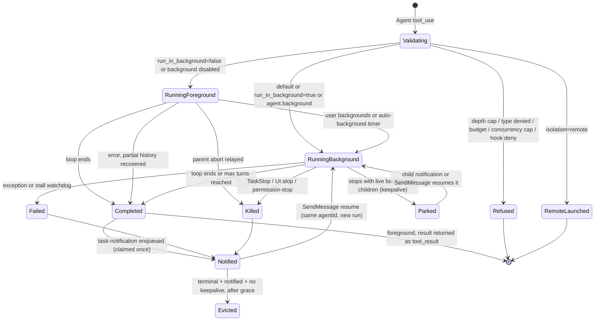
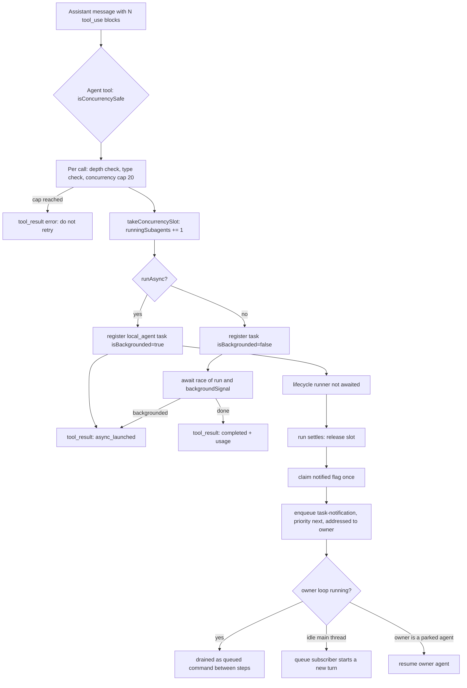
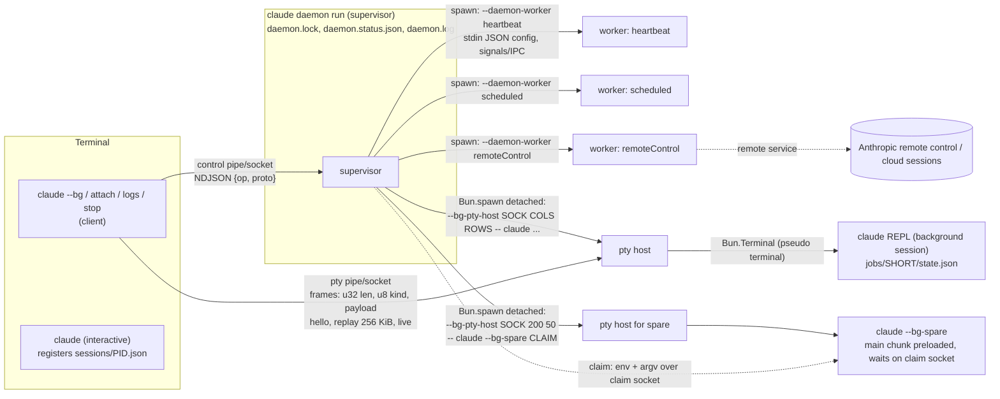

# Static pass 05: subagents, tasks, background work, session persistence and resume, terminal rendering

Target: Claude Code CLI 2.1.296 (Windows x64 Bun standalone), extracted module graph.
Evidence format: `chunk-xxxxxxxx.js@<char offset>` plus a short quoted anchor.
Labels: **VERIFIED-STATIC** (read in shipped code), **STRONGLY INFERRED**, **HYPOTHESIS**, **UNKNOWN**.
Static evidence shows the code exists. Every "does X" below means "does X when reached".

Mangled identifiers are quoted as they appear (`vC`, `kX`, `avt`). Names in *italics* are conceptual.

---

## 1. Scope and coverage

### What was read

A structural fact that shapes everything else: the small chunks named in the brief
(`chunk-yy3r64d0.js`, `chunk-1stv0pyw.js`, `chunk-6q3v99kv.js`, `chunk-zfk1cmmq.js`, ...) are
**re-export shims**. Their bodies are a few hundred bytes of `export{vC as runAgent,...}` after a
long import list. The implementation lives in a handful of large chunks. **VERIFIED-STATIC**
(`chunk-yy3r64d0.js` body is 181 chars: `export{Fzr as clearWorktreeFromAgentMetadata,...vC as runAgent`).

| Area | Defining chunk (real code) | Read |
|---|---|---|
| Agent tool (`Agent`) schema, launch path | `chunk-h6wy99cb.js` (52 KB) | 6000 to end, nearly in full |
| `runAgent` (`vC`), lifecycle runner (`kX`), tool filter (`LR`, `Cl`) | `chunk-jwmqjyrb.js` | 83500-94500, 104200-117200, 121161-146500 |
| Agent definitions, loader, precedence | `chunk-phacttch.js` 2086200-2097000, 438161, 1850754 | in full for those ranges |
| `createSubagentContext` (`gir`) | `chunk-phacttch.js@2539713` | in full |
| Task registry | `chunk-3evzq53a.js`, `chunk-883fj0m4.js` | registry factory, id generator, eviction |
| Task registration, backgrounding, kill, notification | `chunk-phacttch.js` 4225600-4236500, `chunk-5sfap31d.js` | in full for those functions |
| Agent resume (`SendMessage` continuation) | `chunk-r06rdesa.js` 8100-14600 | preconditions only |
| Transcript store (*Project* class) | `chunk-phacttch.js` 4539300-4720000 | targeted: policy table, write queue, `appendEntry`, `insertMessageChain`, `recordTranscript`, load reducer, chain builder, leaf selection |
| Path derivation | `chunk-sy9frekf.js`, `chunk-b4kymy1n.js` | in full for path functions |
| Resume repair and restore | `chunk-phacttch.js` 1283000-1295000, `chunk-9x333bd0.js` 7653-27000 | classifier and `processResumedConversation` |
| Housekeeping, retention | `chunk-vccj0dts.js`, `chunk-91kaxfwm.js`, `chunk-cvvnq4he.js` 466000-471000 | constants and control flow |
| Daemon paths and wire framing | `chunk-k6k3h9nt.js` | in full |
| Daemon CLI, worker spawn, pty host, bg spare | `chunk-39q3j8sd.js`, `chunk-g72zgfkm.js`, `chunk-jn2r7nez.js`, `chunk-e9h2r1b7.js`, `chunk-r5vwp451.js`, `cli` | entry points and spawn sites |
| Terminal renderer | `chunk-tzda8nh4.js`, `chunk-v44rfc3q.js` | see section C for what was reached |

### What was not reached

- The body of the daemon supervisor loop (`Mt` in `chunk-39q3j8sd.js`): lock acquisition order, idle-exit timer, upgrade handoff. Only its call site and its spawn of workers were read.
- `TaskOutput`, `TaskStop`, `SendMessage` tool bodies. Their names and the functions they call (`gE`, `Ve`/`kn` resume) were read, their input schemas were not.
- Workflow, teammate (swarm), cron, monitor and remote-agent task internals. They are placed in the task model from the registry tables only.
- `history.jsonl` line schema, `session-env` contents, todos/tasks file schema. Directory names are verified, file formats are not.
- The storage abstraction called `storageV5` in the code (a key/namespace backend that can replace direct filesystem access, gated by `j()`). Every persistence function has a `storageV5` branch. This report documents the plain-filesystem branch.
- Remote mirroring (`persistToRemote`, `internalEventWriter`, `hydrateRemoteSession`): existence verified, protocol not read.

---

## 2. Findings

## A. Subagents and tasks

### A1. Agent definitions

**Built-in agents** (**VERIFIED-STATIC** unless noted). `getBuiltInAgents` is `L0e` at
`chunk-phacttch.js@2086295`. It returns `[]` when `CLAUDE_AGENT_SDK_DISABLE_BUILTIN_AGENTS` is set in a
non-interactive session, the coordinator set when coordinator mode is on, otherwise a list built
conditionally:

| agentType | Evidence | Properties observed | Included when |
|---|---|---|---|
| `general-purpose` | `chunk-phacttch.js@2067564` `Xj={agentType:"general-purpose"` | `tools:["*"]`, no model (inherits by default rule) | always (default mode) |
| `statusline-setup` | `chunk-phacttch.js@2081433` | `tools:["Read","Edit"]`, `model:"sonnet"`, `color:"orange"` | `!Rr()` (not safe mode, STRONGLY INFERRED from the `--safe-mode` string near `Rr()`) |
| `claude` | `chunk-4vndrz3k.js@2544` `qze={agentType:"claude"` | `tools:["*"]`, `appendSystemPrompt:true`, described as the fleet default | `!wEt()` |
| `Explore` | `chunk-phacttch.js@201549` | `disallowedTools:[Agent, ...H7, Tw, Edit, Write, NotebookEdit]`, `model:"inherit"`, `omitClaudeMd:true` | `tH()` gate |
| `Plan` | `chunk-phacttch.js@204673` | same `disallowedTools` as Explore, `tools:XT.tools`, `model:"inherit"`, `omitClaudeMd:true` | `tH()` gate |
| web-fetch agent (type constant `fE`, value not resolved) | `chunk-phacttch.js@2084316` | `model:"inherit"`, `color:"blue"`, `maxTurns:15`, `omitClaudeMd:true` (`@2086200`) | `n1()`: web-fetch-agent enabled, not `CLAUDE_CODE_SIMPLE`, not `CLAUDE_CODE_DISABLE_WEB_FETCH` |
| guide agent (type constant `H5r`; the `whenToUse` text is the Claude Code / Agent SDK / API help agent) | `chunk-phacttch.js@2063600` | not read | entrypoint is not `sdk-ts`, `sdk-py`, `sdk-cli` |
| `fork` (constant `e$`) | `chunk-phacttch.js@1981657` `Yj={agentType:e$` | `tools:["*"]`, `maxTurns:200`, `model:"inherit"`, `permissionMode:"bubble"`, empty system prompt | selected only by `subagent_type:"fork"`, never listed by `L0e` |
| coordinator worker (constant `Vze`) | `chunk-3k69rd2t.js@4093` | `tools:["*"]`, `maxTurns:500`, `permissionMode:"bubble"` | coordinator mode only |
| `workflow-subagent` | `chunk-8hbrzh7z.js@40034` | `tools:["*"]`, `disallowedTools:[qf, Agent, Workflow]` | internal to workflow scripts |
| `comment-thread-analyst` | `chunk-8f1dpmg0.js@6946` | `tools:[Artifact]`, `model:"inherit"`, `maxTurns:6`, `omitClaudeMd:true` | internal |
| `main-session` | `chunk-phacttch.js@4239986` | pseudo agent for a backgrounded main session | internal |

The Explore model is special-cased: `Fge` (`chunk-phacttch.js@201760`) returns `"inherit"` or
`{inheritCap:"opus"}` (`wct="opus"`), with env override `CLAUDE_CODE_DISABLE_EXPLORE_INHERIT_CAP`.
**VERIFIED-STATIC**.

**Custom agent file locations** (**VERIFIED-STATIC**, `DVn` at `chunk-phacttch.js@438161`, called as
`Mte("agents", cwd, ...)`):

1. Managed: `<managed settings dir>/.claude/agents` -> `source:"policySettings"` (`FC(ZT(),".claude",e)`).
2. User: `<config home>/agents` -> `source:"userSettings"` (`FC(ve(),e)`), skipped unless the `userSettings` source is enabled.
3. Project: every `.claude/agents` found by `eJ(e,n)` (walk from cwd upward, STRONGLY INFERRED) -> `source:"projectSettings"`.
4. Additional directories (`od()`): `<dir>/.claude/agents` -> `source:"projectSettings"` with `fromAdditionalDirectory:true`.
5. Plugin agents: `Wet(n)`; plus runtime-registered plugin agents from `$.agent.register` (`W3t`, `registeredAtRunTime:true`).
6. `--agents` JSON flag: `parseAgentsFromJson` (`Lwt@2094468`), default `source:"flagSettings"`.

Files are found by a recursive `.md` walk that follows symlinks, dedups directories by `dev:ino`, and has a
3000 ms abort (`AbortSignal.timeout(3000)` in `pU`, `@~441000`). Files resolving to the same inode are
loaded once (`"Skipping duplicate file"`).

**Precedence** (**VERIFIED-STATIC**, `u2` at `chunk-phacttch.js@2088270`): groups are applied in the order
`[built-in, plugin, userSettings, projectSettings (additional dirs first, then the rest sorted), flagSettings, policySettings]`
into a `Map` keyed by `agentType`, so a later group replaces an earlier one. Effective priority, highest
first: **policy > flag (`--agents`) > project > user > plugin > built-in**. Duplicates within one
source and directory are logged (`"[agents] Duplicate agent name"`).

**Frontmatter fields consumed by the Markdown parser** (`Nwt@2095264`, **VERIFIED-STATIC**):

| Field | Handling |
|---|---|
| `name` | required string; must not start with `-`; max length `h9`; NFKC form must not contain `:` |
| `description` | required string; literal `\n` sequences become newlines; stored as `whenToUse` |
| `tools` | parsed by `o0e`; `undefined` means all tools. If agent memory is on and `memory` is set, `Write`, `Edit`, `Read` are force-added |
| `disallowedTools` | parsed by `o0e` |
| `model` | trimmed; case-insensitive `inherit` normalised |
| `effort` | named level from `Ia` or an integer |
| `permissionMode` | must be in `Bv`; invalid values are logged and dropped |
| `mcpServers` | array of server names or single-key `{name: config}` objects (schema `Ame`) |
| `hooks` | validated by `sZ()`; a top-level `PreToolUse`/`PermissionRequest` outside `hooks` makes the agent **not load** (`unloadableGuard`) |
| `maxTurns` | positive integer |
| `autoCompactWindow` | integer in `[SL, AF]` |
| `skills` | list (`db`), preloaded at spawn |
| `initialPrompt` | non-empty string |
| `memory` | `user` \| `project` \| `local` |
| `background` | `true` or `"true"` only |
| `omitClaudeMd` | `true` or `"true"` only |
| `isolation` | `worktree` \| `remote` |
| `color` | must be in `B_` |
| `observer`, `observerMessage`, `observeSubagents` | observer pairing fields |
| cache TTL | via `ghr(r)` -> `cacheTtl` |

The body of the file (trimmed) is the system prompt; when memory is enabled an agent-memory section is appended.
The JSON form (`Z3` schema, `chunk-phacttch.js@1850754`) uses `prompt` instead of a body and otherwise the same keys.

### A2. The Agent tool: from tool call to `runAgent`

**Tool object**: `aUt` in `chunk-h6wy99cb.js@~44200`. `name: yt` where `yt="Agent"`
(`chunk-zg424atw.js@692`), with one alias `Wf`. `isReadOnly()` and `isConcurrencySafe()` both return
`true`. `maxResultSizeChars: zit` (`1e5`, `chunk-zg424atw.js@1003`). **VERIFIED-STATIC**.

**Input schema** (**VERIFIED-STATIC**, `chunk-h6wy99cb.js@10900-13800`):

```ts
{
  description: string,
  prompt: string,
  subagent_type?: string,
  model?: "sonnet" | "opus" | "haiku" | "fable",
  effort?: <named level>             // plus "lower" | "higher" when R0e() is on
  run_in_background?: boolean,
  name?: string,                     // regex XCs; reserved names refused
  team_name?: string,                // "Deprecated; ignored."
  mode?: <permission mode>,          // "Deprecated; ignored."
  isolation?: "worktree" | "remote",
  cwd?: string                       // removed from the model-facing schema by .omit({cwd:true})
}
```

Schema shaping at build time: `run_in_background` is removed when background launches are disabled or
fork mode is on; `model` is removed under `CLAUDE_CODE_SUBAGENT_MODEL_FORCE`; `effort` is removed when
`VM()` is set.

**Output union** (`jo`, `@~14300`): `status:"completed"` (sync result), `status:"async_launched"`,
`status:"remote_launched"`, and at runtime also `status:"teammate_spawned"`.

**Permission check**: `checkPermissions` returns `allow` unless the mode predicate `si(mode)` holds; in
that case it allows only the vetted web-fetch dispatch and otherwise returns `passthrough` with
`"Agent tool requires permission to spawn subagents."`.

**Launch path** (`xo` in `chunk-h6wy99cb.js@~15000`, **VERIFIED-STATIC**), in order:

1. **Depth cap.** `Xu(agentContext) >= _v()` throws `"Subagent nesting limit reached (depth N of M)"`. `_v()` reads `CLAUDE_CODE_MAX_SUBAGENT_SPAWN_DEPTH`, else a remote flag `tengu_hazel_trellis`, else `3` (`chunk-d1zbawpk.js@560` `var n=3`).
2. Refuse if the caller agent has a stop pending.
3. Teammate restrictions: teammates cannot spawn teammates; in-process teammates cannot spawn background agents.
4. **Type resolution.** Explicit `subagent_type` is checked against permission deny rules `Agent(<type>)` and the caller's `allowedAgentTypes`. Omitted type falls back to `general-purpose` only when it is available, otherwise an error listing available agents. Names are normalised (`ohe`) for a fuzzy single match; multiple matches produce `"is ambiguous"`.
5. **Sync vs async decision** (`po@6066`):
   ```
   wantAsyncByDefault = (isCoordinator && !callerIsTeammate) || forceAsync
                        || (!(callerIsTeammate || callerIsHeadlessSubagent) && run_in_background !== false)
   shouldRunAsync = isRemote || ((run_in_background === true || agent.background === true
                                   || (!isWebFetchAgent && wantAsyncByDefault))
                                  && !backgroundTasksDisabled)
   ```
   So when background tasks are enabled, **omitting `run_in_background` runs the agent in the background**. Only an explicit `false` forces the foreground. This matches the schema text "Agents run in the background by default".
6. **Abort and budget gate** (`ht`): throws if the parent is aborted (an `"interrupt"` abort is tolerated for a background launch), and refuses when `maxBudgetUsd` is exhausted.
7. Wait up to 30000 ms for `requiredMcpServers`, then verify them.
8. Plugin `agent.spawn` hook (`J9n`) may deny, retype, rewrite prompt/model/cwd/background; a rewrite is re-checked against permission rules.
9. **Model**: `QU(Fge(agent, parentModel), parentModel, toolModelParam, permissionMode)`. Forks always pass `"inherit"`.
10. **Remote isolation**: creates a cloud session (`mD({source:"remote_agent"...})`), registers a `remote_agent` task and returns `remote_launched`. **Delegated to a remote service.**
11. **System prompt and initial messages**:
    - normal agent: `Et = aKt([agentPrompt], model, budget)`; `we = [...carriedCopies, userMessage(prompt)]` where the carried copies come from `fEs(parent.messages, ...)` (a small set of selected parent rows, not the conversation).
    - fork: `Dt = parent's already-rendered system prompt` (or rebuilt identically), `we = M5r(prompt, assistantMessage)`, and `forkContextMessages = parent.messages`.
12. **Tool pool**: normal agents get a freshly assembled pool `toolCatalog.assembleToolPool({...permCtx, mode: agent.permissionMode ?? parentMode}, mcpTools)`; forks get `parent.options.tools` with `useExactTools:true`.
13. **Worktree** (if `isolation === "worktree"`): `v2e(UQo(agentId))` creates it before launch.
14. **Concurrency slot** (audit correction, not re-verified by me: the reviewer reports the `Ln` check actually runs early, right after the sync/async decision and the abort/budget gate, and again in `Kn` just before the slot is taken, `chunk-h6wy99cb.js@~18711`, `@~24315`, not after worktree creation as ordered here): `Ln(e)` refuses when `taskRegistry.getConcurrentSubagents() >= isr()`; `isr()` is `CLAUDE_CODE_MAX_CONCURRENT_SUBAGENTS ?? 20` (`kFo=20`, `chunk-phacttch.js@1872101`). The refusal is skipped by flag `tengu_amber_kestrel` or ultracode mode. The slot is a counter in app state (`runningSubagents`), released by an idempotent closure.
15. Dispatch to the async or sync branch (section A4 and A3).

**What `runAgent` (`vC`, `chunk-jwmqjyrb.js@121161`) builds** (**VERIFIED-STATIC**):

| Piece | Construction |
|---|---|
| agent id | `override.agentId ?? Lh()`. Format regex: `^a(?:[\w-]{1,63}-)?[0-9a-f]{16}$` (`chunk-70h570pg.js@~900`) |
| abort controller | `override.abortController`, else `new AbortController` when async, else **the parent's controller object itself** |
| file-state cache | `override.readFileState`, else for a fork a clone of the parent's with seeded entries stripped (`Mre(..., {stripSeededFromContext:true})`), else a fresh empty cache `cS(ME)` |
| user/system context | parent's `AC(...)`/`a2(...)`; with `omitClaudeMd` the CLAUDE.md content is dropped (`gd`) |
| permission mode | resolved lazily per app-state read (`yn`). The agent's declared `permissionMode` applies only when the parent is **not** in `bypassPermissions`, `acceptEdits` or `auto`. `bubble` degrades to the parent mode when the parent is in `plan` or `dontAsk`. `bypassPermissions` is refused unless the session authorises it. |
| prompt avoidance | `shouldAvoidPermissionPrompts = true` for async agents unless mode is `bubble`, a dialog relay exists, or `canShowPermissionPrompts` is passed. Async agents that can prompt get `awaitAutomatedChecksBeforeDialog`. |
| allowed-tools override | if `allowedTools` is passed, session allow rules are replaced by it (CLI-arg and MCP policy rules are kept) |
| worktree | added to `additionalWorkingDirectories` |
| tools | `LR(agent, pool, isBackground, false, isTeammate, depth, memoryMode)` unless `useExactTools`; plus agent-frontmatter MCP tools; zero tools is a hard error (`"would be spawned with zero tools"`) |
| system prompt | `override.systemPrompt` or `cd(agent, ...)`; optional append of `appendSubagentSystemPrompt` (env `CLAUDE_CODE_ENABLE_APPEND_SUBAGENT_PROMPT`) and a memory note |
| hooks | runs `SubagentStart` hooks; additional context becomes a `hook_additional_context` attachment; registers agent-frontmatter hooks in the session registry scoped to the agent id |
| skills | first `fn` names from `skills` are preloaded as meta user messages |
| thinking config | derived by `Rks(parent.thinkingConfig, {isAsync, ...})` |
| options | `isNonInteractiveSession` is forced `true` for background shape (`JJn`); `Explore` and `Plan` get `omitGitStatus:true`; `maxBudgetUsd` inherited |
| query | `options.runQuery({messages, systemPrompt, userContext, systemContext, canUseTool, toolUseContext, querySource, maxTurns: maxTurnsParam ?? agent.maxTurns, forkPointUuid, ...})` |

`createSubagentContext` (`gir`, `chunk-phacttch.js@2539713`) shows what is shared and what is isolated:

- **Shared by reference**: `messageQueue`, `taskRegistry`, `sessionHooksRegistry`, `toolState`, `agentLifecycle`, `sessionEnvVars`, `credentials`, `storageV5`, `rootToolSurface`, `permissionRelays`, `requestDialog`.
- **Isolated**: `readFileState` (clone), `toolDecisions` (new Map), `nestedMemoryAttachmentTriggers`, `dynamicSkillDirTriggers`, `localDenialTracking`, `queryTracking` (`depth + 1`, new chain id).
- **`setAppState`**: shared only when `shareSetAppState` (sync agents pass `!isAsync`). Otherwise only the keys in `Rur` propagate to the parent.
- **File history**: only `touch` operations reach the parent unless `shareFileHistory`.
- **Abort**: default is `hg(parent.abortController)`, a child controller linked to the parent.

**Tools children never get** (**VERIFIED-STATIC**, `Cl` at `chunk-jwmqjyrb.js@83520` and sets in
`chunk-svt0njrf.js@13400-13950`). Filter order per tool:

1. MCP tools pass (subject to memory-mode filter).
2. `ExitPlanMode` passes when the agent's mode is `plan`.
3. **Always removed** (set `vot`): `ExitPlanMode`, `EnterPlanMode`, `memory_list`, `memory_read`, `memory_write`, `AskUserQuestion`, `Poll`, `ConnectGitHub`, `OfferChromeSetup`, `propose_skills`, `WaitForMcpServers`, `RefreshMcpTools`, `Workflow`, `ScheduleWakeup`, `ReadNotifications`, `ProposeGoal`, `PublishPlugin`, `EndConversation`, and an app-artifact REPL tool.
4. Custom (non built-in) agents: same set (`Ccs = new Set([...vot])`).
5. Headless-only removals (`Rcs`): `SuggestPluginInstall`, `SuggestSkills`, `PushNotification`, `ShowOnboardingRolePicker`.
6. `Agent` is kept only while `depth < _v()`.
7. **Async agents** keep only the allowlist `kot`: `Read`, `WebSearch`, `TodoWrite`, `Grep`, `WebFetch`, `Glob`, `Bash`, the PowerShell tool, `Edit`, `Write`, `NotebookEdit`, `Skill`, `StructuredOutput`, `ToolSearch`, `EnterWorktree`, `ExitWorktree`, `REPL`, `LSP`, `Monitor`, `TaskStop`, `GetTask`, `SendMessage`, `Artifact`, `SearchPlugins`, `SearchSkills`, `ListPlugins`, `ListSkills`. In-process teammates additionally keep `TaskCreate`, `TaskGet`, `TaskList`, `TaskUpdate`, `SendMessage`, `CronCreate`, `CronDelete`, `CronList`.

Then `LR` applies `disallowedTools` (bare names, `Tool(rule)` forms, and `mcp__server` / `mcp__server__*` server-level denials) and resolves the `tools` allowlist. An `Agent(a,b)` entry in `tools` becomes `allowedAgentTypes`.

**Prompt-cache sharing with the parent** (**VERIFIED-STATIC** for the mechanism, **STRONGLY INFERRED** for the effect):

- A fork reuses the parent's exact system prompt bytes (`override:{systemPrompt:Dt, parentSystemPrompt:true}`), the parent's exact tool array (`useExactTools:true`), the parent's messages as prefix, and the parent's `stickyBetas`. `runQuery` receives `forkPointUuid` (`hir(St)`). That is the prefix a cache hit needs.
- A normal agent has its own system prompt and its own filtered tool list, so it cannot share the parent's cache prefix.
- `filterIncompleteToolCalls` (`Nzr@145568`) drops parent assistant messages whose `tool_use` has no `tool_result` before using them as fork context.
- `onCacheSafeParams` hands `{systemPrompt, userContext, systemContext, toolUseContext, forkContextMessages, stickyBetas, agentCacheTtlOverride}` to the lifecycle runner, used for progress summarisation forks.
- Recursive forks are refused: `"Fork is not available inside a forked worker."` and fork with `isolation:"remote"` is refused.

### A3. Parent-child communication

**While a foreground child runs** (**VERIFIED-STATIC**, `Ft` callback in `chunk-h6wy99cb.js@~40500`):
the parent's `onProgress` receives

```ts
{ type:"progress", toolUseID:`agent_${assistantMessage.message.id}`,
  data:{ type:"agent_progress", message, prompt, agentId, agentType, isBuiltIn, description,
         resolvedModel, modelsUsed } }
```

- First event carries the child's initial user message and the prompt.
- After that, only child messages whose first content block is `tool_use` or `tool_result` are forwarded, unless `options.forwardSubagentText` is set.
- Child `bash_progress` / `powershell_progress` are forwarded with their own `toolUseID`.
- API retries surface as `data.type:"agent_api_retry"` with `attempt`, `maxRetries`, `retryDelayMs`, `errorStatus`, `errorCategory`; a later non-error event emits `resolved:true`.
- Assistant text length is reported as `{type:"response_length", op:"add", delta}`.
- After `Fo = 2000` ms a `background_hint` tool-progress event is emitted (when backgrounding is possible).

**Final result of a foreground agent**: `{status:"completed", prompt, ...ZJn(messages, agentId, metadata), worktreePath?, worktreeBranch?, canContinueAgent}` where `ZJn` supplies `agentId`, `content[]`, `totalTokens`, `totalToolUseCount`, `totalDurationMs`, `agentType`.

**tool_result text** (`mapToolResultToToolResultBlockParam`, `@~46500`, **VERIFIED-STATIC**):

- `completed`: the agent's content blocks, or `"(Subagent completed but returned no output.)"`, followed by a trailer:
  ```
  agentId: <id> (use SendMessage with to: '<id>', ... to continue this agent)
  worktreePath: ...            (only when a worktree was kept)
  worktreeBranch: ...
  <usage>subagent_tokens: N
  tool_uses: N
  duration_ms: N</usage>
  ```
  The continuation hint is omitted when `canContinueAgent === false`. For agent types in `hxt` with no worktree the trailer is omitted entirely.
- `async_launched`: a fixed instruction block with `agentId`, and when the caller has Read/Bash, `output_file: <path>` with an instruction not to read it (it is the full JSONL transcript).
- `remote_launched`: `taskId`, `session_url`, `output_file`.
- `teammate_spawned`: `agent_id`, `name`.

**Sidechain transcripts** (**VERIFIED-STATIC**): `runAgent` calls `Uhe(messages, agentId, parentUuid)`
(`recordSidechainTranscript`, `chunk-phacttch.js@4596975`), which calls
`insertMessageChain(rows, isSidechain=true, agentId, parentUuid)`. Rows with `isSidechain && agentId`
are written to `cg(agentId)` = `<projectDir>/<sessionId>/subagents[/<subdir>]/agent-<agentId>.jsonl`
(`chunk-b4kymy1n.js@1877`). A sidecar `agent-<agentId>.meta.json` (`jZe`, `chunk-phacttch.js@~4542000`)
stores spawn metadata written by `ad(...)`: `agentType`, `isFork`, `worktreePath`, `worktreeBranch`,
`inheritedWorktreePath`, `spawnedWithWorktree`, `cwd`, `spawnMode`, `description`, `name`, `toolUseId`,
`parentAgentId`, `spawnDepth`, `requestShape`, `requestNonInteractive`, `model`, `effort`.
For a fork of the main conversation the parent prefix is **not** copied: a `fork-context-ref` entry
`{agentId, parentSessionId, parentLastUuid, contextLength}` is written instead (`YJr`).

### A4. Background execution

**Task registry** (**VERIFIED-STATIC**, `chunk-3evzq53a.js@~37900`, `chunk-883fj0m4.js@1490`).
State is `appState.tasks: Record<id, Task>` plus `appState.transcripts`. API: `register`, `update`,
`updateTranscript`, `getTranscript`, `remove`, `evictTerminal`, `applyOffsetsAndEvict`, `get`, `all`,
`takeConcurrencySlot`, `getConcurrentSubagents`, web-search budget.

| Task type | Id prefix | Display noun | Local or remote |
|---|---|---|---|
| `local_bash` | `b` | shell | local |
| `local_agent` | `a` | subagent | local |
| `remote_agent` | `r` | cloud session | **remote service**, local row is a tracker |
| `in_process_teammate` | `t` | teammate | local, same process |
| `local_workflow` | `w` | workflow | local |
| `monitor_mcp` | `m` | monitor | local, watches an MCP server |
| `monitor_ws` | `s` | monitor | local |
| `mcp_task` | `k` | MCP task | **delegated to an MCP server** |
| `dream` | `d` | dream | local |
| `auto_mode_scan` | `e` | auto-mode scan | local |
| `local_memory_import` | `n` | memory import | local |

Generic id: prefix + 8 characters from `0-9a-z`, from random bytes (`_k`). A `local_agent` task uses the
agent id as its task id instead (the `ine`/`FQo` functions pass `agentId` to `e_`).

Base record (`e_`): `{id, type, status:"pending", description, toolUseId, startTime, outputFile?, outputOffset:0, notified:false}`.
Status values on the wire: `pending | running | completed | failed | killed | paused` (`chunk-80kqkekd.js@~368000`).

`local_agent` adds (`G8r`/`ine`, `chunk-phacttch.js@4233906`): `agentId, ownerAgentId, parentAgentId,
spawnDepth, prompt, model, effort, cwd, selectedAgent, agentType, abortController, isBackgrounded,
isIdle, pendingMessages:[], retain:false, diskLoaded:false, keepaliveReasons:Set, retrieved,
lastReportedToolCount, lastReportedTokenCount`, and optionally `autoBackgroundArmed`, `directCall`,
`outputFileUnreadable`, `ownerCanContinueAgents`, `awaitedByCaller`, `isObserver`, `forkedSkillName`.

**Explicit background launch** (async branch of `xo`): `ine(...)` registers a task with
`isBackgrounded:true`, then `kX({... makeStream: (...) => vC({... override:{agentId, agentContext, abortController}})})`
is started **without awaiting**, and the tool returns `async_launched` immediately.

**Auto-backgrounding** (**VERIFIED-STATIC**): a foreground agent registers through `FQo`
(`chunk-phacttch.js@4235511`) with `backgroundSignal` (a promise) and, if `autoBackgroundMs > 0`, a timer.
`autoBackgroundMs` is `Bo()`: `120000` when `CLAUDE_AUTO_BACKGROUND_TASKS` is set, else `0` (off).
The tool awaits `Promise.race([run, backgroundSignal])`. When the signal wins, the same running agent is
left running, the parent abort relay is detached, and the tool returns `async_launched`. Manual
backgrounding (`y2e`) resolves the same signal. The timer does not fire while a tool call that must run
alone is queued behind the Agent call (`"call_queued_behind"`); it re-arms at `min(ms, 1000)`.

**Completion delivery** (**VERIFIED-STATIC**, `avt` = *enqueueAgentNotification*,
`chunk-phacttch.js@4226700`; XML builder `Hi`, `chunk-5sfap31d.js@884`):

```xml
<task-notification>
<task-id>{agentId}</task-id>
<tool-use-id>{toolUseId}</tool-use-id>
<output-file>{path}</output-file>
<status>{completed|failed|killed}</status>
<summary>Agent "{description}" {finished | failed: {error} | was stopped by user | was stopped by Claude | stopped at its N-turn limit (partial result...)}</summary>
<note>...</note>
<result>{final text}</result>
<usage><subagent_tokens>N</subagent_tokens><tool_uses>N</tool_uses><duration_ms>N</duration_ms></usage>
<worktree><worktreePath>...</worktreePath><worktreeBranch>...</worktreeBranch></worktree>
</task-notification>
```

Tag names come from constants in `chunk-04wty0yg.js@9112` (`Hu="task-notification"`, `nU="task-id"`,
`rU="tool-use-id"`, `MF="task-type"`, `Dpe="output-file"`, `iw="status"`, `eE="summary"`, `Z1="note"`).
Empty fields are omitted.

It is enqueued with `Qa({value, mode:"task-notification", skipAttachments:true, priority:"next", agentId:<owner>, taskId, runId?, usage?})`
(`tst="next"`). Properties of the queue path:

- **Exactly-once per run**: `_5(taskId, registry)` claims the task's `notified` flag; a second call logs `"already-notified"`.
- **Routing**: the notification goes to the owner agent's queue if that owner is itself a live backgrounded agent, otherwise to the main thread (`lvt`).
- **Size cap**: a task-notification value over `lMt = 1e5` characters is truncated (`"task-notification capped from"`, `chunk-phacttch.js@226502`).
- **Priorities**: `now | next | later` (`@210437`); default for other producers is `later`.
- **Idle wake**: queue subscribers start a turn when a queued command exists; the REPL coalesces more than `Fve = 3` pending task notifications into one summary line (`chunk-9w4htdvs.js@1312475`). A 60000 ms re-poll timer covers notifications addressed to an agent that is not running (`chunk-fzzrkchm.js@228525`).
- **Mid-turn**: queued commands addressed to the running loop are drained as attachments between steps (`getQueuedCommandAttachments`, `chunk-2pksgq12.js`). **STRONGLY INFERRED** from the export name and the `mode==="task-notification" && agentId===r` filter at `chunk-phacttch.js@219109`.

**Output files**: `outputFile = Au(taskId)` (`getTaskOutputPath`, `chunk-m7wc9cf3.js`). For a
`local_agent` the output file is the agent's JSONL transcript (the tool result text says so). Tasks carry
`outputOffset` so `TaskOutput` can return deltas (`getTaskOutputDelta`). **VERIFIED-STATIC** for the
fields, **STRONGLY INFERRED** for the symlink arrangement (`initTaskOutputAsSymlink` exists).

**Eviction**: a terminal, notified task is removed from state unless `retain` with `evictAfter` in the
future, or it holds `keepaliveReasons`. `RI = 30000` ms grace applies to `mcp_task` rows and to the
`evictAfter` stamp set when the last keepalive is released (`chunk-3evzq53a.js@~37600`).

**Continuing an agent (`SendMessage`)** (**VERIFIED-STATIC** for the preconditions, `kn` in
`chunk-r06rdesa.js@9390`): three entry modes, `notification` (`resumeAgentBackground`), `inline`
(`resumeAgentInline`) and `reply`. A per-agent in-flight set prevents double resume
(`AgentResumeInProgressError`). The resume:

1. refuses if the agent or the resumer is still stopping (`AgentStillStoppingError`);
2. marks the task `resuming:true`;
3. loads the agent transcript (`Mle` = `getAgentTranscript`) and the `.meta.json` sidecar in parallel; an oversized transcript is a permanent refusal;
4. refuses if `stoppedByUser` and the resume is not user-initiated (`AgentStoppedByUserError`);
5. validates forked-skill scoping records;
6. re-runs `runAgent` with `recordedUuids` so already-persisted rows are not rewritten, with `invocationKind:"resume"`.

A resumed subagent "is always registered in the background" (SDK schema text, `chunk-80kqkekd.js@366935`).
If the agent is still running, messages are appended to `task.pendingMessages` and drained by the agent
loop (`LEe`, `hJ`, `chunk-phacttch.js@~4226000`).

### A5. Concurrency and nesting

- **Parallel scheduling**: the tool declares `isConcurrencySafe() -> true`, so several `Agent` tool_use blocks in one assistant message are eligible for the executor's concurrent batch. The executor itself belongs to another pass. **VERIFIED-RUNTIME** (audit merge): runtime E10 shows two `Agent` calls from one message started their requests 339 ms apart and were in flight at the same time (`03-runtime-experiments.md`, E10).
- **Concurrent cap**: 20 by default, env `CLAUDE_CODE_MAX_CONCURRENT_SUBAGENTS`. Error text: `"Concurrent subagent limit reached. You can run N subagents at once. Do not retry."` **VERIFIED-STATIC**.
- **Nesting**: subagents can spawn subagents up to depth 3 by default (env `CLAUDE_CODE_MAX_SUBAGENT_SPAWN_DEPTH`, flag `tengu_hazel_trellis`). The `Agent` tool is also stripped from the child's pool once `depth >= cap` (`agentToolRemovedByDepth`). `spawn_depth` is 1 for a top-level spawn. **VERIFIED-STATIC**.
- **Shared-cwd note**: when an unisolated write-capable agent is launched into a directory where another is running, the result carries `sharesCwd:true` and the model receives a note.

**Worktree isolation** (**VERIFIED-STATIC**, `chunk-h6wy99cb.js@~32500-34000`; helpers in
`chunk-tbhxcq54.js`): `createAgentWorktree` returns
`{worktreePath, worktreeBranch, headCommit, baseChangeset, sessionDir, gitRoot, hookBased}`. The agent
runs with `cwd = worktreePath`. For a fork a meta user message tells the model about the path change.
Cleanup (`Fe`) at settle:

1. hook-based worktree without a baseline: kept;
2. owner backgrounded and parked on keepalive: kept;
3. otherwise check for changes (`rKt(path, headCommit)` or a changeset diff); **if unchanged, remove it** (`lne(..., "agent_tool")`) and clear the worktree fields from the agent metadata;
4. if changed, keep it and return `worktreePath`/`worktreeBranch` in the result.

`cleanupStaleAgentWorktrees` exists for leftovers (`chunk-tbhxcq54.js`), run from housekeeping.

### A6. Cancellation, timeouts, errors

**Abort linkage** (**VERIFIED-STATIC**):

| Agent kind | Controller | Parent interrupt reaches it? |
|---|---|---|
| foreground | new controller `Ae`, relayed from the parent by `QAe(parent, Ae)` (`FQo`) | yes, while in the foreground |
| foreground moved to background | same controller, relay **detached** (`detachParentAbortRelay`) | no |
| launched in background | `ine` is called from the Agent tool **without** `parentAbortController`, so `lr()` creates an independent controller | no |

So an Esc interrupt of the parent turn does not stop background agents. **Runtime contradiction (E39a, scoped):** the stream-json `interrupt` control request did kill a background agent (`task_updated` status `killed`, `exitPath=cancelled`) while the same script without an interrupt completed; the TUI Esc path was not run. They are stopped by `TaskStop`
or the task UI, which call `gE(taskId, registry, killedBy)` (`chunk-phacttch.js@4228625`): aborts the
controller, sets `status:"killed"`, `killedBy: "user" | "parent" | "system"`, `endTime`, clears
keepalives, kills monitors and orphaned shell tasks owned by the agent, and emits a `killed` notification
if not already notified.

**Abort reasons** read from `signal.reason`: `"interrupt"`, `"background"`, `"permission-stop"`.

**Stall watchdog** (background agents, `kX`): if no stream progress for `jzr()` ms and no tool is in
flight, the agent is aborted and reported `failed` with `"Agent stalled: no progress for Ns"`.
`jzr()` = `CLAUDE_ASYNC_AGENT_STALL_TIMEOUT_MS`, else `600000` when the stream watchdog is disabled, else
`min(WJt() + 300000, 2147483647)`. The value of `WJt()` (the stream-watchdog base) was not resolved.

**Max turns**: `maxTurns` from the call or the definition is passed to `runQuery`. A
`max_turns_reached` attachment ends the loop; the notification summary becomes
`"stopped at its N-turn limit (partial result...)"`. Built-in limits: fork 200, coordinator worker 500,
web-fetch agent 15, comment analyst 6. Other agents: no limit unless frontmatter sets one.

**Sync error handling** (`chunk-h6wy99cb.js@~42800`): on an exception that is not a user abort the tool
recovers partial history (`Pqo`) and still returns a `completed` result with a harness note prepended. A
user abort rethrows (the tool call is cancelled). **Async error**: task set failed (`Wor`), notification
with `status:"failed"` and `failed: <message>`.

**Cleanup stages** in `runAgent`'s `finally` (in order): SubagentStop hooks if not already run (5000 ms
budget), agent MCP clients, session hooks, prompt-cache tracking, read-file cache clear, sent-skill names,
message arrays, tracing spans, transcript subdir, todos, sandbox write grant, monitors, shell tasks. Stages
marked `keepaliveGated` (monitors, shells) are skipped when the agent stays parked with live background
children.

### A7. Other task kinds in the same model

- **Background shells** (`local_bash`): local child processes; ids `b........`; completion notifications use the same queue (`enqueueShellTerminalNotification`, `chunk-g1kdq2cq.js`); summary prefix `"Background command "`.
- **Monitors** (`monitor_mcp`, `monitor_ws`): local watchers; events arrive as `"Monitor event:"` notifications (`enqueueMonitorEvent`).
- **Workflows** (`local_workflow`): local script orchestration that spawns `workflow-subagent` agents; `tr=5`, `_s=90000` constants in `chunk-8hbrzh7z.js@40500` (roles not resolved).
- **Teammates / swarm** (`in_process_teammate`): same process, mailbox-driven, flat roster (no nested teammates), cannot spawn background agents.
- **Remote / cloud agents** (`remote_agent`): the work runs in a cloud session created by `mD(...)`; the local task only tracks and relays permissions. **Remote.**
- **MCP tasks** (`mcp_task`): long-running operations on an MCP server (`driveMcpTask`, `restoreMcpTasks`). **Remote to the MCP server.**
- **Cron / scheduled** (`CronCreate`, `ScheduleWakeup`, `useScheduledTasks`): session cron tasks live in app state (`addSessionCronTask`); a `session_cron_carry` attachment carries them across resume (`chunk-phacttch.js@4539400`). The daemon also has a `scheduled` worker kind (A8).

### A8. Daemon and background sessions

**Entry points in `cli`** (**VERIFIED-STATIC**): fast paths on `argv[0]`:
`--daemon-worker <kind>` (`cli@6806`) -> `runDaemonWorker`; `--bg-pty-host` (`cli@7300`) -> `runPtyHost`;
`--bg-spare` (`cli@7648`) -> `runBgSpare`; `--preload` (`cli@7865`) -> `runPreload`;
`--bg` / `--background` / `--routine` and the background verbs (`cli@10358`) -> `chunk-060stnq8.js`
handlers after the fleet gate (`isAgentsFleetEnabled`). `claude daemon <sub>` -> `daemonMain`.

**`claude daemon` subcommands** (`chunk-39q3j8sd.js@71231`): `list`, `scheduled`, `remote-control`, `hub`
(TTY only), `run`, `install`, `start`, `restart` and more. On this Windows build `install`/`start` print
that the service is unavailable: `"the daemon still runs on demand when a client connects"`.
`run` sets `process.title="claude daemon"`, traps SIGINT/SIGTERM (second signal forces exit).

**Files** (**VERIFIED-STATIC**, `chunk-k6k3h9nt.js`, `chunk-54set51h.js@1532`, `chunk-exenffgb.js`, `chunk-syr8fhvp.js@1198`):

| Path | Role |
|---|---|
| `~/.claude/daemon.lock` | supervisor singleton lock (holder pid and origin, per the `lock.pid` uses) |
| `~/.claude/daemon.json` | daemon config |
| `~/.claude/daemon.log`, `daemon.log.1` | log and one rotation |
| `~/.claude/daemon.status.json` | `{supervisorPid, supervisorProcStart, writtenAt, workers}` |
| `~/.claude/daemon/pipe.key` | 16-hex nonce naming Windows pipes, mode 0600, created with `wx` |
| `~/.claude/daemon/control.key` | 32-hex control secret |
| `~/.claude/daemon/roster.json` | session roster |
| `~/.claude/daemon/dispatch/`, `dispatch/rejected/` | dispatch request files |
| `~/.claude/daemon/attach-journal`, `auth/<id>.json`, `auth/<id>.tokens.json`, `host-managed/`, `pty-pids/<id>.pid` | attach log, per-session auth, pty host pid files |
| `~/.claude/jobs/<short>/state.json` | per background-session job state (`short` = first 8 chars of session id); `jobs/settled/*.json` |
| `~/.claude/sessions/<pid>.json` | live-process registry (section B13) |

**IPC endpoints**:

- Windows: named pipes `\\.\pipe\cc-daemon-<pipe.key>-<name>` with names `control`, `rv-<id>`, `pty-<id>`.
- POSIX: `/tmp/cc-daemon-<uid>/<sha256(configDir)[0:8]>/` holding `control.sock`, `rv/<id>.sock`, `pty/<id>.sock`, `spare/<id>.pty.sock`, `spare/<id>.claim.sock`. Directories are forced to mode 0700 and must be owned by the caller's uid.

**Wire formats**:

- Control socket: newline-delimited JSON requests carrying `op` and `proto`. Ops seen: `ping`, `list`, `leases` (`chunk-8vgjktqq.js@5811`). Liveness probe writes `{"op":"ping"}\n` with a 1000 ms timeout.
- PTY socket: binary frames `uint32be length | uint8 kind | payload`. `kind 0` = raw terminal bytes, `kind 1` = JSON control. Max frame `1048576`; a larger frame or unknown kind closes the parser.
- PTY control messages (`chunk-jn2r7nez.js`): host -> client `hello{replPid, version}`, `live`, `ping`, `exit{code, signal}`, `auth-required`; client -> host `pong`, `resize{cols, rows}` (each bounded by 10000), `kill{sig}` (SIGTERM, escalated to SIGKILL after 5000 ms).

**PTY host** (`runPtyHost`): argv `--bg-pty-host <sock> <cols> <rows> -- <file> [args...]`, defaults
200x50. It creates `new Bun.Terminal({cols, rows, data})` and `Bun.spawn([file, ...args], {terminal, env:{...env, TERM:"xterm-256color"}})`.
Output is kept in a ring buffer of `262144` bytes and replayed to each attaching client before `live`.
A client whose write backlog exceeds `1048576` bytes is dropped. Input is gated on a per-socket auth
token (`CLAUDE_BG_PTY_AUTH` or a tokens file).

**Workers** (`chunk-g72zgfkm.js@14233`): kinds `heartbeat`, `scheduled` (needs OAuth), `remoteControl`
(needs OAuth). The supervisor spawns `<claude> --daemon-worker <kind> [n]` with piped stdio (plus a Node
IPC channel when an auth manager is present) and writes a JSON config on the worker's stdin
(`{config, initialAccessToken}`). Workers abort on SIGTERM/SIGINT or an IPC message.

**Spares and preload** (`chunk-e9h2r1b7.js@62386`): a spare is a pre-warmed process started as
`--bg-pty-host <sock> 200 50 -- <claude> --bg-spare <claimSock>`. It imports the main chunk
(`chunk-zvnaqyp5.js`) eagerly, then waits on the claim socket for the real session's env and argv
(`kin`), exits if `process.ppid` changes (polled every 2000 ms), and on claim runs the normal main
(`Ein`). `--preload` (`chunk-v8jk3662.js@6352`) is the same idea without a pty: load the main chunk, then run.

**Lifecycle** (STRONGLY INFERRED from strings, supervisor body not read): the daemon starts on demand
when a client needs it and exits when the last client disconnects
(`"the daemon runs on demand and exits when the last client disconnects"`). A background session survives
its launching terminal because the pty host is spawned `detached:true` and owns the REPL process.

## B. Session persistence and resume

### B9. On-disk layout

Config home is `ve()` (`~/.claude`, or `CLAUDE_CONFIG_DIR`). **VERIFIED-STATIC** unless noted.

```
~/.claude/
  projects/                                   Df() / kp()   chunk-sy9frekf.js@13382
    <projectKey>/                             Vv(cwd)
      <sessionId>.jsonl                       Gu()          chunk-b4kymy1n.js@1663
      <sessionId>/
        subagents/[<subdir>/]agent-<agentId>.jsonl      cg(agentId)
        subagents/[<subdir>/]agent-<agentId>.meta.json  jZe(agentId)
        tool-results/                         zSe="tool-results"  chunk-z1z3mney.js@43435
      memory/                                 (named in the purge tool: "transcripts (.jsonl) and memory/")
  file-history/<sessionId>/                   chunk-8q5wva37.js@27428
  history.jsonl                               prompt history across all projects
  sessions/<pid>.json, .fleetview-heartbeat   live-process registry
  session-env/, shell-snapshots/, todos/, tasks/, plans/*.md, debug/, paste-cache/, image-cache/, backups/
  jobs/<short>/, daemon/, daemon.lock, daemon.json, daemon.log
  .last-cleanup                               retention sentinel
```

**Project key rule** (`chunk-sy9frekf.js@12501-12700`):

```js
k(e)  = e.replace(/[^a-zA-Z0-9]/g, "-")
OO(e) = k(e).length <= 200 ? k(e) : `${k(e).slice(0,200)}-${Math.abs(Hse(e)).toString(36)}`
Vv(e) = oin() ?? OO(e)          // oin(): pinned override, when set
```

- `MAX_SANITIZED_LENGTH = 200` (`Ppe`).
- The hash `Hse` is computed over the **original** path. Its algorithm was not resolved. **UNKNOWN**.
- Example: `C:\Users\me\proj` -> `C--Users-me-proj`.
- The key is lossy, so different paths can collide. The code guards this: `recordedCwdCollidesWithProjectResolved` compares the `cwd` recorded in entries with the expected one.
- `findProjectDirs` also considers the legacy key and, for long paths, prefix matches of the first 200 chars.

Session file name: `<sessionId>.jsonl`, session id is a UUID (`validateUuid` regex at `@2064`).
`resolveProjectDir` uses the session's pinned project dir, else `d_(originalCwd)`.

The file is **created lazily**: `sessionFile` stays `null` and entries are buffered in `pendingEntries`
until the first `user`, `assistant` or `system` row is inserted (`materializeSessionFile`,
`chunk-phacttch.js@4582100`). A session that never produces such a row leaves no transcript.

### B10. JSONL entry schema

One JSON object per line. Entry types and their append policy come from the `ENTRY_APPEND_POLICY` table
(`rNs`, `chunk-phacttch.js@4539653`, **VERIFIED-STATIC**):

| Policy | Types |
|---|---|
| `dedup-transcript` (message rows, deduplicated by `uuid`) | `user`, `assistant`, `attachment`, `system`, `progress` |
| `always` (metadata, appended every time) | `summary`, `custom-title`, `ended-by-model`, `continued-in`, `ai-title`, `last-prompt`, `tag`, `relocated`, `agent-name`, `agent-color`, `agent-setting`, `pr-link`, `frame-link`, `artifact-comment-monitor`, `artifact-autoreact-ledger`, `bridge-session`, `history-suppression`, `file-history-snapshot`, `file-history-delta`, `attribution-snapshot`, `mode`, `permission-mode`, `isolation-latch`, `dev-mods`, `memory-mode`, `atis-latch`, `worktree-state`, `cost-state`, `queue-operation` |
| `route-by-agent` (written to the agent file when `agentId` is set, else the session file) | `content-replacement`, `api-request-shape`, `api-request-blob`, `api-request`, `fork-context-ref`, `observer-ref` |

**Message row** (built in `insertMessageChain`, `chunk-phacttch.js@4582928`):

```js
{ parentUuid, logicalParentUuid, isSidechain, teamName, agentName, promptId, agentId,
  ...message,                       // type, uuid, timestamp, message, and type-specific fields
  sessionKind, userType, entrypoint, cwd, sessionId, version,   // Far(sessionId)
  version, gitBranch, slug }
```

- `parentUuid`: previous chain row's uuid; `null` for the first row and for a compact boundary.
- `logicalParentUuid`: set only on a compact boundary, to the uuid that preceded it.
- For a `user` row carrying `sourceToolAssistantUUID` (a tool result), `parentUuid` is that assistant uuid when it is known to be persisted. Otherwise the running parent is kept and `tengu_phantom_parent_write` is logged.
- `userType` is the constant `"external"` in this build (`Har`).
- `entrypoint` is `process.env.CLAUDE_CODE_ENTRYPOINT`.
- `version` keeps the row's own version if it has one, else the running version.
- `promptId` is set on `user` rows only.
- `toolUseResult` on user rows is passed through a sanitiser (`DLn`).
- `progress` rows do not advance the parent pointer (`Cle`).

Per-type metadata fields seen in the load reducer (`S$n`, `chunk-phacttch.js@4685423`) and writers:

| Type | Fields |
|---|---|
| `summary` | `leafUuid`, `summary` |
| `last-prompt` | `lastPrompt?`, `leafUuid` (uuid or `null`), `explicit?`, `rewound?`, `sessionId` |
| `custom-title` | `sessionId`, `customTitle` |
| `ai-title` | `sessionId`, `aiTitle` |
| `tag` | `sessionId`, `tag` |
| `relocated` | `sessionId`, `relocatedCwd` |
| `agent-name` / `agent-color` / `agent-setting` | `sessionId`, `agentName` / `agentColor` / `agentSetting` |
| `mode` | `sessionId`, `mode` (`coordinator` \| `normal`) |
| `permission-mode` | `sessionId`, `permissionMode` |
| `isolation-latch` | `sessionId`, `side` |
| `memory-mode` | `sessionId`, `mode` (`on` \| `off`), `afterUuid`, `timestamp`, `reason?`, `account?`, `accountChoice?` |
| `atis-latch` | `sessionId`, `atis` (printable ASCII) |
| `worktree-state` | `sessionId`, `worktreeSession` |
| `file-history-snapshot` | `messageId`, `snapshot`, `isSnapshotUpdate` |
| `content-replacement` | `sessionId`, `agentId?`, `replacements` |
| `fork-context-ref` | `agentId`, `parentSessionId`, `parentLastUuid`, `contextLength` |
| `observer-ref` | observer fields plus `timestamp` |
| `api-request-shape` / `api-request-blob` / `api-request` | `sessionId`, `agentId?`, `hash`, payload (request replay records) |
| `ended-by-model` | `sessionId` |
| `queue-operation`, `attribution-snapshot`, `file-history-delta`, `pr-link`, `cost-state`, `bridge-session`, others | written verbatim by their producers; fields not enumerated here |

### B11. Write path

**VERIFIED-STATIC**, `chunk-phacttch.js@4558600-4590000`.

- `recordTranscript` (`_E@4595820`) takes the full message list each time, filters rows already in the per-session uuid set (`sessionMessages`), and inserts only the new suffix. The parent hint for the first new row is the last already-persisted chain row.
- `appendEntry` routes by policy. For message rows the uuid set is the **dedup**: a main-chain row is written only if its uuid is not in the set. Sidechain rows are always enqueued to the agent file.
- Writes are **batched per file**: `enqueueWrite` pushes `{entry, resolve}` onto `writeQueues[file]` and `scheduleDrain()` arms one timer of `FLUSH_INTERVAL_MS = 100`. A drain concatenates serialized lines into chunks under `MAX_CHUNK_BYTES = 104857600` and calls `appendToFile` once per chunk.
- **Ordering**: drains are serialized through `drainChain` (a promise chain), and each queue is FIFO, so line order within a file equals enqueue order. A remove or compact item in the queue forces a flush of the lines before it.
- **Flush**: `flush()` cancels the timer, awaits the active drain, drains again, and loops while tracked writes are pending. `flushSessionStorageAtExit` exists for shutdown; `sealAppendsForShutdown` then makes further appends no-ops.
- **Torn tail repair**: if a previous process died mid-line, the next append first writes a newline (`sealTornTailSync`).
- **Write failure**: logged (`"Transcript write failed"`), pending promises are still resolved, and a store fence stops further writes for certain errors.
- **In-place compaction (local GC)**: after `bytesSinceCompact >= 20971520` (20 MiB, `dq`) the session file is rewritten to drop pre-compact-boundary rows (`performCompactTranscript`). `COMPACT_MIN_FILE_BYTES = 5242880`. A rewrite that would reclaim less than 10% is considered low-yield (`g2r = 0.1`).

**Deliberately not persisted**:

- Everything, when persistence is off (`Fa()`): test env, the explicit disable flag (`jP()`, the `--no-session-persistence` path, STRONGLY INFERRED), `CLAUDE_CODE_SKIP_PROMPT_HISTORY`, or a nested-session marker.
- `progress` rows of ephemeral kinds (`bash_progress`, `powershell_progress`, `mcp_progress`, `tool_heartbeat`, `agent_api_retry`, `artifact_publish_retry`) are recognised as legacy and skipped on load (`h2r`).
- Stream events and other non-transcript types fail `isTranscriptMessage`.
- On resume, `system` rows of subtype `bridge_status` and `cloud_session_status` are filtered out of the restored list.

**Remote mirroring**: `appendEntry` calls `persistToRemote(sessionId, entry)` for main-chain message rows
when a remote ingress or internal event writer is configured; session mirrors can be attached
(`addSessionMirror`, `fireMirror`). Existence **VERIFIED-STATIC**, protocol **UNKNOWN**.

### B12. Read and resume path

**CLI rules** (**VERIFIED-STATIC**):

- `--session-id` together with `--continue` or `--resume` is an error unless `--fork-session` is given: `"--session-id can only be used with --continue or --resume if --fork-session is also specified."` (`chunk-m44bzxs2.js@58109`).
- `--resume <uuid>` without `--fork-session` and without `--session-id` switches the process session id to that uuid before loading (`maybeSwitchSessionForResume`, `chunk-9x333bd0.js@7653`).
- `--continue` loads the most recent session for the cwd (`IEe(undefined, ...)`); failure text `"No conversation found to continue"` (`chunk-zvnaqyp5.js@62383`).
- `--bg` manages the session id itself and ignores a user `--session-id`.

**Picker listing** uses lite reads (`readSessionLite`, `chunk-sy9frekf.js@11827`): `stat`, then read the
first `65536` bytes and the last `65536` bytes (`LITE_READ_BUF_SIZE`), and extract fields with string
scans (`extractJsonStringField`, `extractLastJsonStringField`) instead of parsing the file. Sessions whose
`entrypoint` is `sdk-cli`, `sdk-ts` or `sdk-py`, or whose `sessionKind` is `daemon` / `daemon-worker`,
are hidden from the picker (`isHiddenFromSessionPicker@1776`). Index scan windows:
`INDEX_HEAD_SCAN_BYTES=256`, `INDEX_BOUNDARY_SCAN_BYTES=4096`, `INDEX_LAST_PROMPT_SCAN_BYTES=1024`,
`LAST_PROMPT_PREFIX_SCAN_BYTES=64`.

**Full load** (`loadTranscriptFile`, `Ole@4694390`):

- Files larger than `SKIP_PRECOMPACT_THRESHOLD = 5242880` bytes are scanned for the last `"compact_boundary"` marker and only the tail from there is parsed, unless `CLAUDE_CODE_DISABLE_PRECOMPACT_SKIP` is set.
- `MAX_TRANSCRIPT_READ_BYTES = 52428800`.
- Each line goes through the reducer `S$n`, which fills maps for messages (by uuid), summaries, titles, tags, modes, worktree state, file-history snapshots, attribution snapshots, content replacements, and `leafUuids`.
- Legacy `progress` rows are bridged: children of a progress row are re-parented to the progress row's own parent.

**Leaf selection** (`TNs@4700746`): the leaf is the last message that is in `leafUuids`, is not a
sidechain row, and is `user` or `assistant`. If no leaf uuids were recorded, the last non-sidechain
message is used. `last-prompt` entries with `explicit:true` pin or clear the leaf (this is how rewind is
persisted).

**Chain rebuild** (`buildConversationChain`, `Akt@4627113`): walk `parentUuid` from the leaf to the root,
with a visited set (a cycle logs `"Cycle detected in parentUuid chain"` and returns the partial list).
A missing parent triggers a timestamp-based fallback search (`q2r`, window constant `z2r = 5000`).
The list is reversed, then non-conversational children (attachments, system rows) that hang off chain
members are re-attached in timestamp order (`G2r`). A transcript whose rows carry no `parentUuid` at all
loses everything but the last row and logs an explicit error (`aQr`). Branches that are not ancestors of
the leaf are simply not visited.

**Repairs** (`chunk-phacttch.js@1288300-1294400`, **VERIFIED-STATIC** for the control flow):

1. Sanitise row fields: unknown `permissionMode`, `promptId`, invalid `turnOrigin`/`turnPosition` are dropped.
2. Remove unresolved `tool_use` blocks and their dependents (`iVe`, with the collected set of trailing unresolved ids).
3. Classify the tail (`PUe`/`Eho`):
   - last row is an assistant reply -> `none`;
   - last row is a plain user prompt with no reply -> `interrupted_prompt` (the prompt is re-submittable);
   - last row is a tool result, a task notification, or a note after the prompt -> `interrupted_turn`;
   - a turn that ended at max turns -> `none` (`because:"max_turns"`).
4. For `interrupted_turn`, append a **meta user message** with content `"Continue from where you left off."` (constant `B5`, env override `CLAUDE_CODE_RESUME_PROMPT`) and return `{kind:"interrupted_prompt", message}`.
5. Staleness guards: a rewind anchor suppresses continuation; a trailing API error older than the bound (default `21600000` ms = 6 h, flag-tunable between 60000 and 2592000000) suppresses it.
6. A row flagged `interruptedByShutdown` marks a turn cut by process shutdown (`ENs@~4699500`).

Automatic re-submission of the interrupted turn happens only with `CLAUDE_CODE_RESUME_INTERRUPTED_TURN`
set (used for background crash-respawn, `"Auto-resuming interrupted turn for bg crash-respawn"`).

**State restored beyond messages** (`processResumedConversation`, `Mpn`, `chunk-9x333bd0.js@22282`):

| State | Source |
|---|---|
| session id | adopted from the transcript unless forking (`$Ne`); `adoptResumedSessionFile` re-points the writer at the existing file |
| fork | new session id; metadata copied without worktree and relocated-cwd state; content replacements re-recorded |
| coordinator vs normal mode | `mode` entry, re-saved |
| worktree session | `worktree-state` entry (`GIe`), with a warning message if it cannot be restored |
| main-thread agent | `agent-setting` entry resolved against current definitions; a miss adds a visible warning and falls back to default |
| model | recovered from messages (`jIe`/`WIe`) |
| permission mode | `permission-mode` entry via `transitionPermissionMode`, unless the CLI set one; `auto` may be downgraded with a warning |
| agent name / color, standalone agent context | `agent-name`, `agent-color` |
| file history | `fileHistorySnapshots` copied into app state (`Ngt`) |
| todos | re-derived from the messages (`Ae(messages)`) into `appState.todos[sessionId]` |
| goal | `restoreGoalFromTranscript` |
| attribution, cost state, bridge session, memory-mode stamps, PR link | their entries |
| cwd | `relocated` entry overrides `projectPath` |

**Cross-directory resume**: picking a session whose project path differs prints
`"This conversation is from a different directory."` plus a ready command (copied to the clipboard)
instead of resuming in place (`chunk-vqp2fyh3.js@24543`, `chunk-bxbv2yy5.js@43266`). **VERIFIED-STATIC**.

**SessionStart hooks**: the loaded log carries `sessionStartHooks` and `processResumedConversation`
returns them with the result; the source string passed is `"resume"` (`E_(id,"resume",...)`). The hook
invocation site itself belongs to the hooks pass. **STRONGLY INFERRED**.

### B13. Crash recovery and retention

- **What survives a kill**: every line whose 100 ms batch reached `appendToFile`. Up to one batch window of rows can be lost. A partially written last line is sealed with a newline on the next append and skipped by the parser.
- **Interrupted turn**: detected structurally on load (B12 step 3), not from a marker file.
- **Transcript heartbeat**: every `TRANSCRIPT_HEARTBEAT_INTERVAL_MS = 3600000` the session file's mtime is touched (`War@4607012`), so a long idle session is not aged out by retention.
- **Process registry**: `~/.claude/sessions/<pid>.json` holds `{pid, sessionId, cwd, startedAt, procStart, version, peerProtocol, name, ...}`, updated on session switch and cwd change, deleted on exit (`chunk-cvvnq4he.js@468022`). `.fleetview-heartbeat` is fresh if its mtime is under `5000` ms old.
- **Retention**: `cleanupPeriodDays`, default `30` (`rRt`, `chunk-4gghv5aa.js@782818`); `0` disables the sweep cutoff (`P_` returns `null`). The sweep runs from `startBackgroundHousekeeping` (`chunk-vccj0dts.js@12610`): first attempt 5000 ms after start, skipped if `~/.claude/.last-cleanup` is younger than 24 h (`86400000`), deferred by `600000` ms while the user was active in the last 60 s. The sweep is skipped entirely when settings have validation errors or the user settings source is disabled.
- `PERSISTED_SESSION_RESUME_WINDOW_MS = 900000` and `BRIDGE_POINTER_TTL_MS = 14400000` (`chunk-k8y0tzxn.js`) govern remote-control pointer reuse, not local transcripts.

## C. Terminal rendering

### C14. Rendering stack (briefest section, by priority)

Reached: the renderer root class, frame pacer, frame writer, mode constants, input tokenizer state,
capability probing, streaming Markdown component. Not reached: the screen-diff algorithm body, the key
table and kitty decoding details, scrollback/"static" handling, and the print-mode output path.

**Stack** (**VERIFIED-STATIC**):

- A **custom fork of Ink** in `chunk-v44rfc3q.js` (360 KB) with the public surface (`createRoot`, `render`, `Box`, `Text`, `Ansi`, `RawAnsi`, `Link`, `NoSelect`, `useAnimationFrame`, `measureElement`) in `chunk-8b588q8f.js` (7,242 chars). Audit correction: the first version attributed this surface to `chunk-tzda8nh4.js`; those names occur in neither `chunk-tzda8nh4.js` nor `chunk-v44rfc3q.js`, whose export lists are minified. I confirmed by searching all chunks that `RawAnsi`, `measureElement` and `useAnimationFrame` occur only in `chunk-8b588q8f.js`. The `chunk-tzda8nh4.js` facade carries render, Box, Text, Link and NoSelect. Host node names are Ink's: `ink-root`, `ink-text`, `ink-virtual-text`, `ink-link` (`@178299`).
- **React reconciler bundled in the same chunk** (`Be.createContainer`, `Be.updateContainer`, `updateContainerSync` at `@122679`, `@126685`), with event priorities: `keydown/keyup/click/focus/blur/paste/action` are discrete, `resize/scroll/wheel/mousemove` are continuous (`@175638`).
- **Layout engine: a JavaScript implementation of the Yoga API**, not a WASM binary. `calculateLayout` at `@148887` is plain JS that tracks `nodesVisited`, `measureCalls`, `measureCacheHits`. Root is created with `hs.Config.create()`. The root width is the terminal column count on a TTY; off a TTY it lays out at auto width capped at `8192` (`qs`, `@305005`).
- **Screen model**: frames are cell grids with pooled chars, styles and hyperlinks (`screen.cells`, `charPool`, `hyperlinkPool`, `stylePool`). Two frames are kept (`frontFrame`, `backFrame`) and the log renderer (`this.log.render(prev, next, altScreenActive, useScrollRegions)`, `@324865`) emits a patch list.

**Output diffing** (**VERIFIED-STATIC** for the patch vocabulary, `iNr` at `chunk-wej3z55z.js@5329`): patch
types are `stdout`, `clear{count}`, `clearTerminal{altScreen, viewportRows, reason}`, `cursorHide`,
`cursorShow`, `cursorMove{x,y}`, `cursorTo{col}`, `carriageReturn`, `hyperlink{uri}`, `styleStr`. All
patches of a frame are concatenated into **one string and written once**. A resize or a frame taller
than the viewport produces a full `clearTerminal` repaint (`Xl(u,"resize",...)`, `@255503`). In
alt-screen mode a `scrollHint{top,bottom,delta}` lets the renderer shift rows with a scroll region
(DECSTBM) instead of repainting; this is gated off under tmux/zellij (`"DECSTBM: enabled|gated"`,
`@230395`) and by `CLAUDE_CODE_ALT_SCREEN_FULL_REPAINT`.

**Frame pacing** (**VERIFIED-STATIC**, `scheduleFrame` at `chunk-v44rfc3q.js@319644`, constants in
`chunk-b539jwxr.js@619`):

- minimum interval between frames `tg = 16` ms;
- `sUo = 4` ms while `now < inputPriorityUntil` (after input, for typing latency);
- if the non-blocking stdout queue holds more than `iUo = 16384` bytes, the frame is held and retried after `IFr = 250` ms (back-pressure);
- the frame itself runs in a microtask (`queueMicrotask(() => this.onRender())`);
- a pending scroll drain re-renders after `tg >> 2` = 4 ms.

**Synchronized output** (**VERIFIED-STATIC**): every frame is wrapped in `CSI ? 2026 h` ... `CSI ? 2026 l`
unless `skipSyncMarkers()` is true (stdout not a TTY, capability absent, or TTY handlers not yet attached).
Support is decided by a DECRQM probe (`"probe: DECRPM 2026 status="`, accepted for status 1, 2 or 3),
with `CLAUDE_CODE_FORCE_SYNC_OUTPUT` as an override outside tmux (`yve`, `chunk-wej3z55z.js@3629`).

**Terminal modes** (`chunk-7kwz7nym.js@665`): `CURSOR_VISIBLE 25`, `ALT_SCREEN 47`,
`ALT_SCREEN_CLEAR 1049`, `MOUSE_NORMAL 1000`, `MOUSE_BUTTON 1002`, `MOUSE_ANY 1003`, `MOUSE_SGR 1006`,
`MOUSE_SGR_PIXELS 1016`, `FOCUS_EVENTS 1004`, `BRACKETED_PASTE 2004`, `THEME_NOTIFY 2031`,
`SYNCHRONIZED_UPDATE 2026`, `WIN32_INPUT_MODE 9001`. Enter and leave sequences are built as
`CSI ? <n> h` / `CSI ? <n> l`. On unmount `m3n` (`@303999`) resets every mode it set, disables mouse
pixel mode, focus events, theme notify and bracketed paste, shows the cursor, and restores the kitty
keyboard state.

**Alternate screen / fullscreen** (**VERIFIED-STATIC**): an `<AlternateScreen>` component switches the
renderer to `altScreenActive`. In that mode the frame height is clamped to the terminal rows (overflow is
clipped and logged: `"something is rendering outside <AlternateScreen>"`), the viewport is `rows + 1`,
and the cursor is parked on the last row. Outside it, the UI renders inline in the main buffer and
finished output scrolls into native scrollback. How finished rows are frozen (Ink's `<Static>` equivalent,
`transcriptFrontCutRows`, `writeAfterKept`/`takeKeptForNextFrame`) was not read. **UNKNOWN** in detail.

**Streaming Markdown** (**VERIFIED-STATIC**, `zDr` in `chunk-6zffedxp.js@18200`): the streaming text
component keeps per-instance state `{chunks, frozenSource, stablePrefix, openFence, isLinkless}`.
On each update it:

1. checks the new text still starts with `frozenSource` (otherwise resets);
2. lexes only the text after the stable prefix;
3. advances `stablePrefix` to the end of the last complete top-level block, so earlier blocks are not re-lexed;
4. when the stable prefix or the unstable tail exceeds `4096` chars (`ve`), freezes that part into an immutable rendered chunk, cutting at a newline, else a space at least `1536` chars (`Jr`) from the end, without splitting a surrogate pair;
5. tracks open code fences (`` ``` `` or `~~~`) so a frozen chunk inside a fence is re-opened with the same fence.

So streaming cost is bounded by the unstable tail, not the whole message.

**Input** (**VERIFIED-STATIC** for the structure):

- Raw mode is reference counted: components that register key handlers add to a count and `setRawMode(count > 0)` is applied (`my`/`cy`, `@176836`).
- A tokenizer state machine `{mode: "NORMAL" | "IN_PASTE", incomplete, pasteBuffer, pendingByteEvents, ...}` (`@188522`) handles partial escape sequences (an `incompleteEscapeTimer` flushes a lone ESC), reassembles split UTF-8 bytes and Windows high surrogates, and turns bracketed-paste content into one `{kind:"paste", text}` event.
- Terminal replies are parsed into typed events: `da1`, `da2`, `kittyKeyboard{flags}`, `cursorPosition`, `themeNotify`, `xtversion`, `kittyGraphics` (`@187815`).
- Capabilities are probed at startup when both stdin and stdout are TTYs: XTVERSION, `CSI ? u` (kitty keyboard / extended keys), DECRQM 2026, kitty graphics, OSC 7501 program status (`@228337-230400`).
- Mouse: SGR mouse with click counting (`lastClickTime`, `clickCount`).
- Backspace mapping on Windows is special-cased (`CLAUDE_CODE_BS_AS_CTRL_BACKSPACE`, `@188700`).
- Keystrokes typed before the UI mounts are buffered (`startCapturingEarlyInput` / `consumeEarlyInput`, `chunk-fxyb3b0j.js`).

**Resize** (**VERIFIED-STATIC**, `handleResize@313584`): on stdout `resize`, re-read the size; if it
changed, re-probe cell pixels and re-render the current tree immediately (not through the pacer). `SIGCONT`
has its own resume handler that re-asserts modes.

**Non-TTY** (**STRONGLY INFERRED**): the renderer still mounts but skips sync markers, cursor hiding and
the capability querier (`querier = stdout.isTTY && stdin.isTTY ? new ... : null`), and lays out at auto
width. `getBaseRenderOptions` (`chunk-7qdxjyww.js@1200`) only sets `exitOnCtrlC`, an optional stdin
override, and `isScreenReaderEnabled`. Print mode (`-p`) writing directly to stdout without the renderer
belongs to the CLI entry pass and was not verified here.

---

## 3. Reconstructed control flow

### 3.1 Agent tool call

```text
AgentTool.call(input, ctx):
  depth = spawnDepth(ctx.agentContext); if depth >= maxDepth(): throw PreconditionError
  agent = resolveAgent(input.subagent_type)          # deny rules, allowedAgentTypes, fuzzy match
  {isolation, isRemote, runAsync} = decide(agent, input.run_in_background, ctx)
  assertNotAborted(); assertBudget()
  await waitForRequiredMcp(agent, 30_000)
  spawn = await pluginSpawnHooks(...)                # may deny or rewrite
  model = resolveModel(agent, parentModel, input.model)
  if isRemote: return launchCloudSession()           # status: remote_launched
  if fork:   sys = parent.renderedSystemPrompt; msgs = forkMessages(prompt, assistantMsg); ctxMsgs = parent.messages
  else:      sys = buildAgentPrompt(agent);     msgs = [...carried, user(prompt)]
  worktree = isolation == "worktree" ? createAgentWorktree(agentId) : null
  if registry.concurrent >= cap: throw PreconditionError
  release = registry.takeConcurrencySlot()
  if runAsync:
      task = registerAsync(agentId, abort = new AbortController)     # not linked to parent
      void lifecycle(task, () => runAgent(...))                       # not awaited
      return {status:"async_launched", agentId, outputFile}
  else:
      fg = registerForeground(agentId, parentAbort, autoBackgroundMs)
      outcome = await race(lifecycle(fg, () => runAgent(...)), fg.backgroundSignal)
      if outcome == "backgrounded": detachParentRelay(); return {status:"async_launched", ...}
      return {status:"completed", content, usage, worktree?}
```

### 3.2 Subagent lifecycle state machine



### 3.3 Task scheduler model



### 3.4 Process topology (background sessions and daemon)



Solid edges are verified spawn or socket sites. The supervisor-to-spare claim edge and the client-to-supervisor
dispatch sequence are **STRONGLY INFERRED** (socket paths and spawn argv verified, the handshake order not read).

### 3.5 Resume sequence

```mermaid
sequenceDiagram
    participant U as User (claude --resume ID / --continue)
    participant M as main()
    participant S as Transcript store
    participant F as projects/KEY/ID.jsonl
    participant R as Resume repair
    participant P as processResumedConversation
    U->>M: argv
    M->>M: validate flags (--session-id needs --fork-session)
    M->>M: resume is a uuid and not forking: switch session id
    M->>S: getLastSessionLog(id) or newest for cwd
    S->>F: stat; if over 5 MiB seek last compact_boundary
    F-->>S: lines
    S->>S: reduce lines into maps (messages by uuid, metadata by sessionId, leafUuids)
    S->>S: pick leaf, walk parentUuid to root, reverse, re-attach attachments
    S-->>M: log {messages, titles, mode, permissionMode, worktreeSession, snapshots...}
    M->>R: deserialize(messages)
    R->>R: drop unresolved tool_use, classify tail
    R-->>M: messages + turnInterruptionState (none / interrupted_prompt)
    M->>P: processResumedConversation(log, {forkSession})
    alt fork
      P->>S: keep fresh session id, copy metadata, re-record content replacements
    else adopt
      P->>S: adoptResumedSessionFile (append to the same file)
      P->>P: restore worktree session
    end
    P->>P: restore agent, model, permission mode, todos, file history, goal
    P-->>M: initialState + messages + sessionStartHooks
    M->>U: REPL renders restored conversation
```

---

## 4. Data contracts

Observed fields are taken from code. Fields marked `// proposed` are my naming for values whose exact
shape was not read.

```ts
// ---- Agent definition (observed) ----
interface AgentDefinition {
  agentType: string;
  whenToUse: string;
  tools?: string[];                 // undefined = all
  disallowedTools?: string[];
  getSystemPrompt(ctx?): string;
  source: "built-in" | "plugin" | "userSettings" | "projectSettings" | "flagSettings" | "policySettings";
  baseDir?: string; filename?: string; filePath?: string;
  fromAdditionalDirectory?: boolean;
  model?: string | "inherit";
  effort?: string | number;
  permissionMode?: string;          // includes "bubble" for built-ins
  mcpServers?: (string | Record<string, object>)[];
  hooks?: object;
  maxTurns?: number;
  autoCompactWindow?: number;
  skills?: string[];
  initialPrompt?: string;
  memory?: "user" | "project" | "local";
  background?: true;
  omitClaudeMd?: true;
  isolation?: "worktree" | "remote";
  color?: string;
  cacheTtl?: unknown;
  observer?: string; observerMessage?: string; observeSubagents?: false;
  requiredMcpServers?: string[];
  plugin?: string; registeredAtRunTime?: boolean;
}

// ---- Agent tool output (observed) ----
type AgentToolOutput =
  | { status: "completed"; prompt: string; agentId: string; agentType?: string;
      content: { type: "text"; text: string }[];
      totalTokens: number; totalToolUseCount: number; totalDurationMs: number;
      worktreePath?: string; worktreeBranch?: string; canContinueAgent?: boolean }
  | { status: "async_launched"; isAsync?: true; agentId: string; description: string;
      resolvedModel?: string; modelsUsed?: string[]; prompt: string; outputFile: string;
      canReadOutputFile?: boolean; canContinueAgent?: boolean; sharesCwd?: boolean }
  | { status: "remote_launched"; taskId: string; sessionUrl: string; description: string;
      prompt: string; outputFile: string }
  | { status: "teammate_spawned"; prompt: string; agentId: string; resolvedModel: string; name?: string };

// ---- Task (observed base + local_agent) ----
interface TaskBase {
  id: string; type: TaskType;
  status: "pending" | "running" | "completed" | "failed" | "killed" | "paused";
  description: string; toolUseId?: string; startTime: number; endTime?: number;
  outputFile?: string; outputOffset: number; notified: boolean;
}
interface LocalAgentTask extends TaskBase {
  type: "local_agent"; agentId: string; ownerAgentId?: string; parentAgentId?: string;
  spawnDepth: number; prompt: string; model: string; effort?: unknown; cwd?: string;
  agentType: string; abortController?: AbortController;
  isBackgrounded: boolean; isIdle: boolean; pendingMessages: unknown[];
  retain: boolean; evictAfter?: number; keepaliveReasons: Set<string>;
  killedBy?: "user" | "parent" | "system"; stoppedByUser?: boolean; userStopCount?: number;
  resuming?: boolean; finalizing?: boolean; quietlyParked?: boolean;
  autoBackgroundArmed?: boolean; directCall?: boolean;
  progress?: { toolUseCount: number; tokenCount: number; recentActivities?: unknown[] };
  result?: AgentToolOutput;
}

// ---- Queued notification (observed) ----
interface QueuedCommand {
  value: string;                    // the <task-notification> XML
  mode: "task-notification" | "prompt" | "poll-event";
  priority: "now" | "next" | "later";
  skipAttachments?: boolean;
  agentId?: string;                 // owner loop to deliver to
  taskId?: string; runId?: string;
  usage?: { totalTokens: number; toolUses: number; durationMs: number };
  timestamp: string;
}

// ---- Session transcript line (observed) ----
interface TranscriptMessageRow {
  type: "user" | "assistant" | "attachment" | "system" | "progress";
  uuid: string;
  parentUuid: string | null;
  logicalParentUuid?: string | null;     // only on compact boundaries
  isSidechain: boolean;
  agentId?: string;                      // sidechain rows
  teamName?: string; agentName?: string;
  promptId?: string;                     // user rows
  sessionId: string;
  sessionKind?: string;                  // e.g. "interactive" | "bg" | "daemon" | "daemon-worker"
  userType: "external";
  entrypoint?: string;
  cwd?: string;
  version: string;
  gitBranch?: string;
  slug?: string;
  timestamp: string;                     // ISO 8601
  message?: object;                      // API-shaped message for user/assistant
  requestId?: string;                    // assistant rows
  toolUseResult?: unknown;               // user rows carrying a tool result
  sourceToolAssistantUUID?: string;
  isMeta?: boolean; isCompactSummary?: boolean; isApiErrorMessage?: boolean;
  interruptedByShutdown?: boolean;
  permissionMode?: string;
  attachment?: object;                   // attachment rows
  subtype?: string;                      // system rows
}

// ---- Agent sidecar: agent-<id>.meta.json (observed keys) ----
interface AgentMetadata {
  agentType: string; isFork?: boolean; isBuiltIn?: boolean;
  worktreePath?: string; worktreeBranch?: string;
  inheritedWorktreePath?: string; spawnedWithWorktree?: boolean;
  cwd?: string; spawnMode?: string; description?: string; name?: string;
  toolUseId?: string; parentAgentId?: string; spawnDepth?: number;
  requestShape: "background" | "foreground"; requestNonInteractive: boolean;
  model?: string; effort?: unknown; stoppedByUser?: boolean; pluginSteered?: boolean;
}

// ---- Process registry: sessions/<pid>.json (observed keys) ----
interface PidFile {
  pid: number; sessionId: string; cwd: string; startedAt: number; procStart: unknown;
  version: string; peerProtocol: unknown; name?: string; nameSource?: string;
  parkedJobId?: string; updatedAt?: number;
}

// ---- PTY socket frame (observed) ----
// uint32be payloadLength | uint8 kind (0 = data, 1 = JSON control) | payload
type PtyControl =
  | { t: "hello"; replPid: number; version?: string } | { t: "live" } | { t: "ping" } | { t: "pong" }
  | { t: "exit"; code: number; signal?: string } | { t: "auth-required" }
  | { t: "resize"; cols: number; rows: number } | { t: "kill"; sig: "SIGTERM" | "SIGKILL" };
```

---

## 5. Constants

| Role | Value | Evidence |
|---|---|---|
| Max subagent spawn depth (default) | 3 | `chunk-d1zbawpk.js@560` `var n=3;var _="tengu_hazel_trellis"` |
| Max concurrent subagents (default) | 20 | `chunk-phacttch.js@1872101` `kFo=20` |
| Auto-background delay when enabled | 120000 ms | `chunk-h6wy99cb.js@~10850` `if(a.CLAUDE_AUTO_BACKGROUND_TASKS)return 120000` |
| Auto-background re-arm cap | 1000 ms | `chunk-phacttch.js@~4236800` `gWr=1000` |
| Background hint delay | 2000 ms | `chunk-h6wy99cb.js@~10830` `Fo=2000` |
| Required MCP server wait | 30000 ms | `chunk-h6wy99cb.js@~26300` `maxWaitMs:30000` |
| Async stall timeout pad / cap / fallback | +300000 / 2147483647 / 600000 ms | `chunk-jwmqjyrb.js@104187` `Vl=300000`, `Xl`, `Ql=600000` |
| SubagentStop hook budget in cleanup | 5000 ms | `chunk-jwmqjyrb.js@~144000` `ble(void 0,void 0,5000` |
| Fork maxTurns | 200 | `chunk-phacttch.js@1981823` |
| Coordinator worker maxTurns | 500 | `chunk-3k69rd2t.js@4093` |
| Web-fetch agent maxTurns | 15 | `chunk-phacttch.js@2086200` |
| Agent tool max result chars | 100000 | `chunk-zg424atw.js@1003` `zit=1e5` |
| Task-notification max chars | 100000 | `chunk-fd5j6erd.js@1428` `lMt=1e5` |
| Notification coalescing threshold | 3 | `chunk-9w4htdvs.js@1312475` `Fve=3` |
| Stranded-notification re-poll | 60000 ms | `chunk-fzzrkchm.js@228525` |
| Task eviction grace | 30000 ms | `chunk-3evzq53a.js@~37550` `RI=30000` |
| Agent file directory walk timeout | 3000 ms | `chunk-phacttch.js@~441000` `AbortSignal.timeout(3000)` |
| Project key max length | 200 | `chunk-sy9frekf.js@12501` `Ppe=200` |
| Lite read window (head and tail) | 65536 bytes | `chunk-sy9frekf.js@1723` `sw=65536` |
| Transcript flush interval | 100 ms | `chunk-phacttch.js@4558605` `FLUSH_INTERVAL_MS=100` |
| Max append chunk | 104857600 bytes | same anchor `MAX_CHUNK_BYTES=104857600` |
| Compact min file size | 5242880 bytes | `chunk-phacttch.js@4540717` `ges=5242880` |
| Local GC backstop | 20971520 bytes | same region `dq=20971520` |
| Low-yield compact ratio | 0.1 | same region `g2r=0.1` |
| Pre-compact skip threshold | 5242880 bytes | `chunk-sy9frekf.js@18592` `CZ=5242880` |
| Max transcript read | 52428800 bytes | `chunk-phacttch.js@4541837` `FJr=52428800` |
| Index scan windows | 256 / 4096 / 1024 / 64 bytes | `chunk-phacttch.js@4541850` |
| Chain timestamp fallback | 5000 | `chunk-phacttch.js@~4629300` `z2r=5000` |
| Stale interrupted-turn bound | 21600000 ms (min 60000, max 2592000000) | `chunk-phacttch.js@~1284100` `fho`, `hho`, `yho` |
| Transcript heartbeat | 3600000 ms | `chunk-vccj0dts.js@12375` `e0s=3600000` |
| Housekeeping first run / defer / sentinel age | 5000 / 600000 / 86400000 ms | `chunk-vccj0dts.js@12340` |
| Retention default | 30 days | `chunk-4gghv5aa.js@782818` `rRt=30` |
| Fleet heartbeat freshness | 5000 ms | `chunk-cvvnq4he.js@466460` `sE=5000` |
| Persisted session resume window | 900000 ms | `chunk-k8y0tzxn.js@1754` |
| PTY frame header / max frame | 5 bytes / 1048576 | `chunk-k6k3h9nt.js@~7300` `f=5`, `o8t=1048576` |
| PTY replay ring | 262144 bytes | `chunk-k6k3h9nt.js` `r8t=262144` |
| PTY resize bound | 10000 | `chunk-k6k3h9nt.js` `$Ce=1e4` |
| PTY default size | 200 x 50 | `chunk-jn2r7nez.js@~2500` |
| PTY kill escalation | 5000 ms | `chunk-jn2r7nez.js@~4500` |
| Spare parent-death poll | 2000 ms | `chunk-e9h2r1b7.js@~62900` |
| Control socket ping timeout | 1000 ms | `chunk-k6k3h9nt.js@~5500` |
| Frame interval / input-priority interval | 16 ms / 4 ms | `chunk-b539jwxr.js@619` `var tg=16,oUo=50,sUo=4` |
| Stdout backlog hold threshold / retry | 16384 bytes / 250 ms | `chunk-b539jwxr.js@638` `iUo=16384,IFr=250` |
| Non-TTY layout width cap | 8192 columns | `chunk-v44rfc3q.js@305005` `qs=8192` |
| Streaming Markdown freeze threshold / tail keep | 4096 / 1536 chars | `chunk-6zffedxp.js@17181` `ve=4096`, `Jr=1536` |
| Synchronized update / alt screen / bracketed paste modes | 2026 / 1049 / 2004 | `chunk-7kwz7nym.js@665` |

---

## 5b. Audit addendum (second-pass review)

A second reviewer checked 224 claim rows against the extracted source and runtime logs: 155
verified, 63 partial (14 of these not re-read rather than faulted), 1 contradicted, 5 excluded
as scope notes. All 45 constant values in section 5 check out. Runtime evidence does not
contradict a verified static claim. Two findings are corrected in place above (renderer facade
chunk, concurrency check order). The rest are split below into items I re-read and items that remain leads.

**Verified and stated here (the original wording is superseded):**

- A3: the tool_result can be wrapped in a frame that starts `[Subagent hand-back] The text below is
  the final report of a subagent this session delegated to` (`chunk-7hzazptj.js@3966`); runtime E10
  and E11 captures contain it. The completed-output `tool_use_result` in runtime E11 also carries
  `resolvedModel`, `toolStats` and `canContinueAgent`, which the contract in section A3 omits.
  The parent also enforces a hand-back call for non-auxiliary query sources (`chunk-93pksqr2.js@70585`).
- A5: promoted to runtime-verified for parallel Agent calls (see above).
- B10 to B13: `FLUSH_INTERVAL_MS=100` was not found by name in my grep (the only matches were
  telemetry flush constants), so treat the reviewer's override claim as a lead.

**Still unverified leads (not merged):**

- Line 20: the `chunk-yy3r64d0.js` export body is 161 chars, not 181; `chunk-1stv0pyw.js` is not a
  few-hundred-byte shim (its export list is 8,480 bytes).
- A1: the "Duplicate agent name" log compares the whole combined list across sources
  (`chunk-phacttch.js@2090584`, `bHo`). The `--agents` schema `Z3` (`@1850754`) has `prompt` but no
  `color` and no `cacheTtl`, so "otherwise the same keys" is wrong.
- A3: `canContinueAgent` is required in the async schema (`chunk-h6wy99cb.js@14500`).
- A4: `Au` (getTaskOutputPath) is defined in `chunk-9613h2kb.js@3114`; on Windows
  `initTaskOutputAsSymlink` (`@19899`) uses a hardlink with a copy fallback, not a symlink.
- A6: the cleanup stages omit `tetherThreadState`, `propagateNestedMemory` and the
  `deferredWhileParked` deferral (`chunk-jwmqjyrb.js@143450`).
- B10 to B13: the `api-request-shape` transcript entry uses `shapeHash` and also carries `shape`,
  `timestamp`, `version`. `promptId` is always deleted on repair (`@1288300`). The retention sweep is
  skipped on validation errors only when a cleanup key is unknowable, and a policy setting bypasses it
  (`chunk-91kaxfwm.js@4139`).
- C14: `startCapturingEarlyInput` and `consumeEarlyInput` are in `chunk-0p1t5w5n.js`; the reply-event
  list omits `decrpm`, `cellSize`, `osc` (`chunk-v44rfc3q.js@187450`).
- Contracts: the PTY control contract omits the client-to-host `auth` token message
  (`chunk-jn2r7nez.js`, `chunk-k6k3h9nt.js@7383`).
- Not verified, not contradicted: the daemon paths `dispatch/rejected`, `jobs/<short>/state.json`,
  `jobs/settled`; the directories `plans/`, `paste-cache/`, `image-cache/`, `backups/`, `tasks/`;
  `spawn_depth` equals 1 for a top-level spawn; the resume-restore rows for model, todos, cost,
  bridge and memory mode. The "default is background" claim is static only.
- The `.json` sidecar name in runtime logs is an artifact of `tools/transcript_schema.py` (maps
  `.meta.json` to `.json`); the static `.meta.json` stands.
- Offset drift of up to about 1.5 KB in `chunk-h6wy99cb.js` (`Bo` at 10309, `Fo` at 10301, MCP wait at
  24857, `aUt` at 45438), `chunk-k6k3h9nt.js@7051`, `chunk-jwmqjyrb.js@~143450`, and `avt` defined at
  `chunk-phacttch.js@4224766`.

## 6. Open questions for runtime experiments

1. **Default backgrounding.** Launch one `Agent` call with no `run_in_background` in an interactive session and one in `-p` mode. Expect `async_launched` interactively. In headless mode the result depends on `e7()`/`Vat()`; record which.
2. **Parallel Agent calls.** **Answered at runtime (E10):** sibling `Agent` calls overlap (about 339 ms start separation, 2 s durations on both).
3. **Parent interrupt.** Start a background agent, press Esc during the parent turn, and check that the agent's JSONL keeps growing. Repeat with a foreground agent and expect it to stop. **Answered for the SDK interrupt (E39):** both were cancelled; TUI Esc not run.
4. **Depth cap.** Chain general-purpose agents until `"Subagent nesting limit reached (depth 3 of 3)"` appears. Confirm whether the `Agent` tool is already missing from the depth-3 child's tool list.
5. **Notification delivery while idle vs mid-turn.** Finish a background agent while the REPL is idle (expect a new turn to start on its own) and while a long tool is running (expect delivery between steps). Capture the exact `<task-notification>` text from the transcript.
6. **Project key hash.** Create a session in a directory whose absolute path exceeds 200 characters and read the directory name to recover the `Hse` suffix; test candidate hashes (djb2, Java `hashCode`, Bun.hash) against it.
7. **Lazy file creation.** Start `claude`, exit without typing, and confirm no `<sessionId>.jsonl` exists.
8. **Kill window.** `taskkill /F` the process right after a tool result prints, then count lines to measure how much of a 100 ms batch is lost, and check that the next resume seals the torn line.
9. **Interrupted turn.** Kill during a tool call, resume, and check whether a meta `"Continue from where you left off."` row is appended and whether the turn auto-runs (expected only with `CLAUDE_CODE_RESUME_INTERRUPTED_TURN`). **Partly answered (E24a, E24b):** resume with a new prompt gets a synthetic interrupted `tool_result` plus `No response requested.`; resume with no prompt and the env flag were not run.
10. **Fork cache sharing.** With the fork gate on, spawn `subagent_type:"fork"` and compare `cache_read_input_tokens` on the fork's first request against the parent's prefix size.
11. **Daemon on Windows.** Run `claude --bg "..."` and list `\\.\pipe\cc-daemon-*`, `~/.claude/daemon/`, `~/.claude/jobs/` and the process tree to confirm supervisor -> pty host -> REPL and the spare pool size. **Partly answered by passive observation:** the three pipe names, the supervisor process and one pty-host process match the static description; no spare host and no launch lifecycle were seen (`runtime-logs/daemon-surface/summary.json`).
12. **Retention.** Set `cleanupPeriodDays: 1`, backdate a transcript's mtime, delete `.last-cleanup`, start a session and wait about 5 s to see the sweep.
13. **Worktree cleanup.** Run an agent with `isolation:"worktree"` that makes no changes (expect removal) and one that edits a file (expect the path in the result).
14. **Rendering.** Record raw terminal output (for example through a pty logger) during a streamed reply: count `ESC[?2026h` pairs per second (expect at most about 60), confirm one write per frame, and confirm whether inline mode ever emits `ESC[?1049h`. Repeat with stdout piped to see which sequences disappear.
15. **Finished-output freezing.** In inline mode, scroll the terminal back during a long session and resize the window to see which rows are repainted. That settles how completed messages leave the live frame.
